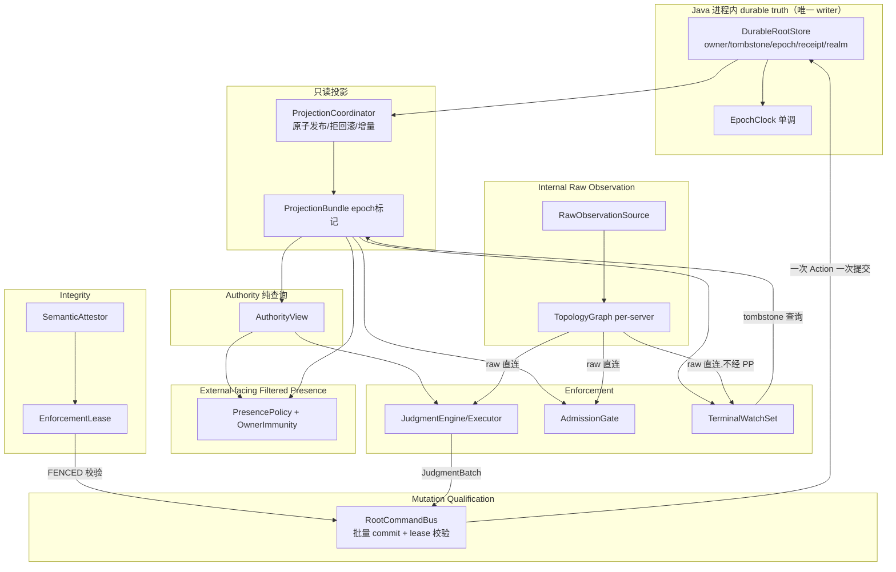
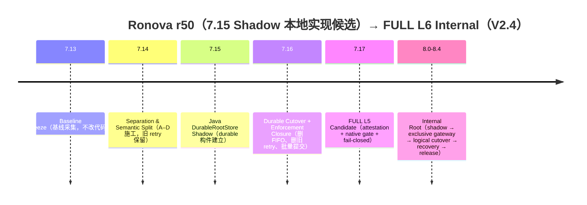

# Ronova L6 Architecture Master Plan V2.4 — Internal Root

> 有效规划（2026-09-08 整理）：正文的历史版本、阶段和验证记录保留原义；当前实现见 [进度](../CURRENT-PROGRESS.md)。
> 规范顺序与后续实施入口见 [规划索引](README.md)，新功能不因规划登记而视为已实现。

> **2026-09-05 文档接合说明（不改冻结决策）：**当前规范顺序为 L6 Master V2.4 → Baseline V1.4 → L6E-0 V1.3 → [7.16+ Strength Master V2.6](Ronova_7.16_Plus_JVM_Extreme_Strength_Enhancement_Master_V2.6_Internal_Root.md) → P0-A/阶段实现规格，与 [架构索引](README.md) 一致。V2.6 必须复用 D9 的 batch 原子粒度、D11 的 canonical identity/API 及 D13 的进程角色边界；不升格为高于本文的 Authority。V2.5/V2.4 加强稿仅作历史；本说明不改变源码、测试或历史成品证据。

> **2026-09-02 implementation note：**当前 working source 已推进到 `0.2.0-alpha.7.17-r53` ProfilePresetMatrix source candidate；本文中的 r50/40-test/JAR 哈希继续表示 V2.4 冻结时的历史输入，不是 r53 构建证明。当前实现状态以 `docs/CURRENT-PROGRESS.md` 与根目录 `docs/archive/handoffs/7.17-PROFILE-PRESET-MATRIX-HANDOFF.md` 为准。

> **V2.4 Internal Root + Bootstrap/Restart Boundary Revision — 2026-08-29**
>
> 本版取消所有“External Dominion Root / 持续外部 Authority/attack plane / cross-process Root command channel / external transport trust boundary”作为 Ronova 主线必需条件的设计；JVM 内 `InternalDominionRoot` 保留并成为 FULL L6 的唯一逻辑 Authority writer。
> 从 7.16 起 durable truth 永久留在 Minecraft JVM 内；8.x 不再迁移到外部进程，而是把 `InternalDominionRoot` 收口为唯一逻辑 Authority writer，`DurableRootStore` 降为其持久化后端。
> FULL L6 因此改定义为 **Internal Root L6**：更强的 single-writer、command/receipt/dedup、anti-rollback、fence、projection 与 recovery 契约，但**不再宣称获得 JVM 外故障域隔离**。
> **历史 r27 源码校正（由当前 r50 继承）：**当前 Authority/Native Root 保持在 Minecraft JVM 内；Native 不可用时默认 `DUAL_AGENT` 可由 `AutoAttach` 通过 `ProcessBuilder` 启动短命 helper JVM完成 Agent attach。该 helper 属于允许的 bounded bootstrap path，不是 External Root。V2.4 将 D13/`PROC-INV-1` 重定义为“外部进程角色边界”，不再要求 child-process count 必须为 0。
> 本修订优先级高于 V2.2 中所有 External Root / IPC 残留表述。


working source：`0.2.0-alpha.7.15-r50`；frozen 7.14A historical artifact：`build/libs/ronova-0.2.0-alpha.7.13-r12.jar`
Ronova 同步：2026-08-30；项目身份、canonical 包路径与 r50 源码对齐，V2.4 保持 Internal Root，并将 D13/`PROC-INV-1` 从“零子进程”修订为“bounded helper/relaunch 可用，但不得成为 External Authority/持续战斗执行面”
冻结 7.14A 历史证据：r12 `clean build` 与 32 个 standalone tests PASS，SHA-256 `8570321AC5C178A5B802B8B423988F931E148B49201840D247ABD878C3B0F3AD`。当前 r50 working source 注册 40 个 standalone SelfTest（39 个重混淆生产 JAR + 1 个开发主输出），7.14D implementation candidate 与 7.15 DurableRootStore Shadow 已有源码落点；本地 `mc_check`、`mc_build` 与 40/40 分层回归通过，JAR SHA-256 为 `0e0a82422cb56cc622d18a1ddb0a4864efb861f8a567d0c296cb30e67560879d`。本文件不把本地结果冒充为 Windows Forge 实机或发布级 exact-artifact PASS。
文档性质：总体架构与升级路线设计（本轮**不修改任何代码**，不开始实现）
修订依据：《Ronova L6 Master Plan — Architecture Consistency Review》（C1–C4 / H1–H7 / M1–M8 / L1–L3）、V1.4 / L6E-0 V1.3 / P0-A V1.3 Internal Root 四文档交叉复核，以及候选包附带的 `r27(1).zip` Runtime Process Boundary source audit（本轮对 Native/PE 部分按 DOCUMENT-ONLY 处理）
作者角色：总架构师
日期：2026-08-29
状态：**V2.4 — Internal Root + Bootstrap/Restart Boundary Closure 冻结版**（保留 V2.1 的 F1–F3；本版关闭 batch 事务粒度、7.15 receipt writer、类型复用与测试保留口径）

---

## 0. 阅读约定

**证据分级**

- **CONFIRMED** — 由 7.13 源码或运行日志直接证明，附 `文件:行` 或日志行。
- **INFERENCE** — 架构推断，源码/日志未直接证明（尤其 native `.dll` 内部行为，Java 侧不可见，一律标 INFERENCE）。

**设计红线（贯穿全文）**

1. 本轮只做总设计，不改代码。
2. 参考报告仅作参考；与源码/日志冲突处**以源码/日志为准**（见 §11.4）。
3. 只加强 Ronova 本体。**全文不含任何第三方 Mod ID、实体名、类名、包名的特判、黑白名单或兼容分支**。所有增强落在 Dominion 自身、Minecraft/Forge 通用语义边界、JVM/JVMTI、进程内 Native 与持久化边界。
4. 不靠继续堆 Mixin/Hook/Event/fallback 提升强度。重点提升 Authority、Observation、Enforcement、Persistence、Integrity、Root 六大架构轴。
5. Internal Raw Observation 与 External-facing Filtered Presence **完全分离**；Dominion 自身不可被 quarantine/presence filter 蒙蔽。**该分离是单向的：presence 永不反向决定 raw 观测内容**（V2 强化，见 §0.1 决策 D1）。

### 0.1 V2 冻结决策（本版新增，优先级高于正文其余描述）

以下八条为本版**冻结的架构决策**。正文任何与其冲突的残留表述均以本节为准；除非源码出现明确反证，不再重新开放。

| # | 决策 | 关闭的 Review 项 |
|---|---|---|
| **D1** | Dominion 内部 Judgment / Reconcile / TerminalWatch / lifecycle 一致性所需的物理观测**只来自 Raw Observation**。Presence/Quarantine 只控制外部读取路径可见性，**不得反向过滤内部候选发现**。`TargetDiscovery` 不经过 Presence Filter；排除受保护对象只依赖纯查询 `AuthorityView`。 | C1 |
| **D2** | **逻辑 Judgment 语义与物理存储表示严格分离**。存储层允许 compact representation / index / segment / cold storage / checkpoint / compaction，但任何优化不得扩大或缩小 Judgment 命中集合、不得改变 UUID/IDENTITY Judgment 含义、不得破坏 `ClearTombstone(uuid)`、不得使可撤销记录变为不可撤销。**禁止把精确 Tombstone 折叠为更宽的 class-lineage 规则作为容量手段**。 | C2 |
| **D3** | FULL L5 唯一 authoritative durable writer 固定为 **Java in-process `DurableRootStore`**。8.x 不再进行跨进程 durable authority 迁移；FULL L6 改为由 JVM 内的 **`InternalDominionRoot`** 成为唯一逻辑 Authority writer，`DurableRootStore` 仅作为其 durable storage backend。Native 任何阶段都不做 authoritative durable write。 | H1 |
| **D4** | `DominionEpoch` 保持 `(generation, sequence)`。`fence_token`、`root_instance_id`、`command_sequence`、`command_id`、`commit_index`、`realm_id` 均为**独立概念**，不进入 `DominionEpoch`，不由单个 sequence 兼职。外部 session/message transport 语义从主线删除。 | H2 |
| **D5** | Terminal 语义拆为 **Lifecycle Integration（ONCE）** 与 **State Reassertion（REPEATABLE + IDEMPOTENT）** 两类。Terminal 层**不得**删除 Raw Observation 对物理对象的认知——`TerminalLifecycle.enforce` 中的 `TopologyIndex.forget(entity)`（`TerminalLifecycle.java:28`，CONFIRMED）必须移除。 | H3 |
| **D6** | **Judgment commit 扩展性不变量**：一次 Judgment Action 的 N 个 Judgment **不得导致 N 次完整 authoritative projection rebuild**；单次动作成本不得表现为 `本次 Judgment 数 × 历史 Tombstone 总数`。具体实现（batch commit / incremental projection / 等价有界机制）留给工程规格，但该复杂度上界是架构不变量（§7.5、§12.2）。 | C3 |
| **D7** | **Judgment 属于 control-plane mutation**。L6 中 Judgment 仍按 Action 批量提交，并且只有 Root 返回 durable `CommitReceipt` 后才能进入不可逆 lifecycle transition。持久化调用若在“可能已提交但 receipt 未返回”的窗口失败，进入 `COMMIT_UNKNOWN`，保留原 `command_id` 通过本地 dedup/recovery store 解析；禁止生成替代 `command_id`。实时查询 hot path 只读 immutable projection，禁止同步 durable I/O。 | C4 |
| **D8** | 阶段推进原则：**不得先移除旧的可靠机制、再等待后续版本补上替代机制**。7.14–7.17 依赖顺序按此重排（§11）；旧 finite retry 只在新的 durable Tombstone 驱动闭环真实成立后（7.16）才删除。 | H4 |

### 0.2 V2.4 跨规格闭合决策（优先级与 D1–D8 相同）

以下决定用于约束 Baseline V1.4、L6E-0 V1.3 与 P0-A V1.3 Internal Root；正文若仍有旧表述，以本节为准。

| # | 决策 | 关闭的问题 |
|---|---|---|
| **D9** | `1 JudgmentBatch = 1 command_id = 1 atomic transaction = 1 DominionEpoch transition = 1 commit_index = 1 durable receipt = 至多 1 次 projection publication`。batch 内 Judgment 不各自推进 authoritative epoch；物理 convergence 仍可分批异步进行。 | batch epoch/receipt/dedup 歧义 |
| **D10** | 7.15 仍由 `DominionLedger(SavedData)` 写入 authoritative `LifecycleIntegrationReceipt`；Java `DurableRootStore` shadow 只镜像并验证。7.16 cutover 成功后，receipt 与其他 truth 一起由 Java `DurableRootStore` 唯一写入。 | shadow receipt 形成第二真值 |
| **D11** | 领域类型必须沿现有 `dev.ronova.coremod` 骨架演进。`DominionCommand`、`CommitReceipt`、`DominionRootGateway` 的唯一 canonical 归属为 `root/api`；不得在 `contract/` 或 L6E 新包中复制第二套。当前 `SubjectIdentity` 只可作为迁移输入，L6E 必须通过显式 schema migration 演进为稳定 `SubjectKey` 语义。 | 重复 DTO / 双 Root API / 身份语义漂移 |
| **D12** | 测试保留单位是**不变量覆盖与可追溯 evidence**，不是旧测试数量、旧类名或旧调用图。等价覆盖建立后，应删除只保护废弃结构或兼容别名的测试。 | 测试兼容壳与测试膨胀 |
| **D13 / PROC-INV-1** | **Authority/process-role boundary。**Ronova 可为 bootstrap、Agent attach、recovery 或 relaunch 创建有界 helper/successor process；但 Judgment/Terminal/Ownership truth、durable Root mutation 与持续 enforcement ownership 必须留在当前有效 Minecraft JVM。helper/sidecar/service 不得成为 durable Authority writer、持续战斗执行面、独立 target-monitoring/attack plane 或 External Dominion Root。 | 允许 r27 审计确认、r42 继承的 `AutoAttach`；禁止 External Authority role |

**能力等级定义（V2 修订）**

| 不变量 | 7.13 现状 | FULL L5 | FULL L6 |
|---|---|---|---|
| Durable truth owner | Java SavedData (Ledger) | **Java in-process `DurableRootStore`（唯一 durable store/writer）** | **Internal `InternalDominionRoot`（唯一逻辑 writer）+ `DurableRootStore` backend** |
| 谁可推进 authoritative epoch | Java Ledger | 仅 Java `DurableRootStore` | 仅 `InternalDominionRoot` |
| Tombstone 逻辑寿命 | 有限（65536 FIFO 逐出）+ 6 次有限 retry | **无限期（durable，幂等 enforce，语义不压缩，D2）** | 同左，跨重启持久 |
| Raw / Presence 分离 | 部分（immunity 在调用方，见 §1.5） | **完全分离（单向，D1），immunity 内化为 PresencePolicy 不变量** | 同左 |
| 实时查询路径同步 durable I/O | 无（全 in-JVM） | 禁止 | **禁止；只读 immutable projection** |
| Judgment mutation 路径 | in-JVM 同步 commit | in-JVM 批量 commit（D6） | **control-plane 批量 InternalRoot commit（D7）** |
| Ronova-created child process | Native active 时 0；Native unavailable + `DUAL_AGENT` 时可启动短命 helper JVM | **允许 bounded bootstrap/relaunch；禁止 external Authority role（PROC-INV-1）** | **同前，且 Root/Truth 仍仅在 active Minecraft JVM** |
| Proof 失效行为 | 静默降级到 Local | fence 新 mutation，保留既有保护 | fence affected InternalRoot/domain execution |
| JVM crash 后 truth | Ledger SavedData 可恢复 | 可恢复 | **由本地 durable backend 恢复；仍属于 JVM/主机故障域** |
| Split-brain 防护 | 单进程天然无 | 单 writer 不变量 | **fencing token 闭合** |

---

## 1. 7.13 架构审计（V2 修订：C1 误判更正、H7 表述更正，其余保留）

### 1.1 运行环境（源码 CONFIRMED；实机数据为迁移前继承证据）

- 当前源码与构建配置确认 MC 1.20.1 / Forge 47.4.22 / Java 17，mod id `ronova`，包根 `dev.ronova.coremod`。
- 迁移前 7.13 实机日志曾确认 Native `ACTIVE/0x7f`、Agent attach `NATIVE_ACTIVE` 与 runtime integrity reassertion；当前源码对应日志为 `Ronova initialized (...)` 与 `Ronova runtime integrity reassertion armed (...)`，但当前 Ronova exact artifact 尚未重新取得同等实机日志。
- r27 源码审计确认 `RonovaDominion.java:28-30` 仅在 `NativeBridge.isActive()==false` 时调用 `AutoAttach`；`AutoAttach.java:22-39` 使用 `ProcessBuilder` 启动 helper JVM，`AttachHelper.java:5-20` 再通过 Attach API 加载 Agent。默认策略仍为 `DUAL_AGENT`（`StartupPolicy.java:31-38`）。因此 observed `NATIVE_ACTIVE` 只证明该次运行未启动 helper，不能证明 fallback 不存在。
- 候选包附带的 Native/PE 进程边界报告声称 Native 源码只创建进程内 watchdog thread，且两份 DLL 的 PE 导入表未发现 `CreateProcess*`、`ShellExecute*`、`WinExec`、Named Pipe、Socket 或远程进程注入导入；该结论在本轮为 DOCUMENT-ONLY，未以工作区可见输入重新验证，也不替代 exact-artifact 的 Windows process-tree 运行验证。
- 当前源码遥测标签为 `RONOVA_ACTION`，字段仍为 `seq / request_session / request_seq / player / origin=packet / action(LOADED|AREA|PRIMARY) / candidates / judged / marks / topology / tombstones / quarantine_objects / elapsed_us`。迁移前日志中的字段与数值仅作为行为基线，不作为当前 JAR 的 exact-artifact PASS。
- 迁移前性能基线曾出现首个 `LOADED` 动作约 170 ms 尖峰、随后同类动作多为 `<10 ms`。**注意（V2）：`elapsed_us` 是单次动作耗时，不是 server tick 时长，不可作 tick baseline（§11.0、§12.2）。该历史结果不能替代当前 Ronova artifact 的性能闭环。**
- 迁移前日志确认 world reload 后会话更换而 Tombstone 持久；该语义在当前源码中保留，仍待当前 Ronova exact artifact 的实机复验。
- 迁移前共存环境含其它 coremod / mod。**本设计对它们不做任何特判**，仅把“存在外部字节码改写者”作为通用压力条件。

### 1.2 包结构与分层现状（CONFIRMED，保留 V1）

7.13 **已不是纯 Mixin 堆砌**，已存在明显的分层雏形：

```
dev.ronova.coremod
├─ RonovaDominion            @Mod 入口，类加载触发 native load
├─ agent/                   java.lang.instrument agent + JVMTI 桥（第2/3套字节码通道）
├─ adapter/                 Entity → contract 身份转换
├─ bootstrap/               ServerRuntimeRegistry（per-server 组合根）
├─ capability/              玩家能力维持模块（reconcile）
│  ├─ protection/  recovery/  utility/
├─ client/                  客户端运行时/呈现
├─ content/                 物品等游戏内容
├─ contract/                loader-neutral 值类型（L5 词汇表）★成熟
├─ core/                    DecisionSource 接缝 + LocalDominionCore
├─ engine/                  判定/执行/终结/观测引擎 ★核心
│  └─ spawn/                per-server 准入
├─ event/                   DominionEvents（Forge 事件订阅）
├─ mixin/                   18 个 mixin（观测/拦截入口）
├─ nativebridge/            JNI 桥 + native decision source ★L6雏形
├─ network/                 会话幂等 + 动作包
├─ persistence/             DominionLedger(SavedData) + Store + Assembler ★durable
├─ projection/              只读投影（authority/admission/presence/capability）
├─ root/                    durable Root 端口抽象（api + local）★L6雏形
├─ runtime/                 RootCommandBus（串行提交）
└─ util/                    WeakIdentitySet 等
```

**关键判断（CONFIRMED）**：`contract`/`core`/`nativebridge`/`root`/`persistence`/`projection` 六个包已构成"决策—投影—持久—提交"骨架，L5/L6 的抽象接缝已存在，**不需要重造领域模型**。真正欠缺的是把接缝补完并搬移"谁拥有 durable truth"。

### 1.3 六大架构轴的现状评估（V2 修订处以【V2】标注）

#### 1.3.1 Authority（授权）

- `AuthorityIdentity`（进程级 `ConcurrentHashMap` owner UUID 集）+ `AuthorityDecisionResolver`（server 走 projection，client 走缓存+tag）+ `AuthorityGuard`（门面）。CONFIRMED。
- 授权真相实际在 `AuthorityTopologyProjection.owns(uuid)`（由快照派生）与 durable 的 `DominionLedger.owners`。CONFIRMED。
- **问题**：`AuthorityGuard.isProtected(player)` 是最热的门控，却带绑定副作用（未授权分支执行 `clearProjection`，`AuthorityGuard.java:64-69`；bind/写 tag/bindAnchor 路径同类混合，CONFIRMED）——查询与副作用混合。【V2】该问题的消费面比 V1 记载更广：presence/quarantine 判定入口 `QuarantineView.matches` 也调用它（`QuarantineView.java:78`），即**副作用位于最热读取路径上**。修正方案见 §2.3 AuthorityView/AuthorityBinder 拆分与 §4.3 依赖规则。
- `AuthorityRuntimeState` 命名误导：实为 per-server 的 anchor/连接/repair 簿记，**不是授权状态持有者**（CONFIRMED）。

#### 1.3.2 Observation（观测）

- `TopologyIndex`（进程级 static，4 张弱引用索引）负责实体拓扑观测。CONFIRMED。
- **raw 观测不纯**：`ExecutionTargetPolicy.shouldTrack` 含 `!JudgmentState.isJudged`（`:31`）；`TerminalLifecycle.enforce` 主动 `TopologyIndex.forget`（`:28`）。→ 观测层耦合了 terminal 判定状态（CONFIRMED），违反"raw 应纯原始"。【V2】此项在迁移表中升格为**明确的删除动作**（§10.2 TerminalLifecycle 行，D5）。
- 【V2 更正（C1）】V1 曾把"`TargetDiscovery` 三方法把 `TopologyIndex.snapshot` 直接并入候选、未经 quarantine 过滤（`:31,75,95`）"列为缺陷。**这是误判**：内部候选发现不经 presence/quarantine 过滤恰是 D1 要求的正确行为。7.13 的 `canJudge`（`TargetDiscovery.java:101`）实际依赖 `isCombatObject && !AuthorityGuard.isProtected` —— 走的是 authority，不是 presence，方向正确。真正的问题只有两个：`loaded()` 全表扫描无 budget（`:90`），以及 `AuthorityGuard.isProtected` 带副作用（§1.3.1）。裁决更新见 §10.2。

#### 1.3.3 Enforcement（执行）

- `JudgmentExecutor`：纯 execute-only，`alreadyTerminal` 门保证 death 一次（`:36`，CONFIRMED）——设计干净。
- `TerminalLifecycle`：death/die/kill/discard 由 firstExecution 门一次性；health/removalReason/callback 等 raw-state 断言每次幂等可重复；各 lane `try/catch` 故障隔离（CONFIRMED）——**语义拆分方向良好**。【V2】但其 `:28` 的 `TopologyIndex.forget` 违反 D5，迁移时必须移除（§10.2）。
- **问题**：`JudgmentEngine` 进程级 static retry 队列，`RETRY_DELAYS={1,2,5,10,20,40}`（`:28`），`nextAttempt < RETRY_DELAYS.length` 才续（`:171`）——**每实体最多 reassert 6 次后彻底放弃**（CONFIRMED）。有限 retry，违反需求 7。【V2】删除时机受 D8 约束：7.16 新闭环成立后才删（§11.1）。
- 【V2 新增（C3，CONFIRMED）】**Judgment 提交路径存在结构性扩展瓶颈**：`JudgmentEngine.judgeRootsReport` 逐实体调用 `JudgmentExecutor.execute`（`JudgmentEngine.java:126-140`），每实体一次 `runtime.commands().commit(...)`（`JudgmentExecutor.java:47`）；`RootCommandBus.commit` 每次 commit 后 `projections.publish(receipt.snapshot())`；`ProjectionCoordinator.publish → build` 全量重建 `AdmissionProjection`（构造器遍历 snapshot 全部 judgments 重建两个 `LineageIndex`），并对全量 snapshot 做 `NativeSnapshotCodec.fingerprint`（AXR3 编码 + SHA-256）。即 **一次 Action 的成本 = judged 数 × O(tombstone 总量)**。日志佐证：tombstones 仅 110 时 `LOADED` 已达 170 ms（candidates=71）。在 V2 的永久 Tombstone 模型下该乘积无上界——修正为 D6 不变量（§7.5）。

#### 1.3.4 Persistence（持久化）

- `DominionLedger extends SavedData`，挂 overworld `DimensionDataStorage`（`:35,50-54`，CONFIRMED）。tombstone 全字段 NBT 序列化（uuid/type/class/dim/xyz/radius/scope/sequence，`:354-367`）。**reload/chunk/dimension 切换后可完整恢复**，UUID 命中即权威（非弱引用）。CONFIRMED。
- epoch `(generation, sequence)` 单调、跨 reload 持久（`:64-67,262-267`）；`record` 强校验 `decision.epoch == nextDecisionEpoch()` 否则抛异常（`:127-133`）——乐观并发语义，**且是全字段 record 相等比较**。【V2】这正是 D4 禁止向 `DominionEpoch` 添加 fence/root-instance 字段的源码级理由：任何附加字段都会破坏该相等性契约。
- **硬伤（CONFIRMED）**：`MAX_TOMBSTONES=65536`，`trimTombstones()` FIFO 逐出最老 tombstone（`:37,256-260`）。**逻辑寿命并非无限**。
- 【V2 新增（C2 佐证，CONFIRMED）】撤销路径以 UUID 为键：`clearTombstone(uuid)` 走 `tombstones.remove(uuid)`，命中才 `classLineages.remove(uuid)`（`:216-228`）。`LineageIndex.matches` 的 GLOBAL_LINEAGE 分支只按 type 命中、忽略 uuid 与坐标（`LineageIndex.java:74-76`）。**因此任何"把精确记录折叠为宽 lineage 规则"的方案都会同时（a）扩大命中集合（b）使 `clearTombstone(uuid)` 静默失效**——这是 D2 的源码依据。

#### 1.3.5 Integrity（完整性）

- `RonovaAgent` 是标准 `java.lang.instrument` agent（premain/agentmain），`StartupPolicy.ProtectionMode` 分 `MIXIN` / `DUAL_AGENT`，默认 `DUAL_AGENT`（CONFIRMED）。
- `AutoAttach` 是**条件式 bounded bootstrap fallback**：只有 Native 未 active、策略为默认 `DUAL_AGENT`、且 modJar 为普通文件时，才 fork helper JVM 做运行期 attach；Native active、Agent 已安装、MIXIN 模式或开发环境均不启动 helper。V2.4 允许该路径保留，但 helper 必须无 durable Authority 状态、无持续战斗循环，并在 attach handoff 后退出。
- `RonovaTransformer` 广谱扫描并改写核心类**及任意含相关引用的第三方类**（`patchExternalFieldWrites:209 / patchExternalQueryCollections:248 / patchExternalControlEntrypoints:284 / patchExternalControlGuards:300 / patchExternalRendererEntries:316`）。CONFIRMED。
- native 层双 DLL，经 JVMTI `ClassFileLoadHook` → `NativeTransformBridge`（第 3 通道）。**DLL 内部行为 Java 源不可见（INFERENCE 盲区）**。
- **问题**：完整性机制承担了"提升强度"的职责（改写第三方类），脆弱且高冲突，属需求 4 反对的堆砌。【V2】删除 `patchExternal*` 的方向保留，但由此产生的 **Presence 保证范围收窄必须显式声明**（H6），见 §2.3.1。

#### 1.3.6 Root（根权威）

- `DominionRootGateway`（snapshot/epoch/nextDecisionEpoch/commit）+ `LocalDominionRootGateway`（SavedData-backed）+ `DominionCommand`（sealed 5 命令）+ `CommitReceipt`（after<before 抛"Root epoch rolled back"）。CONFIRMED——L6 durable root 抽象边界已就位。
- `NativeSnapshotCodec`：候选包报告记录其为确定性二进制 wire 格式（AXR3 + FNV-1a64 + SHA-256）；本轮对 Native/PE 相关部分按 DOCUMENT-ONLY 处理，Java 源码落点仍需以可见源码和后续构建证据为准。
- **DOCUMENT-ONLY 结论**：候选包报告把 `NativeDominionRoot` 定性为进程内 Native authority root，并把 `NativeRootBridge` 定性为 JNI in-process 适配器；该报告同时声称无 socket/pipe/共享内存/子进程。上述 Native/PE 范围未在本工作区重新验证，不能作为本轮 CONFIRMED 事实。
- `RootCommandBus.commit` 是 `synchronized` 同步串行提交，commit-then-publish 顺序契约。CONFIRMED。【V2】该顺序契约（durable commit 成功后才发布/执行）是 D7 “Root durable `CommitReceipt` 后才进入不可逆 transition” 的 7.13 原型；L6 Internal 保留其方向，只改变提交粒度与内部 Root boundary（§8.7）。
- **epoch 无 fencing**（CONFIRMED）：`DominionEpoch` 纯 `(generation, sequence)`；`CAP_SEMANTIC_LEASE` 位存在但 Java 侧无 lease 生命周期。【V2】fencing 补齐方式按 D4：不动 `DominionEpoch`，fence/root-instance 落在 Internal Root 状态与命令信封（§8.3）。

### 1.4 三条"权力倒流"（CONFIRMED，保留 V1）

1. **Durable mutation 倒流到 Java**：`LocalDominionRootGateway → LocalDominionStore → DominionLedger(SavedData)` 拥有 durable truth，Native 只消费快照。【V2 注：按 D3，L5 阶段这不再视为"倒流待纠正"，而是**确认为 L5 的正确归属**——L5 durable truth 就应在 Java。真正要纠正的是把它从 SavedData 载体升级为 `DurableRootStore`（§5），并在 L6 收口到 JVM 内 `InternalDominionRoot → DurableRootStore` 单一写路径（§8）。】
2. **Critical repair 倒流到 Java**：native `ClassFileLoadHook` → `NativeTransformBridge` → Java `RonovaTransformer` 实施改写。（Java 侧 CONFIRMED；native 侧调用细节 INFERENCE。）
3. **Critical gate truth 倒流到 Java predicate**：`BootstrapHooks` 关键判定是 Java `Predicate/BiPredicate`（CONFIRMED `BootstrapHooks.java:20-267`）。

### 1.5 需求逐条对照现状（V2 修订 H7）

| 需求 | 现状裁决 |
|---|---|
| 6：Raw / Presence 完全分离 | **部分未达成（V2 更正表述）**。7.13 实况：`PresenceProjection.decide` 是空壳（只回显外部 `quarantined` 布尔，`PresenceProjection.java:16-24`，CONFIRMED），但其唯一调用方 `QuarantineView.matches` 在入口已有调用方短路 `AuthorityGuard.isProtected(entity)` 返回 false（`QuarantineView.java:76-78`，CONFIRMED）。**因此"owner 会被 quarantine 蒙蔽"不是现网事实**。真实缺陷是：(a) immunity 位于调用方而非 `PresencePolicy` 自身——未来任何新调用方都会绕过；(b) `AuthorityGuard.isProtected` 只覆盖 `Player`（`:65`），非玩家 Dominion 自身实体不在免疫内；(c) protection 依赖 authority resolution 成功。7.14 的目标据此定义：**把 Owner / Dominion-self immunity 提升为 PresencePolicy 自身的不变量**（§2.3、§5.1 L5-INV-4）。 |
| 7：Tombstone 可持续幂等、不依赖有限 retry、支持重建/reload | **部分**。持久化与 reload 恢复到位（Ledger SavedData）、幂等 enforce 到位（TerminalLifecycle），但 **6 次有限 retry** 与 **65536 FIFO 逐出** 违反要求。 |
| 8：bounded budget/backoff/storm control | **严重不足**。仅 `JudgmentEngine.tick` 有 256/tick budget + 有限退避。capability 每 tick 无条件全量 reconcile、`TargetDiscovery.loaded` 全表扫描、`drainConstructed`/`drainStaleReferences` 均无限额（CONFIRMED）。【V2 增】Judgment 提交路径的 per-entity commit × 全量 rebuild 同属此类（§1.3.3）。 |
| 4：不靠堆 Mixin/Hook/Event/fallback | **违反**。同一"玩家不死"语义三重覆盖；同一"spawn 拒绝"6 闸门重复（CONFIRMED）。 |
| 5：模块职责/状态所有权/依赖/边界清晰 | **未达成**。大量进程级 static 状态服务多 server；仅 `SpawnAdmissionRuntime`/`ProjectionCoordinator`/`DominionLedger` 正确 per-server。 |

---

## 2. 新模块树（V2 修订：C1/H2/H5/H7/M1 相关条目）

### 2.1 设计原则

- **单一真值方向**：Root 决定"事实是什么"；Enforcement 层只负责"让 Minecraft 服从事实"。任何模块不得自持与 Root 冲突的权威状态。
- **per-server 为默认**：所有运行时状态挂在 per-server 组合根下；仅"跨 server 生命周期的诊断计数器"允许进程级 static。
- **观测与呈现物理分离（单向）**：`observation` 与 `presence` 是两个独立包，raw 源不经 presence 过滤，presence 不能反向影响 raw（D1）。
- **读写分离**：高频读取路径（presence 判定、target discovery、capability 门控）只依赖**纯查询视图**（`AuthorityView`），一切 authority 副作用走显式的 mutation/binding 路径（H5/M7）。
- **边界包显式化**：Java / Native / Internal Root 的每个跨界点都由显式的 `bridge` / `gateway` / `port` 承载，wire 格式集中在 `wire` 包。

### 2.2 目标包树（FULL L6 Internal 收敛形态）

标注：`[K]`=保留自 7.13、`[R]`=重构、`[N]`=新增、`[S]`=由旧类拆出、`[M]`=合并旧类。

```
dev.ronova.coremod
│
├─ contract/                      L5 词汇表（loader-neutral，零 Forge 依赖）
│   ├─ DominionEpoch          [K] 保持 (generation, sequence)，不加字段（D4）
│   ├─ DominionSnapshot       [K]
│   ├─ DominionDecision       [K]  (Authority|Judgment|Admission|Presence)
│   ├─ DominionRequest        [K]
│   ├─ SubjectKey             [N]  稳定相等键 = (realm_id, subject_id)
│   ├─ SubjectIdentity        [R]  以 SubjectKey 为锚点的描述；origin/schema/观测位置不参与身份相等
│   ├─ Capability / CapabilitySet [K]  64-bit mask
│   └─ RealmId                [N]  realm identity / correlation identifier（可检测 clone/fork，不裁决 ownership；L5 起绑定 store，见 §5.4）
│
├─ observation/                   ★Internal Raw Observation（永不被 presence 过滤）
│   ├─ RawObservationSource   [S]  从 TopologyIndex 拆出的纯 raw 观测入口
│   ├─ RawEntityRef           [S]  弱引用 + identity 记录
│   ├─ TopologyGraph          [R]  原 TopologyIndex：去掉 !isJudged 耦合，per-server 化
│   └─ ObservationBudget      [N]  drainStale/扫描的分帧预算
│
├─ presence/                      ★External-facing Filtered Presence（仅指对外可见性，不表示外部进程；范围见 §2.3.1）
│   ├─ PresencePolicy         [R]  原 PresenceProjection：内化 quarantine 决策 + 自身 immunity 不变量
│   ├─ OwnerImmunity          [N]  owner 与 Dominion-self 强制 present=true（身份来源见 §2.3.2）
│   └─ QuarantineView         [R]  拆 server/client 两路（见 §2.4）
│
├─ authority/                     授权（真相来自 Root 投影）
│   ├─ AuthorityView           [S] ★纯查询，零副作用（原 AuthorityGuard 查询部分）
│   ├─ AuthorityBinder         [S] owner 绑定/解绑/anchor 副作用（原 AuthorityGuard 副作用部分）
│   ├─ AuthorityTopologyProjection [K]
│   └─ CapabilityProjection    [M] 并入 AuthorityTopologyProjection
│
├─ engine/                        判定与执行
│   ├─ JudgmentEngine          [R] 去掉 6 次有限 retry；改为 tombstone 驱动；Action 级批量提交（D6）
│   ├─ JudgmentExecutor        [K] execute-only
│   ├─ TargetDiscovery         [R] loaded() 加 budget；保护判定改依赖 AuthorityView（D1：不经 presence 过滤）
│   ├─ ExecutionTargetPolicy   [R] shouldTrack 去掉 !isJudged 耦合（D5 配套）
│   ├─ ExecutionScopePolicy    [R] 删除未使用的 requested 死参数
│   ├─ SphericalRange          [K]
│   ├─ JudgmentMark            [K]
│   └─ spawn/
│       ├─ SpawnAdmissionRuntime [K] per-server 状态持有者
│       ├─ AdmissionGate         [M] 由 SpawnFirewall 门面降为薄接口
│       └─ SpawnAdmissionMetrics [K]
│
├─ terminal/                      ★Tombstone / Terminal Enforcement（重设计核心，语义见 §6）
│   ├─ TombstoneAuthority     [S] 权威 tombstone 判定（UUID+lineage，非弱身份）
│   ├─ TerminalWatchSet       [N] 无限逻辑寿命 + HOT/WARM/COLD 状态机
│   ├─ TerminalLifecycle      [R] Lifecycle-Integration-once / State-Reassertion-always；移除 TopologyIndex.forget（D5）
│   ├─ LifecycleIntegrationReceipt [N] 一次性集成回执（防重复 loot；durable 化时机见 §11.1）
│   └─ TerminalBudget         [N] time-budget 调度（≤预算/tick）
│
├─ integrity/                     完整性与语义证明
│   ├─ SemanticAttestor       [R] 从 marker 升级为 installed-bytecode CFG 证明
│   ├─ AttestationManifest    [N] 语义不变量清单（非整类 hash）
│   ├─ LoaderProofRegistry    [N] 多 ClassLoader all-copies 证明
│   └─ EnforcementLease       [N] proof→lease 状态（ACTIVE/PROVISIONAL/FENCED）；经 RootCommandBus 生效，不直写 store（§4.3）
│
├─ persistence/                   durable 事实（L5 的 Java 权威实现，D3）
│   ├─ DurableRootStore       [N] 统一存储接口（L5 writer / L6 Internal Root durable backend）
│   ├─ OwnerRegistry          [S] 由 DominionLedger 拆出
│   ├─ TombstoneStore         [S] 由 DominionLedger 拆出（无限期；语义不压缩，D2；表示层优化见 §6.4）
│   ├─ EpochClock             [S] 由 DominionLedger 拆出
│   ├─ SnapshotAssembler      [K]
│   └─ LedgerCodec            [S] SavedData/NBT 编解码（cutover 后降为 mirror/migration 载体）
│
├─ projection/                    只读投影（高频读，低频重建）
│   ├─ ProjectionCoordinator  [R] 原子发布 + 拒回滚 + native 对账；增量/批量 publish（D6）
│   ├─ ProjectionBundle        [R] epoch 一致性校验扩展到全部成员（M8）
│   └─ AdmissionProjection     [R] 内化 owner 免疫（不依赖调用方传参）
│
├─ root/                          Root 端口抽象
│   ├─ api/DominionRootGateway  [K] 端口
│   ├─ api/DominionCommand      [K]
│   ├─ api/CommitReceipt        [K]
│   ├─ api/JudgmentBatch        [N] 一次 Action 的 N 个 Judgment 的原子提交单元（D6/D7）
│   ├─ local/LocalDominionRootGateway [R] L5：DurableRootStore-backed Java 权威实现
│   └─ internal/InternalDominionRootGateway   [N] L6：JVM 内唯一逻辑 Root 实现
│
├─ wire/                          ★跨边界序列化（集中管理）
│   ├─ NativeSnapshotCodec     [K] AXR3 帧（就绪度最高）
│   ├─ InternalRootCommandCodec [N] canonical Root command/receipt 编码
│   └─ FrameIntegrity          [S] FNV/SHA-256 canonical hash / tamper check
│
├─ nativebridge/                  Java ↔ Native (JNI, in-process；L5 职责按 D3 限定)
│   ├─ NativeDominionDecisionSource [K] native-first + 可观测降级
│   ├─ NativeRootBridge        [K] JNI 协议适配
│   ├─ NativeGateBridge        [N] bootstrap 可见的 native critical gates（验证/校验，非 durable writer）
│   └─ NativeTransformBridge   [R] repair：native verify → 受信 transformer → native re-verify
│
├─ root/internal/                 ★FULL L6 Internal Root（JVM 内）
│   ├─ InternalDominionRoot    [N] 唯一逻辑 Authority writer
│   ├─ RootInstanceState       [N] root instance / writer fence / command sequence
│   └─ RootRecoveryJournal     [N] command dedup / COMMIT_UNKNOWN / restart recovery
│
├─ core/                          决策接缝
│   ├─ DominionDecisionSource  [K] 可替换 seam
│   ├─ LocalDominionDecisionSource [K] 冻结 R1 策略
│   └─ DominionCore            [R] 原 LocalDominionCore：per-server 化决策源
│
├─ capability/                    玩家能力维持（消费投影，加 budget）
│   ├─ CapabilityRuntime       [R] 加分帧预算 + 修 anchor 绕过去重
│   ├─ CapabilityContext       [K]
│   ├─ CapabilityDiagnostics   [K]
│   ├─ AnchorMaintenanceState  [R] 原 AuthorityRuntimeState 改名
│   ├─ protection/  recovery/  utility/  [R] 全部加脏检测（dirty-check）
│
├─ bootstrap/
│   ├─ ServerRuntimeRegistry   [K] per-server 组合根
│   └─ DominionCompositionRoot [K] 依赖装配
│
├─ agent/                         java.lang.instrument + JVMTI
│   ├─ RonovaAgent              [K] premain/agentmain + watchdog
│   ├─ AttachHelper / AutoAttach [KEEP as bounded bootstrap] 条件式 helper；受 PROC-INV-1 角色边界约束
│   ├─ RonovaTransformer        [R] ★大幅收缩：仅保留 critical 生命周期 gate 注入，删除 patchExternal* 广谱改写（范围声明见 §2.3.1）
│   ├─ AgentHooks / BootstrapHooks [R] critical truth 迁到 native gate，Java 仅留非关键 adapter
│   └─ StartupPolicy           [K]
│
├─ mixin/                         观测/拦截 seam（收敛为最小集，同 V1 §10.6）
├─ event/DominionEvents        [R] 保留生命周期/命令订阅，删除与 Mixin 重复的保护事件
├─ network/                     [K] SessionJournal 幂等 + RonovaAction
├─ client/  content/  util/    [K]
│
（§10.0 默认规则：本树与 §10 未显式列出的类，默认 KEEP，仅随所属包 per-server 化调整。）

```

### 2.3 关键模块职责再定义

| 模块 | 职责（一句话） | 不做什么 |
|---|---|---|
| `observation.RawObservationSource` | 提供 Dominion 内部**永不被过滤**的原始实体拓扑 | 不判定 terminal、不做 presence、不对外暴露 |
| `presence.PresencePolicy` | 决定实体对**外部查询/渲染/追踪 sink**的可见性（范围见 §2.3.1） | 不影响 raw 观测；**自身保证**不隐藏 owner/Dominion-self（不依赖调用方短路） |
| `presence.OwnerImmunity` | 强制 owner 与 Dominion 自身实体 `present=true` | 不依赖 authority resolution 成功与否（fail-static 到 present） |
| `authority.AuthorityView` | 纯查询授权视图（isProtected/hasCapability 等） | **零副作用**；不 bind、不写 tag、不 clearProjection |
| `authority.AuthorityBinder` | 显式 authority 副作用（bind/unbind/anchor/projection 清理） | 不出现在任何高频读取路径 |
| `terminal.TombstoneAuthority` | 以 UUID+lineage 为权威判定"是否已判决"（跨 reload） | 不用对象弱身份作权威 |
| `terminal.TerminalWatchSet` | 无限逻辑寿命的物理 detach 监视（HOT/WARM/COLD） | 不以 retry 次数结束；不无界扫描 |
| `integrity.EnforcementLease` | 由语义证明结果驱动 ACTIVE/PROVISIONAL/FENCED | 失效时只 fence mutation，不撤既有保护；不直写 persistence |
| `persistence.TombstoneStore` | 无限期持久 tombstone（UUID+lineage），语义不压缩 | **不做 FIFO 容量逐出；不做语义折叠** |
| `root.api.JudgmentBatch` | 一次 Action 的 Judgment 集合的原子 durable 提交单元 | 不逐实体提交；不隐式拆分 |
| `root.internal.InternalDominionRootGateway` | L6 内部唯一逻辑 Authority writer 的端口 | realtime query 只读 projection；mutation 才进入 Root |

#### 2.3.1 Presence 保证范围（V2 新增，关闭 H6）

删除 `patchExternal*`（针对任意第三方类的字节码改写）后，presence 的强制面收窄。V2 显式声明边界：

- **强保证范围**：Dominion 自身控制的 Minecraft / Forge 通用 observation、query、tracking、rendering sink——即 Dominion 注入自身核心 gate 的入口、Mixin seam、Forge 通用查询/同步/渲染路径。L5-INV-4 的 `public=false` 判据按此口径验收。
- **不保证范围**：第三方自行创建并维护、绕过 Minecraft/Forge 通用入口的私有 collection、自定义 manager、独立 cache、直接对象引用读取。对这些路径**不通过**第三方 Mod ID / class name / entity name / bytecode patch 建立特殊适配（红线 3）。
- 该收窄是红线 3（禁止第三方特判）与需求 4（禁止堆砌）的必然结果，不是缺陷；文档与测试口径一致按此书写，避免"测试按窄口径通过、文档按宽口径宣称"。

#### 2.3.2 "Dominion 自身实体"的身份来源（V2 新增，关闭 M1）

`OwnerImmunity` 的两类免疫对象各有明确身份来源：**owner** 来自 durable `OwnerRegistry`（UUID 集）；**Dominion 自身实体** 由无状态谓词判定——实体注册类型属于 Dominion 自身 registry namespace（即本 mod 自己注册的 EntityType）。该判定只引用自身 namespace，不涉及任何第三方标识，不违反红线 3。状态所有权见 §3.2。

### 2.4 QuarantineView 拆分（保留 V1，依据 CONFIRMED `QuarantineView.java:76-114`）

现 `QuarantineView.matches` 在单类里承载 server 路径（`SERVER_OBJECTS` raw + admission projection）与 client 路径（`CLIENT_MARKS` lineage + `CLIENT_PRESENCE`），两套状态与逻辑完全不同。拆为 `ServerQuarantineView` 与 `ClientQuarantineView`，共享 `presence.PresencePolicy.decide` 作为最终裁决点。【V2】拆分后两路对保护对象的判定一律改调 `AuthorityView`（纯查询）；immunity 不再依赖此处短路，而由 `PresencePolicy` 自身保证（§1.5、H7）。

---

## 3. State Ownership（状态所有权）

**原则**：每一块可变状态有唯一 owner；跨 server 的进程级 static 仅限"诊断计数器"。**Scope**：`PROC` = 进程级 static（7.13 问题所在），`SRV` = per-server，`BUNDLE` = per-snapshot 不可变，`ROOT` = per-server Internal Root 所有，`NONE` = 无状态。

### 3.1 7.13 现状（CONFIRMED，保留 V1）

| 状态 | 持有者 | Scope | 写者 | 读者 | 问题 |
|---|---|---|---|---|---|
| owner UUID 集 | `AuthorityIdentity.PROTECTED` | PROC | bind/unbind | AuthorityGuard/Resolver | 多 server 共享 |
| 已判定实体 | `JudgmentState.EXECUTED` (WeakIdentitySet) | PROC | mark/clear | executor/policy | **弱身份，reload 丢失** |
| retry 队列 | `JudgmentEngine.RETRIES` | PROC | offer/poll | tick | **有限 6 次** |
| 拓扑索引 ×4 | `TopologyIndex.OBSERVED/BY_*` | PROC | observe/forget | discovery/related | 多 server + 无 budget |
| 隔离对象 | `QuarantineView.SERVER_OBJECTS` | PROC(WeakHashMap by server) | register | matches/filter | server/client 混装 |
| client marks | `QuarantineView.CLIENT_MARKS` | PROC | accept/replace | matches | —— |
| 准入 passed/rejected | `SpawnAdmissionRuntime` | **SRV** | reject/commit | matchesTombstone | ✓ 正确，但无 budget |
| 准入计数 | `SpawnAdmissionMetrics` | PROC (AtomicLong) | record | getter | ✓ 诊断，可接受 |
| anchor/连接簿记 | `AuthorityRuntimeState` | **SRV** | bindAnchor | CapabilityRuntime | ✓，但命名误导 |
| owners + tombstones + epoch | `DominionLedger` | **SRV** (SavedData) | commit | projection | ✓ durable，但 65536 FIFO |
| 当前投影 bundle | `ProjectionCoordinator.current` | **SRV** (WeakHashMap) | publish (CAS) | 各 projection 读者 | ✓ 正确 |
| 决策源 | `LocalDominionCore.SOURCE` | PROC (AtomicRef) | install | decide | 全局单例，未 per-server |
| native cutover 标志 | `NativeDominionRoot.SOURCE_INSTALLED` | PROC (AtomicBool) | publish | authoritative() | 一次性 cutover |

### 3.2 目标状态所有权（FULL L5 / L6，V2 修订 D3/D4/M1）

| 状态 | 目标持有者 | Scope | 权威级别 | 持久化 |
|---|---|---|---|---|
| owner 注册表 | `persistence.OwnerRegistry` | SRV(L5) / ROOT(L6) | **durable truth** | Store |
| tombstone（UUID+lineage，语义不压缩） | `persistence.TombstoneStore` | SRV(L5) / ROOT(L6) | **durable truth，无限期** | Store |
| epoch (generation, sequence) | `persistence.EpochClock` | SRV(L5) / ROOT(L6) | **durable truth，单调** | Store |
| realm 身份 | `contract.RealmId`（store 内绑定） | SRV(L5) / ROOT(L6) | durable 身份量（非单调） | Store |
| fence_token / root_instance | `root.internal.RootInstanceState`（L6） | SRV | Internal Root writer qualification | head metadata + runtime |
| 已判决身份 | `terminal.TombstoneAuthority` | SRV | 派生自 tombstone（非独立权威） | 从 Store 投影 |
| 物理 detach 监视 | `terminal.TerminalWatchSet` | SRV | 运行时（可重建） | 否（从 tombstone 重建） |
| lifecycle 集成回执 | `terminal.LifecycleIntegrationReceipt` | SRV | durable（防重复 loot） | 7.15 由 SavedData authoritative 写、shadow 镜像；7.16 起由 `DurableRootStore` authoritative 写（D10） |
| raw 拓扑 | `observation.TopologyGraph` | **SRV** | 运行时观测（非权威） | 否 |
| presence 决策 | `presence.PresencePolicy` | SRV | 派生自投影 | 否 |
| Dominion-self 判定 | `presence.OwnerImmunity`（无状态谓词，自身 registry namespace 派生） | NONE | —— | 否 |
| 投影 bundle | `projection.ProjectionCoordinator` | SRV | 只读快照（epoch 标记） | 否 |
| 决策源 | `core.DominionCore` | **SRV** | 可替换 seam | 否 |
| 能力维持簿记 | `capability.AnchorMaintenanceState` | SRV | 运行时 | 否 |
| 语义证明/lease | `integrity.EnforcementLease` | SRV | 运行时（证明结果）；经 RootCommandBus 生效 | 否 |
| command canonical hash / integrity metadata | `root.internal` + `wire` | SRV | tamper/dedup evidence | durable receipt/dedup store |
| **最终 durable truth（L6）** | `root/internal/InternalDominionRoot` + `persistence/DurableRootStore` | **ROOT/SRV** | **InternalRoot 唯一逻辑 writer；Store 唯一 durable backend** | Local durable store |

**核心迁移**：§3.1 全部 `PROC` 状态要么 per-server 化（`SRV`），要么在 L6 迁到 `ROOT`。`JudgmentState.EXECUTED` 这类"弱身份权威"**降级**为从 `TombstoneStore` 投影出的派生视图——权威只有一个，就是 durable tombstone。

### 3.3 Single-Writer 不变量（贯穿 L5→L6，V2.4 Internal Root）

任何时刻，推进 authoritative epoch 的逻辑 writer **有且仅有一个**：

```text
L5:
  DurableRootStore
  = durable store + authoritative writer

L6 Internal:
  InternalDominionRoot
  = 唯一逻辑 Authority writer
       ↓
  DurableRootStore
  = 唯一 durable storage backend
```

8.x 不再是跨进程 cutover，而是**逻辑 writer 收口**：所有 mutation 必须经 `InternalDominionRoot → RootCommandBus → DurableRootStore`；任何直接写 Store 的旁路都属于 invariant violation。

Native、Domain、Projection、Agent 均不得推进 authoritative epoch。

由于 Root 与 Minecraft JVM 同处一个进程，本版明确不宣称通过进程隔离抵抗“整个 JVM 已被完全控制”的对手。

## 4. Dependency DAG（V2 修订：H5 分层修正、C1 方向修正）

### 4.1 分层规则（V2 修订）

依赖只能**自上而下**（上层依赖下层），同层不互相环依赖，跨界只经 bridge/gateway/port。

```
Layer 0  contract/  wire/            （纯值类型 + 序列化，无依赖）
Layer 1  observation/  persistence/  （基础状态与观测；persistence 是低层 durable primitive，不依赖 integrity）
Layer 2  projection/  core/          （投影与决策接缝）
Layer 2b authority/  presence/       （authority 纯查询视图读 immutable projection；presence 只依赖 AuthorityView）
Layer 3  engine/  terminal/  capability/   （判定/执行/维持）
Layer 4  root/  runtime/  nativebridge/  integrity/       （权威提交与边界；mutation qualification 在 RootCommandBus 完成）
Layer 5  agent/  mixin/  event/  network/  client/          （Minecraft 接入 seam）
Layer 6  bootstrap/  RonovaDominion                          （组合根/入口）
```

**V1→V2 变化**：`authority/` 从 Layer 1 移至 Layer 2b（其内容是从 projection 派生的查询视图，必然依赖 Layer 2，V1 放 Layer 1 造成向上依赖）；`presence/` 与其同层且只依赖 `AuthorityView`。fence/lease 对 durable 写入的约束不再表现为 `integrity → persistence` 的直接边——**mutation qualification 统一在 Layer 4 的 `RootCommandBus` / mutation admission boundary 执行**：`RootCommandBus.commit` 在提交入口查询 `EnforcementLease` 状态，`persistence` 完全不感知 `integrity` 的存在（H5）。

### 4.2 运行时数据流 DAG（FULL L6 Internal Root 目标）

```text
Physical Runtime
      ↓
Raw Observation
      ↓
Internal Judgment / Reconcile
      ↓
AuthoritySnapshot / immutable ProjectionView
      ↓
InternalDominionRoot  ←唯一 mutation authority
      ↓
RootCommandBus
      ↓
DurableRootStore      ←唯一 durable backend
      ↓
ProjectionCoordinator
      ↓
Authority / Presence / Domain consumers
```

规则：

- Raw Observation 永不被 Presence 反向过滤；
- realtime query 只读 immutable projection；
- durable mutation 不允许直接调用 store writer；
- `InternalDominionRoot` 与 Store 同 JVM，但职责必须保持分离；
- Native 只做 validation / integrity / critical primitive，不成为第二 Root。

### 4.3 编译期依赖（关键约束，V2 增补）

- `observation/` **不得** import `presence/`（反向依赖破坏分离）。
- `presence/` 与 `engine.TargetDiscovery` **只得** import `authority.AuthorityView`，**不得** import `AuthorityBinder`（副作用隔离，M7/H5）。
- `persistence/` **不得** import `integrity/`（低层 durable primitive，H5）。
- `contract/`、`wire/` **不得** import 任何 `net.minecraft.*` / `net.minecraftforge.*`。CONFIRMED 7.13 已满足。
- `capability/` 只 import `projection/` 与 `authority/`（读投影），**不得**写 durable 状态。
- `contract/`、`wire/` 与纯 domain model 不得依赖 Minecraft/Forge。功能包需要接触 MC 类型时，必须放入显式的 `*.minecraft` adapter 或 `*Runtime` 边界；不得为了满足包名规则把 MC 对象塞进纯 contract，也不得为每个调用点制造重复包装层。

---

## 5. FULL L5 架构与不变量（V2 修订：D3 writer 固定、M2 gate 消歧、H7 判据修正、D6 性能不变量）

### 5.1 FULL L5 的完成条件（严格定义）

7.13 是 **L5A**（部分 L5）。FULL L5 **不引入跨进程 Root**；允许 bounded helper/relaunch 用于 bootstrap/attach/recovery，但它们不得承载 Authority truth 或持续 enforcement。目标是“关闭本地执行语义漏洞 + Java 进程内单一 durable truth + 完整性可证明 + fail-closed + 外部进程角色受控”。

**Gate 规则（V2.1 closure fix + D13 V2.4 reconciliation）**：`L5-INV-1…5、L5-INV-7、L5-INV-8、L5-INV-9` 共八条领域必要条件与跨阶段 `PROC-INV-1` 均为 **FULL L5 必要条件**；`L5-INV-6` 仍为**候选强化项**。这里 `PROC-INV-1` 验证的是“所有 helper/relaunch 都是有界、非权威、可枚举且正确 handoff”，不是 child-process count=0。

**L5-INV-1 单一 durable writer（Java 固定，D3）**
进程内只有 **Java `DurableRootStore`** 能推进 authoritative epoch。不存在 Java→Native durable cutover；Native 不持 durable 写路径。
- PASS 判据：静态扫描证明只有一处调用 `EpochClock.advance` 且位于 `DurableRootStore` 提交路径；删除 SavedData mirror 后 owner+tombstone 仍可恢复。

**L5-INV-2 Tombstone 无限逻辑寿命（语义不压缩，D2）**
永久判决**永不**因"补了 N 次"或"容量满"被遗忘，**也永不因存储优化改变命中集合**。
- PASS 判据：`TombstoneStore` **不再执行** 65536 FIFO 逐出；tombstone 只在 owner 显式 `ClearTombstone`/`ClearTombstones` 命令下消失；1/10/1000 次 reinsert 后仍被拒绝；任何存储层 compaction 前后，对同一查询集合的命中结果**逐条相同**（语义等价测试，§6.4）；`ClearTombstone(uuid)` 在任何存储形态下可命中。

**L5-INV-3 有限 retry 消除**
不存在"reassert N 次后放弃"的逻辑。
- PASS 判据：`JudgmentEngine` 删除 `RETRY_DELAYS` 有限数组语义；改为 tombstone 驱动的 `TerminalWatchSet`，逻辑寿命由"tombstone 是否仍存在"决定（§6.2）。删除时机受 D8 约束（§11.1，7.16）。

**L5-INV-4 Raw / Presence 完全分离 + immunity 内化（V2 修订判据，关闭 H7）**
Dominion 内部 raw observation 永不被 presence/quarantine 过滤；owner 与 Dominion 自身实体的免疫是 **`PresencePolicy` 自身的不变量**，不依赖调用方短路。
- PASS 判据：(a) `observation/` 不 import `presence/`（编译期）；(b) 处于 quarantine 的物理对象 `raw=true, public=false`；(c) **直接调用 `PresencePolicy.decide`**（绕过 QuarantineView 及一切调用方短路）注入 `quarantined=true`，对 owner 实体与 Dominion-self 实体（非 Player）仍返回 `present=true`；(d) authority resolution 被人为置失败时，(c) 仍成立（immunity fail-static）。**判据 (c)(d) 对 7.13 为 FAIL**（7.13 免疫在调用方且仅覆盖 Player），可区分新旧实现。

**L5-INV-5 Bounded 物理工作**
所有持续性物理工作（terminal reassertion、capability reconcile、观测扫描、准入 drain）都有分帧 time/count budget 与 backoff。
- PASS 判据：terminal worker ≤ 预算/tick；capability reconcile 有 dirty-check + 每 tick 上限；实机 p95 tick ≤ 冻结基线 +5%（基线定义见 §11.0）。

**L5-INV-6 Critical truth 不依赖 Java predicate（候选强化项）**
生命周期 critical gate 的真值来自 native immutable state 或至少 per-server 不可变投影，Java 只做非关键 adapter。
- PASS 判据：`BootstrapHooks` critical 判定迁到 `NativeGateBridge`；Java ASM 消失不导致 truth 消失。
- 说明（INFERENCE）：依赖 native 侧实现，Java 源无法完全验证 native gate 内部。未完成 → `L5_COMPAT`。

**L5-INV-7 Fail-closed 语义证明**
语义证明失败时 **fence 新 mutation**（经 RootCommandBus mutation qualification，§4.3），但**保留**既有 protection/tombstone/watch。
- PASS 判据：注入"伪造 gate 字节码"后，新 Judgment/Bind/Clear 被拒，既有 owner 保护与 tombstone 拒绝仍生效。

**L5-INV-8 收敛观测/保护入口**
同一语义不再由 Mixin+Event+Agent 三重实现。
- PASS 判据：玩家保护判定收敛到单一权威决策源；spawn 拒绝保留 NBT-gate + ENTITY_MANAGER-sink 两个闸门，其余降为委托。

**L5-INV-9 Judgment 提交扩展性（V2 新增，关闭 C3/D6）**
一次 Judgment Action 的 N 个 Judgment 不得导致 N 次完整 authoritative projection rebuild；单次 Action 成本不得与 `N × 历史 tombstone 总量` 线性相乘。
- PASS 判据：一次 Action 产生**恰一次** durable 提交单元（`JudgmentBatch`）与**至多一次**发布周期；在 1k / 10k / 100k tombstones 三档下（§12.2），Judgment action latency、commit latency、projection update latency 随 tombstone 总量的增长为亚线性（目标 O(N_action) + O(Δ)，禁止 O(N_action × N_total)）。

**PROC-INV-1 外部进程角色边界（D13，跨阶段必要条件）**
Ronova 可以启动 bounded helper/successor process 做 bootstrap、Agent attach、recovery 或 relaunch。所有 Judgment/Terminal/Ownership truth、durable Root mutation 与持续 enforcement ownership 必须留在当前有效 Minecraft JVM；任何 helper/sidecar/service 都不得成为 durable Authority writer、持续战斗执行面或 External Dominion Root。r27 历史审计确认、并由当前 r50 保留的 `AutoAttach`/`AttachHelper` 可作为合规候选，但必须通过 bounded-role/process-tree 验证。
- PASS 判据：(a) 生产源码与 packaged JAR 中所有 `ProcessBuilder`/`Runtime.exec`/Attach-helper/relaunch 入口均被枚举并标注 purpose；(b) helper 无 durable Authority/continuing combat state，handoff 后退出；(c) Windows process-tree 覆盖正常启动、runtime reassertion、shutdown、强制 Native-unavailable 与可选 relaunch，并证明不存在并存 Authority writers；(d) Native source + PE imports 无隐藏 External Root transport/process injection；(e) bootstrap/relaunch 失败后进入 documented degraded/fenced。

### 5.2 FULL L5 数据流（V2 修订）



**与 V1 的差异**：(1) `LEASE → STORE` 改为 `LEASE → BUS`——persistence 不感知 integrity（H5）；(2) `JE → STORE` 改为 `JE → BUS → STORE` 且以 `JudgmentBatch` 为单位（C3/D6）；(3) 新增 `AV` 节点，`JE`/`PP` 的保护判定统一走纯查询（C1/M7）；(4) `TW` 的 tombstone 查询走投影而非直查 store（读写分离）。

### 5.3 FULL L5 不变量总表

| 编号 | 不变量 | 验证手段 |
|---|---|---|
| L5-INV-1 | 单一 Java durable writer（D3） | 静态扫描 + 删 mirror 恢复测试 |
| L5-INV-2 | tombstone 无限逻辑寿命 + 语义不压缩（D2） | 1/10/1000 reinsert + compaction 语义等价 + clear 可达性 |
| L5-INV-3 | 无有限 retry | 代码审查 + tombstone 驱动测试 |
| L5-INV-4 | raw/presence 单向分离 + immunity 内化 | 编译期依赖检查 + **直测 PresencePolicy**（含非 Player 与 authority 失败注入） |
| L5-INV-5 | bounded 物理工作 | budget 断言 + p95 tick 对冻结基线回归 |
| L5-INV-6 | critical truth 非 Java predicate（候选） | native gate 存在性 + ASM 消失测试 |
| L5-INV-7 | fail-closed 证明 | 伪造 gate → fence 新 mutation 保留旧保护 |
| L5-INV-8 | 入口收敛 | 单一决策源审查 |
| L5-INV-9 | Judgment 提交扩展性（D6） | 1k/10k/100k tombstone 三档 latency 基准 |
| PROC-INV-1 | bounded helper/relaunch 允许；External Authority/持续战斗进程禁止（D13，必要） | process-launch inventory + role audit + Windows process-tree + handoff/relaunch + Native PE imports |

### 5.4 RealmId 与 store 绑定（V2 新增）

`DurableRootStore` 自 7.15 起绑定 `RealmId`。在 Internal Root 路线中它用于 migration/shadow 对账、store 与 world lineage 关联以及 clone/fork 诊断；不再承担网络 session 语义。

`RealmId` **不自动解决 clone/fork ownership**。存档文件夹被复制后，两份分叉存档可能携带相同 `RealmId`；`fence_token` 只裁决 writer qualification / stale writer，不能单独判断哪一个分叉应继承原 Internal Root authoritative lineage。因此不得再以 `realm_id + fence` 宣称 clone ownership 已解决。无法唯一证明 realm ownership 时，mutation 必须 **FENCED / BLOCKED**；不得让两个 clone 共用可写 authoritative state、不得按“谁先连上”静默选 owner、不得产生两个可同时写入的 writer。具体 clone/fork arbitration mechanism 留到 L6 detailed engineering specification；本 Master Plan 只冻结上述 fail-closed 不变量。

---

## 6. Tombstone / Terminal Enforcement 重设计（V2 修订：C2 语义/存储分离、D5 终结拆分）

### 6.1 问题回顾（CONFIRMED）

7.13 把两件本应独立的事耦合在一起：
- **"避免重复 death/loot"** 由 `TerminalLifecycle` firstExecution 门保证（正确，`:36,41`）。
- **"以后无需再 physical detach"** 被错误地绑到 `JudgmentEngine` 的 6 次有限 retry（`RETRY_DELAYS`，`:28,171`）——用完就放弃。

同时权威身份用弱引用（`JudgmentState.EXECUTED = WeakIdentitySet<Entity>`，`:16`），reload 重建实体后丢失，只能靠 `QuarantineView.matchesDetachedLineage` 兜底。此外 `TerminalLifecycle.enforce` 主动 `TopologyIndex.forget(entity)`（`:28`）——terminal 层反向抹除 raw 观测认知，违反 D1/D5。

### 6.2 新模型：无限逻辑寿命 + 有界物理工作（V2 按 D5 术语拆分）

将"逻辑判决"与"物理执行"彻底分离，物理执行再拆两个语义：

```
Committed Tombstone (durable, UUID+lineage, 无限期, 语义不压缩)
│
├── Lifecycle Integration ── ONCE（幂等一次）
│     ├── 生命周期事件衔接（death callback 等）
│     ├── loot / effect 集成
│     └── 记 LifecycleIntegrationReceipt{judgment_id, first_physical_identity, integrated_epoch}
│
└── State Reassertion ── REPEATABLE / IDEMPOTENT（无限次幂等）
      ├── removal state（discard / remove）
      ├── entity-manager detach
      ├── tracking detach
      ├── raw terminal 字段断言（health/removalReason/callback）
      └── quarantine/presence 投影更新
```

**Terminal 与 Raw Observation 的关系（D5，V2 明确）**：State Reassertion 的目标是"物理 incarnation 不重新恢复为有效状态"，它需要**持续看见**该对象——因此 terminal 层**不得**调用任何"让 raw 观测遗忘对象"的操作。现有 `TopologyIndex.forget(entity)`（`TerminalLifecycle.java:28`）与 `ExecutionTargetPolicy.shouldTrack` 的 `!isJudged` 条件（`:31`）均在迁移中移除（§10.2）。已判决对象在 raw 观测中的可见性与普通对象相同；它对**外部**不可见由 presence 负责，与 raw 无关。

**逻辑寿命判据**：`TerminalWatchSet` 的成员**不以重试次数结束**，而以 **authoritative tombstone 是否仍存在**决定。tombstone 只在 owner 显式 `ClearTombstone`/`ClearTombstones` 命令下消失。

**物理 incarnation 处理**：对每个物理对象用弱引用 + identity 记录。对象连续 `K` 个 raw-observation 周期确实不存在 → 物理 watch 转 COLD 休眠（不保留强引用），但 **lineage/identity tombstone 永久保留**。一旦 Admission 或 raw observation 再次发现该 lineage 的物理 incarnation，立即重新升为 HOT。（COLD→HOT 的 raw 再发现路径因 D5 的 forget 移除而保持可用——这正是 V1 的自相矛盾处，V2 已闭合。）

### 6.3 调度状态机与预算（保留 V1）

```
        readd / revive / reinsert 检测
   ┌──────────────────────────────────────┐
   ▼                                        │
 [HOT] ──物理已 detach 且短期未复现──▶ [WARM] ──连续 raw-absent──▶ [COLD]
   ▲                                        │                          │
   └────────────── raw 再现 ────────────────┴──────────────────────────┘

HOT :  每 tick 或极短 backoff（1 tick）        —— 刚检测到复活/重插
WARM:  指数 backoff 2/5/10/20 tick            —— 最近 detach、未重新注册
COLD:  低频确认（如每 100+ tick），无强引用    —— 连续 raw-absent
```

**预算规则**：
- `TerminalWatchSet` 每 tick 消耗受 `TerminalBudget` 限制（初始建议 ≤ 0.5 ms/tick，实机基准后调整）。
- 超预算按优先级（HOT > WARM > COLD）分帧处理，剩余顺延下一 tick，**绝不在一个 tick 内无界循环**。
- COLD 成员用弱引用；GC 回收后从 raw 观测再发现时重建，不常驻内存。

**防重复掉落**：同一 committed judgment 的后续 reassertion **不再调用 Lifecycle Integration**（查 `LifecycleIntegrationReceipt`），但 removal/detach/字段断言可无限幂等重放。Admission 阶段刚出现即被 tombstone 拒绝的新 incarnation **不生成第二次 death/loot**。**"正常对象不误入 watch"的可测口径（L3）**分开统计：`live/resolvable watch count == 当前命中 authoritative tombstone 且仍可解析的物理 incarnation 数`；COLD/tombstone-backed records 单独计数，不得混入 live watch 等式。误入率由 D2 的命中集合零扩大约束。

### 6.4 对象重建 / reload 的权威性 + 容量策略（V2 重写，关闭 C2）

| 场景 | 7.13 行为（CONFIRMED） | 新设计 |
|---|---|---|
| chunk reload 重建实体 | `JudgmentState` 弱身份丢失，靠 lineage 兜底 | `TombstoneStore` UUID+lineage 权威匹配，Admission 阶段即拦截 |
| world/dimension reload | tombstone SavedData 恢复（已正确） | 保持；`TerminalWatchSet` 从 `TombstoneStore` 重建 |
| 对象 UUID 变化重生 | **判决时**按 scope 决定（IDENTITY/LOCAL_LINEAGE/GLOBAL_LINEAGE，`LineageIndex` KEEP） | 保持——scope 是**判决时语义**，不是事后容量手段 |
| 容量超限 | **FIFO 静默丢弃最老（问题）** | **物理表示优化，语义零变化**（下述） |

**容量策略（V2，替代 V1 的"lineage 压缩"）**：

V1 曾提出"长期未命中的精确记录压缩为 class-lineage 规则"。**该方案废弃**（Review C2）：源码证明它会同时扩大命中集合（`LineageIndex.matches` 的 GLOBAL 分支只按 type 命中，`LineageIndex.java:74-76`）并破坏撤销（`clearTombstone(uuid)` 以 UUID 为键，`DominionLedger.java:216-228`，折叠后静默 no-op）——即语义压缩，违反 D2。

V2 的容量控制**只发生在物理表示层**，Judgment 匹配语义零变化：

- **允许**：紧凑二进制表示（复用 AXR3 经验）、分段存储（hot segment 内存驻留 + cold segment 磁盘按需加载）、UUID 索引 + 空间索引分离、checkpoint 合并、数据库层 compaction。
- **强制等价**：任何物理优化前后，(a) 对任意查询的命中结果逐条相同（不扩大、不缩小）；(b) `ClearTombstone(uuid)` 对任意记录可命中并使其永久消失；(c) IDENTITY/精确 judgment 的 UUID 语义不变。该等价性是 L5-INV-2 的 PASS 判据之一，纳入 §12.1 测试矩阵（compaction 语义等价测试）。
- **内存驻留集**：常驻内存的只需 admission 判定所需的索引（UUID 集 + lineage 空间索引），全量记录体可冷存——索引本身不改变命中语义，只改变查找路径。
- 逻辑判决数量本身**不设上限**。存储增长的工程压力由表示层吸收，不由语义层吸收。

---

## 7. Bounded Budget / Backoff / Storm Control（V2 增补 §7.5）

### 7.1 7.13 现状（CONFIRMED，保留 V1）

| 工作 | 现状 budget | 问题 |
|---|---|---|
| JudgmentEngine.tick retry 消费 | 256/tick + 6 次有限退避 | 唯一有 budget 的，但语义错（有限） |
| capability reconcile | **无**，每 tick 无条件全量 | Vitals/Cleanse/Lifecycle/Flight 无脏检测；anchor 路径绕过去重门 |
| TargetDiscovery.loaded | **无**，getAllEntities 全表扫 | 大世界性能风险 |
| SpawnAdmissionRuntime.drainConstructed | **无**，一次性处理全队列 | 构造风暴时长耗时 |
| TopologyIndex.drainStaleReferences | **无**，每次全量 drain | —— |
| 【V2 增】Judgment 提交 | **无**：per-entity commit × 全量 projection rebuild | §1.3.3，C3 |

### 7.2 统一预算框架（V2 增 presence/commit 行）

引入 per-server **`FrameBudgetGovernor`**（**per-server 实例，进程内不共享预算**——L2 消歧），为每类持续工作分配每 tick time-slice：

```
每 server tick 总预算 = TICK_BUDGET_US（如 2000 us，实机调优）
├─ terminal:     ≤ 500 us   （HOT 优先，WARM/COLD 分帧）
├─ capability:   ≤ 400 us   （仅 dirty 的玩家/module）
├─ discovery:    ≤ 300 us   （loaded() 分片扫描，游标续扫）
├─ admission:    ≤ 400 us   （drainConstructed 分批）
├─ observation:  ≤ 200 us   （drainStale 分帧）
└─ maintenance:  ≤ 200 us   （telemetry flush / bounded housekeeping）
仅**可延期持续工作**在预算耗尽后顺延下一 tick；超预算记 telemetry。
`AuthorityView` / `PresencePolicy` / 当前对象的 admission decision 属同步关键查询，不得因预算耗尽延迟或改答；14D 对它们只做计量与性能 gate。
Judgment Action 的批量提交属事件驱动 control-plane（§7.5），不占 tick 预算，单独设 gate。
```

### 7.3 各工作的具体策略（保留 V1）

- **capability reconcile**：dirty-check 驱动。Vitals 仅当 `health<max || food<20` 才写；Cleanse 仅当 `hasHarmful()` 才遍历；Lifecycle 仅当 `isRemoved()||deathTime>0` 才写；Flight 用 `changed` 提前 return。合并 anchor 与 maintain 两条驱动路径，统一走 `claimRoutineRepair` 去重门（修复 CONFIRMED `CapabilityRuntime.java:88` 绕过）。事件驱动优先于轮询。
- **discovery.loaded**：游标式分片扫描（每 tick 扫一段，跨 tick 续扫）。
- **admission.drainConstructed**：每 tick 固定批量（如 64），积压走 backoff。
- **observation.drainStale**：分帧 drain，单 tick 上限。

### 7.4 Storm Control（保留 V1）

- **准入风暴**：单 tick 拒绝数超阈值 → backoff 模式，避免"拒绝-重生-再拒绝"正反馈。
- **reconcile 风暴**：超预算持续 N tick → 自动延长 WARM/COLD backoff。
- **telemetry 风暴**：ring buffer + 采样，避免日志刷屏。

### 7.5 Judgment 提交扩展性（V2 新增，关闭 C3/D6）

**现状（CONFIRMED，§1.3.3）**：一次 Action 的成本 = judged 数 × (一次 durable commit + 一次全量 `AdmissionProjection` 重建 + 一次全量 AXR3 编码/SHA-256)。tombstones=110 时 `LOADED` 已 170 ms。

**架构不变量（L5-INV-9）**：
1. 一次 Judgment Action 产生**恰一次** durable 提交单元：同一 Action 的 N 个 Judgment 以一个 `JudgmentBatch`、一个 `command_id`、一个 atomic transaction 提交，authoritative epoch 与 `commit_index` 各推进一次，并返回一个 durable receipt（D9）。
2. 一次 Action 触发**至多一次**投影发布周期；发布成本目标 O(Δ)（增量）或至少与"本次变更数"而非"历史总量"成正比。
3. 全量重建（如 reload 后首次发布）允许 O(N_total)，但必须是**低频恢复路径**，不出现在每次 Action。

**实现自由度**：batch commit / incremental projection / 等价有界更新机制由详细工程规格选择；本文只冻结复杂度上界与提交原子性。

**Gate（纳入 §12.2）**：在同一归档硬件/OS/JVM 参数下，warmup 60 s、measurement 300 s、每档至少 30 次 action，分别记录 p50/p95。1k / 10k / 100k tombstones 三档的 action、commit、projection-update p95 均要求 `p95(100k) ≤ max(8 × p95(1k), p95(1k) + 10 ms)`，且不得出现近似 ×100 的历史总量线性放大。基线、原始样本和异常值规则必须随 evidence 归档。

---

## 8. L6 架构（FULL L5 完成后；V2.4 Internal Root）

### 8.1 L6 目标：把 Root 收口为 JVM 内唯一逻辑 Authority writer

FULL L6 不再依赖外部进程。目标改为：

```text
Minecraft JVM
└─ InternalDominionRoot
   ├─ RootCommand qualification
   ├─ authoritative epoch advancement
   ├─ command dedup / recovery
   ├─ anti-rollback / checkpoint lineage
   ├─ writer fencing
   └─ durable commit orchestration
        ↓
      DurableRootStore
      （只做 durable backend）
```

L6 相对 L5 的提升不是“把 truth 移出 JVM”，而是把 **store 与 Authority writer 分离**：L5 中 `DurableRootStore` 同时是 store/writer；L6 中只有 `InternalDominionRoot` 能产生 authoritative mutation，Store 不再暴露业务写入口。

**进入条件（D13）**：8.x 可以保留合规的 `AutoAttach`/relaunch bootstrap，但 `PROC-INV-1` 必须已证明所有进程启动点均被枚举、用途有界、无 Authority 持有、handoff 后 helper 终止；若存在持续 external Authority/attack plane，则不得进入 FULL L5/FULL L6 Internal。

**明确边界**：Internal Root 与 hostile Mod/Agent 仍处于同一 JVM 故障域。本版 L6 不宣称拥有跨进程隔离，也不宣称能在完整 JVM/native compromise 下保持不可篡改 truth。

### 8.2 Internal Root 架构

```text
Minecraft / Forge runtime
        │ Raw Observation / action
        ▼
Execution / Judgment services
        │ RootCommandEnvelope
        ▼
InternalDominionRoot
        ├─ validate expected epoch
        ├─ validate writer fence / root instance
        ├─ dedup(command_id + payload_hash)
        ├─ policy / invariant qualification
        ├─ commit ordering
        └─ COMMIT_UNKNOWN recovery
        │
        ▼
DurableRootStore
        │ CommitReceipt
        ▼
ProjectionCoordinator
        │ immutable projection
        ├─ AuthorityView
        ├─ PresencePolicy
        ├─ TerminalWatch
        └─ Enforcement Domains
```

### 8.3 Epoch / Fence / Root Instance / Command 语义

| 概念 | 语义 | 载体 |
|---|---|---|
| `DominionEpoch` | authoritative truth 顺序 `(generation,sequence)` | durable truth |
| `RootInstanceId` | 当前 JVM 内 Root 实例身份；restart/rebuild 后变化 | runtime + durable head metadata |
| `FenceToken` | writer generation；拒绝 stale Root instance / stale mutation | Root state + command envelope |
| `CommandSequence` | 当前 Root instance 内请求顺序/诊断 | runtime |
| `command_id` | durable mutation 幂等键 | command envelope + dedup store |
| `commit_index` | durable commit 的全局单调索引 | DurableRootStore |
| `realm_id` | store/world lineage identity/correlation | durable store |

这些概念不得塞入 `DominionEpoch` 兼职。

### 8.4 In-Process Root Command Boundary

不再存在作为 Root transport 的 Named Pipe、HMAC handshake、DACL/PID binding 或跨进程 replay 协议；若存在外部 Agent-attach helper，只能是 D13 允许的 bounded bootstrap/attach/relaunch 辅助，不得承载 Root。`RootInstanceId` 与 `FenceToken` 作为纯内部 writer-generation 语义继续保留。

替代边界：

- 所有 durable mutation 只能调用 `InternalDominionRoot.submit(...)`；
- Store 的 mutating API 对 Domain/Agent/普通 runtime 不公开；
- RootCommandEnvelope 必须携带 `command_id`、canonical payload hash、expected epoch、root instance/fence；
- 同 `command_id + same payload` 幂等返回同 receipt；
- 同 `command_id + different payload` 必须 conflict；
- realtime query 只读 `ProjectionView`，不得同步触发 durable file/DB I/O。

### 8.5 Recovery / Stale Writer 防护

Internal Root 仍保留 recovery 与 fencing，但意义变为**同进程 stale writer 防护**：

- server/runtime 重建产生新 `RootInstanceId`；
- fence 单调推进；
- 旧 instance 的 command 在新 fence 下全部拒绝；
- durable store 保存 command dedup/receipt，使 crash/restart 后可恢复 `COMMIT_UNKNOWN`；
- projection revision 只允许向前发布，旧 projection 晚到必须 reject。

跨两个完全独立 JVM 的 split-brain 不在 Internal Root 强保证范围。

### 8.6 FULL L6 Internal 不变量

| ID | 不变量 |
|---|---|
| L6-INV-1 | `InternalDominionRoot` 是唯一逻辑 Authority writer；`DurableRootStore` 是唯一 durable backend |
| L6-INV-2 | Native / Domain / Agent / Projection 均不能直接推进 authoritative epoch |
| L6-INV-3 | realtime query/tick/admission/presence hot path 0 同步 durable I/O；只读 immutable projection |
| L6-INV-4 | stale root instance / stale fence / stale epoch mutation 0 接受 |
| L6-INV-5 | `command_id + canonical hash` 幂等且 conflict 显式 |
| L6-INV-6 | `COMMIT_UNKNOWN` 只能以原 command_id recovery，不得猜 success/reject |
| L6-INV-7 | durable commit 成功后才 publish projection / 进入不可逆 lifecycle |
| L6-INV-8 | Raw Observation 与 Presence 单向分离继续成立 |
| L6-INV-9 | Tombstone durable、无 FIFO 语义逐出、Terminal dominance 成立 |
| L6-INV-10 | JVM 完全失陷不属于 Internal Root 的隔离保证；此限制不得在文档中隐藏 |

`PROC-INV-1` 作为跨阶段 release invariant 被 FULL L6 原样继承：运行期存在 `AutoAttach` helper 本身不导致 FAIL；只有 helper/relaunch 越界为 durable Authority writer、持续 enforcement/target-monitoring plane、未正确 handoff 或形成并存 Authority writers 时才 FAIL。

### 8.7 Judgment Commit Ordering

```text
Action
  ↓
canonical JudgmentBatch
  ↓
InternalDominionRoot.submit(same command_id)
  ↓
validate epoch / fence / policy / dedup
  ↓
DurableRootStore atomic commit
  ↓
CommitReceipt
  ↓
Projection publish
  ↓
Lifecycle Integration / TerminalWatch / convergence
```

如果 durable store 在“写入可能已经发生，但 caller 尚未得到 receipt”的窗口发生 I/O failure / process crash：

```text
COMMIT_UNKNOWN
→ restart/recover same command_id + same canonical hash
→ COMMITTED(receipt) | NOT_COMMITTED | STILL_UNKNOWN
```

在结果解析前禁止不可逆本地效果。

## 9. Java / Native / Internal Root 职责划分（V2.4）

### 9.1 三层职责边界

| 层 | 负责 | 不负责 |
|---|---|---|
| **InternalDominionRoot（Java, in-JVM）** | 唯一逻辑 Authority writer；command qualification；epoch/fence；dedup/recovery；policy；durable commit orchestration | 不直接扫描世界、不渲染、不持可变 Minecraft Entity 引用 |
| **DurableRootStore（Java, in-JVM）** | durable storage、checkpoint、commit index、receipt/dedup persistence、anti-rollback metadata | 不接受 Domain 业务 mutation；不自行创造 Judgment |
| **Native Agent** | immutable projection validation、integrity verification、critical primitive、本地高成本硬化 | 不做 authoritative durable write；不成为第二 Root |
| **Java Runtime / Domain** | Raw Observation、discovery、enforcement、presence、capability、client integration | 不直接写 DurableRootStore；不推进 authoritative epoch |

### 9.2 能力层归属

| 能力 | FULL L5 | FULL L6 Internal |
|---|---|---|
| owner/tombstone/epoch truth | `DurableRootStore` 自身 writer | `InternalDominionRoot` writer → Store backend |
| Judgment commit | `RootCommandBus → DurableRootStore` | `InternalDominionRoot → RootCommandBus → DurableRootStore` |
| fence | store/runtime generation | Internal Root writer fence |
| dedup/recovery | 基础 | 强制 canonical command/receipt recovery |
| external transport/process | 无 | **无** |
| process isolation | 无 | **无（明确不宣称）** |

### 9.3 边界契约

```text
Runtime → InternalDominionRoot       mutation request
InternalDominionRoot → DurableRootStore   durable commit
DurableRootStore → InternalDominionRoot   receipt/recovery result
InternalDominionRoot → ProjectionCoordinator publication input
Runtime hot reads → ProjectionView          read-only
Native → projection/integrity               validate only
```

禁止 `Domain → DurableRootStore.write(...)` 旁路。

## 10. 现有代码迁移方案（KEEP / REFACTOR / SPLIT / MERGE / DELETE）

### 10.0 默认规则（V2 新增，关闭 M5）

**本章未显式列出的类默认 KEEP**，仅随所属包的 per-server 化与包移动调整，不改行为。主源码 118 个文件中约 64 个在下表显式裁决，其余（`client/`、`content/`、`network/` 细项、`adapter/`、`util/` 等）适用默认规则。

### 10.1 contract / core

| 类 | 裁决 | 理由（附证据） |
|---|---|---|
| `DominionEpoch` | **KEEP（V2 更正，原 REFACTOR）** | 保持 `(generation, sequence)`，**不加 fence/root-instance 字段（D4）**。源码依据：`DominionLedger.record` 全字段相等校验（`:127-133`）与 `CommitReceipt` 单调契约依赖现有结构；writer fence/root-instance 的生命周期（writer-generation 级）与 epoch（状态版本级）不同，混入会破坏相等性契约 |
| `DominionSnapshot` / `DominionDecision` / `DominionRequest` | KEEP | 防御性不可变 |
| `SubjectKey` | **新增** | 稳定 equality/lookup key：`(RealmId, subjectId)`；不含 origin、schema、dimension、坐标或 runtime class |
| `SubjectIdentity` | **REFACTOR + MIGRATE** | 现有类型是 loader-neutral observation descriptor，但其 record equality 含 registry/runtime/dimension/坐标，不满足 L6E identity stability。迁移后以 `SubjectKey` 为唯一锚点；其余字段降为 metadata/evidence，不再参与身份相等与 map key |
| `Capability` / `CapabilitySet` | KEEP | 64-bit mask 已是理想 wire 形态 |
| `DominionDecisionSource` / `LocalDominionDecisionSource` | KEEP | 可替换 seam + 冻结策略 |
| `LocalDominionCore` | **REFACTOR** | 全局 static 单例 → per-server 决策源（`core.DominionCore`） |
| `RealmId` | **新增** | realm identity / correlation identifier，L5 起绑定 store；检测 clone/fork 但不裁决 ownership（§5.4） |

### 10.2 engine（判定/执行/观测，V2 修订 C1/D5 相关行）

| 类 | 裁决 | 理由 |
|---|---|---|
| `JudgmentEngine` | **SPLIT** | 编排 + 进程级 retry 队列 + 闭包遍历三职责混合；删除 6 次有限 retry（`:28,171`，时机按 D8 = 7.16）；提交改 Action 级 `JudgmentBatch`（D6）；retry 状态移入 per-server `TerminalWatchSet` |
| `JudgmentExecutor` | KEEP（轻 REFACTOR） | execute-only 干净（`:16-51`）；改为 batch 内成员执行，commit 权上移到 batch 层 |
| `TopologyIndex` | **SPLIT + REFACTOR** | → `observation.TopologyGraph`（per-server）+ `RawObservationSource`；加 budget |
| `ExecutionTargetPolicy` | **REFACTOR（V2 升格，原 KEEP）** | `shouldTrack` 删除 `!JudgmentState.isJudged` 条件（`:31`）——raw 观测不耦合 terminal（D5） |
| `LineageIndex` | KEEP | 质量最高（O(1) identity/global + spatial cell + 原子 replace）；**removeEldestToSize 不再被 TombstoneStore 使用**（D2），保留供投影 LRU 场景 |
| `QuarantineView` | **SPLIT** | server/client 两路拆分（`:76-114`）；保护判定改调 `AuthorityView`；immunity 移入 `PresencePolicy`（§2.4） |
| `TerminalLifecycle` | **REFACTOR（V2 升格，原 KEEP）** | Lifecycle-Integration-once / State-Reassertion-always 拆分保留；**删除 `TopologyIndex.forget(entity)` 调用（`:28`，D5）**——terminal 不得反向抹除 raw 认知；移入 `terminal/` 包 |
| `JudgmentState` | **REFACTOR** | 弱身份权威（`:16`）→ 从 `TombstoneStore` 派生的 `TombstoneAuthority` |
| `SpawnAdmissionRuntime` | KEEP（REFACTOR） | 唯一正确 per-server 状态；`drainConstructed` 加 budget |
| `SpawnFirewall` | **MERGE** | 纯转发门面降为薄 `AdmissionGate`；死代码 `ExecutionResult.NONE` 删除 |
| `SpawnAdmissionMetrics` | KEEP | 诊断计数器 |
| `TargetDiscovery` | **REFACTOR（V2 更正）** | `loaded()` 全表扫加 budget（`:90`）。**不加 presence 过滤（C1/D1）**——内部候选发现保持 raw 直连；保护排除从 `AuthorityGuard.isProtected`（带副作用，`:101`）改为 `AuthorityView`（纯查询）。V1 的"候选经 presence 过滤"处方作废 |
| `ExecutionScopePolicy` | **REFACTOR** | 删除未使用的 `requested` 死参数 |
| `SphericalRange` / `JudgmentMark` / `LineageRecord` | KEEP | 无状态/纯几何/契约 |
| `AuthorityGuard` | **SPLIT** | → `AuthorityView`（纯查询，零副作用）+ `AuthorityBinder`（副作用）。`isProtected` 查询带绑定副作用（`:64-80`）；**所有高频读取路径（presence/quarantine/`QuarantineView:78`、TargetDiscovery`:101`、capability 门控）改绑 `AuthorityView`（M7）** |
| `AuthorityIdentity` | KEEP（per-server 化） | 简单线程安全，进程级 → per-server |
| `AuthorityDecisionResolver` | KEEP | 清晰 server/client 分流 |

### 10.3 capability（保留 V1）

| 类 | 裁决 | 理由 |
|---|---|---|
| `CapabilityRuntime` | **REFACTOR** | 加分帧 budget；修 anchor 路径绕过去重门（`:88`） |
| `AuthorityRuntimeState` | **REFACTOR（改名）** | → `AnchorMaintenanceState` |
| `VitalsRecoveryModule` / `NegativeEffectCleanseModule` / `LifecycleContinuityModule` | **REFACTOR** | 加 dirty-check（无条件全量写 → 条件写） |
| `BladeContinuityModule` / `TopologyContinuityModule` / `FlightModule` | KEEP | 已有节流/脏检测（正面范例） |
| `CapabilityContext` / `CapabilityDiagnostics` / `ServerCapabilityModule` | KEEP | 干净抽象 |

### 10.4 persistence / projection（V2 修订）

| 类 | 裁决 | 理由 |
|---|---|---|
| `DominionLedger` | **SPLIT** | 拆为 `OwnerRegistry` + `TombstoneStore` + `EpochClock` + `LedgerCodec`（5 职责）；**删除 65536 FIFO 逐出**（`:37,256-260`，时机 7.16）；`classLineages` 冗余索引随 scope 语义保留（判决时语义），**不用于容量折叠（D2）** |
| `LocalDominionStore` | KEEP | 薄适配，实现 `DurableRootStore` 接口 |
| `SnapshotAssembler` | KEEP | 纯函数（owner 占位 dim/pos 需注意 `:24-27`） |
| `PresenceProjection` | **REFACTOR/SPLIT** | 空壳（`:16-24` 只回显）→ `PresencePolicy`：内化 quarantine 决策 + **immunity 自身不变量**（H7：现状缺陷是"immunity 在调用方、仅覆盖 Player、依赖 authority 解析"，非"owner 已被蒙蔽"） |
| `AdmissionProjection` | **REFACTOR** | owner 免疫内化，不依赖调用方传 `protectedSubject`（`:85-88`）；重建改增量（D6） |
| `AuthorityTopologyProjection` | KEEP | owner 真相源；需被 Presence/Admission 消费 |
| `CapabilityProjection` | **MERGE** | 并入 `AuthorityTopologyProjection` |
| `ProjectionBundle` | **REFACTOR（V2 升格，原 KEEP）** | epoch 一致性校验现仅覆盖 authorityTopology+admission（`ProjectionBundle.java:20-23`，CONFIRMED）；扩展到全部成员——presence 不再跨 epoch 共享单实例、capabilities 随 MERGE 自动满足（M8） |
| `ProjectionCoordinator` | KEEP（REFACTOR） | 健壮 CAS 发布；presence 共享实例修复；发布支持增量路径（D6） |
| `MinecraftSubjectAdapter` | KEEP | `DominionLedger.subject` 重复逻辑 MERGE 到此 |

### 10.5 root / nativebridge / wire（V2 增 JudgmentBatch）

| 类 | 裁决 | 理由 |
|---|---|---|
| `DominionRootGateway` / `DominionCommand` / `CommitReceipt` | KEEP | L6 durable root 抽象边界已就位 |
| `JudgmentBatch` | **新增** | Action 级原子提交单元（D6/D7，§8.7） |
| `LocalDominionRootGateway` | **REFACTOR** | L5 权威实现从 SavedData-backed 升级为 `DurableRootStore`-backed（7.16） |
| `RootCommandBus` | KEEP（REFACTOR） | synchronized 串行 + commit-then-publish 契约保留；增加 batch 提交与 lease qualification（§4.3） |
| `NativeSnapshotCodec` | KEEP | 就绪度最高（AXR3 双完整性）；移入 `wire/` |
| `NativeDominionDecisionSource` / `NativeRootBridge` | KEEP | native-first + 可观测降级 / JNI 适配 |
| `NativeDominionRoot` | KEEP（REFACTOR） | process-local；L6 时降为投影 cutover；**任何阶段不获得 durable 写权（D3）** |
| `NativeTransformBridge` | **REFACTOR** | repair 链改为 native verify → 受信 transformer → native re-verify → 失败 FENCED |

### 10.6 agent / mixin / event（保留 V1 裁决，范围声明见 §2.3.1）

| 类/组 | 裁决 | 理由 |
|---|---|---|
| `RonovaAgent` / `StartupPolicy` | KEEP（REFACTOR） | 保留同 JVM `premain`/watchdog 与策略；Native unavailable 必须显式 degraded/fenced |
| `AttachHelper` / `AutoAttach` | **KEEP / BOUND before 7.17 FULL L5** | 允许的 bootstrap attach path；必须用途固定、无 durable Authority、无持续战斗循环、handoff 后退出 |
| `RonovaTransformer.patchExternal*`（`:209-350`） | **DELETE** | 改写任意第三方类，脆弱高冲突（需求 4）；**由此产生的 presence 范围收窄已在 §2.3.1 显式声明（H6）** |
| `RonovaTransformer`（critical gate 注入 `:132-171`） | **REFACTOR** | 收缩为仅注入自身 critical gate，真值迁 native（INV-6 候选） |
| `BootstrapHooks`（critical predicate `:20-267`） | **REFACTOR** | critical truth → `NativeGateBridge`；Java 留非关键 adapter |
| `*Accessor` (6) | KEEP | 纯字段访问 seam |
| `EntityProtectionMixin`（observeConstruction） | KEEP | 最早 raw 观测入口 |
| `EntityProtectionMixin`（remove 保护） | REFACTOR | 与 transformer 重复，收敛 |
| `LivingEntityProtectionMixin` | **MERGE** | 三重覆盖收敛到单一决策源 |
| `EntityTypeNbtAdmissionMixin` / `PersistentEntityAdmissionMixin` | KEEP | NBT 最早闸门 + manager 兜底闸门 |
| `ServerLevelAdmissionMixin` / `ServerLevelTickAdmissionMixin` | **MERGE** | 与 NBT+MANAGER 重叠，降为委托 |
| `EntityTypeFactoryAdmissionMixin` | **DELETE** | 仅 observe 却引发 NaturalSpawner WARN，冗余 |
| `MinecraftScreenGuardMixin` | **MERGE/DELETE** | 与 transformer control-sink 重叠 |
| `ConnectionProtectionMixin` / `ServerConnectionProtectionMixin` | REFACTOR | 双层 disconnect 拦截，判定收敛（保留两 sink） |
| `*RuntimeMixin` / client seam / `MouseHandlerInputMixin` | KEEP | 心跳/输入唯一 seam |
| `DominionEvents`（生命周期/命令订阅） | KEEP；（Living 保护 4 事件）**MERGE** | 正当 seam / 三重覆盖收敛 |
| `SessionJournal` / `RonovaAction` / network | KEEP | 会话幂等正当设计 |

### 10.7 迁移动作汇总（V2 更新）

| 动作 | 数量 | 代表 |
|---|---|---|
| **KEEP** | 以迁移矩阵为准，不冻结数量 | DominionEpoch、LineageIndex、JudgmentExecutor、Codec、Accessor；Root API 只保留 `root/api` canonical 一套 |
| **REFACTOR** | ~18 | LocalDominionCore、PresenceProjection、TerminalLifecycle、ExecutionTargetPolicy、TargetDiscovery、CapabilityRuntime、ProjectionBundle、RootCommandBus |
| **SPLIT** | 5 | JudgmentEngine、TopologyIndex、QuarantineView、DominionLedger、AuthorityGuard |
| **MERGE** | ~6 | SpawnFirewall、CapabilityProjection、LivingProtectionMixin+Events、admission mixin 冗余 |
| **DELETE** | 3 | RonovaTransformer.patchExternal*、EntityTypeFactoryAdmissionMixin、ScreenGuard 重叠 |
| **新增** | 以实际 deliverable 为准，不冻结数量 | RealmId、SubjectKey、JudgmentBatch、（terminal/integrity/root/internal 包内新类见 §2.2） |

---

## 11. 分阶段版本路线（V2 重排，关闭 H4/D8/M3）

**原则**：每一阶段只移动**一个**权力边界，保留可逆窗口。**不得先移除旧的可靠机制、再等待后续版本补上替代机制（D8）**。7.14 内部使用施工阶段 7.14A–D（工程拆分，非新能力等级）。

### 11.0 7.13 Baseline Freeze（V2 新增，7.14 前置，关闭 M3）

正式进入 7.14 前，在**未修改的 7.13 二进制**上采集并冻结性能基线：

| 指标 | 说明 |
|---|---|
| server tick p50 / p95 / p99 | tick 时长直方图（**不是** `RONOVA_ACTION elapsed_us`——那是动作耗时，一个 tick 可含 0 或多个动作） |
| Judgment action latency | LOADED / AREA / PRIMARY 分档 |
| Admission latency | spawn 判定路径 |
| projection publish latency | commit→publish 周期 |
| tombstone count / candidate count | 规模上下文 |
| Terminal enforcement budget usage | retry 队列消耗 |

后续所有版本性能 gate 与该冻结基线比较。基线存档与采集脚本随版本库归档。

### 11.1 阶段详表（V2 重排）



| 版本 | 交付物 | 必过验收 | 不得升级条件 |
|---|---|---|---|
| **7.14 Separation & Semantic Split** | **A**：`RawObservationSource`/`TopologyGraph` 拆出，raw/presence 单向分离；`ExecutionTargetPolicy` 去 `!isJudged`；**移除 `TerminalLifecycle` 的 `TopologyIndex.forget`（D5）**。**B**：`AuthorityView`/`AuthorityBinder` 拆分；presence/discovery/capability 读路径改绑纯查询。**C**：`PresencePolicy` + `OwnerImmunity`（immunity 内化，含 Dominion-self）；QuarantineView 拆 server/client。**D**：`FrameBudgetGovernor` seam + 结构化 telemetry seam。**旧 finite retry 保留原样运行（D8）**；`TerminalWatchSet` 仅以骨架引入（消费旧 retry 信号），不接管寿命语义 | 已判决对象仍在 raw 观测中可见（forget 移除生效）；直测 `PresencePolicy.decide`：owner 与非 Player Dominion-self 注入 `quarantined=true` 仍 `present=true`，authority 解析失败时同样成立（该测试对 7.13 FAIL，对 7.14 PASS）；读路径零 authority 副作用（静态扫描无 `AuthorityBinder` 引用）；p95 tick ≤ 基线 +5% | raw 可见性回归；immunity 直测不过；读路径仍有副作用 |
| **7.15 Java DurableRootStore Shadow** | `DurableRootStore` 接口 + Java shadow 实现（含 `RealmId` 绑定，§5.4）；`OwnerRegistry`/`TombstoneStore`/`EpochClock` 从 Ledger 拆出（shadow 侧）；migration/shadow verification；state hash + crash failpoint。**D10：durable `LifecycleIntegrationReceipt` 仍由 authoritative SavedData 写入，shadow 只镜像并核对，不参与去重裁决。** | 10k+ 随机命令 主/shadow hash 0 分歧；SavedData receipt 落盘后重启不重复 loot；shadow receipt 与主路径 0 分歧；**任何时刻只有 SavedData 一个权威 writer** | 非确定性 replay / 恢复歧义 / shadow receipt 被运行时当作权威 / 出现双权威 |
| **7.16 Durable Cutover + Enforcement Closure** | Java `DurableRootStore` 权威 cutover（SavedData 降 mirror；cutover #1，Java→Java）；**删除 65536 FIFO（D2 语义等价约束下）**；`TombstoneAuthority` + `TerminalWatchSet` 由 durable tombstone truth 驱动；永久逻辑寿命生效；**`JudgmentBatch` 批量提交 + 增量/批量 projection publish（D6）**；**最后删除旧 finite retry（D8：新闭环验证成立后）** | 删 mirror 后 owner+tombstone 可恢复；无第二条推进 epoch 路径；durable commit 后即使 receipt 丢失/崩溃也可恢复且不重复；1/10/1000 reinsert 仍拒绝；compaction 语义等价测试通过；`ClearTombstone(uuid)` 全形态可达；**1k/10k/100k 三档 Judgment latency 亚线性（L5-INV-9）**；旧 retry 删除后 soak 无 enforcement 缺口 | store 恢复不稳；migration 不可逆；三档基准超标；新闭环未成立时删 retry |
| **7.17 FULL L5 Candidate** | CFG `SemanticAttestor`、`NativeGateBridge`（验证真值，非 durable）、`LoaderProofRegistry` all-copies、`EnforcementLease` FENCED（经 RootCommandBus）、repair 链、restart/recovery verification；对 `AutoAttach`/relaunch 做 bounded-role audit | ignored result/flipped branch/added bypass 全 FAIL；任一 required copy fail→lease fail；proof 失败冻结新 mutation且保留既有保护；入口收敛完成；八条领域必要不变量 `L5-INV-1…5、7、8、9` 与 `PROC-INV-1` 全 PASS（仅 INV-6 未完成 → `L5_COMPAT`） | 语义误报不可控；repair/fence 有保护反转；helper 变成 Authority/持续战斗进程或 relaunch 双 writer |
| **8.0 Internal Root Shadow** | `InternalDominionRoot` shadow-evaluate commands against current L5 writer；不改变权威 | shadow result/receipt parity 0 分歧；Root component restart 不影响现有 truth | shadow drift / duplicate writer leakage |
| **8.1 Exclusive Root Gateway** | 所有新 mutation 改经 Internal Root；Store direct-writer inventory 清零；root instance/fence 生效 | stale root/fence 100% reject；direct store mutation static scan = 0 | 仍有旁路 writer |
| **8.2 Internal Authority Cutover** | Internal Root 成为唯一逻辑 writer；Store 只作 backend；JudgmentBatch + dedup/recovery 完整启用 | crash/restart recovery；COMMIT_UNKNOWN 同 id 恢复；dedup mutation=1；0 direct writer | 双 writer / unknown 被误判 |
| **8.3 Recovery & Presence Closure** | root/runtime rebuild、projection replacement、presence revision/fence closure | 新 runtime 先恢复 projection 再开放 mutation；旧 projection/delta reject | restart 出现无保护窗口 |
| **8.4 FULL L6 Internal Release Gate** | chaos/soak/store-fault/schema rollback/integrity evidence | 0 acknowledged lost commit；0 stale fence/epoch accepted；0 direct store mutation；全矩阵通过 | 任一 critical invariant 未满足 |

**7.16 内部门禁顺序（同一版本内仍坚持一次只移动一个边界）**：

```text
7.16A  SavedData → Java DurableRootStore writer cutover；先保留 mirror/retry/FIFO
7.16B  Tombstone 表示与 clear 语义验证完成后删除 FIFO
7.16C  TombstoneAuthority + TerminalWatch 接管逻辑寿命；旧 retry 继续作 shadow safety net
7.16D  JudgmentBatch 按 D9 切换为一批一次事务/epoch/commit_index/publish
7.16E  新闭环 soak PASS 后最后删除旧 finite retry
```

任一子门失败只回退该子门，不把尚未验证的后续边界一并开启。

### 11.2 可逆窗口与回滚

- 7.14 A–D 每步有 feature flag，可独立回退（immunity 内化回退到调用方短路、forget 移除回退到原行为）。Legacy 仅是紧急回退模式；以 legacy 路径完成的运行不得作为该阶段正式 PASS/tag evidence。
- 7.15 shadow 只读验证，随时可摘除。
- 7.16 是**第一处真正 cutover**（Java→Java）：SavedData mirror 双向 migration 保证可回退；旧 retry 删除放在本版本**最后一步**，且删除前需通过"新闭环 soak"。
- 7.17 attestation 先 proof-only shadow（记录 proof，不 fence）；确认无误报后才切 fail-closed。
- 8.x 先 shadow 再收口 mutation gateway；8.2 是 Internal Root 逻辑 writer cutover，回滚必须恢复唯一 writer，不允许同时开放 Store 直写。

### 11.3 阶段↔Review 对账

| 阶段 | 关闭的 Review 项 |
|---|---|
| Baseline Freeze | M3 |
| 7.14A | C1（raw 方向）、H3/D5、部分 L5-INV-4 |
| 7.14B | H5/M7（读写分离） |
| 7.14C | H7（immunity 内化 + 直测判据） |
| 7.14D | 预算/遥测 seam（支撑 M3 之后的 gate） |
| 7.15 | H4（先建替代，后删旧机制的前半） |
| 7.16 | C2（语义等价约束下删 FIFO）、C3/D6（批量+增量）、H4 后半（最后删 retry）、H1/D3（Java cutover 落定） |
| 7.17 | L5 gate（M2 口径） |
| 8.1–8.2 | C4/D7（Internal Root commit/recovery 契约）、H2/D4（fence 载体）、M6（realm） |

### 11.4 与 deep-research-report.md 的差异（保留 V1 结论）

| 项 | 参考报告 | 源码/日志裁决 | 本文采用 |
|---|---|---|---|
| tombstone 逻辑寿命 | "无限期"（隐含已实现） | CONFIRMED 现实是 65536 FIFO 逐出（`DominionLedger:37,256-260`） | 7.16 显式删除 FIFO，此前非真无限期 |
| native "marker proof" | 断言 marker 字符串 | native DLL 内部不可见 = INFERENCE | 标 INFERENCE |
| L5/L6 完成度百分比 | 给出具体百分比 | 无源码依据 = INFERENCE | 用不变量清单代替 |
| capability reconcile budget | 未强调 | CONFIRMED 最大 TPS 风险之一 | 7.14D 起加 budget |
| 阶段路线 | 三段式 | 方向一致 | 采用（V2 重排依赖顺序） |
| Internal Root 协议 | 详尽设计 | 合理，Windows/SQLite 假设待确认 | 采用为 L6 参考（§13.3） |

---

## 12. 测试矩阵与性能标准（V2 修订）

### 12.1 测试矩阵（release gate）

先建立“现有 SelfTest → 稳定 invariant ID → canonical evidence”的映射。测试保留的是不变量覆盖，不是 27 这一历史数量：绑定旧类名、旧别名或旧调用图的结构断言，在新 invariant test 已提供等价或更强覆盖后应删除；尚无替代证据时才迁移。FULL L5/L6 证据按下表分层新增或复用，禁止同一 invariant 在多个阶段重复造等价测试：

运行层级固定为：

1. **每次改动**：编译 + 受影响 invariant 的 focused tests；
2. **阶段 tag**：该阶段 gate + 共享 core regression；
3. **durable/InternalRoot cutover 或 release candidate**：完整 crash/chaos/performance/soak。

后两层复用第一层已经产生的 canonical evidence；不得只因多个文档都引用同一 invariant 就重复启动等价测试。

| 测试层 | 用例 | 阈值 |
|---|---|---|
| Unit / Root Model | epoch、fence、expected_epoch、command dedup、state hash | property/fuzz 0 错误接受 |
| Unit / Attestor | missing gate、marker-only、POP result、branch flip、extra RETURN、bypass side effect | 恶意 fixture 100% FAIL |
| Unit / TerminalWatch | 1/10/1000 次 reinsert、identity 变化、GC/weak ref | tombstone 存在期不遗忘 |
| **Unit / PresencePolicy（V2 修订，H7）** | **直接调用 `decide`**：owner 注入 quarantined、非 Player Dominion-self 注入、authority 解析失败注入 | 全部 `present=true`；**对 7.13 基线该组为 FAIL**（可区分性要求） |
| **Unit / Compaction 语义等价（V2 新增，C2）** | 任意存储优化前后对同一查询集逐条比对；`ClearTombstone(uuid)` 全形态命中 | 命中集合零差异；clear 100% 可达 |
| **Perf / Judgment 扩展性（V2 新增，C3）** | 1k / 10k / 100k tombstones 三档：action/commit/projection-update latency | 亚线性增长（L5-INV-9） |
| Integration / Store | transaction、duplicate command、checkpoint、损坏尾记录 | 恢复到最后可证明 committed state；同一 `command_id` 只产生一次 durable mutation |
| Crash Injection | commit 前/中/后、flush 前后、snapshot publication、JVM/process crash | 0 acknowledged lost commit |
| **Commit Ordering / Explicit Reject** | Root 明确返回 stale epoch / stale fence / realm mismatch / semantic precondition failure / protocol rejection | 状态 = `REJECTED`；0 本地不可逆效果；重新 decision 后才可用新 `command_id` |
| **Receipt Loss After Durable Commit（F2）** | Root durable commit 成功 → 在 receipt 返回调用方前注入异常/崩溃 → 重启后以原 `command_id` recover/重试 | 调用方先进入或恢复为 `COMMIT_UNKNOWN`；Root recovery 返回原 `COMMITTED` receipt；durable mutation 总数 = 1；lifecycle integration 总数 = 1 |
| **Ambiguity Before Durable Resolution（F2）** | command 已进入 durable commit path，但 I/O/lock/fault 使调用方无法证明是否提交 | 状态 = `COMMIT_UNKNOWN`；只有 durable recovery 明确返回 `NOT_COMMITTED` 后才允许重新 decision，并生成新 `command_id` |
| **Duplicate Retransmit（F2）** | 同一 `command_id` 重发 N 次 | durable commit = 1；epoch / `commit_index` 只推进一次；每次返回同一逻辑 receipt |
| **Unknown Across JVM Restart（F2）** | `COMMIT_UNKNOWN` → JVM/process restart → 从 durable recovery journal 查询原 `command_id` | 原 command 状态可恢复；restart 不自动生成新 mutation；`STILL_UNKNOWN` 时继续 blocked |
| **Clone/Fork Ownership Ambiguity（F3）** | 两个复制存档携带同一 `RealmId`，且 lineage ownership 无法唯一证明 | 两侧 mutation 均 `FENCED / BLOCKED`；0 first-connect-wins；0 双 writer；不得共用可写 authoritative state |
| Forge 实机回归 | Authority/Judgment/Admission/Presence、save/reload、restart | 7.13 既有功能无语义回退 |
| Observation | 物理对象处于 quarantine；**已判决对象** | `raw=true, public=false`；已判决对象 raw 仍可见（D5） |
| Continuous Enforcement | 反复 revive/reinsert/re-register | watch 不退出且预算受控；watch 成员数 == tombstone 命中 incarnation 数（L3 口径） |
| Instrumentation/JVMTI | Ronova 前后注册 retransform transformer | 下一轮 attestation 检出并 FENCE |
| **Production Process Boundary（D13）** | exact packaged JAR process-launch inventory；正常启动/attach/reassert/shutdown；Native-unavailable；可选 relaunch；Windows process tree；两份 DLL PE import audit | 每个 process-launch site 都有固定 bootstrap/recovery/relaunch purpose；helper 短命并 handoff；0 external Authority writer/持续 combat plane；0 hidden Root IPC/transport |
| Multi-ClassLoader | 2/10/100 copies，一份失败 | 整体 lease FAIL |
| Root Command Envelope / Dedup / Fencing | canonical/negative fixtures | invalid hash、stale fence/epoch、command-id conflict 100% reject |
| Root/JVM Restart / Split-Brain / Projection Gap | （同 V1） | epoch 不回退；只有 current fence 能 mutate；gap 走 full snapshot |
| Soak | 2h / 8h gameplay + GC + retransform + save | state hash 无 drift；watch/projection 无无界增长 |

### 12.2 性能预算（V2 修订）

```
server tick p50/p95/p99      ≤ 冻结基线（§11.0）+5% / +5% / +10%
Admission / Authority / Presence 实时路径   0 同步 durable I/O（只读 immutable projection）
Judgment Action（control-plane）:
  L5: 一次 Action ≤ 1 次 durable 提交 + ≤ 1 次发布周期（L5-INV-9）
  L6 Internal: 上述 + InternalRoot qualification + durable commit；本机 p99 ≤ 5 ms；无网络往返
  三档扩展性: 1k/10k/100k tombstones，action latency 亚线性
full semantic attestation    事件驱动 + 低频 watchdog（非每 tick）
terminal worker              ≤ 0.5 ms/tick（初始，实机调优）
FrameBudget 总额             ≤ 2000 us/tick（初始，实机调优；per-server 实例不共享）
```

**可调 vs 不可调**：us/ms 数字是工程预算，实机基准后可调。**不可调**的不变量：实时查询路径零同步 durable I/O、stale epoch/fence/realm 零接受、acknowledged lost commit 零容忍、Judgment 扩展性亚线性（D6）、未证明 `COMMITTED` 前不可逆本地效果零容忍、`COMMIT_UNKNOWN` 不得视为 `REJECTED`、同一 `command_id` 重传不得产生第二次 durable mutation、realm ownership 无法唯一证明时 mutation 必须 blocked（L6-INV-10）。

**基线说明（M3）**：`RONOVA_ACTION elapsed_us` 是动作耗时观测，**不是 tick 基线**；tick 基线以 §11.0 冻结采集为准。7.13 的 170 ms `LOADED` 尖峰按 §7.5 分析属提交路径扩展性问题，是 7.16 的优化对象，不进入基线容差。

### 12.3 PASS / FAIL Gate 判定（V2 消歧，M2）

- 每个版本的"必过验收"（§11.1）全绿才能 tag。
- **FULL L5 tag**：`L5-INV-1…5、L5-INV-7、L5-INV-8、L5-INV-9` 八条领域必要不变量、`PROC-INV-1` 与 `L5-INV-6` 全 PASS。仅 `L5-INV-6` 未 PASS → tag `L5_COMPAT`；`PROC-INV-1` 未 PASS → 两种 tag 都禁止。
- **FULL L6 tag**：§8.6 十条不变量、继承的 `PROC-INV-1`、§12.1 全矩阵与 §12.2 全部达标。
- 任一 critical 不变量（single-writer、0 lost commit、0 stale fence、owner 免疫、Judgment 扩展性）FAIL = 整体 FAIL。

---

## 13. 风险与明确拒绝的设计（V2 修订）

### 13.1 风险与缓解（V2 增补三行，余保留 V1）

| 风险 | 严重度 | 缓解 | 回滚 |
|---|---|---|---|
| raw/presence 分层错误误隐藏 owner | 高 | raw API package-private；immunity 内化 + 直测；owner 免疫注入测试 | 7.14 flag 回 legacy |
| TerminalWatch tick storm | 高 | 弱引用 + backoff + time budget + 优先级 | 关 continuous worker，保留 admission + bounded reassert |
| 重复 death/loot | 高 | `LifecycleIntegrationReceipt`（7.15 durable 化前的重启窗口由"7.14 不删旧 retry/不改寿命语义"覆盖，D8） | 禁 integration 重放，只 State Reassertion |
| 双 writer 双真值 | **致命** | 任一时刻单一 epoch writer（D3 时间线） | shadow 只验证；cutover 失败回前 writer |
| store corruption | **致命** | transaction + WAL/FULL + backup + crash fuzz | `RECOVERY_READONLY`，禁自动 clear |
| attestation 误报/漏报 | 高/**致命** | proof-only shadow + golden fixture / branch-flip fixture + all-copies | `L5_COMPAT` / release gate 阻断 |
| capability reconcile 拖 TPS | 高 | dirty-check + budget + 合并驱动路径 | 降 reconcile 频率 |
| **Judgment 提交扩展性回归（V2）** | 高 | L5-INV-9 三档 gate；批量+增量为架构不变量 | 阻断 7.16 tag |
| **compaction 语义漂移（V2）** | **致命** | 语义等价测试（§12.1）；D2 禁止语义折叠 | 回退到无 compaction 全量表示 |
| **JudgmentBatch REJECT 后本地泄漏（V2）** | 高 | L6-INV-10 + Commit Ordering 注入测试 | 阻断 8.2 tag |
| **durable receipt ambiguity 被误判为 REJECT（V2.1）** | **致命** | `COMMIT_UNKNOWN` 状态 + 原 `command_id` status query / 幂等重发 + durable dedup 四组测试（§12.1） | 阻断 L6 架构冻结与 8.2 tag |
| native gate JNI 性能回归 | 中高 | immutable native index + microbench | gate 回 Java 投影，退 L5A |
| fail-closed self-DoS | 高 | 只 fence mutation，既有保护 fail-static | recovery read-only |
| stale root instance / direct-store bypass | 高 | Store writer API 封闭 + RootInstance/Fence + static inventory + runtime invariant | fence InternalRoot / block mutation |
| 同 JVM 双 writer / direct Store bypass | **致命** | InternalRoot sole writer + Store mutator封闭 + fence + invariant scan | 全 FENCED |
| clone/fork ownership 歧义 | **致命** | `RealmId` 只做 identity/correlation；在 8.2 前冻结 arbitration；未冻结或无法证明时 mutation `FENCED / BLOCKED` | 阻断 8.2，不自动选 owner |
| schema/artifact downgrade | 高 | signed manifest + version floor | 拒绝 authoritative mode |
| Native failure 触发 helper JVM | 中 | D13：bounded attach purpose + timeout/exit + no Authority state + process-tree gate | helper 越界或泄漏时阻断 FULL L5/L6/L6E tag |

### 13.2 明确拒绝的设计（Anti-goals，V2 修订）

1. **拒绝：靠继续堆 Mixin/Hook/Event/fallback 提升强度。**收敛到单一权威决策源（需求 4）。
2. **拒绝：对任何第三方 Mod ID/实体/类名/包名做特判、黑白名单或兼容分支**（需求 3；含 §2.3.1 的 presence 范围外路径）。
3. **拒绝：有限 retry 作为 terminal 寿命机制。**寿命由 tombstone 存在性决定（需求 7）。
4. **拒绝：tombstone FIFO 容量逐出。**永久判决不因容量丢弃（需求 7）。
5. **【V2 修订】拒绝：以"精确记录折叠为宽 lineage 规则"实现容量控制。**存储表示可优化，Judgment 匹配语义不可压缩（D2）。（V1 曾采纳该方案，废弃。）
6. **拒绝：presence 层反向影响 raw observation。**编译期禁止 `observation → presence` 依赖；**内部候选发现（TargetDiscovery）不经 presence 过滤（D1）**（需求 6）。
7. **拒绝：实时查询路径同步 durable I/O。**范围按 §8.6 封闭定义；Judgment 是 control-plane，按 §8.7 契约。
8. **拒绝：任何 Authority 外部化路线。**未达 FULL L5 不启动 L6；达到 FULL L5 后同样只做 JVM 内 Internal Root 收口。
9. **拒绝：用一个 `sequence` 承担 epoch/commit/fence/root-instance/dedup/realm 多种职责。**各概念独立；`DominionEpoch` 不加 fence/root-instance 字段（D4）。
10. **拒绝：RonovaTransformer 主动改写任意第三方类。**`patchExternal*` 删除（需求 3/4）。
11. **拒绝：把 authoritative DB 放网络文件系统。**本机磁盘。
12. **拒绝：fail-closed 时关闭既有保护。**FENCED 只冻结新 mutation。
13. **拒绝：用 Authenticode/WinVerifyTrust 代替运行时语义证明。**互补不替代。
14. **拒绝：native gate 一步 C++ 重写整个 ASM。**先 native 化"决定"，再逐步可信化"注入"。
15. **【V2 新增】拒绝：任何 Native durable writer 迁移。**整条路线没有跨进程 durable authority 迁移（D3）。
16. **【V2 新增】拒绝：先删除旧保证机制、后补替代机制的阶段排序。**（D8）
17. **【V2 新增】拒绝：per-entity durable commit 进入永久 tombstone 模型。**Action 级批量为架构不变量（D6）。
18. **【r27/V2.4 source reconciliation】允许 bounded helper，但拒绝把 helper 偷换成 External Root。**`AutoAttach`/`AttachHelper`、受控 relaunch 可以用于 bootstrap/attach/recovery；它们不得保存/裁决 Authority truth，不得在 handoff 后持续监控或修改目标运行时。service/daemon/sidecar 若成为持续 Authority/attack plane 仍违反 D13。

### 13.3 待确认输入（影响 L6 规格冻结，保留 V1）

| 决策项 | 默认值 | 影响 |
|---|---|---|
| 目标平台 | Windows 本机 | InternalRoot 与 durable store 实现；不再受外部 transport 限制 |
| 是否支持 Linux/macOS | 否 | 不再需要外部传输抽象 |
| 是否需要独立 companion/service | **否** | 主线冻结为单 JVM 内部 Root |
| 是否允许 bundled SQLite | 是 | 7.15–8.2 存储实现风险 |
| 可接受 tick 开销 | p95 ≤+5%, p99 ≤+10% | terminal/attestation 周期 |
| 可接受 Root commit latency | 本机 p99 ≤5 ms | WAL/FULL、batch 策略；§8.7 timeout 推导 |
| 掉电持久性要求 | committed 尽量强 durability | SQLite `synchronous` 与 I/O 成本 |
| 多 JVM 是否共享同一 durable Root | **不支持** | Internal Root 无跨 JVM single-writer 仲裁保证 |
| Dedicated vs Integrated Server 优先级 | 都支持 | per-server Root lifecycle、store isolation、测试矩阵 |
| 世界复制/克隆语义 | `RealmId` 用于 store/world lineage 与 clone diagnostics。完全独立 JVM 同时运行复制 world 的全局 ownership 仲裁**不在 Internal Root 强保证范围** | 文档明确能力边界；不伪装成跨进程 single-writer |
| 历史存档兼容年限 | 至少一代导入导出 | migration/schema 复杂度 |

---

## 14. 结论

### 14.1 核心判断（CONFIRMED，保留 V1）

7.13 **不是**需要从头重写的 Mixin 堆砌，而是一套**已有分层骨架、但真值语义未闭环**的系统。`contract`/`root`/`nativebridge`/`persistence`/`projection` 已提供 L5/L6 所需的抽象接缝；`NativeSnapshotCodec` 的 canonical 编码可复用于内部 Root command/receipt schema。真正欠缺的是：**durable truth 的唯一归属（InternalDominionRoot → DurableRootStore backend）、无限期且语义不压缩的 tombstone、installed-bytecode 语义证明、bounded 物理工作与可扩展的批量提交、raw/presence 单向分离、以及以内部 single-writer、fence、anti-rollback、dedup/recovery 与 Integrity 保持可证明的 Authority；不再声称移出 JVM 故障域。**

### 14.2 V2 相对 V1 的修订原则

V2 未重新设计架构。全部修订属于三类：(1) 撤回与自身不变量矛盾的处方（C1 presence 过滤、C2 lineage 折叠、H2 epoch 加字段）；(2) 把隐式假设显式化并给出可测判据（C3/C4 提交扩展性与顺序、H6 presence 范围、H7 immunity 判据、M 系列消歧）；(3) 重排阶段依赖以满足"先立后破"（H4/D8）。核心不变量方向（单 writer、无限 tombstone、raw/presence 分离、fail-closed、批量低频 control-plane）与 V1 一致。

### 14.3 本轮交付范围

本文为**总设计修订**，不含代码修改，不含实现 patch。分阶段实现（Baseline Freeze 与 7.14A 起）需在冻结确认后进入详细工程规格。

---

# Architecture Review Resolution Table

| Finding | Status | 修改章节 | 处理说明 |
|---|---|---|---|
| **C1** TargetDiscovery 被要求经 presence 过滤，与 raw/presence 不变量冲突 | **FIXED** | §0.1(D1)、§1.3.2、§2.2、§4.2、§10.2、§13.2(6) | 撤回 V1 处方。内部候选发现保持 raw 直连；保护排除改用纯查询 `AuthorityView`。§1.3.2 的原"缺陷"更正为符合 D1 的正确现状（源码依据 `TargetDiscovery.java:101` 走 authority 非 presence） |
| **C2** Tombstone 折叠为 class-lineage 改变判决语义并破坏 ClearTombstone | **FIXED** | §0.1(D2)、§1.3.4、§6.4、§13.2(5)、§12.1 | V1 压缩方案废弃。容量控制仅限物理表示层（分段/索引/checkpoint/compaction），强制命中集合零差异 + `ClearTombstone(uuid)` 全形态可达，纳入 L5-INV-2 判据与语义等价测试（源码依据 `LineageIndex.java:74-76`、`DominionLedger.java:216-228`） |
| **C3** per-entity commit × 全量 rebuild 在永久 tombstone 下 O(N²) | **FIXED** | §0.1(D6)、§1.3.3、§5.1(L5-INV-9)、§7.5、§10.5(JudgmentBatch)、§12.1/§12.2 | 新增 L5-INV-9：一次 Action 恰一次提交单元、至多一次发布周期；1k/10k/100k 三档亚线性 gate。具体算法（batch/incremental）留给工程规格，复杂度上界为架构不变量 |
| **C4** L6 Judgment commit / durable ambiguity 边界未定义 | **FIXED** | §0.1(D7)、§8.6(L6-INV-3/10)、§8.7、§12.1 | Judgment 定为 control-plane：Action 粒度同步批量 commit；仅 `COMMITTED(receipt)` 后进入不可逆区；明确 `REJECTED` 与 `COMMIT_UNKNOWN`，durable I/O / receipt ambiguity 保留原 `command_id` 恢复，durable dedup 防重复 mutation；L6-INV-3 的“实时查询路径”封闭定义 |
| **H1** L5 durable writer Java/Native 定义冲突 | **FIXED** | §0.1(D3)、§0 等级表、§3.3、§5.1(L5-INV-1)、§9.1/§9.2、§13.2(15) | L5 writer 固定为 Java `DurableRootStore`；Native 任何阶段不做 authoritative durable write；全路线不再存在跨进程 authority 迁移；8.2 仅做内部逻辑 writer cutover。V1 的"Native 或 Java 之一 + cutover"表述删除 |
| **H2** fenceToken/rootInstance 混入 DominionEpoch | **FIXED** | §0.1(D4)、§8.3、§10.1、§13.2(9) | `DominionEpoch` 保持 `(generation, sequence)`（裁决从 REFACTOR 改 KEEP）；fence/rootInstance/commandSequence/command_id/realm 各有专属载体（语义表 §8.3）。源码依据：`record` 全字段相等校验 `DominionLedger.java:127-133` |
| **H3** TerminalLifecycle 的 TopologyIndex.forget 与 raw 不变量冲突 | **FIXED** | §0.1(D5)、§1.3.2/§1.3.3、§6.2、§10.2、§11.1(7.14A) | 迁移表升格为显式删除动作（`TerminalLifecycle.java:28`）；`ExecutionTargetPolicy.shouldTrack` 的 `!isJudged` 同批移除；7.14A 验收含"已判决对象 raw 仍可见" |
| **H4** 7.14–7.16 依赖倒置（先删旧机制后建替代） | **FIXED** | §0.1(D8)、§11.0/§11.1/§11.2/§11.3、§13.2(16) | 路线重排：7.14 拆 A–D 且**保留旧 retry**；`LifecycleIntegrationReceipt` durable 化在 7.15；删 FIFO、删旧 retry、批量提交统一在 7.16 且删 retry 为最后一步（新闭环 soak 后） |
| **H5** 分层依赖方向不自洽（authority 上依 projection、lease 写 store） | **FIXED** | §4.1、§4.2、§4.3、§5.2 | `authority/` 移至 Layer 2b；`presence` 只依赖 `AuthorityView`；mutation qualification 统一在 `RootCommandBus`（Layer 4），`persistence` 不 import `integrity`（编译期约束） |
| **H6** 删除 patchExternal* 后 presence 保证范围未定义 | **FIXED** | §2.3.1、§1.3.5、§13.2(2) | 显式声明：强保证 = Dominion 自身控制的 MC/Forge 通用 sink；第三方私有读取路径不在绝对保证范围，且不以第三方特判补偿（红线 3）。测试口径与文档口径统一 |
| **H7** "owner 被 quarantine 蒙蔽"描述过重，验收不可区分 7.13 与新实现 | **FIXED** | §1.5、§2.3/§2.4、§5.1(L5-INV-4)、§10.4、§12.1、§11.1(7.14C) | 更正为源码事实：调用方短路存在（`QuarantineView.java:76-78`）但 immunity 位置错、仅覆盖 Player、依赖 authority 解析。7.14 目标改为"immunity 提升为 PresencePolicy 自身不变量"；验收改为直测 `PresencePolicy.decide`（该测试对 7.13 FAIL，具区分性） |
| **M1** "Dominion 自身实体"无身份来源 | **FIXED** | §2.3.2、§3.2 | 无状态谓词：自身 registry namespace 派生；owner 来自 durable `OwnerRegistry`。不涉第三方标识 |
| **M2** L5-INV-6 "必须/可选"口径冲突 | **FIXED** | §5.1 gate 规则、§12.3 | 八条领域必要（L5-INV-1…5、7、8、9）+ PROC-INV-1 角色边界必要 + INV-6 候选；仅 INV-6 未完成 → `L5_COMPAT` |
| **M3** 无 tick 基线，elapsed_us 被误作基线 | **FIXED** | §11.0、§12.2、§1.1 | 新增 7.13 Baseline Freeze 前置阶段；明确 `elapsed_us` 为动作耗时非 tick 基线 |
| **M4** "五个概念"实为更多 | **FIXED** | §8.3、§13.2(9) | 更正为七个协议概念 + realm 身份量，逐项标注载体 |
| **M5** 迁移表覆盖 64/118，无默认裁决 | **FIXED** | §10.0、§10.7 | 新增默认规则：未列出者默认 KEEP，仅随包 per-server 化调整 |
| **M6** Root command realm consistency 缺失 | **FIXED** | §8.3–§8.5、§5.4 | InternalRoot command envelope 携带 realmId，并与当前 durable head/store lineage 一致；跨独立 JVM clone ownership 不在本版保证范围 |
| **M7** presence 热路径调用带副作用的 isProtected | **FIXED** | §1.3.1、§2.3、§4.3、§10.2(AuthorityGuard 行)、§7.2 | 所有高频读取路径（含 `QuarantineView:78`）改绑 `AuthorityView`；编译期禁止读路径 import `AuthorityBinder`；presence 纳入预算表 |
| **M8** ProjectionBundle 一致性校验缺员 | **FIXED** | §10.4(ProjectionBundle 行) | 校验扩展到全部成员；presence 不再跨 epoch 共享实例；capabilities 随 MERGE 自动满足 |
| **L1** 27 个 SelfTest 无到新不变量映射 | **FIXED** | §12.1 | SPLIT 前建立映射表；结构断言随 SPLIT 迁移而非删除 |
| **L2** FrameBudgetGovernor "进程级（per-server）"矛盾 | **FIXED** | §7.2 | 明确 per-server 实例、进程内不共享预算 |
| **L3** "正常对象不误入 watch"无判定口径 | **FIXED** | §6.3、§12.1 | 可测口径：watch 成员数 == 命中 authoritative tombstone 的物理 incarnation 数（telemetry 断言） |

（22 项全部 FIXED；无 PARTIAL / REJECTED / DEFERRED。Review 的两处建议按证据做了**更小修正**而非机械采纳：C1 未按 V1 审计原文把 raw 直连改掉，而是撤回处方并保留 7.13 正确现状；H7 未发明新缺陷，而是把目标从"修复现网蒙蔽"改为"immunity 内化"。）

---

# 最终清单

## 1. FULL L5 不变量清单

| 编号 | 不变量 | 性质 |
|---|---|---|
| L5-INV-1 | 单一 durable writer = Java `DurableRootStore`（D3） | 必要 |
| L5-INV-2 | tombstone 无限逻辑寿命 + 存储优化语义零变化 + `ClearTombstone(uuid)` 全形态可达（D2） | 必要 |
| L5-INV-3 | 无有限 retry；寿命由 tombstone 存在性决定 | 必要 |
| L5-INV-4 | raw/presence 单向分离；owner 与 Dominion-self immunity 为 `PresencePolicy` 自身不变量（直测判据） | 必要 |
| L5-INV-5 | 全部持续物理工作 bounded budget + backoff | 必要 |
| L5-INV-6 | critical truth 不依赖 Java predicate（native gate） | 候选（未达 → `L5_COMPAT`） |
| L5-INV-7 | fail-closed：证明失败 fence 新 mutation，保留既有保护 | 必要 |
| L5-INV-8 | 观测/保护入口收敛，无三重覆盖 | 必要 |
| L5-INV-9 | 一次 Action ≤1 次提交单元 + ≤1 次发布周期；tombstone 三档亚线性（D6） | 必要 |
| PROC-INV-1 | bounded helper/relaunch 可用；External Authority/持续战斗进程禁止（D13） | 跨阶段必要；角色边界越界则无 L5/L6/L6E tag |

## 2. FULL L6 Internal 不变量清单

| 编号 | 不变量 |
|---|---|
| L6-INV-1 | `InternalDominionRoot` 唯一逻辑 Authority writer；`DurableRootStore` 唯一 durable backend |
| L6-INV-2 | Native/Java 只持只读投影 |
| L6-INV-3 | 实时查询路径（Admission/Authority/Presence/tick/consistency loop）0 同步 durable I/O；只读 immutable projection |
| L6-INV-4 | epoch 单调不回退；fence 单调只增 |
| L6-INV-5 | stale fence/epoch、replay、bad MAC、realm 不匹配 = 0 接受 |
| L6-INV-6 | 0 acknowledged lost commit |
| L6-INV-7 | 旧 JVM 复活不能 mutate |
| L6-INV-8 | 任一侧重启后 truth 可重建，无旧状态回生 |
| L6-INV-9 | FENCED 时既有保护 fail-static 保留 |
| L6-INV-10 | 未证明 `COMMITTED` 前禁止不可逆本地 lifecycle transition；`COMMIT_UNKNOWN` 安全悬置；receipt ambiguity/JVM restart/retry 保留原 `command_id` 且不得形成第二次 durable mutation |

FULL L6 Internal 还必须继承并通过 `PROC-INV-1`；它不另行编号，以避免把同一跨阶段进程边界复制成第二套语义。

## 3. 7.14 → 7.17 路线

```
7.13 Baseline Freeze（前置：tick p50/p95/p99 + action/admission/publish latency 冻结）
7.14 Separation & Semantic Split（A raw/presence+forget移除 → B AuthorityView → C PresencePolicy immunity → D budget/telemetry seam；旧 retry 保留）
7.15 Java DurableRootStore Shadow（store 接口 + RealmId + durable receipt + shadow verification；SavedData 仍权威）
7.16 Durable Cutover + Enforcement Closure（Java cutover #1 → 删 FIFO → tombstone 驱动 watch → JudgmentBatch 批量/增量 → 最后删旧 retry）
7.17 FULL L5 Candidate（attestation + native gate + all-copies + fail-closed；八条领域必要不变量 L5-INV-1…5、7、8、9 + PROC-INV-1 role-bound PASS；仅 INV-6 未达 = L5_COMPAT）
```

## 4. 8.0 → 8.4 路线

```text
8.0 Internal Root Shadow
8.1 Exclusive Root Gateway
8.2 Internal Authority Cutover
8.3 Recovery & Presence Closure
8.4 FULL L6 Internal Release Gate
```

8.x 的 **Authority/Truth/continuing enforcement** 全程位于当前有效 Minecraft JVM 内。允许 bounded attach helper 或受控 successor-JVM relaunch，但没有 companion executable/service 作为持续 Authority writer，也没有 Named Pipe/local-loopback/共享内存作为 canonical Root transport。

## 5. Single Writer ownership matrix

| 阶段 | authoritative logical writer | Durable backend | Native 角色 |
|---|---|---|---|
| 7.13–7.15 | Java `DominionLedger`(SavedData) | SavedData | 投影/决策缓存 |
| 7.16 implementation / 7.17 FULL L5 candidate | **Java `DurableRootStore`** | DurableRootStore | 投影 + integrity 验证 + critical gate（非 durable） |
| 8.0–8.1 | Java `DurableRootStore`（authoritative）+ InternalRoot shadow | DurableRootStore | 同上 |
| 8.2+ (FULL L6 Internal) | **InternalDominionRoot** | **DurableRootStore** | 只读投影 + integrity/critical gate |

## 6. Raw Observation / Presence dependency DAG（摘要）

```
RawObservationSource ──▶ TerminalWatch / JudgmentEngine / AdmissionGate   （raw 直连，不经 presence）
ProjectionBundle ──▶ AuthorityView ──▶ JudgmentEngine / PresencePolicy    （保护判定走纯查询）
PresencePolicy(+OwnerImmunity) ──▶ 外部 query/render/tracking sink        （仅对外；无任何边指向 raw/discovery）
编译期：observation ⊬ presence；presence/discovery ⊬ AuthorityBinder；persistence ⊬ integrity
```

## 7. Epoch / Fence / RootInstance / Command semantic table

| 概念 | 载体 | 单调性 |
|---|---|---|
| epoch_generation / epoch_sequence | `DominionEpoch`（不扩字段） | 单调 |
| commit_index | Root store 内部 | 单调 |
| fence_token | `root.internal.RootInstanceState` + command envelope | 单调只增 |
| root_instance_id | `root.internal.RootInstanceState` | 身份量；restart/rebuild 后变化 |
| command_sequence | InternalRoot runtime envelope | per-root-instance 单调 |
| command_id | `DominionCommand` 信封 + Root durable dedup index | durable dedup identity；跨异常/JVM restart/retry 保持不变 |
| realm_id（identity / correlation；不裁决跨 JVM clone ownership） | store/world lineage binding | 身份量 |

## 8. Tombstone lifetime / clear semantics

- 逻辑寿命：**无限期**；只在 owner 显式 `ClearTombstone(uuid)` / `ClearTombstones` 下消失。
- 匹配语义：判决时 scope（IDENTITY/LOCAL/GLOBAL_LINEAGE）固定，事后不变。
- 存储优化：仅物理表示层；命中集合零扩大零缩小；clear 全形态可达；IDENTITY 语义永不改变。
- reload/重建：UUID+lineage durable 匹配，Admission 阶段拦截；watch 从 store 重建。

## 9. Judgment commit ordering

```
组装 JudgmentBatch(N judgments, 1 command_id)
→ 可撤销预处理
→ 同步提交（L5: RootCommandBus→DurableRootStore；L6 Internal: InternalDominionRoot→DurableRootStore，含 expected_epoch+fence+realm）
→ COMMITTED(receipt)：才进入不可逆区（Lifecycle Integration once → State Reassertion → TerminalWatch 注册 → 一次发布）
→ REJECTED（Root 明确证明未提交）：零本地不可逆效果；可重新 decision 后生成新 command_id
→ durable I/O / JVM crash 导致 receipt ambiguity：COMMIT_UNKNOWN；保留原 command_id 查询或幂等重发
→ COMMITTED(receipt) 则继续原 batch；NOT_COMMITTED 才可重新 decision；STILL_UNKNOWN 继续 blocked
→ 同一 command_id 任意重传：durable mutation、epoch、commit_index 均只推进一次
```

## 10. Performance gates

| Gate | 阈值 |
|---|---|
| server tick p50/p95/p99 | ≤ 冻结基线 +5%/+5%/+10% |
| 实时查询路径同步 durable I/O | 0（封闭定义 §8.6） |
| 一次 Judgment Action | ≤1 durable 提交单元 + ≤1 发布周期；L6 无网络往返 |
| Judgment 扩展性 | 1k/10k/100k tombstones 三档 action/commit/projection latency 亚线性 |
| Root commit（L6） | 本机 p99 ≤ 5 ms；timeout = p99×4 |
| terminal worker | ≤ 0.5 ms/tick（初始） |
| FrameBudget 总额 | ≤ 2000 us/tick（初始，per-server） |
| 不可调不变量 | stale fence/epoch 零接受；acknowledged lost commit 零容忍；COMMIT_UNKNOWN 不得视为 REJECTED；同 command_id 零重复 mutation；direct Store bypass 零容忍；L6-INV-10 零容忍；PROC-INV-1 零 external Authority writer / 持续外部 combat plane |

## 11. Freeze readiness verdict

Review 全部 22 项（C1–C4、H1–H7、M1–M8、L1–L3）状态 **FIXED**；D1–D13 已落入不变量、迁移表、路线与测试矩阵。V2.4 进一步确认：External Root/service/IPC 不在主线，r27 条件式 Agent helper 属于允许的 bounded bootstrap path；D13/`PROC-INV-1` 约束的是角色、生命周期与 handoff，而不是 child-process count。V2.1/V2.2 的其余 closure 保持有效。

**READY TO FREEZE**

---

*（本文引用的 r27 Java 源码事实属于历史审计输入；当前 working source 为 r50，已包含 7.14B/7.14C/7.14D/7.15 implementation candidate。候选包报告中的 Native 源码和 DLL 静态 PE 结论仍按 DOCUMENT-ONLY 处理，静态审计不能替代 exact-artifact Windows 运行验证；`PROC-INV-1` 的 release-grade bounded-role/process-tree 证据仍需在相应 gate 提供。）*

---

# Closure Fix Resolution

| Finding | Status | 修改章节 | 说明 |
|---|---|---|---|
| F1 — FULL L5 Gate 漏列 L5-INV-9 | FIXED | §5.1、§11.1（7.17）、§12.3、Architecture Review Resolution Table、最终 FULL L5 清单/路线 | FULL L5 必要条件统一为 `L5-INV-1…5、L5-INV-7、L5-INV-8、L5-INV-9`；`L5-INV-6` 保持候选强化项。八条必要不变量全 PASS 且 INV-6 PASS 才是 FULL L5；仅 INV-6 未 PASS 时为 `L5_COMPAT`。 |
| F2 — Durable Ambiguity 不能等同于 REJECT | FIXED | §0.1(D7)、§8.3–§8.7、§11.1（8.2）、§12.1–§12.2、§13.1、Architecture Review Resolution Table、最终 L6/commit/semantic 清单 | JudgmentBatch 冻结 `COMMITTED / REJECTED / COMMIT_UNKNOWN`；durable I/O ambiguity、receipt 返回前崩溃/异常进入 `COMMIT_UNKNOWN`。原 `command_id` 必须用于状态查询或幂等重发；Root durable dedup 保证 mutation/epoch/commit_index 只推进一次；四组指定 recovery/dedup 测试已加入。 |
| F3 — RealmId clone semantics 表述过度 | FIXED | 模块树、§5.4、§8.1、§8.3–§8.5、§10.1、§11.1（8.2）、§12.1、§13.1、§13.3、最终 RealmId semantic table / verdict | `RealmId` 限定为 realm identity / correlation identifier；`fence_token` 只解决 writer qualification。clone/fork ownership 无法唯一证明时 mutation 必须 `FENCED / BLOCKED`；具体 arbitration mechanism 留给 L6 detailed engineering specification，并须在 8.2 前冻结。 |
| F4 — “无第二 JVM”与 r27 `AutoAttach` 冲突 | **RESOLVED BY V2.4 POLICY** | §0.2(D13)、§1.1/§1.3.5、§5.1、§8、§10.6、§11.1、§12、§13 | 区分 External Root 与 bounded helper/relaunch；当前条件式 helper 可保留，但必须 role-bounded、无 Authority state、handoff 后退出，并纳入 `PROC-INV-1` process-tree 测试。 |

1. **FULL L5 freeze verdict：READY TO FREEZE。** Gate 定义已经统一；实际 FULL L5 tag 仍须八条领域必要不变量、`PROC-INV-1` role-bound gate 及候选 INV-6 按 §12.3 通过。
2. **L6 architecture freeze verdict：READY TO FREEZE。** Ambiguous commit、durable dedup 与 clone/fork fail-closed 边界已经冻结；不需要在 Master Plan 中提前设计具体 clone/fork arbitration mechanism。
3. **Remaining blockers：V2.4 Internal Root 架构无 External Root blocker，r27 `AutoAttach` 也不再是 blocker。** 后续只需证明 helper/relaunch 的 bounded role、无 Authority state、正确 handoff/termination；若发现持久 companion Authority 或双 JVM writer，则立即 FAIL。跨独立 JVM clone arbitration 仍为非保证范围。

**READY TO FREEZE**
