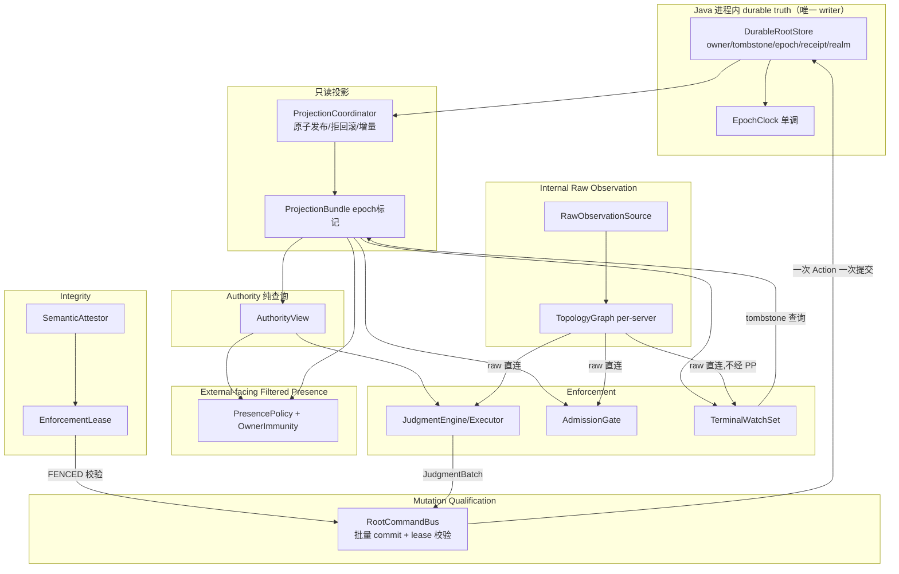
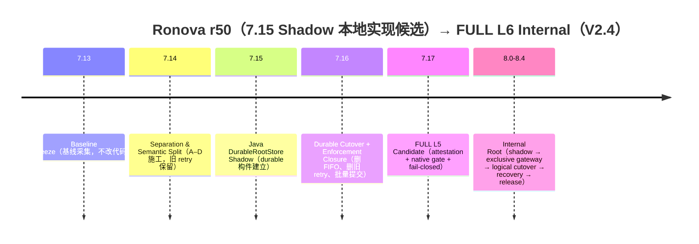

# Ronova 技能、架构与运行时规划

**fix11已有基线入口（原文块外）：** [真实转换器、依赖索引与模块宿主](R66-CAPABILITY-WIRING-PLAN.md#eight-existing-baseline)补入原S1/A1/A4等章节；不重建现成维护owner，不把观察索引升级为授权。原MS标题和迁入正文不改。

**fix10职责入口（原文块外）：** [S1挑战统一层](R66-CAPABILITY-WIRING-PLAN.md#eight-s1)、[A4状态接线](R66-CAPABILITY-WIRING-PLAN.md#eight-a4)、[A1依赖索引](R66-CAPABILITY-WIRING-PLAN.md#eight-a1)、[A2应用协议](R66-CAPABILITY-WIRING-PLAN.md#eight-a2)与[S4事件连续性](R66-CAPABILITY-WIRING-PLAN.md#eight-s4)在现有运行时/能力工作里融合；不是新Root或独立总纲，原文和ID不改。

**fix8就地精度入口（原文块外）：** [C13请求/天花板/观察消费](R66-CAPABILITY-WIRING-PLAN.md#extreme-ceiling-baseline)与[⑤独立到期/期望依赖](R66-CAPABILITY-WIRING-PLAN.md#v13-certificate)、[⑦固定计划切片前置](R66-CAPABILITY-WIRING-PLAN.md#v13-cross-surface-budget)接回原批次；静态计数不是运行档位。

> **fix7 同权限清点职责入口：** 决定侧封印、Mixin/原生合同与观察位置、持久认证边界已融入[既有工作章节](R66-CAPABILITY-WIRING-PLAN.md#same-privilege-surface)；[处理回执](RESTRUCTURE-REVIEW.md#review-fix7-surface)。仅规划补足，旧原文块和ID不改。

> **fix6 V1.3职责入口：** ①成本/⑦预算、⑤证书、⑨报告与条件②③已并入现有接线章节；不是能力已实现。 [逐条回执](RESTRUCTURE-REVIEW.md#review-fix6-v13) · [当前融合规划](R66-CAPABILITY-WIRING-PLAN.md#v13-receipt)。
> 当前接线增补：[r66 能力发布、动作执行与 JVMTI 规划](R66-CAPABILITY-WIRING-PLAN.md)。下方旧块保真保留；就地更正只作用于注明的历史判断，不代表源码已修改。
> 结构来源：`.incoming-ms-mod-doc/Minecraft-MS-Mod-Doc-main/base/minecraft-ms-1.20.1-skills.zh.md`。重构日期：2026-09-14。
> 本书按 MS 原有二级、三级标题顺序组织；下方“迁入原文”来自 Ronova 输入包。MS 示例、Ronova 原条款和本次编排说明分别标注。
> **只有文档迁移与明确标注的规划增补，没有实现改动或运行验收。** 原文中的已实现、未实现、成功/失败、日期、源码行号和历史版本都属于原记录，不是本轮确认。
> 当前限制与文档效力见 [规划入口](README.md)；旧文件/节号/行号与新位置见 [完整迁移映射](RESTRUCTURE-MAP.md)。
> 人读入口：[不变量全集与全部编号索引](INVARIANT-INDEX.md)；[启动参数选型](README.md#scope-startup-parameters)；[P 层与完成口径](README.md#scope-p-layer)。
> **旧语境约定：** 迁入段落的“本文/本节/第 X 节/§X”继续指其原来源的章节；可解析引用已转为新位置链接。相同 ID 在不同原来源中不合并、不重编号。

本书收纳 **731 个原文分段**。这些分段保留标题文字、正文、表格、示例和全部原 ID；仅调整标题层级及引用链接。

## 章节导航
- [秒杀是什么](#ms-skills-l14)
- [先确定能力边界](#ms-skills-l68)
- [总体架构](#ms-skills-l84)
- [秒杀的三种执行模式](#ms-skills-l112)
  - [1. 标准死亡](#ms-skills-l114)
  - [2. 实体清除](#ms-skills-l125)
  - [3. 混合模式](#ms-skills-l144)
- [扇形与范围选取](#ms-skills-l163)
- [线程、逻辑边与生命周期](#ms-skills-l185)
  - [逻辑服务器](#ms-skills-l187)
  - [客户端](#ms-skills-l204)
  - [追踪和重载](#ms-skills-l214)
- [防御链](#ms-skills-l222)
  - [1. 统一分类](#ms-skills-l226)
  - [2. Forge 事件层](#ms-skills-l237)
  - [3. 实体与生物方法层](#ms-skills-l241)
  - [4. `SynchedEntityData` 层](#ms-skills-l257)
  - [5. 周期修复层](#ms-skills-l267)
- [自定义Mixin或转换器](#ms-skills-l273)
  - [注入声明](#ms-skills-l281)
  - [实现一个简单 Hook](#ms-skills-l309)
  - [转换器注册与顺序](#ms-skills-l326)
  - [重转换与重定义](#ms-skills-l338)
- [JNA/JNI/JVMTI Native 层](#ms-skills-l350)
  - [命令桥接契约](#ms-skills-l360)
  - [启动顺序(对于ModMain优先级且对平台有限制的秒杀Mod)](#ms-skills-l376)
  - [对于非MoMain优先级](#ms-skills-l391)
  - [Native 实现规则](#ms-skills-l404)
- [新增功能的实现清单](#ms-skills-l413)
  - [新武器或主动技能](#ms-skills-l415)
  - [新防御规则](#ms-skills-l427)
- [构建、打包与验证](#ms-skills-l436)
- [故障定位](#ms-skills-l464)
- [完成标准(以一个标准的，带Native的秒杀Mod举例)](#ms-skills-l478)
  - [总而言之](#ms-skills-l484)

---

<a id="ms-skills-l14"></a>

## 秒杀是什么

**框架来源：** [MS skills，原 L14–L67](../../.incoming-ms-mod-doc/Minecraft-MS-Mod-Doc-main/base/minecraft-ms-1.20.1-skills.zh.md#秒杀是什么)。

**编排说明（非原条款）：** MS 原文在此区分数值伤害、运行态清除和可见结果。圈内称谓、人物评价和 T0/T1 排名只作原来源背景，不成为 Ronova 的实现事实或统一验收结论。

**关联原条款：** [V26 · 3.1 攻击 / 拦截 / 防护](MS-SKILLS-PLAN.md#orig-v26-l0214)；[V26 · 3.6 Existence Termination / 存在性终结](MS-MSITEM-PLAN.md#orig-v26-l0325)。

本节点没有被单独搬入的原文段落；它保留 MS 的独立职责入口。上列关联条款或下级章节不等于本节点所有细节已经覆盖；适用性与缺口见映射表。

<a id="ms-skills-l68"></a>

## 先确定能力边界

**框架来源：** [MS skills，原 L68–L83](../../.incoming-ms-mod-doc/Minecraft-MS-Mod-Doc-main/base/minecraft-ms-1.20.1-skills.zh.md#先确定能力边界)。

**编排说明（非原条款）：** 当前不可越过的边界只有三条铁律与“不起外部进程”。下列旧边界原文保留；其工程约束可显式修订，旧文档位次、冻结字样或示例选型不构成额外永久禁令。具体效力调整见 README。

<a id="orig-index-l0027"></a>

**迁入原文｜INDEX｜旧 L27–L39** · [原章节映射](RESTRUCTURE-MAP.md#map-orig-index-l0027)

原标题路径：有效规划 → 唯一规范顺序

**规范关系调整：** 本段的旧位次/冻结不可覆盖规则仅保留作来源记录，不再阻止显式修订；技术不变量本轮未据此删除。参见 [当前文档效力](README.md#scope-governance)。

**原稿定位说明：** 原“已并入/已取代/派生导读”等状态也随文保留；迁移不把该稿恢复成另一份并行最高规范，更不刷新其实现判断。

<!-- RONOVA-ORIGINAL-BEGIN orig-index-l0027 -->
#### 唯一规范顺序

| 顺序 | 有效文档 | 用途 |
|---|---|---|
| 1 | [L6 Architecture Master V2.4](RESTRUCTURE-MAP.md#source-l6) | D1–D13、Internal Root、单 writer、原子 batch 和宿主边界 |
| 2 | [Baseline / All Enhancements V1.4](RESTRUCTURE-MAP.md#source-bl) | 阶段路线及已内联的加强约束 |
| 3 | [L6E-0 Contract Freeze V1.3](RESTRUCTURE-MAP.md#source-cf) | SubjectKey、revision、副作用、执行上下文与客户端边界 |
| 4 | [7.16+ Strength Master V2.6](RESTRUCTURE-MAP.md#source-v26) | 7.17 起的强度、执行、候选、恢复、资源和完成合同 |
| 5 | [P0-A Implementation Spec V1.3](RESTRUCTURE-MAP.md#source-p0a) | FULL L6 Internal 之后的 Truth Authority 实施规格 |

7.17 恢复链规划、L6/L6E 全量加强路线及其他阶段规格属于第 5 层，不增加另一套 Root、身份或规范顺序。
较高位文档的冻结决策优先；实质冲突登记为设计缺口，不按“版本号更新”覆盖。


<!-- RONOVA-ORIGINAL-END orig-index-l0027 -->

<a id="orig-bl-l0101"></a>

**迁入原文｜BL｜旧 L101–L120** · [原章节映射](RESTRUCTURE-MAP.md#map-orig-bl-l0101)

原标题路径：1. 7.14A 冻结基准、r27 历史输入与 r50 当前源码 → 1.2 r50 当前 working source（源码事实） → 1.2.1 当前运行时进程边界（r27 源码确认）

**进程效力调整：** 本段涉及进程/旧 helper 条款；原文保留，但任何启动外部进程的授权均不适用。参见 [当前进程边界](README.md#scope-process)。

<!-- RONOVA-ORIGINAL-BEGIN orig-bl-l0101 -->
#### 1.2.1 当前运行时进程边界（r27 源码确认）

```text
NativeBridge ACTIVE
    -> RonovaDominion returns NATIVE_ACTIVE
    -> no AutoAttach call
    -> Ronova-created child process = 0 on this path

NativeBridge not ACTIVE
    + default DUAL_AGENT + regular mod JAR
    -> AutoAttach ProcessBuilder(java.exe ... AttachHelper ...)
    -> short-lived helper JVM
```

因此可以根据当前可见 Java 源码声明“External Dominion Root 不存在、Authority/Truth 主线在 Minecraft JVM 内”。r27 唯一由工作区 Java 源码确认的生产 child-process path 是 Java `AutoAttach`/`AttachHelper`，它被归类为 bounded bootstrap helper；只要不托管 durable Authority、不持续执行战斗/目标监控并在 handoff 后退出，就不违反 Internal Root。候选包报告声称两份 Native DLL 未发现 process creation、Named Pipe、Socket 或远程进程注入接口；该 Native/PE 结论本轮标为 DOCUMENT-ONLY，仍需对应输入和 exact-artifact 运行验证。

`PROC-INV-1` 冻结为角色边界：允许 bootstrap/attach/recovery/relaunch helper，但 exact packaged artifact 必须证明这些进程用途有界、无 durable Authority 状态、handoff 后终止；External Root、持续 external combat plane、独立 target-monitoring process 与 canonical cross-process Root channel 禁止。

---


<!-- RONOVA-ORIGINAL-END orig-bl-l0101 -->

<a id="orig-bl-l0179"></a>

**迁入原文｜BL｜旧 L179–L180** · [原章节映射](RESTRUCTURE-MAP.md#map-orig-bl-l0179)

原标题路径：2. 后续所有加强必须遵守的硬边界

<!-- RONOVA-ORIGINAL-BEGIN orig-bl-l0179 -->
#### 2. 后续所有加强必须遵守的硬边界


<!-- RONOVA-ORIGINAL-END orig-bl-l0179 -->

<a id="orig-bl-l0268"></a>

**迁入原文｜BL｜旧 L268–L295** · [原章节映射](RESTRUCTURE-MAP.md#map-orig-bl-l0268)

原标题路径：2. 后续所有加强必须遵守的硬边界 → 2.4 不做逐 Mod / Boss 特判架构

<!-- RONOVA-ORIGINAL-BEGIN orig-bl-l0268 -->
#### 2.4 不做逐 Mod / Boss 特判架构

禁止把主线设计成：

```java
if (uomWither) { ... }
if (bossA) { ... }
if (bossB) { ... }
```

也不以 Mod ID / package / class whitelist 作为最终 Authority。

正确方向是：

```text
Target
 ↓
Identity Discovery
 ↓
State Ownership Discovery
 ↓
Authority Relation
```

无法解析时明确报告 `UNRESOLVED_AUTHORITY_OWNER`，而不是偷偷 fallback 成普通 `setHealth()`。

---


<!-- RONOVA-ORIGINAL-END orig-bl-l0268 -->

<a id="orig-bl-l0332"></a>

**迁入原文｜BL｜旧 L332–L372** · [原章节映射](RESTRUCTURE-MAP.md#map-orig-bl-l0332)

原标题路径：3. MC 实际威胁模型

<!-- RONOVA-ORIGINAL-BEGIN orig-bl-l0332 -->
#### 3. MC 实际威胁模型

Ronova 的主威胁模型应冻结在 Minecraft Mod 对抗范围，而不是企业安全 / 内核安全。

```text
T0 普通玩家

T1 作弊客户端 / 纯客户端 Mod
   ├ forged packets
   ├ movement / attack prediction
   ├ UI / render modification
   └ client memory modification

T2 同服务器 JVM 内的对抗 Mod / CoreMod
   ├ Forge Event
   ├ Mixin
   ├ ASM
   ├ reflection
   └ direct state mutation

T3 Java Agent / Instrumentation / JVMTI
   ├ retransformation
   ├ method-body injection
   └ class-load interference

T4 in-process Native adversary
   ├ JNI
   ├ JVMTI native
   └ native hook
```

不作为主线设计目标：

- OS administrator；
- kernel；
- hypervisor；
- TPM / HSM；
- SGX / SEV 必选部署。

---


<!-- RONOVA-ORIGINAL-END orig-bl-l0332 -->

<a id="orig-bl-l1815"></a>

**迁入原文｜BL｜旧 L1815–L1826** · [原章节映射](RESTRUCTURE-MAP.md#map-orig-bl-l1815)

原标题路径：15. Anti-Interception / 方法体注入对抗 → 15.3 不采用的高风险做法

<!-- RONOVA-ORIGINAL-BEGIN orig-bl-l1815 -->
#### 15.3 不采用的高风险做法

主线不采用：

- Java method 内存页硬 `mprotect`；
- 常驻 JVMTI SingleStep CFI；
- 高频全类自变异；
- SecurityManager 作为 Java 17 核心防线；
- 把 ClassLoader isolation 当成 JVMTI 防火墙。

---


<!-- RONOVA-ORIGINAL-END orig-bl-l1815 -->

<a id="orig-bl-l2499"></a>

**迁入原文｜BL｜旧 L2499–L2522** · [原章节映射](RESTRUCTURE-MAP.md#map-orig-bl-l2499)

原标题路径：24. 明确淘汰 / 不进入主线的旧加强

**进程效力调整：** 本段涉及进程/旧 helper 条款；原文保留，但任何启动外部进程的授权均不适用。参见 [当前进程边界](README.md#scope-process)。

<!-- RONOVA-ORIGINAL-BEGIN orig-bl-l2499 -->
#### 24. 明确淘汰 / 不进入主线的旧加强

以下想法保留为研究资料，不进入主实现：

| 旧方案 | 处理 |
|---|---|
| TPM / HSM | 不属于 MC 主威胁模型 |
| 外部进程 / SGX / SEV 必选 | 不进入 FULL L6 Internal 要求 |
| kernel / hypervisor 防御 | 超出范围 |
| 第三方 Mod 全量签名白名单 | 违反通用 Authority 方向 |
| Fake Authority Projection | 污染真值层，禁止 |
| ML / RL 自动产生 Judgment | Authority 不可交给非确定模型 |
| 高频代码自变异 | 仅可选 anti-analysis |
| SecurityManager | Java 17 主线不依赖 |
| Java method page `mprotect` | HotSpot 兼容性风险过高 |
| 常驻 JVMTI SingleStep | 热路径性能不可接受 |
| 每次 JNI 完整 stack trace | 热路径开销过大 |
| 每 Boss 独立 Adapter | 改为 State Ownership Resolver |
| 无限堆 Hook / fallback | 与正式 L6 方向冲突 |
| EventPriority 决定 Authority | Event 只能是 seam / observation accelerator |
| 动态密钥 / 执行前字节码解密 / 执行后擦除 | 可作为 anti-analysis 研究项；对已能 runtime 注入的 T3/T4 对手不是 Authority 防线，不进入主线 |

---


<!-- RONOVA-ORIGINAL-END orig-bl-l2499 -->

<a id="orig-bl-l2787"></a>

**迁入原文｜BL｜旧 L2787–L2798** · [原章节映射](RESTRUCTURE-MAP.md#map-orig-bl-l2787)

原标题路径：26. 各增强轴的验收原则 → 26.7 Production Process Boundary

**进程效力调整：** 本段涉及进程/旧 helper 条款；原文保留，但任何启动外部进程的授权均不适用。参见 [当前进程边界](README.md#scope-process)。

<!-- RONOVA-ORIGINAL-BEGIN orig-bl-l2787 -->
#### 26.7 Production Process Boundary

必须同时证明：

- production Java/source/artifact 中所有 `ProcessBuilder`、`Runtime.exec`、Attach-helper/relaunch 入口都被完整枚举并绑定到明确的 bootstrap/attach/recovery/relaunch purpose；不得存在未分类或隐藏的 process-launch path；
- Native source 与 exact DLL import table 必须枚举任何 process creation；若未来 Native 参与 relaunch，只允许 bounded bootstrap/relaunch purpose。external injection、Named Pipe/cross-process shared memory/direct network 不得成为 Root Authority transport；
- Windows process tree 枚举 normal startup、runtime reassertion、shutdown、forced Native-unavailable 与可选 relaunch 的所有 Ronova-created process，并证明 helper 生命周期有界、handoff 后退出；
- Native unavailable 时允许 bounded attach/relaunch；若无法建立合规 in-JVM runtime，则进入 documented degraded/fenced；
- Gradle、PowerShell、Forge scenario runner 与 profiler 只属于构建/验证工具，永不从 production runtime 调用。

---


<!-- RONOVA-ORIGINAL-END orig-bl-l2787 -->

<a id="orig-bl-l2927"></a>

**迁入原文｜BL｜旧 L2927–L2942** · [原章节映射](RESTRUCTURE-MAP.md#map-orig-bl-l2927)

原标题路径：29. 本文冻结结论

**进程效力调整：** 本段涉及进程/旧 helper 条款；原文保留，但任何启动外部进程的授权均不适用。参见 [当前进程边界](README.md#scope-process)。

**规范关系调整：** 本段的旧位次/冻结不可覆盖规则仅保留作来源记录，不再阻止显式修订；技术不变量本轮未据此删除。参见 [当前文档效力](README.md#scope-governance)。

<!-- RONOVA-ORIGINAL-BEGIN orig-bl-l2927 -->
#### 29. 本文冻结结论

1. 7.14A 已完成并冻结；当前 r50 已完成并接入 7.14B/7.14C/7.14D/7.15，7.16 是下一实现阶段。
2. 7.14D 的有限预算与遥测 seam、7.15 的 Java DurableRootStore Shadow 已作为 implementation candidate 落地；本轮以 `mc_check`、`mc_build` 与 40/40 分层 standalone SelfTest 完成收尾；不提前实现 7.16 之外的 P0 链。
3. Canonical L6 Master Plan 继续作为上位架构，不被后续加强稿覆盖。  
4. VITALS 与 TERMINAL 永久分离。  
5. Unknown Mod / Boss 的问题用 **State Ownership Discovery** 解决，不用逐 Mod Adapter 海。  
6. State Ownership / Dispatch / Return 统一为 **Execution Authority Chain**。  
7. Integrity 必须有 scoped fence、repair budget 和明确不可修复终点。  
8. Resource Resilience 是实战强度，不只是性能优化。  
9. Native 只做 critical validation / primitive，不成为第二 Root。  
10. Client Render 是独立信任边界，Native Render Firewall 只能作为受控客户端扩展。  
11. Anti-Rollback、Causality、Fencing 必须保证 durable truth 不静默倒退。  
12. 后续不再横向发明大量“大模块”，而应按四条 P0 大链向下写不变量、状态机、数据模型和 Implementation Spec。  
13. 当前 r50 的 `AutoAttach` / `AttachHelper` helper 从源码看是 bounded bootstrap path 候选；它无需在 7.17 前删除，但必须通过 `PROC-INV-1` 的用途、Authority-role、handoff 与 termination 验证。


<!-- RONOVA-ORIGINAL-END orig-bl-l2927 -->

<a id="orig-bl-l3010"></a>

**迁入原文｜BL｜旧 L3010–L3022** · [原章节映射](RESTRUCTURE-MAP.md#map-orig-bl-l3010)

原标题路径：30. V1.4 — Implementation Spec 前的缺口收口 → 30.3 统一规范链（2026-09-05 文档接合）

**规范关系调整：** 本段的旧位次/冻结不可覆盖规则仅保留作来源记录，不再阻止显式修订；技术不变量本轮未据此删除。参见 [当前文档效力](README.md#scope-governance)。

<!-- RONOVA-ORIGINAL-BEGIN orig-bl-l3010 -->
#### 30.3 统一规范链（2026-09-05 文档接合）

当前规范顺序与 [架构索引](README.md) 及 [加强总纲 V2.6 §1.1](RESTRUCTURE-MAP.md#source-v26) 一致：

```text
Canonical L6 Master V2.4 Internal Root
→ 本文 V1.4 Internal Root
→ L6E-0 Contract Freeze V1.3 Internal Root
→ 7.16+ JVM Extreme Strength Enhancement Master V2.6 Internal Root
→ P0-A Implementation Spec V1.3 Internal Root
```

其他阶段实现规格与 P0-A 同为下游实现层，不能覆盖上游冻结决策。V2.6 是明确纳入的强度增量，不是另找旧 `Post-V1.1 Hardening Addendum`；旧 hardening closure 仍已内联本文。V2.5/V2.4 加强稿只作历史，不与当前规范并行裁决；r53 源码状态及历史验证证据不因文档接合而改变。

<!-- RONOVA-ORIGINAL-END orig-bl-l3010 -->

<a id="orig-v26-l0130"></a>

**迁入原文｜V26｜旧 L130–L131** · [原章节映射](RESTRUCTURE-MAP.md#map-orig-v26-l0130)

原标题路径：Ronova 7.16+ JVM 极限强度加强总纲 V2.6（Internal Root） → 1. 文档权威与版本关系

<!-- RONOVA-ORIGINAL-BEGIN orig-v26-l0130 -->
#### 1. 文档权威与版本关系


<!-- RONOVA-ORIGINAL-END orig-v26-l0130 -->

<a id="orig-v26-l0132"></a>

**迁入原文｜V26｜旧 L132–L155** · [原章节映射](RESTRUCTURE-MAP.md#map-orig-v26-l0132)

原标题路径：Ronova 7.16+ JVM 极限强度加强总纲 V2.6（Internal Root） → 1. 文档权威与版本关系 → 1.1 历史版本

**规范关系调整：** 本段的旧位次/冻结不可覆盖规则仅保留作来源记录，不再阻止显式修订；技术不变量本轮未据此删除。参见 [当前文档效力](README.md#scope-governance)。

<!-- RONOVA-ORIGINAL-BEGIN orig-v26-l0132 -->
#### 1.1 历史版本

- V1.0：第一次冻结“攻击 / 拦截 / 防护 / 运行时 / 功能”五页结构；
- V2.0：加入稳定窗口、TargetEpoch、WriteSink、运行时补丁防护、JIT/dispatch evidence 和恢复内核；
- V2.1：扩大结果相关攻击面，加入源/链/代码攻击、存在性终结和四层反全返回；
- **V2.2：把 EXTREME 正式改成极限代码对抗，并修正范围缩窄、FENCE 自伤、D33 绝对化、TargetEpoch 重激活及 7.16 scope 问题。**
- **V2.3：冻结候选准入与处置权限、义务归并和容量溢出汇总、执行/结果正交状态、反诱导公平调度及其验收。**
- **V2.4：冻结资格代际原子提交、JVM 全资源域宿主安全、Completion 最终性、候选限制释放防抖与最终验收。**
- **V2.5：在 V2.4 深度上冻结八类 Runtime Surface、逐能力三档矩阵、跨表面单 Root 编排、客户端/服务端边界和广度验收。**
- **V2.6：补齐开关权限投影、身份与批量事务、参与范围、执行未知恢复、文档链、独立验收基线及存储容量合同。**

解释优先级：

1. [L6 Architecture Master V2.4](RESTRUCTURE-MAP.md#source-l6)：冻结路线、D1–D13、单 writer 与原子 batch；
2. [7.14A Baseline Master V1.4](RESTRUCTURE-MAP.md#source-bl)：阶段路线及已内联 hardening closure；
3. [L6E-0 Contract Freeze V1.3](RESTRUCTURE-MAP.md#source-cf)：canonical identity、revision、side-effect 与 server/client 基础合同；
4. 本 V2.6：在上述约束内定义 7.16+ 强度、执行和验收的增量合同；
5. [P0-A Implementation Spec V1.3](RESTRUCTURE-MAP.md#source-p0a) 及各阶段实现规格；
6. GUI 文案、示例、handoff 和进度说明（不能反向修改合同）。

此顺序与 [`docs/plans/README.md`](README.md) 一致。较高位文档内部的显式冻结决策高于其历史叙述；出现实质冲突时登记设计缺口，不通过“版本号较新”静默覆盖上游。r51 验证不变量是必须保持的实现证据，不是另一份排在架构之前的规范；新旧行为差异必须有显式迁移及回归，源码实际状态也不能被文档虚构。

V2.6 在本增强系列中替代 V2.5/V2.4 的当前实施入口；这些历史稿不再并行裁决。仍适用的合同已保留在本稿对应正文。旧稿的“继承全部历史用例”不等于附件实际完整：X01–X23 缺件按 [§19.1.1](MS-SKILLS-PLAN.md#orig-v26-l2895) 处理。不得只引用不可得原文而宣称当前验收闭合，也不得用新文案篡改历史运行结果。


<!-- RONOVA-ORIGINAL-END orig-v26-l0132 -->

<a id="orig-v26-l0156"></a>

**迁入原文｜V26｜旧 L156–L173** · [原章节映射](RESTRUCTURE-MAP.md#map-orig-v26-l0156)

原标题路径：Ronova 7.16+ JVM 极限强度加强总纲 V2.6（Internal Root） → 1. 文档权威与版本关系 → 1.2 不回写已完成阶段

<!-- RONOVA-ORIGINAL-BEGIN orig-v26-l0156 -->
#### 1.2 不回写已完成阶段

```text
r51 / 7.15 frozen baseline
    ↓
7.16 Durable Cutover + Strength Policy Foundation
    ↓
7.17 JVM Enforcement Closure / FULL L5 Candidate
    ↓
L6 Internal Dominion Root
    ↓
L6E Execution / Reconstitution / Semantic Closure
```

7.14A/B/C/D、7.15 和已经接近完成的 7.16 实现不因本总纲重新编号或推翻。

包内 V2.5、V2.4 原稿保留；更早历史稿未随包提供时不得声称已保留或已核验。本 V2.6 的实施合同集中定义在对应正文；阶段表与验收只引用，不另建冲突的状态枚举、攻击键或执行规则。


<!-- RONOVA-ORIGINAL-END orig-v26-l0156 -->

<a id="orig-v26-l0174"></a>

**迁入原文｜V26｜旧 L174–L184** · [原章节映射](RESTRUCTURE-MAP.md#map-orig-v26-l0174)

原标题路径：Ronova 7.16+ JVM 极限强度加强总纲 V2.6（Internal Root） → 1. 文档权威与版本关系 → 1.3 Internal Root 不变

**进程效力调整：** 本段涉及进程/旧 helper 条款；原文保留，但任何启动外部进程的授权均不适用。参见 [当前进程边界](README.md#scope-process)。

<!-- RONOVA-ORIGINAL-BEGIN orig-v26-l0174 -->
#### 1.3 Internal Root 不变

- Authority 不移出当前游戏进程；
- 7.16：DurableRootStore 是 sole durable writer；
- FULL L6：InternalDominionRoot 是 sole logical Authority writer；
- Agent、Instrumentation、JVMTI、Native、恢复内核只提供证据、门控、执行和修复；
- 它们不能成为第二 Judgment writer；
- 临时 attach/relaunch helper 可以存在，但必须有界、非权威、完成任务后退出。

---


<!-- RONOVA-ORIGINAL-END orig-v26-l0174 -->

<a id="orig-v26-l0361"></a>

**迁入原文｜V26｜旧 L361–L362** · [原章节映射](RESTRUCTURE-MAP.md#map-orig-v26-l0361)

原标题路径：Ronova 7.16+ JVM 极限强度加强总纲 V2.6（Internal Root） → 4. 目标、非目标与宿主安全边界

<!-- RONOVA-ORIGINAL-BEGIN orig-v26-l0361 -->
#### 4. 目标、非目标与宿主安全边界


<!-- RONOVA-ORIGINAL-END orig-v26-l0361 -->

<a id="orig-v26-l0402"></a>

**迁入原文｜V26｜旧 L402–L416** · [原章节映射](RESTRUCTURE-MAP.md#map-orig-v26-l0402)

原标题路径：Ronova 7.16+ JVM 极限强度加强总纲 V2.6（Internal Root） → 4. 目标、非目标与宿主安全边界 → 4.2 Extreme 不设置的限制

<!-- RONOVA-ORIGINAL-BEGIN orig-v26-l0402 -->
#### 4.2 Extreme 不设置的限制

不允许把以下写成固定架构限制：

- 最多 1 个、2 个或 N 个敌对 Mod；
- 最多 N 个结果图节点；
- 最多 N 层逻辑链深度；
- 最多 N 个 loader 副本；
- 最多 N 个任务/回调来源；
- “只攻击明确注册过的某几个 Mod”。

实现可以因内存和 CPU 使用**有界窗口**、分页、分片、LRU、backlog，但：

> **资源预算限制每个窗口处理多少，不限制最终应该处理哪些。**


<!-- RONOVA-ORIGINAL-END orig-v26-l0402 -->

<a id="orig-v26-l0417"></a>

**迁入原文｜V26｜旧 L417–L428** · [原章节映射](RESTRUCTURE-MAP.md#map-orig-v26-l0417)

原标题路径：Ronova 7.16+ JVM 极限强度加强总纲 V2.6（Internal Root） → 4. 目标、非目标与宿主安全边界 → 4.3 Extreme 允许牺牲的东西

<!-- RONOVA-ORIGINAL-BEGIN orig-v26-l0417 -->
#### 4.3 Extreme 允许牺牲的东西

已证明属于当前敌对结果链、且相应处置获得当前 Root 政策授权后，EXTREME 不保证：

- 对方 Mod 的功能完整性；
- 对方 Mod 的热补丁仍能工作；
- 共享 helper / manager 在对抗后仍完整服务所有第三方功能；
- 对方自己的恢复器、listener、runtime patch、generated class 继续保持原语义；
- 对方 Mod 在当前会话内能够恢复到“正常玩法状态”。

“高度疑似”只在满足 Candidate Admission Rule 后授权临时、可撤销的结果限制和进一步追踪，不自动授权永久、类级或高副作用改写。已证明的共享恢复路径继续适用 [§9.3](MS-MSITEM-PLAN.md#orig-v26-l1488)，不能借第三方兼容性退回弱执行。


<!-- RONOVA-ORIGINAL-END orig-v26-l0417 -->

<a id="orig-v26-l0429"></a>

**迁入原文｜V26｜旧 L429–L452** · [原章节映射](RESTRUCTURE-MAP.md#map-orig-v26-l0429)

原标题路径：Ronova 7.16+ JVM 极限强度加强总纲 V2.6（Internal Root） → 4. 目标、非目标与宿主安全边界 → 4.4 Extreme 绝对安全边界

<!-- RONOVA-ORIGINAL-BEGIN orig-v26-l0429 -->
#### 4.4 Extreme 绝对安全边界

EXTREME 不允许通过以下方式取得胜负：

- 故意制造 OOM；
- 无限创建线程；
- 无限类生成；
- 无限 retransform/redefine；
- 无限每 tick JVM 全扫描；
- 故意死循环吃满 CPU；
- 破坏 JVM/native 内存来求强度；
- 删除第三方文件；
- 损坏世界存档或区块文件；
- 修改、删除用户文件；
- 操纵无关进程；
- OS / 内核破坏；
- 故意蓝屏、死机、崩溃宿主电脑。

形式化：

> **EXTREME 不计第三方兼容性代价，但必须计宿主稳定性、Authority 正确性、用户数据安全和 JVM 可持续运行的代价。**

---


<!-- RONOVA-ORIGINAL-END orig-v26-l0429 -->

<a id="orig-v26-l2527"></a>

**迁入原文｜V26｜旧 L2527–L2540** · [原章节映射](RESTRUCTURE-MAP.md#map-orig-v26-l2527)

原标题路径：Ronova 7.16+ JVM 极限强度加强总纲 V2.6（Internal Root） → 15. Authority、持久化与恢复 → 15.3 Restart

<!-- RONOVA-ORIGINAL-BEGIN orig-v26-l2527 -->
#### 15.3 Restart

重启：

```text
durable truth
→ restore Realm/Root/Tombstone/TargetEpoch
→ rebuild policy
→ rebuild candidate/result evidence
→ revalidate old certificate scope
```

旧会话证书不能直接充当新 JVM 的当前完成证明。


<!-- RONOVA-ORIGINAL-END orig-v26-l2527 -->

<a id="orig-v26-l2828"></a>

**迁入原文｜V26｜旧 L2828–L2888** · [原章节映射](RESTRUCTURE-MAP.md#map-orig-v26-l2828)

原标题路径：Ronova 7.16+ JVM 极限强度加强总纲 V2.6（Internal Root） → 18. 依赖与非法组合

<!-- RONOVA-ORIGINAL-BEGIN orig-v26-l2828 -->
#### 18. 依赖与非法组合

必须拒绝：

- EXTREME 显示 ACTIVE，但关键 executor 不存在；
- 极限清除没有 TargetEpoch / Admission / stability / recovery closure；
- 反全返回 Extreme 没有 final state evidence；
- 全返回 Extreme 没有 final result takeover；
- 动态代码 Extreme 只有观察，没有 dispatch/result outlet 控制，却显示已完成；
- 全部严格只能观察却声称 DENIED；
- budget overflow 后删除 obligation；
- 单个 TARGET 失证直接 ROOT FENCE；
- 合法 reactivation 复用旧 TargetEpoch；
- ResultGraph/Certificate 直接作为 Judgment/Admission Truth；
- 7.16 为了 V2.2/V2.3/V2.4/V2.5 重做完整 ResultGraph / MutationTrace / Extreme executor；
- 通过 heap/direct/native/metaspace/code cache/线程栈/句柄/GPU 资源耗尽、无限扫描、文件/存档/OS 破坏增强 Extreme。

V2.3 另外必须拒绝：

- 两份重复日志、同一事件的派生字段或过期跨 epoch 证据凑成两条独立弱证据；
- 合法合规修复仅因触达 protected sink 就被自动攻击或隔离；
- Candidate/Unresolved 仅因分数高、等待久或次数多而直接获得永久/类级/高副作用改写权限；
- 只做重复 key 合并，却允许不同 sourceIdentity 或汇总记录无限增长；
- 先删细节限制、后建立汇总，造成并发提交放行窗口；
- LRU、TTL、样本过期、摘要相同或计数变化直接解除未决义务；
- 一个代表来源被证明无关，就解除整个汇总范围及其他仍有效的限制；
- FENCED、QUARANTINED、调用过执行器或恢复函数返回成功直接映射为 CLEARED；
- 当前证书已经失效，UI 仍显示历史 CLEARED 作为当前结果；
- 通过更换来源身份重置配额，或让 sourcePressure/repeatCount 无界提高优先级；
- 没有 Authority/repair 保留预算，或只有严格优先级而无公平与探索机制；
- 以新增四项合同为理由要求 7.16 完成全套实现。

V2.4 另外必须拒绝：

- Judgment transition、TargetEpoch 推进、旧代际撤销、Admission revision 与 receipt 分开提交或分开发布；
- `COMMIT_UNKNOWN` 时新建第二 command 补写 epoch，或在 durable commit 前发布新 projection/gate；
- qualification transaction 内调用第三方代码，允许同步重建回调重入 Root；
- 非清除操作仅凭 APPLIED 就显示最终完成，没有有效 CompletionContract 与 `completionSatisfied=true`；
- 用 `isTerminalOutcome` 混淆 CriticalOperation 完成和实体 TERMINAL；
- Candidate 已 PROVEN_UNRELATED 后篡改证据结论来实现防抖，或让重复日志/身份轮换无限延长自动释放窗口；
- Candidate 释放防抖偷偷延迟明确的操作者 `clear_uuid`/解除裁决 Authority command；
- 只监控 Java heap，却宣称 direct/native/metaspace/code cache/线程/类加载/句柄/GPU 资源安全完整；
- 把不可观测资源视为无限可用，或把敌方制造的 host-wide pressure 当成归属证明、删除攻击面、清空 obligation、撤销 Judgment；
- 通过触发 OOM、Direct buffer memory、metaspace/code cache 枯竭、线程/句柄泄漏、驱动崩溃来冒充攻击成功。

V2.5 另外必须拒绝：

- Data/Network/Presentation 等任一 Surface 保存可与 Root 竞争的 Judgment、epoch、Admission 或“表面真相”；
- 为八类表面新增八套互不兼容的攻击 key、GUI 顶层页或 Authority 状态机；
- 三个预设仍只按 plane 统一映射，却宣称已实现逐能力矩阵；
- Surface 只有 observer 就显示 FULL，只有发出 executor 请求就显示 DENIED/APPLIED，repair 返回成功就显示完成；
- 客户端 HUD、renderer、keybind 或 packet cache 直接提交 Judgment、推进 TargetEpoch 或签发 CLEARED；
- 专用服务端加载客户端渲染类、shader 或只在客户端存在的 API 后再用异常降级掩盖边界错误；
- 各 Surface executor 彼此直接调用、循环修复、重复提交 canonical command 或以最后回调覆盖 Root 仲裁；
- 跨表面计划不绑定 RealmId、lineage、TargetEpoch、commandId、revision 或 idempotency key；
- 一个表面完成就忽略 required surface 缺口，把跨表面结果显示为 FULL/CLEARED；
- 通过扩大全局 Mixin/Unsafe/ClassLoader/JNI 禁用范围来替代来源归属、最小 scope 和 Host Safety；
- 以 V2.5 为理由把 r52 的占位接口、统一 mapping 或 source-level 编译通过写成 exact-artifact 已完成。

---


<!-- RONOVA-ORIGINAL-END orig-v26-l2828 -->

<a id="orig-v26-l3254"></a>

**迁入原文｜V26｜旧 L3254–L3255** · [原章节映射](RESTRUCTURE-MAP.md#map-orig-v26-l3254)

原标题路径：Ronova 7.16+ JVM 极限强度加强总纲 V2.6（Internal Root） → 22. JVM 与宿主硬边界

<!-- RONOVA-ORIGINAL-BEGIN orig-v26-l3254 -->
#### 22. JVM 与宿主硬边界


<!-- RONOVA-ORIGINAL-END orig-v26-l3254 -->

<a id="orig-v26-l3256"></a>

**迁入原文｜V26｜旧 L3256–L3269** · [原章节映射](RESTRUCTURE-MAP.md#map-orig-v26-l3256)

原标题路径：Ronova 7.16+ JVM 极限强度加强总纲 V2.6（Internal Root） → 22. JVM 与宿主硬边界 → 22.1 同权限 Native/JVMTI

<!-- RONOVA-ORIGINAL-BEGIN orig-v26-l3256 -->
#### 22.1 同权限 Native/JVMTI

如果对方完全控制同地址空间，不能宣称数学绝对不可篡改。

Ronova 可以：

- 多来源 evidence；
- fence；
- repair；
- restart；
- durable truth recovery。

不能虚构物理绝对免疫。


<!-- RONOVA-ORIGINAL-END orig-v26-l3256 -->

<a id="orig-v26-l3270"></a>

**迁入原文｜V26｜旧 L3270–L3281** · [原章节映射](RESTRUCTURE-MAP.md#map-orig-v26-l3270)

原标题路径：Ronova 7.16+ JVM 极限强度加强总纲 V2.6（Internal Root） → 22. JVM 与宿主硬边界 → 22.2 JVM 死亡

<!-- RONOVA-ORIGINAL-BEGIN orig-v26-l3270 -->
#### 22.2 JVM 死亡

当前 JVM 已 halt / native crash / OS kill：

> 原 JVM 不能继续自救。

只能依赖：

- 已提交 durable truth；
- clean restart；
- 新 JVM 重建 Root 与 evidence。


<!-- RONOVA-ORIGINAL-END orig-v26-l3270 -->

<a id="orig-v26-l3282"></a>

**迁入原文｜V26｜旧 L3282–L3285** · [原章节映射](RESTRUCTURE-MAP.md#map-orig-v26-l3282)

原标题路径：Ronova 7.16+ JVM 极限强度加强总纲 V2.6（Internal Root） → 22. JVM 与宿主硬边界 → 22.3 OS / 文件 / 无关进程

<!-- RONOVA-ORIGINAL-BEGIN orig-v26-l3282 -->
#### 22.3 OS / 文件 / 无关进程

不属于 Extreme 攻击面。


<!-- RONOVA-ORIGINAL-END orig-v26-l3282 -->

<a id="orig-v26-l3286"></a>

**迁入原文｜V26｜旧 L3286–L3291** · [原章节映射](RESTRUCTURE-MAP.md#map-orig-v26-l3286)

原标题路径：Ronova 7.16+ JVM 极限强度加强总纲 V2.6（Internal Root） → 22. JVM 与宿主硬边界 → 22.4 极限代码对抗的正式边界

<!-- RONOVA-ORIGINAL-BEGIN orig-v26-l3286 -->
#### 22.4 极限代码对抗的正式边界

> **Ronova Extreme 可以不计敌对 Mod 的兼容性和功能存活代价，但不能不计 Minecraft/JVM 宿主、用户数据和操作系统的安全代价。**

---


<!-- RONOVA-ORIGINAL-END orig-v26-l3286 -->

<a id="orig-full-l0211"></a>

**迁入原文｜FULL｜旧 L211–L221** · [原章节映射](RESTRUCTURE-MAP.md#map-orig-full-l0211)

原标题路径：Ronova 7.17 极限档全体系加强规划 V1.0 → 6. 实现与文档约定

<!-- RONOVA-ORIGINAL-BEGIN orig-full-l0211 -->
#### 6. 实现与文档约定

- 扩展现有来源描述和步骤结果，记录实际对象、槽位、身份版本、处置结果及后续观察；
  继续使用 Internal Root 的统一身份和执行资格。
- 最终写入位置核对当前对象与版本，写后独立观察。
  完整 Native lease / WriteSink 尚未实现的部分继续作为明确工程项，当前 Java 排他范围和 Native 观察不代替完整实现。
- 保留普通动作的独立开关，以及生命周期 ONCE 语义；持续状态修复不得重新触发外部生命周期效果。
- 通用实现不加入 Boss 或模组名称特判；`memoryRemove` 仅分析、不集成。新增视觉效果优先采用着色器。
- 本文件维护极限定义、完整能力清单与加强路径；[当前进度](../CURRENT-PROGRESS.md) 同步记录目标、已接线和已验证状态，
  局部源码、完整能力与成品结果分别说明。


<!-- RONOVA-ORIGINAL-END orig-full-l0211 -->

<a id="orig-full-l0244"></a>

**迁入原文｜FULL｜旧 L244–L266** · [原章节映射](RESTRUCTURE-MAP.md#map-orig-full-l0244)

原标题路径：Ronova 7.17 极限档全体系加强规划 V1.0 → 8. 参考 Mod 研究转入加强规划 → 8.1 研究依据与采纳边界

<!-- RONOVA-ORIGINAL-BEGIN orig-full-l0244 -->
#### 8.1 研究依据与采纳边界

本节依据 ArcaneVorte 0.5.6、永爱之刃 2.6 fix / 3.2、SuperSteve 6.9.1 的源码、
原始字节码、已提供 Native 静态材料，以及无样本依赖的独立机制示例。
研究入口为[全部 Mod 研究接续](../ALL-MODS-RESEARCH.md)。
“静态确认”表示当前输入确有该分支；“机制示例通过”只证明该写法的边界。
两者均不等于样本实机生效，也不替代 Ronova 自己的生产 observer/executor 验收。

| 证据组 | 核实的行为 | 转入哪些加强项 |
|---|---|---|
| [SuperSteve](../../validation/7.17/reference-study/full-study/SUPERSTEVE.md) | 静态原对象、共享维护线程、多索引再发布、自有生命模型、动态定义与网络代码入口 | M02–M04、M07–M09、M12–M14 |
| [Arcane](../../validation/7.17/reference-study/full-study/ARCANE.md) | 定时器到服务器队列再到裸线程的后继；首次字节缓存；磁盘 JAR 改写；仅清快照的“恢复”方法 | M04、M06–M09、M13–M14 |
| [永爱 2.6](../../validation/7.17/reference-study/full-study/FLS26.md)及[15 处异常复核](../../validation/7.17/reference-study/full-study/FLS26-WARNING-REVIEW.md) | 共享快照、代理/原值缓存、identity hash 键、迟到回调、共享日志参数、操作数漏检、取消与退出分离 | M01–M07、M10–M11、M13–M14 |
| [永爱 3.2](../../validation/7.17/reference-study/full-study/FLS32.md) | 辅助方法存在但接线未证实；具体实体空 setter/remove；隐藏定义回退；网络使用整数实体 ID | M03、M07–M09、M12、M14 |
| [Native](../../validation/7.17/reference-study/full-study/NATIVE.md) | 已核对的 JNI 引用操作；全局临时禁用；Java cleanup 的实际调用范围 | M05、M08、M10–M11、M14 |

核心两个受保护 Native 库的展开函数体仍缺失；导出名、API 数量和伪代码目录不成为新执行能力。
音视频依赖的数组算法、文件格式解析和窗口辅助函数，只在存在实际资源/调用关系时进入对应范围，
不能因为一起打包就当成攻击能力或通用恢复来源。

以下 M01–M14 只是文档追踪编号，不是新动作、配置键、Root command 或 EffectJournal slot。
生产规则使用实际关系和登记合同，表中的样本标识仅用于研究证据定位。


<!-- RONOVA-ORIGINAL-END orig-full-l0244 -->

<a id="orig-full-l0290"></a>

**迁入原文｜FULL｜旧 L290–L299** · [原章节映射](RESTRUCTURE-MAP.md#map-orig-full-l0290)

原标题路径：Ronova 7.17 极限档全体系加强规划 V1.0 → 8. 参考 Mod 研究转入加强规划 → 8.3 不采纳的实现方式

<!-- RONOVA-ORIGINAL-BEGIN orig-full-l0290 -->
#### 8.3 不采纳的实现方式

- 不复制按类名、Mod ID、字段名关键词或全 Class 集合判敌的规则，不停止共享池或中断共享工作线程。
- 不将整表 clear/putAll、批量修改磁盘 JAR、对象头类指针改写或移除其他 JVMTI 环境作为通用清理实现。
- 不把吞异常后返回 true、opcode/长度相同、清空快照、“修复完成”日志或 API 名称当成效果证明。
- 不接入来自客户端的任意 class/main 执行协议，不把宿主进程、窗口或系统服务变成默认处置对象。
- `memoryRemove` 仍只分析；受保护 Native 的未恢复函数只登记缺口，不按猜测编写等价能力。

这些反例用于加强准确性和验证，不降低已有极限目标或把必要执行步骤永久改为 MONITOR。


<!-- RONOVA-ORIGINAL-END orig-full-l0290 -->

<a id="orig-tier-l0238"></a>

**迁入原文｜TIER｜旧 L238–L254** · [原章节映射](RESTRUCTURE-MAP.md#map-orig-tier-l0238)

原标题路径：Ronova 7.17 极限档强度实施规划 V1.0 — Internal Root → 2. 目标与非目标 → 2.2 非目标（明确不做）

<!-- RONOVA-ORIGINAL-BEGIN orig-tier-l0238 -->
#### 2.2 非目标（明确不做）

1. **不把"全部 STRICT_ALL"继续当作极限档的实现**——[V2.6:776](MS-MSITEM-PLAN.md#orig-v26-l0761) 认定它是
   "7.16 policy foundation，不是最终矩阵"，[V2.6:2885](MS-SKILLS-PLAN.md#orig-v26-l2828) 禁止把它写成已完成。
2. **不自行发明通用深度语义**（初版方案的 P3 即犯此错）——三档语义由 [§6.6](MS-MSITEM-PLAN.md#orig-v26-l0761) 逐键定义，
   实施者的职责是落实，不是重新设计。
3. **不降低任何档位的声明目标**：不把 3 个恢复链步骤的 `minimum` 从 `STRICT_ALL` 降到
   `RELATED_PATHS`——属"因难以实现而把极限目标降级"，规范明文禁止。
4. 不建立外部持续 Authority、Named Pipe、跨进程 Root 或第二份权威数据库。
5. 不新增第 55 个高级键、第 15 个普通动作或第 9 类运行表面。
6. 不声称任何验收项转 PASS；本文不修改 `validation/7.17/acceptance-matrix.json`。
7. 不把 `SurfaceRegistry.Maturity` 按"适配器已注册"直接给高分（见 [§6.2](MS-SKILLS-PLAN.md#orig-tier-l0467)）。
8. **不修改 `ProfilePresetMatrix` revision 1 的既有字节语义**——revision 2 以新增方式进入
   （见 P0），revision 1 保留可解析与可回滚。

---


<!-- RONOVA-ORIGINAL-END orig-tier-l0238 -->

<a id="orig-tier-l0456"></a>

**迁入原文｜TIER｜旧 L456–L457** · [原章节映射](RESTRUCTURE-MAP.md#map-orig-tier-l0456)

原标题路径：Ronova 7.17 极限档强度实施规划 V1.0 — Internal Root → 6. 不采纳的实现方式（红线）

<!-- RONOVA-ORIGINAL-BEGIN orig-tier-l0456 -->
#### 6. 不采纳的实现方式（红线）


<!-- RONOVA-ORIGINAL-END orig-tier-l0456 -->

<a id="orig-tier-l0458"></a>

**迁入原文｜TIER｜旧 L458–L466** · [原章节映射](RESTRUCTURE-MAP.md#map-orig-tier-l0458)

原标题路径：Ronova 7.17 极限档强度实施规划 V1.0 — Internal Root → 6. 不采纳的实现方式（红线） → 6.1 四类禁止的"增强"

<!-- RONOVA-ORIGINAL-BEGIN orig-tier-l0458 -->
#### 6.1 四类禁止的"增强"

| 禁止 | 为什么 |
|---|---|
| 把"全部 STRICT_ALL"当作极限档实现交付 | [V2.6:776](MS-MSITEM-PLAN.md#orig-v26-l0761) 认定其为 7.16 policy foundation；[V2.6:2885](MS-SKILLS-PLAN.md#orig-v26-l2828) 明文禁止写成已完成 |
| 自拟一套通用"深度语义"替代 [§6.6](MS-MSITEM-PLAN.md#orig-v26-l0761) 逐键定义 | 规范已逐键定义；自拟即制造第二套语义 |
| 给 `withCapability` 传高等级而不建立证据 | 即"接口返回即证据"，规范明文禁止 |
| 把 3 个步骤的 `minimum` 降到 `PROTECT_RONOVA` | 即"因难以实现而把极限目标降级"，规范明文禁止 |


<!-- RONOVA-ORIGINAL-END orig-tier-l0458 -->

<a id="orig-tier-l0467"></a>

**迁入原文｜TIER｜旧 L467–L474** · [原章节映射](RESTRUCTURE-MAP.md#map-orig-tier-l0467)

原标题路径：Ronova 7.17 极限档强度实施规划 V1.0 — Internal Root → 6. 不采纳的实现方式（红线） → 6.2 特别提示：举证退化的两种形态

<!-- RONOVA-ORIGINAL-BEGIN orig-tier-l0467 -->
#### 6.2 特别提示：举证退化的两种形态

1. **自我报告式退化**：举证生产者直接读自己的配置或缓存，而不是观察行为。
   防线：证据必须能指向一次具体的运行时事件（计数、回执、被拦截对象）。
2. **笼统覆盖式退化**：一个生产者给一整片平面发放天花板。
   防线：举证**按键注册**，一个键一份证据；
   `attack.runtime_patch_disablement` 与 `protect.anti_interception` 共用实现但**分开计量**。


<!-- RONOVA-ORIGINAL-END orig-tier-l0467 -->

<a id="orig-tier-l0475"></a>

**迁入原文｜TIER｜旧 L475–L483** · [原章节映射](RESTRUCTURE-MAP.md#map-orig-tier-l0475)

原标题路径：Ronova 7.17 极限档强度实施规划 V1.0 — Internal Root → 6. 不采纳的实现方式（红线） → 6.3 明确不在本文范围

<!-- RONOVA-ORIGINAL-BEGIN orig-tier-l0475 -->
#### 6.3 明确不在本文范围

- Native WriteSink / lease 强制下沉（Native 层架构决策，另议）
- `ronova_root.dll` 未纳入封印信任链（构建期信任链缺口，另议）
- 三层拦截的交叠精简（拦截层架构决策，另议）
- 12 个无执行器的普通动作的具体实现（属能力实现，P2 只负责举证与按档接线）

---


<!-- RONOVA-ORIGINAL-END orig-tier-l0475 -->

<a id="orig-tier-l0735"></a>

**迁入原文｜TIER｜旧 L735–L748** · [原章节映射](RESTRUCTURE-MAP.md#map-orig-tier-l0735)

原标题路径：第二部：加强路线（第一部 P0–P4 完成之后） → 15. 第二部的红线

<!-- RONOVA-ORIGINAL-BEGIN orig-tier-l0735 -->
#### 15. 第二部的红线

1. **不要先写 ResultGraph 再想候选从哪来**——会得到空图；
2. **不要用 LRU 截断图的语义**——[V2.6:404-411](MS-SKILLS-PLAN.md#orig-v26-l0402) 禁止把"最多 N 个结果图节点"
   写成固定架构限制；预算只限制每窗口处理量；
3. **不要把 Certificate 当作 `denySpawn()` 的 Authority**——[V2.6:355](MS-SKILLS-PLAN.md#orig-v26-l0341) 明文禁止；
4. **不要把 MutationTrace 当 Authority**，或凭字符串/包名/同父类判定归属——[V2.6:1168-1171](MS-SKILLS-PLAN.md#orig-v26-l1154) 明文禁止；
5. **不要让 ResultGraph 写 Root**——[V2.6:347-349](MS-SKILLS-PLAN.md#orig-v26-l0341) 明文禁止（不创造 Judgment /
   不单独撤销 Tombstone / 不自己推进 TargetEpoch）；
6. **不要在 Q4 之前声明高于 `PROTECT_RONOVA` 的天花板**；
7. **不得因容量压力做语义截断**——与 [L6 §6.4](MS-MSITEM-PLAN.md#orig-l6-l0685) tombstone 容量策略同构，只做物理表示优化。

---


<!-- RONOVA-ORIGINAL-END orig-tier-l0735 -->

<a id="orig-tier-l0749"></a>

**迁入原文｜TIER｜旧 L749–L761** · [原章节映射](RESTRUCTURE-MAP.md#map-orig-tier-l0749)

原标题路径：第二部：加强路线（第一部 P0–P4 完成之后） → 16. 明确超出本文范围（需上层决策或平台能力）

**进程效力调整：** 本段涉及进程/旧 helper 条款；原文保留，但任何启动外部进程的授权均不适用。参见 [当前进程边界](README.md#scope-process)。

<!-- RONOVA-ORIGINAL-BEGIN orig-tier-l0749 -->
#### 16. 明确超出本文范围（需上层决策或平台能力）

以下不在第一部/第二部授权内；实施者**不得自行启动**：

| 项 | 阻塞原因 | 解冻条件 |
|---|---|---|
| **JIT / native dispatch 覆盖** | `ATTACK_DISPATCH` 极限列要求"覆盖候选解释/**JIT**/native dispatch 与最终调用目标"，而原生 JVMTI **仅申请 4 项能力**（`can_retransform_classes` / `_any_class` / `can_generate_all_class_hook_events` / `can_access_local_variables`），**无 compiled-method-load、无 method-entry** | 扩原生 JVMTI 能力或改用其他平台机制；需上层决策 |
| **跨进程 / 跨 JVM Root** | D13 与 `PROC-INV-1` 冻结：无 Named Pipe、无 HMAC、无跨进程 replay 协议 | 需第 1 层规范解冻 |
| **对同权限 Native 免疫** | 规范自承"不宣称对同权限 Native 绝对免疫"（[§6.6.3](MS-SKILLS-PLAN.md#orig-v26-l0820) `INTERCEPT_JNI_NATIVE` 极限列） | 需上层决策 |
| **非 Windows 平台** | 存储后端限定 Windows 本地 NTFS + TxF | 需另立后端规格 |

---


<!-- RONOVA-ORIGINAL-END orig-tier-l0749 -->

<a id="orig-rec-l0348"></a>

**迁入原文｜REC｜旧 L348–L380** · [原章节映射](RESTRUCTURE-MAP.md#map-orig-rec-l0348)

原标题路径：Ronova 7.17 通用恢复链处置实施规划 V1.0 → 11. 已识别的设计边界

**规范关系调整：** 本段的旧位次/冻结不可覆盖规则仅保留作来源记录，不再阻止显式修订；技术不变量本轮未据此删除。参见 [当前文档效力](README.md#scope-governance)。

<!-- RONOVA-ORIGINAL-BEGIN orig-rec-l0348 -->
#### 11. 已识别的设计边界

2026-09-09 续扫接线：静态 copy 来源定位已经加入可保留的字段游标，区分 caller Class、当前资格和记录对象；
外层与记录内部字段分别推进，单次仍受 64 项与运行时预算限制。当前事件中的对象替换会重新解析相关记录，
历史未捕获的 copy 仍保留缺口。运行时对已保留调用者轮转并管理游标资源释放。
这部分状态为“已接线、未验证”；布局索引后台推进、代码布局版本退休、容量外来源公平续接仍是工程项。

SavedData 内部扫描也已接入逐字段游标，取消原先最多保留 64 个引用字段的固定截断，
按实际字段值识别快照（包括 Object 声明槽），每轮继续原位置并遍历继承字段。
扫描位置弱引用类；元数据获取与排序仍由反射执行，其高负载开销尚未验证。

已加载 SavedData 的标准 AtomicReference 槽位已接入 Root 批准的精确清空，
许可明确区分静态管理器和已加载持久对象，旧作用域不能互用。写后核对当前世界、加载缓存、记录与槽位。
状态为“已接线、未验证”；该内存结果不证明磁盘记录已更新，也不清偿保存和生产任务的义务。

直接快照记录移除：新增独立 Root 许可与标准并发 Map 的引用身份操作，区分快照单元清空和条目移除。
现已接入有界独立任务，状态为“已接线、未验证”。JDK 容器内部锁可能由外部生产者长期持有，
任务取得该锁后才申请 Root 写入资格，条目实际发布后释放；等待不占 Root lease，服务器线程不等待任务退出。
五秒有效期和取消检查在实际提交处生效，超时不等于线程已退出，也不释放仍被阻塞任务占用的工作线程容量。
提交前登记未决债务，维护线程分别收集移除结果和写后证据；已经进入提交的效果不能以取消请求冒充撤销。
混合记录、生产任务、保存记录与已经复制出去的分支不因一条 Map 记录消失而自动完成。

上位 L6 Master 要求收缩广谱 `patchExternal*`；V2.6 同时规划结果相关代码处置。
本功能首先使用登记的 Minecraft/Forge 通用语义入口、实际对象关系和精确数据/任务 sink，
不通过重新扩大全 JVM 第三方字节码扫描来取得来源证明。
必须改写第三方实现的分支，只有独立注册的 critical operation、当前因果证明、
动作许可、恢复与完整性合同均成立才可讨论；未满足时保留执行缺口，
不能用本规划默认覆盖上位禁止任意改写的边界。

完整任意 manager 图、所有 native/private scheduler 以及全 JVM 结果闭包
仍由 L6/L6E 对应规格收口。7.17 交付的是登记通用路径上的真实处置能力，
不把这个功能的完成等同 FULL L5、L6E 或整个极限能力完成。


<!-- RONOVA-ORIGINAL-END orig-rec-l0348 -->

<a id="orig-max-l0009"></a>

**迁入原文｜MAX｜旧 L9–L29** · [原章节映射](RESTRUCTURE-MAP.md#map-orig-max-l0009)

原标题路径：Ronova 合规极限加强方案 V1.0 → 0. 本方案的判断

**进程效力调整：** 本段涉及进程/旧 helper 条款；原文保留，但任何启动外部进程的授权均不适用。参见 [当前进程边界](README.md#scope-process)。

**原稿定位说明：** 原“已并入/已取代/派生导读”等状态也随文保留；迁移不把该稿恢复成另一份并行最高规范，更不刷新其实现判断。

<!-- RONOVA-ORIGINAL-BEGIN orig-max-l0009 -->
#### 0. 本方案的判断

**核心判断：合规空间远大于当前实现所占据的部分。**

依据五个真实样本的静态审查（[机制对照](../research/reference-priority-mechanisms.md)）：

| 样本手法 | 是否合规 | 验证 |
|---|---|---|
| 进程内自 attach（自开 `allowAttachSelf`） | ✅ | 永爱 2.6 `JavaAgentUtil:547-626` |
| 手搓 `\\.\pipe\javatool<N>` 直连 attach listener | ✅ | 永爱 2.6 `:837-920` |
| **自取 JVMTI（加载 `jvm.dll` → `GetEnv` → `SetEventCallbacks`）** | ✅ | himitsu PE 字符串 |
| 四路 ModLauncher 服务注册 | ✅ | 永爱 2.6 `META-INF/services/` |
| JDK 自带 SPI 注册（`FileSystemProvider`、`Consumer`） | ✅ | 永爱 2.6 同上 |
| ServiceLoader 返回顺序重排 | ✅ | 永爱 2.6 `ServiceLoaderPriorityAgent:190-268` |
| 定义类进 `sun.instrument` 包 | ⚠️ 不违规但触碰 JDK 内部 | SuperSteve 6.9.13f（推断） |
| 直接 patch JAR 文件 | ❌ **违规** | ArcaneVortge `JarPatcher` |
| 起外部 helper 进程 | ❌ **违反部署约束** | Ronova `AutoAttach` |

**违规的只有三件事：改文件、针对、外部进程。** 其余全部在合规空间内。
⇒ **加强的路径不是"更隐蔽"，而是"更靠前、更深、更可证"。**


<!-- RONOVA-ORIGINAL-END orig-max-l0009 -->

<a id="orig-max-l0030"></a>

**迁入原文｜MAX｜旧 L30–L47** · [原章节映射](RESTRUCTURE-MAP.md#map-orig-max-l0030)

原标题路径：Ronova 合规极限加强方案 V1.0 → 0. 本方案的判断 → 0.1 合规红线（本方案全程遵守）

**进程效力调整：** 本段涉及进程/旧 helper 条款；原文保留，但任何启动外部进程的授权均不适用。参见 [当前进程边界](README.md#scope-process)。

**限制分层调整：** 无参数或其他项目自定禁令不能自动升格为本次铁律；原句保留，适用性见 [当前限制分层](README.md#scope-classification)。

**原稿定位说明：** 原“已并入/已取代/派生导读”等状态也随文保留；迁移不把该稿恢复成另一份并行最高规范，更不刷新其实现判断。

<!-- RONOVA-ORIGINAL-BEGIN orig-max-l0030 -->
#### 0.1 合规红线（本方案全程遵守）

| # | 红线 | 出处 |
|---|---|---|
| V1 | 不修改任何文件（含依赖文件、Mod 文件、Forge 文件、游戏核心文件） | [`skills:62`](../../.incoming-ms-mod-doc/Minecraft-MS-Mod-Doc-main/base/minecraft-ms-1.20.1-skills.zh.md#秒杀是什么)、`:398` |
| V2 | 不针对：不按第三方的包名/类名/文件/私有实现判定 | [`skills:63`](../../.incoming-ms-mod-doc/Minecraft-MS-Mod-Doc-main/base/minecraft-ms-1.20.1-skills.zh.md#秒杀是什么)、[`msitem:41`](../../.incoming-ms-mod-doc/Minecraft-MS-Mod-Doc-main/base/item/minecraft-ms-msitem.zh.md#先定义击杀契约) |
| V3 | 不删对方 Mod 文件 | [`skills:64`](../../.incoming-ms-mod-doc/Minecraft-MS-Mod-Doc-main/base/minecraft-ms-1.20.1-skills.zh.md#秒杀是什么) |
| V4 | **无外部**：不创建外部进程 | 用户部署约束 |
| V5 | **无参数**：不要求任何启动参数（`-javaagent` / `-agentlib` / `-D`） | [`skills:396`](../../.incoming-ms-mod-doc/Minecraft-MS-Mod-Doc-main/base/minecraft-ms-1.20.1-skills.zh.md#对于非momain优先级) |
| V6 | 不对 JDK/Forge/LWJGL/游戏核心类做全局全返回改写 | [`skills:348`](../../.incoming-ms-mod-doc/Minecraft-MS-Mod-Doc-main/base/minecraft-ms-1.20.1-skills.zh.md#重转换与重定义) |
| V7 | 不破坏宿主稳定性、Authority 正确性、用户数据安全、JVM 可持续运行 | [V2.6:449](MS-SKILLS-PLAN.md#orig-v26-l0429) |
| V8 | **自律项**：不触碰 JDK 内部实现（`sun.*` 定义、`InstrumentationImpl` 改写、私有字段反射） | 本方案 [§6.2](MS-SKILLS-PLAN.md#orig-max-l0287) 说明 |

V8 是**自律**而非外部要求：样本普遍触碰它，但 Ronova 有官方路径达到同等效果（[§1](MS-SKILLS-PLAN.md#orig-max-l0048)），
且触碰 JDK 内部会破坏 Ronova 最核心的资产——**可验证性**。

---


<!-- RONOVA-ORIGINAL-END orig-max-l0030 -->

<a id="orig-max-l0304"></a>

**迁入原文｜MAX｜旧 L304–L322** · [原章节映射](RESTRUCTURE-MAP.md#map-orig-max-l0304)

原标题路径：Ronova 合规极限加强方案 V1.0 → 7. 明确不采纳（尽管样本在用）

**进程效力调整：** 本段涉及进程/旧 helper 条款；原文保留，但任何启动外部进程的授权均不适用。参见 [当前进程边界](README.md#scope-process)。

**原稿定位说明：** 原“已并入/已取代/派生导读”等状态也随文保留；迁移不把该稿恢复成另一份并行最高规范，更不刷新其实现判断。

<!-- RONOVA-ORIGINAL-BEGIN orig-max-l0304 -->
#### 7. 明确不采纳（尽管样本在用）

| 不采纳 | 样本依据 | 理由 |
|---|---|---|
| 定义类进 `sun.instrument` 等 JDK 包 | SuperSteve 6.9.13f | V8 自律；破坏可验证性；跨 JDK 版本脆弱 |
| 反射改 `InstrumentationImpl` / transformer 链 | SuperSteve 6.9.13f | 同上 |
| 手搓 `\\.\pipe\javatool<N>` 直连 attach listener | 永爱 2.6 `:886` | 依赖 JDK 内部实现；且属于 attach 机制，本方案已有合规前置层（L1） |
| 起外部 helper 进程 | Ronova `AutoAttach` | V4 |
| 运行时解密载荷后 `DefineClass` | himitsu | 破坏可审计性；与 Ronova 的封印/证据路线相反 |
| 载荷伪装（DLL 改名、jar 加密） | himitsu | 与"公开可验证"取向相反 |
| 改写他人 JAR / 文件 | ArcaneVortge `JarPatcher` | V1、V3 |
| 按名称/包名判定目标 | — | V2 |
| 全局全返回改写 JDK/Forge/LWJGL/核心类 | — | V6 |

**共同点**：这些手段能提升短期对抗强度，但**都会降低 Ronova 最核心的资产——可验证性与可审计性**。
Ronova 的差异化优势是 283 类封印 + 证据链 + Root 单一 writer；用隐藏换强度是**拿长板换短板**。

---


<!-- RONOVA-ORIGINAL-END orig-max-l0304 -->

<a id="orig-max-l0352"></a>

**迁入原文｜MAX｜旧 L352–L364** · [原章节映射](RESTRUCTURE-MAP.md#map-orig-max-l0352)

原标题路径：Ronova 合规极限加强方案 V1.0 → 9. 与既有三份规划的关系

**进程效力调整：** 本段涉及进程/旧 helper 条款；原文保留，但任何启动外部进程的授权均不适用。参见 [当前进程边界](README.md#scope-process)。

**原稿定位说明：** 原“已并入/已取代/派生导读”等状态也随文保留；迁移不把该稿恢复成另一份并行最高规范，更不刷新其实现判断。

<!-- RONOVA-ORIGINAL-BEGIN orig-max-l0352 -->
#### 9. 与既有三份规划的关系

| 文件 | 关系 |
|---|---|
| [`Ronova_MS_Compliance_and_Enhancement_Plan_V1.0.md`](RESTRUCTURE-MAP.md#source-msc) | 本方案的 **M0 是 L1 的前置**（先删 AutoAttach，再建 L1 替代）；本方案 = M1–M6 + 额外三层 |
| [`Ronova_7.17_Extreme_Tier_Strength_Implementation_Plan_V1.0_Internal_Root.md`](RESTRUCTURE-MAP.md#source-tier) | 本方案的 **L5 与其实第二部（Q0–Q5）同源**；L4 与其 P0/P1（天花板管道）衔接 |
| `docs/research/ronova-vs-ms-comparison.md` | 本方案的合规判据来源 |

**不新增第四套编号的口径**：本方案的 `L1–L6` 与 `V1–V8` 是**追溯标签**，
不是新的能力键、动作、阶段或验收编号；落地时应并入既有 `M*` / `Q*` / `CF*` 体系。

---


<!-- RONOVA-ORIGINAL-END orig-max-l0352 -->

<a id="orig-cf-l0027"></a>

**迁入原文｜CF｜旧 L27–L55** · [原章节映射](RESTRUCTURE-MAP.md#map-orig-cf-l0027)

原标题路径：0. Non-Goals

<!-- RONOVA-ORIGINAL-BEGIN orig-cf-l0027 -->
#### 0. Non-Goals

L6E-0 **不实现**：

- InternalDominionRoot 本体（应由 FULL L6 Internal 阶段先完成）；
- Authority Relationship Graph 全量 Resolver；
- Execution Capability 真实签发；
- Authority AllReturn；
- Durable TerminalWatch；
- Native Authority Microkernel；
- Semantic Class Seal；
- Render Client Hardening；
- 全量 VITALS Owner Resolution；
- Physical Incarnation Reconstitution。

L6E-0 只冻结：

1. 标识语义；
2. revision / epoch 语义；
3. Root-compatible envelope；
4. mode / scope / policy 语义；
5. failure / fence / liveness 语义；
6. P0-A → P0-B 契约；
7. P0-B → P0-C completion / observation 契约；
8. Server / Client 边界；
9. forward-compatible extension 规则。

---


<!-- RONOVA-ORIGINAL-END orig-cf-l0027 -->

<a id="orig-cf-l0078"></a>

**迁入原文｜CF｜旧 L78–L81** · [原章节映射](RESTRUCTURE-MAP.md#map-orig-cf-l0078)

原标题路径：2. Global Redlines

<!-- RONOVA-ORIGINAL-BEGIN orig-cf-l0078 -->
#### 2. Global Redlines

以下红线在 L6E-0 冻结：


<!-- RONOVA-ORIGINAL-END orig-cf-l0078 -->

<a id="orig-cf-l0082"></a>

**迁入原文｜CF｜旧 L82–L99** · [原章节映射](RESTRUCTURE-MAP.md#map-orig-cf-l0082)

原标题路径：2. Global Redlines → R1 — No Mod-ID Authority

<!-- RONOVA-ORIGINAL-BEGIN orig-cf-l0082 -->
#### R1 — No Mod-ID Authority

不得出现：

```text
if modId == X → allow/deny/terminal/hardened
```

Mod / class / loader / transformer provenance 只能作为：

- evidence；
- incident attribution；
- selective fencing input。

不能直接成为 Authority。

---


<!-- RONOVA-ORIGINAL-END orig-cf-l0082 -->

<a id="orig-cf-l0193"></a>

**迁入原文｜CF｜旧 L193–L210** · [原章节映射](RESTRUCTURE-MAP.md#map-orig-cf-l0193)

原标题路径：2. Global Redlines → R7 — Internal Root Process-Role Boundary

**进程效力调整：** 本段涉及进程/旧 helper 条款；原文保留，但任何启动外部进程的授权均不适用。参见 [当前进程边界](README.md#scope-process)。

<!-- RONOVA-ORIGINAL-BEGIN orig-cf-l0193 -->
#### R7 — Internal Root Process-Role Boundary

FULL L6 Internal / L6E 的 “Internal” 约束 Authority 位置与外部进程角色；它不要求 child-process count=0：

```text
External Root/persistent Authority service/daemon  FORBIDDEN
Named Pipe/cross-process IPC as Root channel      FORBIDDEN
AutoAttach/helper JVM              ALLOWED_FOR_BOUNDED_BOOTSTRAP_ATTACH
unbounded/persistent external fallback            FORBIDDEN
in-process JNI/JVMTI               ALLOWED
same-JVM premain                   ALLOWED
degraded/fenced same-JVM fallback  ALLOWED
```

Native unavailable、Agent unavailable 或 Integrity proof failure 可以触发 bounded attach/recovery/relaunch helper；helper 不得持有 Authority truth 或持续 enforcement，必须在 handoff 后退出。若无法建立合规 in-JVM runtime，则进入显式 degraded/fenced result。

---


<!-- RONOVA-ORIGINAL-END orig-cf-l0193 -->

<a id="orig-cf-l1662"></a>

**迁入原文｜CF｜旧 L1662–L1667** · [原章节映射](RESTRUCTURE-MAP.md#map-orig-cf-l1662)

原标题路径：29. Freeze Decision Summary → ID-9 — Production Process Boundary

**进程效力调整：** 本段涉及进程/旧 helper 条款；原文保留，但任何启动外部进程的授权均不适用。参见 [当前进程边界](README.md#scope-process)。

<!-- RONOVA-ORIGINAL-BEGIN orig-cf-l1662 -->
#### ID-9 — Production Process Boundary

`Internal Root` 的生产定义包含严格的**角色边界**：Ronova 可使用 bounded helper/restart process 完成 bootstrap、attach、recovery 或 relaunch，但 active Minecraft JVM 始终是唯一 Authority/Truth/continuing-enforcement owner。Named Pipe/local loopback/OS shared-memory 不得成为 canonical Root transport；`AutoAttach` / `AttachHelper` 可作为合规 bootstrap path 保留。

---


<!-- RONOVA-ORIGINAL-END orig-cf-l1662 -->

<a id="orig-cf-l1668"></a>

**迁入原文｜CF｜旧 L1668–L1695** · [原章节映射](RESTRUCTURE-MAP.md#map-orig-cf-l1668)

原标题路径：30. Final Freeze Statement

<!-- RONOVA-ORIGINAL-BEGIN orig-cf-l1668 -->
#### 30. Final Freeze Statement

从 L6E-0 起，Ronova 的工程目标正式冻结为：

> **Ronova 不以“拦住每一次 hostile write”为必要条件。**
>
> **Ronova 以 Root Truth、Logical Identity、Binding Revision、Execution Qualification、Independent Observation、Bounded Convergence、Explicit Failure 与 Integrity Proof 维持 Authority。**
>
> **当系统无法证明自身还能维持这些性质时，必须显式 Fence / Fail-Stop，而不是继续以 ACTIVE 状态运行。**

这份 Contract Freeze V1.3 的直接下游文档为：

> **`Ronova L6E P0-A Truth Authority Implementation Spec V1.3`**

并只先实现：

```text
SubjectKey + SubjectIdentity metadata
Physical Incarnation
Binding / Ownership Revision
Ownership Binding
Execution Lease
Root Projection Contract
Terminal-aware Rebinding
P0-D minimum structural/wire fixtures
```

而不是一次性实现全部 Hardened+。

<!-- RONOVA-ORIGINAL-END orig-cf-l1668 -->

<a id="orig-p0a-l0026"></a>

**迁入原文｜P0A｜旧 L26–L51** · [原章节映射](RESTRUCTURE-MAP.md#map-orig-p0a-l0026)

原标题路径：0. 上位依据

**规范关系调整：** 本段的旧位次/冻结不可覆盖规则仅保留作来源记录，不再阻止显式修订；技术不变量本轮未据此删除。参见 [当前文档效力](README.md#scope-governance)。

<!-- RONOVA-ORIGINAL-BEGIN orig-p0a-l0026 -->
#### 0. 上位依据

实现必须遵循以下优先级：

```text
Canonical L6 Master Plan V2.4 Internal Root
    ↓
7.14A Baseline + All Enhancements Master V1.4 Internal Root
    ↓
L6E-0 Contract Freeze V1.3
    ↓
7.16+ JVM Extreme Strength Enhancement Master V2.6 Internal Root
    ↓
本文：P0-A Truth Authority Implementation Spec V1.3
```

2026-09-05 将 [加强总纲 V2.6](RESTRUCTURE-MAP.md#source-v26) 明确纳入合同增量层，顺序与 [架构索引](README.md) 一致。Baseline V1.4 仍已内联 hardening closure，不存在必须另找的旧 `Post-V1.2 Hardening Addendum`。V2.6 的普通动作许可、TargetEpoch/batch 接合、副作用未知恢复和完成参与范围约束相关新增实现，但不降低本文上游 SubjectKey、单 writer、原子 batch、server/client 和 side-effect 合同。r53 状态及历史证据不变；历史 V2.5/V2.4 不再并行裁决。

若本文与 L6E-0 Contract Freeze 冲突：

> **以 L6E-0 Contract Freeze 为准。**

若本文与 Canonical L6 D1–D13 冲突：

> **以 Canonical L6 冻结决策为准。**


<!-- RONOVA-ORIGINAL-END orig-p0a-l0026 -->

<a id="orig-p0a-l0052"></a>

**迁入原文｜P0A｜旧 L52–L67** · [原章节映射](RESTRUCTURE-MAP.md#map-orig-p0a-l0052)

原标题路径：0. 上位依据 → 0.1 V1.3 Closure Map

<!-- RONOVA-ORIGINAL-BEGIN orig-p0a-l0052 -->
#### 0.1 V1.3 Closure Map

| 复核问题 | V1.3 处理 |
|---|---|
| 与当前源码重复类型/包 | [§3](MS-SKILLS-PLAN.md#orig-p0a-l0201) 明确 KEEP/EXTEND/MIGRATE；只使用 `dev.ronova.coremod` canonical path |
| 身份把 metadata 放进 equality | [§4](MS-ENTITYDEFENCE-PLAN.md#orig-p0a-l0312) 拆 `SubjectKey` 与 metadata-only `SubjectIdentity` |
| incarnation 缺 Realm | [§5](MS-ENTITYDEFENCE-PLAN.md#orig-p0a-l0395) 直接包含完整 SubjectKey |
| lifecycle/unknown/quarantine 混为一轴 | [§10](MS-MSITEM-PLAN.md#orig-p0a-l0634) 拆 LifecycleTruth / ResolutionState / AdmissionDisposition |
| Root 协议弱于 Canonical L6 | [§13](MS-SKILLS-PLAN.md#orig-p0a-l0709)–16 复用 InternalRoot instance/fence、command hash、封闭 submit/recovery result |
| projection tearing / boolean Optional | [§19](MS-ENTITYDEFENCE-PLAN.md#orig-p0a-l0933)–22 使用单一 immutable ProjectionView + AuthorityResult |
| 四协议只留名称 | [§24](MS-ENTITYDEFENCE-PLAN.md#orig-p0a-l1049)、[§26](MS-MSITEM-PLAN.md#orig-p0a-l1096) 实现 L6E-0 V1.3 已冻结的 admission/provider 合同；context/accumulator 由共享 contract 消费 |
| P0-D 被推迟到最后 | [§37](MS-SKILLS-PLAN.md#orig-p0a-l1385) 与 deliverables 纳入最小 structural/wire/fenced/tamper fixtures |
| Root-side 交付漏列 | [§58](MS-SKILLS-PLAN.md#orig-p0a-l2112) 显式列 schema、handler、dedup/recovery、migration/rollback tooling |

---


<!-- RONOVA-ORIGINAL-END orig-p0a-l0052 -->

<a id="orig-p0a-l0183"></a>

**迁入原文｜P0A｜旧 L183–L200** · [原章节映射](RESTRUCTURE-MAP.md#map-orig-p0a-l0183)

原标题路径：2. P0-A 核心不变量 → A8 — Production Process Boundary (`PROC-INV-1`)

**进程效力调整：** 本段涉及进程/旧 helper 条款；原文保留，但任何启动外部进程的授权均不适用。参见 [当前进程边界](README.md#scope-process)。

<!-- RONOVA-ORIGINAL-BEGIN orig-p0a-l0183 -->
#### A8 — Production Process Boundary (`PROC-INV-1`)

P0-A 的 truth service、projection publisher、durable mutation 与 continuing enforcement 必须留在当前有效 Minecraft JVM 内；bootstrap/recovery 可以使用 bounded helper/relaunch：

```text
bounded AutoAttach / helper JVM = allowed for bootstrap/attach/relaunch
External Root / persistent Authority service/daemon = forbidden
helper as durable Truth/Ownership writer = forbidden
helper as continuing combat/target-monitoring plane = forbidden
Named Pipe / local loopback / OS shared-memory as canonical Root channel = forbidden
JNI / JVMTI / same-JVM premain / in-process threads = allowed
failed bootstrap after allowed recovery = DEGRADED or FENCED
```

P0-A 可以依赖 canonical bounded bootstrap/attach/relaunch helper，但不得把 `ProcessBuilder`、Attach API、service/daemon 或其他外部进程路径用于 Subject/Truth/Ownership durable mutation 或持续 enforcement。r27 历史审计确认、并由当前 r50 保留的 `AutoAttach` / `AttachHelper` 可作为 bootstrap fallback。所有 process-launch site 必须在证据中分类并验证 handoff/termination。

---


<!-- RONOVA-ORIGINAL-END orig-p0a-l0183 -->

<a id="orig-p0a-l1449"></a>

**迁入原文｜P0A｜旧 L1449–L1450** · [原章节映射](RESTRUCTURE-MAP.md#map-orig-p0a-l1449)

原标题路径：39. Fail-Closed / Fail-Open 策略

<!-- RONOVA-ORIGINAL-BEGIN orig-p0a-l1449 -->
#### 39. Fail-Closed / Fail-Open 策略


<!-- RONOVA-ORIGINAL-END orig-p0a-l1449 -->

<a id="orig-p0a-l1451"></a>

**迁入原文｜P0A｜旧 L1451–L1466** · [原章节映射](RESTRUCTURE-MAP.md#map-orig-p0a-l1451)

原标题路径：39. Fail-Closed / Fail-Open 策略 → Root unavailable / fenced

<!-- RONOVA-ORIGINAL-BEGIN orig-p0a-l1451 -->
#### Root unavailable / fenced

对 critical subject：

```text
NO NEW DURABLE MUTATION
```

Internal Root component / durable store 若 FENCED、无法打开或状态无法验证：

- 已缓存 Projection 只可按 declared age/fence policy 继续读；
- authority-sensitive admission/execution 遇到 STALE/UNKNOWN 必须 HELD/FENCED；
- 不能自造 binding revision；
- 不能清 Tombstone；
- 恢复后必须先重建 Root head / projection，再恢复 ACTIVE。


<!-- RONOVA-ORIGINAL-END orig-p0a-l1451 -->

<a id="orig-p0a-l1467"></a>

**迁入原文｜P0A｜旧 L1467–L1482** · [原章节映射](RESTRUCTURE-MAP.md#map-orig-p0a-l1467)

原标题路径：39. Fail-Closed / Fail-Open 策略 → Unknown schema

<!-- RONOVA-ORIGINAL-BEGIN orig-p0a-l1467 -->
#### Unknown schema

mandatory semantic unknown：

```text
FAIL CLOSED
```

optional extension unknown：

```text
SAFE IGNORE
```

---


<!-- RONOVA-ORIGINAL-END orig-p0a-l1467 -->

<a id="orig-p0a-l1778"></a>

**迁入原文｜P0A｜旧 L1778–L1793** · [原章节映射](RESTRUCTURE-MAP.md#map-orig-p0a-l1778)

原标题路径：49. Unit Tests → U-17 Production Process Boundary

**进程效力调整：** 本段涉及进程/旧 helper 条款；原文保留，但任何启动外部进程的授权均不适用。参见 [当前进程边界](README.md#scope-process)。

<!-- RONOVA-ORIGINAL-BEGIN orig-p0a-l1778 -->
#### U-17 Production Process Boundary

对 production bootstrap 做 process-tree capture，并对生产源码、依赖与打包产物做 forbidden API/import scan。必须证明：

```text
all process-launch sites enumerated and role-bounded
AutoAttach / AttachHelper allowed only for bootstrap/attach/relaunch handoff
no external Authority writer / persistent combat plane
no Named Pipe / local loopback / OS shared-memory IPC
Native unavailable → same-JVM DEGRADED/FENCED
```

构建、测试、profiling、Forge runner 与普通 Minecraft client/server 进程继续在报告中单独标记；production helper/relaunch 必须显式标记 purpose、lifetime 与 Authority-role。

---


<!-- RONOVA-ORIGINAL-END orig-p0a-l1778 -->

<a id="orig-p0a-l2139"></a>

**迁入原文｜P0A｜旧 L2139–L2157** · [原章节映射](RESTRUCTURE-MAP.md#map-orig-p0a-l2139)

原标题路径：59. P0-A V1.3 明确不交付

**进程效力调整：** 本段涉及进程/旧 helper 条款；原文保留，但任何启动外部进程的授权均不适用。参见 [当前进程边界](README.md#scope-process)。

<!-- RONOVA-ORIGINAL-BEGIN orig-p0a-l2139 -->
#### 59. P0-A V1.3 明确不交付

以下留给后续：

- 全量 arbitrary Manager graph；
- Native shared-memory backend；
- 把 helper JVM、companion process 或其他跨进程 Root/IPC 路径用作 Authority；bounded bootstrap/attach/recovery/relaunch helper 仍受 `PROC-INV-1` 允许，但不得成为 Root；
- Execution Capability；
- AllReturn；
- CompletionReceipt enforcement；
- Physical Reconstitution；
- Side-Effect compensation engine；
- Semantic Class Seal；
- Render Client Agent；
- Native Render Firewall；
- T4 same-process native absolute protection。

---


<!-- RONOVA-ORIGINAL-END orig-p0a-l2139 -->

<a id="orig-p0a-l2230"></a>

**迁入原文｜P0A｜旧 L2230–L2239** · [原章节映射](RESTRUCTURE-MAP.md#map-orig-p0a-l2230)

原标题路径：60. P0-A Exit Criteria → Process Boundary

**进程效力调整：** 本段涉及进程/旧 helper 条款；原文保留，但任何启动外部进程的授权均不适用。参见 [当前进程边界](README.md#scope-process)。

<!-- RONOVA-ORIGINAL-BEGIN orig-p0a-l2230 -->
#### Process Boundary

- P0-A production path 的所有 helper/relaunch 都有明确 purpose、bounded lifetime 与 handoff；
- `AutoAttach` / `AttachHelper` 若存在，仅用于 bootstrap/attach，不进入 Truth/Ownership durable dependency graph；
- external Authority writer / persistent combat plane 数为零；
- Native/Agent 不可用时只产生同 JVM `DEGRADED` / `FENCED`；
- process-tree、static forbidden-call/import scan 与打包产物检查均通过。

---


<!-- RONOVA-ORIGINAL-END orig-p0a-l2230 -->

<a id="orig-p0a-l2272"></a>

**迁入原文｜P0A｜旧 L2272–L2298** · [原章节映射](RESTRUCTURE-MAP.md#map-orig-p0a-l2272)

原标题路径：62. Final Implementation Rule

<!-- RONOVA-ORIGINAL-BEGIN orig-p0a-l2272 -->
#### 62. Final Implementation Rule

P0-A 的代码实现必须持续满足：

> **Truth only flows one way：Root → Projection → Consumer。**

以及：

> **Physical Minecraft state、Resolver evidence、Java object identity、第三方 Manager field 都只能成为观察或绑定证据，不能反向偷偷升级成 durable Authority Truth。**

P0-A V1.3 的最终目标不是“一次性解决所有强力 Mod”，而是先把：

```text
Identity
Incarnation
Binding
Ownership
Revision
Root Truth
Projection
Policy
Process Boundary
```

这九个地基彻底锁死。

只有这九个地基稳定后，P0-B 的 Execution Capability、Dispatch、AllReturn，P0-C 的 Convergence/Reconstitution，以及 P0-D 的 Integrity Proof 才有可靠的 Authority 基础。

<!-- RONOVA-ORIGINAL-END orig-p0a-l2272 -->

<a id="orig-l6-l0030"></a>

**迁入原文｜L6｜旧 L30–L44** · [原章节映射](RESTRUCTURE-MAP.md#map-orig-l6-l0030)

原标题路径：Ronova L6 Architecture Master Plan V2.4 — Internal Root → 0. 阅读约定

<!-- RONOVA-ORIGINAL-BEGIN orig-l6-l0030 -->
#### 0. 阅读约定

**证据分级**

- **CONFIRMED** — 由 7.13 源码或运行日志直接证明，附 `文件:行` 或日志行。
- **INFERENCE** — 架构推断，源码/日志未直接证明（尤其 native `.dll` 内部行为，Java 侧不可见，一律标 INFERENCE）。

**设计红线（贯穿全文）**

1. 本轮只做总设计，不改代码。
2. 参考报告仅作参考；与源码/日志冲突处**以源码/日志为准**（见 [§11.4](MS-SKILLS-PLAN.md#orig-l6-l1133)）。
3. 只加强 Ronova 本体。**全文不含任何第三方 Mod ID、实体名、类名、包名的特判、黑白名单或兼容分支**。所有增强落在 Dominion 自身、Minecraft/Forge 通用语义边界、JVM/JVMTI、进程内 Native 与持久化边界。
4. 不靠继续堆 Mixin/Hook/Event/fallback 提升强度。重点提升 Authority、Observation、Enforcement、Persistence、Integrity、Root 六大架构轴。
5. Internal Raw Observation 与 External-facing Filtered Presence **完全分离**；Dominion 自身不可被 quarantine/presence filter 蒙蔽。**该分离是单向的：presence 永不反向决定 raw 观测内容**（V2 强化，见 [§0.1](MS-SKILLS-PLAN.md#orig-l6-l0045) 决策 D1）。


<!-- RONOVA-ORIGINAL-END orig-l6-l0030 -->

<a id="orig-l6-l0045"></a>

**迁入原文｜L6｜旧 L45–L59** · [原章节映射](RESTRUCTURE-MAP.md#map-orig-l6-l0045)

原标题路径：Ronova L6 Architecture Master Plan V2.4 — Internal Root → 0. 阅读约定 → 0.1 V2 冻结决策（本版新增，优先级高于正文其余描述）

**规范关系调整：** 本段的旧位次/冻结不可覆盖规则仅保留作来源记录，不再阻止显式修订；技术不变量本轮未据此删除。参见 [当前文档效力](README.md#scope-governance)。

<!-- RONOVA-ORIGINAL-BEGIN orig-l6-l0045 -->
#### 0.1 V2 冻结决策（本版新增，优先级高于正文其余描述）

以下八条为本版**冻结的架构决策**。正文任何与其冲突的残留表述均以本节为准；除非源码出现明确反证，不再重新开放。

| # | 决策 | 关闭的 Review 项 |
|---|---|---|
| **D1** | Dominion 内部 Judgment / Reconcile / TerminalWatch / lifecycle 一致性所需的物理观测**只来自 Raw Observation**。Presence/Quarantine 只控制外部读取路径可见性，**不得反向过滤内部候选发现**。`TargetDiscovery` 不经过 Presence Filter；排除受保护对象只依赖纯查询 `AuthorityView`。 | C1 |
| **D2** | **逻辑 Judgment 语义与物理存储表示严格分离**。存储层允许 compact representation / index / segment / cold storage / checkpoint / compaction，但任何优化不得扩大或缩小 Judgment 命中集合、不得改变 UUID/IDENTITY Judgment 含义、不得破坏 `ClearTombstone(uuid)`、不得使可撤销记录变为不可撤销。**禁止把精确 Tombstone 折叠为更宽的 class-lineage 规则作为容量手段**。 | C2 |
| **D3** | FULL L5 唯一 authoritative durable writer 固定为 **Java in-process `DurableRootStore`**。8.x 不再进行跨进程 durable authority 迁移；FULL L6 改为由 JVM 内的 **`InternalDominionRoot`** 成为唯一逻辑 Authority writer，`DurableRootStore` 仅作为其 durable storage backend。Native 任何阶段都不做 authoritative durable write。 | H1 |
| **D4** | `DominionEpoch` 保持 `(generation, sequence)`。`fence_token`、`root_instance_id`、`command_sequence`、`command_id`、`commit_index`、`realm_id` 均为**独立概念**，不进入 `DominionEpoch`，不由单个 sequence 兼职。外部 session/message transport 语义从主线删除。 | H2 |
| **D5** | Terminal 语义拆为 **Lifecycle Integration（ONCE）** 与 **State Reassertion（REPEATABLE + IDEMPOTENT）** 两类。Terminal 层**不得**删除 Raw Observation 对物理对象的认知——`TerminalLifecycle.enforce` 中的 `TopologyIndex.forget(entity)`（`TerminalLifecycle.java:28`，CONFIRMED）必须移除。 | H3 |
| **D6** | **Judgment commit 扩展性不变量**：一次 Judgment Action 的 N 个 Judgment **不得导致 N 次完整 authoritative projection rebuild**；单次动作成本不得表现为 `本次 Judgment 数 × 历史 Tombstone 总数`。具体实现（batch commit / incremental projection / 等价有界机制）留给工程规格，但该复杂度上界是架构不变量（[§7.5](MS-SKILLS-PLAN.md#orig-l6-l0750)、[§12.2](MS-SKILLS-PLAN.md#orig-l6-l1186)）。 | C3 |
| **D7** | **Judgment 属于 control-plane mutation**。L6 中 Judgment 仍按 Action 批量提交，并且只有 Root 返回 durable `CommitReceipt` 后才能进入不可逆 lifecycle transition。持久化调用若在“可能已提交但 receipt 未返回”的窗口失败，进入 `COMMIT_UNKNOWN`，保留原 `command_id` 通过本地 dedup/recovery store 解析；禁止生成替代 `command_id`。实时查询 hot path 只读 immutable projection，禁止同步 durable I/O。 | C4 |
| **D8** | 阶段推进原则：**不得先移除旧的可靠机制、再等待后续版本补上替代机制**。7.14–7.17 依赖顺序按此重排（[§11](MS-SKILLS-PLAN.md#orig-l6-l1055)）；旧 finite retry 只在新的 durable Tombstone 驱动闭环真实成立后（7.16）才删除。 | H4 |


<!-- RONOVA-ORIGINAL-END orig-l6-l0045 -->

<a id="orig-l6-l0060"></a>

**迁入原文｜L6｜旧 L60–L88** · [原章节映射](RESTRUCTURE-MAP.md#map-orig-l6-l0060)

原标题路径：Ronova L6 Architecture Master Plan V2.4 — Internal Root → 0. 阅读约定 → 0.2 V2.4 跨规格闭合决策（优先级与 D1–D8 相同）

**进程效力调整：** 本段涉及进程/旧 helper 条款；原文保留，但任何启动外部进程的授权均不适用。参见 [当前进程边界](README.md#scope-process)。

<!-- RONOVA-ORIGINAL-BEGIN orig-l6-l0060 -->
#### 0.2 V2.4 跨规格闭合决策（优先级与 D1–D8 相同）

以下决定用于约束 Baseline V1.4、L6E-0 V1.3 与 P0-A V1.3 Internal Root；正文若仍有旧表述，以本节为准。

| # | 决策 | 关闭的问题 |
|---|---|---|
| **D9** | `1 JudgmentBatch = 1 command_id = 1 atomic transaction = 1 DominionEpoch transition = 1 commit_index = 1 durable receipt = 至多 1 次 projection publication`。batch 内 Judgment 不各自推进 authoritative epoch；物理 convergence 仍可分批异步进行。 | batch epoch/receipt/dedup 歧义 |
| **D10** | 7.15 仍由 `DominionLedger(SavedData)` 写入 authoritative `LifecycleIntegrationReceipt`；Java `DurableRootStore` shadow 只镜像并验证。7.16 cutover 成功后，receipt 与其他 truth 一起由 Java `DurableRootStore` 唯一写入。 | shadow receipt 形成第二真值 |
| **D11** | 领域类型必须沿现有 `dev.ronova.coremod` 骨架演进。`DominionCommand`、`CommitReceipt`、`DominionRootGateway` 的唯一 canonical 归属为 `root/api`；不得在 `contract/` 或 L6E 新包中复制第二套。当前 `SubjectIdentity` 只可作为迁移输入，L6E 必须通过显式 schema migration 演进为稳定 `SubjectKey` 语义。 | 重复 DTO / 双 Root API / 身份语义漂移 |
| **D12** | 测试保留单位是**不变量覆盖与可追溯 evidence**，不是旧测试数量、旧类名或旧调用图。等价覆盖建立后，应删除只保护废弃结构或兼容别名的测试。 | 测试兼容壳与测试膨胀 |
| **D13 / PROC-INV-1** | **Authority/process-role boundary。**Ronova 可为 bootstrap、Agent attach、recovery 或 relaunch 创建有界 helper/successor process；但 Judgment/Terminal/Ownership truth、durable Root mutation 与持续 enforcement ownership 必须留在当前有效 Minecraft JVM。helper/sidecar/service 不得成为 durable Authority writer、持续战斗执行面、独立 target-monitoring/attack plane 或 External Dominion Root。 | 允许 r27 审计确认、r42 继承的 `AutoAttach`；禁止 External Authority role |

**能力等级定义（V2 修订）**

| 不变量 | 7.13 现状 | FULL L5 | FULL L6 |
|---|---|---|---|
| Durable truth owner | Java SavedData (Ledger) | **Java in-process `DurableRootStore`（唯一 durable store/writer）** | **Internal `InternalDominionRoot`（唯一逻辑 writer）+ `DurableRootStore` backend** |
| 谁可推进 authoritative epoch | Java Ledger | 仅 Java `DurableRootStore` | 仅 `InternalDominionRoot` |
| Tombstone 逻辑寿命 | 有限（65536 FIFO 逐出）+ 6 次有限 retry | **无限期（durable，幂等 enforce，语义不压缩，D2）** | 同左，跨重启持久 |
| Raw / Presence 分离 | 部分（immunity 在调用方，见 [§1.5](MS-SKILLS-PLAN.md#orig-l6-l0184)） | **完全分离（单向，D1），immunity 内化为 PresencePolicy 不变量** | 同左 |
| 实时查询路径同步 durable I/O | 无（全 in-JVM） | 禁止 | **禁止；只读 immutable projection** |
| Judgment mutation 路径 | in-JVM 同步 commit | in-JVM 批量 commit（D6） | **control-plane 批量 InternalRoot commit（D7）** |
| Ronova-created child process | Native active 时 0；Native unavailable + `DUAL_AGENT` 时可启动短命 helper JVM | **允许 bounded bootstrap/relaunch；禁止 external Authority role（PROC-INV-1）** | **同前，且 Root/Truth 仍仅在 active Minecraft JVM** |
| Proof 失效行为 | 静默降级到 Local | fence 新 mutation，保留既有保护 | fence affected InternalRoot/domain execution |
| JVM crash 后 truth | Ledger SavedData 可恢复 | 可恢复 | **由本地 durable backend 恢复；仍属于 JVM/主机故障域** |
| Split-brain 防护 | 单进程天然无 | 单 writer 不变量 | **fencing token 闭合** |

---


<!-- RONOVA-ORIGINAL-END orig-l6-l0060 -->

<a id="orig-l6-l1213"></a>

**迁入原文｜L6｜旧 L1213–L1214** · [原章节映射](RESTRUCTURE-MAP.md#map-orig-l6-l1213)

原标题路径：Ronova L6 Architecture Master Plan V2.4 — Internal Root → 13. 风险与明确拒绝的设计（V2 修订）

<!-- RONOVA-ORIGINAL-BEGIN orig-l6-l1213 -->
#### 13. 风险与明确拒绝的设计（V2 修订）


<!-- RONOVA-ORIGINAL-END orig-l6-l1213 -->

<a id="orig-l6-l1215"></a>

**迁入原文｜L6｜旧 L1215–L1237** · [原章节映射](RESTRUCTURE-MAP.md#map-orig-l6-l1215)

原标题路径：Ronova L6 Architecture Master Plan V2.4 — Internal Root → 13. 风险与明确拒绝的设计（V2 修订） → 13.1 风险与缓解（V2 增补三行，余保留 V1）

<!-- RONOVA-ORIGINAL-BEGIN orig-l6-l1215 -->
#### 13.1 风险与缓解（V2 增补三行，余保留 V1）

| 风险 | 严重度 | 缓解 | 回滚 |
|---|---|---|---|
| raw/presence 分层错误误隐藏 owner | 高 | raw API package-private；immunity 内化 + 直测；owner 免疫注入测试 | 7.14 flag 回 legacy |
| TerminalWatch tick storm | 高 | 弱引用 + backoff + time budget + 优先级 | 关 continuous worker，保留 admission + bounded reassert |
| 重复 death/loot | 高 | `LifecycleIntegrationReceipt`（7.15 durable 化前的重启窗口由"7.14 不删旧 retry/不改寿命语义"覆盖，D8） | 禁 integration 重放，只 State Reassertion |
| 双 writer 双真值 | **致命** | 任一时刻单一 epoch writer（D3 时间线） | shadow 只验证；cutover 失败回前 writer |
| store corruption | **致命** | transaction + WAL/FULL + backup + crash fuzz | `RECOVERY_READONLY`，禁自动 clear |
| attestation 误报/漏报 | 高/**致命** | proof-only shadow + golden fixture / branch-flip fixture + all-copies | `L5_COMPAT` / release gate 阻断 |
| capability reconcile 拖 TPS | 高 | dirty-check + budget + 合并驱动路径 | 降 reconcile 频率 |
| **Judgment 提交扩展性回归（V2）** | 高 | L5-INV-9 三档 gate；批量+增量为架构不变量 | 阻断 7.16 tag |
| **compaction 语义漂移（V2）** | **致命** | 语义等价测试（[§12.1](MS-SKILLS-PLAN.md#orig-l6-l1148)）；D2 禁止语义折叠 | 回退到无 compaction 全量表示 |
| **JudgmentBatch REJECT 后本地泄漏（V2）** | 高 | L6-INV-10 + Commit Ordering 注入测试 | 阻断 8.2 tag |
| **durable receipt ambiguity 被误判为 REJECT（V2.1）** | **致命** | `COMMIT_UNKNOWN` 状态 + 原 `command_id` status query / 幂等重发 + durable dedup 四组测试（[§12.1](MS-SKILLS-PLAN.md#orig-l6-l1148)） | 阻断 L6 架构冻结与 8.2 tag |
| native gate JNI 性能回归 | 中高 | immutable native index + microbench | gate 回 Java 投影，退 L5A |
| fail-closed self-DoS | 高 | 只 fence mutation，既有保护 fail-static | recovery read-only |
| stale root instance / direct-store bypass | 高 | Store writer API 封闭 + RootInstance/Fence + static inventory + runtime invariant | fence InternalRoot / block mutation |
| 同 JVM 双 writer / direct Store bypass | **致命** | InternalRoot sole writer + Store mutator封闭 + fence + invariant scan | 全 FENCED |
| clone/fork ownership 歧义 | **致命** | `RealmId` 只做 identity/correlation；在 8.2 前冻结 arbitration；未冻结或无法证明时 mutation `FENCED / BLOCKED` | 阻断 8.2，不自动选 owner |
| schema/artifact downgrade | 高 | signed manifest + version floor | 拒绝 authoritative mode |
| Native failure 触发 helper JVM | 中 | D13：bounded attach purpose + timeout/exit + no Authority state + process-tree gate | helper 越界或泄漏时阻断 FULL L5/L6/L6E tag |


<!-- RONOVA-ORIGINAL-END orig-l6-l1215 -->

<a id="orig-l6-l1238"></a>

**迁入原文｜L6｜旧 L1238–L1258** · [原章节映射](RESTRUCTURE-MAP.md#map-orig-l6-l1238)

原标题路径：Ronova L6 Architecture Master Plan V2.4 — Internal Root → 13. 风险与明确拒绝的设计（V2 修订） → 13.2 明确拒绝的设计（Anti-goals，V2 修订）

**进程效力调整：** 本段涉及进程/旧 helper 条款；原文保留，但任何启动外部进程的授权均不适用。参见 [当前进程边界](README.md#scope-process)。

<!-- RONOVA-ORIGINAL-BEGIN orig-l6-l1238 -->
#### 13.2 明确拒绝的设计（Anti-goals，V2 修订）

1. **拒绝：靠继续堆 Mixin/Hook/Event/fallback 提升强度。**收敛到单一权威决策源（需求 4）。
2. **拒绝：对任何第三方 Mod ID/实体/类名/包名做特判、黑白名单或兼容分支**（需求 3；含 [§2.3.1](MS-ENTITYDEFENCE-PLAN.md#orig-l6-l0351) 的 presence 范围外路径）。
3. **拒绝：有限 retry 作为 terminal 寿命机制。**寿命由 tombstone 存在性决定（需求 7）。
4. **拒绝：tombstone FIFO 容量逐出。**永久判决不因容量丢弃（需求 7）。
5. **【V2 修订】拒绝：以"精确记录折叠为宽 lineage 规则"实现容量控制。**存储表示可优化，Judgment 匹配语义不可压缩（D2）。（V1 曾采纳该方案，废弃。）
6. **拒绝：presence 层反向影响 raw observation。**编译期禁止 `observation → presence` 依赖；**内部候选发现（TargetDiscovery）不经 presence 过滤（D1）**（需求 6）。
7. **拒绝：实时查询路径同步 durable I/O。**范围按 [§8.6](MS-SKILLS-PLAN.md#orig-l6-l0859) 封闭定义；Judgment 是 control-plane，按 [§8.7](MS-SKILLS-PLAN.md#orig-l6-l0876) 契约。
8. **拒绝：任何 Authority 外部化路线。**未达 FULL L5 不启动 L6；达到 FULL L5 后同样只做 JVM 内 Internal Root 收口。
9. **拒绝：用一个 `sequence` 承担 epoch/commit/fence/root-instance/dedup/realm 多种职责。**各概念独立；`DominionEpoch` 不加 fence/root-instance 字段（D4）。
10. **拒绝：RonovaTransformer 主动改写任意第三方类。**`patchExternal*` 删除（需求 3/4）。
11. **拒绝：把 authoritative DB 放网络文件系统。**本机磁盘。
12. **拒绝：fail-closed 时关闭既有保护。**FENCED 只冻结新 mutation。
13. **拒绝：用 Authenticode/WinVerifyTrust 代替运行时语义证明。**互补不替代。
14. **拒绝：native gate 一步 C++ 重写整个 ASM。**先 native 化"决定"，再逐步可信化"注入"。
15. **【V2 新增】拒绝：任何 Native durable writer 迁移。**整条路线没有跨进程 durable authority 迁移（D3）。
16. **【V2 新增】拒绝：先删除旧保证机制、后补替代机制的阶段排序。**（D8）
17. **【V2 新增】拒绝：per-entity durable commit 进入永久 tombstone 模型。**Action 级批量为架构不变量（D6）。
18. **【r27/V2.4 source reconciliation】允许 bounded helper，但拒绝把 helper 偷换成 External Root。**`AutoAttach`/`AttachHelper`、受控 relaunch 可以用于 bootstrap/attach/recovery；它们不得保存/裁决 Authority truth，不得在 handoff 后持续监控或修改目标运行时。service/daemon/sidecar 若成为持续 Authority/attack plane 仍违反 D13。


<!-- RONOVA-ORIGINAL-END orig-l6-l1238 -->

<a id="orig-l6-l1259"></a>

**迁入原文｜L6｜旧 L1259–L1276** · [原章节映射](RESTRUCTURE-MAP.md#map-orig-l6-l1259)

原标题路径：Ronova L6 Architecture Master Plan V2.4 — Internal Root → 13. 风险与明确拒绝的设计（V2 修订） → 13.3 待确认输入（影响 L6 规格冻结，保留 V1）

<!-- RONOVA-ORIGINAL-BEGIN orig-l6-l1259 -->
#### 13.3 待确认输入（影响 L6 规格冻结，保留 V1）

| 决策项 | 默认值 | 影响 |
|---|---|---|
| 目标平台 | Windows 本机 | InternalRoot 与 durable store 实现；不再受外部 transport 限制 |
| 是否支持 Linux/macOS | 否 | 不再需要外部传输抽象 |
| 是否需要独立 companion/service | **否** | 主线冻结为单 JVM 内部 Root |
| 是否允许 bundled SQLite | 是 | 7.15–8.2 存储实现风险 |
| 可接受 tick 开销 | p95 ≤+5%, p99 ≤+10% | terminal/attestation 周期 |
| 可接受 Root commit latency | 本机 p99 ≤5 ms | WAL/FULL、batch 策略；[§8.7](MS-SKILLS-PLAN.md#orig-l6-l0876) timeout 推导 |
| 掉电持久性要求 | committed 尽量强 durability | SQLite `synchronous` 与 I/O 成本 |
| 多 JVM 是否共享同一 durable Root | **不支持** | Internal Root 无跨 JVM single-writer 仲裁保证 |
| Dedicated vs Integrated Server 优先级 | 都支持 | per-server Root lifecycle、store isolation、测试矩阵 |
| 世界复制/克隆语义 | `RealmId` 用于 store/world lineage 与 clone diagnostics。完全独立 JVM 同时运行复制 world 的全局 ownership 仲裁**不在 Internal Root 强保证范围** | 文档明确能力边界；不伪装成跨进程 single-writer |
| 历史存档兼容年限 | 至少一代导入导出 | migration/schema 复杂度 |

---


<!-- RONOVA-ORIGINAL-END orig-l6-l1259 -->

<a id="orig-road-l0026"></a>

**迁入原文｜ROAD｜旧 L26–L42** · [原章节映射](RESTRUCTURE-MAP.md#map-orig-road-l0026)

原标题路径：Ronova L6／L6E 全量加强路线 V1.0 — Internal Root → 1. 范围、规范与阅读方式 → 1.2 规范来源

**规范关系调整：** 本段的旧位次/冻结不可覆盖规则仅保留作来源记录，不再阻止显式修订；技术不变量本轮未据此删除。参见 [当前文档效力](README.md#scope-governance)。

<!-- RONOVA-ORIGINAL-BEGIN orig-road-l0026 -->
#### 1.2 规范来源

本文是后续实施路线汇总，沿用 [规划索引](README.md) 的唯一规范顺序。

| 来源 | 本文采用的内容 |
|---|---|
| [L6 Architecture Master V2.4](RESTRUCTURE-MAP.md#source-l6) | D1–D13、Internal Root、批量原子提交、8.0–8.4、单 writer 与进程角色边界 |
| [Baseline V1.4](RESTRUCTURE-MAP.md#source-bl) | P0-A/B/C/D 依赖、生命与状态归属、执行、资源及 P1 扩展 |
| [L6E-0 V1.3](RESTRUCTURE-MAP.md#source-cf) | SubjectKey、OwnershipBinding、执行上下文、revision、lease 和 completion 合同 |
| [Strength Master V2.6](RESTRUCTURE-MAP.md#source-v26) | [§6.6](MS-MSITEM-PLAN.md#orig-v26-l0761)–6.7 的 54 键与 14 动作、[§8.4](MS-SKILLS-PLAN.md#orig-v26-l1200)–8.6 的横切合同与表面、[§16](MS-SKILLS-PLAN.md#orig-v26-l2613)–17 的阶段映射 |
| [P0-A V1.3](RESTRUCTURE-MAP.md#source-p0a) | 身份、绑定、归属与权威投影的实施合同及迁移要求 |

7.17 的 [全体系加强](RESTRUCTURE-MAP.md#source-full) 和
[通用恢复链处置](RESTRUCTURE-MAP.md#source-rec) 仍按原范围完成。
本文列出的 L6/L6E 深化不转移、删除或降低 7.17 已承诺的工程。
较高位文档的冻结决定继续适用；未来实施规格必须在同一合同下细化。


<!-- RONOVA-ORIGINAL-END orig-road-l0026 -->

<a id="orig-road-l0080"></a>

**迁入原文｜ROAD｜旧 L80–L90** · [原章节映射](RESTRUCTURE-MAP.md#map-orig-road-l0080)

原标题路径：Ronova L6／L6E 全量加强路线 V1.0 — Internal Root → 2. L6 Internal：8.0–8.4 的完整加强 → 2.2 身份、恢复和进程边界

<!-- RONOVA-ORIGINAL-BEGIN orig-road-l0080 -->
#### 2.2 身份、恢复和进程边界

`DominionEpoch`、`RootInstanceId`、`FenceToken`、`CommandSequence`、`command_id`、`commit_index` 和 `RealmId`
保留各自语义。Root/runtime 重建更换实例身份，旧实例写入失效；检查点、回执和反回滚依据持续保留。
投影单调发布，晚到旧版本被拒绝。清除 Tombstone 仍保持精确语义，不能为节省容量扩大为类血缘规则。

Authority、持久 truth 与持续执行所有权位于当前有效 Minecraft JVM。
Native 承担校验、观察、关键原语和保护职责，不成为第二个 writer。
bootstrap、attach、恢复或受控重启 helper 按 D13 保持有界用途、明确交接和退出。
Internal Root 与 Minecraft 同故障域，不因此获得完整 JVM/native 失陷下的隔离保证。


<!-- RONOVA-ORIGINAL-END orig-road-l0080 -->

<a id="orig-msc-l0022"></a>

**迁入原文｜MSC｜旧 L22–L34** · [原章节映射](RESTRUCTURE-MAP.md#map-orig-msc-l0022)

原标题路径：Ronova × MS 要求 合规与加强方案 V1.0 → 0. 本方案的定位

**原稿定位说明：** 原“已并入/已取代/派生导读”等状态也随文保留；迁移不把该稿恢复成另一份并行最高规范，更不刷新其实现判断。

<!-- RONOVA-ORIGINAL-BEGIN orig-msc-l0022 -->
#### 0. 本方案的定位

**目标：让 Ronova 满足 MS 文档的可验证要求，并把 Ronova 已有的强度落到 MS 的验收口径上。**

与另两份规划的关系：

| 文件 | 出发点 | 关系 |
|---|---|---|
| [`Ronova_7.17_Extreme_Tier_Strength_Implementation_Plan_V1.0_Internal_Root.md`](RESTRUCTURE-MAP.md#source-tier) | Ronova 内部规范（[V2.6 §6.6](MS-MSITEM-PLAN.md#orig-v26-l0761)、D91） | **互补**：那份解决"声明与实装的落差"，本方案解决"对抗要求与合规" |
| `docs/research/ronova-vs-ms-comparison.md` | 对照分析 | 本方案是其结论的执行版 |

---


<!-- RONOVA-ORIGINAL-END orig-msc-l0022 -->

<a id="orig-msc-l0039"></a>

**迁入原文｜MSC｜旧 L39–L49** · [原章节映射](RESTRUCTURE-MAP.md#map-orig-msc-l0039)

原标题路径：Ronova × MS 要求 合规与加强方案 V1.0 → 1. 要求清单与现状判定 → 1.1 纪律与边界

**进程效力调整：** 本段涉及进程/旧 helper 条款；原文保留，但任何启动外部进程的授权均不适用。参见 [当前进程边界](README.md#scope-process)。

**限制分层调整：** 无参数或其他项目自定禁令不能自动升格为本次铁律；原句保留，适用性见 [当前限制分层](README.md#scope-classification)。

**原稿定位说明：** 原“已并入/已取代/派生导读”等状态也随文保留；迁移不把该稿恢复成另一份并行最高规范，更不刷新其实现判断。

<!-- RONOVA-ORIGINAL-BEGIN orig-msc-l0039 -->
#### 1.1 纪律与边界

| ID | 要求 | 出处 | Ronova 现状 | 判定 |
|---|---|---|---|---|
| R-A1 | 不能修改文件（含依赖文件、Mod 文件） | [`skills:62`](../../.incoming-ms-mod-doc/Minecraft-MS-Mod-Doc-main/base/minecraft-ms-1.20.1-skills.zh.md#秒杀是什么) | 未修改第三方文件 | ✅ |
| R-A2 | 不能针对（反射/MethodHandler/VarHandler/直接用对方的类） | [`skills:63`](../../.incoming-ms-mod-doc/Minecraft-MS-Mod-Doc-main/base/minecraft-ms-1.20.1-skills.zh.md#秒杀是什么) | 明文"不按第三方 Boss、Mod ID、类名或包名编写特判" | ✅ |
| R-A3 | 不能删对方 Mod 文件 | [`skills:64`](../../.incoming-ms-mod-doc/Minecraft-MS-Mod-Doc-main/base/minecraft-ms-1.20.1-skills.zh.md#秒杀是什么) | 无此行为 | ✅ |
| R-A4 | 目标分类不依赖其他 Mod 的包名/类名/文件/私有实现 | [`msitem:41`](../../.incoming-ms-mod-doc/Minecraft-MS-Mod-Doc-main/base/item/minecraft-ms-msitem.zh.md#先定义击杀契约) | 同上 | ✅ |
| R-A5 | 不能修改 Forge 文件；正常对抗**不用 `-javaagent`**（无参数） | [`skills:396`](../../.incoming-ms-mod-doc/Minecraft-MS-Mod-Doc-main/base/minecraft-ms-1.20.1-skills.zh.md#对于非momain优先级)、`:398` | **`AutoAttach` 自挂 Agent = 违规** | ❌ **C1** |
| R-A6 | 不得通过修改他人文件/针对第三方/破坏他人 Mod 实现功能 | `README.md:57` | 同上 | ✅ |


<!-- RONOVA-ORIGINAL-END orig-msc-l0039 -->

<a id="orig-msc-l0212"></a>

**迁入原文｜MSC｜旧 L212–L242** · [原章节映射](RESTRUCTURE-MAP.md#map-orig-msc-l0212)

原标题路径：Ronova × MS 要求 合规与加强方案 V1.0 → 3. 阶段设计 → M0 —— 合规整改（C1、C3、C4）

**进程效力调整：** 本段涉及进程/旧 helper 条款；原文保留，但任何启动外部进程的授权均不适用。参见 [当前进程边界](README.md#scope-process)。

**原稿定位说明：** 原“已并入/已取代/派生导读”等状态也随文保留；迁移不把该稿恢复成另一份并行最高规范，更不刷新其实现判断。

<!-- RONOVA-ORIGINAL-BEGIN orig-msc-l0212 -->
#### M0 —— 合规整改（C1、C3、C4）

**入口**：无。可立即开始。

> **2026-09-11 修正（依据 [参考样本早期优先级获取机制对照](../research/reference-priority-mechanisms.md)）**
>
> 参考五个真实样本后，M0 的 C1 处置**从"需要寻找替代方案"降级为"删一段冗余回退"**：
>
> - Ronova 的 `ronova.dll` **已经在做**同一件事——`JNI_OnLoad` 内
>   `vm->GetEnv(&environment, JVMTI_VERSION_1_2)` 自取 JVMTI env，随后
>   `AddCapabilities` → `SetEventCallbacks(ClassFileLoadHook)`（`ronova_native.cpp:780-786, 817-846`）。
>   这与样本 himitsu 的机制相同，且合规（无外部进程、无启动参数、不碰 JDK 内部）。
> - 因此 `AutoAttach` 只剩 Java 侧 `Instrumentation` 回退职责，且**仅在 DLL 加载失败时触发**。
> - ⇒ **主路径无需任何替代**；`ImmediateWindowProvider` 由"必需前提"降为**可选增强**。
> - 副产品确认：Ronova 是本批实现中**唯一需要外部进程**的一个（永爱 2.6 用进程内 self-attach、
>   SuperSteve 6.9.13f 用定义 `sun.instrument` 包内类、himitsu 用自取 JVMTI、ArcaneVorte 用内嵌 agent）。

| 交付物 | 内容 |
|---|---|
| 移除 `AutoAttach` | 删除 helper JVM 自挂路径（`AutoAttach.java:26-33` + `AttachHelper`）；**受影响入口清单**；`MIXIN` 模式的降级语义。**主路径无需替代** |
| 能力未可用上报 | Native 加载失败时，在 `/ronova status` 中**显式**显示"JVMTI/Agent 层不可用"，不得静默降级。这是移除后的**真实能力降级**（只剩 Mixin），必须如实呈现 |
| D8 退休证据 | 证明等效能力已由 `ronova.dll` 提供（同机制、已接线），方可退休旧路径 |
| 可选增强（非前提） | 若要让 Java 侧回退也合规，可接 `ImmediateWindowProvider`（Forge 47.4.11+；Ronova 在 47.4.22 满足）；次选 `ITransformationService`。**不属于 M0 的完成条件** |
| 独占过滤开关化 | `PresenceSplitFlags` 增独立开关；关闭时走"完整列表 + 自我修复"；在文档中记录 5 条后果 |
| 收敛 native 常量 | 单一来源生成 DLL 名/资源路径/拷贝路径，构建期校验 |

**验收**：无外部进程、无启动参数即可运行；`/ronova status` 能显示各层真实可用性；
独占过滤关闭时查询返回完整列表且自我修复仍生效。

**明确不做**：M0 不改任何强度取值；不以"可选增强"为由推迟 C1 的移除。


<!-- RONOVA-ORIGINAL-END orig-msc-l0212 -->

<a id="orig-msc-l0347"></a>

**迁入原文｜MSC｜旧 L347–L359** · [原章节映射](RESTRUCTURE-MAP.md#map-orig-msc-l0347)

原标题路径：Ronova × MS 要求 合规与加强方案 V1.0 → 6. 红线

**原稿定位说明：** 原“已并入/已取代/派生导读”等状态也随文保留；迁移不把该稿恢复成另一份并行最高规范，更不刷新其实现判断。

<!-- RONOVA-ORIGINAL-BEGIN orig-msc-l0347 -->
#### 6. 红线

1. **不得为通过肉眼验收而改用违规手段**——尤其不得恢复代理注册、不得要求启动参数、不得修改任何第三方文件。
2. **不得把独占过滤藏进基础防御**（[`entitydefence:236`](../../.incoming-ms-mod-doc/Minecraft-MS-Mod-Doc-main/base/entity/minecraft-ms-entitydefence.zh.md#可选实体列表独占防御)）。
3. **不得对 JDK/Forge/LWJGL/游戏核心类做全局全返回改写**（[`skills:348`](../../.incoming-ms-mod-doc/Minecraft-MS-Mod-Doc-main/base/minecraft-ms-1.20.1-skills.zh.md#重转换与重定义)）。
4. **不得让 Native 扩大为业务规则的执行者**（[`skills:358`](../../.incoming-ms-mod-doc/Minecraft-MS-Mod-Doc-main/base/minecraft-ms-1.20.1-skills.zh.md#jnajnijvmti-native-层)）——C2 未裁决前，不得在 native 侧新增判定逻辑。
5. **不得因为"MS 文档没提"就删除 Ronova 已有的更强机制**——尤其
   `LifecycleIntegrationReceipt` ONCE 语义、283 类 CodeSeal、Root 单一 writer、
   持久化正确性相关的一切。MS 的完成标准是下限，不是上限。
6. **不得让两套验收口径互相冒充**——内部证据型验收（68 项）与 MS 肉眼型验收是两件事，分别记录。

---


<!-- RONOVA-ORIGINAL-END orig-msc-l0347 -->

<a id="orig-msc-l0360"></a>

**迁入原文｜MSC｜旧 L360–L374** · [原章节映射](RESTRUCTURE-MAP.md#map-orig-msc-l0360)

原标题路径：Ronova × MS 要求 合规与加强方案 V1.0 → 7. 与 Ronova 内部规范的关系

**规范关系调整：** 本段的旧位次/冻结不可覆盖规则仅保留作来源记录，不再阻止显式修订；技术不变量本轮未据此删除。参见 [当前文档效力](README.md#scope-governance)。

**原稿定位说明：** 原“已并入/已取代/派生导读”等状态也随文保留；迁移不把该稿恢复成另一份并行最高规范，更不刷新其实现判断。

<!-- RONOVA-ORIGINAL-BEGIN orig-msc-l0360 -->
#### 7. 与 Ronova 内部规范的关系

| 情形 | 处理 |
|---|---|
| MS 要求 Ronova 已有且更强 | 保持 Ronova 做法，在对照表中注明（如 R-D5、R-J5、R-S1） |
| MS 要求 Ronova 缺失 | 按本方案补（C3–C8） |
| MS 要求与 Ronova 内部规范冲突 | **登记为设计缺口**，不按"外部文档更新"覆盖内部冻结决策；由用户裁决 |
| Ronova 内部规范与 MS 无关的工程 | 不受本方案影响（如 ResultGraph 主线、逐键矩阵） |

**已知的实质冲突一处**：R-Q2（Native 不得是业务规则第二份实现）
vs Ronova 把 Root 决策内核放进 `ronova_root.dll`。**需用户裁决。**

---

*本方案为设计文档，未修改工作区任何既有文件。*

<!-- RONOVA-ORIGINAL-END orig-msc-l0360 -->

<a id="orig-msr-l0405"></a>

**迁入原文｜MSR｜旧 L405–L414** · [原章节映射](RESTRUCTURE-MAP.md#map-orig-msr-l0405)

原标题路径：Ronova MS 未满足条款 —— 可选强化设计 V1.0 → 不做什么

**原稿定位说明：** 原“已并入/已取代/派生导读”等状态也随文保留；迁移不把该稿恢复成另一份并行最高规范，更不刷新其实现判断。

<!-- RONOVA-ORIGINAL-BEGIN orig-msr-l0405 -->
#### 不做什么

- 不改 `validation/7.17/acceptance-matrix.json`。
- 不声称任何 PASS；本规格的判据是**实现完成度**判据，不是游戏内验收。
- 不引入新的阶段/能力编号；落地时并入 V2.0 的 `C1`–`C4` / `C6` 与既有 `CF*` 体系。
- 不在本轮做 V2.0 [§8](MS-SKILLS-PLAN.md#orig-rule-l0957) 的三项后置验证。

---

*本规格为设计文档，未修改工作区任何既有文件。*

<!-- RONOVA-ORIGINAL-END orig-msr-l0405 -->

<a id="orig-rule-l0019"></a>

**迁入原文｜RULE｜旧 L19–L20** · [原章节映射](RESTRUCTURE-MAP.md#map-orig-rule-l0019)

原标题路径：Ronova MS 规则内加强方案 V2.0 → 0. 规则来源声明

**原稿定位说明：** 原“已并入/已取代/派生导读”等状态也随文保留；迁移不把该稿恢复成另一份并行最高规范，更不刷新其实现判断。

<!-- RONOVA-ORIGINAL-BEGIN orig-rule-l0019 -->
#### 0. 规则来源声明


<!-- RONOVA-ORIGINAL-END orig-rule-l0019 -->

<a id="orig-rule-l0021"></a>

**迁入原文｜RULE｜旧 L21–L33** · [原章节映射](RESTRUCTURE-MAP.md#map-orig-rule-l0021)

原标题路径：Ronova MS 规则内加强方案 V2.0 → 0. 规则来源声明 → 0.1 唯一规则来源

**原稿定位说明：** 原“已并入/已取代/派生导读”等状态也随文保留；迁移不把该稿恢复成另一份并行最高规范，更不刷新其实现判断。

<!-- RONOVA-ORIGINAL-BEGIN orig-rule-l0021 -->
#### 0.1 唯一规则来源

本方案的全部红线与合规判据**只来自 MS 三份文档**，均为 ZH 原文：

| 简称 | 文件 |
|---|---|
| `skills` | `.incoming-ms-mod-doc/Minecraft-MS-Mod-Doc-main/base/minecraft-ms-1.20.1-skills.zh.md`（485 行） |
| `msitem` | `.incoming-ms-mod-doc/Minecraft-MS-Mod-Doc-main/base/item/minecraft-ms-msitem.zh.md`（418 行） |
| `entitydefence` | `.incoming-ms-mod-doc/Minecraft-MS-Mod-Doc-main/base/entity/minecraft-ms-entitydefence.zh.md`（325 行） |

引用格式为 `文档:行号`。三份文档的 EN 版是译文（标题计数 ZH/EN 一致：36/36、24/24、25/25），
不作为独立依据；仅当 ZH 表述有歧义时回查 EN。


<!-- RONOVA-ORIGINAL-END orig-rule-l0021 -->

<a id="orig-rule-l0034"></a>

**迁入原文｜RULE｜旧 L34–L46** · [原章节映射](RESTRUCTURE-MAP.md#map-orig-rule-l0034)

原标题路径：Ronova MS 规则内加强方案 V2.0 → 0. 规则来源声明 → 0.2 明确不采用的规则来源

**限制分层调整：** 无参数或其他项目自定禁令不能自动升格为本次铁律；原句保留，适用性见 [当前限制分层](README.md#scope-classification)。

**原稿定位说明：** 原“已并入/已取代/派生导读”等状态也随文保留；迁移不把该稿恢复成另一份并行最高规范，更不刷新其实现判断。

<!-- RONOVA-ORIGINAL-BEGIN orig-rule-l0034 -->
#### 0.2 明确不采用的规则来源

| 来源 | 为什么不作为规则 |
|---|---|
| `Ronova_7.16_Plus_..._V2.6_Internal_Root.md:433-445` 的 13 条绝对禁止 | 项目自有条款，不是 MS 文档 |
| [`V2.6:400`](MS-MSITEM-PLAN.md#orig-v26-l0389)「第三方兼容性不是保护目标」以外的兼容性顾虑 | 同上；且与本方案的判据无关 |
| `docs/CURRENT-PROGRESS.md`、`docs/PHASE1-IMPLEMENTATION-STATE.md` 的节奏纪律 | 项目文档纪律，不是 MS 规则（**[§8](MS-SKILLS-PLAN.md#orig-rule-l0957) 仍按用户要求保留验证后置**，但那是用户指令，不是判据） |
| V1.0 的 W1–W8 中无 MS 依据的部分 | 见 [§2](MS-SKILLS-PLAN.md#orig-rule-l0247) 逐条裁决 |
| AI 或既有文档自加的「安全保守」倾向 | 不是判据 |

**规则基只回答「违不违规」；它不回答「强不强」。** 本方案的目标是在「不违规」的补集里取最大强度，
因此任何被 MS 未禁止的手段都必须重新评估，不能因为「看起来危险」而预先排除。


<!-- RONOVA-ORIGINAL-END orig-rule-l0034 -->

<a id="orig-rule-l0047"></a>

**迁入原文｜RULE｜旧 L47–L53** · [原章节映射](RESTRUCTURE-MAP.md#map-orig-rule-l0047)

原标题路径：Ronova MS 规则内加强方案 V2.0 → 0. 规则来源声明 → 0.2.1 唯一的例外：用户明示约束（`UX` 编号）

**原稿定位说明：** 原“已并入/已取代/派生导读”等状态也随文保留；迁移不把该稿恢复成另一份并行最高规范，更不刷新其实现判断。

<!-- RONOVA-ORIGINAL-BEGIN orig-rule-l0047 -->
#### 0.2.1 唯一的例外：用户明示约束（`UX` 编号）

用户已明确要求把 **「无外部」** 作为强制约束加入（2026-09-12）。它**没有 MS 文档依据**，
但**与 MS 规则同等强制**，因此单独用 `UX` 编号，不与 `R1`–`R66` 混编——避免被误读为 MS 要求。

见 [§1](MS-SKILLS-PLAN.md#orig-rule-l0094) 闸门 0 的 `UX1`。凡与 `UX` 冲突的加强项一律排除，即使它完全符合 MS 规则。


<!-- RONOVA-ORIGINAL-END orig-rule-l0047 -->

<a id="orig-rule-l0054"></a>

**迁入原文｜RULE｜旧 L54–L65** · [原章节映射](RESTRUCTURE-MAP.md#map-orig-rule-l0054)

原标题路径：Ronova MS 规则内加强方案 V2.0 → 0. 规则来源声明 → 0.3 MS 文档本身的性质

**原稿定位说明：** 原“已并入/已取代/派生导读”等状态也随文保留；迁移不把该稿恢复成另一份并行最高规范，更不刷新其实现判断。

<!-- RONOVA-ORIGINAL-BEGIN orig-rule-l0054 -->
#### 0.3 MS 文档本身的性质

MS 三份文档不是纯禁止清单，而是**三层规范**，本方案三层都用：

| 层 | 性质 | 例 |
|---|---|---|
| **硬禁止** | 违反即不算 MS Mod | [`skills:62-66`](../../.incoming-ms-mod-doc/Minecraft-MS-Mod-Doc-main/base/minecraft-ms-1.20.1-skills.zh.md#秒杀是什么) 三条铁律；[`skills:398`](../../.incoming-ms-mod-doc/Minecraft-MS-Mod-Doc-main/base/minecraft-ms-1.20.1-skills.zh.md#对于非momain优先级)「修改文件是一种违规行为」 |
| **强制架构契约** | 文档用「才算完整 / 才算完成」表述 | [`skills:478-483`](../../.incoming-ms-mod-doc/Minecraft-MS-Mod-Doc-main/base/minecraft-ms-1.20.1-skills.zh.md#完成标准以一个标准的带native的秒杀mod举例)；[`msitem:406-418`](../../.incoming-ms-mod-doc/Minecraft-MS-Mod-Doc-main/base/item/minecraft-ms-msitem.zh.md#完成标准)；[`entitydefence:314-325`](../../.incoming-ms-mod-doc/Minecraft-MS-Mod-Doc-main/base/entity/minecraft-ms-entitydefence.zh.md#完成标准) |
| **取向与默认** | 用「优先 / 建议 / 更安全的默认值 / 不会用」表述 | [`skills:289`](../../.incoming-ms-mod-doc/Minecraft-MS-Mod-Doc-main/base/minecraft-ms-1.20.1-skills.zh.md#注入声明)、[`skills:396`](../../.incoming-ms-mod-doc/Minecraft-MS-Mod-Doc-main/base/minecraft-ms-1.20.1-skills.zh.md#对于非momain优先级)、[`entitydefence:236`](../../.incoming-ms-mod-doc/Minecraft-MS-Mod-Doc-main/base/entity/minecraft-ms-entitydefence.zh.md#可选实体列表独占防御) |

取向层不是违规判据，但**偏离取向必须明文声明**（[`msitem:322`](../../.incoming-ms-mod-doc/Minecraft-MS-Mod-Doc-main/base/item/minecraft-ms-msitem.zh.md#hook-分类)「不能静默假装能力仍完整」）。


<!-- RONOVA-ORIGINAL-END orig-rule-l0054 -->

<a id="orig-rule-l0066"></a>

**迁入原文｜RULE｜旧 L66–L93** · [原章节映射](RESTRUCTURE-MAP.md#map-orig-rule-l0066)

原标题路径：Ronova MS 规则内加强方案 V2.0 → 0. 规则来源声明 → 0.4 判定分层（2026-09-12 用户确立）

**原稿定位说明：** 原“已并入/已取代/派生导读”等状态也随文保留；迁移不把该稿恢复成另一份并行最高规范，更不刷新其实现判断。

<!-- RONOVA-ORIGINAL-BEGIN orig-rule-l0066 -->
#### 0.4 判定分层（2026-09-12 用户确立）

用户明确的判定口径：**「只要铁律不违反，剩下的自己说的算，铁律是共识。」**

⇒ 全部条款按**是否属于共识铁律**分成两层，判定力完全不同：

| 层 | 内容 | 判定力 |
|---|---|---|
| **L0 —— 铁律（共识）** | [`skills:62-64`](../../.incoming-ms-mod-doc/Minecraft-MS-Mod-Doc-main/base/minecraft-ms-1.20.1-skills.zh.md#秒杀是什么) 三条 + [`skills:398`](../../.incoming-ms-mod-doc/Minecraft-MS-Mod-Doc-main/base/minecraft-ms-1.20.1-skills.zh.md#对于非momain优先级) 的推论（Forge 文件） | **强制**。违反即 [`skills:66`](../../.incoming-ms-mod-doc/Minecraft-MS-Mod-Doc-main/base/minecraft-ms-1.20.1-skills.zh.md#秒杀是什么)「不算个秒杀 Mod」 |
| **L1 —— MS 其余全部文本** | 架构契约、完成标准、实现顺序、七字段契约、重转换纪律、启动顺序、失败策略、独占过滤开关… | **自定**。**不是违规判据**。MS 的「必须 / 不要」措辞在这里是**建议强度**，采纳与否由 Ronova 自己决定 |
| **UX —— 用户明示约束** | `UX1` 无外部 | **强制**（非 MS 来源，效力等同于 L0） |

**这个分层推翻了本文早先的一处框架错误**：此前把 L1 的「必须 / 不要」当成违规判据，
列出「5 处明文未满足」。按 0.4 的口径，那 5 处是**自定项**，不是违规。
V2.0 [§4.0](MS-SKILLS-PLAN.md#orig-rule-l0353) 与 [§5](MS-SKILLS-PLAN.md#orig-rule-l0730) C 块已按此重述；[`Ronova_MS_Remediation_Spec_V1.0.md`](RESTRUCTURE-MAP.md#source-msr) 的 S1–S6
从「整改」改述为**可选强化设计**。

**L1 仍然有用的三个理由**（不因为「自定」就作废）：

1. **它是免费的设计库**。MS 的七字段注入契约、重转换批处理纪律、启动顺序、
   独占过滤的 5 条后果——这些都是踩过坑的人写的清单，直接抄成本最低；
2. **它决定对抗强度**。L1 里的 R17（重转换纪律）、R22（判定收口）、R57（注入契约）
   直接关系到能不能扛住别人的转换器删除与重写；
3. **一旦采纳，就要自洽**。自己定的规则必须自己守住并如实呈现——否则退回
   L0 之外的另一种失分（对抗中对手会先发现你自称的能力是假的）。

---


<!-- RONOVA-ORIGINAL-END orig-rule-l0066 -->

<a id="orig-rule-l0094"></a>

**迁入原文｜RULE｜旧 L94–L97** · [原章节映射](RESTRUCTURE-MAP.md#map-orig-rule-l0094)

原标题路径：Ronova MS 规则内加强方案 V2.0 → 1. 规则基（L0 铁律 + L1 参考库）

**原稿定位说明：** 原“已并入/已取代/派生导读”等状态也随文保留；迁移不把该稿恢复成另一份并行最高规范，更不刷新其实现判断。

<!-- RONOVA-ORIGINAL-BEGIN orig-rule-l0094 -->
#### 1. 规则基（L0 铁律 + L1 参考库）

按「一份加强项要过几道闸」组织。**闸门 0 是 L0（强制）；闸门 1–8 是 L1（自定参考，见 [§0.4](MS-SKILLS-PLAN.md#orig-rule-l0066)）。**


<!-- RONOVA-ORIGINAL-END orig-rule-l0094 -->

<a id="orig-rule-l0098"></a>

**迁入原文｜RULE｜旧 L98–L111** · [原章节映射](RESTRUCTURE-MAP.md#map-orig-rule-l0098)

原标题路径：Ronova MS 规则内加强方案 V2.0 → 1. 规则基（L0 铁律 + L1 参考库） → 闸门 0 —— MS 身份闸（三条铁律 + 一条推论）

**原稿定位说明：** 原“已并入/已取代/派生导读”等状态也随文保留；迁移不把该稿恢复成另一份并行最高规范，更不刷新其实现判断。

<!-- RONOVA-ORIGINAL-BEGIN orig-rule-l0098 -->
#### 闸门 0 —— MS 身份闸（三条铁律 + 一条推论）

| ID | 规则 | 依据 |
|---|---|---|
| **R1** | 不修改文件，包括依赖文件、Mod 文件 | [`skills:62`](../../.incoming-ms-mod-doc/Minecraft-MS-Mod-Doc-main/base/minecraft-ms-1.20.1-skills.zh.md#秒杀是什么)，违反即 [`skills:66`](../../.incoming-ms-mod-doc/Minecraft-MS-Mod-Doc-main/base/minecraft-ms-1.20.1-skills.zh.md#秒杀是什么) |
| **R2** | 不针对：不得用反射 / `MethodHandler` / `VarHandler` 或直接使用对方的类 | [`skills:63`](../../.incoming-ms-mod-doc/Minecraft-MS-Mod-Doc-main/base/minecraft-ms-1.20.1-skills.zh.md#秒杀是什么) |
| **R3** | 不删对方 Mod 文件 | [`skills:64`](../../.incoming-ms-mod-doc/Minecraft-MS-Mod-Doc-main/base/minecraft-ms-1.20.1-skills.zh.md#秒杀是什么) |
| **R4** | 不修改 Forge 文件（MS 明文称之为违规行为） | [`skills:398`](../../.incoming-ms-mod-doc/Minecraft-MS-Mod-Doc-main/base/minecraft-ms-1.20.1-skills.zh.md#对于非momain优先级) |

**R1 的正向边界（MS 自己要求写文件的地方）**：
[`skills:381`](../../.incoming-ms-mod-doc/Minecraft-MS-Mod-Doc-main/base/minecraft-ms-1.20.1-skills.zh.md#启动顺序对于modmain优先级且对平台有限制的秒杀mod) 要求从 Jar 固定资源路径把 DLL 提取到游戏目录私有位置；
[`skills:235`](../../.incoming-ms-mod-doc/Minecraft-MS-Mod-Doc-main/base/minecraft-ms-1.20.1-skills.zh.md#1-统一分类) 要求白名单 JSON 写入游戏目录。
⇒ **写自有文件不是 R1 违规**；R1 覆盖的是第三方文件、依赖文件、Mod 文件、Forge 文件。


<!-- RONOVA-ORIGINAL-END orig-rule-l0098 -->

<a id="orig-rule-l0112"></a>

**迁入原文｜RULE｜旧 L112–L132** · [原章节映射](RESTRUCTURE-MAP.md#map-orig-rule-l0112)

原标题路径：Ronova MS 规则内加强方案 V2.0 → 1. 规则基（L0 铁律 + L1 参考库） → 闸门 0 —— MS 身份闸（三条铁律 + 一条推论） → 闸门 0 附加 —— 用户明示约束 `UX1`（非 MS 来源，同等强制）

**进程效力调整：** 本段涉及进程/旧 helper 条款；原文保留，但任何启动外部进程的授权均不适用。参见 [当前进程边界](README.md#scope-process)。

**原稿定位说明：** 原“已并入/已取代/派生导读”等状态也随文保留；迁移不把该稿恢复成另一份并行最高规范，更不刷新其实现判断。

<!-- RONOVA-ORIGINAL-BEGIN orig-rule-l0112 -->
#### 闸门 0 附加 —— 用户明示约束 `UX1`（非 MS 来源，同等强制）

| ID | 规则 | 判定方法 | 来源 |
|---|---|---|---|
| **UX1** | **无外部**：不创建任何外部进程（含 helper JVM、attach 辅助进程、外部工具） | 进程树中无本 mod 派生的子进程；主源码中 `ProcessBuilder` / `Runtime.exec` / `ProcessHandle` 派生调用为 0 | 用户 2026-09-12 明确要求；**MS 三份文档零覆盖** |

**当前唯一的违反点**：`coremod/agent/AutoAttach.java:26-33` 用
`new ProcessBuilder(java.exe, "--add-modules", "jdk.attach", "-cp", <自身 jar>, AttachHelper, <自身 pid>, <自身 jar>)`
派生子 JVM，由 `AttachHelper.java:13-21` 执行 `VirtualMachine.attach(pid).loadAgent(jar).detach()`。

全主源码检索 `ProcessBuilder|Runtime\.getRuntime\(\)\.exec|ProcessHandle` → **仅此一处**；
其余 `.start()` 全部是 `Thread.start()`（`BaselineTelemetry.java:318`、`RonovaAgent.java:114`、
`RecordMutationTask.java:38`、`StorageImageTask.java:87`、`StorageTransactionTask.java:28,77`）。

⇒ 它**确实是自指向**的（`ProcessHandle.current().pid()` + 自身 JAR），不触 R2；
它存在的目的是避免要求 `jdk.attach.allowAttachSelf`（服务 R60 的取向）。
但按 `UX1` 它是必须移除的项，见 [§5](MS-SKILLS-PLAN.md#orig-rule-l0730) 的 **C15**。

> 注意与 `R21`/`R22` 区分：`UX1` 约束的是**进程模型**，不是 Native 层的定位。
> 移除 `AutoAttach` 不影响 `NativeBridge` 在进程内加载两个 DLL（`UX1` 允许）。


<!-- RONOVA-ORIGINAL-END orig-rule-l0112 -->

<a id="orig-rule-l0235"></a>

**迁入原文｜RULE｜旧 L235–L246** · [原章节映射](RESTRUCTURE-MAP.md#map-orig-rule-l0235)

原标题路径：Ronova MS 规则内加强方案 V2.0 → 1. 规则基（L0 铁律 + L1 参考库） → 1.1 MS 文档内部的一处张力（已裁决）

**原稿定位说明：** 原“已并入/已取代/派生导读”等状态也随文保留；迁移不把该稿恢复成另一份并行最高规范，更不刷新其实现判断。

<!-- RONOVA-ORIGINAL-BEGIN orig-rule-l0235 -->
#### 1.1 MS 文档内部的一处张力（已裁决）

[`skills:277-279`](../../.incoming-ms-mod-doc/Minecraft-MS-Mod-Doc-main/base/minecraft-ms-1.20.1-skills.zh.md#自定义mixin或转换器) 说「不使用 Forge 提供的 Mixin」，而 [`msitem:288`](../../.incoming-ms-mod-doc/Minecraft-MS-Mod-Doc-main/base/item/minecraft-ms-msitem.zh.md#forge-事件mixin-与自定义转换器) 把「标准 Sponge Mixin」列为可接受的层之一。

裁决：**不是禁止，是强度评价。** [`skills:279`](../../.incoming-ms-mod-doc/Minecraft-MS-Mod-Doc-main/base/minecraft-ms-1.20.1-skills.zh.md#自定义mixin或转换器) 给的两条理由都是「Mixin 在对抗中弱」：
转换器服务可被删掉、无继承链修改、改过一次无法二次修改。

⇒ 由此得到一条可判定推论，本方案称为 **R59′**：
**Mixin 层不得是任何关键能力的唯一实现。** 关键能力至少要有第二条不依赖 Mixin 转换服务的通道。

---


<!-- RONOVA-ORIGINAL-END orig-rule-l0235 -->

<a id="orig-rule-l0247"></a>

**迁入原文｜RULE｜旧 L247–L266** · [原章节映射](RESTRUCTURE-MAP.md#map-orig-rule-l0247)

原标题路径：Ronova MS 规则内加强方案 V2.0 → 2. V1.0 红线的逐条重裁

**进程效力调整：** 本段涉及进程/旧 helper 条款；原文保留，但任何启动外部进程的授权均不适用。参见 [当前进程边界](README.md#scope-process)。

**限制分层调整：** 无参数或其他项目自定禁令不能自动升格为本次铁律；原句保留，适用性见 [当前限制分层](README.md#scope-classification)。

**原稿定位说明：** 原“已并入/已取代/派生导读”等状态也随文保留；迁移不把该稿恢复成另一份并行最高规范，更不刷新其实现判断。

<!-- RONOVA-ORIGINAL-BEGIN orig-rule-l0247 -->
#### 2. V1.0 红线的逐条重裁

| V1.0 | 内容 | 重裁 | 理由 |
|---|---|---|---|
| **W1** | 不修改任何文件 | **保留，收窄** | 正据 [`skills:62`](../../.incoming-ms-mod-doc/Minecraft-MS-Mod-Doc-main/base/minecraft-ms-1.20.1-skills.zh.md#秒杀是什么)、[`skills:398`](../../.incoming-ms-mod-doc/Minecraft-MS-Mod-Doc-main/base/minecraft-ms-1.20.1-skills.zh.md#对于非momain优先级)；MS 只覆盖第三方/依赖/Mod/Forge 文件。写自有文件（[`skills:381`](../../.incoming-ms-mod-doc/Minecraft-MS-Mod-Doc-main/base/minecraft-ms-1.20.1-skills.zh.md#启动顺序对于modmain优先级且对平台有限制的秒杀mod)、[`entitydefence:235`](../../.incoming-ms-mod-doc/Minecraft-MS-Mod-Doc-main/base/entity/minecraft-ms-entitydefence.zh.md#可选实体列表独占防御)）是 MS 要求，不算违规 |
| **W2** | 不针对（不按第三方包名/类名/Mod ID/私有实现判定） | **保留，精确化** | 正据 [`msitem:41`](../../.incoming-ms-mod-doc/Minecraft-MS-Mod-Doc-main/base/item/minecraft-ms-msitem.zh.md#先定义击杀契约)。原文还包含「**文件**」与「**私有实现**」两种依赖，V1.0 漏了 |
| **W3** | 不删对方 Mod 文件 | **保留** | [`skills:64`](../../.incoming-ms-mod-doc/Minecraft-MS-Mod-Doc-main/base/minecraft-ms-1.20.1-skills.zh.md#秒杀是什么) |
| **W4** | **无外部**：不创建任何外部进程 | **删除**（随后由用户明示以 `UX1` 重新加入，见闸门 0 附加） | **MS 三份文档零处提及进程**。查遍 `skills` / `msitem` / `entitydefence` 无任何关于子进程、helper JVM、attach 的条款。此规则无 MS 依据，因此不能编在 `R` 系列里 |
| **W5** | **无参数**：不要求任何启动参数 | **降级为取向** | [`skills:396`](../../.incoming-ms-mod-doc/Minecraft-MS-Mod-Doc-main/base/minecraft-ms-1.20.1-skills.zh.md#对于非momain优先级) 原文是「正常对抗中不会用该优先级」，是取向不是禁止。保留为默认选择，不作为违规判据 |
| **W6** | 不对 JDK/Forge/LWJGL/核心类做全局全返回式改写 | **保留** | [`skills:348`](../../.incoming-ms-mod-doc/Minecraft-MS-Mod-Doc-main/base/minecraft-ms-1.20.1-skills.zh.md#重转换与重定义) 原文 |
| **W7** | 不破坏宿主稳定性 / Authority 正确性 / 用户数据安全 / JVM 可持续运行 | **删除为红线，改为「资源有界」闸** | 原文出自 [`V2.6:449`](MS-SKILLS-PLAN.md#orig-v26-l0429)，非 MS。MS 的等价条款是可判定的：[`msitem:275-282`](../../.incoming-ms-mod-doc/Minecraft-MS-Mod-Doc-main/base/item/minecraft-ms-msitem.zh.md#服务端队列与线程边界)（每 tick 预算、每发起者预算、丢弃无效任务、失败隔离）、[`skills:345`](../../.incoming-ms-mod-doc/Minecraft-MS-Mod-Doc-main/base/minecraft-ms-1.20.1-skills.zh.md#重转换与重定义)（每批 ≤32）、[`msitem:135`](../../.incoming-ms-mod-doc/Minecraft-MS-Mod-Doc-main/base/item/minecraft-ms-msitem.zh.md#列出全部击杀入口)（不能提交无限任务） |
| **W8** | 不篡改既有 JDK 类的行为 | **删除** | MS 无此禁。且 **MS 自身取向与 W8 相反**：[`skills:384`](../../.incoming-ms-mod-doc/Minecraft-MS-Mod-Doc-main/base/minecraft-ms-1.20.1-skills.zh.md#启动顺序对于modmain优先级且对平台有限制的秒杀mod) 把「打开 Java 模块访问边界」列为启动顺序第 5 步，[`skills:396`](../../.incoming-ms-mod-doc/Minecraft-MS-Mod-Doc-main/base/minecraft-ms-1.20.1-skills.zh.md#对于非momain优先级) 又否定 Premain（需改启动参数）⇒ MS 的顺序隐含要求在**无启动参数**的前提下程序化打开模块边界，而这正是 W8 禁止的手段 |

**结论**：W1 / W2 / W3 / W6 有 MS 正据，保留；W4 / W7 / W8 删除；W5 降级。
**其中 W4 随后由用户明示以 `UX1` 重新加入**——不是作为 MS 规则，而是作为加在规则基之上的用户约束
（见闸门 0 附加与 [§7](MS-SKILLS-PLAN.md#orig-rule-l0912)）。所以它被删除的是「MS 依据」，不是「效力」。
V1.0 [§4](MS-SKILLS-PLAN.md#orig-rule-l0345)「明确不采纳」表中，有 7 项的理由是完全或部分依赖被删红线的，必须翻案（见 [§3](MS-SKILLS-PLAN.md#orig-rule-l0267)）。

---


<!-- RONOVA-ORIGINAL-END orig-rule-l0247 -->

<a id="orig-rule-l0297"></a>

**迁入原文｜RULE｜旧 L297–L316** · [原章节映射](RESTRUCTURE-MAP.md#map-orig-rule-l0297)

原标题路径：Ronova MS 规则内加强方案 V2.0 → 3.1 参考样本的 MS 合规判定

**原稿定位说明：** 原“已并入/已取代/派生导读”等状态也随文保留；迁移不把该稿恢复成另一份并行最高规范，更不刷新其实现判断。

<!-- RONOVA-ORIGINAL-BEGIN orig-rule-l0297 -->
#### 3.1 参考样本的 MS 合规判定

同一把尺子量五个参考样本。**结论：只有 ArcaneVorte 违反 MS 铁律；其余四个都不违反。**

| 样本 | MS 判定 | 关键证据 |
|---|---|---|
| **ArcaneVorte 0.5.6（含内嵌 Agent）** | **❌ 违反 R1（[`skills:62`](../../.incoming-ms-mod-doc/Minecraft-MS-Mod-Doc-main/base/minecraft-ms-1.20.1-skills.zh.md#秒杀是什么) 不能修改文件，包括依赖文件、Mod 文件）** | `ARCANE.md:17`：`JarPatcher.patchAllMods` 注册 shutdown hook、准备临时目录、**扫描 `mods/` JAR 并按条件改写**，随后调用 `MixinPatcher`；`backupAndReplaceJar` 先复制备份、写临时 JAR，**再删除原路径并 move 临时文件**。`ARCANE.md:23` 证据指向 `AntiHiddenClass/JarPatcher.java` 与 `MixinPatcher.java`。⇒ 按 [`skills:66`](../../.incoming-ms-mod-doc/Minecraft-MS-Mod-Doc-main/base/minecraft-ms-1.20.1-skills.zh.md#秒杀是什么)，这属于「不算个秒杀 Mod」的一档 |
| **永爱之刃 2.6 fix（+ 4 个 bridge、10 个 DLL）** | **✅ 未发现违反任何 MS 铁律** | 未发现磁盘 JAR 改写。native 包中只有 `wzzjvmti.dll` 是 JVMTI，`wzzdx2d`/`wzzdx3d` 是图形栈 hook、`wzzswaphook`/`wzzSecurityHook`/`wzzWindowDetector` 等——**MS 对图形栈 hook 与多 DLL 布局零表述**。手搓 `\\.\pipe\javatool<N>`、`Can-Set-Native-Method-Prefix: true`（即 [`skills:59`](../../.incoming-ms-mod-doc/Minecraft-MS-Mod-Doc-main/base/minecraft-ms-1.20.1-skills.zh.md#秒杀是什么) 点名的 JNCT/JLTN）、`-javaagent` Premain 全部不在 MS 禁止面内（Premain 仅是 [`skills:396`](../../.incoming-ms-mod-doc/Minecraft-MS-Mod-Doc-main/base/minecraft-ms-1.20.1-skills.zh.md#对于非momain优先级) 的取向问题）。`ServiceLoaderPriorityAgent.reorderResources` 重排 ServiceLoader 资源序——MS 无禁，但属跨 Mod footprint，应记录 |
| **永爱之刃 3.2** | **✅ 未发现违反** | 无内嵌 JAR、无 native 声明。`HertaEntity` 把 remove/setter 覆写为空操作、`alive` 返回 true、健康值返回固定大值——这正是 [`skills:243-253`](../../.incoming-ms-mod-doc/Minecraft-MS-Mod-Doc-main/base/minecraft-ms-1.20.1-skills.zh.md#3-实体与生物方法层) 的防御方法表要求的形态。`HiddenInstanceFactory` 用隐藏类 ⇒ [`skills:355`](../../.incoming-ms-mod-doc/Minecraft-MS-Mod-Doc-main/base/minecraft-ms-1.20.1-skills.zh.md#jnajnijvmti-native-层) 明文合法 |
| **SuperSteve 6.9.13f** | **✅ 未发现违反**（一处 [`skills:324`](../../.incoming-ms-mod-doc/Minecraft-MS-Mod-Doc-main/base/minecraft-ms-1.20.1-skills.zh.md#实现一个简单-hook) 条件待核） | 使用 `sun.instrument.InstrumentationImpl`、`defineClassInPackage`、`sun.misc.Unsafe`、`ReflectionFactory`、运行期生成类（`SSTransformerImpl` 被引用但零 class 文件）。**[`skills:324`](../../.incoming-ms-mod-doc/Minecraft-MS-Mod-Doc-main/base/minecraft-ms-1.20.1-skills.zh.md#实现一个简单-hook) 明确承认这条 `Unsafe` 内联路线**，[`skills:384`](../../.incoming-ms-mod-doc/Minecraft-MS-Mod-Doc-main/base/minecraft-ms-1.20.1-skills.zh.md#启动顺序对于modmain优先级且对平台有限制的秒杀mod) 还要求程序化打开模块边界 ⇒ 手段本身不违规。**待核**：[`skills:324`](../../.incoming-ms-mod-doc/Minecraft-MS-Mod-Doc-main/base/minecraft-ms-1.20.1-skills.zh.md#实现一个简单-hook) 的「其他 JVM / JDK 更新 / 其他架构 / 布局探测失败时必须立即拒绝执行」是否实现 |
| **himitsu / Secret 4.1** | **✅ 未发现违反** | `himitsu.secret` 是改了扩展名的合法 x64 PE（MZ、`PE\0\0`@0x100、Machine 0x8664、6 节、熵 6.421）；`himitsu.jar` 是 `HSP2` 魔数全加密（熵 8.000）；PE 字符串含 `jvm.dll` / `GetEnv(JVMTI)` / `SetEventCallbacks` / `ClassFileLoadHook` / `DefineClass` / `bcrypt.dll` / `BCryptDecrypt` / `HimitsuBootstrap` / `HimitsuEarlyGuard`。**MS 三份文档对载荷加密与文件改名零表述** ⇒ 不构成违规 |

**对 Ronova 的直接含义**：

1. V1.0 [§4](MS-SKILLS-PLAN.md#orig-rule-l0345) 用「他违规所以我不用」的理由排除 himitsu 与 SuperSteve 的技术，**是错的**——他们不违规。
   V2.0 [§3](MS-SKILLS-PLAN.md#orig-rule-l0267) 已按 MS 口径翻案（I2 / I9 / I10）。
2. ArcaneVorte 的 `JarPatcher` 是**唯一**可确证的样本违规，Ronova **绝不能**走这条路（R1 / R3）。
3. 样本合规 ≠ 样本安全。SuperSteve 的 `JCplrMsg` 在服务端定义并执行网络消息中的隐藏类且未发现发送者权限检查
   （`README.md:37`）——MS 无相应条款，但这是真实攻击面；**采纳技术不等于采纳其安全姿态**。


<!-- RONOVA-ORIGINAL-END orig-rule-l0297 -->

<a id="orig-rule-l0317"></a>

**迁入原文｜RULE｜旧 L317–L344** · [原章节映射](RESTRUCTURE-MAP.md#map-orig-rule-l0317)

原标题路径：Ronova MS 规则内加强方案 V2.0 → 3.1 参考样本的 MS 合规判定 → 3.1.1 同一批样本对 L1 条款（R17/R22/R26/R31/R57/R58）的对照

**原稿定位说明：** 原“已并入/已取代/派生导读”等状态也随文保留；迁移不把该稿恢复成另一份并行最高规范，更不刷新其实现判断。

<!-- RONOVA-ORIGINAL-BEGIN orig-rule-l0317 -->
#### 3.1.1 同一批样本对 L1 条款（R17/R22/R26/R31/R57/R58）的对照

上表判的是 L0 铁律。L1 是 MS 的工程建议，样本**不是**照 MS 文档写的，
因此多数条款**根本无从判定**——研究档案的定位是行为链，不是工程纪律，且 `README.md:67` 明载
「运行时实际加载与竞争：**未加载原样本**」。

| 条款 | 永爱 2.6 | 永爱 3.2 | ArcaneVorte | SuperSteve | himitsu |
|---|---|---|---|---|---|
| **R58** 不能静默假装能力完整 | **❌ 违反** | 无证据 | 无证据 | 无证据 | 无法判定（载荷加密） |
| **R17** 重转换纪律 | ⚠️ 失败上报不满足（与 R58 同一处代码） | 无证据 | 无证据 | 无证据 | 无法判定 |
| **R57** 七字段契约 | ⚠️ descriptor 缺失时回落到名称匹配 | 无证据 | 无证据 | 无证据 | 无法判定 |
| **R26** Java 17 + ping | 无证据 | 无证据 | 有平台判别，未见 Java 17 与 ping | 无证据 | 无法判定 |
| **R22** Native 非第二实现 | **无法判定**（`wzzapi.dll` 149 导出、`wzz_hook.dll` 4 导出**无磁盘字节**，`NATIVE.md:17-18` 明载「受保护业务函数体…仍缺少」） | N/A（0 native 声明） | N/A（0 native 声明） | N/A（0 native 声明） | **无法判定**（`himitsu.jar` 熵 8.000 全加密） |
| **R31** DLL 名/路径单一来源 | 无法判定（无构建脚本，只有还原产物） | 同 | 同 | 同 | 同 |

**唯一可确证的 Tier 2 违规是永爱 2.6 的 R58**：

- `FLS26.md:29`：「`ClassBytecodeRestorer` 的内层重定义包装**吞掉异常，外层可能仍返回 true**；
  `BytecodeComparator` 只比较指令类型/opcode，遗漏操作数。……**不能将它的修复计数或"未修改"当成可信终态。**」
- `VM-VALIDATION.md:36` 复核为「**错误重定义仍报成功**」。

这正是 [`msitem:322`](../../.incoming-ms-mod-doc/Minecraft-MS-Mod-Doc-main/base/item/minecraft-ms-msitem.zh.md#hook-分类) 禁止的「静默假装能力仍完整」，且同一处代码也命中 [`skills:346`](../../.incoming-ms-mod-doc/Minecraft-MS-Mod-Doc-main/base/minecraft-ms-1.20.1-skills.zh.md#重转换与重定义)
「单批失败时输出类名、阶段和异常」。

⇒ **样本只能当技术参照，不能当合规参照。** Ronova 的 S1–S6 没有可抄的作业。

---


<!-- RONOVA-ORIGINAL-END orig-rule-l0317 -->

<a id="orig-rule-l0353"></a>

**迁入原文｜RULE｜旧 L353–L389** · [原章节映射](RESTRUCTURE-MAP.md#map-orig-rule-l0353)

原标题路径：Ronova MS 规则内加强方案 V2.0 → 4. 缺口清单（按 §0.4 分层） → 4.0 判定速览（直接回答「有没有违规」）

**进程效力调整：** 本段涉及进程/旧 helper 条款；原文保留，但任何启动外部进程的授权均不适用。参见 [当前进程边界](README.md#scope-process)。

**原稿定位说明：** 原“已并入/已取代/派生导读”等状态也随文保留；迁移不把该稿恢复成另一份并行最高规范，更不刷新其实现判断。

<!-- RONOVA-ORIGINAL-BEGIN orig-rule-l0353 -->
#### 4.0 判定速览（直接回答「有没有违规」）

**L0 答案：没有确证的铁律违规。** 唯一的口径疑点已在本节给出结论（见 N12）。

| 层 | 内容 | 结论 |
|---|---|---|
| **L0 —— 铁律（共识，强制）** | R1 不改文件（含依赖 / Mod / Forge）/ R2 不针对 / R3 不删文件 | **R1 ✅ 干净**（只写自有产物；跨所有权 SavedData 写入的结论见 N12）<br>**R2 ✅ 干净**（全仓库无按第三方包名 / 类名 / Mod ID / 私有实现的判定路径）<br>**R3 ✅ 干净**（native 侧 `DeleteFile\|MoveFileEx\|ReplaceFile\|RemoveDirectory` = 0 命中） |
| **UX —— 用户约束（强制）** | `UX1` 无外部 | ❌ **一处违反**：`AutoAttach` / `AttachHelper`（唯一子进程派生点）→ C15 |
| **L1 —— MS 其余文本（自定，不是违规）** | 下面「自定项明细」的 7 条 | 与 MS 建议不同，**但按 [§0.4](MS-SKILLS-PLAN.md#orig-rule-l0066) 由 Ronova 自己决定** |

**L1 自定项明细**（原表把这一列标为「违规」，本版改述）：

| 规则 | MS 措辞 | 现状 | 自定建议 |
|---|---|---|---|
| **R22** [`skills:358`](../../.incoming-ms-mod-doc/Minecraft-MS-Mod-Doc-main/base/minecraft-ms-1.20.1-skills.zh.md#jnajnijvmti-native-层) | 「**不能**成为业务规则的第二份实现」 | `native_root.cpp:353-410 decide()` + `LocalDominionDecisionSource` 两份实现；且 4 个 native 域中 3 个在生产路径上是死代码 | **建议采纳 MS**：3/4 已死，删除代价最小（见 S1） |
| **R17** [`skills:340-346`](../../.incoming-ms-mod-doc/Minecraft-MS-Mod-Doc-main/base/minecraft-ms-1.20.1-skills.zh.md#重转换与重定义) | 「使用单工作线程和阻塞队列」/「去重」/「单批失败时**输出类名、阶段和异常**」 | 无队列、无去重、`catch (Throwable ignored)` 零日志（`RonovaAgent.java:122-131`） | **建议采纳**：这条直接决定能否扛住对手的转换器重写（见 S2） |
| **R57** [`msitem:313-323`](../../.incoming-ms-mod-doc/Minecraft-MS-Mod-Doc-main/base/item/minecraft-ms-msitem.zh.md#hook-分类) | 「**每一个**注入或转换声明都**必须**写清以下契约」（七字段） | 抽样最多 4/7；逻辑侧 / 顺序 / 逐站点失败策略 / 验证全缺 | **建议采纳**：`descriptor` 缺失就是 [`skills:315`](../../.incoming-ms-mod-doc/Minecraft-MS-Mod-Doc-main/base/minecraft-ms-1.20.1-skills.zh.md#实现一个简单-hook) 的静默失效面（见 S3） |
| **R31** [`skills:411`](../../.incoming-ms-mod-doc/Minecraft-MS-Mod-Doc-main/base/minecraft-ms-1.20.1-skills.zh.md#native-实现规则) | 「**不要**将 DLL 文件名、资源路径和 Gradle 拷贝路径拆成三份手写常量」 | 正是三处手写（`NativeBridge.java:14-16`、两个 `.ps1:8`） | 低风险、可随时做（见 S4） |
| **R26** [`skills:380-382`](../../.incoming-ms-mod-doc/Minecraft-MS-Mod-Doc-main/base/minecraft-ms-1.20.1-skills.zh.md#启动顺序对于modmain优先级且对平台有限制的秒杀mod) | 「检查 Windows x64 **和 Java 17** 前提」/「**先调用 ping**」 | 只有 OS/arch 检查，无 Java 17 检查，无独立 ping | 低风险；亦可不做（见 S5） |
| **R58** [`msitem:322`](../../.incoming-ms-mod-doc/Minecraft-MS-Mod-Doc-main/base/item/minecraft-ms-msitem.zh.md#hook-分类) | 「**不能**静默假装能力仍完整」 | 容器级已有 `required:true` / `defaultRequire:1`（方向正确），但 `BootstrapHooks` 全域 fail-open 未声明，顶层 `catch (Throwable ignored)` 丢原因 | **建议采纳**：与 R17 同源，且对手会先发现你自称的能力是假的（见 S6） |
| **R13** [`skills:322`](../../.incoming-ms-mod-doc/Minecraft-MS-Mod-Doc-main/base/minecraft-ms-1.20.1-skills.zh.md#实现一个简单-hook) | 「预先设计回滚。打补丁前保存原始字节码，或明确用重启/重定义作为恢复方式」 | 未见到原始字节码保存或显式回滚声明 | 随 S2 一并处理 |

**不是违规的**（避免误判）：

| 项 | 为什么不是 |
|---|---|
| N7 Mixin 是唯一实现 | [`skills:277-279`](../../.incoming-ms-mod-doc/Minecraft-MS-Mod-Doc-main/base/minecraft-ms-1.20.1-skills.zh.md#自定义mixin或转换器) 陈述的是**理由**（"不使用 Forge Mixin 的原因为…"），不是禁止；[`msitem:288`](../../.incoming-ms-mod-doc/Minecraft-MS-Mod-Doc-main/base/item/minecraft-ms-msitem.zh.md#forge-事件mixin-与自定义转换器) 反而把标准 Sponge Mixin 列为可接受的层。它是强度评价 ⇒ R59′ 是本方案自定的推论，不是 MS 规则 |
| N8 独占过滤 | 独立开关**已存在**（`PresenceSplitFlags`，只是切的是另一件事）；缺的是归属核实与 5 条后果记录 |
| N9 规范实例 / 修复点 | `entitydefence` 的设计指引，Ronova 有自己的等价模型 |
| N10 原生探针 | [`skills:452`](../../.incoming-ms-mod-doc/Minecraft-MS-Mod-Doc-main/base/minecraft-ms-1.20.1-skills.zh.md#构建打包与验证) 是「应提供」，属工程完善 |
| N11 13 个动作未接线 | 完成度问题；未接线 ≠ 违约 |
| N13 规则集两份 | 与 N1 / R31 同源，不单独构成新违规 |
| N14 未加保护的客户端调用 | **当前不可达**（无调用者），是潜伏风险而非既成违规 |
| N15 可达集合含 Forge/LWJGL | **形式合规**（精确 descriptor + 小范围），只有回滚声明缺失是实的 |
| N16 急切选取启发式 | 名称只用于**选取**、不用于**判定** ⇒ 不违反 [`msitem:41`](../../.incoming-ms-mod-doc/Minecraft-MS-Mod-Doc-main/base/item/minecraft-ms-msitem.zh.md#先定义击杀契约) |
| **内存中改写其他 Mod 的类** | **不是违规**：[`skills:243`](../../.incoming-ms-mod-doc/Minecraft-MS-Mod-Doc-main/base/minecraft-ms-1.20.1-skills.zh.md#3-实体与生物方法层) 明确要求「保证来自其他 Mod 的直接调用也无法绕过防御」 |


<!-- RONOVA-ORIGINAL-END orig-rule-l0353 -->

<a id="orig-rule-l0559"></a>

**迁入原文｜RULE｜旧 L559–L610** · [原章节映射](RESTRUCTURE-MAP.md#map-orig-rule-l0559)

原标题路径：Ronova MS 规则内加强方案 V2.0 → 4. 缺口清单（按 §0.4 分层） → N12 —— R1 边界：恢复链会改写按名字选中的 SavedData 文件（**已结论：不违反铁律**）

**原稿定位说明：** 原“已并入/已取代/派生导读”等状态也随文保留；迁移不把该稿恢复成另一份并行最高规范，更不刷新其实现判断。

<!-- RONOVA-ORIGINAL-BEGIN orig-rule-l0559 -->
#### N12 —— R1 边界：恢复链会改写按名字选中的 SavedData 文件（**已结论：不违反铁律**）

**这是唯一需要解释 R1 口径的行为。按 [§0.4](MS-SKILLS-PLAN.md#orig-rule-l0066) 的分层给出结论：不构成铁律违规。**

链路（全部经源码核实）：

1. 拦截是**名字无关**的：`mixin/SavedDataRecoverySaveMixin.java:50-60` 重定向
   `Lnet/minecraft/nbt/NbtIo;writeCompressed(Lnet/minecraft/nbt/CompoundTag;Ljava/io/File;)V`，
   捕获 Minecraft / Forge / **其他 Mod** 传进来的任意 `File`；
   落到 `observation/SavedDataSaveTrace.java:37,58`。
2. 该路径随后被**原生完整重写**：`observation/RecoverySourceTracker.java:161` →
   `observation/StorageTransactionTask.java:33` → `native/src/storage_transaction.hpp:139`
   （`GENERIC_READ|GENERIC_WRITE` 打开）、`:149` `WriteFile`、`:151` `SetEndOfFile` + `FlushFileBuffers`，
   以 KTM 事务提交（`:137`）。
3. 路径范围**不限定在 Ronova 自有目录**：`mixin/DimensionDataStorageRecoveryMixin.java:16-22`
   `folder.resolve(name+".dat").normalize()`，只有字符集过滤（拒绝空 / >512 / `/` `\` `:` / 控制字符）
   与父目录一致性检查，**没有 `ronova` 前缀要求**；存储名来自任意已注册的 `SavedData`
   （`RecoverySourceTracker.java:1043`、`:1778`）。
4. 另有对任意绝对路径的**只读**访问：`observation/RecoveryFileReadback.java:81`、
   `ronova_native.cpp:1112,1144`。
5. **不存在**对外部文件的删除 / 改名 / JAR 改写：
   native 侧检索 `DeleteFile|MoveFileEx|ReplaceFile|RemoveDirectory|SetFileInformationByHandle` → 0 命中。

两种读法：

| 读法 | 结论 |
|---|---|
| **字面读法**：[`skills:62`](../../.incoming-ms-mod-doc/Minecraft-MS-Mod-Doc-main/base/minecraft-ms-1.20.1-skills.zh.md#秒杀是什么)「不能修改文件，包括依赖文件、Mod 文件」 | 若某个 `.dat` 属于其他 Mod 的 `SavedData`，写入即构成 R1 违规 |
| **目的读法**：三条铁律（[`skills:62-64`](../../.incoming-ms-mod-doc/Minecraft-MS-Mod-Doc-main/base/minecraft-ms-1.20.1-skills.zh.md#秒杀是什么)）整体语境是"不要动对方的 Mod 安装 / 不要针对"，且 MS 自身要求 Mod 写文件（[`skills:381`](../../.incoming-ms-mod-doc/Minecraft-MS-Mod-Doc-main/base/minecraft-ms-1.20.1-skills.zh.md#启动顺序对于modmain优先级且对平台有限制的秒杀mod)、[`skills:235`](../../.incoming-ms-mod-doc/Minecraft-MS-Mod-Doc-main/base/minecraft-ms-1.20.1-skills.zh.md#1-统一分类)） | 运行期世界存档不是"依赖文件/Mod 文件"，且该路径**名字无关**（不触 R2），属合法恢复行为 |

**结论（按 [§0.4](MS-SKILLS-PLAN.md#orig-rule-l0066) 铁律口径）：不违反 R1。** 三条理由是决定性的：

1. **枚举范围**。[`skills:62`](../../.incoming-ms-mod-doc/Minecraft-MS-Mod-Doc-main/base/minecraft-ms-1.20.1-skills.zh.md#秒杀是什么) 明确枚举的是「依赖文件、Mod 文件」——即 Mod 的**分发产物**
   （`mods/` 下的 JAR 及其依赖）。世界存档里的 `SavedData` 是**运行期数据**，不是任何人的分发产物。
   与之配套的 [`skills:64`](../../.incoming-ms-mod-doc/Minecraft-MS-Mod-Doc-main/base/minecraft-ms-1.20.1-skills.zh.md#秒杀是什么)「不能删对方 Mod 文件」同样指向分发产物。三条铁律的整体语境是
   「不要动对方的 Mod 安装」——这是共识所在。
2. **MS 自己要求写世界持久化**。[`skills:137`](../../.incoming-ms-mod-doc/Minecraft-MS-Mod-Doc-main/base/minecraft-ms-1.20.1-skills.zh.md#2-实体清除) 要求清理「服务器实体管理器中的可见查询、
   按 ID/UUID 索引、tick 列表、ChunkMap 追踪记录和 section 存储」；
   [`entitydefence:141`](../../.incoming-ms-mod-doc/Minecraft-MS-Mod-Doc-main/base/entity/minecraft-ms-entitydefence.zh.md#修复服务端注册表) 要求修复「持久实体分区管理器」并明确其失效后果是
   「区块切换和管理器回调可能丢弃实体」。**这些都在世界存档里。**
   若把存档写入算作 R1 违规，MS 自己的清除链与修复链就无法成立——该读法自相矛盾。
3. **不触 R2**。拦截按 `NbtIo.writeCompressed` 的调用点触发，按存储名解析路径，
   **不依赖任何第三方包名 / 类名 / Mod ID**；对同一次写入，无论作者是谁都一视同仁。

**唯一的自定项**（不属铁律）：是否要给"改写第三方 `SavedData`"加一个显式开关并记录后果。
这不是合规要求，是 Ronova 自己要不要做的问题（与 [`entitydefence:228-236`](../../.incoming-ms-mod-doc/Minecraft-MS-Mod-Doc-main/base/entity/minecraft-ms-entitydefence.zh.md#可选实体列表独占防御) 的取向一致）。
若要，实现要点是：

- **(a) 限定范围**：只写 Ronova 自己注册的 `SavedData`，其他 Mod 的只观察不改写 —— **能力显著缩小**；
- **(b) 显式开关**：保留能力但默认关闭 + 状态如实显示；
- **(c) 保留现状**：不做额外开关，但记录该行为的存在与后果。


<!-- RONOVA-ORIGINAL-END orig-rule-l0559 -->

<a id="orig-rule-l0683"></a>

**迁入原文｜RULE｜旧 L683–L697** · [原章节映射](RESTRUCTURE-MAP.md#map-orig-rule-l0683)

原标题路径：Ronova MS 规则内加强方案 V2.0 → 4. 缺口清单（按 §0.4 分层） → N16 —— 急切重转换的选取启发式按通用英文子串命中第三方类

**原稿定位说明：** 原“已并入/已取代/派生导读”等状态也随文保留；迁移不把该稿恢复成另一份并行最高规范，更不刷新其实现判断。

<!-- RONOVA-ORIGINAL-BEGIN orig-rule-l0683 -->
#### N16 —— 急切重转换的选取启发式按通用英文子串命中第三方类

`ronova_native.cpp:388-402 is_loaded_candidate_signature`（`include_external=true` 时）用
`strstr(signature, "Entity" | "Renderer" | "Client" | "Screen" | "Input" | "Mouse" | "Keyboard" |
"Attack" | "Combat" | "Execution" | "Lifecycle" | "Control" | "Guard" | "Hook" | "Mixin")`
挑选**已加载**的类做一轮急切重转换。

`:385-387` 的注释声明「字节码预筛仍做最终决定，名称只用于给已加载的生命周期/查询/客户端控制辅助类一次急切处理」——
**所以它不是判定，只是选取**。但：

- 这些词是通用英文词，**任何 Mod 的类名里出现 `Client` / `Screen` / `Control` / `Guard` / `Hook` / `Mixin`
  都会被选中并急切重转换**，构成对其他 Mod 的无差别打扰面。
- 这是 Ronova 中**最接近「按名称判定第三方」的一处**。它**不违反** [`msitem:41`](../../.incoming-ms-mod-doc/Minecraft-MS-Mod-Doc-main/base/item/minecraft-ms-msitem.zh.md#先定义击杀契约)
  （该条约束的是**目标分类**，不是转换候选选取），但它是 R5 的风险面，应改为显式清单（与 N13 合并处理）。


<!-- RONOVA-ORIGINAL-END orig-rule-l0683 -->

<a id="orig-rule-l0698"></a>

**迁入原文｜RULE｜旧 L698–L715** · [原章节映射](RESTRUCTURE-MAP.md#map-orig-rule-l0698)

原标题路径：Ronova MS 规则内加强方案 V2.0 → 4. 缺口清单（按 §0.4 分层） → 4.1 对其他 Mod 的影响面（合规口径）

**原稿定位说明：** 原“已并入/已取代/派生导读”等状态也随文保留；迁移不把该稿恢复成另一份并行最高规范，更不刷新其实现判断。

<!-- RONOVA-ORIGINAL-BEGIN orig-rule-l0698 -->
#### 4.1 对其他 Mod 的影响面（合规口径）

| 通道 | 是否触及其他 Mod | MS 判定 |
|---|---|---|
| **改写对方 `.jar` / 磁盘文件** | ❌ 无 | ✅ 不违反 R1/R3（native 检索 `DeleteFile\|MoveFileEx\|ReplaceFile` = 0 命中） |
| **按第三方包名 / 类名 / Mod ID / 私有实现判定目标** | ❌ 无 | ✅ 不违反 R2 / [`msitem:41`](../../.incoming-ms-mod-doc/Minecraft-MS-Mod-Doc-main/base/item/minecraft-ms-msitem.zh.md#先定义击杀契约)（`QuarantineView.java:11-14` 明示「contains no knowledge of another mod's names」） |
| **删对方文件** | ❌ 无 | ✅ 不违反 R3 |
| **在内存中改写对方类的字节码** | ✅ **有**（N15） | ⚠️ **MS 明确要求**：[`skills:243`](../../.incoming-ms-mod-doc/Minecraft-MS-Mod-Doc-main/base/minecraft-ms-1.20.1-skills.zh.md#3-实体与生物方法层)「使用注入覆盖下列入口，**保证来自其他 Mod 的直接调用也无法绕过防御**」。形式精确 ⇒ 不违反 [`skills:348`](../../.incoming-ms-mod-doc/Minecraft-MS-Mod-Doc-main/base/minecraft-ms-1.20.1-skills.zh.md#重转换与重定义)；但缺回滚声明（[`skills:322`](../../.incoming-ms-mod-doc/Minecraft-MS-Mod-Doc-main/base/minecraft-ms-1.20.1-skills.zh.md#实现一个简单-hook)） |
| **急切重转换选取命中对方类名** | ✅ 有（N16） | ⚠️ 名称仅用于选取、不用于判定 ⇒ 不违反 [`msitem:41`](../../.incoming-ms-mod-doc/Minecraft-MS-Mod-Doc-main/base/item/minecraft-ms-msitem.zh.md#先定义击杀契约)，但是 R5 风险面 |
| **跨所有权改写对方 `SavedData`** | ✅ 有（N12） | ❓ **待裁决**：R1 的字面 vs 目的读法 |
| **把对方实体从全局列表/渲染中剔除** | ❌ 无 | ✅ 已核实：`filterQuarantinedResult` 只剔 Ronova 自己的终结目标（R63 要求）；`shouldSuppressRender` 第二分支只对非 Entity 参数生效 |
| **进程外干涉对方** | ❌ 无 | ✅ 不违反 UX1 |

**结论**：对外**没有**"针对 / 改文件 / 删文件"这三类 MS 铁律行为；
唯一的铁律歧义是 **N12（跨所有权 SavedData 写入）**。
内存中改写对方字节码是**MS 主动要求**的防御手段，不是违规。
真正要收口的是 **N15 的可达集合**与 **N16 的选取启发式**。


<!-- RONOVA-ORIGINAL-END orig-rule-l0698 -->

<a id="orig-rule-l0912"></a>

**迁入原文｜RULE｜旧 L912–L916** · [原章节映射](RESTRUCTURE-MAP.md#map-orig-rule-l0912)

原标题路径：Ronova MS 规则内加强方案 V2.0 → 7. MS 文档之外的约束与裁决

**原稿定位说明：** 原“已并入/已取代/派生导读”等状态也随文保留；迁移不把该稿恢复成另一份并行最高规范，更不刷新其实现判断。

<!-- RONOVA-ORIGINAL-BEGIN orig-rule-l0912 -->
#### 7. MS 文档之外的约束与裁决

> 编号：`UX1` = 用户明示约束（强制，无 MS 依据）；`U2` = 自有取向。
> **本节的裁决项已清空**：N12 的 R1 口径问题已在 [§4](MS-SKILLS-PLAN.md#orig-rule-l0345) 的 N12 得出结论（不违反铁律）。


<!-- RONOVA-ORIGINAL-END orig-rule-l0912 -->

<a id="orig-rule-l0917"></a>

**迁入原文｜RULE｜旧 L917–L925** · [原章节映射](RESTRUCTURE-MAP.md#map-orig-rule-l0917)

原标题路径：Ronova MS 规则内加强方案 V2.0 → 7. MS 文档之外的约束与裁决 → N12 —— 已结论：不违反铁律（记录备查）

**原稿定位说明：** 原“已并入/已取代/派生导读”等状态也随文保留；迁移不把该稿恢复成另一份并行最高规范，更不刷新其实现判断。

<!-- RONOVA-ORIGINAL-BEGIN orig-rule-l0917 -->
#### N12 —— 已结论：不违反铁律（记录备查）

按 [§0.4](MS-SKILLS-PLAN.md#orig-rule-l0066) 的 L0 口径，跨所有权 `SavedData` 写入**不构成 R1 违规**。三条决定性理由
（枚举范围 / MS 自己要求写世界持久化 / 不触 R2）见 [§4](MS-SKILLS-PLAN.md#orig-rule-l0345) 的 N12。

因此 **E 块（恢复链）不受合规阻碍**，可以按原计划推进。
剩下的只是自定项：要不要给该行为加显式开关（N12 的 (a)/(b)/(c)），
**不属合规要求**，不阻塞任何块。


<!-- RONOVA-ORIGINAL-END orig-rule-l0917 -->

<a id="orig-rule-l0926"></a>

**迁入原文｜RULE｜旧 L926–L948** · [原章节映射](RESTRUCTURE-MAP.md#map-orig-rule-l0926)

原标题路径：Ronova MS 规则内加强方案 V2.0 → 7. MS 文档之外的约束与裁决 → UX1 —— 「无外部」（不起子进程）—— **已确认，强制约束**

**进程效力调整：** 本段涉及进程/旧 helper 条款；原文保留，但任何启动外部进程的授权均不适用。参见 [当前进程边界](README.md#scope-process)。

**原稿定位说明：** 原“已并入/已取代/派生导读”等状态也随文保留；迁移不把该稿恢复成另一份并行最高规范，更不刷新其实现判断。

<!-- RONOVA-ORIGINAL-BEGIN orig-rule-l0926 -->
#### UX1 —— 「无外部」（不起子进程）—— **已确认，强制约束**

**2026-09-12 用户明确要求加入。** 它没有 MS 文档依据，但**与 L0 铁律同等强制**，
因此用 `UX` 编号单独列出，不被误读为 MS 要求。规则定义与判定方法见 [§1](MS-SKILLS-PLAN.md#orig-rule-l0094) 闸门 0 附加。

**为什么它值得单列**：MS 三份文档对进程模型**零表述**。可复核判据：在三份 ZH 原文上检索
`进程|process|Process|子进程|helper|attach|Attach` —— **0 命中**。
所以在纯 MS 口径下 `AutoAttach` 不违规；是用户把「无外部」加到了规则基之上。

**唯一的违反点与其代价**：

- `coremod/agent/AutoAttach.java:26-33` 派生子 JVM +
  `AttachHelper.java:13-21` 的 `VirtualMachine.attach(pid).loadAgent(jar).detach()`。
  全主源码检索确认**这是唯一一处**（其余 `.start()` 全是 `Thread.start()`）。
- 它是**自指向**的（`ProcessHandle.current().pid()` + 自身 JAR），不触 R2；
  存在的目的是避免要求 `jdk.attach.allowAttachSelf`，即服务 R60 的取向。
- 移除后**必须由 A 块补上前置能力**，否则会留下入口真空。替代路径有三条，
  全部是进程内的：**A1**（4 个 ModLauncher 服务）、**A4**（`ImmediateWindowProvider`，
  [`skills:394`](../../.incoming-ms-mod-doc/Minecraft-MS-Mod-Doc-main/base/minecraft-ms-1.20.1-skills.zh.md#对于非momain优先级) 称其优先级「极其高」且 Mod File 可正常使用）、**I7**（进程内 attach 管道）。
- 落地顺序上 **A 块未就绪前不得执行 C15**（见 [§6](MS-SKILLS-PLAN.md#orig-rule-l0869)）。

⇒ 动作项：**[§5](MS-SKILLS-PLAN.md#orig-rule-l0730) 的 C15**。同时 `I8`（外部 helper 进程）已从 [§3](MS-SKILLS-PLAN.md#orig-rule-l0267) 的可选空间移入排除表。


<!-- RONOVA-ORIGINAL-END orig-rule-l0926 -->

<a id="orig-rule-l0949"></a>

**迁入原文｜RULE｜旧 L949–L956** · [原章节映射](RESTRUCTURE-MAP.md#map-orig-rule-l0949)

原标题路径：Ronova MS 规则内加强方案 V2.0 → 7. MS 文档之外的约束与裁决 → U2 —— 自有的可验证性取向（不是裁决项，是优先级说明）

**原稿定位说明：** 原“已并入/已取代/派生导读”等状态也随文保留；迁移不把该稿恢复成另一份并行最高规范，更不刷新其实现判断。

<!-- RONOVA-ORIGINAL-BEGIN orig-rule-l0949 -->
#### U2 —— 自有的可验证性取向（不是裁决项，是优先级说明）

Ronova 的差异化资产是 CodeSeal + 证据链 + Root 单一 writer。
I-10（载荷伪装）、I-9（加密载荷）与这套取向冲突，但**不与 MS 冲突**。
本方案不把它们列为「不采纳」，只列为「与自有取向冲突，优先级最低」。

---


<!-- RONOVA-ORIGINAL-END orig-rule-l0949 -->

<a id="orig-non-l0025"></a>

**迁入原文｜NON｜旧 L25–L37** · [原章节映射](RESTRUCTURE-MAP.md#map-orig-non-l0025)

原标题路径：Ronova 无违规加强方案 V1.0 → 1. 红线（可判定）

**进程效力调整：** 本段涉及进程/旧 helper 条款；原文保留，但任何启动外部进程的授权均不适用。参见 [当前进程边界](README.md#scope-process)。

**限制分层调整：** 无参数或其他项目自定禁令不能自动升格为本次铁律；原句保留，适用性见 [当前限制分层](README.md#scope-classification)。

**原稿定位说明：** 原“已并入/已取代/派生导读”等状态也随文保留；迁移不把该稿恢复成另一份并行最高规范，更不刷新其实现判断。

<!-- RONOVA-ORIGINAL-BEGIN orig-non-l0025 -->
#### 1. 红线（可判定）

| ID | 红线 | 判定方法 |
|---|---|---|
| **W1** | 不修改任何文件：第三方文件、依赖文件、Mod 文件、Forge 文件、游戏核心文件 | 写操作清单可审计；自有 Root 文件与自身临时产物除外 |
| **W2** | 不针对：不按第三方的包名 / 类名 / Mod ID / 私有实现判定 | 判定路径的字节码级审计：目标分类不得读取任何名称常量 |
| **W3** | 不删对方 Mod 文件 | 无删除操作 |
| **W4** | **无外部**：不创建任何外部进程 | 进程树中无本 mod 派生的子进程 |
| **W5** | **无参数**：不要求 `-javaagent` / `-agentlib` / `-D` / `--add-opens` 等任何启动参数 | 无参数启动即可完整运行 |
| **W6** | 不对 JDK / Forge / LWJGL / 游戏核心类做全局全返回式改写 | 改写目标清单 + 逐项契约 |
| **W7** | 不破坏宿主稳定性、Authority 正确性、用户数据安全、JVM 可持续运行 | 预算与资源治理实测（[V2.6:449](MS-SKILLS-PLAN.md#orig-v26-l0429)） |
| **W8** | **不篡改既有 JDK 类的行为**（改 `InstrumentationImpl` 链、往既有 JDK 类塞插桩） | 无对 `java.*` / `sun.*` / `jdk.*` **既有类**的字节码写入 |


<!-- RONOVA-ORIGINAL-END orig-non-l0025 -->

<a id="orig-non-l0038"></a>

**迁入原文｜NON｜旧 L38–L56** · [原章节映射](RESTRUCTURE-MAP.md#map-orig-non-l0038)

原标题路径：Ronova 无违规加强方案 V1.0 → 1. 红线（可判定） → 1.1 W8 的边界（本轮实测修正）

**限制分层调整：** 无参数或其他项目自定禁令不能自动升格为本次铁律；原句保留，适用性见 [当前限制分层](README.md#scope-classification)。

**原稿定位说明：** 原“已并入/已取代/派生导读”等状态也随文保留；迁移不把该稿恢复成另一份并行最高规范，更不刷新其实现判断。

<!-- RONOVA-ORIGINAL-BEGIN orig-non-l0038 -->
#### 1.1 W8 的边界（本轮实测修正）

**W8 只禁止"改写既有 JDK 类"，不禁止"定义自有新类"。** 但后者的实际可达性经头文件核实后是**有条件的**：

`jni.h:794` — `DefineClass(const char *name, jobject loader, const jbyte *buf, jsize len)`

`loader = null` ⇒ 类进引导加载器的**未命名模块**。在 JDK 9+ 的 JPMS 下：

| 目标 | 可达 | 原因 |
|---|---|---|
| 引导层可见、不可被任何 classloader 遮蔽 | ✅ | 类进引导加载器 |
| 取得 `sun.instrument` 等包的**包私有访问** | ❌ | 未命名模块 ≠ `java.base` 命名模块 ⇒ **不同运行时包** |
| 定义进 `java.*` | ❌ | prohibited package name（JDK 明文禁止） |

⇒ **本方案只取"引导层可见"这一半**（它能消掉一次磁盘写入，见 A3）；
不追求包访问——那需要 `Unsafe` / `ReflectionFactory` / 改私有字段，落回 W8 禁止区。

---


<!-- RONOVA-ORIGINAL-END orig-non-l0038 -->

<a id="orig-non-l0078"></a>

**迁入原文｜NON｜旧 L78–L86** · [原章节映射](RESTRUCTURE-MAP.md#map-orig-non-l0078)

原标题路径：Ronova 无违规加强方案 V1.0 → 2. 可达上限：T0 三件套能到哪 → 2.2 一条硬边界

**原稿定位说明：** 原“已并入/已取代/派生导读”等状态也随文保留；迁移不把该稿恢复成另一份并行最高规范，更不刷新其实现判断。

<!-- RONOVA-ORIGINAL-BEGIN orig-non-l0078 -->
#### 2.2 一条硬边界

**JIT 产物不能直接改。** JVMTI 只能观察编译事件（`jvmti.h:697`
`can_generate_compiled_method_load_events`）并通过 retransform 触发去优化，
**没有改写已编译代码的 API**。越过它只能走原生 inline hook（Hook `jvm.dll` 导出）——
纯原生、非官方、跨 JDK 脆弱，**本方案不采纳**。

---


<!-- RONOVA-ORIGINAL-END orig-non-l0078 -->

<a id="orig-non-l0196"></a>

**迁入原文｜NON｜旧 L196–L216** · [原章节映射](RESTRUCTURE-MAP.md#map-orig-non-l0196)

原标题路径：Ronova 无违规加强方案 V1.0 → 4. 明确不采纳

**进程效力调整：** 本段涉及进程/旧 helper 条款；原文保留，但任何启动外部进程的授权均不适用。参见 [当前进程边界](README.md#scope-process)。

**限制分层调整：** 无参数或其他项目自定禁令不能自动升格为本次铁律；原句保留，适用性见 [当前限制分层](README.md#scope-classification)。

**原稿定位说明：** 原“已并入/已取代/派生导读”等状态也随文保留；迁移不把该稿恢复成另一份并行最高规范，更不刷新其实现判断。

<!-- RONOVA-ORIGINAL-BEGIN orig-non-l0196 -->
#### 4. 明确不采纳

| 不采纳 | 样本在用 | 理由 |
|---|---|---|
| 改写既有 JDK 类（`InstrumentationImpl` 链、`sun.instrument` 内插桩） | SuperSteve 6.9.13f | **W8**；破坏可验证性——283 类封印证明不了"我没动过别人的类" |
| 借 `Unsafe` / `ReflectionFactory` / 私有字段取得包访问 | SuperSteve 6.9.13f | W8；且 JDK 版本脆弱 |
| 手搓 `\\.\pipe\javatool<N>` 直连 attach listener | 永爱 2.6 `:886` | 依赖 JDK 内部；A 块已提供合规前置层 |
| 起外部 helper 进程 | Ronova `AutoAttach` | **W4** |
| 运行时解密载荷后 `DefineClass` | himitsu（`BCryptDecrypt` + `DefineClass`） | 破坏可审计性，与封印/证据路线相反 |
| 载荷伪装（DLL 改名 `.secret`、jar 加密） | himitsu（`himitsu.secret` 为 PE、`himitsu.jar` 熵 8.000） | 与"公开可验证"取向相反 |
| 改写他人 JAR / 文件 | ArcaneVorte `JarPatcher` | **W1、W3** |
| 按名称/包名判定目标 | — | **W2** |
| 全局全返回改写 JDK / Forge / LWJGL / 核心类 | — | **W6** |
| 原生 inline hook `jvm.dll` 导出（改 JIT 产物） | — | [§2.2](MS-SKILLS-PLAN.md#orig-non-l0078) 硬边界；跨 JDK 极脆弱 |
| 靠资源耗尽取胜（OOM / 无限线程 / 无限 retransform） | — | **W7**；[V2.6:431-445](MS-SKILLS-PLAN.md#orig-v26-l0429) |

**共同点**：这些手段能提升短期对抗强度，但都会**降低 Ronova 最核心的资产——可验证性与可审计性**。
Ronova 的差异化优势是 283 类封印 + 证据链 + Root 单一 writer；**用隐蔽换强度是拿长板换短板。**

---


<!-- RONOVA-ORIGINAL-END orig-non-l0196 -->

<a id="orig-ds-l0019"></a>

**迁入原文｜DS｜旧 L19–L32** · [原章节映射](RESTRUCTURE-MAP.md#map-orig-ds-l0019)

原标题路径：Ronova 设计规范 · 合并导读 → 1. 权威顺序与效力

**原稿定位说明：** 原“已并入/已取代/派生导读”等状态也随文保留；迁移不把该稿恢复成另一份并行最高规范，更不刷新其实现判断。

<!-- RONOVA-ORIGINAL-BEGIN orig-ds-l0019 -->
#### 1. 权威顺序与效力

Ronova 的规范是**有序的**，冲突时高位优先。四份文档各自表述一致
（`README.md:19-30`、[`L6:6`](MS-SKILLS-PLAN.md#orig-l6-l0001)、[`CF:56-74`](MS-SKILLS-PLAN.md#orig-cf-l0056)、[`BL:3012-3022`](MS-SKILLS-PLAN.md#orig-bl-l3010)、[`V2.6:143-152`](MS-SKILLS-PLAN.md#orig-v26-l0132)）：

| 序 | 文档 | 冻结什么 |
|---|---|---|
| 1 | **L6 Architecture Master V2.4** | 路线、**D1–D13**、单 writer、原子 batch、宿主边界、状态所有权、编译期依赖 |
| 2 | **7.14A Baseline / All Enhancements V1.4** | 阶段路线、已内联的 hardening closure、四链拓扑与 P0 顺序 |
| 3 | **L6E-0 Contract Freeze V1.3** | canonical identity、revision、side-effect、执行上下文与客户端边界 |
| 4 | **7.16+ Strength Master V2.6** | 在上述约束内的强度、执行与验收增量合同 |
| 5 | **P0-A Implementation Spec V1.3** 及各阶段实现规格 | Truth Authority 实施规格 |
| 6 | GUI 文案、示例、handoff、进度说明 | **不能反向修改合同** |


<!-- RONOVA-ORIGINAL-END orig-ds-l0019 -->

<a id="orig-ds-l0033"></a>

**迁入原文｜DS｜旧 L33–L43** · [原章节映射](RESTRUCTURE-MAP.md#map-orig-ds-l0033)

原标题路径：Ronova 设计规范 · 合并导读 → 1. 权威顺序与效力 → 1.1 冲突处理规则（五条，跨文档一致）

**规范关系调整：** 本段的旧位次/冻结不可覆盖规则仅保留作来源记录，不再阻止显式修订；技术不变量本轮未据此删除。参见 [当前文档效力](README.md#scope-governance)。

**原稿定位说明：** 原“已并入/已取代/派生导读”等状态也随文保留；迁移不把该稿恢复成另一份并行最高规范，更不刷新其实现判断。

<!-- RONOVA-ORIGINAL-BEGIN orig-ds-l0033 -->
#### 1.1 冲突处理规则（五条，跨文档一致）

1. **显式冻结决策 > 同文档历史叙述**（[`L6:45`](MS-SKILLS-PLAN.md#orig-l6-l0045)、[`L6:47`](MS-SKILLS-PLAN.md#orig-l6-l0045)、[`L6:62`](MS-SKILLS-PLAN.md#orig-l6-l0060)、[`CF:21-23`](MS-SKILLS-PLAN.md#orig-cf-l0001)）。
2. **实质冲突登记为设计缺口，不得用「版本号较新」静默覆盖上游**
   （`README.md:30`、[`V2.6:152`](MS-SKILLS-PLAN.md#orig-v26-l0132)）。
3. **禁止反向解释**：[`CF:74`](MS-SKILLS-PLAN.md#orig-cf-l0056)「**禁止**把 L6E-0 反向解释成对 Canonical L6 的替代」；
   [`BL:2931`](MS-SKILLS-PLAN.md#orig-bl-l2927)「Canonical L6 Master Plan 继续作为上位架构，不被后续加强稿覆盖」。
4. **V2.5/V2.4 加强稿只作历史，不与当前规范并行裁决**（[`BL:3022`](MS-SKILLS-PLAN.md#orig-bl-l3010)、[`L6:6`](MS-SKILLS-PLAN.md#orig-l6-l0001)）。
5. **源码/日志优先于参考报告**（[`L6:40`](MS-SKILLS-PLAN.md#orig-l6-l0030) 红线 2）；
   **实现状态只看 `docs/CURRENT-PROGRESS.md`**（[`L6:3`](MS-SKILLS-PLAN.md#orig-l6-l0001)、[`L6:8`](MS-SKILLS-PLAN.md#orig-l6-l0001)、[`BL:3`](MS-SKILLS-PLAN.md#orig-bl-l0001)、[`CF:3`](MS-SKILLS-PLAN.md#orig-cf-l0001)）。


<!-- RONOVA-ORIGINAL-END orig-ds-l0033 -->

<a id="orig-ds-l0044"></a>

**迁入原文｜DS｜旧 L44–L52** · [原章节映射](RESTRUCTURE-MAP.md#map-orig-ds-l0044)

原标题路径：Ronova 设计规范 · 合并导读 → 1. 权威顺序与效力 → 1.2 违反顺序的典型错误（各处点名）

**原稿定位说明：** 原“已并入/已取代/派生导读”等状态也随文保留；迁移不把该稿恢复成另一份并行最高规范，更不刷新其实现判断。

<!-- RONOVA-ORIGINAL-BEGIN orig-ds-l0044 -->
#### 1.2 违反顺序的典型错误（各处点名）

- 把设计要求写成已实现（[`L6:19`](MS-SKILLS-PLAN.md#orig-l6-l0001)、[`V2.6:154`](MS-SKILLS-PLAN.md#orig-v26-l0132)、`D86`/`D98`/`D106`）；
- 只引用不可得原文而宣称验收闭合（[`V2.6:154`](MS-SKILLS-PLAN.md#orig-v26-l0132)）；
- 用新文案篡改历史运行结果（[`V2.6:154`](MS-SKILLS-PLAN.md#orig-v26-l0132)）；
- 把 r52 的占位接口、统一 mapping 或 source-level 编译通过写成 exact-artifact 已完成（[`V2.6:2885`](MS-SKILLS-PLAN.md#orig-v26-l2828)、`D98`）。

---


<!-- RONOVA-ORIGINAL-END orig-ds-l0044 -->

<a id="orig-ds-l0267"></a>

**迁入原文｜DS｜旧 L267–L282** · [原章节映射](RESTRUCTURE-MAP.md#map-orig-ds-l0267)

原标题路径：Ronova 设计规范 · 合并导读 → 5. 不变量全集 → 5.1 跨阶段必要条件 `PROC-INV-1`（= `D13`，`L6:543-545`）

**进程效力调整：** 本段涉及进程/旧 helper 条款；原文保留，但任何启动外部进程的授权均不适用。参见 [当前进程边界](README.md#scope-process)。

**原稿定位说明：** 原“已并入/已取代/派生导读”等状态也随文保留；迁移不把该稿恢复成另一份并行最高规范，更不刷新其实现判断。

<!-- RONOVA-ORIGINAL-BEGIN orig-ds-l0267 -->
#### 5.1 跨阶段必要条件 `PROC-INV-1`（= `D13`，[`L6:543-545`](MS-SKILLS-PLAN.md#orig-l6-l0500)）

允许 bootstrap/attach/recovery/relaunch 的有界 helper 与后继进程；
**但** Judgment/Terminal/Ownership truth、durable Root mutation、持续 enforcement ownership
**必须留在当前有效 Minecraft JVM**；helper/sidecar/service **不得**成为 durable Authority writer、
持续战斗执行平面或 External Dominion Root。

**PASS 判据五条**（[`L6:545`](MS-SKILLS-PLAN.md#orig-l6-l0500)）：(a) 生产源码 + 打包 JAR 中全部 `ProcessBuilder`/`Runtime.exec`/
attach-helper/relaunch 入口**已枚举并标注用途**；(b) helper 不持 durable Authority/持续战斗状态，
**handoff 后退出**；(c) Windows 进程树覆盖正常启动、运行期重断言、关服、Native 不可用、可选 relaunch，
证明**无并存的 Authority writer**；(d) Native 源码与 PE 导入表显示无隐藏 External Root transport/进程注入；
(e) bootstrap/relaunch 失败进入**已登记的 degraded/fenced**。

> [`L6:874`](MS-SKILLS-PLAN.md#orig-l6-l0859) 明确：「**运行期存在 `AutoAttach` helper 本身不导致 FAIL**」；
> [`L6:15`](MS-SKILLS-PLAN.md#orig-l6-l0001)/[`L6:20`](MS-SKILLS-PLAN.md#orig-l6-l0001)：D13 **不再要求 child-process count 必须为 0**。


<!-- RONOVA-ORIGINAL-END orig-ds-l0267 -->

<a id="orig-ds-l0463"></a>

**迁入原文｜DS｜旧 L463–L487** · [原章节映射](RESTRUCTURE-MAP.md#map-orig-ds-l0463)

原标题路径：Ronova 设计规范 · 合并导读 → 6. 执行与宿主边界 → 6.1 进程边界：`R7`（`CF:193-207`）+ `D13`/`PROC-INV-1`

**进程效力调整：** 本段涉及进程/旧 helper 条款；原文保留，但任何启动外部进程的授权均不适用。参见 [当前进程边界](README.md#scope-process)。

**原稿定位说明：** 原“已并入/已取代/派生导读”等状态也随文保留；迁移不把该稿恢复成另一份并行最高规范，更不刷新其实现判断。

<!-- RONOVA-ORIGINAL-BEGIN orig-ds-l0463 -->
#### 6.1 进程边界：`R7`（[`CF:193-207`](MS-SKILLS-PLAN.md#orig-cf-l0193)）+ `D13`/`PROC-INV-1`

**禁止**：External Root / 常驻 Authority 服务或 daemon；Named Pipe / 跨进程 IPC 作为 Root 通道；
无界或常驻的外部 fallback；把 child process、external helper、OS 共享内存或本地回环
**提升为 Root transport**（[`CF:435`](MS-SKILLS-PLAN.md#orig-cf-l0398)）。

**允许**：`AutoAttach` / helper JVM = **`ALLOWED_FOR_BOUNDED_BOOTSTRAP_ATTACH`**；
进程内 JNI/JVMTI；同 JVM premain；degraded/fenced 的同 JVM fallback。
**条件**：helper **不得持有 Authority truth 或持续 enforcement，必须在 handoff 后退出**。

> ⚠️ **与用户约束 `UX1`（无外部）冲突，且冲突跨三个权威层级。**
> - [`L6:15`](MS-SKILLS-PLAN.md#orig-l6-l0001)/[`L6:20`](MS-SKILLS-PLAN.md#orig-l6-l0001)（D13）：**不再要求 child-process count 必须为 0**；
> - [`L6:874`](MS-SKILLS-PLAN.md#orig-l6-l0859)：**运行期存在 `AutoAttach` helper 本身不导致 FAIL**；
> - [`BL:135`](MS-SKILLS-PLAN.md#orig-bl-l0121) 与 [`BL:2941`](MS-SKILLS-PLAN.md#orig-bl-l2927)：当前条件式 `AutoAttach` fallback **可保留**，
>   **无需在 7.17 前删除**，但必须通过 `PROC-INV-1` 的用途/Authority-role/handoff/termination 验证；
> - [`CF:193-207`](MS-SKILLS-PLAN.md#orig-cf-l0193)（R7）与 [`CF:1662-1664`](MS-SKILLS-PLAN.md#orig-cf-l1662)（**ID-9，L6E-0 最终冻结的 9 个 Implementation Decisions 之一**）：
>   **`AutoAttach` / `AttachHelper` 可作为合规 bootstrap path 保留**。
>
> ⇒ `UX1` 是用户 2026-09-12 明示的约束，**效力在项目文档之上**，故 `AutoAttach`/`AttachHelper`
> 仍应移除（[`plans/Ronova_MS_Rulebound_Enhancement_Plan_V2.0.md`](RESTRUCTURE-MAP.md#source-rule) 的 **C15**）。
> **但代价必须如实记录**：这不是删掉野路子，而是**删掉一条被冻结合同认可的 bootstrap 路径**。
> 替代方案（A1 ModLauncher 服务 / A4 `ImmediateWindowProvider` / I7 进程内 attach 管道）
> 必须同样满足 R7 的边界——**进程内方案天然满足「不得提升为 Root transport」，
> 而重新引入任何外部 helper 来"补能力"会同时违反 `UX1` 与 `R7`。**


<!-- RONOVA-ORIGINAL-END orig-ds-l0463 -->

<a id="orig-ds-l0561"></a>

**迁入原文｜DS｜旧 L561–L562** · [原章节映射](RESTRUCTURE-MAP.md#map-orig-ds-l0561)

原标题路径：Ronova 设计规范 · 合并导读 → 7. 极限档的绝对安全边界与代价（`V2.6` §4.4 / §22.4）

**原稿定位说明：** 原“已并入/已取代/派生导读”等状态也随文保留；迁移不把该稿恢复成另一份并行最高规范，更不刷新其实现判断。

<!-- RONOVA-ORIGINAL-BEGIN orig-ds-l0561 -->
#### 7. 极限档的绝对安全边界与代价（`V2.6` [§4.4](MS-SKILLS-PLAN.md#orig-v26-l0429) / [§22.4](MS-SKILLS-PLAN.md#orig-v26-l3286)）


<!-- RONOVA-ORIGINAL-END orig-ds-l0561 -->

<a id="orig-ds-l0563"></a>

**迁入原文｜DS｜旧 L563–L584** · [原章节映射](RESTRUCTURE-MAP.md#map-orig-ds-l0563)

原标题路径：Ronova 设计规范 · 合并导读 → 7. 极限档的绝对安全边界与代价（`V2.6` §4.4 / §22.4） → 7.1 绝对安全边界 —— 13 条（`V2.6:431-445`）

**原稿定位说明：** 原“已并入/已取代/派生导读”等状态也随文保留；迁移不把该稿恢复成另一份并行最高规范，更不刷新其实现判断。

<!-- RONOVA-ORIGINAL-BEGIN orig-ds-l0563 -->
#### 7.1 绝对安全边界 —— 13 条（[`V2.6:431-445`](MS-SKILLS-PLAN.md#orig-v26-l0429)）

> EXTREME **不允许**通过以下方式取得胜负：

1. 故意制造 OOM；
2. 无限创建线程；
3. 无限类生成；
4. 无限 retransform / redefine；
5. 无限每 tick JVM 全扫描；
6. 故意死循环吃满 CPU；
7. **破坏 JVM / native 内存来求强度**；
8. 删除第三方文件；
9. 损坏世界存档或区块文件；
10. 修改、删除用户文件；
11. 操纵无关进程；
12. OS / 内核破坏；
13. 故意蓝屏、死机、崩溃宿主电脑。

[`V2.6:2044`](MS-SKILLS-PLAN.md#orig-v26-l1994)：「任何 Extreme executor 均**不得**通过耗尽 heap、direct/native memory、metaspace、
code cache、线程栈、类加载容量、平台句柄或 GPU/render allocation 来获得对抗优势。」
[`V2.6:2062`](MS-SKILLS-PLAN.md#orig-v26-l1994)：「**不允许故意继续分配直至 JVM、游戏进程、显卡驱动或宿主系统崩溃。**」


<!-- RONOVA-ORIGINAL-END orig-ds-l0563 -->

<a id="orig-ds-l0585"></a>

**迁入原文｜DS｜旧 L585–L604** · [原章节映射](RESTRUCTURE-MAP.md#map-orig-ds-l0585)

原标题路径：Ronova 设计规范 · 合并导读 → 7. 极限档的绝对安全边界与代价（`V2.6` §4.4 / §22.4） → 7.2 必须计的代价（`V2.6:449`、`:3288`）

**原稿定位说明：** 原“已并入/已取代/派生导读”等状态也随文保留；迁移不把该稿恢复成另一份并行最高规范，更不刷新其实现判断。

<!-- RONOVA-ORIGINAL-BEGIN orig-ds-l0585 -->
#### 7.2 必须计的代价（[`V2.6:449`](MS-SKILLS-PLAN.md#orig-v26-l0429)、`:3288`）

> **EXTREME 不计第三方兼容性代价，但必须计宿主稳定性、Authority 正确性、
> 用户数据安全和 JVM 可持续运行的代价。**
>
> **Ronova Extreme 可以不计敌对 Mod 的兼容性和功能存活代价，
> 但不能不计 Minecraft/JVM 宿主、用户数据和操作系统的安全代价。**

代价账本是 **10 个 `HostResourceDomain`**（[`V2.6:2011-2022`](MS-SKILLS-PLAN.md#orig-v26-l1994)）：
`JAVA_HEAP` · `DIRECT_BUFFER`/`MAPPED_BUFFER` · `METASPACE` · `CODE_CACHE` ·
`THREAD`/`THREAD_STACK` · `CLASS`/`CLASSLOADER` · `JNI_JNA_NATIVE` · `JVMTI_OWNED` ·
`FILE_DESCRIPTOR`/`PLATFORM_HANDLE` · `GPU_UPLOAD`/`RENDER_BUFFER`。

每个域必须报告（`:2027-2032`）：`supported/observed/unobserved` · `ownedUsage/ownedPeak/allocationRate` ·
`hostPressure` · `softBudget/hardBudget` · `throttleState/emergencyState` · `lastReleaseProgress`。

[`V2.6:3185`](MS-SKILLS-PLAN.md#orig-v26-l3183)：每个启用的 Extreme executor **必须声明**它可能消耗的 `HostResourceDomain`、
归属计数器、软/硬预算、释放路径**和不可观测项**；**禁止**用 `Runtime.freeMemory()`、
单次 heap 快照、捕获 `OutOfMemoryError` 或 `System.gc()` 来"证明"宿主安全。


<!-- RONOVA-ORIGINAL-END orig-ds-l0585 -->

<a id="orig-ds-l0605"></a>

**迁入原文｜DS｜旧 L605–L616** · [原章节映射](RESTRUCTURE-MAP.md#map-orig-ds-l0605)

原标题路径：Ronova 设计规范 · 合并导读 → 7. 极限档的绝对安全边界与代价（`V2.6` §4.4 / §22.4） → 7.3 明确不保证的（`V2.6:419-427`）

**原稿定位说明：** 原“已并入/已取代/派生导读”等状态也随文保留；迁移不把该稿恢复成另一份并行最高规范，更不刷新其实现判断。

<!-- RONOVA-ORIGINAL-BEGIN orig-ds-l0605 -->
#### 7.3 明确不保证的（[`V2.6:419-427`](MS-SKILLS-PLAN.md#orig-v26-l0417)）

在「已证明属于当前敌对结果链 + 相应处置获得当前 Root 政策授权」之后，EXTREME **不保证**：

- 对方 Mod 的**功能完整性**；
- 对方 Mod 的**热补丁仍能工作**；
- 共享 helper / manager 在对抗后仍完整服务所有第三方功能；
- 对方自己的恢复器、listener、runtime patch、generated class 继续保持原语义；
- 对方 Mod 在当前会话内能够**恢复到"正常玩法状态"**。

[`V2.6:427`](MS-SKILLS-PLAN.md#orig-v26-l0417)：「**高度疑似"只授权临时可撤销限制**，「不自动授权永久、类级或高副作用改写」。


<!-- RONOVA-ORIGINAL-END orig-ds-l0605 -->

<a id="orig-ds-l0617"></a>

**迁入原文｜DS｜旧 L617–L623** · [原章节映射](RESTRUCTURE-MAP.md#map-orig-ds-l0617)

原标题路径：Ronova 设计规范 · 合并导读 → 7. 极限档的绝对安全边界与代价（`V2.6` §4.4 / §22.4） → 7.4 禁止写死的架构上限（`V2.6:404-415`）

**原稿定位说明：** 原“已并入/已取代/派生导读”等状态也随文保留；迁移不把该稿恢复成另一份并行最高规范，更不刷新其实现判断。

<!-- RONOVA-ORIGINAL-BEGIN orig-ds-l0617 -->
#### 7.4 禁止写死的架构上限（[`V2.6:404-415`](MS-SKILLS-PLAN.md#orig-v26-l0402)）

**不允许**写成固定架构限制：最多 1/2/N 个敌对 Mod · 最多 N 个结果图节点 · 最多 N 层逻辑链深度 ·
最多 N 个 loader 副本 · 最多 N 个任务/回调来源 · "只攻击明确注册过的某几个 Mod"。
[`V2.6:415`](MS-SKILLS-PLAN.md#orig-v26-l0402)：「**资源预算限制每个窗口处理多少，不限制最终应该处理哪些。**」
`D62`：EXTREME **不设**敌对 Mod 数量上限。


<!-- RONOVA-ORIGINAL-END orig-ds-l0617 -->

<a id="orig-ds-l0648"></a>

**迁入原文｜DS｜旧 L648–L658** · [原章节映射](RESTRUCTURE-MAP.md#map-orig-ds-l0648)

原标题路径：Ronova 设计规范 · 合并导读 → 7. 极限档的绝对安全边界与代价（`V2.6` §4.4 / §22.4） → 7.6 极限档"非免疫"的明确声明

**原稿定位说明：** 原“已并入/已取代/派生导读”等状态也随文保留；迁移不把该稿恢复成另一份并行最高规范，更不刷新其实现判断。

<!-- RONOVA-ORIGINAL-BEGIN orig-ds-l0648 -->
#### 7.6 极限档"非免疫"的明确声明

- [`V2.6:3258`](MS-SKILLS-PLAN.md#orig-v26-l3256)：「如果对方完全控制同地址空间，**不能宣称数学绝对不可篡改**」；`:3268`：「**不能虚构物理绝对免疫**」；
- `INTERCEPT_JNI_NATIVE`：「**不宣称对同权限 Native 绝对免疫**」；`INTERCEPT_JVMTI`：「不可观测部分**必须报告 `UNOBSERVED`**」；
- [`V2.6:3272-3280`](MS-SKILLS-PLAN.md#orig-v26-l3270)：原 JVM 死亡后**不能继续自救**；恢复只能靠已提交 durable truth + 干净重启 + 新 JVM 重建 Root 与证据；
- [`V2.6:3284`](MS-SKILLS-PLAN.md#orig-v26-l3282)：「OS / 文件 / 无关进程 — **不属于 Extreme 攻击面**」；
- [`V2.6:3198`](MS-SKILLS-PLAN.md#orig-v26-l3183)：「资源安全测试证明的是『**Ronova 不用摧毁宿主来赢**』，
  不是保证敌方代码无法自行崩溃进程」。

---


<!-- RONOVA-ORIGINAL-END orig-ds-l0648 -->

<a id="orig-ds-l0811"></a>

**迁入原文｜DS｜旧 L811–L843** · [原章节映射](RESTRUCTURE-MAP.md#map-orig-ds-l0811)

原标题路径：Ronova 设计规范 · 合并导读 → 11. 非法组合（`V2.6:2828-2885`）

**原稿定位说明：** 原“已并入/已取代/派生导读”等状态也随文保留；迁移不把该稿恢复成另一份并行最高规范，更不刷新其实现判断。

<!-- RONOVA-ORIGINAL-BEGIN orig-ds-l0811 -->
#### 11. 非法组合（[`V2.6:2828-2885`](MS-SKILLS-PLAN.md#orig-v26-l2828)）

判定清单：出现下列组合即视为**设计错误**，不是「实现得不够好」。

**基础（`:2830-2843`）**：EXTREME 显示 ACTIVE 但关键 executor 不存在 ·
极限清除无 TargetEpoch/Admission/stability/recovery closure · 反全返回无 final state evidence ·
全返回无 final result takeover · 动态代码只有观察却显示已完成 · 只能观察却声称 DENIED ·
budget overflow 后删除 obligation · 单个 TARGET 失证直接 ROOT FENCE ·
合法 reactivation 复用旧 TargetEpoch · ResultGraph/Certificate 直接作为 Judgment/Admission Truth ·
7.16 为 V2.2–V2.5 重做完整 ResultGraph/MutationTrace/executor ·
以资源耗尽/无限扫描/文件存档 OS 破坏增强 EXTREME。

**V2.3（`:2845-2858`）**：重复日志凑独立弱证据 · 合规修复因触达 sink 被自动隔离 ·
仅因分数高/等待久获得高副作用权限 · 只合并重复 key 而允许无限增长 ·
先删细节后建汇总 · LRU/TTL/摘要变化直接解除义务 · 一个来源无关就解除整个汇总范围 ·
FENCED/QUARANTINED/函数返回成功直接映射 CLEARED · UI 显示历史 CLEARED 作为当前 ·
更换来源身份重置配额 · 无 Authority/repair 保留预算 · 以新增合同要求 7.16 完成全套。

**V2.4（`:2860-2871`）**：资格各要素分开提交或分开发布 · `COMMIT_UNKNOWN` 时新建第二 command 补写 epoch ·
qualification transaction 内调用第三方代码 · 仅凭 APPLIED 显示最终完成 ·
`isTerminalOutcome` 混淆 CriticalOperation 完成与实体 TERMINAL · 篡改证据结论实现防抖 ·
防抖偷偷延迟操作者 clear 命令 · 只监控 Java heap 却宣称全资源域安全 ·
把不可观测资源视为无限 · 以 OOM/句柄泄漏/驱动崩溃冒充攻击成功。

**V2.5（`:2873-2885`）**：任一 Surface 保存可与 Root 竞争的 Truth ·
新增八套互不兼容的攻击 key/GUI 页/状态机 · 仍按 plane 统一映射却宣称逐键矩阵 ·
只有 observer 就显示 FULL · 客户端 HUD/renderer/keybind/packet cache 直接提交 Judgment ·
专用服务端加载客户端渲染类再用异常降级掩盖 · 各 Surface executor 彼此调用/循环修复/覆盖 Root 仲裁 ·
跨表面计划不绑定七要素 · 一个表面完成就忽略 required surface 缺口 ·
扩大全局 Mixin/Unsafe/ClassLoader/JNI 禁用范围替代来源归属 · 把 r52 占位接口写成 exact-artifact 已完成。

---


<!-- RONOVA-ORIGINAL-END orig-ds-l0811 -->

<a id="orig-ds-l0932"></a>

**迁入原文｜DS｜旧 L932–L947** · [原章节映射](RESTRUCTURE-MAP.md#map-orig-ds-l0932)

原标题路径：第二部分 · 加强方案（**提案，非规范**） → 15. 三层规则源（判定力完全不同）

**进程效力调整：** 本段涉及进程/旧 helper 条款；原文保留，但任何启动外部进程的授权均不适用。参见 [当前进程边界](README.md#scope-process)。

**原稿定位说明：** 原“已并入/已取代/派生导读”等状态也随文保留；迁移不把该稿恢复成另一份并行最高规范，更不刷新其实现判断。

**审阅补充（非原条款，2026-09-14）：** 本段 DS 的 P 层“冻结”标签不再有不可修改效力；DS 的 C1 / C11 / C12 / C13 / C14 / C16 / C19 属可修订的项目设计对齐项，不是额外铁律。原条款和当前完成口径没有因本轮修订自动删除，历史实现判断也未复核。见[P 层与 C 块定级](README.md#scope-p-layer)。

<!-- RONOVA-ORIGINAL-BEGIN orig-ds-l0932 -->
#### 15. 三层规则源（判定力完全不同）

| 层 | 内容 | 判定力 | 违反的后果 |
|---|---|---|---|
| **L0 · MS 铁律（共识）** | [`skills:62-64`](../../.incoming-ms-mod-doc/Minecraft-MS-Mod-Doc-main/base/minecraft-ms-1.20.1-skills.zh.md#秒杀是什么) 三条 + [`skills:398`](../../.incoming-ms-mod-doc/Minecraft-MS-Mod-Doc-main/base/minecraft-ms-1.20.1-skills.zh.md#对于非momain优先级)（Forge 文件） | **强制** | [`skills:66`](../../.incoming-ms-mod-doc/Minecraft-MS-Mod-Doc-main/base/minecraft-ms-1.20.1-skills.zh.md#秒杀是什么)：「不算个秒杀 Mod」 |
| **P · 项目自有规范** | [§4](MS-SKILLS-PLAN.md#orig-ds-l0166)–[§12](MS-SKILLS-PLAN.md#orig-ds-l0844) 的 `D1`–`D106`、`L5-INV`/`L6-INV`/`PROC-INV-1`、`A1`–`A8`、`R1`–`R7`、宪法级不变量 | **对 Ronova 强制**（自己冻结的，自己得守；[`CF:21-23`](MS-SKILLS-PLAN.md#orig-cf-l0001)「后续实现不得通过'局部方便'破坏全局语义」） | 架构不成立 / full L5、L6、L6E 不得宣告完成 |
| **UX · 用户明示约束** | **`UX1` 无外部**（不起子进程） | **强制，效力最高** | —— |

**两层的关键区别**：`L0` 决定 Ronova **算不算 MS Mod**；`P` 决定 Ronova **自己的架构是否成立**。
两者可以独立失败——**可以既不违铁律、又违反自己冻结的规范**。[§16.2](MS-SKILLS-PLAN.md#orig-ds-l0962) 就是这一类。

**MS 文档其余全部文本**（七字段契约、重转换纪律、启动顺序、失败策略…）按用户 2026-09-12 口径属
**L1 自定层**：MS 的「必须/不要」在那里只是**建议强度**，采纳与否 Ronova 自己决定，**不是违规**。

---


<!-- RONOVA-ORIGINAL-END orig-ds-l0932 -->

<a id="orig-ds-l0948"></a>

**迁入原文｜DS｜旧 L948–L949** · [原章节映射](RESTRUCTURE-MAP.md#map-orig-ds-l0948)

原标题路径：第二部分 · 加强方案（**提案，非规范**） → 16. 合规判定

**原稿定位说明：** 原“已并入/已取代/派生导读”等状态也随文保留；迁移不把该稿恢复成另一份并行最高规范，更不刷新其实现判断。

<!-- RONOVA-ORIGINAL-BEGIN orig-ds-l0948 -->
#### 16. 合规判定


<!-- RONOVA-ORIGINAL-END orig-ds-l0948 -->

<a id="orig-ds-l0950"></a>

**迁入原文｜DS｜旧 L950–L961** · [原章节映射](RESTRUCTURE-MAP.md#map-orig-ds-l0950)

原标题路径：第二部分 · 加强方案（**提案，非规范**） → 16. 合规判定 → 16.1 对外（L0 铁律 + UX1）

**进程效力调整：** 本段涉及进程/旧 helper 条款；原文保留，但任何启动外部进程的授权均不适用。参见 [当前进程边界](README.md#scope-process)。

**原稿定位说明：** 原“已并入/已取代/派生导读”等状态也随文保留；迁移不把该稿恢复成另一份并行最高规范，更不刷新其实现判断。

<!-- RONOVA-ORIGINAL-BEGIN orig-ds-l0950 -->
#### 16.1 对外（L0 铁律 + UX1）

| 项 | 状态 | 依据 |
|---|---|---|
| **L0 · R1 不修改文件** | ✅ 干净 | 只写自有产物；跨所有权 `SavedData` 写入结论见 [§16.3](MS-SKILLS-PLAN.md#orig-ds-l0986) |
| **L0 · R2 不针对** | ✅ 干净 | 全仓库无按第三方包名 / 类名 / Mod ID / 私有实现的判定路径 |
| **L0 · R3 不删文件** | ✅ 干净 | native 侧 `DeleteFile\|MoveFileEx\|ReplaceFile\|RemoveDirectory` = 0 命中 |
| **L0 · R4 不改 Forge 文件** | ✅ 干净 | —— |
| **UX1 无外部** | ❌ **一处违反** | `agent/AutoAttach.java:26-33` + `AttachHelper.java:13-21`（全主源码唯一子进程派生点）→ [§18](MS-SKILLS-PLAN.md#orig-ds-l1126) 的 **C15** |

**对外结论：铁律全部干净；唯一强制整改项是 `UX1` 的 C15。**


<!-- RONOVA-ORIGINAL-END orig-ds-l0950 -->

<a id="orig-ds-l0962"></a>

**迁入原文｜DS｜旧 L962–L985** · [原章节映射](RESTRUCTURE-MAP.md#map-orig-ds-l0962)

原标题路径：第二部分 · 加强方案（**提案，非规范**） → 16. 合规判定 → 16.2 对内（P 项目自有规范）—— 本轮整合新增的维度

**原稿定位说明：** 原“已并入/已取代/派生导读”等状态也随文保留；迁移不把该稿恢复成另一份并行最高规范，更不刷新其实现判断。

**审阅补充（非原条款，2026-09-14）：** 本段 DS 的 P 层“冻结”标签不再有不可修改效力；DS 的 C1 / C11 / C12 / C13 / C14 / C16 / C19 属可修订的项目设计对齐项，不是额外铁律。原条款和当前完成口径没有因本轮修订自动删除，历史实现判断也未复核。见[P 层与 C 块定级](README.md#scope-p-layer)。

<!-- RONOVA-ORIGINAL-BEGIN orig-ds-l0962 -->
#### 16.2 对内（P 项目自有规范）—— 本轮整合新增的维度

这一列以前从未核过。逐条对照五份规范的冻结条款：

**已满足（实测）**：

| 规范条款 | 实测结果 |
|---|---|
| [`L6:487-494`](MS-SKILLS-PLAN.md#orig-l6-l0487) 五条编译期依赖禁令 | ✅ **全部通过**：`observation/` 不 import `presence/`；`presence/` 与 `TargetDiscovery` 不 import `AuthorityBinder`；`persistence/` 不 import `integrity/`；`contract/` 不 import `net.minecraft.*`；`capability/` 不 import `persistence/`、`root/` |
| `L5-INV-4` Raw/Presence 完全分离 + immunity 内化 | ✅ 与 `D1`、`CF` [§6](MS-SKILLS-PLAN.md#orig-cf-l0458) 正交性一致 |
| `R1` No Mod-ID Authority（[`CF:82-96`](MS-SKILLS-PLAN.md#orig-cf-l0082)） | ✅ 无 `if modId == X → …` |
| `D5` Lifecycle Integration ONCE / State Reassertion REPEATABLE | ✅ 语义已建模 |
| `A1` / `A6` / `A7`（身份稳定 / Projection 非 Truth / Graph 非 Root） | ✅ 结构上成立 |

**违反或高风险（P 层，不是 L0）**：

| # | 条款 | 现状 | 严重度 |
|---|---|---|---|
| **P1** | `A5` + `L6-INV-1` + `D3` + [`V2.6:179-180`](MS-SKILLS-PLAN.md#orig-v26-l0174)：「Native **不能成为第二 Judgment writer**」「Native 任何阶段都不做 authoritative durable write」 | `native_root.cpp:353-410 decide()` 是独立判定内核，且 `NativeDominionDecisionSource` 是 **native 优先 + Java 兜底**；4 个判定域中 3 个在生产路径上是死代码（`Authority`/`Admission`/`Presence` 全走 Java）。**Java 还会二次裁决 native 的答复**（`LocalDominionCore:26-31`） | **高**——这是对自己冻结架构的偏离，不只是 MS L1 建议 |
| **P2** | `D91` + [`V2.6:876-879`](MS-MSITEM-PLAN.md#orig-v26-l0874) + [`V2.6:2885`](MS-SKILLS-PLAN.md#orig-v26-l2828)：三个预设**必须逐键解析**；同一 key 的三档**必须命中不同生产策略**；**不得**把 r52 的统一映射写成已完成 | `ProfilePresetMatrix:145-150` 只实现三种**统一填充**（`filled(STRICT_ALL/RELATED_PATHS/MONITOR)`）；`/ronova strength status` 对 14 个动作中的 13 个显示「未接线（仅保存请求）」 | **高**——铁律无关，但**直接卡住 FULL L5 / V2.5 的完成判定**（`V2.6` [§24](MS-SKILLS-PLAN.md#orig-v26-l3391) #44、X51） |
| **P3** | `L5-INV-8`：「同一语义**不得**由 Mixin + Event + Agent 三份实现」；生成拒绝**只保留两个门**（`NBT-gate` + `ENTITY_MANAGER-sink`），其余委派 | **NBT 编码链三层都有**：Mixin（`CompoundTagWriteObservationMixin` / `ListTagWriteObservationMixin` / `NbtCompressedWriteObservationMixin`）+ Agent（`NbtCopyContract` / `NbtFactoryContract`）+ Native（`CompoundTag` 位 `0x2000`、`EntityType` 位 `0x4000`） | **中**——不是"三份实现同一语义"就是"三层冗余"，需逐个 chain 判明 |
| **P4** | `L6` [§2.3.1](MS-ENTITYDEFENCE-PLAN.md#orig-l6-l0351)（`:355-356`）：对第三方私有路径「**不通过**第三方 Mod ID / class name / entity name / **bytecode patch** 建立特殊适配」 | `RonovaTransformer.java:119-126` 对一切「非 `net/minecraft/` 且非 `dev/ronova/coremod/`」的类做 in-memory 改写；选取条件按**字节码内容**（`is_candidate`）而非 Mod ID | **中**——字面上是 bytecode patch；需给出「内容驱动、非 Mod 定向」的对齐说明，或收窄可达集合 |
| **P5** | `D6` / `L5-INV-9`（Judgment 提交次线性）· `D9`（1 batch = 1 事务 = 1 epoch = 1 commit_index = ≤1 发布）· `L6-INV-3`（热路径零同步 durable I/O）· `D7`（commit 后才进不可逆 lifecycle） | **未核** | 待核 |


<!-- RONOVA-ORIGINAL-END orig-ds-l0962 -->

<a id="orig-ds-l0986"></a>

**迁入原文｜DS｜旧 L986–L1002** · [原章节映射](RESTRUCTURE-MAP.md#map-orig-ds-l0986)

原标题路径：第二部分 · 加强方案（**提案，非规范**） → 16. 合规判定 → 16.3 跨所有权 `SavedData` 写入 —— 结论：不违反 L0

**原稿定位说明：** 原“已并入/已取代/派生导读”等状态也随文保留；迁移不把该稿恢复成另一份并行最高规范，更不刷新其实现判断。

<!-- RONOVA-ORIGINAL-BEGIN orig-ds-l0986 -->
#### 16.3 跨所有权 `SavedData` 写入 —— 结论：不违反 L0

`Ronova` 的恢复链会按名字改写任意 `SavedData` 文件（`SavedDataRecoverySaveMixin` 拦截
`NbtIo.writeCompressed`，`DimensionDataStorageRecoveryMixin:16-22` 只做字符集过滤、
**无 `ronova` 前缀限制**，随后由 `storage_transaction.hpp:139/149/151` 用 NTFS 事务重写）。

**不违反 R1**，三条决定性理由：

1. **枚举范围**：[`skills:62`](../../.incoming-ms-mod-doc/Minecraft-MS-Mod-Doc-main/base/minecraft-ms-1.20.1-skills.zh.md#秒杀是什么) 枚举的是「依赖文件、Mod 文件」——Mod 的**分发产物**；
   世界存档里的 `SavedData` 是**运行期数据**，不是任何人的分发产物；
2. **MS 自己要求写世界持久化**：[`skills:137`](../../.incoming-ms-mod-doc/Minecraft-MS-Mod-Doc-main/base/minecraft-ms-1.20.1-skills.zh.md#2-实体清除) 要求清理「ID/UUID 索引、tick 列表、ChunkMap 追踪记录和 section 存储」，
   [`entitydefence:141`](../../.incoming-ms-mod-doc/Minecraft-MS-Mod-Doc-main/base/entity/minecraft-ms-entitydefence.zh.md#修复服务端注册表) 要求修复「持久实体分区管理器」——**都在世界存档里**。
   若把存档写入算作 R1 违规，MS 自己的清除链与修复链就不成立；
3. **不触 R2**：拦截按调用点触发、按存储名解析路径，**不依赖任何第三方包名 / 类名 / Mod ID**。

---


<!-- RONOVA-ORIGINAL-END orig-ds-l0986 -->

> **fix7 就地说明：** 同权限清点的决定侧依赖与API门面已接[原C13/C11批次](R66-CAPABILITY-WIRING-PLAN.md#surface-policy)，不是新架构线。

<a id="ms-skills-l84"></a>

## 总体架构

**框架来源：** [MS skills，原 L84–L111](../../.incoming-ms-mod-doc/Minecraft-MS-Mod-Doc-main/base/minecraft-ms-1.20.1-skills.zh.md#总体架构)。

**编排说明（非原条款）：** 承接 Ronova 的 Authority、Internal Root、单 writer、Subject/Incarnation、批次提交、投影、图、持久化、资源及跨阶段合同。这些是 MS 职责分层下的 Ronova 专属展开，不把 MS 示例状态键或类名替换进既有类型。

<a id="orig-index-l0001"></a>

**迁入原文｜INDEX｜旧 L1–L6** · [原章节映射](RESTRUCTURE-MAP.md#map-orig-index-l0001)

原标题路径：有效规划

**原稿定位说明：** 原“已并入/已取代/派生导读”等状态也随文保留；迁移不把该稿恢复成另一份并行最高规范，更不刷新其实现判断。

<!-- RONOVA-ORIGINAL-BEGIN orig-index-l0001 -->
#### 有效规划

这里集中当前仍有效的架构合同和后续实施规划。
文档版本中的日期、r50/r54 等历史状态不代表当前代码；实现情况只看
[当前进度](../CURRENT-PROGRESS.md)。


<!-- RONOVA-ORIGINAL-END orig-index-l0001 -->

<a id="orig-bl-l0001"></a>

**迁入原文｜BL｜旧 L1–L24** · [原章节映射](RESTRUCTURE-MAP.md#map-orig-bl-l0001)

原标题路径：Ronova — 以当前源码链为基准的全量加强总纲 V1.4 — Internal Root

**进程效力调整：** 本段涉及进程/旧 helper 条款；原文保留，但任何启动外部进程的授权均不适用。参见 [当前进程边界](README.md#scope-process)。

<!-- RONOVA-ORIGINAL-BEGIN orig-bl-l0001 -->
#### Ronova — 以当前源码链为基准的全量加强总纲 V1.4 — Internal Root

> 有效规划（2026-09-08 整理）：正文的历史版本、阶段和验证记录保留原义；当前实现见 [进度](../CURRENT-PROGRESS.md)。
> 规范顺序与后续实施入口见 [规划索引](README.md)，新功能不因规划登记而视为已实现。

> **2026-09-02 implementation note：**当前 working source 已推进到 `0.2.0-alpha.7.17-r53` ProfilePresetMatrix source candidate；正文中的 r50/40-test 状态是 V1.4 冻结输入，当前事实见 `docs/CURRENT-PROGRESS.md` 与根目录 `docs/archive/handoffs/7.17-PROFILE-PRESET-MATRIX-HANDOFF.md`。

> **V1.4 Internal Root + Bootstrap/Restart Boundary Revision — 2026-08-29**
>
> 本版与 Canonical L6 V2.4 对齐：取消 External Root / 持续外部 Authority/attack plane / 跨进程 Root IPC 作为正式路线，FULL L6 改为 JVM 内 `InternalDominionRoot` 唯一逻辑 Authority writer，`DurableRootStore` 为唯一 durable backend。
> L6E P0-A/B/C/D 继续保留，但全部建立在 Internal Root 上。
> **r27 historical source reconciliation：**Authority/Truth 主线保持在 Minecraft JVM 内；Native-unavailable `DUAL_AGENT` 可由 `AutoAttach` 启动短命 helper JVM 做 Agent attach。V1.4 允许这类 bounded bootstrap/relaunch path；D13/`PROC-INV-1` 禁止的是 helper/sidecar 成为 durable Authority writer、持续战斗执行面或 External Root。该历史审计结论已由当前 r50 路线继承。


> 文档日期：2026-08-29  
> Ronova 同步：项目身份、包路径、命令、配置与 r50 working source 对齐；r12 构建证据仅作为 7.14A frozen historical evidence
> 当前 working source：r50，`mod_version=0.2.0-alpha.7.15-r50`，注册 40 个 standalone SelfTest（39 个重混淆生产 JAR + 1 个开发主输出）。冻结 7.14A historical artifact：`build/libs/ronova-0.2.0-alpha.7.13-r12.jar`，SHA-256 `8570321AC5C178A5B802B8B423988F931E148B49201840D247ABD878C3B0F3AD`
> 当前阶段：**r50 working source：7.14B/7.14C/7.14D/7.15 source implemented and locally verified；7.16 next；r12 仅保留为 7.14A frozen evidence**
> 文档性质：**总体架构与后续加强路线；文中明确标注的 7.14B/7.14C/7.14D/7.15 实现状态以 r50 本地证据为准，其余未标注实现的增强仍属于设计目标**
> 修订版本：**V1.4 — Internal Root + Bootstrap/Restart Boundary Closure**  
> V1.4 重点：保持 Internal Root 主线，区分 r12 frozen evidence 与 r50 working source，允许 bounded helper/relaunch 但禁止 External Authority role，并冻结 7.14D synchronous-vs-deferrable budget 边界。

---


<!-- RONOVA-ORIGINAL-END orig-bl-l0001 -->

<a id="orig-bl-l0025"></a>

**迁入原文｜BL｜旧 L25–L47** · [原章节映射](RESTRUCTURE-MAP.md#map-orig-bl-l0025)

原标题路径：Ronova — 以当前源码链为基准的全量加强总纲 V1.4 — Internal Root → 0. 文档目的

<!-- RONOVA-ORIGINAL-BEGIN orig-bl-l0025 -->
#### 0. 文档目的

这份文档把此前讨论过的 Ronova 加强方案全部重新整理，并以 7.14A frozen baseline、r27 历史源码事实与当前 r50 working source 为起点。

核心原则只有两个：

1. **不把未来 L6 / L6 Enhanced 的能力倒灌进 7.14A。**
2. **所有加强必须服从正式 L6 的架构方向，而不是靠不断堆 Mixin / Hook / Event / fallback 形成“看起来很强”的屎山。**

因此本文把内容分为三层：

```text
当前真实实现
    ↓
正式升级路线
    ↓
FULL L6 Internal 之后的 Enhanced 强化
```

任何一项未来能力，在没有对应 Implementation Spec 和源码实现前，都只能视为**设计目标**。

---


<!-- RONOVA-ORIGINAL-END orig-bl-l0025 -->

<a id="orig-bl-l0209"></a>

**迁入原文｜BL｜旧 L209–L237** · [原章节映射](RESTRUCTURE-MAP.md#map-orig-bl-l0209)

原标题路径：2. 后续所有加强必须遵守的硬边界 → 2.2 单一 Authority 真值源

<!-- RONOVA-ORIGINAL-BEGIN orig-bl-l0209 -->
#### 2.2 单一 Authority 真值源

任何阶段都禁止出现多套最终真值：

```text
HealthRoot
TerminalRoot
NativeRoot
JavaStore
各自都能创造最终 truth
```

正式目标改为：

```text
FULL L5:
DurableRootStore
= authoritative durable writer

FULL L6 Internal:
InternalDominionRoot
= 唯一逻辑 Authority writer
        ↓
DurableRootStore
= 唯一 durable backend
```

Java Domain / Native / Client 只消费 projection 或执行已授权操作。Native 永远不是 durable writer。


<!-- RONOVA-ORIGINAL-END orig-bl-l0209 -->

<a id="orig-bl-l0238"></a>

**迁入原文｜BL｜旧 L238–L267** · [原章节映射](RESTRUCTURE-MAP.md#map-orig-bl-l0238)

原标题路径：2. 后续所有加强必须遵守的硬边界 → 2.3 强度不能来自 Hook 数量

<!-- RONOVA-ORIGINAL-BEGIN orig-bl-l0238 -->
#### 2.3 强度不能来自 Hook 数量

允许：

```text
明确 Authority 边界
      ↓
最小必要 critical seam
      ↓
独立 Observation / Integrity 验证
```

禁止把：

```text
Mixin + Event + ASM + 10 个 fallback
```

本身当成强度来源。

新增拦截点必须服务于明确的：

- Authority；
- Observation；
- Enforcement；
- Integrity；
- Native / Render boundary。

---


<!-- RONOVA-ORIGINAL-END orig-bl-l0238 -->

<a id="orig-bl-l0296"></a>

**迁入原文｜BL｜旧 L296–L315** · [原章节映射](RESTRUCTURE-MAP.md#map-orig-bl-l0296)

原标题路径：2. 后续所有加强必须遵守的硬边界 → 2.5 Fail-static

<!-- RONOVA-ORIGINAL-BEGIN orig-bl-l0296 -->
#### 2.5 Fail-static

Integrity / Root / proof 出问题时：

```text
已有 committed truth
→ 尽可能继续 enforce

新的 authoritative mutation
→ FENCE
```

禁止：

```text
“证明失败了，所以先关闭保护再修。”
```

---


<!-- RONOVA-ORIGINAL-END orig-bl-l0296 -->

<a id="orig-bl-l0373"></a>

**迁入原文｜BL｜旧 L373–L412** · [原章节映射](RESTRUCTURE-MAP.md#map-orig-bl-l0373)

原标题路径：4. L6 Enhanced 最终四条 P0 大链

<!-- RONOVA-ORIGINAL-BEGIN orig-bl-l0373 -->
#### 4. L6 Enhanced 最终四条 P0 大链

经过前面所有方案去重，真正的核心可以压缩为四条链：

```text
P0-A Truth Authority
Identity
→ State Ownership
→ Durable Truth
→ Anti-Rollback

P0-B Execution Authority
Ownership
→ Dispatch
→ Return / Completion

P0-C Convergence Authority
Raw Observation
→ VITALS / TERMINAL
→ Resource-bounded Reassertion

P0-D Integrity Authority
Proof
→ Scoped Fence
→ Bounded Repair
→ Revalidation
```

P1 才是：

```text
Native Boundary
Render Boundary
Movement / Equipment / Effect
Audit / Deception
广泛 Formal / Chaos 工具化与扩展矩阵
```

P0-D critical protocol 的最小 invariant model 与指定 failure fixtures 仍是对应 Implementation Spec 的 gate；只有超出关键状态机的广泛形式化、长时 chaos 与平台工具化属于 P1。


<!-- RONOVA-ORIGINAL-END orig-bl-l0373 -->

<a id="orig-bl-l0500"></a>

**迁入原文｜BL｜旧 L500–L517** · [原章节映射](RESTRUCTURE-MAP.md#map-orig-bl-l0500)

原标题路径：4. L6 Enhanced 最终四条 P0 大链 → 4.3 四链共同的不变量

<!-- RONOVA-ORIGINAL-BEGIN orig-bl-l0500 -->
#### 4.3 四链共同的不变量

```text
Truth 决定“什么是真的”
Execution 决定“如何允许执行”
Convergence 决定“物理世界如何回到真值”
Integrity 决定“前三条链是否仍值得信任”
```

任意一条链不得反向成为另一条链的第二 Authority：

- Integrity 只能 Fence / Repair / Revalidate，不能自行创造 Judgment；
- Convergence 只能执行 projection，不能修改 Root Truth；
- Dispatch / Return 不能自行修改 Ownership；
- Ownership 不以某次物理执行成功与否决定 Root Truth。

---


<!-- RONOVA-ORIGINAL-END orig-bl-l0500 -->

<a id="orig-bl-l0702"></a>

**迁入原文｜BL｜旧 L702–L734** · [原章节映射](RESTRUCTURE-MAP.md#map-orig-bl-l0702)

原标题路径：6. Identity + State Ownership → 6.3 OwnershipBinding 与 ExecutionLease 分离

<!-- RONOVA-ORIGINAL-BEGIN orig-bl-l0702 -->
#### 6.3 OwnershipBinding 与 ExecutionLease 分离

不能让“所有权租约到期”直接导致 Authority 消失。

正式拆成：

```text
OwnershipBinding
= Root 对语义所有权的持续绑定

ExecutionLease
= 当前哪个 executor instance 可以替它执行
```

例如：

```text
OwnershipBinding = HEALTH
ExecutionLease = HealthDomain-A
```

A 崩溃：

```text
OwnershipBinding 仍然成立
ExecutionLease A 失效
→ 可重新授予 B
```

TERMINAL 更不能因为 executor lease 到期而失去 Tombstone 语义。

---


<!-- RONOVA-ORIGINAL-END orig-bl-l0702 -->

<a id="orig-bl-l1366"></a>

**迁入原文｜BL｜旧 L1366–L1399** · [原章节映射](RESTRUCTURE-MAP.md#map-orig-bl-l1366)

原标题路径：12. Execution Scheduling + Feedback → 12.4 原子多目标 JudgmentBatch：原子的是“逻辑提交”，不是物理世界

<!-- RONOVA-ORIGINAL-BEGIN orig-bl-l1366 -->
#### 12.4 原子多目标 JudgmentBatch：原子的是“逻辑提交”，不是物理世界

此前讨论过 `JudgmentTransaction / 两阶段提交`。最终应收敛为：

```text
AREA action
→ discover N subjects
→ canonical JudgmentBatch
→ one command_id / batch_hash
→ Root all-or-nothing durable commit
→ durable `CommitReceipt`
→ per-subject asynchronous physical convergence
```

需要保证：

- 一个 batch 的逻辑 Judgment 要么全部进入 durable truth，要么全部不进入；
- `COMMIT_UNKNOWN` 必须查询 / 重发**同一个 batch command_id**；
- batch 内 subject 顺序与内容需要 canonicalization，保证幂等；
- projection 更新应为 batch / incremental publish，避免 N 次全量 rebuild。

**不承诺 Minecraft 物理对象的瞬时原子性：**

```text
Root atomic commit ✅
所有实体在同一个 CPU 指令 / tick 瞬间同时物理消失 ❌
```

物理 convergence 仍受 budget / scheduling 管理。

因此不需要把 Minecraft Entity Runtime 强行包装成分布式 2PC participant。

---


<!-- RONOVA-ORIGINAL-END orig-bl-l1366 -->

<a id="orig-bl-l1427"></a>

**迁入原文｜BL｜旧 L1427–L1447** · [原章节映射](RESTRUCTURE-MAP.md#map-orig-bl-l1427)

原标题路径：13. Execution Authority Chain — State Ownership / Dispatch / Return 统一模型 → 13.1 Authority Snapshot

<!-- RONOVA-ORIGINAL-BEGIN orig-bl-l1427 -->
#### 13.1 Authority Snapshot

三阶段应消费同一个权威快照，而不是反复查三套 projection。

概念结构：

```text
ExecutionAuthorityContext
├ subject
├ operation
├ authority epoch
├ projection revision
├ ownership binding
├ authorized dispatch class
└ completion contract
```

Java 可以携带上下文优化热路径，但 Native critical boundary 不得无条件相信 Java 自报 Authority。

---


<!-- RONOVA-ORIGINAL-END orig-bl-l1427 -->

<a id="orig-bl-l1992"></a>

**迁入原文｜BL｜旧 L1992–L1993** · [原章节映射](RESTRUCTURE-MAP.md#map-orig-bl-l1992)

原标题路径：18. Durable Truth / Anti-Rollback / Causality

<!-- RONOVA-ORIGINAL-BEGIN orig-bl-l1992 -->
#### 18. Durable Truth / Anti-Rollback / Causality


<!-- RONOVA-ORIGINAL-END orig-bl-l1992 -->

<a id="orig-bl-l1994"></a>

**迁入原文｜BL｜旧 L1994–L2013** · [原章节映射](RESTRUCTURE-MAP.md#map-orig-bl-l1994)

原标题路径：18. Durable Truth / Anti-Rollback / Causality → 18.1 正式路线

**进程效力调整：** 本段涉及进程/旧 helper 条款；原文保留，但任何启动外部进程的授权均不适用。参见 [当前进程边界](README.md#scope-process)。

<!-- RONOVA-ORIGINAL-BEGIN orig-bl-l1994 -->
#### 18.1 正式路线

```text
7.14 Separation & Semantic Split
 ↓
7.15 Java DurableRootStore shadow
 ↓
7.16 durable cutover / enforcement closure
 ↓
7.17 FULL L5 candidate
 ↓
8.x Internal Dominion Root consolidation
 ↓
FULL L6 Internal
 ↓
L6 Enhanced
```

FULL L6 不建立 External Authority process。8.x 的目标是把 `InternalDominionRoot` 收口为唯一逻辑 writer，并把 `DurableRootStore` 降为 durable backend。bounded attach/relaunch helper 可以存在，但不得保存/裁决 Authority truth、不得在 handoff 后持续执行战斗或目标监控。


<!-- RONOVA-ORIGINAL-END orig-bl-l1994 -->

<a id="orig-bl-l2014"></a>

**迁入原文｜BL｜旧 L2014–L2027** · [原章节映射](RESTRUCTURE-MAP.md#map-orig-bl-l2014)

原标题路径：18. Durable Truth / Anti-Rollback / Causality → 18.2 Anti-Rollback

<!-- RONOVA-ORIGINAL-BEGIN orig-bl-l2014 -->
#### 18.2 Anti-Rollback

Internal Root 必须通过本地 durable store 的 checkpoint lineage 防旧 snapshot 静默回滚：

```text
checkpoint generation
commit index
previous checkpoint digest
snapshot lineage
monotonic generation / fence
```

如果 durable store 与 world 一同被完整复制/回滚，Internal Root **不能宣称具有外部独立故障域**；该限制属于明确能力边界，而不是隐藏假设。


<!-- RONOVA-ORIGINAL-END orig-bl-l2014 -->

<a id="orig-bl-l2028"></a>

**迁入原文｜BL｜旧 L2028–L2040** · [原章节映射](RESTRUCTURE-MAP.md#map-orig-bl-l2028)

原标题路径：18. Durable Truth / Anti-Rollback / Causality → 18.3 Causal Ordering

<!-- RONOVA-ORIGINAL-BEGIN orig-bl-l2028 -->
#### 18.3 Causal Ordering

Authority 顺序不得依赖 wall clock；继续使用：

```text
epoch
revision
commit_index
command_id
causal predecessor
fence_token
```


<!-- RONOVA-ORIGINAL-END orig-bl-l2028 -->

<a id="orig-bl-l2041"></a>

**迁入原文｜BL｜旧 L2041–L2054** · [原章节映射](RESTRUCTURE-MAP.md#map-orig-bl-l2041)

原标题路径：18. Durable Truth / Anti-Rollback / Causality → 18.4 COMMIT_UNKNOWN

<!-- RONOVA-ORIGINAL-BEGIN orig-bl-l2041 -->
#### 18.4 COMMIT_UNKNOWN

同进程也可能出现：durable write 已发生，但 JVM crash / I/O exception 导致 caller 未收到 receipt。

```text
command_id = X
 ↓
result ambiguous
 ↓
restart/recover X / idempotent resend X
```

禁止创建新的同义 command id。


<!-- RONOVA-ORIGINAL-END orig-bl-l2041 -->

<a id="orig-bl-l2055"></a>

**迁入原文｜BL｜旧 L2055–L2065** · [原章节映射](RESTRUCTURE-MAP.md#map-orig-bl-l2055)

原标题路径：18. Durable Truth / Anti-Rollback / Causality → 18.5 Internal Root Recovery

<!-- RONOVA-ORIGINAL-BEGIN orig-bl-l2055 -->
#### 18.5 Internal Root Recovery

不做 HA / replica consensus。主线只要求：

- atomic/checksummed checkpoint；
- command dedup + durable receipt；
- root instance/fence generation；
- crash-safe reopen；
- corrupt store → explicit FENCED / recovery mode；
- repair 后 revalidate 才 ACTIVE。


<!-- RONOVA-ORIGINAL-END orig-bl-l2055 -->

<a id="orig-bl-l2066"></a>

**迁入原文｜BL｜旧 L2066–L2073** · [原章节映射](RESTRUCTURE-MAP.md#map-orig-bl-l2066)

原标题路径：19. Resource Resilience

<!-- RONOVA-ORIGINAL-BEGIN orig-bl-l2066 -->
#### 19. Resource Resilience

后来这项从“性能优化”升格为 P0，因为：

> **如果攻击者可以把 Ronova 自己的修复机制打到 TPS 崩溃，Authority 在实战上就等于失效。**

---


<!-- RONOVA-ORIGINAL-END orig-bl-l2066 -->

<a id="orig-bl-l2176"></a>

**迁入原文｜BL｜旧 L2176–L2190** · [原章节映射](RESTRUCTURE-MAP.md#map-orig-bl-l2176)

原标题路径：19. Resource Resilience → 19.2 必须具备

<!-- RONOVA-ORIGINAL-BEGIN orig-bl-l2176 -->
#### 19.2 必须具备

```text
Coalescing
Budget
Backpressure
Priority
Dominance
Bounded Queue
Dedup
Incremental Projection
```

---


<!-- RONOVA-ORIGINAL-END orig-bl-l2176 -->

<a id="orig-bl-l2191"></a>

**迁入原文｜BL｜旧 L2191–L2220** · [原章节映射](RESTRUCTURE-MAP.md#map-orig-bl-l2191)

原标题路径：19. Resource Resilience → 19.3 Resource Priority

<!-- RONOVA-ORIGINAL-BEGIN orig-bl-l2191 -->
#### 19.3 Resource Priority

资源紧张时推荐：

```text
TIER 0
Root / Fence / Projection validity
Execution Authority critical integrity

TIER 1
TERMINAL / Admission critical enforcement
Identity / Ownership enforcement

TIER 2
VITALS critical convergence
critical behavioral verification

TIER 3
Movement / Equipment / Effect
ordinary reconciliation

TIER 4
Audit / telemetry / statistics
forensics enrichment
```

不能为了修 health 把“health mutation path 是否已被劫持”的 Integrity 完全停掉。

---


<!-- RONOVA-ORIGINAL-END orig-bl-l2191 -->

<a id="orig-bl-l2221"></a>

**迁入原文｜BL｜旧 L2221–L2241** · [原章节映射](RESTRUCTURE-MAP.md#map-orig-bl-l2221)

原标题路径：19. Resource Resilience → 19.4 Storm Mode

<!-- RONOVA-ORIGINAL-BEGIN orig-bl-l2221 -->
#### 19.4 Storm Mode

```text
NORMAL
 ↓ pressure
PRESSURE
 ↓ adversarial pattern
STORM
```

STORM：

- 更激进 coalescing；
- 降低低优先 audit 频率；
- 非关键 reconcile 降频；
- 关键 Integrity 继续；
- TERMINAL / Admission 不丢；
- storm 本身产生 adversarial signal。

---


<!-- RONOVA-ORIGINAL-END orig-bl-l2221 -->

<a id="orig-bl-l2799"></a>

**迁入原文｜BL｜旧 L2799–L2858** · [原章节映射](RESTRUCTURE-MAP.md#map-orig-bl-l2799)

原标题路径：27. 最终整合架构

<!-- RONOVA-ORIGINAL-BEGIN orig-bl-l2799 -->
#### 27. 最终整合架构

```text
                         Internal Dominion Root
                 Truth / Policy / Identity / Causality
                              │
                      Immutable Projection
                              │
              ┌───────────────┴────────────────┐
              │                                │
      Identity Binding                 Constraint Truth
              │                                │
      State Ownership Binding                  │
              │                                │
      Execution Lease                          │
              └───────────────┬────────────────┘
                              ↓
                   Execution Authority Chain
             ┌────────────────────────────────┐
             │ Ownership                      │
             │      ↓                         │
             │ Dispatch                       │
             │      ↓                         │
             │ Return / Completion            │
             └────────────────────────────────┘
                              ↓
                       Physical Runtime
                              ↓
                       Raw Observation
                              ↓
                    Invariant / Reconcile
                              ↓
                     Execution Feedback
                              ↓
                             Root

Enforcement Domains:
VITALS / TERMINAL / Admission / Movement / Equipment / Effect

Integrity 横跨全链：
Structural Proof
→ Semantic Proof
→ Behavioral Proof
→ Scoped Fence
→ Bounded Repair
→ Revalidation

全链底座：
Durable Anti-Rollback
Resource Resilience
Audit / Formal / Chaos

边界扩展：
Java ↔ Native Trust Boundary
Server ↔ Client Render Boundary
Optional Native Render Firewall
```

---


<!-- RONOVA-ORIGINAL-END orig-bl-l2799 -->

<a id="orig-bl-l2943"></a>

**迁入原文｜BL｜旧 L2943–L2962** · [原章节映射](RESTRUCTURE-MAP.md#map-orig-bl-l2943)

原标题路径：30. V1.4 — Implementation Spec 前的缺口收口

<!-- RONOVA-ORIGINAL-BEGIN orig-bl-l2943 -->
#### 30. V1.4 — Implementation Spec 前的缺口收口

对照此前所有讨论，以下曾经“缺失或隐含”的项目现已明确归档：

| 历史加强项 | 历史 V1.1 最终归属 |
|---|---|
| Entity State Snapshot & Rollback | [§23.4](MS-ENTITYDEFENCE-PLAN.md#orig-bl-l2458)：仅作为受限 Physical State Checkpoint / Recovery 辅助，不成为 Authority |
| Tick-Level Control | [§8.3](MS-MSITEM-PLAN.md#orig-bl-l0836)：收敛为 Phase-aware Enforcement / critical phase seam |
| 动态密钥与执行前解密 | [§24](MS-SKILLS-PLAN.md#orig-bl-l2499)：明确降级为 anti-analysis，不进入主线 |
| Minecraft Tag 高效过滤 | [§5.4](MS-MSITEM-PLAN.md#orig-bl-l0606)：Target selector / policy matching 优化，不作为 Authority proof |
| 原子多实体 JudgmentTransaction | [§12.4](MS-SKILLS-PLAN.md#orig-bl-l1366)：Root 逻辑 batch 原子提交；物理 convergence 不承诺瞬时原子 |
| Root 驱动全局动态策略 | [§5.3](MS-MSITEM-PLAN.md#orig-bl-l0571)：确定性、revisioned PolicyOverlay，不允许 ML/RL 或 Incident 系统直接创造 Judgment |
| P0 四链开发依赖 | [§4.1](MS-SKILLS-PLAN.md#orig-bl-l0413)~4.3：A → B → C，D 横切伴随 |
| Return / Dispatch 实现路线 | [§13.4](MS-SKILLS-PLAN.md#orig-bl-l1524)：ExecutionGateway 优先；无法改造成 Gateway 的非 Gateway critical seam 只作最小补充，由 Integrity 负责证明 |
| Resolver 可扩展性 | [§9.4.1](MS-MSITEM-PLAN.md#orig-bl-l0993)~9.4.2：ResolverProvider SPI 只提供 evidence，不拥有 Authority |
| Coalescing 状态丢失风险 | [§19.1](MS-ENTITYDEFENCE-PLAN.md#orig-bl-l2074)：Coalesce work, not security evidence；按 DeviationSemantics 累积 |
| Admission Pre-Binding 难度 | [§10.3.1](MS-MSITEM-PLAN.md#orig-bl-l1206)~10.3.2：Hard Prebind / Pre-Presence / Emergency Reconcile 分层 |
| FULL L6 Internal → Enhanced 迁移成本 | [§25.8.1](MS-SKILLS-PLAN.md#orig-bl-l2663)：8.x wire / projection 仅预留数据契约 |
| Formal Verification 定位 | [§22.3](MS-SKILLS-PLAN.md#orig-bl-l2372)：提升为 P0-D design input / acceptance gate |


<!-- RONOVA-ORIGINAL-END orig-bl-l2943 -->

<a id="orig-bl-l2963"></a>

**迁入原文｜BL｜旧 L2963–L2992** · [原章节映射](RESTRUCTURE-MAP.md#map-orig-bl-l2963)

原标题路径：30. V1.4 — Implementation Spec 前的缺口收口 → 30.1 进入 Implementation Spec 前仍需逐项冻结的四个协议

<!-- RONOVA-ORIGINAL-BEGIN orig-bl-l2963 -->
#### 30.1 进入 Implementation Spec 前仍需逐项冻结的四个协议

以下是冻结门，不是待无限扩写的愿望清单。`L6E-0 Contract Freeze V1.3 Internal Root` 已逐项给出可测试合同，下游 `P0-A V1.3 Internal Root` 因而可标记 `IMPLEMENTATION SPEC READY`：

1. **ExecutionAuthorityContext schema**
   - 字段 requiredness、wire type、作用域和不变量；
   - 哪些字段必须进入 Native validation，哪些仅为诊断 evidence；
   - ownership / binding / projection / policy revision 的一致性矩阵与允许跨越规则；
   - completion contract 的 RETURN / THROW / ABORT / SUPPRESS / REWRITE 表达、postcondition 与 side-effect scope。

2. **ResolverProvider SPI contract**
   - provider 注册、ACTIVE/SUSPENDED/REVOKED/FAILED 生命周期与 revision；
   - candidate evidence 格式；
   - validation / revoke / stale / provider disappearance 后的 revalidation 规则；
   - hostile provider 的隔离、审计和对既有 binding 的影响。

3. **DeviationAccumulator contract**
   - `LATEST_STATE / EXTREMA_LATCH / EDGE_LATCH / COUNT_RATE / BOUNDED_TRANSITION_LOG` 的状态结构、update/peek/consume/reset 精确定义；
   - 各 Domain 默认语义；
   - memory、overflow、eviction、counter saturation 与 evidence-loss failure 行为。

4. **Pre-Admission Binding state machine**
   - `DISCOVERED / PREBOUND / ACTIVE / HELD / CANCELLED / EMERGENCY_RECONCILE`；
   - 每个 transition 的 authority、revision 与失败结果；
   - Forge/Minecraft seam → HARD_PREBIND / PRE_PRESENCE_BIND / EMERGENCY_RECONCILE 对照表；
   - 哪些 seam 可真正 hard-gate，哪些只能 post-admission repair；
   - Root unavailable/fenced、stale projection、unknown schema 与 durable-I/O ambiguity 时的明确行为。

四项状态：**SATISFIED BY L6E-0 V1.3 Internal Root**（Execution context [§7](MS-ENTITYDEFENCE-PLAN.md#orig-bl-l0750)、Resolver [§8](MS-MSITEM-PLAN.md#orig-bl-l0794)、Pre-Admission [§9](MS-MSITEM-PLAN.md#orig-bl-l0874)、DeviationAccumulator [§15](MS-SKILLS-PLAN.md#orig-bl-l1759)，并由 T-08～T-15 验证合同）。这表示“可以开始按 P0-A 实施”，不表示对应 runtime 已经实现或通过游戏内验证。


<!-- RONOVA-ORIGINAL-END orig-bl-l2963 -->

<a id="orig-bl-l2993"></a>

**迁入原文｜BL｜旧 L2993–L3009** · [原章节映射](RESTRUCTURE-MAP.md#map-orig-bl-l2993)

原标题路径：30. V1.4 — Implementation Spec 前的缺口收口 → 30.2 类型复用与 Integrity 横切门

<!-- RONOVA-ORIGINAL-BEGIN orig-bl-l2993 -->
#### 30.2 类型复用与 Integrity 横切门

进入 P0-A 前还必须附一张唯一的迁移矩阵：

```text
现有 dev.ronova.coremod 类型
→ KEEP / EXTEND / REPLACE-IN-PLACE / ADD / DELETE
→ canonical package
→ schema migration
→ writer / reader
→ 删除旧 facade 的条件
```

该矩阵必须保证 `DominionRootGateway`、`DominionCommand`、`CommitReceipt`、`DominionEpoch` 与 Identity 只有一套 canonical truth path。兼容 facade 最多只读、必须有删除门，不能成为第二 writer。

P0-D 继续按 [§4.1](MS-SKILLS-PLAN.md#orig-bl-l0413) 横切 A/B/C：P0-A 在定义 Root/Projection/Binding seam 的同时，至少交付 structural validation、wire canonicalization 与 FENCED snapshot fixture；完整 repair/revalidation engine 仍留给后续 P0-D closure。


<!-- RONOVA-ORIGINAL-END orig-bl-l2993 -->

<a id="orig-v26-l0001"></a>

**迁入原文｜V26｜旧 L1–L36** · [原章节映射](RESTRUCTURE-MAP.md#map-orig-v26-l0001)

原标题路径：Ronova 7.16+ JVM 极限强度加强总纲 V2.6（Internal Root）

**规范关系调整：** 本段的旧位次/冻结不可覆盖规则仅保留作来源记录，不再阻止显式修订；技术不变量本轮未据此删除。参见 [当前文档效力](README.md#scope-governance)。

<!-- RONOVA-ORIGINAL-BEGIN orig-v26-l0001 -->
#### Ronova 7.16+ JVM 极限强度加强总纲 V2.6（Internal Root）

> 有效规划（2026-09-08 整理）：正文的历史版本、阶段和验证记录保留原义；当前实现见 [进度](../CURRENT-PROGRESS.md)。
> 规范顺序与后续实施入口见 [规划索引](README.md)，新功能不因规划登记而视为已实现。

> 文档性质：7.16 起的强度系统、极限代码对抗、结果相关攻击面、执行对抗、自动恢复与 JVM 闭环总纲  
> 状态：Design Freeze Candidate  
> 冻结实现基线：0.2.0-alpha.7.15-r51  
> 基线 JAR SHA-256：12624f81392363d757208cbfe873593d152fbbc58b03d1eb2d8e4dac04a09801  
> 当前源码承载版本：0.2.0-alpha.7.17-r54（普通攻击策略基础 source candidate；不是新的 exact-artifact 冻结基线）  
> 生效范围：7.16、7.17、FULL L5、L6、L6E  
> 上游架构：Ronova L6 Architecture Master Plan V2.4 Internal Root  
> 继承文档：V2.5 完整稿；V2.5 / V2.4 保留为历史稿，更早版本只在实际可得时引用原文  
> 日期：2026-09-05  
> 规范修订边界：V2.6 正文在 r53 的 DOCUMENT-ONLY 批次冻结；本次仅同步实施状态，r54 源码落地范围以交接为准，不回写历史验收

**2026-09-05 r54 实施补记：** [§6.7](MS-MSITEM-PLAN.md#orig-v26-l0884) 的十四项普通子策略、schema 3、历史 command hash 保真、命令编辑与初步 Root/COMMITTED 执行门已有源码和离线聚焦回归。只有 terminalize 已接入新的 Root 终结提交门；其余十三项暂不控制旧 TerminalLifecycle 物理分支。完整 Forge/JAR、独立 executor、effect recovery 和五页 GUI 未完成。详见 [r54 Handoff](../archive/handoffs/7.17-ATTACK-ACTION-POLICY-HANDOFF.md)。下文 r53/r52 实施说明保留历史阶段含义。

V2.6 修复六项合同缺口，并补充分批交付和持久存储容量处理。它不增加第十六项高级攻击能力、不缩小 Extreme 结果相关攻击域，也不把设计字段冒充成 r53 已有实现。以下 V2.3–V2.5 版本说明保留为继承来源；当前规范性解释以 [§1.1](MS-SKILLS-PLAN.md#orig-v26-l0132) 的统一顺序及本版对应正文为准。

| 本版修订 | 唯一定义 | 实现验收入口 |
|---|---|---|
| 普通攻击开关与高级政策的权限交集、持久化和迁移 | [§6.7](MS-MSITEM-PLAN.md#orig-v26-l0884) | X57、X58 |
| SubjectKey / TargetEpoch / 批量资格事务接合 | [§9.5.1](MS-ENTITYDEFENCE-PLAN.md#orig-v26-l1665)–[§9.5.2](MS-SKILLS-PLAN.md#orig-v26-l1685) | X59、X60 |
| 服务端完成与客户端参与范围 | [§9.4.1](MS-MSITEM-PLAN.md#orig-v26-l1546) | X61、X62 |
| 非幂等副作用未知、跨计划版本恢复与补偿 | [§12.6](MS-MSITEM-PLAN.md#orig-v26-l2182)、[§15.7](MS-SKILLS-PLAN.md#orig-v26-l2603) | X63–X65 |
| 统一文档优先级、历史验收缺件的显式处理 | [§1.1](MS-SKILLS-PLAN.md#orig-v26-l0132)、[§19.1.1](MS-SKILLS-PLAN.md#orig-v26-l2895) | X66、B01–B23 |
| 7.17 分批交付、磁盘容量与恢复保留空间 | [§16.6](MS-SKILLS-PLAN.md#orig-v26-l2780)、[§20.5](MS-SKILLS-PLAN.md#orig-v26-l3202) | X67、X68 |

V2.5 沿用 V2.4 的冻结基线声明，不回写 r51 / 7.15 的实现状态，也不把 r52 源码候选伪装成新的 exact-artifact 冻结基线，更不要求为了本次升版返工 7.16 Durable Cutover。  
本版完整继承 V2.4 的攻击深度、十五项攻击政策、三类全返回、候选准入、义务压缩、执行/结果分离、反诱导调度和宿主安全；在此之上把 Data、Network、Presentation、Input、Event、Temporal、Registry、Resource 八类运行表面统一纳入同一 Internal Root，并冻结逐能力三档启用矩阵、跨表面操作计划、客户端/服务端边界和真实能力报告。文档升版不代表这些新增广度已经进入 r52 生产实现。

**2026-09-02 实现状态补记：** r53 已把 [§6.6](MS-MSITEM-PLAN.md#orig-v26-l0761) 的 54-key、revisioned `ProfilePresetMatrix`、逐项解析回执、supported/evidence 双 ceiling、安全下限、schema-1 读取迁移和 coherent restart 边界落入源码与聚焦测试；这只完成 7.17 矩阵基础，不代表八类 Runtime Surface adapter、CrossSurfaceOperationPlan、AllReturn、anti-AllReturn 或 Extreme executor 已经实现。

---


<!-- RONOVA-ORIGINAL-END orig-v26-l0001 -->

<a id="orig-v26-l0037"></a>

**迁入原文｜V26｜旧 L37–L129** · [原章节映射](RESTRUCTURE-MAP.md#map-orig-v26-l0037)

原标题路径：Ronova 7.16+ JVM 极限强度加强总纲 V2.6（Internal Root） → 0. 最终结论

<!-- RONOVA-ORIGINAL-BEGIN orig-v26-l0037 -->
#### 0. 最终结论

Ronova 的三个正式强度预设继续为：

```text
COMPATIBLE  兼容
ENHANCED    强化
EXTREME     极限代码对抗
```

其中 **EXTREME / 极限代码对抗** 不再被定义成“兼容档的更高数值版本”。

它的正式定位是：

> **面向 Minecraft / Forge / 当前 JVM 内的极限代码对抗。创作者通过各自 Mod 的状态、生命周期、代码执行、恢复、拦截、分派、动态代码、Native/JVMTI 证据和最终结果控制进行对抗。Ronova Extreme 的第一目标是让当前 Judgment 成为最终有效结果，而不是保证敌对 Mod 在对抗后仍保持正常功能。**

EXTREME：

- 不设置敌对 Mod 数量上限；
- 不设置固定目标槽位上限；
- 不以 Mod ID、类名、实体类型或单一机制作为攻击边界；
- 不因第三方 Mod 兼容性主动降低已确认结果链的攻击强度；
- 不因为一个路径暂时无法完成归属证明就把它从攻击域删除；
- 资源预算限制**执行速率**，不缩小**逻辑攻击域**；
- 唯一不可突破的强制边界是宿主安全、Authority 正确性和 JVM 可持续运行。

V2.2 冻结的九项政策继续有效：

1. **Extreme Code Duel Positioning**  
   EXTREME 正式定义为“极限代码对抗”，兼容性不再是该档位的首要目标。

2. **No Mod-count Cap**  
   不写入“1–2 个 Mod”等数量限制。少量同级 Mod 只可作为常见测试场景，不能成为架构上限。

3. **Candidate Surface Default-in**  
   任何有合理证据可能改变当前 Judgment 最终结果的同 JVM 路径，先进入候选攻击面，再做归属证明。

4. **Proof Controls Severity, Not Scope**  
   证明决定能否做永久、类级或高副作用处置；不决定候选路径是否进入结果控制范围。

5. **Host-Safety Boundary**  
   Extreme 可以牺牲敌对 Mod 兼容性，但不能靠 OOM、无限线程、无限扫描、无限 retransform、故意 JVM 崩溃、破坏用户文件/存档或 OS 来取得强度。

6. **Fence Scope Escalation**  
   FENCE 必须按 TARGET → OPERATION → PLANE → ROOT/REALM 分级，不允许一个未知类或单个目标把 Ronova 自己骗进全 Root 停摆。

7. **TargetEpoch Qualification Generation**  
   TargetEpoch 是资格代际，不只在终结时推进。任何让旧资格失效的 Authority transition 都推进 epoch；合法重新激活也必须使用新 epoch，旧任务永不复活。

8. **Derived Evidence Boundary**  
   ResultGraph 与 ExistenceTerminationCertificate 只是派生证据，不是第二 Truth，不得直接取代 Judgment、Tombstone、TargetEpoch 或 Admission Authority。

9. **7.16 Scope Lock**  
   7.16 只冻结政策键、版本化扩展缝和已有必要合同；完整 ResultGraph、MutationTrace、ExistenceTerminationCertificate 生产 schema 与 executor 从 7.17 起实现，不因 V2.2 把 7.16 重新扩成 JVM 大改造。

V2.3 在这九项政策下冻结四项执行合同：

| 合同 | 正文位置 | 必须解决的问题 |
|---|---|---|
| Candidate Admission Rule | [§9.2](MS-MSITEM-PLAN.md#orig-v26-l1327) | 一条有效强证据或两条独立弱证据准入；候选只授权临时结果隔离与追踪 |
| Obligation Compaction | [§14.5](MS-SKILLS-PLAN.md#orig-v26-l2368)–[§14.8](MS-SKILLS-PLAN.md#orig-v26-l2479) | 重复事件归并，不断变化的新来源转为有界范围汇总；记录可压缩，未解决事实不消失 |
| Execution / AttackOutcome Separation | [§6.5](MS-MSITEM-PLAN.md#orig-v26-l0675)、[§9.4](MS-MSITEM-PLAN.md#orig-v26-l1506)、[§11.5](MS-SKILLS-PLAN.md#orig-v26-l1951) | FENCED 与 APPLIED/PARTIAL/CLEARED/FAILED 分开，当前完成证明失效不能继续显示成功 |
| Candidate Anti-induction Scheduling | [§12.4](MS-SKILLS-PLAN.md#orig-v26-l2085) | 按真实结果影响和有效证据调度，抑制刷量，并保留公平处理与探索预算 |

四项合同只细化现有攻防执行，不新增攻击按钮，不创造第二 Authority，不追加 7.16 生产实现义务。

V2.4 进一步冻结五项收口合同：

| 合同 | 正文位置 | 必须解决的问题 |
|---|---|---|
| Qualification Transition Atomicity | [§9.5](MS-SKILLS-PLAN.md#orig-v26-l1588)、[§13.4](MS-SKILLS-PLAN.md#orig-v26-l2286)、[§15.5](MS-SKILLS-PLAN.md#orig-v26-l2551) | Judgment、TargetEpoch、旧代际撤销、Admission revision 与 receipt 同一权威事务提交 |
| Full Host Resource Safety | [§12.2](MS-SKILLS-PLAN.md#orig-v26-l1994)、[§20.4](MS-SKILLS-PLAN.md#orig-v26-l3183) | heap、direct/native、metaspace、code cache、线程、类加载、句柄与可观测 GPU 资源全部受预算约束 |
| Completion Finality | [§6.5](MS-MSITEM-PLAN.md#orig-v26-l0675) | 非清除 CriticalOperation 明确区分局部 APPLIED 与合同最终完成 |
| Candidate Restriction Release Hysteresis | [§9.2.5](MS-MSITEM-PLAN.md#orig-v26-l1442) | 证据结论与限制释放状态分离，防止自动限制反复开关 |
| Version Truthfulness | [§2](MS-SKILLS-PLAN.md#orig-v26-l0185) | V2.2/V2.3/V2.4 新设计均不得伪装成 r51 已实现 |

五项收口不缩小 Extreme 攻击域。宿主预算只限制 Ronova 自身执行和分配速率；敌方制造的全局资源压力不能成为删除攻击面、撤销 Judgment 或伪造完成的依据。

V2.5 在 V2.4 深度不变的前提下冻结六项广度合同：

| 合同 | 正文位置 | 必须解决的问题 |
|---|---|---|
| Runtime Surface Taxonomy | [§8.6](MS-SKILLS-PLAN.md#orig-v26-l1222) | Data、Network、Presentation、Input、Event、Temporal、Registry、Resource 统一映射到现有攻/拦/防能力，不创造第四执行平面 |
| Breadth–Depth Parity | [§8.6](MS-SKILLS-PLAN.md#orig-v26-l1222)、[§12.5](MS-MSITEM-PLAN.md#orig-v26-l2134) | 每个表面都必须走观察、归属、验证、政策、执行、修复、恢复、完成闭环，不能只“看见了”就算具备 Extreme |
| Per-key ProfilePresetMatrix | [§6.6](MS-MSITEM-PLAN.md#orig-v26-l0761) | 三档强度按每个能力键真实启用，而不是把整页粗暴映射成同一个等级 |
| Single-root Cross-surface Plan | [§12.5](MS-MSITEM-PLAN.md#orig-v26-l2134)、[§15](MS-SKILLS-PLAN.md#orig-v26-l2493) | 多表面冲突由一份 Root 批准的 operation plan 与 receipt 编排，禁止各表面互相修复和产生第二 Truth |
| Client / Server Boundary | [§8.6](MS-SKILLS-PLAN.md#orig-v26-l1222)、[§16.5](MS-SKILLS-PLAN.md#orig-v26-l2763) | Presentation 与 Input 只作显示投影和请求入口；服务端 Truth、专用服务端类加载和网络重放边界必须真实成立 |
| Surface Truthfulness | [§6.6](MS-MSITEM-PLAN.md#orig-v26-l0761)、[§19.5](MS-SKILLS-PLAN.md#orig-v26-l3068) | 缺少 observer、executor、repair 或 completion proof 时显示真实 UNOBSERVED/UNAVAILABLE/PARTIAL/FENCED，不得伪报 ACTIVE/FULL |

V2.5 不增加 GUI 顶层页、不增加新的攻击按钮，也不修改现有十五项攻击政策键和五十四项稳定 `StrengthOptionKey`。新增表面是现有能力的覆盖维度与执行合同，不是给玩家看的 JVM 黑话开关。

---


<!-- RONOVA-ORIGINAL-END orig-v26-l0037 -->

<a id="orig-v26-l0212"></a>

**迁入原文｜V26｜旧 L212–L213** · [原章节映射](RESTRUCTURE-MAP.md#map-orig-v26-l0212)

原标题路径：Ronova 7.16+ JVM 极限强度加强总纲 V2.6（Internal Root） → 3. 正式术语

<!-- RONOVA-ORIGINAL-BEGIN orig-v26-l0212 -->
#### 3. 正式术语


<!-- RONOVA-ORIGINAL-END orig-v26-l0212 -->

<a id="orig-v26-l0214"></a>

**迁入原文｜V26｜旧 L214–L228** · [原章节映射](RESTRUCTURE-MAP.md#map-orig-v26-l0214)

原标题路径：Ronova 7.16+ JVM 极限强度加强总纲 V2.6（Internal Root） → 3. 正式术语 → 3.1 攻击 / 拦截 / 防护

<!-- RONOVA-ORIGINAL-BEGIN orig-v26-l0214 -->
#### 3.1 攻击 / 拦截 / 防护

```text
攻击
= Ronova 主动让目标或其结果链发生什么

拦截
= 对方准备修改状态、代码、任务、分派、Native 路径或结果时，
  Ronova 在生效前阻止什么

防护
= 对方已经打进来、拦截漏过或结果已被偷换后，
  Ronova 如何检测、恢复、替代执行与重新取得有效结果
```


<!-- RONOVA-ORIGINAL-END orig-v26-l0214 -->

<a id="orig-v26-l0341"></a>

**迁入原文｜V26｜旧 L341–L360** · [原章节映射](RESTRUCTURE-MAP.md#map-orig-v26-l0341)

原标题路径：Ronova 7.16+ JVM 极限强度加强总纲 V2.6（Internal Root） → 3. 正式术语 → 3.7 ResultGraph / Certificate 的权威边界

<!-- RONOVA-ORIGINAL-BEGIN orig-v26-l0341 -->
#### 3.7 ResultGraph / Certificate 的权威边界

ResultGraph：

- 是从 Raw Observation、provenance、dispatch、task、state、network、save 等证据派生的结果关系图；
- 可限制 lease、证明 closure、定位攻击面；
- **不能创造 Judgment**；
- **不能单独撤销 Tombstone**；
- **不能自己推进 TargetEpoch**；
- 重启后必须依据当前 Root Truth 和可信 evidence 重新建立。

ExistenceTerminationCertificate：

- 只是“在某一证据 revision / 会话 / policy / result graph 下完成条件已满足”的证明；
- 不能直接成为 `denySpawn()` 的 Authority；
- Admission 必须继续依据 Root Truth + Tombstone + TargetEpoch + policy；
- Certificate 失效只代表“完成证明失效”，不自动回滚已提交 Judgment。

---


<!-- RONOVA-ORIGINAL-END orig-v26-l0341 -->

<a id="orig-v26-l0453"></a>

**迁入原文｜V26｜旧 L453–L454** · [原章节映射](RESTRUCTURE-MAP.md#map-orig-v26-l0453)

原标题路径：Ronova 7.16+ JVM 极限强度加强总纲 V2.6（Internal Root） → 5. 核心不变量

<!-- RONOVA-ORIGINAL-BEGIN orig-v26-l0453 -->
#### 5. 核心不变量


<!-- RONOVA-ORIGINAL-END orig-v26-l0453 -->

<a id="orig-v26-l0455"></a>

**迁入原文｜V26｜旧 L455–L471** · [原章节映射](RESTRUCTURE-MAP.md#map-orig-v26-l0455)

原标题路径：Ronova 7.16+ JVM 极限强度加强总纲 V2.6（Internal Root） → 5. 核心不变量 → 5.1 继承不变量 D1–D32

<!-- RONOVA-ORIGINAL-BEGIN orig-v26-l0455 -->
#### 5.1 继承不变量 D1–D32

以下原则继续有效：

- Raw Observation 与 Presence 分离；
- Judgment 与存储分离；
- 单 writer；
- command idempotency；
- COMMIT_UNKNOWN 原 command id 恢复；
- Tombstone / Admission / Receipt 不回退；
- 所有 worker 有界；
- Native/JVMTI 不是 Truth；
- 修复后重验证；
- 新机制没证明前不能删旧可靠机制；
- 极限关键 evidence 失效必须 fail-closed；
- 极限可以牺牲兼容性，不能牺牲持久化正确性。


<!-- RONOVA-ORIGINAL-END orig-v26-l0455 -->

<a id="orig-v26-l0472"></a>

**迁入原文｜V26｜旧 L472–L502** · [原章节映射](RESTRUCTURE-MAP.md#map-orig-v26-l0472)

原标题路径：Ronova 7.16+ JVM 极限强度加强总纲 V2.6（Internal Root） → 5. 核心不变量 → 5.2 D33 修订：Final Write Sink 不得绝对化

<!-- RONOVA-ORIGINAL-BEGIN orig-v26-l0472 -->
#### 5.2 D33 修订：Final Write Sink 不得绝对化

旧式表述：

```text
所有 Authority-bearing mutation 最终必须经过登记 WriteSink
```

V2.2 改为：

> **所有已纳入 Ronova 仲裁能力范围的 Authority-bearing mutation，必须经过登记 WriteSink 或等价的已证明最终提交门。**

如果某个相关 mutation：

- 能观察但不能前置阻止；
- 能穿透当前 gate；
- 能由未知 Native/JVMTI 直接修改；
- 无法证明是否经过当前 sink；

则：

```text
不得把该写入视为合法结果
不得宣布该结果面闭环
撤销对应 coverage proof
隔离相应结果授权
按 scope 进入 PARTIAL / FENCED
```

这比“假装所有写入都必经 Ronova”优先级更高。


<!-- RONOVA-ORIGINAL-END orig-v26-l0472 -->

<a id="orig-v26-l0503"></a>

**迁入原文｜V26｜旧 L503–L520** · [原章节映射](RESTRUCTURE-MAP.md#map-orig-v26-l0503)

原标题路径：Ronova 7.16+ JVM 极限强度加强总纲 V2.6（Internal Root） → 5. 核心不变量 → 5.3 V2.2 新增强不变量（继续有效）

<!-- RONOVA-ORIGINAL-BEGIN orig-v26-l0503 -->
#### 5.3 V2.2 新增强不变量（继续有效）

| 编号 | 要求 |
|---|---|
| D53 | EXTREME 候选攻击域采用 default-in：合理怀疑可改变 Judgment 结果的路径先纳入候选面 |
| D54 | 归属证明决定处置级别，不决定候选路径是否进入结果控制范围 |
| D55 | 资源预算耗尽只延后执行，不得删除已建立 obligation 或缩小攻击域 |
| D56 | FENCE 必须有 scope；TARGET/OPERATION/PLANE 的问题不得无条件升级 ROOT/REALM |
| D57 | ROOT/REALM FENCE 只在 Authority writer、epoch、durable truth、root ownership 等核心可信性失证时升级 |
| D58 | TargetEpoch 是资格代际；终结、合法重新激活、重新绑定等使旧资格失效的 Authority transition 都推进 epoch |
| D59 | 后续合法重新激活必须使用新 TargetEpoch；任何旧实体、旧任务、旧包、旧 callback 都不能恢复资格 |
| D60 | ResultGraph 是派生证据，不是 Authority writer |
| D61 | ExistenceTerminationCertificate 是证明，不是 Admission/Judgment Truth |
| D62 | EXTREME 不设置敌对 Mod 数量上限 |
| D63 | EXTREME 可以破坏敌对 Mod 兼容性，但不能通过无界资源消耗、用户数据/存档/OS 破坏来增强 |
| D64 | “无法前置 veto”时不得产生虚假的 DENIED 证明；只能报告真实隔离/修复/fence 动作 |
| D65 | 7.16 不因 V2.2 返工成完整 ResultGraph/MutationTrace/Certificate 实现阶段 |


<!-- RONOVA-ORIGINAL-END orig-v26-l0503 -->

> **fix6显式接续：** D75的依赖/使用闸在已有CompletionTracker基础上扩展，原文与ID不改。 [当前设计](R66-CAPABILITY-WIRING-PLAN.md#v13-certificate)。

<a id="orig-v26-l0521"></a>

**迁入原文｜V26｜旧 L521–L538** · [原章节映射](RESTRUCTURE-MAP.md#map-orig-v26-l0521)

原标题路径：Ronova 7.16+ JVM 极限强度加强总纲 V2.6（Internal Root） → 5. 核心不变量 → 5.4 V2.3 执行合同不变量

<!-- RONOVA-ORIGINAL-BEGIN orig-v26-l0521 -->
#### 5.4 V2.3 执行合同不变量

| 编号 | 要求 |
|---|---|
| D66 | 候选准入要求当前结果范围内一条有效强证据或两条独立弱证据；合法且结果合规的授权操作不因触达 sink 被自动隔离 |
| D67 | Candidate/Unresolved 只允许临时结果限制与追踪；confidence、重复次数或调度优先级不能直接授予高副作用处置 |
| D68 | 同一事件的重复日志、派生字段和过期证据不能伪装成两条独立弱证据 |
| D69 | Raw event、代表样本、字符串载荷、细粒度 obligation 及汇总记录均有容量与字节预算 |
| D70 | 重复事件按规范义务归并；不同来源和 key 持续增长时由有界范围汇总承接未决事实 |
| D71 | 细节淘汰前必须完成未决范围与结果限制的接力；压缩、LRU、TTL、计数或样本变化不能独立解除 obligation |
| D72 | 汇总记录与证据摘要不证明其中全部来源敌对，也不证明结果闭合；覆盖缺口未解决时不得 CLEARED |
| D73 | Authority commit、executionState、attackOutcome、fenceScope 及策略激活状态相互分离，FENCED 不能推导攻击成功 |
| D74 | APPLIED 必须有局部效果证据；FAILED 不等同 Judgment 提交失败，COMMIT_UNKNOWN 始终以原 command id 查证 |
| D75 | 当前证书的关键证据失效或目标再次漂移时，当前结果重新评估；历史 CLEARED 不得冒充当前完成 |
| D76 | sourcePressure 主要驱动限流与合并，重复次数贡献封顶；刷量和更换来源身份不能自动获得更多预算 |
| D77 | 在宿主有最低执行机会时保留 Authority/repair 预算、目标间公平处理及有界探索；固定优先级不能永久搁置已有未决范围 |
| D78 | 四项合同的完整 schema、执行器和新增验收归 7.17/L6E；不新增攻击项、不返工 7.16、不增设 Truth writer |


<!-- RONOVA-ORIGINAL-END orig-v26-l0521 -->

<a id="orig-v26-l0539"></a>

**迁入原文｜V26｜旧 L539–L551** · [原章节映射](RESTRUCTURE-MAP.md#map-orig-v26-l0539)

原标题路径：Ronova 7.16+ JVM 极限强度加强总纲 V2.6（Internal Root） → 5. 核心不变量 → 5.5 V2.4 Design Freeze 不变量

<!-- RONOVA-ORIGINAL-BEGIN orig-v26-l0539 -->
#### 5.5 V2.4 Design Freeze 不变量

| 编号 | 要求 |
|---|---|
| D79 | 任何改变目标资格代际的 Authority transition，必须把 Judgment transition、TargetEpoch 分配、旧代际撤销、Admission token revision 与权威 receipt 作为同一 canonical Root command 的单一 durable transaction 提交 |
| D80 | 资格事务只能整体可见或整体不可见；projection 只能在 durable commit 后发布，崩溃恢复与 COMMIT_UNKNOWN 必须使用原 command id，禁止用第二命令补推进 epoch |
| D81 | Host Safety 必须覆盖 heap、direct/mapped buffer、metaspace、code cache、线程与栈、class/loader、JNI/JNA/JVMTI native allocation、文件/平台句柄及可观测 GPU/render allocation |
| D82 | Ronova-owned usage 与 whole-host pressure 必须分开；敌方制造的全局压力只能触发背压、分片和紧急预算，不能删除攻击面、撤销 Judgment 或伪造成功 |
| D83 | 非清除 CriticalOperation 的 APPLIED 是否为最终成功，必须由 CompletionContract 通过 completionSatisfied 明确声明；未声明时 APPLIED 只表示局部效果 |
| D84 | Candidate 的证据结论与临时限制释放状态相互分离；PROVEN_UNRELATED 可以立即成立，而自动限制必须经有界、可审计、不可无限延长的释放重验证窗口 |
| D85 | Candidate 自动释放防抖不得改变明确的操作者 Authority command 语义；显式解除裁决仍按对应 canonical command 立即提交并如实提示可能恢复的外部重建源 |
| D86 | V2.4 不新增攻击按钮、不缩小 Extreme 攻击域、不返工 7.16 为全 JVM 实现；7.16 只承接已有 cutover 所需的原子事务与版本化扩展合同，完整生产执行和资源域 governor 从 7.17/L6E 实现 |


<!-- RONOVA-ORIGINAL-END orig-v26-l0539 -->

> **fix6显式接续：** D95多表面分配消费既有Root计划；①⑥待证，不宣称预算载体从零。 [当前设计](R66-CAPABILITY-WIRING-PLAN.md#v13-cross-surface-budget)。

<a id="orig-v26-l0552"></a>

**迁入原文｜V26｜旧 L552–L570** · [原章节映射](RESTRUCTURE-MAP.md#map-orig-v26-l0552)

原标题路径：Ronova 7.16+ JVM 极限强度加强总纲 V2.6（Internal Root） → 5. 核心不变量 → 5.6 V2.5 Runtime Surface 不变量

<!-- RONOVA-ORIGINAL-BEGIN orig-v26-l0552 -->
#### 5.6 V2.5 Runtime Surface 不变量

| 编号 | 要求 |
|---|---|
| D87 | InternalDominionRoot 仍是唯一 logical Authority writer；Data、Network、Presentation、Input、Event、Temporal、Registry、Resource 只能作为 observer、evidence adapter、executor、repair/recovery adapter 或 projection，不能各自保存一份可竞争 Truth |
| D88 | 每个宣称受支持的 Runtime Surface 必须实现可检查的 Observe → Attribute → Verify → Policy → Enforce → Repair → Recover → Completion 链，并为每一阶段提供 typed input、typed output、revision 与失败语义 |
| D89 | Runtime Surface 必须映射到 Attack / Interception / Protection 三个既有平面；不得创造第四平面、第二 Judgment 状态机或绕过 Root API 的“表面权威” |
| D90 | V2.5 不增加顶层攻击 key 或 GUI 按钮；十五项攻击政策与五十四项稳定 StrengthOptionKey 保持兼容，表面覆盖通过映射、evidence 和 executor binding 表达 |
| D91 | 三个正式预设从 7.17 起由 versioned ProfilePresetMatrix(profile, StrengthOptionKey) 逐键解析；r52 按 plane 的统一映射只是 7.16 基础实现，不得被描述成 V2.5 已交付矩阵 |
| D92 | 服务端 Root Truth 与客户端投影严格分离；Presentation 只显示 accepted projection，Input 只生成带身份、epoch 与 nonce 的请求；专用服务端不得加载客户端渲染实现 |
| D93 | 任一跨表面操作至少绑定 RealmId、player/owner identity、target lineage、TargetEpoch、source identity、canonical command id 和 relevant revision；旧包、旧事件、旧任务、旧投影不能跨 epoch 恢复资格 |
| D94 | observer、executor、repair、recovery 或 completion proof 任一缺失时，能力必须按实际报告 UNOBSERVED、UNAVAILABLE、PENDING_RESTART、PARTIAL 或 FENCED；不得由“Agent 已加载”“看到调用”或“发出补丁”推导 ACTIVE/FULL |
| D95 | 多表面同时作用于同一 protected result 时，由一份 Root-approved CrossSurfaceOperationPlan 统一决定顺序、幂等键、lease、预算和 completion；表面之间不得互相调用形成循环修复、重复提交或结果振荡 |
| D96 | Host Safety Governor、Loop Guard、single-writer、bounded queue 和资源硬预算在所有预设中始终启用；EXTREME 只提高覆盖、证据和处置能力，不能关闭宿主安全来换强度 |
| D97 | Runtime Surface 仍受当前 Minecraft / Forge / 同 JVM 边界约束；不得把 OS、无关进程、用户文件、磁盘破坏、凭据窃取或无界资源攻击纳入攻防能力 |
| D98 | 7.16 Scope Lock 继续成立；r52 只承载已有 StrengthPolicy/option seam 与 cutover 基础，八表面生产闭环、逐键预设矩阵和跨表面验收从 7.17 开始并在 L6/L6E 收口 |

---


<!-- RONOVA-ORIGINAL-END orig-v26-l0552 -->

<a id="orig-v26-l0571"></a>

**迁入原文｜V26｜旧 L571–L583** · [原章节映射](RESTRUCTURE-MAP.md#map-orig-v26-l0571)

原标题路径：Ronova 7.16+ JVM 极限强度加强总纲 V2.6（Internal Root） → 5. 核心不变量 → 5.7 V2.6 接合合同不变量

**规范关系调整：** 本段的旧位次/冻结不可覆盖规则仅保留作来源记录，不再阻止显式修订；技术不变量本轮未据此删除。参见 [当前文档效力](README.md#scope-governance)。

<!-- RONOVA-ORIGINAL-BEGIN orig-v26-l0571 -->
#### 5.7 V2.6 接合合同不变量

| 编号 | 要求 |
|---|---|
| D99 | 普通动作许可与高级 effective policy 取交集；OFF 不被宏开关、替代方法名或最终接管覆盖；两者同一 Root policy 图持久化和激活 |
| D100 | SubjectKey 是唯一主体身份；lineage 是关系证据；TargetEpoch、Binding/Ownership 与 DominionEpoch 各守 scope，不形成第二身份/资格 writer |
| D101 | 一次 JudgmentBatch 的全部资格变更同一事务；单目标冲突不部分提交，不在 COMMIT_UNKNOWN 未解时物理执行 |
| D102 | Completion 预先声明 server/client scope 与参与版本；断线、无 observer 或移除失败参与者不冒充原联合合同完成 |
| D103 | Root COMMIT_UNKNOWN 与 step EFFECT_UNKNOWN 分离；持久 intent 不证明效果，缺 receipt 不证明未执行 |
| D104 | effectKey 跨重试、重规划与重启保持语义稳定；不确定非幂等副作用只按可证明的查询/幂等/补偿合同恢复 |
| D105 | 持久空间有限；预检、保留、精确压缩、背压不删除 Truth/未决事实，也不伪报未接受请求已持久化 |
| D106 | 规范优先级唯一；历史缺件显式登记；B/X 用例、配置子字段与新增 executor 的设计要求不得写成 r53 已实现 |


<!-- RONOVA-ORIGINAL-END orig-v26-l0571 -->

<a id="orig-v26-l1222"></a>

**迁入原文｜V26｜旧 L1222–L1254** · [原章节映射](RESTRUCTURE-MAP.md#map-orig-v26-l1222)

原标题路径：Ronova 7.16+ JVM 极限强度加强总纲 V2.6（Internal Root） → 8. 选项、政策键与阶段 → 8.6 V2.5 Runtime Surface Taxonomy

<!-- RONOVA-ORIGINAL-BEGIN orig-v26-l1222 -->
#### 8.6 V2.5 Runtime Surface Taxonomy

Runtime Surface 是“当前 Judgment 的结果可以被观察、改变、重建、投影或恢复的运行表面”。它不是 Mod 分类、包名白名单或新的 Authority。一个具体来源可以同时属于多个表面；归类用于选择 adapter、evidence 与 executor，不用于直接判敌。

| Surface | 覆盖对象 | 主要攻击键 | 主要拦截/防护键 | Extreme 完成条件 |
|---|---|---|---|---|
| Data | field、capability、map、NBT、SavedData、缓存、派生状态 | `ATTACK_STATE_SOURCE`、`ATTACK_RECOVERY_SOURCE`、`ATTACK_SAVE_RECONSTRUCTION`、`ATTACK_FINAL_RESULT_TAKEOVER` | Unsafe/反射、ASM、Instrumentation；生命/记录/回滚/状态恢复 | Authority state、所有已纳入候选的写回源和持久恢复出口收敛到同一 revision；缺口为 PARTIAL |
| Network | packet、channel、handler、mirror、sync cache、重发/重放 | `ATTACK_NETWORK_RECONSTRUCTION`、`ATTACK_CALLBACK_CHAIN`、`ATTACK_FINAL_RESULT_TAKEOVER`、`ATTACK_SOURCE_TRACE` | 线程任务、ClassLoader、JNI/Native；输入通信/反拦截/回滚 | 请求与投影绑定身份、nonce、epoch、revision；旧包/镜像不能恢复资格，服务端 receipt 可验证 |
| Presentation | renderer、model、BossBar、HUD、overlay、client presence、tooltip | `ATTACK_NON_ENTITY`、`ATTACK_FINAL_RESULT_TAKEOVER`、`ATTACK_CALLBACK_CHAIN` | Mixin/ASM、ClassLoader；显示保护、代码完整性、Render Guard | 客户端仅显示 Root 接受投影；旧/伪 presence、HUD 或 renderer 不再展示已终结结果，且不影响服务端 Truth |
| Input | keybind、mouse、GUI action、command request、client gesture | `ATTACK_CALLBACK_CHAIN`、`ATTACK_DISPATCH`、`ATTACK_SOURCE_TRACE` | Mixin、线程任务、全返回；反拦截、输入通信、调用保护 | 合法请求有收件/拒绝 receipt，取消、吞输入、重放或替换调用不能伪造 Authority command |
| Event | Forge bus、listener、hook、callback、lambda、订阅/反订阅 | `ATTACK_CALLBACK_CHAIN`、`ATTACK_LOGIC_SOURCE`、`ATTACK_SOURCE_TRACE` | Mixin、ASM、Instrumentation；反拦截、调用保护、自动修复 | 相关事件因果边可归属，敌方回调不能恢复旧结果；合法无关 listener 不因注册在同一总线被误杀 |
| Temporal | tick、scheduler、executor、thread、timer、future、延迟重建 | `ATTACK_TASK_CHAIN`、`ATTACK_RECOVERY_SOURCE`、`ATTACK_CALLBACK_CHAIN` | 线程任务、JVMTI、Unsafe/反射；循环保护、反拦截、状态恢复 | 旧 epoch task 永不提交，候选恢复任务有界隔离/取消/重验，公平与应急预算持续前进 |
| Registry | registry、factory、EntityType、ID/UUID index、listener registry、loader lineage | `ATTACK_REGISTRATION_SOURCE`、`ATTACK_TARGET_CLASS_LINEAGE`、`ATTACK_LOGIC_SOURCE` | ClassLoader、ModLauncher、ASM；实体记录、身份重生、核心权限 | 注册/重注册/工厂产物绑定 lineage 与 epoch，候选重插入口受 Admission 与 completion 验证 |
| Resource | class bytes、resource、shader、generated class、native module、handle、buffer | `ATTACK_DYNAMIC_CODE`、`ATTACK_RUNTIME_PATCH_DISABLEMENT`、`ATTACK_NON_ENTITY`、`ATTACK_DISPATCH` | ASM、Instrumentation、JVMTI、ClassLoader、JNI/Native；代码完整性、自动修复、显示保护 | 相关资源 identity、producer、loader/dispatch/outlet 可验证；repair 后重验，所有分配受 HostResourceDomain 预算 |

Host Safety 不是第九个可攻击表面，而是八个表面共用且不可关闭的执行边界。Realm、Judgment、TargetEpoch、Tombstone、Admission 和 canonical receipt 也不是 Data Surface 中的一般可写状态；它们仍只由 Root/Store single writer 改变。

每个 Surface adapter 必须采用统一 typed pipeline：

```text
Observation
  → AttributionEvidence
  → VerificationDecision
  → RootPolicyRequest
  → Root-approved OperationPlan
  → EnforcementReceipt
  → Repair/RecoveryReceipt
  → CompletionEvidence
  → Root-accepted OutcomeProjection
```

阶段失败必须保留最后一个可信 receipt，并按实际输出 `UNOBSERVED`、`UNAVAILABLE`、`QUARANTINED`、`FENCED`、`PARTIAL` 或 `FAILED`。任何 adapter 都不得直接写 Judgment、推进 TargetEpoch、签发 CLEARED 或把本地 cache 变成权威状态。


<!-- RONOVA-ORIGINAL-END orig-v26-l1222 -->

<a id="orig-v26-l1255"></a>

**迁入原文｜V26｜旧 L1255–L1272** · [原章节映射](RESTRUCTURE-MAP.md#map-orig-v26-l1255)

原标题路径：Ronova 7.16+ JVM 极限强度加强总纲 V2.6（Internal Root） → 8. 选项、政策键与阶段 → 8.6 V2.5 Runtime Surface Taxonomy → 8.6.1 广度与深度等高

<!-- RONOVA-ORIGINAL-BEGIN orig-v26-l1255 -->
#### 8.6.1 广度与深度等高

“纳入表面”不等于完成。V2.5 对每个 Surface 采用统一成熟度：

| 成熟度 | 必须具备 | 可声明状态 |
|---|---|---|
| S0 — Absent | 无可靠 observer | `UNAVAILABLE` |
| S1 — Observe | 有界观察与 revision | `MONITOR`，不能声称拦截/恢复 |
| S2 — Attribute | 来源、上下文和证据独立性可验证 | 可进入 Candidate，不能自动高副作用处置 |
| S3 — Enforce | 有真实 gate/executor 与 denial/effect receipt | 按实际报告 DENIED/APPLIED；穿透不得伪报成功 |
| S4 — Repair | 能恢复受保护结果并重验 | 可报告恢复动作，未闭合仍为 PARTIAL |
| S5 — Recover | 重启、epoch、任务、网络、保存链可恢复 | 可承接跨时序 obligation |
| S6 — Complete | CompletionContract、稳定窗口和证据失效重评完成 | 才可声明该 Surface 对相应操作 `FULL` |

EXTREME 要求当前操作所依赖的所有 Surface 达到其 CompletionContract 指定成熟度；一个表面只有 S1，不得因为其他表面 S6 就把整项能力显示 FULL。Compatible/Enhanced 也使用同一成熟度事实，只是候选范围和处置政策不同。

---


<!-- RONOVA-ORIGINAL-END orig-v26-l1255 -->

<a id="orig-v26-l1588"></a>

**迁入原文｜V26｜旧 L1588–L1664** · [原章节映射](RESTRUCTURE-MAP.md#map-orig-v26-l1588)

原标题路径：Ronova 7.16+ JVM 极限强度加强总纲 V2.6（Internal Root） → 9. 攻击平面 → 9.5 TargetEpoch 资格代际

<!-- RONOVA-ORIGINAL-BEGIN orig-v26-l1588 -->
#### 9.5 TargetEpoch 资格代际

V2.2 冻结：

```text
TargetEpoch
= 目标有效资格的 generation
```

推进场景至少包括：

```text
终结
合法重新激活
Authority 重新绑定新 incarnation
恢复后废弃旧 admission token
发生需要撤销旧任务/旧包资格的 authoritative transition
```

示例：

```text
epoch 12
→ TERMINAL
→ epoch 13
→ 所有 <=12 的 task/packet/entity stale

后来唯一 Authority 明确允许重新激活
→ epoch 14
→ 只允许基于 14 的新 admission
→ epoch 12/13 永远不会因为“复活被允许”重新合法
```

V2.4 冻结资格代际的原子提交合同。任何上述推进都必须由 canonical Root command 中的 qualification transition payload 表达；`QualificationTransitionCommand` 是该操作语义名称，不允许绕过现有 `root/api` 再造 command/gateway 类型。单目标或 batch 结构按 [§9.5.2](MS-SKILLS-PLAN.md#orig-v26-l1685)，至少绑定：

```text
commandId / realmId
lineageId / targetIdentity
expectedJudgmentRevision
expectedTargetEpoch
transitionKind
nextJudgment / nextTargetEpoch
revokeThroughEpoch
nextAdmissionTokenRevision
policyRevision
```

同一事务必须一次提交：

```text
Judgment transition
TargetEpoch N → N+1
revoke <= N
Admission token revision
durable transition receipt
```

禁止：

```text
先发布 Judgment，稍后异步推进 TargetEpoch
先推进 TargetEpoch，再补写 Judgment/Tombstone
先开放新 Admission，再撤销旧 token
崩溃恢复时另建 command 再推进一次 epoch
projection 先看到新资格，durable truth 仍停留在旧资格
```

事务只能整体可见或整体不可见：

- 提交前崩溃：不发布任何新 Judgment、epoch 或 admission 资格；
- durable commit 已完成但回执未知：以原 `commandId` 查询或幂等重放，返回同一 transition receipt；
- expected revision / epoch 冲突：整个命令失败，不允许留下半个 transition；
- durable commit 成功后，才允许向 Projection、Admission gate、任务/包 gate 和客户端状态发布新 revision；
- 发布过程中断时，恢复方从 durable receipt 重建全部投影，不能反向猜测或生成第二 Truth。

7.16 的 DurableRootStore sole-writer 与后续 InternalDominionRoot 都必须服从同一合同；阶段变化只替换实现后端，不改变原子可见性和幂等语义。


<!-- RONOVA-ORIGINAL-END orig-v26-l1588 -->

<a id="orig-v26-l1685"></a>

**迁入原文｜V26｜旧 L1685–L1696** · [原章节映射](RESTRUCTURE-MAP.md#map-orig-v26-l1685)

原标题路径：Ronova 7.16+ JVM 极限强度加强总纲 V2.6（Internal Root） → 9. 攻击平面 → 9.5 TargetEpoch 资格代际 → 9.5.2 多目标 QualificationBatch 原子性

<!-- RONOVA-ORIGINAL-BEGIN orig-v26-l1685 -->
#### 9.5.2 多目标 QualificationBatch 原子性

一次已有 JudgmentBatch 的资格变更使用同一个 canonical command，payload 含排序、去重的 `transitions[]`，每项绑定 SubjectKey、expected Binding/Ownership/Judgment/TargetEpoch/Admission revision 及 desired transition。下一版本由 Root 在 prepare/commit 中分配；请求中的 next 值如被保留只能是受校验的预期结果，不能由调用方指定任意跳号。

- 每个 SubjectKey 至多一条合并后的 transition；重复且冲突的输入在 prepare 拒绝。
- prepare 对每个主体检查权限、旧状态、证据与 expected revision，无第三方物理副作用。
- 任一目标 revision/资格冲突则整个 batch 不提交；不得悄悄删去冲突目标后复用原 commandId。操作者明确改变目标集合时是新的请求域与新命令，不是原命令的恢复重试。
- 对一个确有状态变化的 batch：**1 commandId、1 atomic durable transaction、1 DominionEpoch transition、1 CommitIndex、1 durable receipt、至多 1 次权威 projection publication**。每个实际改变资格的主体推进自己的 TargetEpoch 一次，不逐目标发起新事务。
- 零目标/no-change 的既有 durable receipt 语义保持不变，不为满足表面计数而推进全局 epoch。
- receipt 绑定完整目标集合与各主体的 next revision；提交失败不得进入 applyCommitted。COMMIT_UNKNOWN 只以原 commandId 解析，未确认提交前不得物理执行；确认后按原 receipt 续作。
- 物理清除和修复可预算分批进行，但不能把 Authority batch 拆成多个可部分提交的资格事务；后续纯执行进度持久化不重复发出 Judgment 或资格推进。


<!-- RONOVA-ORIGINAL-END orig-v26-l1685 -->

<a id="orig-v26-l1974"></a>

**迁入原文｜V26｜旧 L1974–L1975** · [原章节映射](RESTRUCTURE-MAP.md#map-orig-v26-l1974)

原标题路径：Ronova 7.16+ JVM 极限强度加强总纲 V2.6（Internal Root） → 12. 运行时与宿主安全

<!-- RONOVA-ORIGINAL-BEGIN orig-v26-l1974 -->
#### 12. 运行时与宿主安全


<!-- RONOVA-ORIGINAL-END orig-v26-l1974 -->

<a id="orig-v26-l1994"></a>

**迁入原文｜V26｜旧 L1994–L2063** · [原章节映射](RESTRUCTURE-MAP.md#map-orig-v26-l1994)

原标题路径：Ronova 7.16+ JVM 极限强度加强总纲 V2.6（Internal Root） → 12. 运行时与宿主安全 → 12.2 Host Safety Governor

<!-- RONOVA-ORIGINAL-BEGIN orig-v26-l1994 -->
#### 12.2 Host Safety Governor

Extreme 必须有独立宿主安全 governor，至少约束：

- worker 数量；
- task queue；
- evidence queue；
- class/retransform rate；
- repair rate；
- JIT/native verification rate；
- per-source flood；
- backlog age；
- memory cap；
- CPU time budget。

`memory cap` 不得只解释成 Java heap。V2.4 冻结以下 `HostResourceDomain`：

| 资源域 | 最低约束 |
|---|---|
| JAVA_HEAP | Ronova-owned retained bytes、临时分配速率、GC 压力与软/硬预算 |
| DIRECT_BUFFER / MAPPED_BUFFER | direct/mapped buffer 的申请、容量、生命周期和未释放量 |
| METASPACE | 新增类、重定义生成物、元数据增长与回收趋势 |
| CODE_CACHE | JIT/生成代码占用、编译/重转换压力及接近满载状态 |
| THREAD / THREAD_STACK | worker 数、临时线程、线程栈预算、阻塞与失控线程增长 |
| CLASS / CLASSLOADER | loaded/generated class 数、loader 数、loader churn 与不可回收增长 |
| JNI_JNA_NATIVE | Ronova 经 JNI/JNA/Native bridge 申请的 native allocation 与释放回执 |
| JVMTI_OWNED | JVMTI 分配、tag/table/buffer 与对应释放责任 |
| FILE_DESCRIPTOR / PLATFORM_HANDLE | 文件、映射、进程内平台句柄和图形/事件对象的打开与关闭 |
| GPU_UPLOAD / RENDER_BUFFER | Ronova 可观测、可归属的纹理上传、VBO/SSBO/FBO、staging/render buffer 占用 |

每个资源域至少报告：

```text
supported / observed / unobserved
ownedUsage / ownedPeak / allocationRate
hostPressure
softBudget / hardBudget
throttleState / emergencyState
lastReleaseProgress
```

归属与压力必须分开：

- `ownedUsage` 是 Ronova 执行器、Agent、JVMTI、Native bridge、渲染器和诊断结构直接创建或能够可靠归属的资源；
- `hostPressure` 是整个 JVM/进程/驱动可观察到的剩余容量或危险趋势，不能自动归因于某个敌方来源；
- 敌方制造全局资源压力时，governor 可以减少新分配、降低并发、分片、延后或切换低分配替代路径，但不能据此删除攻击面、撤销 Judgment、释放旧 TargetEpoch、清空 obligation 或报告 CLEARED；
- 必须为 Authority command、durable receipt/recovery、必要 gate、最小 repair/reverify 保留独立应急预算；
- 资源域不可观测时必须报告 `UNOBSERVED`，并对 Ronova-owned allocation 使用保守硬上限；禁止把“无法测量”当成“无限可用”或“已经安全”；
- GPU/平台资源只对当前平台实际可观测与可归属的部分作强声明，不能用单一 Java heap 指标替代。

任何 Extreme executor 均不得通过耗尽 heap、direct/native memory、metaspace、code cache、线程栈、类加载容量、平台句柄或 GPU/render allocation 来获得对抗优势。

但语义必须是：

```text
预算耗尽
→ 暂停/分片/延后执行
→ obligation 仍存在
→ 下一预算窗口继续
```

禁止：

```text
预算耗尽
→ 把结果链从攻击域删除
```

达到 hard budget 时必须停止新的同类 Ronova-owned 分配并进入真实节流/替代路径；已经建立的权威事实和结果义务继续保留。若最小安全执行也无法维持，按实际受影响 scope 报告 FENCED/PARTIAL，不允许故意继续分配直至 JVM、游戏进程、显卡驱动或宿主系统崩溃。


<!-- RONOVA-ORIGINAL-END orig-v26-l1994 -->

<a id="orig-v26-l2064"></a>

**迁入原文｜V26｜旧 L2064–L2084** · [原章节映射](RESTRUCTURE-MAP.md#map-orig-v26-l2064)

原标题路径：Ronova 7.16+ JVM 极限强度加强总纲 V2.6（Internal Root） → 12. 运行时与宿主安全 → 12.3 不设 Mod 数量硬上限

<!-- RONOVA-ORIGINAL-BEGIN orig-v26-l2064 -->
#### 12.3 不设 Mod 数量硬上限

如果同时有多个同级对抗 Mod：

```text
全部可进入 Candidate/Proven Result Surface
↓
按预算分页处理
↓
未处理部分保持 pending / quarantine / obligation
↓
后续继续
```

不允许：

```text
超过 2 个
→ 后面的不管
```


<!-- RONOVA-ORIGINAL-END orig-v26-l2064 -->

<a id="orig-v26-l2085"></a>

**迁入原文｜V26｜旧 L2085–L2133** · [原章节映射](RESTRUCTURE-MAP.md#map-orig-v26-l2085)

原标题路径：Ronova 7.16+ JVM 极限强度加强总纲 V2.6（Internal Root） → 12. 运行时与宿主安全 → 12.4 Candidate 反诱导与公平调度

<!-- RONOVA-ORIGINAL-BEGIN orig-v26-l2085 -->
#### 12.4 Candidate 反诱导与公平调度

调度器复用 Host Safety Governor，不新增 Authority。候选、规范 obligation 和范围汇总可保存以下有界调度信息：

```text
confidence
causalStrength
sourcePressure
repeatCount
protectedImpact
lastUsefulEvidence
firstPendingAt / lastServicedAt
```

confidence 与 causalStrength 由可验证证据更新，不信任来源自报。它们用于安排查证顺序，不能替代 Candidate Admission Rule，也不能直接把候选升级为 PROVEN_RELATED 或永久处置授权。

基础优先顺序：

```text
已观察到正在恢复目标 / TERMINAL → PRESENT
    > 正在改变关键状态
    > 未授权或授权不明的 protected sink/completion 触达
    > 同 lineage 的已关联恢复行为重复出现
    > 只有弱相关性的待查证噪声
```

已证明合法合规的操作不因活跃度高就被排入攻击候选。protectedImpact 必须来自真实结果观察；缺少直接状态证据时只能按已有证据等级安排，不能由对方填一个“高影响”字段取得高优先级。

| 调度因素 | 正式作用 | 禁止行为 |
|---|---|---|
| protectedImpact / causalStrength | 优先处理当前真实冲突结果和可验证的关键因果边 | 用类名、日志标签或自报严重度替代真实影响 |
| lastUsefulEvidence | 新增有用证据或实际查证进展可提高处理价值 | 重复发送同一证据就刷新“最近有效进展” |
| repeatCount | 合并重复语义，有限提升已确认持续冲突的处理紧迫性，贡献封顶 | 次数无限增大、权重无限上升或自动变成归属证明 |
| sourcePressure | 触发来源/结果范围配额、合并、背压与更粗汇总 | 洪泛越多分配预算越多 |
| 等待时间 | 在预算内作有界补偿，保证已有未决范围获得查证机会 | 永远只处理新来的高优先任务 |

预算分配必须同时具备：

1. 独立保留 Authority、commit/receipt、必要 repair/reverify 和 durable recovery 的最低执行预算；
2. 对真实结果漂移优先，但紧急处理本身也有总量与单来源上限；
3. 在目标/结果范围之间公平分片，同一来源不能耗尽全部攻击与证据预算；
4. 对低置信度未决候选和范围汇总保留非零、有界的探索预算；
5. 来源配额结合可验证 producer 与受保护结果范围，轮换 task、类名或 sourceIdentity 不能重置全部配额；
6. 来源归一无法完成时，进入已有未知来源预算组或范围汇总，不为每个新 ID 创建无限队列。

同源归组只用于预算和记录管理，不能成为“这一组全部敌对”的裁决依据。范围汇总必须有后续探查游标和服务记录；不能只永久保存一个 pending 标记却从不安排查证。

在待处理集合有限且 JVM 持续提供最低执行机会时，公平与探索机制必须避免已有未决范围永久饥饿。持续超载时不承诺每条 raw event 都能逐条处理或在固定时间内完成；必须保留有界范围约束、真实报告 pending/coverage gap，并持续对这些范围安排代表性查证。预算耗尽不能伪造 PROVEN_UNRELATED、DENIED 或 CLEARED。


<!-- RONOVA-ORIGINAL-END orig-v26-l2085 -->

<a id="orig-v26-l2224"></a>

**迁入原文｜V26｜旧 L2224–L2225** · [原章节映射](RESTRUCTURE-MAP.md#map-orig-v26-l2224)

原标题路径：Ronova 7.16+ JVM 极限强度加强总纲 V2.6（Internal Root） → 13. Evidence / Lease / TOCTOU

<!-- RONOVA-ORIGINAL-BEGIN orig-v26-l2224 -->
#### 13. Evidence / Lease / TOCTOU


<!-- RONOVA-ORIGINAL-END orig-v26-l2224 -->

<a id="orig-v26-l2226"></a>

**迁入原文｜V26｜旧 L2226–L2243** · [原章节映射](RESTRUCTURE-MAP.md#map-orig-v26-l2226)

原标题路径：Ronova 7.16+ JVM 极限强度加强总纲 V2.6（Internal Root） → 13. Evidence / Lease / TOCTOU → 13.1 Evidence

<!-- RONOVA-ORIGINAL-BEGIN orig-v26-l2226 -->
#### 13.1 Evidence

继续维护：

- artifact baseline；
- sealed runtime baseline；
- loader inventory；
- dispatch revision；
- JIT/native revision；
- WriteSink evidence；
- ResultGraph revision；
- MutationTrace evidence；
- unresolved obligations。

V2.3 还需绑定 candidateAdmissionRuleRevision、独立证据依据、obligationCoverageRevision、范围汇总缺口、实际限制动作及 outcomeRevision。候选分数、事件数量和压力指标仍只是诊断或调度输入，不成为 Authority 投票。

V2.4 还需绑定 qualificationTransitionReceipt、expected/next TargetEpoch、Admission token revision、CompletionContract revision、completionSatisfied revision、restrictionRelease revision，以及各 HostResourceDomain 的 owned accounting/observability revision。V2.5 再绑定 profileMatrixRevision、surfaceRegistryRevision、requiredSurfaceSet、surfaceMaturityRevision、crossSurfacePlanId/stepRevision 与 causality token。资源压力、表面成熟度与释放状态同样只是执行和安全证据，不能成为 Judgment 投票或第二 Authority。


<!-- RONOVA-ORIGINAL-END orig-v26-l2226 -->

<a id="orig-v26-l2244"></a>

**迁入原文｜V26｜旧 L2244–L2267** · [原章节映射](RESTRUCTURE-MAP.md#map-orig-v26-l2244)

原标题路径：Ronova 7.16+ JVM 极限强度加强总纲 V2.6（Internal Root） → 13. Evidence / Lease / TOCTOU → 13.2 ExecutionLease

<!-- RONOVA-ORIGINAL-BEGIN orig-v26-l2244 -->
#### 13.2 ExecutionLease

高强度操作必须绑定短期 lease。

lease 至少绑定：

```text
realm
root/epoch
policy revision
critical operation
target identity
lineage
target epoch
runtime seal
result graph revision
dispatch/native/sink revision
authorized result edges
obligation coverage revision / affectedScope
expiry
```

新增候选限制、汇总接力或覆盖缺口影响本次结果时，lease 在提交处必须复验。不能只检查已证明 ResultGraph 的 revision，忽略图外尚未证明但已经限制结果资格的候选范围。


<!-- RONOVA-ORIGINAL-END orig-v26-l2244 -->

<a id="orig-v26-l2286"></a>

**迁入原文｜V26｜旧 L2286–L2307** · [原章节映射](RESTRUCTURE-MAP.md#map-orig-v26-l2286)

原标题路径：Ronova 7.16+ JVM 极限强度加强总纲 V2.6（Internal Root） → 13. Evidence / Lease / TOCTOU → 13.4 Qualification Transition Commit Gate

<!-- RONOVA-ORIGINAL-BEGIN orig-v26-l2286 -->
#### 13.4 Qualification Transition Commit Gate

[§13.3](MS-MSITEM-PLAN.md#orig-v26-l2268) 的执行器 CAS 不能替代 [§9.5](MS-SKILLS-PLAN.md#orig-v26-l1588) 的 Authority 原子事务。凡 CriticalOperation 会终结、重新激活、重新绑定目标或使旧资格失效，必须先获得已经 durable commit 的 qualification transition receipt，再进入可能调用第三方代码的物理执行阶段。

```text
准备 evidence / expected revisions
→ canonical Root 原子提交 QualificationTransitionCommand
→ 获得 transitionReceipt
→ 发布新 gate revision
→ 签发绑定该 receipt 的 ExecutionLease
→ 执行 remove / rewrite / dispatch / repair
→ 完成后复验
```

Root transaction 内禁止调用目标实体、敌方 manager、第三方 callback 或可能重入 Root 的外部代码。事务只写内部权威状态和 receipt；物理攻击与投影发布在提交后执行，并由已经生效的新 TargetEpoch/Admission gate 覆盖。

因此，即使目标在 `remove()` 调用栈内同步创建新 UUID 身体，或者外部 SavedData manager 在下一 tick/重启后恢复身体，新对象也只能面对已经提交的新 epoch 与撤销事实，不存在“Judgment 已终结但旧资格仍可趁窗口提交”的状态。

若 transition commit 为 `COMMIT_UNKNOWN`，不得继续签发新的非幂等攻击 lease；先以原 command id 解析提交结果。已经提交但投影未完整发布时，恢复流程必须从 receipt 补建 gate，而不是回滚 durable transition。

---


<!-- RONOVA-ORIGINAL-END orig-v26-l2286 -->

<a id="orig-v26-l2308"></a>

**迁入原文｜V26｜旧 L2308–L2309** · [原章节映射](RESTRUCTURE-MAP.md#map-orig-v26-l2308)

原标题路径：Ronova 7.16+ JVM 极限强度加强总纲 V2.6（Internal Root） → 14. ResultGraph 与 CandidateGraph

<!-- RONOVA-ORIGINAL-BEGIN orig-v26-l2308 -->
#### 14. ResultGraph 与 CandidateGraph


<!-- RONOVA-ORIGINAL-END orig-v26-l2308 -->

<a id="orig-v26-l2310"></a>

**迁入原文｜V26｜旧 L2310–L2322** · [原章节映射](RESTRUCTURE-MAP.md#map-orig-v26-l2310)

原标题路径：Ronova 7.16+ JVM 极限强度加强总纲 V2.6（Internal Root） → 14. ResultGraph 与 CandidateGraph → 14.1 CandidateGraph

<!-- RONOVA-ORIGINAL-BEGIN orig-v26-l2310 -->
#### 14.1 CandidateGraph

候选图用于：

- 收集疑似相关边；
- 做有界追踪；
- 暂时限制结果资格；
- 等待来源证明。

CandidateGraph 不能成为 Truth。

准入、证据独立性和处置权限唯一采用 [§9.2](MS-MSITEM-PLAN.md#orig-v26-l1327)。未决候选可以由细粒度记录或范围汇总表示；释放样本和图节点不等同解除结果限制。


<!-- RONOVA-ORIGINAL-END orig-v26-l2310 -->

<a id="orig-v26-l2323"></a>

**迁入原文｜V26｜旧 L2323–L2334** · [原章节映射](RESTRUCTURE-MAP.md#map-orig-v26-l2323)

原标题路径：Ronova 7.16+ JVM 极限强度加强总纲 V2.6（Internal Root） → 14. ResultGraph 与 CandidateGraph → 14.2 ResultGraph

<!-- RONOVA-ORIGINAL-BEGIN orig-v26-l2323 -->
#### 14.2 ResultGraph

只有 `PROVEN_RELATED` 的节点/边进入正式 ResultGraph。

ResultGraph 用于：

- attack；
- interception；
- protection；
- completion contract；
- existence termination proof。


<!-- RONOVA-ORIGINAL-END orig-v26-l2323 -->

<a id="orig-v26-l2335"></a>

**迁入原文｜V26｜旧 L2335–L2347** · [原章节映射](RESTRUCTURE-MAP.md#map-orig-v26-l2335)

原标题路径：Ronova 7.16+ JVM 极限强度加强总纲 V2.6（Internal Root） → 14. ResultGraph 与 CandidateGraph → 14.3 Graph Revision

<!-- RONOVA-ORIGINAL-BEGIN orig-v26-l2335 -->
#### 14.3 Graph Revision

新增关键边：

```text
resultGraphRevision++
→ affected lease stale
→ affected completion proof stale
→ revalidate
```

新增候选义务、范围汇总、覆盖缺口或限制交接涉及的变化推进相应 evidence/obligationCoverageRevision，同样使受影响 lease 和当前完成证明需要重验；不要求未证明的边先伪装成 ResultGraph 的已证明边。


<!-- RONOVA-ORIGINAL-END orig-v26-l2335 -->

<a id="orig-v26-l2348"></a>

**迁入原文｜V26｜旧 L2348–L2367** · [原章节映射](RESTRUCTURE-MAP.md#map-orig-v26-l2348)

原标题路径：Ronova 7.16+ JVM 极限强度加强总纲 V2.6（Internal Root） → 14. ResultGraph 与 CandidateGraph → 14.4 图预算耗尽

<!-- RONOVA-ORIGINAL-BEGIN orig-v26-l2348 -->
#### 14.4 图预算耗尽

图预算耗尽时：

```text
保持 unresolved obligation
保持对应结果出口限制
延后图扩展
```

禁止：

```text
淘汰候选
→ 当成无关
→ 宣布 CLEARED
```

V2.3 将“保留 obligation”明确为保留未解决的语义约束与受影响范围，不要求永久保留每条 raw event、每个 Java 对象或每个来源名字。


<!-- RONOVA-ORIGINAL-END orig-v26-l2348 -->

<a id="orig-v26-l2368"></a>

**迁入原文｜V26｜旧 L2368–L2419** · [原章节映射](RESTRUCTURE-MAP.md#map-orig-v26-l2368)

原标题路径：Ronova 7.16+ JVM 极限强度加强总纲 V2.6（Internal Root） → 14. ResultGraph 与 CandidateGraph → 14.5 Obligation Compaction / 规范义务归并

<!-- RONOVA-ORIGINAL-BEGIN orig-v26-l2368 -->
#### 14.5 Obligation Compaction / 规范义务归并

细粒度 canonical key：

```text
ObligationKey
  = realm
  + lineage
  + targetEpoch
  + sourceIdentity
  + edgeKind
  + protectedResult
```

| 字段 | 约束 |
|---|---|
| realm / lineage / targetEpoch | 绑定当前受保护范围与资格代际，不能跨目标、跨代际混并后放行 |
| sourceIdentity | 优先引用可验证的 producer/注册关系/调用来源身份；不是任意自报字符串，也不永久强引用每个 task/Class 对象 |
| edgeKind | 区分写入、恢复、注册、调度、回调、重建、分派、发布等语义 |
| protectedResult | 指向受当前 Judgment 约束的具体结果或出口，不能只写“这个 Mod” |

Judgment、policy 与证据 revision 作为记录的上下文绑定一起保存。只有 key 与约束语义、上下文兼容时才能归并；不兼容记录须分开或转成显式待重验的范围汇总，禁止把旧证明拼成当前授权。

lineage/source 尚未知时使用已知结果范围的候选记录或汇总，不为每个未知字符串发放永久身份。更换 task 对象、类名或自报 ID 不自动意味着获得一份新的独立预算。

每条规范义务保存有界聚合信息：

```text
key / contextBinding
status / restrictionReasons
count / countSaturated
firstSeen / lastSeen
latestEvidenceDigest
representativeSamples[]
pressureScore
lastUsefulEvidence
restrictionRef / coverageRevision
```

例如同一语义的 100000 次重复提交，可保存为一条 unresolved obligation、计数 100000 和少量代表样本。计数采用有界、可饱和的表示；样本同时限制数量与总字节，字符串、堆栈、来源链和摘要计算也受预算约束。

处理流：

```text
Raw event → bounded ring buffer
重复语义 → merge/coalesce 到已有 ObligationKey
证据细节 → digest + 有界代表样本
结果义务 → 保留状态、限制原因、上下文和未闭合事实
```

digest 与 count 用于查重、摘要和调度，不是因果证明、授权凭证或完成证明。仅增加重复计数不能提升归属状态，也不能用“摘要相同”直接认为不同上下文已解决。


<!-- RONOVA-ORIGINAL-END orig-v26-l2368 -->

<a id="orig-v26-l2420"></a>

**迁入原文｜V26｜旧 L2420–L2462** · [原章节映射](RESTRUCTURE-MAP.md#map-orig-v26-l2420)

原标题路径：Ronova 7.16+ JVM 极限强度加强总纲 V2.6（Internal Root） → 14. ResultGraph 与 CandidateGraph → 14.6 不同 key 洪泛与范围汇总

**规范关系调整：** 本段的旧位次/冻结不可覆盖规则仅保留作来源记录，不再阻止显式修订；技术不变量本轮未据此删除。参见 [当前文档效力](README.md#scope-governance)。

<!-- RONOVA-ORIGINAL-BEGIN orig-v26-l2420 -->
#### 14.6 不同 key 洪泛与范围汇总

规范 key 归并只能压缩重复事件。对方持续产生不同 sourceIdentity、task、callback、hidden class、lineage 或结果边时，细粒度 key 数量仍可能增长，因此必须同时具备容量溢出汇总。

```text
可用细节预算内
  → 细粒度 ObligationKey

细节 key / 字节预算耗尽
  → 在有界范围汇总中登记受影响结果集合与未闭合事实
  → 接力维持临时结果限制 / coverage gap
  → 释放被覆盖的细节记录
  → 以后按预算选择代表性来源重新展开
```

范围汇总至少保存：

```text
affectedScope / protectedResultSelector
contextBinding / coverageRevision
unresolvedCoverageGap
restrictionRef / restrictionReasons
aggregateCount / countSaturated
firstSeen / lastUsefulEvidence
boundedRepresentativeSamples[]
nextProbeCursor / resolutionPredicates
```

汇总范围必须以可验证的目标、操作或受保护结果出口表示，不能把所有子 key 放进一个无限增长的集合，也不能依据一个样本就认定整个范围全部敌对。只保留“此范围仍有未解决来源/覆盖缺口”及其临时结果约束。

细粒度表、范围汇总表、样本和索引都必须有独立字节上限。汇总表也满时，使用预留的有界应急覆盖标记和更粗但仍有实际依据的结果范围；新输入合并计数或被背压，不再无限分配对象。scope selector 采用受控的有限表达，不携带全部事件、目标或来源清单。

更粗汇总表示降低记录精度，不表示扩大敌对裁决或永久失能权限。按实际受影响的 TARGET/OPERATION/PLANE 暂停无证结果授权；只有 [§11.3](MS-SKILLS-PLAN.md#orig-v26-l1885) 的 Authority 条件失证才能升级 ROOT/REALM，不能因为记录容量满就 Root 停摆。

未进入细节表的输入仍由原受保护 gate 验证授权。没有可控制出口时，必须如实标为覆盖缺口及 PARTIAL/FENCED，不能把范围标记当成真正拦截成功。

```text
记录精度允许下降
未解决事实不能消失
约束不能因压缩自动变弱
攻击成功不能由容量变化推导
```


<!-- RONOVA-ORIGINAL-END orig-v26-l2420 -->

<a id="orig-v26-l2463"></a>

**迁入原文｜V26｜旧 L2463–L2478** · [原章节映射](RESTRUCTURE-MAP.md#map-orig-v26-l2463)

原标题路径：Ronova 7.16+ JVM 极限强度加强总纲 V2.6（Internal Root） → 14. ResultGraph 与 CandidateGraph → 14.7 压缩、淘汰与限制交接

<!-- RONOVA-ORIGINAL-BEGIN orig-v26-l2463 -->
#### 14.7 压缩、淘汰与限制交接

细节记录转成范围汇总时必须依次完成：

1. 计算覆盖原未决事实的 affectedScope 与仍需保留的结果限制；
2. 在预留预算内建立或更新汇总，登记覆盖缺口与限制原因；
3. 通过实际门控同步或版本化协议确认新旧限制连续有效；
4. 推进相关 coverage revision，使受影响 lease 和当前完成证明失效并待重验；
5. 之后才释放已被汇总覆盖的细节、样本与索引。

并发提交不能在“细节先删、汇总后建”的空窗获得资格。交接失败时保留原限制，或使用已有应急结果 gate/范围标记继续拒绝无证授权；无法保证控制则按最小 scope FENCED，禁止报告交接成功。

Raw ring buffer 可以循环覆盖历史事件，但若覆盖造成当前关键证据缺失，要留下有界覆盖缺口，不能把“没有事件记录”解释成“没有攻击”。LRU/TTL 只能释放由其他记录有效承接的义务细节或非必要样本，不能直接删除未决语义义务。

汇总之后仍需调度查证。达到预算、样本全部过期、计数归零、压力下降或最近无漂移，都不能独立清除 unresolvedCoverageGap。不能通过无限落盘日志或无限扩张索引把内存问题转移到另一种资源。


<!-- RONOVA-ORIGINAL-END orig-v26-l2463 -->

<a id="orig-v26-l2479"></a>

**迁入原文｜V26｜旧 L2479–L2492** · [原章节映射](RESTRUCTURE-MAP.md#map-orig-v26-l2479)

原标题路径：Ronova 7.16+ JVM 极限强度加强总纲 V2.6（Internal Root） → 14. ResultGraph 与 CandidateGraph → 14.8 义务解除与证据权限

<!-- RONOVA-ORIGINAL-BEGIN orig-v26-l2479 -->
#### 14.8 义务解除与证据权限

解除义务必须有当前上下文中的可验证依据，例如：

- 完整受影响关系已被证明无关，且没有其他有效限制原因；
- 对应恢复/写入/完成出口已经实际受控，并满足该 obligation 的 resolutionPredicates；
- 唯一 Authority 已作出合法后续资格转换，同时证明旧资格仍被拒绝、新资格按新 epoch 验证。

一个代表样本无关，不足以清除整个范围汇总；销毁一个来源对象，不足以证明其任务/回调后继全部失效。只有范围级覆盖证明或逐步查证已覆盖整个汇总范围时，才能解除该范围的缺口。

Obligation、CoverageGap、CandidateGraph 与汇总记录均是派生证据。它们可以依据既有 Root policy 使必要前提失证、限制 lease 和阻止虚假完成声明，不能自己提交 Tombstone、推进 TargetEpoch 或生成永久实体黑名单。临时 gate 的策略执行仍受 canonical Root API 与单 writer 约束。

---


<!-- RONOVA-ORIGINAL-END orig-v26-l2479 -->

<a id="orig-v26-l2493"></a>

**迁入原文｜V26｜旧 L2493–L2494** · [原章节映射](RESTRUCTURE-MAP.md#map-orig-v26-l2493)

原标题路径：Ronova 7.16+ JVM 极限强度加强总纲 V2.6（Internal Root） → 15. Authority、持久化与恢复

<!-- RONOVA-ORIGINAL-BEGIN orig-v26-l2493 -->
#### 15. Authority、持久化与恢复


<!-- RONOVA-ORIGINAL-END orig-v26-l2493 -->

<a id="orig-v26-l2495"></a>

**迁入原文｜V26｜旧 L2495–L2504** · [原章节映射](RESTRUCTURE-MAP.md#map-orig-v26-l2495)

原标题路径：Ronova 7.16+ JVM 极限强度加强总纲 V2.6（Internal Root） → 15. Authority、持久化与恢复 → 15.1 权威对象

<!-- RONOVA-ORIGINAL-BEGIN orig-v26-l2495 -->
#### 15.1 权威对象

```text
StrengthConfigRequest
→ StrengthPolicySnapshot
→ StrengthResolutionReceipt
```

运行时诊断不是 Truth。


<!-- RONOVA-ORIGINAL-END orig-v26-l2495 -->

<a id="orig-v26-l2505"></a>

**迁入原文｜V26｜旧 L2505–L2526** · [原章节映射](RESTRUCTURE-MAP.md#map-orig-v26-l2505)

原标题路径：Ronova 7.16+ JVM 极限强度加强总纲 V2.6（Internal Root） → 15. Authority、持久化与恢复 → 15.2 ResultGraph / Certificate 不写 Truth

<!-- RONOVA-ORIGINAL-BEGIN orig-v26-l2505 -->
#### 15.2 ResultGraph / Certificate 不写 Truth

禁止：

```text
ResultGraph says related
→ 自己提交 Tombstone

Certificate says CLEARED
→ 自己 deny spawn
```

必须：

```text
Root Truth
→ Judgment / Tombstone / TargetEpoch
→ Admission policy
```

图和证书只提供证据。


<!-- RONOVA-ORIGINAL-END orig-v26-l2505 -->

<a id="orig-v26-l2541"></a>

**迁入原文｜V26｜旧 L2541–L2550** · [原章节映射](RESTRUCTURE-MAP.md#map-orig-v26-l2541)

原标题路径：Ronova 7.16+ JVM 极限强度加强总纲 V2.6（Internal Root） → 15. Authority、持久化与恢复 → 15.4 V2.3 未决范围与重启恢复

<!-- RONOVA-ORIGINAL-BEGIN orig-v26-l2541 -->
#### 15.4 V2.3 未决范围与重启恢复

从 7.17 起，必要的 pending 范围摘要、策略/证据 revision 与恢复进度可经现有受控持久化通道保存；它们由当前阶段唯一 writer 管理，不成为第二份 Judgment 或 Admission Truth。不要求保存完整 raw 事件或完整堆对象图。

恢复先依据 durable truth 建立 Tombstone、当前 TargetEpoch、policy 与受保护结果 gate，再重建候选和结果证据。旧会话缺口摘要只提示“这些范围需要重验”，不直接永久判定其中全部来源敌对；缺口摘要缺失也不能推定当前已完成。

压缩接力期间崩溃时，新会话在相关受保护结果重新开放前必须验证覆盖与资格；未完成验证保持相应 pending/隔离状态。只有当前完成条件和稳定窗口重新通过，才能生成当前 CLEARED，旧会话的成功回执只保留为历史。

本节属于 7.17/L6E 合同，不要求给 7.16 追加完整图、压缩日志或证书生产 schema。


<!-- RONOVA-ORIGINAL-END orig-v26-l2541 -->

<a id="orig-v26-l2551"></a>

**迁入原文｜V26｜旧 L2551–L2575** · [原章节映射](RESTRUCTURE-MAP.md#map-orig-v26-l2551)

原标题路径：Ronova 7.16+ JVM 极限强度加强总纲 V2.6（Internal Root） → 15. Authority、持久化与恢复 → 15.5 Qualification Transaction 崩溃恢复

<!-- RONOVA-ORIGINAL-BEGIN orig-v26-l2551 -->
#### 15.5 Qualification Transaction 崩溃恢复

V2.4 要求 durable recovery 以资格事务 receipt 为边界，不得分别猜测 Judgment、TargetEpoch 与 Admission 的最新值。

恢复时至少验证：

```text
commandId 唯一且可重放
transition receipt 与 durable commit index 一致
nextJudgment / nextTargetEpoch / revokeThroughEpoch 一致
Admission token revision 与 nextTargetEpoch 一致
projection revision 不领先于 durable truth
旧 epoch 不因投影缺失、回执重放或合法 reactivation 重新有效
```

处理规则：

- 存在完整 durable transition receipt：整体恢复新资格状态，再补建投影和 gate；
- 只有未提交 intent / journal prepare：不得发布其中任何资格变化；
- 回执状态未知：以原 command id 解析，不生成替代 transition；
- Judgment、epoch、撤销范围或 Admission revision 出现不可解释的分裂：按 Authority 核心失证处理，进入最小必要 ROOT/REALM FENCE，禁止随机选择一侧继续；
- 恢复完成前，旧 task、packet、save、entity 与 callback 不能因缓存为空获得默认授权。

同一规则适用于终结、合法重新激活、重新绑定和显式解除裁决，确保重启不能把一次原子 transition 拆成两段。


<!-- RONOVA-ORIGINAL-END orig-v26-l2551 -->

<a id="orig-v26-l2576"></a>

**迁入原文｜V26｜旧 L2576–L2602** · [原章节映射](RESTRUCTURE-MAP.md#map-orig-v26-l2576)

原标题路径：Ronova 7.16+ JVM 极限强度加强总纲 V2.6（Internal Root） → 15. Authority、持久化与恢复 → 15.6 Runtime Surface 持久化边界

<!-- RONOVA-ORIGINAL-BEGIN orig-v26-l2576 -->
#### 15.6 Runtime Surface 持久化边界

V2.5 允许持久化的只是重建执行所需的最小事实：

```text
surfaceRegistryRevision / profileMatrixRevision
pendingSurfaceScopeSummary[]
crossSurfacePlanResumeToken[]
lastAcceptedStepReceiptRef[]
completionDependencyRevision
```

禁止持久化 Surface 本地 Judgment、独立 TargetEpoch、客户端“最终状态”、完整 raw event 流、运行时对象引用或无界 plan history。重启顺序必须是：

```text
恢复 Root durable truth
→ 恢复 policy/matrix revision
→ 建立旧 epoch gate
→ 重建 required Surface capability/maturity
→ 以原 command/plan id 恢复未决 step
→ 重验 completion 与 projection
```

某 Surface 在新 JVM 中缺失、版本变化或降到较低 maturity 时，相关计划按实际进入 PARTIAL/FENCED/UNAVAILABLE；不得使用旧会话的 Surface receipt 伪造当前 FULL。合法新 epoch 只由新的 QualificationTransition receipt 建立，Surface 恢复不能自行“修正”权威代际。

---


<!-- RONOVA-ORIGINAL-END orig-v26-l2576 -->

<a id="orig-v26-l2603"></a>

**迁入原文｜V26｜旧 L2603–L2612** · [原章节映射](RESTRUCTURE-MAP.md#map-orig-v26-l2603)

原标题路径：Ronova 7.16+ JVM 极限强度加强总纲 V2.6（Internal Root） → 15. Authority、持久化与恢复 → 15.7 执行效果恢复次序（V2.6）

<!-- RONOVA-ORIGINAL-BEGIN orig-v26-l2603 -->
#### 15.7 执行效果恢复次序（V2.6）

[§15.6](MS-SKILLS-PLAN.md#orig-v26-l2576) 的 resume token 必须包含 [§12.6](MS-MSITEM-PLAN.md#orig-v26-l2182) 的 effectKey/payloadHash/恢复能力及已接受 receipt 引用；不能只保存 planId。它仍是同一 durable backend 内的最小执行恢复信息，不是可自行裁决的 Surface 状态库。

恢复先解析 Root command 与 qualification receipt，再恢复当前 gate；随后逐个处理 pending effect：已确认效果只重验不盲目再调用，PREPARED/效果未知按恢复能力查证，明确无效果才允许在当前授权下继续。最后重建 completionScope/参与集，签发当前证据。历史 intent、网络 ACK、旧客户端 receipt 或进度日志都不能代替当前效果证明。

若效果收据本身的持久 ACK 丢失，先按原 effectKey 查询同一 Store，不能重新生成 effectKey 或重发 JudgmentBatch。更新执行记录的持久事务不能重复推进该动作的 Judgment/TargetEpoch/DominionEpoch；不得把执行进度 ACK 冒充原 Authority commit receipt。

生命周期 ONCE 的旧 receipt 迁移必须检查原语义：它若只证明“闸门已经 claim”，不能在升级时改称“外部死亡/掉落已完整执行”。没有效果证据时保留已 claim 防重复约束，同时报告未证完成；不重触发 opaque 掉落来补齐漂亮的成功状态。


<!-- RONOVA-ORIGINAL-END orig-v26-l2603 -->

<a id="orig-v26-l3104"></a>

**迁入原文｜V26｜旧 L3104–L3105** · [原章节映射](RESTRUCTURE-MAP.md#map-orig-v26-l3104)

原标题路径：Ronova 7.16+ JVM 极限强度加强总纲 V2.6（Internal Root） → 20. 性能与资源约束

<!-- RONOVA-ORIGINAL-BEGIN orig-v26-l3104 -->
#### 20. 性能与资源约束


<!-- RONOVA-ORIGINAL-END orig-v26-l3104 -->

<a id="orig-v26-l3106"></a>

**迁入原文｜V26｜旧 L3106–L3128** · [原章节映射](RESTRUCTURE-MAP.md#map-orig-v26-l3106)

原标题路径：Ronova 7.16+ JVM 极限强度加强总纲 V2.6（Internal Root） → 20. 性能与资源约束 → 20.1 原则

<!-- RONOVA-ORIGINAL-BEGIN orig-v26-l3106 -->
#### 20.1 原则

Extreme 可以更重，但：

```text
更高预算 ≠ 无预算
```

采用：

- event-driven；
- incremental graph；
- bounded worker；
- per-source quota；
- backlog；
- quarantine；
- dead-letter；
- age/timeout；
- repair rate limit；
- class/JIT/native evidence rate limit。

V2.3/V2.4/V2.5 要求预算覆盖整条记录链、八类 Surface adapter/plan/receipt 和 [§12.2](MS-SKILLS-PLAN.md#orig-v26-l1994) 的全部宿主资源域：raw event、字符串与堆栈载荷、候选条目、规范 key、代表样本、汇总、索引、重试游标、surface cache、plan step、生成类、native/JVMTI allocation、direct/mapped buffer、线程、句柄与可观测渲染资源。不能只限制工作器数量却留下无限 map、无限来源队列、无限摘要历史、无限 Surface plan 或 JVM 非堆泄漏。具体容量、字节预算和速率进入版本化政策与运行时报告，不作为敌对 Mod 数量上限。


<!-- RONOVA-ORIGINAL-END orig-v26-l3106 -->

<a id="orig-v26-l3129"></a>

**迁入原文｜V26｜旧 L3129–L3134** · [原章节映射](RESTRUCTURE-MAP.md#map-orig-v26-l3129)

原标题路径：Ronova 7.16+ JVM 极限强度加强总纲 V2.6（Internal Root） → 20. 性能与资源约束 → 20.2 最关键规则

<!-- RONOVA-ORIGINAL-BEGIN orig-v26-l3129 -->
#### 20.2 最关键规则

> **预算只决定“什么时候处理”，不决定“它是不是攻击面”。**

对应执行要求是：重复事件按语义合并，不同 key 超限时转成有界范围汇总；容量不足降低记录精度，不能降低既有结果约束或伪造已解决。调度优先级服从真实影响、公平分片与探索预算，不能被攻击事件数量单独决定。


<!-- RONOVA-ORIGINAL-END orig-v26-l3129 -->

<a id="orig-v26-l3202"></a>

**迁入原文｜V26｜旧 L3202–L3219** · [原章节映射](RESTRUCTURE-MAP.md#map-orig-v26-l3202)

原标题路径：Ronova 7.16+ JVM 极限强度加强总纲 V2.6（Internal Root） → 20. 性能与资源约束 → 20.5 持久存储容量与恢复保留（V2.6）

**规范关系调整：** 本段的旧位次/冻结不可覆盖规则仅保留作来源记录，不再阻止显式修订；技术不变量本轮未据此删除。参见 [当前文档效力](README.md#scope-governance)。

<!-- RONOVA-ORIGINAL-BEGIN orig-v26-l3202 -->
#### 20.5 持久存储容量与恢复保留（V2.6）

“逻辑目标无固定数量上限”不等于磁盘无限，也不允许突破 r53 当前单文件 64 MiB 编码/读取上限。分段、checkpoint、cold storage 是后续可选物理表示；只有精确命中、解除、command 去重和崩溃恢复均等价才可替换，不因本次 MD 自动修改文件格式。

每个启用持久写入的实现必须声明 `storeFormatRevision`、当前编码上限、owned disk bytes/soft quota/hard quota、已承诺写入预留、checkpoint/compaction 峰值、最低恢复保留空间及其可观察性；不只统计 Java heap 或文件句柄。容量数字由构建/运行证据冻结，不能在文档里虚称已预留。

1. **提交前预留。** command/effect intent 接受前预检最坏编码大小和当前可用空间，为 intent、完成 receipt、checkpoint/原子替换的新旧并存及必要恢复预留空间。软上限先压缩/背压；预检失败不接受新的 durable mutation、不触发其物理副作用，报告容量阻塞。
2. **预检不是原子磁盘保证。** 其他代码/进程可能抢占空间。实际写入/force/replace 失败沿现有 NOT_COMMITTED 或 COMMIT_UNKNOWN 分类，以是否已确定提交为准；不得发成功 ACK、清空内存后猜测成功或覆盖唯一可恢复的旧图像。原文件的缺失/损坏继续 fail closed。
3. **保留现有 Truth。** 容量不足不删除 Tombstone、pending obligation、EFFECT_UNKNOWN 或仍需去重的 command。停止的是无法安全接受的新持久写入/新副作用；已持久 gate 和安全的只读/幂等维持继续在预算内运行。已经承诺但暂不能续作的范围明确 pending，不算已清除。
4. **有限存储的真实边界。** 攻击域规则不缩小，但当前无法持久承诺的新请求必须明确拒绝/背压，并由入口保留原 request ID 按协议重试；不得把未接纳请求说成已创建 durable obligation，也不得建无界内存排队。持续无穷输入/磁盘耗尽下不承诺固定时间全部处理。
5. **精确压缩。** 原始证据可按 [§14](MS-SKILLS-PLAN.md#orig-v26-l2308) 有界汇总；权威记录只允许保持命中集合、精确解除、版本与去重语义的压缩。细化恢复数据转段前要完成验证和原子 manifest 交接；不把精确 UUID Tombstone 扩成类血缘禁令以节省空间。
6. **去重寿命。** unresolved effectKey 与可能重放的 commandId 不因 TTL/LRU 消失。若裁剪旧 receipt，必须有已实现且持久的协议 cutoff/摘要索引，确保旧请求被识别为已处理或明确 stale，而非当成新请求执行；没有该证明就保留记录并在容量处背压。
7. **有界回收。** compaction 有 CPU/I/O/临时磁盘预算，最坏新旧共存空间不足时不启动破坏性重写。只回收 Ronova 自己管理、已确认不再被有效 manifest/recovery 引用的旧段；不删世界、第三方 Mod 文件或用户文件。
8. **保留空间耗尽。** reserve 只服务已承诺结果的恢复、关键 receipt 和安全 checkpoint，不能被普通日志消耗；仍须有上限。若 reserve 被外部占满或不可确认，停止需要它的新副作用并报告实际 storage fence/pressure；不能保证磁盘完全不可写时仍有 durable 进展。ROOT/REALM fence 只在 writer/Truth 的实际可信性受损时按 [§11.3](MS-SKILLS-PLAN.md#orig-v26-l1885) 升级，普通容量不足不自动撤销全部资格。
9. **恢复后续作。** 空间恢复后检查格式、校验、manifest/原 receipt 和预留预算，再按原 command/effectKey 有界续作；不随机换 Realm、不重置计数、不通过新 commandId 绕过去重。

指标标签仍有界；storage pressure、accepted/rejected/pending、保留空间、compaction 峰值和 effect unknown 数分开报告。本合同是可持续性要求，不是用磁盘耗尽对抗其他 Mod 的攻击方式。


<!-- RONOVA-ORIGINAL-END orig-v26-l3202 -->

<a id="orig-full-l0001"></a>

**迁入原文｜FULL｜旧 L1–L16** · [原章节映射](RESTRUCTURE-MAP.md#map-orig-full-l0001)

原标题路径：Ronova 7.17 极限档全体系加强规划 V1.0

<!-- RONOVA-ORIGINAL-BEGIN orig-full-l0001 -->
#### Ronova 7.17 极限档全体系加强规划 V1.0

更新：2026-09-10。状态：**已开始实现，全部 54 项极限能力尚未完成**。

2026-09-08 补入极限档定义、九个进一步加强方向及完成判断。目标、已接线和已验证状态分别记录；
源码接线与成品状态以 [当前进度](../CURRENT-PROGRESS.md) 为准。

2026-09-10 将四个参考版本的可核实机制转入本文件[第 8 节](MS-SKILLS-PLAN.md#orig-full-l0242)，共 14 项加强要求，
并在[第 9 节](MS-SKILLS-PLAN.md#orig-full-l0300)绑定阶段和验收。恢复链必需的部分同时细化到
[通用恢复链规划](RESTRUCTURE-MAP.md#source-rec)[第 12 节](MS-MSITEM-PLAN.md#orig-rec-l0381)。
本次是研究结论进入现有规划，不增加高级键、普通动作、Root 数据库或验收通过数。

阅读导航：[54 项能力](MS-SKILLS-PLAN.md#orig-full-l0070) · [普通动作](MS-MSITEM-PLAN.md#orig-full-l0146) ·
[已接入源码](MS-SKILLS-PLAN.md#orig-full-l0160) · [加强方向](MS-SKILLS-PLAN.md#orig-full-l0189) ·
[研究加强项](MS-SKILLS-PLAN.md#orig-full-l0242) · [阶段与验收](MS-SKILLS-PLAN.md#orig-full-l0300)。


<!-- RONOVA-ORIGINAL-END orig-full-l0001 -->

<a id="orig-full-l0070"></a>

**迁入原文｜FULL｜旧 L70–L71** · [原章节映射](RESTRUCTURE-MAP.md#map-orig-full-l0070)

原标题路径：Ronova 7.17 极限档全体系加强规划 V1.0 → 2. 全部高级能力的极限目标

<!-- RONOVA-ORIGINAL-BEGIN orig-full-l0070 -->
#### 2. 全部高级能力的极限目标


<!-- RONOVA-ORIGINAL-END orig-full-l0070 -->

<a id="orig-full-l0189"></a>

**迁入原文｜FULL｜旧 L189–L210** · [原章节映射](RESTRUCTURE-MAP.md#map-orig-full-l0189)

原标题路径：Ronova 7.17 极限档全体系加强规划 V1.0 → 5. 进一步加强路径

<!-- RONOVA-ORIGINAL-BEGIN orig-full-l0189 -->
#### 5. 进一步加强路径

| 方向 | 要落实的加强 |
|---|---|
| 真实生命与状态 | 分析实际参与存活判断的字段、同步数据、计算方法及外部维护源；建立多来源模型，精确联写，并追踪反弹的写入来源 |
| 通用恢复链 | 扩展到静态管理器、独立快照、无 NBT 复制的新身体构造及新 UUID；通过实际调用和数据关系绑定来源，处理记录、任务、重建出口与后继链 |
| 任务和回调 | 覆盖排队、运行、取消、重订阅和迟到提交；取消任务后继续检查其后继与结果出口，已运行任务不能仅凭取消请求认定结束 |
| 独立执行路径 | 生命改写、移除、索引清理和来源处置分别执行、观察和恢复；一个入口失效时，其余获准步骤继续推进，补充调用、句柄及登记原生出口的执行能力 |
| 代码与拦截对抗 | 分别核对登记基线和实际生效代码；覆盖新 loader、副本、动态变换、提前返回及调度替换，代码变化立即撤销旧证据并触发对应恢复 |
| Owner 全面防护 | 从血量扩展到生命周期、实体索引、追踪、重生、换维度、输入和显示；恢复依据保留有效版本，异常状态不能同时污染所有恢复来源 |
| 保存与重启 | 实际处置目标所属的持久记录，确认保存结果，并在重启后重新解析来源与对象；保留未完成工作和未知效果，恢复过程不重复死亡、掉落或奖励 |
| 客户端与资源 | 覆盖目标所属的追踪、HUD、非实体显示，以及着色器、纹理和 FBO 的创建、释放、重载与故障恢复；分别报告网络确认、资源状态和显示结果 |
| 持续执行与自恢复 | 完善事件驱动维护、独立故障检测和公平调度；高负载下保留来源、处理原因和续接位置，容量不足的工作进入明确待办，稳定后降低空转开销 |

优先打通以下完整链路，同时接合防护、代码和客户端能力：

```text
真实状态 → 维护写源 → 恢复记录和任务 → 新实例 → 保存重启 → 持续观察
```

[第 2 节](MS-SKILLS-PLAN.md#orig-full-l0070)的 54 项清单继续逐项适用。上述九个方向用于组织实现，每项均须接回适用的高级项、普通动作和完成条件。


<!-- RONOVA-ORIGINAL-END orig-full-l0189 -->

<a id="orig-full-l0242"></a>

**迁入原文｜FULL｜旧 L242–L243** · [原章节映射](RESTRUCTURE-MAP.md#map-orig-full-l0242)

原标题路径：Ronova 7.17 极限档全体系加强规划 V1.0 → 8. 参考 Mod 研究转入加强规划

<!-- RONOVA-ORIGINAL-BEGIN orig-full-l0242 -->
#### 8. 参考 Mod 研究转入加强规划


<!-- RONOVA-ORIGINAL-END orig-full-l0242 -->

<a id="orig-full-l0267"></a>

**迁入原文｜FULL｜旧 L267–L289** · [原章节映射](RESTRUCTURE-MAP.md#map-orig-full-l0267)

原标题路径：Ronova 7.17 极限档全体系加强规划 V1.0 → 8. 参考 Mod 研究转入加强规划 → 8.2 必须落实的 14 项加强

<!-- RONOVA-ORIGINAL-BEGIN orig-full-l0267 -->
#### 8.2 必须落实的 14 项加强

| 编号 | 加强要求与关键约束 | 现有接入点和能力 |
|---|---|---|
| M01 准确身份 | runtime 的 hash 只用于分桶，命中后比较实际对象引用、定义 Class/loader、Realm 与登记代次；相同 UUID、同名类、相同 identity hash 和客户端 ID 不合并资格。持久身份仍只有 SubjectKey，重启重新解析 holder | `RecoverySourceTracker`、现有 identity/resolver、`TaskExecutionGraph`；source_trace、target_class_lineage、classloader |
| M02 缓存和共享别名 | 把当前槽、旧值表、代理表、浅复制元素、已发布副本作为不同关系边。处置一条边不能顺带清偿其他边；字段变 null、弱引用回收或 getter 返回空均不等于所有来源退出。读取第三方 getter 可能发布代理，只观察已发生的数据流 | `RecoverySourceTracker`、Candidate/Obligation、Data executor；recovery_source、logic_source、state_source |
| M03 原对象与多索引重插 | 覆盖不用 NBT、直接复用旧对象、复制 section/index 后迟到发布、换世界及换 UUID。对已登记 UUID/ID、tick、section、tracking 等位置分别验证准确条目与版本；不清整表，不用公开查询/渲染结果替代 Raw Observation | 注册/发布 observer、Registry executor、`TerminalCompletionMonitor`；registration_source、entity_record、removal |
| M04 完整任务后继 | 以实际任务对象和执行轮次跟踪 executor→服务器队列→裸线程→再次入队，补 CallerRuns、同步 CompletableFuture、ForkJoin、包装委托、周期重排和父子关系。取消接受、正在执行、实际退出、后继未结、结果未知分别记录；不停止共享 worker 或整池 | `RecoveryTaskObserver`、`TaskExecutionGraph`、`RecoveryTaskDisposition`、Temporal executor；task_chain、callback_chain、thread_task |
| M05 最终提交与撤销 | Root 持久 ACK 后才执行，在已登记 CAS/共同临界区/Native 提交门内复验原资格、准确对象、观察版本与动作许可。clear 先线性化时旧操作拒绝；已经提交的效果保留原历史。检查后对象替换或证据变化不能继续写；结果不明按原 intent 查询 | `RecoveryTaskPlan`、`RecoveryStoragePlan`、`RootExecutionFence`、注册 WriteSink；dispatch、jni_native、core_authority |
| M06 保存与重启证据 | 内存变化、序列化、文件提交、ACK 和独立读回逐阶段记录。保存必须同时证明目标处置及其他记录/未知字段保留；失败后不能把恢复备份、save 返回或内存为空当成提交成功。只接有当前来源关系和可验证语义的存储，不批量改写 mods JAR 或任意外部文件 | Root writer、EffectJournal、Data/storage executor；save_reconstruction、restart_recovery、rollback |
| M07 完整代码语义 | 分开固定可信登记基线与实际生效图像，覆盖 opcode、操作数、调用目标/描述符、分支与 switch、异常表、字段/局部槽、bootstrap/句柄及适用访问标志。保留必要调用的可达性、门的控制支配和返回语义；只忽略合同明确允许的元数据差异 | 现有 integrity、`SemanticGateVerifier`、注册代码/任务合同；code_integrity、asm、mixin、anti_all_return |
| M08 能力与生效定义 | 每项能力绑定实际 Class/定义 loader、运行版本、转换周期、Native 桥与验证器版本。隐藏定义回退、内外包重复类、重转换和 bridge 替换后重新签证；首次看到的字节、磁盘哈希、接口存在或包装返回 true 均不能直接升级为可用。执行探针与独立效果观察共同作证 | 现有 capability、agent/nativebridge、`CodeSealProbe`及各注册合同；dynamic_code_watch、instrumentation、jvmti |
| M09 生命与状态的独立执行 | 识别真正参与存活判断的登记字段、同步单元、运算器/状态机与维护写源。普通 setter/remove 被空返回时，独立且获准的字段、索引和来源步骤继续推进。Owner 恢复依据有可信版本，不能把同一受污染镜像复制成多份“独立基线”；持续修复不重放死亡/掉落 | `RegisteredOwnerVitals`、状态反馈、`TerminalPlanExecutor`；life、state_recovery、anti_interception、final_result_takeover |
| M10 资源与 Native 生命周期 | 分开核算任务句柄、队列引用、JNI global/local ref、回调在途调用、原生线程、图形资源和共享底层对象。替换回调先使旧代次不可新进入，已进入调用按可验证 lease 退出后再释放；cleanup、临时 DLL 删除、setCallback(null) 和卸载请求分别查证 | 现有 resource registry、Native lease/WriteSink、Temporal/客户端资源 executor；native_loader、native_module_watch、render_guard |
| M11 调用上下文与诊断可靠性 | 参数和来源上下文使用局部值或有界、正确配对的作用域，不落共享静态参数槽。临时豁免绑定执行、资格和代次；涉及全局状态时须有明确归属、嵌套/重叠结算和恢复前版本核对，不能一律 finally 写 false/true。日志格式化失败、重入或预算不足不跳过后续结算，也不能制造成功事实 | 现有 observation scope、bootstrap 配对 token、日志与遥测；call、loop_guard、anomalous_call_log |
| M12 客户端与消息授权 | 入队和消费时核对方向、实际连接、玩家资格、请求身份与当前绑定；实体整数 ID 只是查找提示，旧世界/旧会话消息不能作用于新实体。客户端配置请求与 Root writer 权限分离，不新增上传任意字节码执行入口；区分发布、ACK、资源可用和实际显示 | `IngressWorkRegistry`、现有 network/ProjectionView、五页状态输出；network_reconstruction、input_communication、display |
| M13 有界持续推进 | 用真实变更事件唤醒、重复原因合并、主体/来源/队列公平轮转和稳定退避替代每目标 1ms 常驻修复线程。锁等待、资源耗尽、丢事件和活动容量溢出都保存可续接范围；未确认退出不另起替代 worker，停服不能被看门狗重启 | WorkBudget/资源预留、现有维护与反馈调度；auto_repair、thread_continuity、background_integrity |
| M14 完成与证据连续性 | 同一资格下合并所有必要任务、后继、记录、存储、资源和覆盖证据，再观察稳定窗口。新来源、再发布、证据过期或缺失立刻撤销当前完成性并保留历史收据。普通界面继续四类状态，高级诊断呈现缺项；旧 OPAQUE/ONCE、command/hash 和未知效果保持原义 | Root/EffectJournal、`TerminalCompletionMonitor`、GUI 投影；final_result_takeover、source_trace、restart_recovery |

M07 不替换当前已有的语义门验证。现有 `SemanticGateVerifier` 已核对部分调用、参数槽、
分支和过滤返回；加强的是全部适用合同的完整覆盖与真实故障证据，不能把已有代码写成从零开始。
M04 同样保留普通 Future/周期任务实际取消与退出的已有子范围证据，继续补未覆盖的后继与资源。


<!-- RONOVA-ORIGINAL-END orig-full-l0267 -->

<a id="orig-tier-l0001"></a>

**迁入原文｜TIER｜旧 L1–L26** · [原章节映射](RESTRUCTURE-MAP.md#map-orig-tier-l0001)

原标题路径：Ronova 7.17 极限档强度实施规划 V1.0 — Internal Root

**规范关系调整：** 本段的旧位次/冻结不可覆盖规则仅保留作来源记录，不再阻止显式修订；技术不变量本轮未据此删除。参见 [当前文档效力](README.md#scope-governance)。

<!-- RONOVA-ORIGINAL-BEGIN orig-tier-l0001 -->
#### Ronova 7.17 极限档强度实施规划 V1.0 — Internal Root

更新：2026-09-11。状态：**规划，尚未开始实施。全文分两部。**

| 部 | 范围 | 性质 |
|---|---|---|
| **第一部 P0–P4** | 逐键矩阵、天花板管道、逐键举证、表面成熟度、路径合并 | **兑现**：让极限档等于规范已写明的样子 |
| **第二部 Q0–Q5** | 候选一等公民 → MutationTrace → ResultGraph → Certificate → 证明主线 → 深度解锁 | **加强**：把 [V2.6 §4.1](MS-MSITEM-PLAN.md#orig-v26-l0363) 定义的 EXTREME 范围真正建起来 |

> **修订说明**
> - 初版（同日）把首要工作定为"建天花板管道 + 自拟深度语义"。经复核 [V2.6 §6.6](MS-MSITEM-PLAN.md#orig-v26-l0761)，
>   **该假设被推翻**——三档语义由规范逐键定义，且"Extreme 全部 STRICT_ALL"被 [V2.6:776](MS-MSITEM-PLAN.md#orig-v26-l0761)
>   明文认定为"不是最终矩阵"。已重构为以 **G0 逐键矩阵**为首要目标。
> - 第二版补入 **第二部**：依据 [V2.6:90](MS-SKILLS-PLAN.md#orig-v26-l0037)"完整 ResultGraph、MutationTrace、
>   ExistenceTerminationCertificate 生产 schema 与 executor **从 7.17 起实现**"，
>   该主线为 7.17 已排定、代码为零的正题。第一部是它的前置，不是它的替代。

本文属[规范顺序](README.md)第 5 层（与 7.17 通用恢复链处置规划同级），
**不增加第二套 Root、身份、动作开关或验收编号**，不修改任何高位冻结决策。
与 [L6 Architecture Master V2.4](RESTRUCTURE-MAP.md#source-l6)、
[L6E-0 契约冻结 V1.3](RESTRUCTURE-MAP.md#source-cf)、
[7.16+ 强度总纲 V2.6](RESTRUCTURE-MAP.md#source-v26)
冲突时，以高位文档为准，并把冲突登记为设计缺口，不按"版本号更新"覆盖。

---


<!-- RONOVA-ORIGINAL-END orig-tier-l0001 -->

<a id="orig-tier-l0027"></a>

**迁入原文｜TIER｜旧 L27–L33** · [原章节映射](RESTRUCTURE-MAP.md#map-orig-tier-l0027)

原标题路径：Ronova 7.17 极限档强度实施规划 V1.0 — Internal Root → 0. 本文定位

<!-- RONOVA-ORIGINAL-BEGIN orig-tier-l0027 -->
#### 0. 本文定位

**要解决的问题：极限档（EXTREME）的声明强度与运行期实际强度之间存在系统性落差，
而落差的根因不是"天花板太低"，是"请求侧根本没有携带规范的逐键语义"。**

本文只谈**如何让极限档真正变强**，不谈如何把它的**声明数字**写得更高。


<!-- RONOVA-ORIGINAL-END orig-tier-l0027 -->

<a id="orig-tier-l0621"></a>

**迁入原文｜TIER｜旧 L621–L655** · [原章节映射](RESTRUCTURE-MAP.md#map-orig-tier-l0621)

原标题路径：第二部：加强路线（第一部 P0–P4 完成之后） → 11. Q2 —— ResultGraph 生产实现

<!-- RONOVA-ORIGINAL-BEGIN orig-tier-l0621 -->
#### 11. Q2 —— ResultGraph 生产实现

**入口**：Q1 完成。

**规范权威边界**（[V2.6:343-350](MS-SKILLS-PLAN.md#orig-v26-l0341) 原文）

ResultGraph：

- 是从 Raw Observation、provenance、dispatch、task、state、network、save 等证据派生的**结果关系图**；
- 可限制 lease、证明 closure、定位攻击面；
- **不能创造 Judgment**；
- **不能单独撤销 Tombstone**；
- **不能自己推进 TargetEpoch**；
- **重启后必须依据当前 Root Truth 和可信 evidence 重新建立**。

**容量策略**（[V2.6:413-415](MS-SKILLS-PLAN.md#orig-v26-l0402) 原文）

> 实现可以因内存和 CPU 使用**有界窗口**、分页、分片、LRU、backlog，但：
> **资源预算限制每个窗口处理多少，不限制最终应该处理哪些。**

⇒ 必须支持**分片 + 持久索引 + 冷热分离**，且**禁止语义截断**。
与 [L6 Master §6.4](MS-MSITEM-PLAN.md#orig-l6-l0685) 的 tombstone 容量策略同构：**只做物理表示优化，语义零变化**。

**交付物**

1. 图的 schema 与持久化表示（含分片与冷热段）；
2. 图的 executor（在预算内推进、可续接）；
3. 与 `obligation/CandidateRestrictions` 的接线（候选限制挂在图节点上）；
4. 与 `RootCommandBus` 的边界：图**只读** Root Truth，**不写**。

**验收**：容量压力下命中语义逐条不变（等价于 L5-INV-2 的 compaction 等价性判据）；
图重建不改变任何 Judgment / Tombstone / TargetEpoch。

---


<!-- RONOVA-ORIGINAL-END orig-tier-l0621 -->

<a id="orig-tier-l0692"></a>

**迁入原文｜TIER｜旧 L692–L714** · [原章节映射](RESTRUCTURE-MAP.md#map-orig-tier-l0692)

原标题路径：第二部：加强路线（第一部 P0–P4 完成之后） → 13. Q4 —— 证明主线

<!-- RONOVA-ORIGINAL-BEGIN orig-tier-l0692 -->
#### 13. Q4 —— 证明主线

**入口**：Q2 完成（可与 Q3 并行）。

**依据**：[L6 Master §11.1](MS-SKILLS-PLAN.md#orig-l6-l1074)（7.17 FULL L5 Candidate 判据）——
"CFG `SemanticAttestor`、`NativeGateBridge`、`LoaderProofRegistry` all-copies、
`EnforcementLease` FENCED（经 RootCommandBus）、repair 链、restart/recovery verification"。

| 组件 | 规范要求 | 现状 |
|---|---|---|
| `AttestationManifest` | [L6:262](MS-SKILLS-PLAN.md#orig-l6-l0206)——"**语义不变量清单（非整类 hash）**" | 无。现有 CodeSeal 是**逐类 SHA-256**，是规范明确要求之外的**更弱形式** |
| `LoaderProofRegistry` | [L6:263](MS-SKILLS-PLAN.md#orig-l6-l0206)——"多 ClassLoader **all-copies** 证明" | **零代码** |
| `EnforcementLease` | [L6:264](MS-SKILLS-PLAN.md#orig-l6-l0206)——"proof→lease 状态（ACTIVE/**PROVISIONAL**/**FENCED**）；经 `RootCommandBus` 生效，**不直写 store**" | `RootExecutionFence.Lease` + `EnforcementRuntime` 部分对应 |
| `WriteSink` | 规范自承"完整 Native lease / WriteSink 尚未实现" | 3 个占位接口（`WriteSinkId` / `WriteSinkEvidence` / `WriteSinkExtension`） |

**这一阶段的意义**：**只有"更深的范围"有了证明形式，天花板才可能合法地超过 `PROTECT_RONOVA`。**
在此之前，任何超过该档的声明都是虚报。

**验收**：`AttestationManifest` 以**不变量**而非类哈希为单位；
all-copies 覆盖多 ClassLoader；lease 的 `FENCED` 经 `RootCommandBus` 生效且**不直写 store**。

---


<!-- RONOVA-ORIGINAL-END orig-tier-l0692 -->

<a id="orig-rec-l0001"></a>

**迁入原文｜REC｜旧 L1–L44** · [原章节映射](RESTRUCTURE-MAP.md#map-orig-rec-l0001)

原标题路径：Ronova 7.17 通用恢复链处置实施规划 V1.0

**规范关系调整：** 本段的旧位次/冻结不可覆盖规则仅保留作来源记录，不再阻止显式修订；技术不变量本轮未据此删除。参见 [当前文档效力](README.md#scope-governance)。

<!-- RONOVA-ORIGINAL-BEGIN orig-rec-l0001 -->
#### Ronova 7.17 通用恢复链处置实施规划 V1.0

更新：2026-09-10。状态：**7.17 实施中；来源观察及部分任务处置已验证，整链处置未完成**。

本功能在一次已提交的实体终结操作中，同时处理该目标已被证明的恢复记录、
重建入口和延迟任务，使旧身体被清除后，对应恢复源也失去重建能力。
它使用通用的运行时关系发现，不包含任何第三方 Boss、Mod ID、包名、类名或文件名特判。

规范顺序见 [规划索引](README.md)。本规划细化
[加强总纲 V2.6](RESTRUCTURE-MAP.md#source-v26)
的 [§6.7](MS-MSITEM-PLAN.md#orig-v26-l0884)、[§9.2](MS-MSITEM-PLAN.md#orig-v26-l1327)–[§9.5](MS-SKILLS-PLAN.md#orig-v26-l1588)、[§12.5](MS-MSITEM-PLAN.md#orig-v26-l2134)–[§12.6](MS-MSITEM-PLAN.md#orig-v26-l2182)、[§13](MS-SKILLS-PLAN.md#orig-v26-l2224)–[§15](MS-SKILLS-PLAN.md#orig-v26-l2493)；
不替换上游单 writer、Raw/Presence、身份、副作用及宿主边界。
当前代码和成品状态见 [当前进度](../CURRENT-PROGRESS.md)。

2026-09-10 将参考 Mod 研究中可采纳的加强要求直接补入[第 12 节](MS-MSITEM-PLAN.md#orig-rec-l0381)，细化来源、后继、
最终提交、持久读回、资源及稳定完成的阶段一合同。
下面按日期保留的源码增量是历史检查点，最新接线/验证以当前进度和
[第一阶段实施接续](../PHASE1-IMPLEMENTATION-STATE.md)为准，不能把历史“未验证”重复算成新增缺口。

2026-09-09 源码增量（尚未构建/运行验证）：已将实际 NBT 复制调用栈上的静态管理器快照接入来源观察。
当前服务器 runtime、原快照 UUID、精确容器/条目/快照引用与真实复制事件共同约束来源；
经过原重建入口和 Native 观察后，沿用 Root 来源资格与出口限制。
静态 holder 的发现不表示其记录已删除、任务已取消或文件已保存；无 NBT 构造等其他路径继续保留在原工程内。

同日后续接线：静态 holder 中精确 AtomicReference 的快照可以通过独立 Root 计划和写入范围进行 CAS 清空。
计划绑定当前来源/见证版本，竞争替换不被覆盖，关闭或失效的许可拒绝该步骤；直接记录动作与重建出口开关保持独立。
写后分别记录确认的快照清空和未确认写入，保留复制后继及整体记录/任务/保存义务。
这一子步骤不等于删除整个记录或完成持久保存；新增用例尚未集中运行。

同日继续接线：三类已登记内存写入增加 Root 持久意图与专用 lease 入口，
包括静态直接记录、静态原子快照及已加载原子快照。新 effect 语义由 schema 10 承载，
内存结果累积记录但不签发外部保存或整链完成回执；PREPARED 在重启后恢复为未知。
真实 holder 的跨重启解析、保存查询和未接纳结果的持续排队仍待实现，新增场景尚未运行。
后续源码已接上受资源预算约束的结果暂存与维护轮转重试；结果等待不保活来源对象，
只重交原意图的观察结果。完整停服结果 flush、跨重启 holder 解析和保存查询仍未完成。
停服后续已接上取消任务、收集已退出操作和单 Root 镜像批量提交；未退出任务不等待，
保存失败仍保留未知意图。批量故障/重开用例已补，尚未执行，不能据此宣告停服出口验收通过。

阅读导航：[目标](MS-MSITEM-PLAN.md#orig-rec-l0045) · [来源识别](MS-MSITEM-PLAN.md#orig-rec-l0064) ·
[权限](MS-MSITEM-PLAN.md#orig-rec-l0115) · [执行顺序](MS-MSITEM-PLAN.md#orig-rec-l0180) ·
[实际处置](MS-MSITEM-PLAN.md#orig-rec-l0196) · [效果恢复](MS-MSITEM-PLAN.md#orig-rec-l0240) ·
[解除语义](MS-MSITEM-PLAN.md#orig-rec-l0280) · [完成条件](MS-MSITEM-PLAN.md#orig-rec-l0293) ·
[实施与验证](MS-MSITEM-PLAN.md#orig-rec-l0317) · [研究加强要求](MS-MSITEM-PLAN.md#orig-rec-l0381)。


<!-- RONOVA-ORIGINAL-END orig-rec-l0001 -->

<a id="orig-rec-l0212"></a>

**迁入原文｜REC｜旧 L212–L222** · [原章节映射](RESTRUCTURE-MAP.md#map-orig-rec-l0212)

原标题路径：Ronova 7.17 通用恢复链处置实施规划 V1.0 → 6. 数据、任务和资源的真实处置 → 6.2 持久保存

<!-- RONOVA-ORIGINAL-BEGIN orig-rec-l0212 -->
#### 6.2 持久保存

内存条目移除、`setDirty()` 和 `save()` 返回分别记录，不能互相替代。
只有当前受支持存储路径的提交结果及独立读取证明覆盖该目标记录时，
才确认“持久恢复记录已处理”。

通过经验证的存储 owner/保存路径提交目标记录变化，保留同容器其他主体和未知字段。
若序列化、写入、替换、回执或后续读取不明，保持效果未知与恢复义务；
重启后从原 Root intent 查证，不因内存为空认定已成功。
本功能不引入一个可独立决定实体生死的外部记录数据库。


<!-- RONOVA-ORIGINAL-END orig-rec-l0212 -->

<a id="orig-rec-l0233"></a>

**迁入原文｜REC｜旧 L233–L239** · [原章节映射](RESTRUCTURE-MAP.md#map-orig-rec-l0233)

原标题路径：Ronova 7.17 通用恢复链处置实施规划 V1.0 → 6. 数据、任务和资源的真实处置 → 6.4 区块票据及其他资源

<!-- RONOVA-ORIGINAL-BEGIN orig-rec-l0233 -->
#### 6.4 区块票据及其他资源

仅释放来源关系实际证明由该目标持有的票据、句柄或资源引用，
核对登记时的 owner、目标、维度、位置和共享引用情况。
不得从 Java 包名猜 Mod ID 后批量卸票，也不因释放一个引用而释放共享资源本体。
不能证明归属或释放结果时保留资源义务；不能用实体消失掩盖泄漏。


<!-- RONOVA-ORIGINAL-END orig-rec-l0233 -->

<a id="orig-rec-l0441"></a>

**迁入原文｜REC｜旧 L441–L456** · [原章节映射](RESTRUCTURE-MAP.md#map-orig-rec-l0441)

原标题路径：Ronova 7.17 通用恢复链处置实施规划 V1.0 → 12. 参考 Mod 研究转入第一阶段 → 12.4 精确记录、保存与跨重启

<!-- RONOVA-ORIGINAL-BEGIN orig-rec-l0441 -->
#### 12.4 精确记录、保存与跨重启

对应 M03、M06、M14。目标条目使用准确对象与版本确认；
复制后的容器、section 和 tracking 状态若迟到发布，必须使旧观察失效并承接新边。
禁止 clear/putAll 整表后把当前可见实体当成全量真相；Raw Observation 与 Public Presence 保持分离。

实际 SavedData 和有当前来源关系的受支持静态保存 owner，分别登记：
内存变更 → 序列化结果 → 文件提交 → ACK → 独立读取。
确认范围同时覆盖目标记录的处置以及同文件其他记录、未知字段的保留。
读取/解码失败、半写、替换失败或不透明编码不变成“空文件/没有目标”；失败回退也不能吞掉原未知效果。

重启从原 intent 重新核对保存位置、holder、代码与适配器版本；旧 locator 是定位依据，
不是自动授权。只重试能证明安全的步骤；第三方任务句柄不能跨 JVM 复用，无法重新查证就保持未知。
本次细化不自行更改 schema 数字；如实现引入新语义，统一注册编解码、校验和迁移，
保留现有 schema 12/3 的已验证含义、旧 command/hash/ONCE 和 OPAQUE 效果，未知未来版本拒写。


<!-- RONOVA-ORIGINAL-END orig-rec-l0441 -->

<a id="orig-rec-l0457"></a>

**迁入原文｜REC｜旧 L457–L471** · [原章节映射](RESTRUCTURE-MAP.md#map-orig-rec-l0457)

原标题路径：Ronova 7.17 通用恢复链处置实施规划 V1.0 → 12. 参考 Mod 研究转入第一阶段 → 12.5 资源、诊断和预算是完成前置条件

<!-- RONOVA-ORIGINAL-BEGIN orig-rec-l0457 -->
#### 12.5 资源、诊断和预算是完成前置条件

对应 M10–M11、M13–M14。分开记录目标自有资源、共享资源中的目标引用和仅观察到的借用引用。
任务取消、队列摘除、回调退休、真实退出及 reservation 释放不能互相代替。
Native/任务句柄仍被在途调用使用时不释放；不因失去观察 token 就回收其全部工作容量。
共享资源只结算本目标引用，不销毁线程池、全局渲染状态或其他主体仍在使用的底层对象。

状态变化唤醒维护，重复原因合并；主体、来源、结果补交和资源释放轮转分配预算。
禁止每个目标新起一个毫秒级常驻线程；锁等待或能力不足保留有界待办并允许其他目标前进。
诊断使用不可变局部记录和有界输出，格式化异常、日志重入或计数失败不能跳过资源收尾，
也不能改变 Root 中已接纳的意图。无法可靠记录结果时保留原未知事实。

关闭先撤销入口，再收集已退出结果与释放可证明空闲的资源；
晚退出、未提交回执和未完成保存仍由原义务承接。看门狗不能在关闭后再启动维护实例。


<!-- RONOVA-ORIGINAL-END orig-rec-l0457 -->

<a id="orig-max-l0001"></a>

**迁入原文｜MAX｜旧 L1–L8** · [原章节映射](RESTRUCTURE-MAP.md#map-orig-max-l0001)

原标题路径：Ronova 合规极限加强方案 V1.0

**原稿定位说明：** 原“已并入/已取代/派生导读”等状态也随文保留；迁移不把该稿恢复成另一份并行最高规范，更不刷新其实现判断。

<!-- RONOVA-ORIGINAL-BEGIN orig-max-l0001 -->
#### Ronova 合规极限加强方案 V1.0

> **已取代（2026-09-12）**：本稿的红线（V1–V8）与分层已并入
> [`docs/DESIGN-SPEC.md`](RESTRUCTURE-MAP.md#source-ds) 第二部分 [§15](MS-SKILLS-PLAN.md#orig-ds-l0932) 的三层规则源（L0 铁律 / P 项目自有规范 / UX1）。
> **本文件保留作历史，不再作为加强入口。**

日期：2026-09-11。性质：**设计文档**，未修改任何生产代码。


<!-- RONOVA-ORIGINAL-END orig-max-l0001 -->

<a id="orig-cf-l0001"></a>

**迁入原文｜CF｜旧 L1–L26** · [原章节映射](RESTRUCTURE-MAP.md#map-orig-cf-l0001)

原标题路径：Ronova — L6E-0 Contract Freeze V1.3 — Internal Root

**进程效力调整：** 本段涉及进程/旧 helper 条款；原文保留，但任何启动外部进程的授权均不适用。参见 [当前进程边界](README.md#scope-process)。

<!-- RONOVA-ORIGINAL-BEGIN orig-cf-l0001 -->
#### Ronova — L6E-0 Contract Freeze V1.3 — Internal Root

> 有效规划（2026-09-08 整理）：正文的历史版本、阶段和验证记录保留原义；当前实现见 [进度](../CURRENT-PROGRESS.md)。
> 规范顺序与后续实施入口见 [规划索引](README.md)，新功能不因规划登记而视为已实现。

> **2026-09-05 文档接合说明：**当前规范链见 [架构索引](README.md)：L6 Master V2.4 → Baseline V1.4 → 本文 V1.3 → [加强总纲 V2.6](RESTRUCTURE-MAP.md#source-v26) → P0-A/阶段实现规格。[V2.6 §9.5.1](MS-ENTITYDEFENCE-PLAN.md#orig-v26-l1665) 复用本文 SubjectKey/Binding/Ownership，[§12.6](MS-MSITEM-PLAN.md#orig-v26-l2182) 复用 [§16](MS-MSITEM-PLAN.md#orig-cf-l1011) Side-Effect 分类，[§9.4.1](MS-MSITEM-PLAN.md#orig-v26-l1546) 复用 [§20](MS-SKILLS-PLAN.md#orig-cf-l1149)–[§21](MS-SKILLS-PLAN.md#orig-cf-l1194) 客户端边界；不是另建 identity、Truth 或副作用分类。本文冻结合同不变，新增执行接合仍为设计候选，非 r53 已实现。

> **V1.3 Internal Root + Bootstrap/Restart Boundary Revision — 2026-08-29**
>
> 本 Contract Freeze 以 FULL L6 Internal 为前提：`InternalDominionRoot` 与 Minecraft 同 JVM，作为唯一逻辑 Authority writer；`DurableRootStore` 为 durable backend。
> 所有 External Root transport/session/Named Pipe 语义从 mandatory contract 删除；`FenceToken` 保留为内部 writer-generation 防 stale writer。
> 本 Contract 同时继承 Canonical D13/`PROC-INV-1`：L6E 允许 bounded bootstrap/attach/recovery/relaunch helper，但 Authority truth、durable Root mutation 与 continuing enforcement ownership 必须在当前有效 Minecraft JVM；helper/sidecar 不得成为 External Authority writer 或持续 combat plane。


> **Ronova sync:** 2026-08-30；项目身份与 canonical 包路径已对齐 r50 working source；冻结契约版本 V1.3。
> **Status:** CONTRACT FROZEN  
> **Scope:** Post-Baseline V1.4 / Pre-Implementation  
> **Basis:** Canonical L6 Master V2.4 Internal Root + Baseline V1.4 hardening closure（已内联；不存在第五份 Addendum）  
> **Not an implementation spec. 本文不声称当前 r50 已实现 L6E。**
>
> 本文的目的不是继续扩张功能，而是在进入 P0-A / P0-B / P0-C / P0-D Implementation Spec 之前，冻结所有跨层必须共享的语义、标识、版本、模式、失败和扩展契约。
>
> 冻结后，后续实现不得通过“局部方便”破坏这里定义的全局语义。

---


<!-- RONOVA-ORIGINAL-END orig-cf-l0001 -->

<a id="orig-cf-l0056"></a>

**迁入原文｜CF｜旧 L56–L77** · [原章节映射](RESTRUCTURE-MAP.md#map-orig-cf-l0056)

原标题路径：1. Frozen Architecture Position

**规范关系调整：** 本段的旧位次/冻结不可覆盖规则仅保留作来源记录，不再阻止显式修订；技术不变量本轮未据此删除。参见 [当前文档效力](README.md#scope-governance)。

<!-- RONOVA-ORIGINAL-BEGIN orig-cf-l0056 -->
#### 1. Frozen Architecture Position

```text
Canonical L6 Master V2.4 Internal Root
    ↓
V1.4 Architecture + Hardening Closure
    ↓
L6E-0 Contract Freeze V1.3   ← 本文
    ↓
P0-A Truth Authority Implementation Spec V1.3
    ↓
P0-B Execution Authority Implementation Spec
    ↓
P0-C Convergence Authority Implementation Spec

P0-D Integrity Authority = 从本 Contract 起横切 A/B/C，最终单独 Closure
```

**禁止**把 L6E-0 反向解释成对 Canonical L6 的替代。

---


<!-- RONOVA-ORIGINAL-END orig-cf-l0056 -->

<a id="orig-cf-l0160"></a>

**迁入原文｜CF｜旧 L160–L177** · [原章节映射](RESTRUCTURE-MAP.md#map-orig-cf-l0160)

原标题路径：2. Global Redlines → R5 — Unknown ≠ False ≠ Safe

<!-- RONOVA-ORIGINAL-BEGIN orig-cf-l0160 -->
#### R5 — Unknown ≠ False ≠ Safe

任何未解析状态不得默认为安全。

统一使用显式状态：

```text
RESOLVED
PARTIALLY_RESOLVED
AMBIGUOUS
OPAQUE
STALE
INVALID
UNKNOWN
```

---


<!-- RONOVA-ORIGINAL-END orig-cf-l0160 -->

<a id="orig-cf-l0306"></a>

**迁入原文｜CF｜旧 L306–L318** · [原章节映射](RESTRUCTURE-MAP.md#map-orig-cf-l0306)

原标题路径：3. Canonical Identifier Model → 3.5 ProjectionRevision

<!-- RONOVA-ORIGINAL-BEGIN orig-cf-l0306 -->
#### 3.5 ProjectionRevision

表示当前本地 immutable Authority Projection 的版本。

要求：

- 单调；
- 与 Root CommitIndex 相关但不等同；
- 同一 operation 读取的 authority snapshot 必须明确绑定某一 ProjectionRevision；
- critical execution completion 必须证明自己没有错误跨越不允许的 projection revision。

`ProjectionRevision` 单调 per Realm projection lineage。它不是 Binding/Ownership revision 的替代物；每个 projection entry 必须同时携带其实际消费的 binding 与 ownership revision。


<!-- RONOVA-ORIGINAL-END orig-cf-l0306 -->

<a id="orig-cf-l0373"></a>

**迁入原文｜CF｜旧 L373–L397** · [原章节映射](RESTRUCTURE-MAP.md#map-orig-cf-l0373)

原标题路径：4. DominionEpoch / Fence / Sequence 分离

<!-- RONOVA-ORIGINAL-BEGIN orig-cf-l0373 -->
#### 4. DominionEpoch / Fence / Sequence 分离

继续冻结：

```text
DominionEpoch = (generation, sequence)
```

以下概念严格分离：

```text
DominionEpoch
FenceToken
RootInstanceId
CommandSequence
commandId
commitIndex
realmId
bindingRevision
projectionRevision
incarnationSequence
```

不再要求 external session/holder/message transport identity。`FenceToken` 只用于同 JVM 内 Root writer generation 与 stale-instance rejection。


<!-- RONOVA-ORIGINAL-END orig-cf-l0373 -->

<a id="orig-cf-l0398"></a>

**迁入原文｜CF｜旧 L398–L437** · [原章节映射](RESTRUCTURE-MAP.md#map-orig-cf-l0398)

原标题路径：5. Root-Compatible Forward Envelope

<!-- RONOVA-ORIGINAL-BEGIN orig-cf-l0398 -->
#### 5. Root-Compatible Forward Envelope

L6E-0 冻结 canonical **in-process Root command / projection envelope**，不定义网络协议。

```text
AuthorityEnvelope
├ protocolVersion
├ schemaVersion
├ messageType
├ realmId
├ rootInstanceId?
├ fenceToken?
├ commandSequence?
├ subjectKey?
├ subjectMetadata?
├ incarnationId?
├ operationId?
├ completionContractId?
├ bindingRevision?
├ ownershipRevision?
├ projectionRevision?
├ dominionEpoch
├ expectedEpoch?
├ commandId?
├ commitIndex?
├ policyRevision?
├ flags
└ extensions[]
```

规则：

- canonical hash、field ordering、NFC、presence bits、extension criticality 继续保留；
- Root mutation envelope 必须带 `commandId + expectedEpoch + rootInstanceId + fenceToken`；
- `same commandId + same canonical payload` 幂等；
- `same commandId + different payload` → `COMMAND_ID_CONFLICT`；
- 不再存在 AXL6 session/HMAC/Named Pipe header；
- canonical Authority command/envelope 不得把 child process、external helper、OS shared-memory IPC 或本地网络 loopback 提升为 Root transport；Java↔Native Authority path 保持同 JVM JNI/只读 in-process projection；bootstrap helper 只负责 attach/relaunch handoff；
- realtime query 不创建 Root mutation envelope，只消费 `ProjectionView`。


<!-- RONOVA-ORIGINAL-END orig-cf-l0398 -->

<a id="orig-cf-l0438"></a>

**迁入原文｜CF｜旧 L438–L441** · [原章节映射](RESTRUCTURE-MAP.md#map-orig-cf-l0438)

原标题路径：5. Root-Compatible Forward Envelope → 5.1 Unknown Field Rule

<!-- RONOVA-ORIGINAL-BEGIN orig-cf-l0438 -->
#### 5.1 Unknown Field Rule

未来新增 optional field 可安全忽略；未知 mandatory semantic → `UNSUPPORTED_SCHEMA`。extension payload 必须 immutable / defensive-copy / bounded。


<!-- RONOVA-ORIGINAL-END orig-cf-l0438 -->

<a id="orig-cf-l0442"></a>

**迁入原文｜CF｜旧 L442–L453** · [原章节映射](RESTRUCTURE-MAP.md#map-orig-cf-l0442)

原标题路径：5. Root-Compatible Forward Envelope → 5.2 Extension Namespace

<!-- RONOVA-ORIGINAL-BEGIN orig-cf-l0442 -->
#### 5.2 Extension Namespace

```text
core.*
p0a.*
p0b.*
p0c.*
p0d.*
client.*
experimental.*
```


<!-- RONOVA-ORIGINAL-END orig-cf-l0442 -->

<a id="orig-cf-l0454"></a>

**迁入原文｜CF｜旧 L454–L457** · [原章节映射](RESTRUCTURE-MAP.md#map-orig-cf-l0454)

原标题路径：5. Root-Compatible Forward Envelope → 5.3 Dormant Field Rule

<!-- RONOVA-ORIGINAL-BEGIN orig-cf-l0454 -->
#### 5.3 Dormant Field Rule

没有 writer/reader/activation rule 的未来能力不得预写空 core 字段。


<!-- RONOVA-ORIGINAL-END orig-cf-l0454 -->

<a id="orig-cf-l0458"></a>

**迁入原文｜CF｜旧 L458–L507** · [原章节映射](RESTRUCTURE-MAP.md#map-orig-cf-l0458)

原标题路径：6. P0-A → P0-B Contract

<!-- RONOVA-ORIGINAL-BEGIN orig-cf-l0458 -->
#### 6. P0-A → P0-B Contract

P0-B 不得自己发明 Truth。

P0-A 必须向 P0-B 提供一个不可变 authority snapshot：

```text
AuthoritySnapshot
├ subjectKey
├ subjectMetadata
├ activeIncarnation?
├ bindingRevision
├ ownershipBindings[StateDomainId → OwnershipBinding + OwnershipRevision]
├ projectionRevision
├ policyRevision
├ dominionEpoch
├ lifecycleTruth       ACTIVE | TERMINAL
├ resolutionState      RESOLVED | PARTIALLY_RESOLVED | AMBIGUOUS |
│                      OPAQUE | STALE | INVALID | UNKNOWN
├ policyMode
├ fenceState
└ relevant domain constraints
```

状态轴必须正交：

- `lifecycleTruth` 只表达 durable `ACTIVE | TERMINAL`；
- `resolutionState` 只表达本地是否足以解释 snapshot；
- `QUARANTINED` / `HELD` 属于 admission / presence disposition，不得伪装成第三种 lifecycle truth；
- `UNKNOWN` 不是 `ACTIVE`，也不能通过布尔默认值变成“可执行”。

P0-B 只允许基于这个 snapshot 做：

```text
ALLOW
DENY
STALE
FENCED
RETRY_REQUIRED
```

P0-B 不允许：

- 直接修改 Root Truth；
- 自增 BindingRevision；
- 自己创建 Tombstone；
- 根据本地猜测重写 Identity。

---


<!-- RONOVA-ORIGINAL-END orig-cf-l0458 -->

<a id="orig-cf-l0508"></a>

**迁入原文｜CF｜旧 L508–L537** · [原章节映射](RESTRUCTURE-MAP.md#map-orig-cf-l0508)

原标题路径：7. ExecutionAuthorityContext Contract

**规范关系调整：** 本段的旧位次/冻结不可覆盖规则仅保留作来源记录，不再阻止显式修订；技术不变量本轮未据此删除。参见 [当前文档效力](README.md#scope-governance)。

<!-- RONOVA-ORIGINAL-BEGIN orig-cf-l0508 -->
#### 7. ExecutionAuthorityContext Contract

```text
ExecutionAuthorityContext
├ subjectKey
├ incarnationId
├ operationId
├ completionContractId
├ ownershipRevision
├ bindingRevision
├ projectionRevision
├ policyRevision
├ dominionEpoch
├ mode
├ fenceState
├ fenceScope
├ revisionCrossingPolicy
├ callSiteEvidence?
├ classRevision?
└ contextSequence
```

要求：

1. 一次 critical operation **只从同一个 immutable `ProjectionView` handle 构建一次** context；不得分别读取 revision、binding 与 policy 造成 tearing；
2. `subjectKey`、`incarnationId`、`operationId`、`completionContractId`、四类 revision、epoch、mode、fence state/scope、crossing policy、context sequence 为 native required fields；缺失即 `INVALID_CONTEXT`；
3. context 不可被 Domain 在执行途中 mutate，也不得以 extension 覆盖 required field；
4. completion 必须按下述 crossing policy 校验；违反时返回 `STALE_CONTEXT`，不得默认为成功或失败；
5. context 本身不是 Root Truth，只是绑定单一 ProjectionRevision 的执行快照。


<!-- RONOVA-ORIGINAL-END orig-cf-l0508 -->

<a id="orig-cf-l0538"></a>

**迁入原文｜CF｜旧 L538–L554** · [原章节映射](RESTRUCTURE-MAP.md#map-orig-cf-l0538)

原标题路径：7. ExecutionAuthorityContext Contract → 7.1 Revision Crossing Policy

<!-- RONOVA-ORIGINAL-BEGIN orig-cf-l0538 -->
#### 7.1 Revision Crossing Policy

```text
EXACT_SNAPSHOT
    completion 时四类 revision、epoch 与 context 完全一致

ALLOW_NEWER_PROJECTION_SAME_AUTHORITY
    只允许 ProjectionRevision 前进；SubjectKey、Incarnation、BindingRevision、
    OwnershipRevision、PolicyRevision、Epoch 与 FenceState 必须不变

REVALIDATE_BEFORE_COMPLETION
    completion 前必须从一个新的 immutable ProjectionView 重建 context，
    并重新执行 Judgment；不能只替换 revision 数字
```

未声明 crossing policy 的 CompletionContract 等同于 `EXACT_SNAPSHOT`。


<!-- RONOVA-ORIGINAL-END orig-cf-l0538 -->

<a id="orig-cf-l0555"></a>

**迁入原文｜CF｜旧 L555–L571** · [原章节映射](RESTRUCTURE-MAP.md#map-orig-cf-l0555)

原标题路径：7. ExecutionAuthorityContext Contract → 7.2 CompletionContract

<!-- RONOVA-ORIGINAL-BEGIN orig-cf-l0555 -->
#### 7.2 CompletionContract

```text
CompletionContract
├ id                       CompletionContractId
├ contractRevision         positive u64
├ allowedKinds             RETURN | THROW | ABORT | SUPPRESS | REWRITE
├ requiredPostconditions[]
├ sideEffectScope          SideEffectScope
├ revisionCrossingPolicy   RevisionCrossingPolicy
└ failureMapping           closed mapping to explicit AuthorityResult state
```

`allowedKinds` 是封闭集合；未列出的 completion 不合法。`failureMapping` 不得把 `UNKNOWN`、`STALE`、`FENCED` 映射为普通 `false`。

---


<!-- RONOVA-ORIGINAL-END orig-cf-l0555 -->

<a id="orig-cf-l0824"></a>

**迁入原文｜CF｜旧 L824–L857** · [原章节映射](RESTRUCTURE-MAP.md#map-orig-cf-l0824)

原标题路径：13. Policy Constitution

<!-- RONOVA-ORIGINAL-BEGIN orig-cf-l0824 -->
#### 13. Policy Constitution

普通 Policy / Overlay 不允许破坏：

```text
TERMINAL precedence
Epoch monotonicity
COMMIT_UNKNOWN semantics
Ownership revision ordering
Tombstone durability
Root writer uniqueness
Stale incarnation denial
Fence monotonic safety
```

这些统称：

```text
Constitutional Invariants
```

Policy Compiler 必须支持：

```text
Static Analysis
Conflict Detection
Unreachable Rule Detection
Invariant Validation
Dry Run
Signed Revision
```

---


<!-- RONOVA-ORIGINAL-END orig-cf-l0824 -->

<a id="orig-cf-l1085"></a>

**迁入原文｜CF｜旧 L1085–L1107** · [原章节映射](RESTRUCTURE-MAP.md#map-orig-cf-l1085)

原标题路径：17. Relationship Graph Trust Contract

<!-- RONOVA-ORIGINAL-BEGIN orig-cf-l1085 -->
#### 17. Relationship Graph Trust Contract

Graph 是证据图，不是第二个 Root。

任何关系图更新都必须带：

```text
graphRevision
edgeRevision
provenance
validationState
```

本地缓存 Graph 可以重建。

Root 只持久化：

- 已确认的 Authority Binding；
- 必要 identity/ownership relationship；
- 不持久化所有临时 discovery noise。

---


<!-- RONOVA-ORIGINAL-END orig-cf-l1085 -->

<a id="orig-cf-l1132"></a>

**迁入原文｜CF｜旧 L1132–L1148** · [原章节映射](RESTRUCTURE-MAP.md#map-orig-cf-l1132)

原标题路径：19. COMMIT_UNKNOWN Contract

<!-- RONOVA-ORIGINAL-BEGIN orig-cf-l1132 -->
#### 19. COMMIT_UNKNOWN Contract

Internal Root 仍保留 `COMMIT_UNKNOWN`，但触发源改为本地 durable commit ambiguity：

```text
submit(command)
→ durable write 可能已经完成
→ JVM crash / I/O exception / receipt delivery interrupted
```

必须：

- 保留同一 `command_id`；
- restart 后查询 dedup/receipt store 或幂等重放同 envelope；
- 不允许本地猜 commit failed/succeeded；
- irreversible lifecycle transition 等 durable result 解析后再执行。


<!-- RONOVA-ORIGINAL-END orig-cf-l1132 -->

<a id="orig-cf-l1244"></a>

**迁入原文｜CF｜旧 L1244–L1265** · [原章节映射](RESTRUCTURE-MAP.md#map-orig-cf-l1244)

原标题路径：23. Versioning Contract

<!-- RONOVA-ORIGINAL-BEGIN orig-cf-l1244 -->
#### 23. Versioning Contract

所有关键 schema 必须支持：

```text
major
minor
feature flags
mandatory extensions
optional extensions
```

规则：

- major 不兼容；
- minor forward-compatible；
- mandatory extension 不理解 → fail closed；
- optional extension 不理解 → ignore safely；
- feature activation 必须显式。

---


<!-- RONOVA-ORIGINAL-END orig-cf-l1244 -->

<a id="orig-cf-l1297"></a>

**迁入原文｜CF｜旧 L1297–L1337** · [原章节映射](RESTRUCTURE-MAP.md#map-orig-cf-l1297)

原标题路径：25. L6E-0 Frozen Interface Set

<!-- RONOVA-ORIGINAL-BEGIN orig-cf-l1297 -->
#### 25. L6E-0 Frozen Interface Set

进入 P0-A Implementation Spec 前，以下接口名称和语义必须冻结：

1. `RealmId`
2. `SubjectKey`
3. `SubjectIdentity`
4. `SubjectType`
5. `PhysicalIncarnationId`
6. `BindingRevision`
7. `OwnershipRevision`
8. `ProjectionRevision`
9. `PolicyRevision`
10. `DominionEpoch`
11. `CriticalOperationId`
12. `CompletionContractId`
13. `CompletionContract`
14. `RevisionCrossingPolicy`
15. `AuthorityExtension`
16. `AuthorityEnvelope`
17. `AuthorityResult<T>`
18. `AuthoritySnapshot`
19. `ProjectionView`
20. `ExecutionAuthorityContext`
21. `ResolverProvider`
22. `ResolverProviderState`
23. `AuthorityRelationshipEdge`
24. `PreAdmissionBindingState`
25. `DeviationAccumulator`
26. `CriticalInvariant`
27. `ModeSelector`
28. `PolicyOverlay`
29. `FenceState` / `FenceScope`
30. `SideEffectScope`

`AuthorityResult<T>` 是封闭结果：`RESOLVED(T) | PARTIALLY_RESOLVED(T,evidence) | NOT_FOUND(verifiedAtRevision) | AMBIGUOUS | OPAQUE | STALE | INVALID | UNKNOWN | FENCED`。`NOT_FOUND` 只表示在明确 revision 上验证不存在；Root/Projection 不可达或未查清必须是 `UNKNOWN`。公共 Authority API 不得用 `boolean`、`null` 或 `Optional.empty()` 承载这些状态。

`ProjectionView` 是一次读取获得的 immutable handle，至少同时固定 `ProjectionRevision`、`DominionEpoch`、`PolicyRevision`、fence state 与所查 entry；不得提供“先读 revision、再另查 entry”的撕裂式 API。

---


<!-- RONOVA-ORIGINAL-END orig-cf-l1297 -->

<a id="orig-cf-l1563"></a>

**迁入原文｜CF｜旧 L1563–L1566** · [原章节映射](RESTRUCTURE-MAP.md#map-orig-cf-l1563)

原标题路径：29. Freeze Decision Summary

<!-- RONOVA-ORIGINAL-BEGIN orig-cf-l1563 -->
#### 29. Freeze Decision Summary

L6E-0 最终冻结以下 9 个 Implementation Decisions：


<!-- RONOVA-ORIGINAL-END orig-cf-l1563 -->

<a id="orig-cf-l1592"></a>

**迁入原文｜CF｜旧 L1592–L1603** · [原章节映射](RESTRUCTURE-MAP.md#map-orig-cf-l1592)

原标题路径：29. Freeze Decision Summary → ID-3 — Relationship Graph

<!-- RONOVA-ORIGINAL-BEGIN orig-cf-l1592 -->
#### ID-3 — Relationship Graph

Graph 是：

> **validated evidence graph**

不是第二个 Root。

OPAQUE 不深入猜测。

---


<!-- RONOVA-ORIGINAL-END orig-cf-l1592 -->

<a id="orig-cf-l1616"></a>

**迁入原文｜CF｜旧 L1616–L1633** · [原章节映射](RESTRUCTURE-MAP.md#map-orig-cf-l1616)

原标题路径：29. Freeze Decision Summary → ID-5 — Internal Root Envelope

<!-- RONOVA-ORIGINAL-BEGIN orig-cf-l1616 -->
#### ID-5 — Internal Root Envelope

提前为：

```text
SubjectKey + SubjectIdentity metadata
PhysicalIncarnationId
CriticalOperationId
CompletionContractId
BindingRevision + OwnershipRevision
ProjectionRevision + PolicyRevision
AuthorityExtension
```

通过 versioned extension 提供 forward compatibility；不预写无 writer/reader 的 dormant core 字段。

---


<!-- RONOVA-ORIGINAL-END orig-cf-l1616 -->

<a id="orig-cf-l1650"></a>

**迁入原文｜CF｜旧 L1650–L1655** · [原章节映射](RESTRUCTURE-MAP.md#map-orig-cf-l1650)

原标题路径：29. Freeze Decision Summary → ID-7 — Four Shared Protocols

<!-- RONOVA-ORIGINAL-BEGIN orig-cf-l1650 -->
#### ID-7 — Four Shared Protocols

`ExecutionAuthorityContext`、Resolver provider lifecycle、Pre-Admission state machine 与 `DeviationAccumulator` 已具有 requiredness、transition、failure/overflow 和 contract tests，不再留给 P0-A 临场猜测。

---


<!-- RONOVA-ORIGINAL-END orig-cf-l1650 -->

<a id="orig-p0a-l0001"></a>

**迁入原文｜P0A｜旧 L1–L25** · [原章节映射](RESTRUCTURE-MAP.md#map-orig-p0a-l0001)

原标题路径：Ronova — L6E P0-A Truth Authority Implementation Spec V1.3 — Internal Root

**进程效力调整：** 本段涉及进程/旧 helper 条款；原文保留，但任何启动外部进程的授权均不适用。参见 [当前进程边界](README.md#scope-process)。

<!-- RONOVA-ORIGINAL-BEGIN orig-p0a-l0001 -->
#### Ronova — L6E P0-A Truth Authority Implementation Spec V1.3 — Internal Root

> 有效规划（2026-09-08 整理）：正文的历史版本、阶段和验证记录保留原义；当前实现见 [进度](../CURRENT-PROGRESS.md)。
> 规范顺序与后续实施入口见 [规划索引](README.md)，新功能不因规划登记而视为已实现。

> **V1.3 Internal Root + Bootstrap/Restart Boundary Revision — 2026-08-29**
>
> Target 改为 `FULL L6 Internal → L6E`。P0-A 不再假设 External Root / 跨进程 Root；它以已经 authoritative 的 JVM 内 `InternalDominionRoot` 为前提，持久化由 `DurableRootStore` backend 完成。

> **Process-boundary prerequisite:** Canonical D13/`PROC-INV-1` 允许 bounded bootstrap/attach/recovery/relaunch helper。P0-A 的 Subject/Truth/Ownership/durable mutation 与 continuing enforcement ownership 必须留在当前有效 Minecraft JVM；helper 不得成为 durable Authority writer、持续 combat plane 或独立 target-monitoring process。r27 历史审计确认、并由 r50 保留的 `AutoAttach` / `AttachHelper` 可作为 bootstrap path。


> **Ronova sync:** 2026-08-30；项目身份与 canonical 包路径已对齐 r50 working source；实施规格版本 V1.3。
> **Status:** IMPLEMENTATION SPEC READY  
> **Stage:** Post-Baseline V1.4 / Post-L6E-0 Contract Freeze V1.3  
> **Scope:** P0-A — Truth Authority  
> **Target:** FULL L6 Internal → L6E transition foundation  
> **说明：**本文是后续实施规格；当前 r50 已完成 7.14B/7.14C/7.14D/7.15 DurableRootStore Shadow implementation candidate，不声称已实现 P0-A。
>
> 本文只规定 P0-A Truth Authority 的工程实现边界、包结构、核心接口、状态机、数据模型、持久化与投影契约、迁移策略和验收标准。
>
> 本文不实现 P0-B Execution Authority、P0-C Convergence Authority、P0-D Integrity Authority 的完整逻辑，但必须为它们提供稳定、前向兼容的接口。

---


<!-- RONOVA-ORIGINAL-END orig-p0a-l0001 -->

<a id="orig-p0a-l0068"></a>

**迁入原文｜P0A｜旧 L68–L89** · [原章节映射](RESTRUCTURE-MAP.md#map-orig-p0a-l0068)

原标题路径：1. P0-A 的唯一职责

<!-- RONOVA-ORIGINAL-BEGIN orig-p0a-l0068 -->
#### 1. P0-A 的唯一职责

P0-A 只回答五个问题：

1. **这个 Logical Subject 是谁？**
2. **当前哪个 Physical Incarnation 与它绑定？**
3. **哪个状态 Owner 在语义上拥有某项 Authority？**
4. **当前 Binding / Projection / Epoch 的 revision 是多少？**
5. **Root Truth 当前是什么？**

P0-A 不负责：

- 决定具体 Java 方法是否可以执行；
- 拦截 hostile mutation；
- 修复 Minecraft 物理状态；
- 做 AllReturn；
- 做 renderer suppression；
- 直接扫描所有第三方对象；
- 自己执行 TERMINAL physical sink。

---


<!-- RONOVA-ORIGINAL-END orig-p0a-l0068 -->

<a id="orig-p0a-l0090"></a>

**迁入原文｜P0A｜旧 L90–L93** · [原章节映射](RESTRUCTURE-MAP.md#map-orig-p0a-l0090)

原标题路径：2. P0-A 核心不变量

<!-- RONOVA-ORIGINAL-BEGIN orig-p0a-l0090 -->
#### 2. P0-A 核心不变量

以下不变量必须成为代码级断言、测试和 Root schema 的共同基础。


<!-- RONOVA-ORIGINAL-END orig-p0a-l0090 -->

<a id="orig-p0a-l0152"></a>

**迁入原文｜P0A｜旧 L152–L159** · [原章节映射](RESTRUCTURE-MAP.md#map-orig-p0a-l0152)

原标题路径：2. P0-A 核心不变量 → A5 — Root Writer Uniqueness

<!-- RONOVA-ORIGINAL-BEGIN orig-p0a-l0152 -->
#### A5 — Root Writer Uniqueness

FULL L6 Internal / L6E 中：

> `InternalDominionRoot` 是唯一逻辑 Authority writer；`DurableRootStore` 是唯一 durable backend。

Minecraft Domain、Agent、Native、Projection 不得直接推进 authoritative epoch，也不得绕过 Root 修改 durable truth。


<!-- RONOVA-ORIGINAL-END orig-p0a-l0152 -->

<a id="orig-p0a-l0160"></a>

**迁入原文｜P0A｜旧 L160–L170** · [原章节映射](RESTRUCTURE-MAP.md#map-orig-p0a-l0160)

原标题路径：2. P0-A 核心不变量 → A6 — Projection Is Not Truth

<!-- RONOVA-ORIGINAL-BEGIN orig-p0a-l0160 -->
#### A6 — Projection Is Not Truth

```text
Projection
= immutable local view of Root Truth
```

Projection stale、损坏、延迟，不得反向改写 Root。

---


<!-- RONOVA-ORIGINAL-END orig-p0a-l0160 -->

<a id="orig-p0a-l0171"></a>

**迁入原文｜P0A｜旧 L171–L182** · [原章节映射](RESTRUCTURE-MAP.md#map-orig-p0a-l0171)

原标题路径：2. P0-A 核心不变量 → A7 — Graph Is Not Root

<!-- RONOVA-ORIGINAL-BEGIN orig-p0a-l0171 -->
#### A7 — Graph Is Not Root

Authority Relationship Graph：

```text
= evidence / validated relationship cache
```

不是第二个 Root。

---


<!-- RONOVA-ORIGINAL-END orig-p0a-l0171 -->

<a id="orig-p0a-l0201"></a>

**迁入原文｜P0A｜旧 L201–L311** · [原章节映射](RESTRUCTURE-MAP.md#map-orig-p0a-l0201)

原标题路径：3. 推荐包结构

<!-- RONOVA-ORIGINAL-BEGIN orig-p0a-l0201 -->
#### 3. 推荐包结构

P0-A 必须在当前命名空间 `dev.ronova.coremod` 内演进，禁止另建 `com.<project>.ronova.authority.p0a` 平行体系。当前源码复用/迁移矩阵：

| 当前源码类型 | 动作 | V1.3 目标 |
|---|---|---|
| `contract.SubjectIdentity` | **MIGRATE** | 拆成稳定 `SubjectKey` 与 metadata-only `SubjectIdentity`；旧 record 只作迁移输入，不长期并存 |
| `contract.DominionEpoch` | **KEEP** | 保持 `(generation,sequence)`，补齐 wire/schema 使用 |
| `root.api.DominionRootGateway` | **EXTEND** | 在现有 port 上增加 versioned envelope、idempotency 与 recovery；不新建第二个 Gateway |
| `root.api.DominionCommand` | **EXTEND/REVISE** | 使用 SubjectKey、expectedEpoch、command envelope；不新建 `RootWriteCommand` 平行层级 |
| `root.api.CommitReceipt` | **EXTEND/REVISE** | 增加 commandId、canonical hash、commitIndex、before/after epoch；保留唯一 durable receipt |
| 现有 `projection.*` | **ADAPT** | 通过单一 immutable `ProjectionView` 发布/读取；不再建第二个投影真相 |

目标职责树：

```text
dev.ronova.coremod
├── contract/
│   ├── RealmId.java
│   ├── SubjectKey.java
│   ├── SubjectIdentity.java              # metadata descriptor keyed by SubjectKey
│   ├── SubjectType.java
│   ├── PhysicalIncarnationId.java
│   ├── DominionEpoch.java                # reuse current type
│   ├── AuthorityResult.java
│   ├── AuthorityExtension.java
│   ├── AuthorityEnvelope.java
│   ├── AuthoritySnapshot.java
│   ├── CriticalOperationId.java
│   ├── CompletionContractId.java
│   ├── CompletionContract.java
│   └── RevisionCrossingPolicy.java
│
├── binding/
│   ├── BindingRevision.java
│   ├── IncarnationBinding.java
│   ├── OwnershipRevision.java
│   ├── OwnershipBinding.java
│   ├── ExecutionLease.java
│   ├── BindingState.java
│   └── BindingTransitionValidator.java
│
├── relationship/
│   ├── AuthorityRelationshipEdge.java
│   ├── RelationshipType.java
│   ├── RelationshipValidationState.java
│   ├── RelationshipEvidence.java
│   ├── RelationshipGraphSnapshot.java
│   ├── ResolverProvider.java
│   ├── ResolverProviderState.java
│   └── ResolverRegistry.java
│
├── root/api/                              # extend current canonical API
│   ├── DominionRootGateway.java
│   ├── DominionCommand.java
│   ├── RootCommandEnvelope.java
│   ├── RootSubmitResult.java
│   ├── RootRecoveryResult.java
│   ├── RootCommandId.java
│   ├── RootCommitIndex.java
│   └── CommitReceipt.java
├── root/wire/
│   ├── RootEnvelopeCodec.java
│   └── RootSchemaV1.java
├── root/migration/
│   └── P0ASchemaMigration.java
│
├── projection/
│   ├── DominionProjection.java
│   ├── ProjectionRevision.java
│   ├── SubjectProjectionEntry.java
│   ├── ProjectionPublisher.java
│   └── ProjectionView.java
│
├── policy/
│   ├── AuthorityMode.java
│   ├── ModeSelector.java
│   ├── PolicyOverlay.java
│   ├── PolicyRevision.java
│   ├── ConstitutionalInvariant.java
│   └── PolicyResolver.java
│
├── admission/
│   ├── PreAdmissionBindingState.java
│   ├── AdmissionDisposition.java
│   └── PreAdmissionCoordinator.java
│
├── lifecycle/
│   ├── LifecycleTruth.java
│   ├── ResolutionState.java
│   ├── TombstoneState.java
│   └── TombstoneRecord.java
│
├── service/
│   ├── TruthAuthorityService.java
│   ├── IdentityBindingService.java
│   ├── OwnershipService.java
│   ├── IncarnationService.java
│   ├── ProjectionService.java
│   └── PolicyAuthorityService.java
│
└── integrity/fixtures/                    # P0-D minimum crosscut only
    ├── CanonicalEnvelopeFixtures.java
    ├── FencedSnapshotFixtures.java
    └── TamperNegativeFixtures.java
```

路径可随现有模块边界微调，但 canonical 类型只能有一份；任何适配器都必须薄且只做转换，不能持有第二套 truth。

---


<!-- RONOVA-ORIGINAL-END orig-p0a-l0201 -->

<a id="orig-p0a-l0606"></a>

**迁入原文｜P0A｜旧 L606–L633** · [原章节映射](RESTRUCTURE-MAP.md#map-orig-p0a-l0606)

原标题路径：9. ExecutionLease

**进程效力调整：** 本段涉及进程/旧 helper 条款；原文保留，但任何启动外部进程的授权均不适用。参见 [当前进程边界](README.md#scope-process)。

<!-- RONOVA-ORIGINAL-BEGIN orig-p0a-l0606 -->
#### 9. ExecutionLease

ExecutionLease 不等于 Ownership。`ExecutionHolderId` 只标识 JVM 内当前获准执行该 Domain 的 executor instance，不表示网络 session、外部进程或第二个 Root。

```java
public record ExecutionLease(
        ExecutionHolderId holderId,
        SubjectKey subjectKey,
        StateDomainId stateDomain,
        LeaseSequence leaseSequence,
        LeaseDeadline deadline,
        BindingRevision bindingRevision,
        OwnershipRevision ownershipRevision,
        RootInstanceId rootInstanceId,
        FenceToken fenceToken
) {}
```

第一版可以只提供接口和数据模型，不必须实现完整租约续期。

规则：

- lease 过期 ≠ ownership 消失；
- lease/root-instance stale → P0-B execution denied；
- TERMINAL truth 不受 lease 生命周期影响。

---


<!-- RONOVA-ORIGINAL-END orig-p0a-l0606 -->

<a id="orig-p0a-l0675"></a>

**迁入原文｜P0A｜旧 L675–L708** · [原章节映射](RESTRUCTURE-MAP.md#map-orig-p0a-l0675)

原标题路径：12. DominionEpoch

<!-- RONOVA-ORIGINAL-BEGIN orig-p0a-l0675 -->
#### 12. DominionEpoch

继续采用：

```text
DominionEpoch = (generation, sequence)
```

建议：

```java
public record DominionEpoch(
        long generation,
        long sequence
) implements Comparable<DominionEpoch> {}
```

比较：

```text
generation first
then sequence
```

禁止与：

- commitIndex；
- commandSequence；
- fenceToken；

混用。

---


<!-- RONOVA-ORIGINAL-END orig-p0a-l0675 -->

<a id="orig-p0a-l0709"></a>

**迁入原文｜P0A｜旧 L709–L712** · [原章节映射](RESTRUCTURE-MAP.md#map-orig-p0a-l0709)

原标题路径：13. Root Gateway

<!-- RONOVA-ORIGINAL-BEGIN orig-p0a-l0709 -->
#### 13. Root Gateway

本节扩展当前 `dev.ronova.coremod.root.api`，目标为 JVM 内 `InternalDominionRoot`，不创建网络 transport。


<!-- RONOVA-ORIGINAL-END orig-p0a-l0709 -->

<a id="orig-p0a-l0713"></a>

**迁入原文｜P0A｜旧 L713–L743** · [原章节映射](RESTRUCTURE-MAP.md#map-orig-p0a-l0713)

原标题路径：13. Root Gateway → 13.1 Canonical Interface

<!-- RONOVA-ORIGINAL-BEGIN orig-p0a-l0713 -->
#### 13.1 Canonical Interface

```java
public interface DominionRootGateway {
    AuthorityResult<RootReadView> readSubject(SubjectKey subjectKey);
    RootSubmitResult submit(RootCommandEnvelope envelope);
    RootRecoveryResult recover(RootCommandId commandId, CanonicalPayloadHash hash);
    AuthorityResult<RootHead> head();
}
```

```java
public record RootCommandEnvelope(
        RootCommandId commandId,
        RealmId realmId,
        RootInstanceId rootInstanceId,
        FenceToken fenceToken,
        long commandSequence,
        DominionEpoch expectedEpoch,
        CanonicalPayloadHash canonicalPayloadHash,
        DominionCommand command
) {}
```

要求：

- Root API 仅允许 `InternalDominionRoot` implementation 推进 epoch；
- Store writer API 不暴露给 Domain；
- stale root instance / fence / expected epoch → explicit `REJECTED/FENCED`；
- realtime projection read 不通过此 mutation API。


<!-- RONOVA-ORIGINAL-END orig-p0a-l0713 -->

<a id="orig-p0a-l0744"></a>

**迁入原文｜P0A｜旧 L744–L758** · [原章节映射](RESTRUCTURE-MAP.md#map-orig-p0a-l0744)

原标题路径：13. Root Gateway → 13.2 DominionCommand

<!-- RONOVA-ORIGINAL-BEGIN orig-p0a-l0744 -->
#### 13.2 DominionCommand

第一版继续使用 canonical sealed `DominionCommand`，包括：

```text
CREATE_SUBJECT
BIND_INCARNATION
REBIND_INCARNATION
BIND_OWNERSHIP
REVOKE_OWNERSHIP
TERMINALIZE
CLEAR_TOMBSTONE
SET_POLICY_MODE
```


<!-- RONOVA-ORIGINAL-END orig-p0a-l0744 -->

<a id="orig-p0a-l0759"></a>

**迁入原文｜P0A｜旧 L759–L774** · [原章节映射](RESTRUCTURE-MAP.md#map-orig-p0a-l0759)

原标题路径：13. Root Gateway → 13.3 Closed Submit / Recovery Results

<!-- RONOVA-ORIGINAL-BEGIN orig-p0a-l0759 -->
#### 13.3 Closed Submit / Recovery Results

```text
RootSubmitResult
├ COMMITTED(CommitReceipt)
├ REJECTED(reason, observedEpoch?, observedFence?)
└ COMMIT_UNKNOWN(commandId, canonicalPayloadHash)

RootRecoveryResult
├ COMMITTED(CommitReceipt)
├ NOT_COMMITTED(commandId, canonicalPayloadHash)
└ STILL_UNKNOWN(commandId, canonicalPayloadHash)
```

`CommitReceipt` 至少包含 commandId、canonical hash、commitIndex、before/after epoch、durable state digest 与 projection publication input。


<!-- RONOVA-ORIGINAL-END orig-p0a-l0759 -->

<a id="orig-p0a-l0799"></a>

**迁入原文｜P0A｜旧 L799–L818** · [原章节映射](RESTRUCTURE-MAP.md#map-orig-p0a-l0799)

原标题路径：15. COMMIT_UNKNOWN

<!-- RONOVA-ORIGINAL-BEGIN orig-p0a-l0799 -->
#### 15. COMMIT_UNKNOWN

Internal Root 调用也可能在 durable write 与 receipt 返回之间发生 JVM crash / I/O ambiguity。

```text
submit(command)
→ result ambiguous
→ COMMIT_UNKNOWN(commandId, canonicalPayloadHash)
```

调用方只能：

```text
recover(same commandId, same hash)
or
resend(same RootCommandEnvelope)
```

禁止 new commandId retry。不可逆 physical transition 必须等 durable resolved state。


<!-- RONOVA-ORIGINAL-END orig-p0a-l0799 -->

<a id="orig-p0a-l0819"></a>

**迁入原文｜P0A｜旧 L819–L858** · [原章节映射](RESTRUCTURE-MAP.md#map-orig-p0a-l0819)

原标题路径：16. AuthorityEnvelope

<!-- RONOVA-ORIGINAL-BEGIN orig-p0a-l0819 -->
#### 16. AuthorityEnvelope

canonical envelope 完全复用 L6E-0 V1.3 Internal Root [§5](MS-ENTITYDEFENCE-PLAN.md#orig-p0a-l0395)，不在 P0-A 定义弱化版本：

```java
public record AuthorityEnvelope(
        ProtocolVersion protocolVersion,
        SchemaVersion schemaVersion,
        AuthorityMessageType messageType,
        RealmId realmId,
        SubjectKey subjectKey,
        SubjectIdentity subjectMetadata,
        PhysicalIncarnationId incarnationId,
        CriticalOperationId operationId,
        CompletionContractId completionContractId,
        BindingRevision bindingRevision,
        OwnershipRevision ownershipRevision,
        ProjectionRevision projectionRevision,
        DominionEpoch dominionEpoch,
        DominionEpoch expectedEpoch,
        RootCommandId commandId,
        RootCommitIndex commitIndex,
        PolicyRevision policyRevision,
        long flags,
        List<AuthorityExtension> extensions
) {}
```

实际 canonical 编码/持久化/fixture 时：

- message-specific requiredness 严格采用 L6E-0 表；缺失即 `INVALID_ENVELOPE`；
- optional 字段必须显式 presence，absent 与 empty 不同；
- `extensions` 按 `(namespace,name,version)` 唯一且 canonical sort；payload defensive-copy；
- 单 extension 64 KiB、每 envelope 64 个、总 payload 256 KiB；
- mandatory unknown extension fail closed；
- optional unknown extension safe ignore；
- dormant future semantic 只能通过 versioned extension 协商，不能塞进无 reader/writer 的空 core 字段。

---


<!-- RONOVA-ORIGINAL-END orig-p0a-l0819 -->

<a id="orig-p0a-l0859"></a>

**迁入原文｜P0A｜旧 L859–L860** · [原章节映射](RESTRUCTURE-MAP.md#map-orig-p0a-l0859)

原标题路径：17. Projection Model

<!-- RONOVA-ORIGINAL-BEGIN orig-p0a-l0859 -->
#### 17. Projection Model


<!-- RONOVA-ORIGINAL-END orig-p0a-l0859 -->

<a id="orig-p0a-l0861"></a>

**迁入原文｜P0A｜旧 L861–L881** · [原章节映射](RESTRUCTURE-MAP.md#map-orig-p0a-l0861)

原标题路径：17. Projection Model → 17.1 DominionProjection

<!-- RONOVA-ORIGINAL-BEGIN orig-p0a-l0861 -->
#### 17.1 DominionProjection

```text
DominionProjection
├ projectionRevision
├ dominionEpoch
├ commitIndex
├ subjects[]
├ policyRevision
└ integrityMetadata
```

Projection 必须：

- immutable；
- atomic swap；
- readers lock-free 或低锁；
- 不被 Domain 原地 mutate。

---


<!-- RONOVA-ORIGINAL-END orig-p0a-l0861 -->

<a id="orig-p0a-l0882"></a>

**迁入原文｜P0A｜旧 L882–L902** · [原章节映射](RESTRUCTURE-MAP.md#map-orig-p0a-l0882)

原标题路径：17. Projection Model → 17.2 SubjectProjectionEntry

<!-- RONOVA-ORIGINAL-BEGIN orig-p0a-l0882 -->
#### 17.2 SubjectProjectionEntry

```java
public record SubjectProjectionEntry(
        SubjectKey subjectKey,
        SubjectIdentity subjectMetadata,
        LifecycleTruth lifecycleTruth,
        ResolutionState resolutionState,
        PhysicalIncarnationId activeIncarnation,
        BindingRevision bindingRevision,
        List<OwnershipBinding> ownershipBindings,
        AuthorityMode mode,
        PolicyRevision policyRevision,
        FenceState fenceState
) {}
```

第一版不要把完整 Relationship Graph 全塞进 hot projection。

---


<!-- RONOVA-ORIGINAL-END orig-p0a-l0882 -->

<a id="orig-p0a-l0903"></a>

**迁入原文｜P0A｜旧 L903–L932** · [原章节映射](RESTRUCTURE-MAP.md#map-orig-p0a-l0903)

原标题路径：18. Projection Publication

<!-- RONOVA-ORIGINAL-BEGIN orig-p0a-l0903 -->
#### 18. Projection Publication

推荐：

```text
Root Commit
    ↓
Projection Build
    ↓
Validate
    ↓
Publish new immutable revision
    ↓
Atomic swap
```

必须满足 Canonical L6 D6：

> 一个 Judgment / Root batch 不得导致 N 次全量 projection rebuild。

并满足 V2.4 D9：`1 JudgmentBatch = 1 commandId = 1 atomic Root transaction = 1 DominionEpoch transition = 1 commitIndex = 1 durable receipt = ≤1 projection publication`。

应支持：

- batch build；
- incremental update；
- bounded publication cost。

---


<!-- RONOVA-ORIGINAL-END orig-p0a-l0903 -->

<a id="orig-p0a-l0955"></a>

**迁入原文｜P0A｜旧 L955–L984** · [原章节映射](RESTRUCTURE-MAP.md#map-orig-p0a-l0955)

原标题路径：20. AuthoritySnapshot

<!-- RONOVA-ORIGINAL-BEGIN orig-p0a-l0955 -->
#### 20. AuthoritySnapshot

P0-A 向 P0-B 输出：

```java
public record AuthoritySnapshot(
        SubjectKey subjectKey,
        SubjectIdentity subjectMetadata,
        PhysicalIncarnationId activeIncarnation,
        BindingRevision bindingRevision,
        Map<StateDomainId, OwnershipBinding> ownershipBindings,
        ProjectionRevision projectionRevision,
        PolicyRevision policyRevision,
        DominionEpoch epoch,
        LifecycleTruth lifecycleTruth,
        ResolutionState resolutionState,
        AuthorityMode mode,
        FenceState fenceState
) {}
```

要求：

- immutable；
- 由一个 `ProjectionView` 原子构造，并在单 operation 内复用；
- ownership map 与 metadata 必须 defensive-copy / immutable；
- snapshot 不允许反写 P0-A。

---


<!-- RONOVA-ORIGINAL-END orig-p0a-l0955 -->

<a id="orig-p0a-l0985"></a>

**迁入原文｜P0A｜旧 L985–L1001** · [原章节映射](RESTRUCTURE-MAP.md#map-orig-p0a-l0985)

原标题路径：21. TruthAuthorityService

<!-- RONOVA-ORIGINAL-BEGIN orig-p0a-l0985 -->
#### 21. TruthAuthorityService

```java
public interface TruthAuthorityService {
    AuthorityResult<AuthoritySnapshot> resolve(ProjectionView view, SubjectKey subjectKey);
    AuthorityResult<AuthoritySnapshot> resolveByIncarnation(
            ProjectionView view,
            PhysicalIncarnationId incarnation
    );
    AuthorityResult<LifecycleTruth> lifecycle(ProjectionView view, SubjectKey subjectKey);
}
```

刻意不提供 `boolean isTerminal()`：`UNKNOWN ≠ false`。调用方必须穷尽处理 `AuthorityResult` 的 `RESOLVED/STALE/UNKNOWN/FENCED/...` 状态。

---


<!-- RONOVA-ORIGINAL-END orig-p0a-l0985 -->

<a id="orig-p0a-l1139"></a>

**迁入原文｜P0A｜旧 L1139–L1161** · [原章节映射](RESTRUCTURE-MAP.md#map-orig-p0a-l1139)

原标题路径：27. AuthorityRelationshipEdge

<!-- RONOVA-ORIGINAL-BEGIN orig-p0a-l1139 -->
#### 27. AuthorityRelationshipEdge

建议：

```java
public record AuthorityRelationshipEdge(
        UUID edgeId,
        SubjectKey subjectKey,
        String sourceNode,
        String targetNode,
        RelationshipType type,
        RelationshipValidationState validationState,
        long edgeRevision,
        BindingRevision bindingRevision,
        ResolverProviderId providerId,
        ResolverProviderRevision providerRevision,
        Provenance provenance,
        double confidence
) {}
```

---


<!-- RONOVA-ORIGINAL-END orig-p0a-l1139 -->

<a id="orig-p0a-l1162"></a>

**迁入原文｜P0A｜旧 L1162–L1184** · [原章节映射](RESTRUCTURE-MAP.md#map-orig-p0a-l1162)

原标题路径：28. Relationship Validation State

<!-- RONOVA-ORIGINAL-BEGIN orig-p0a-l1162 -->
#### 28. Relationship Validation State

```text
DISCOVERED
EVIDENCE_ACCUMULATED
VALIDATED
BOUND
AMBIGUOUS
OPAQUE
STALE
INVALID
```

只有：

```text
VALIDATED / BOUND 且 provider evidence 未 stale
```

可被 OwnershipService 使用。

---


<!-- RONOVA-ORIGINAL-END orig-p0a-l1162 -->

<a id="orig-p0a-l1185"></a>

**迁入原文｜P0A｜旧 L1185–L1208** · [原章节映射](RESTRUCTURE-MAP.md#map-orig-p0a-l1185)

原标题路径：29. Graph Persistence Policy

<!-- RONOVA-ORIGINAL-BEGIN orig-p0a-l1185 -->
#### 29. Graph Persistence Policy

Root 不持久化所有临时 graph。

Root 只持久化：

- SubjectKey + SubjectIdentity metadata；
- durable OwnershipBinding；
- durable Incarnation binding revision；
- lifecycle/tombstone；
- policy revision。

本地 Graph 可：

```text
rebuild
evict
revalidate
```

避免把 discovery noise 变成 Root 垃圾。

---


<!-- RONOVA-ORIGINAL-END orig-p0a-l1185 -->

<a id="orig-p0a-l1261"></a>

**迁入原文｜P0A｜旧 L1261–L1285** · [原章节映射](RESTRUCTURE-MAP.md#map-orig-p0a-l1261)

原标题路径：32. Constitutional Invariants

<!-- RONOVA-ORIGINAL-BEGIN orig-p0a-l1261 -->
#### 32. Constitutional Invariants

第一版冻结：

```text
TERMINAL precedence
Epoch monotonicity
COMMIT_UNKNOWN semantics
BindingRevision monotonicity
Tombstone durability
Root writer uniqueness
Stale incarnation denial
HARDENED superset rule
```

PolicyCompiler 发现冲突：

```text
POLICY_REJECTED
```

而不是 runtime 临时猜优先级。

---


<!-- RONOVA-ORIGINAL-END orig-p0a-l1261 -->

<a id="orig-p0a-l1313"></a>

**迁入原文｜P0A｜旧 L1313–L1336** · [原章节映射](RESTRUCTURE-MAP.md#map-orig-p0a-l1313)

原标题路径：34. P0-A 与 Non-Blocking Dominion

<!-- RONOVA-ORIGINAL-BEGIN orig-p0a-l1313 -->
#### 34. P0-A 与 Non-Blocking Dominion

P0-A 必须保证即使关闭 active mutation interception：

```text
Truth
Identity
Binding
Ownership
Lifecycle
Projection
```

仍完整工作。

这意味着 P0-A 不能依赖：

- setHealth hook 成功；
- hurt hook 成功；
- remove hook 成功；
- AllReturn 成功。

---


<!-- RONOVA-ORIGINAL-END orig-p0a-l1313 -->

<a id="orig-p0a-l1337"></a>

**迁入原文｜P0A｜旧 L1337–L1361** · [原章节映射](RESTRUCTURE-MAP.md#map-orig-p0a-l1337)

原标题路径：35. P0-A 与 P0-B 的边界

<!-- RONOVA-ORIGINAL-BEGIN orig-p0a-l1337 -->
#### 35. P0-A 与 P0-B 的边界

P0-B 可以问：

```text
subject?
incarnation?
binding revision?
ownership?
mode?
fence?
```

P0-A 返回 snapshot。

P0-B 不能：

```text
直接修改 SubjectKey / SubjectIdentity metadata
重写 BindingRevision
清 Tombstone
```

---


<!-- RONOVA-ORIGINAL-END orig-p0a-l1337 -->

<a id="orig-p0a-l1483"></a>

**迁入原文｜P0A｜旧 L1483–L1499** · [原章节映射](RESTRUCTURE-MAP.md#map-orig-p0a-l1483)

原标题路径：40. Cache 设计

<!-- RONOVA-ORIGINAL-BEGIN orig-p0a-l1483 -->
#### 40. Cache 设计

允许缓存：

- SubjectKey → SubjectIdentity metadata lookup；
- incarnation → subject；
- immutable projection entry；
- validated relationship edge。

禁止缓存：

- 可被当作 durable truth 的 mutable local object；
- 无 revision 的 ownership result；
- 无 expiry/revision 的 resolver guess。

---


<!-- RONOVA-ORIGINAL-END orig-p0a-l1483 -->

<a id="orig-p0a-l1988"></a>

**迁入原文｜P0A｜旧 L1988–L2017** · [原章节映射](RESTRUCTURE-MAP.md#map-orig-p0a-l1988)

原标题路径：53. Persistence Rules

<!-- RONOVA-ORIGINAL-BEGIN orig-p0a-l1988 -->
#### 53. Persistence Rules

Root durable：

```text
SubjectKey + SubjectIdentity metadata
Tombstone
IncarnationBinding
BindingRevision
OwnershipRevision
OwnershipBinding
PolicyRevision
DominionEpoch
CommitIndex
RootCommandId + CanonicalPayloadHash dedup record
CommitReceipt / unresolved recovery record
```

Local ephemeral：

```text
Java object reference
resolver transient evidence
relationship discovery cache
diagnostic history
hot-path metrics
```

---


<!-- RONOVA-ORIGINAL-END orig-p0a-l1988 -->

<a id="orig-p0a-l2018"></a>

**迁入原文｜P0A｜旧 L2018–L2037** · [原章节映射](RESTRUCTURE-MAP.md#map-orig-p0a-l2018)

原标题路径：54. Data Retention

<!-- RONOVA-ORIGINAL-BEGIN orig-p0a-l2018 -->
#### 54. Data Retention

对 ephemeral history：

```text
bounded
ring-buffered
or sampled
```

避免：

```text
unbounded completed history
```

所有诊断历史都必须声明 bound/eviction/overflow telemetry；当前 `PassiveTerminalWatchSet` 已是 1,024 条有界历史，本节保留这一约束而不是重复旧的无界增长描述。

---


<!-- RONOVA-ORIGINAL-END orig-p0a-l2018 -->

<a id="orig-p0a-l2085"></a>

**迁入原文｜P0A｜旧 L2085–L2111** · [原章节映射](RESTRUCTURE-MAP.md#map-orig-p0a-l2085)

原标题路径：57. Backward Compatibility

<!-- RONOVA-ORIGINAL-BEGIN orig-p0a-l2085 -->
#### 57. Backward Compatibility

只有 call-site inventory 证明仍有旧 API 消费者时，才允许临时 facade：

```text
LegacyEntityAuthorityFacade
```

映射到：

```text
SubjectKey + SubjectIdentity metadata
AuthorityResult<AuthoritySnapshot>
```

禁止长期维护两套 truth。

facade 必须 read-only、不得折叠 Unknown、不得持久化，且带 owner/deletion milestone。若 inventory 为 0，不创建它。Migration 完成后若仍短暂存在：

```text
legacy facade = read adapter
```

而不是第二个 writer。

---


<!-- RONOVA-ORIGINAL-END orig-p0a-l2085 -->

<a id="orig-l6-l0001"></a>

**迁入原文｜L6｜旧 L1–L29** · [原章节映射](RESTRUCTURE-MAP.md#map-orig-l6-l0001)

原标题路径：Ronova L6 Architecture Master Plan V2.4 — Internal Root

**进程效力调整：** 本段涉及进程/旧 helper 条款；原文保留，但任何启动外部进程的授权均不适用。参见 [当前进程边界](README.md#scope-process)。

**规范关系调整：** 本段的旧位次/冻结不可覆盖规则仅保留作来源记录，不再阻止显式修订；技术不变量本轮未据此删除。参见 [当前文档效力](README.md#scope-governance)。

<!-- RONOVA-ORIGINAL-BEGIN orig-l6-l0001 -->
#### Ronova L6 Architecture Master Plan V2.4 — Internal Root

> 有效规划（2026-09-08 整理）：正文的历史版本、阶段和验证记录保留原义；当前实现见 [进度](../CURRENT-PROGRESS.md)。
> 规范顺序与后续实施入口见 [规划索引](README.md)，新功能不因规划登记而视为已实现。

> **2026-09-05 文档接合说明（不改冻结决策）：**当前规范顺序为 L6 Master V2.4 → Baseline V1.4 → L6E-0 V1.3 → [7.16+ Strength Master V2.6](RESTRUCTURE-MAP.md#source-v26) → P0-A/阶段实现规格，与 [架构索引](README.md) 一致。V2.6 必须复用 D9 的 batch 原子粒度、D11 的 canonical identity/API 及 D13 的进程角色边界；不升格为高于本文的 Authority。V2.5/V2.4 加强稿仅作历史；本说明不改变源码、测试或历史成品证据。

> **2026-09-02 implementation note：**当前 working source 已推进到 `0.2.0-alpha.7.17-r53` ProfilePresetMatrix source candidate；本文中的 r50/40-test/JAR 哈希继续表示 V2.4 冻结时的历史输入，不是 r53 构建证明。当前实现状态以 `docs/CURRENT-PROGRESS.md` 与根目录 `docs/archive/handoffs/7.17-PROFILE-PRESET-MATRIX-HANDOFF.md` 为准。

> **V2.4 Internal Root + Bootstrap/Restart Boundary Revision — 2026-08-29**
>
> 本版取消所有“External Dominion Root / 持续外部 Authority/attack plane / cross-process Root command channel / external transport trust boundary”作为 Ronova 主线必需条件的设计；JVM 内 `InternalDominionRoot` 保留并成为 FULL L6 的唯一逻辑 Authority writer。
> 从 7.16 起 durable truth 永久留在 Minecraft JVM 内；8.x 不再迁移到外部进程，而是把 `InternalDominionRoot` 收口为唯一逻辑 Authority writer，`DurableRootStore` 降为其持久化后端。
> FULL L6 因此改定义为 **Internal Root L6**：更强的 single-writer、command/receipt/dedup、anti-rollback、fence、projection 与 recovery 契约，但**不再宣称获得 JVM 外故障域隔离**。
> **历史 r27 源码校正（由当前 r50 继承）：**当前 Authority/Native Root 保持在 Minecraft JVM 内；Native 不可用时默认 `DUAL_AGENT` 可由 `AutoAttach` 通过 `ProcessBuilder` 启动短命 helper JVM完成 Agent attach。该 helper 属于允许的 bounded bootstrap path，不是 External Root。V2.4 将 D13/`PROC-INV-1` 重定义为“外部进程角色边界”，不再要求 child-process count 必须为 0。
> 本修订优先级高于 V2.2 中所有 External Root / IPC 残留表述。


working source：`0.2.0-alpha.7.15-r50`；frozen 7.14A historical artifact：`build/libs/ronova-0.2.0-alpha.7.13-r12.jar`
Ronova 同步：2026-08-30；项目身份、canonical 包路径与 r50 源码对齐，V2.4 保持 Internal Root，并将 D13/`PROC-INV-1` 从“零子进程”修订为“bounded helper/relaunch 可用，但不得成为 External Authority/持续战斗执行面”
冻结 7.14A 历史证据：r12 `clean build` 与 32 个 standalone tests PASS，SHA-256 `8570321AC5C178A5B802B8B423988F931E148B49201840D247ABD878C3B0F3AD`。当前 r50 working source 注册 40 个 standalone SelfTest（39 个重混淆生产 JAR + 1 个开发主输出），7.14D implementation candidate 与 7.15 DurableRootStore Shadow 已有源码落点；本地 `mc_check`、`mc_build` 与 40/40 分层回归通过，JAR SHA-256 为 `0e0a82422cb56cc622d18a1ddb0a4864efb861f8a567d0c296cb30e67560879d`。本文件不把本地结果冒充为 Windows Forge 实机或发布级 exact-artifact PASS。
文档性质：总体架构与升级路线设计（本轮**不修改任何代码**，不开始实现）
修订依据：《Ronova L6 Master Plan — Architecture Consistency Review》（C1–C4 / H1–H7 / M1–M8 / L1–L3）、V1.4 / L6E-0 V1.3 / P0-A V1.3 Internal Root 四文档交叉复核，以及候选包附带的 `r27(1).zip` Runtime Process Boundary source audit（本轮对 Native/PE 部分按 DOCUMENT-ONLY 处理）
作者角色：总架构师
日期：2026-08-29
状态：**V2.4 — Internal Root + Bootstrap/Restart Boundary Closure 冻结版**（保留 V2.1 的 F1–F3；本版关闭 batch 事务粒度、7.15 receipt writer、类型复用与测试保留口径）

---


<!-- RONOVA-ORIGINAL-END orig-l6-l0001 -->

<a id="orig-l6-l0102"></a>

**迁入原文｜L6｜旧 L102–L132** · [原章节映射](RESTRUCTURE-MAP.md#map-orig-l6-l0102)

原标题路径：Ronova L6 Architecture Master Plan V2.4 — Internal Root → 1. 7.13 架构审计（V2 修订：C1 误判更正、H7 表述更正，其余保留） → 1.2 包结构与分层现状（CONFIRMED，保留 V1）

<!-- RONOVA-ORIGINAL-BEGIN orig-l6-l0102 -->
#### 1.2 包结构与分层现状（CONFIRMED，保留 V1）

7.13 **已不是纯 Mixin 堆砌**，已存在明显的分层雏形：

```
dev.ronova.coremod
├─ RonovaDominion            @Mod 入口，类加载触发 native load
├─ agent/                   java.lang.instrument agent + JVMTI 桥（第2/3套字节码通道）
├─ adapter/                 Entity → contract 身份转换
├─ bootstrap/               ServerRuntimeRegistry（per-server 组合根）
├─ capability/              玩家能力维持模块（reconcile）
│  ├─ protection/  recovery/  utility/
├─ client/                  客户端运行时/呈现
├─ content/                 物品等游戏内容
├─ contract/                loader-neutral 值类型（L5 词汇表）★成熟
├─ core/                    DecisionSource 接缝 + LocalDominionCore
├─ engine/                  判定/执行/终结/观测引擎 ★核心
│  └─ spawn/                per-server 准入
├─ event/                   DominionEvents（Forge 事件订阅）
├─ mixin/                   18 个 mixin（观测/拦截入口）
├─ nativebridge/            JNI 桥 + native decision source ★L6雏形
├─ network/                 会话幂等 + 动作包
├─ persistence/             DominionLedger(SavedData) + Store + Assembler ★durable
├─ projection/              只读投影（authority/admission/presence/capability）
├─ root/                    durable Root 端口抽象（api + local）★L6雏形
├─ runtime/                 RootCommandBus（串行提交）
└─ util/                    WeakIdentitySet 等
```

**关键判断（CONFIRMED）**：`contract`/`core`/`nativebridge`/`root`/`persistence`/`projection` 六个包已构成"决策—投影—持久—提交"骨架，L5/L6 的抽象接缝已存在，**不需要重造领域模型**。真正欠缺的是把接缝补完并搬移"谁拥有 durable truth"。


<!-- RONOVA-ORIGINAL-END orig-l6-l0102 -->

<a id="orig-l6-l0133"></a>

**迁入原文｜L6｜旧 L133–L134** · [原章节映射](RESTRUCTURE-MAP.md#map-orig-l6-l0133)

原标题路径：Ronova L6 Architecture Master Plan V2.4 — Internal Root → 1. 7.13 架构审计（V2 修订：C1 误判更正、H7 表述更正，其余保留） → 1.3 六大架构轴的现状评估（V2 修订处以【V2】标注）

<!-- RONOVA-ORIGINAL-BEGIN orig-l6-l0133 -->
#### 1.3 六大架构轴的现状评估（V2 修订处以【V2】标注）


<!-- RONOVA-ORIGINAL-END orig-l6-l0133 -->

<a id="orig-l6-l0135"></a>

**迁入原文｜L6｜旧 L135–L141** · [原章节映射](RESTRUCTURE-MAP.md#map-orig-l6-l0135)

原标题路径：Ronova L6 Architecture Master Plan V2.4 — Internal Root → 1. 7.13 架构审计（V2 修订：C1 误判更正、H7 表述更正，其余保留） → 1.3 六大架构轴的现状评估（V2 修订处以【V2】标注） → 1.3.1 Authority（授权）

<!-- RONOVA-ORIGINAL-BEGIN orig-l6-l0135 -->
#### 1.3.1 Authority（授权）

- `AuthorityIdentity`（进程级 `ConcurrentHashMap` owner UUID 集）+ `AuthorityDecisionResolver`（server 走 projection，client 走缓存+tag）+ `AuthorityGuard`（门面）。CONFIRMED。
- 授权真相实际在 `AuthorityTopologyProjection.owns(uuid)`（由快照派生）与 durable 的 `DominionLedger.owners`。CONFIRMED。
- **问题**：`AuthorityGuard.isProtected(player)` 是最热的门控，却带绑定副作用（未授权分支执行 `clearProjection`，`AuthorityGuard.java:64-69`；bind/写 tag/bindAnchor 路径同类混合，CONFIRMED）——查询与副作用混合。【V2】该问题的消费面比 V1 记载更广：presence/quarantine 判定入口 `QuarantineView.matches` 也调用它（`QuarantineView.java:78`），即**副作用位于最热读取路径上**。修正方案见 [§2.3](MS-SKILLS-PLAN.md#orig-l6-l0335) AuthorityView/AuthorityBinder 拆分与 [§4.3](MS-SKILLS-PLAN.md#orig-l6-l0487) 依赖规则。
- `AuthorityRuntimeState` 命名误导：实为 per-server 的 anchor/连接/repair 簿记，**不是授权状态持有者**（CONFIRMED）。


<!-- RONOVA-ORIGINAL-END orig-l6-l0135 -->

<a id="orig-l6-l0142"></a>

**迁入原文｜L6｜旧 L142–L147** · [原章节映射](RESTRUCTURE-MAP.md#map-orig-l6-l0142)

原标题路径：Ronova L6 Architecture Master Plan V2.4 — Internal Root → 1. 7.13 架构审计（V2 修订：C1 误判更正、H7 表述更正，其余保留） → 1.3 六大架构轴的现状评估（V2 修订处以【V2】标注） → 1.3.2 Observation（观测）

<!-- RONOVA-ORIGINAL-BEGIN orig-l6-l0142 -->
#### 1.3.2 Observation（观测）

- `TopologyIndex`（进程级 static，4 张弱引用索引）负责实体拓扑观测。CONFIRMED。
- **raw 观测不纯**：`ExecutionTargetPolicy.shouldTrack` 含 `!JudgmentState.isJudged`（`:31`）；`TerminalLifecycle.enforce` 主动 `TopologyIndex.forget`（`:28`）。→ 观测层耦合了 terminal 判定状态（CONFIRMED），违反"raw 应纯原始"。【V2】此项在迁移表中升格为**明确的删除动作**（[§10.2](MS-SKILLS-PLAN.md#orig-l6-l0960) TerminalLifecycle 行，D5）。
- 【V2 更正（C1）】V1 曾把"`TargetDiscovery` 三方法把 `TopologyIndex.snapshot` 直接并入候选、未经 quarantine 过滤（`:31,75,95`）"列为缺陷。**这是误判**：内部候选发现不经 presence/quarantine 过滤恰是 D1 要求的正确行为。7.13 的 `canJudge`（`TargetDiscovery.java:101`）实际依赖 `isCombatObject && !AuthorityGuard.isProtected` —— 走的是 authority，不是 presence，方向正确。真正的问题只有两个：`loaded()` 全表扫描无 budget（`:90`），以及 `AuthorityGuard.isProtected` 带副作用（[§1.3.1](MS-SKILLS-PLAN.md#orig-l6-l0135)）。裁决更新见 [§10.2](MS-SKILLS-PLAN.md#orig-l6-l0960)。


<!-- RONOVA-ORIGINAL-END orig-l6-l0142 -->

<a id="orig-l6-l0148"></a>

**迁入原文｜L6｜旧 L148–L154** · [原章节映射](RESTRUCTURE-MAP.md#map-orig-l6-l0148)

原标题路径：Ronova L6 Architecture Master Plan V2.4 — Internal Root → 1. 7.13 架构审计（V2 修订：C1 误判更正、H7 表述更正，其余保留） → 1.3 六大架构轴的现状评估（V2 修订处以【V2】标注） → 1.3.3 Enforcement（执行）

<!-- RONOVA-ORIGINAL-BEGIN orig-l6-l0148 -->
#### 1.3.3 Enforcement（执行）

- `JudgmentExecutor`：纯 execute-only，`alreadyTerminal` 门保证 death 一次（`:36`，CONFIRMED）——设计干净。
- `TerminalLifecycle`：death/die/kill/discard 由 firstExecution 门一次性；health/removalReason/callback 等 raw-state 断言每次幂等可重复；各 lane `try/catch` 故障隔离（CONFIRMED）——**语义拆分方向良好**。【V2】但其 `:28` 的 `TopologyIndex.forget` 违反 D5，迁移时必须移除（[§10.2](MS-SKILLS-PLAN.md#orig-l6-l0960)）。
- **问题**：`JudgmentEngine` 进程级 static retry 队列，`RETRY_DELAYS={1,2,5,10,20,40}`（`:28`），`nextAttempt < RETRY_DELAYS.length` 才续（`:171`）——**每实体最多 reassert 6 次后彻底放弃**（CONFIRMED）。有限 retry，违反需求 7。【V2】删除时机受 D8 约束：7.16 新闭环成立后才删（[§11.1](MS-SKILLS-PLAN.md#orig-l6-l1074)）。
- 【V2 新增（C3，CONFIRMED）】**Judgment 提交路径存在结构性扩展瓶颈**：`JudgmentEngine.judgeRootsReport` 逐实体调用 `JudgmentExecutor.execute`（`JudgmentEngine.java:126-140`），每实体一次 `runtime.commands().commit(...)`（`JudgmentExecutor.java:47`）；`RootCommandBus.commit` 每次 commit 后 `projections.publish(receipt.snapshot())`；`ProjectionCoordinator.publish → build` 全量重建 `AdmissionProjection`（构造器遍历 snapshot 全部 judgments 重建两个 `LineageIndex`），并对全量 snapshot 做 `NativeSnapshotCodec.fingerprint`（AXR3 编码 + SHA-256）。即 **一次 Action 的成本 = judged 数 × O(tombstone 总量)**。日志佐证：tombstones 仅 110 时 `LOADED` 已达 170 ms（candidates=71）。在 V2 的永久 Tombstone 模型下该乘积无上界——修正为 D6 不变量（[§7.5](MS-SKILLS-PLAN.md#orig-l6-l0750)）。


<!-- RONOVA-ORIGINAL-END orig-l6-l0148 -->

<a id="orig-l6-l0155"></a>

**迁入原文｜L6｜旧 L155–L161** · [原章节映射](RESTRUCTURE-MAP.md#map-orig-l6-l0155)

原标题路径：Ronova L6 Architecture Master Plan V2.4 — Internal Root → 1. 7.13 架构审计（V2 修订：C1 误判更正、H7 表述更正，其余保留） → 1.3 六大架构轴的现状评估（V2 修订处以【V2】标注） → 1.3.4 Persistence（持久化）

<!-- RONOVA-ORIGINAL-BEGIN orig-l6-l0155 -->
#### 1.3.4 Persistence（持久化）

- `DominionLedger extends SavedData`，挂 overworld `DimensionDataStorage`（`:35,50-54`，CONFIRMED）。tombstone 全字段 NBT 序列化（uuid/type/class/dim/xyz/radius/scope/sequence，`:354-367`）。**reload/chunk/dimension 切换后可完整恢复**，UUID 命中即权威（非弱引用）。CONFIRMED。
- epoch `(generation, sequence)` 单调、跨 reload 持久（`:64-67,262-267`）；`record` 强校验 `decision.epoch == nextDecisionEpoch()` 否则抛异常（`:127-133`）——乐观并发语义，**且是全字段 record 相等比较**。【V2】这正是 D4 禁止向 `DominionEpoch` 添加 fence/root-instance 字段的源码级理由：任何附加字段都会破坏该相等性契约。
- **硬伤（CONFIRMED）**：`MAX_TOMBSTONES=65536`，`trimTombstones()` FIFO 逐出最老 tombstone（`:37,256-260`）。**逻辑寿命并非无限**。
- 【V2 新增（C2 佐证，CONFIRMED）】撤销路径以 UUID 为键：`clearTombstone(uuid)` 走 `tombstones.remove(uuid)`，命中才 `classLineages.remove(uuid)`（`:216-228`）。`LineageIndex.matches` 的 GLOBAL_LINEAGE 分支只按 type 命中、忽略 uuid 与坐标（`LineageIndex.java:74-76`）。**因此任何"把精确记录折叠为宽 lineage 规则"的方案都会同时（a）扩大命中集合（b）使 `clearTombstone(uuid)` 静默失效**——这是 D2 的源码依据。


<!-- RONOVA-ORIGINAL-END orig-l6-l0155 -->

<a id="orig-l6-l0162"></a>

**迁入原文｜L6｜旧 L162–L169** · [原章节映射](RESTRUCTURE-MAP.md#map-orig-l6-l0162)

原标题路径：Ronova L6 Architecture Master Plan V2.4 — Internal Root → 1. 7.13 架构审计（V2 修订：C1 误判更正、H7 表述更正，其余保留） → 1.3 六大架构轴的现状评估（V2 修订处以【V2】标注） → 1.3.5 Integrity（完整性）

**进程效力调整：** 本段涉及进程/旧 helper 条款；原文保留，但任何启动外部进程的授权均不适用。参见 [当前进程边界](README.md#scope-process)。

<!-- RONOVA-ORIGINAL-BEGIN orig-l6-l0162 -->
#### 1.3.5 Integrity（完整性）

- `RonovaAgent` 是标准 `java.lang.instrument` agent（premain/agentmain），`StartupPolicy.ProtectionMode` 分 `MIXIN` / `DUAL_AGENT`，默认 `DUAL_AGENT`（CONFIRMED）。
- `AutoAttach` 是**条件式 bounded bootstrap fallback**：只有 Native 未 active、策略为默认 `DUAL_AGENT`、且 modJar 为普通文件时，才 fork helper JVM 做运行期 attach；Native active、Agent 已安装、MIXIN 模式或开发环境均不启动 helper。V2.4 允许该路径保留，但 helper 必须无 durable Authority 状态、无持续战斗循环，并在 attach handoff 后退出。
- `RonovaTransformer` 广谱扫描并改写核心类**及任意含相关引用的第三方类**（`patchExternalFieldWrites:209 / patchExternalQueryCollections:248 / patchExternalControlEntrypoints:284 / patchExternalControlGuards:300 / patchExternalRendererEntries:316`）。CONFIRMED。
- native 层双 DLL，经 JVMTI `ClassFileLoadHook` → `NativeTransformBridge`（第 3 通道）。**DLL 内部行为 Java 源不可见（INFERENCE 盲区）**。
- **问题**：完整性机制承担了"提升强度"的职责（改写第三方类），脆弱且高冲突，属需求 4 反对的堆砌。【V2】删除 `patchExternal*` 的方向保留，但由此产生的 **Presence 保证范围收窄必须显式声明**（H6），见 [§2.3.1](MS-ENTITYDEFENCE-PLAN.md#orig-l6-l0351)。


<!-- RONOVA-ORIGINAL-END orig-l6-l0162 -->

<a id="orig-l6-l0170"></a>

**迁入原文｜L6｜旧 L170–L177** · [原章节映射](RESTRUCTURE-MAP.md#map-orig-l6-l0170)

原标题路径：Ronova L6 Architecture Master Plan V2.4 — Internal Root → 1. 7.13 架构审计（V2 修订：C1 误判更正、H7 表述更正，其余保留） → 1.3 六大架构轴的现状评估（V2 修订处以【V2】标注） → 1.3.6 Root（根权威）

**进程效力调整：** 本段涉及进程/旧 helper 条款；原文保留，但任何启动外部进程的授权均不适用。参见 [当前进程边界](README.md#scope-process)。

<!-- RONOVA-ORIGINAL-BEGIN orig-l6-l0170 -->
#### 1.3.6 Root（根权威）

- `DominionRootGateway`（snapshot/epoch/nextDecisionEpoch/commit）+ `LocalDominionRootGateway`（SavedData-backed）+ `DominionCommand`（sealed 5 命令）+ `CommitReceipt`（after<before 抛"Root epoch rolled back"）。CONFIRMED——L6 durable root 抽象边界已就位。
- `NativeSnapshotCodec`：候选包报告记录其为确定性二进制 wire 格式（AXR3 + FNV-1a64 + SHA-256）；本轮对 Native/PE 相关部分按 DOCUMENT-ONLY 处理，Java 源码落点仍需以可见源码和后续构建证据为准。
- **DOCUMENT-ONLY 结论**：候选包报告把 `NativeDominionRoot` 定性为进程内 Native authority root，并把 `NativeRootBridge` 定性为 JNI in-process 适配器；该报告同时声称无 socket/pipe/共享内存/子进程。上述 Native/PE 范围未在本工作区重新验证，不能作为本轮 CONFIRMED 事实。
- `RootCommandBus.commit` 是 `synchronized` 同步串行提交，commit-then-publish 顺序契约。CONFIRMED。【V2】该顺序契约（durable commit 成功后才发布/执行）是 D7 “Root durable `CommitReceipt` 后才进入不可逆 transition” 的 7.13 原型；L6 Internal 保留其方向，只改变提交粒度与内部 Root boundary（[§8.7](MS-SKILLS-PLAN.md#orig-l6-l0876)）。
- **epoch 无 fencing**（CONFIRMED）：`DominionEpoch` 纯 `(generation, sequence)`；`CAP_SEMANTIC_LEASE` 位存在但 Java 侧无 lease 生命周期。【V2】fencing 补齐方式按 D4：不动 `DominionEpoch`，fence/root-instance 落在 Internal Root 状态与命令信封（[§8.3](MS-SKILLS-PLAN.md#orig-l6-l0820)）。


<!-- RONOVA-ORIGINAL-END orig-l6-l0170 -->

<a id="orig-l6-l0178"></a>

**迁入原文｜L6｜旧 L178–L183** · [原章节映射](RESTRUCTURE-MAP.md#map-orig-l6-l0178)

原标题路径：Ronova L6 Architecture Master Plan V2.4 — Internal Root → 1. 7.13 架构审计（V2 修订：C1 误判更正、H7 表述更正，其余保留） → 1.4 三条"权力倒流"（CONFIRMED，保留 V1）

<!-- RONOVA-ORIGINAL-BEGIN orig-l6-l0178 -->
#### 1.4 三条"权力倒流"（CONFIRMED，保留 V1）

1. **Durable mutation 倒流到 Java**：`LocalDominionRootGateway → LocalDominionStore → DominionLedger(SavedData)` 拥有 durable truth，Native 只消费快照。【V2 注：按 D3，L5 阶段这不再视为"倒流待纠正"，而是**确认为 L5 的正确归属**——L5 durable truth 就应在 Java。真正要纠正的是把它从 SavedData 载体升级为 `DurableRootStore`（[§5](MS-SKILLS-PLAN.md#orig-l6-l0498)），并在 L6 收口到 JVM 内 `InternalDominionRoot → DurableRootStore` 单一写路径（[§8](MS-SKILLS-PLAN.md#orig-l6-l0765)）。】
2. **Critical repair 倒流到 Java**：native `ClassFileLoadHook` → `NativeTransformBridge` → Java `RonovaTransformer` 实施改写。（Java 侧 CONFIRMED；native 侧调用细节 INFERENCE。）
3. **Critical gate truth 倒流到 Java predicate**：`BootstrapHooks` 关键判定是 Java `Predicate/BiPredicate`（CONFIRMED `BootstrapHooks.java:20-267`）。


<!-- RONOVA-ORIGINAL-END orig-l6-l0178 -->

<a id="orig-l6-l0196"></a>

**迁入原文｜L6｜旧 L196–L197** · [原章节映射](RESTRUCTURE-MAP.md#map-orig-l6-l0196)

原标题路径：Ronova L6 Architecture Master Plan V2.4 — Internal Root → 2. 新模块树（V2 修订：C1/H2/H5/H7/M1 相关条目）

<!-- RONOVA-ORIGINAL-BEGIN orig-l6-l0196 -->
#### 2. 新模块树（V2 修订：C1/H2/H5/H7/M1 相关条目）


<!-- RONOVA-ORIGINAL-END orig-l6-l0196 -->

<a id="orig-l6-l0198"></a>

**迁入原文｜L6｜旧 L198–L205** · [原章节映射](RESTRUCTURE-MAP.md#map-orig-l6-l0198)

原标题路径：Ronova L6 Architecture Master Plan V2.4 — Internal Root → 2. 新模块树（V2 修订：C1/H2/H5/H7/M1 相关条目） → 2.1 设计原则

<!-- RONOVA-ORIGINAL-BEGIN orig-l6-l0198 -->
#### 2.1 设计原则

- **单一真值方向**：Root 决定"事实是什么"；Enforcement 层只负责"让 Minecraft 服从事实"。任何模块不得自持与 Root 冲突的权威状态。
- **per-server 为默认**：所有运行时状态挂在 per-server 组合根下；仅"跨 server 生命周期的诊断计数器"允许进程级 static。
- **观测与呈现物理分离（单向）**：`observation` 与 `presence` 是两个独立包，raw 源不经 presence 过滤，presence 不能反向影响 raw（D1）。
- **读写分离**：高频读取路径（presence 判定、target discovery、capability 门控）只依赖**纯查询视图**（`AuthorityView`），一切 authority 副作用走显式的 mutation/binding 路径（H5/M7）。
- **边界包显式化**：Java / Native / Internal Root 的每个跨界点都由显式的 `bridge` / `gateway` / `port` 承载，wire 格式集中在 `wire` 包。


<!-- RONOVA-ORIGINAL-END orig-l6-l0198 -->

<a id="orig-l6-l0206"></a>

**迁入原文｜L6｜旧 L206–L334** · [原章节映射](RESTRUCTURE-MAP.md#map-orig-l6-l0206)

原标题路径：Ronova L6 Architecture Master Plan V2.4 — Internal Root → 2. 新模块树（V2 修订：C1/H2/H5/H7/M1 相关条目） → 2.2 目标包树（FULL L6 Internal 收敛形态）

**进程效力调整：** 本段涉及进程/旧 helper 条款；原文保留，但任何启动外部进程的授权均不适用。参见 [当前进程边界](README.md#scope-process)。

<!-- RONOVA-ORIGINAL-BEGIN orig-l6-l0206 -->
#### 2.2 目标包树（FULL L6 Internal 收敛形态）

标注：`[K]`=保留自 7.13、`[R]`=重构、`[N]`=新增、`[S]`=由旧类拆出、`[M]`=合并旧类。

```
dev.ronova.coremod
│
├─ contract/                      L5 词汇表（loader-neutral，零 Forge 依赖）
│   ├─ DominionEpoch          [K] 保持 (generation, sequence)，不加字段（D4）
│   ├─ DominionSnapshot       [K]
│   ├─ DominionDecision       [K]  (Authority|Judgment|Admission|Presence)
│   ├─ DominionRequest        [K]
│   ├─ SubjectKey             [N]  稳定相等键 = (realm_id, subject_id)
│   ├─ SubjectIdentity        [R]  以 SubjectKey 为锚点的描述；origin/schema/观测位置不参与身份相等
│   ├─ Capability / CapabilitySet [K]  64-bit mask
│   └─ RealmId                [N]  realm identity / correlation identifier（可检测 clone/fork，不裁决 ownership；L5 起绑定 store，见 §5.4）
│
├─ observation/                   ★Internal Raw Observation（永不被 presence 过滤）
│   ├─ RawObservationSource   [S]  从 TopologyIndex 拆出的纯 raw 观测入口
│   ├─ RawEntityRef           [S]  弱引用 + identity 记录
│   ├─ TopologyGraph          [R]  原 TopologyIndex：去掉 !isJudged 耦合，per-server 化
│   └─ ObservationBudget      [N]  drainStale/扫描的分帧预算
│
├─ presence/                      ★External-facing Filtered Presence（仅指对外可见性，不表示外部进程；范围见 §2.3.1）
│   ├─ PresencePolicy         [R]  原 PresenceProjection：内化 quarantine 决策 + 自身 immunity 不变量
│   ├─ OwnerImmunity          [N]  owner 与 Dominion-self 强制 present=true（身份来源见 §2.3.2）
│   └─ QuarantineView         [R]  拆 server/client 两路（见 §2.4）
│
├─ authority/                     授权（真相来自 Root 投影）
│   ├─ AuthorityView           [S] ★纯查询，零副作用（原 AuthorityGuard 查询部分）
│   ├─ AuthorityBinder         [S] owner 绑定/解绑/anchor 副作用（原 AuthorityGuard 副作用部分）
│   ├─ AuthorityTopologyProjection [K]
│   └─ CapabilityProjection    [M] 并入 AuthorityTopologyProjection
│
├─ engine/                        判定与执行
│   ├─ JudgmentEngine          [R] 去掉 6 次有限 retry；改为 tombstone 驱动；Action 级批量提交（D6）
│   ├─ JudgmentExecutor        [K] execute-only
│   ├─ TargetDiscovery         [R] loaded() 加 budget；保护判定改依赖 AuthorityView（D1：不经 presence 过滤）
│   ├─ ExecutionTargetPolicy   [R] shouldTrack 去掉 !isJudged 耦合（D5 配套）
│   ├─ ExecutionScopePolicy    [R] 删除未使用的 requested 死参数
│   ├─ SphericalRange          [K]
│   ├─ JudgmentMark            [K]
│   └─ spawn/
│       ├─ SpawnAdmissionRuntime [K] per-server 状态持有者
│       ├─ AdmissionGate         [M] 由 SpawnFirewall 门面降为薄接口
│       └─ SpawnAdmissionMetrics [K]
│
├─ terminal/                      ★Tombstone / Terminal Enforcement（重设计核心，语义见 §6）
│   ├─ TombstoneAuthority     [S] 权威 tombstone 判定（UUID+lineage，非弱身份）
│   ├─ TerminalWatchSet       [N] 无限逻辑寿命 + HOT/WARM/COLD 状态机
│   ├─ TerminalLifecycle      [R] Lifecycle-Integration-once / State-Reassertion-always；移除 TopologyIndex.forget（D5）
│   ├─ LifecycleIntegrationReceipt [N] 一次性集成回执（防重复 loot；durable 化时机见 §11.1）
│   └─ TerminalBudget         [N] time-budget 调度（≤预算/tick）
│
├─ integrity/                     完整性与语义证明
│   ├─ SemanticAttestor       [R] 从 marker 升级为 installed-bytecode CFG 证明
│   ├─ AttestationManifest    [N] 语义不变量清单（非整类 hash）
│   ├─ LoaderProofRegistry    [N] 多 ClassLoader all-copies 证明
│   └─ EnforcementLease       [N] proof→lease 状态（ACTIVE/PROVISIONAL/FENCED）；经 RootCommandBus 生效，不直写 store（§4.3）
│
├─ persistence/                   durable 事实（L5 的 Java 权威实现，D3）
│   ├─ DurableRootStore       [N] 统一存储接口（L5 writer / L6 Internal Root durable backend）
│   ├─ OwnerRegistry          [S] 由 DominionLedger 拆出
│   ├─ TombstoneStore         [S] 由 DominionLedger 拆出（无限期；语义不压缩，D2；表示层优化见 §6.4）
│   ├─ EpochClock             [S] 由 DominionLedger 拆出
│   ├─ SnapshotAssembler      [K]
│   └─ LedgerCodec            [S] SavedData/NBT 编解码（cutover 后降为 mirror/migration 载体）
│
├─ projection/                    只读投影（高频读，低频重建）
│   ├─ ProjectionCoordinator  [R] 原子发布 + 拒回滚 + native 对账；增量/批量 publish（D6）
│   ├─ ProjectionBundle        [R] epoch 一致性校验扩展到全部成员（M8）
│   └─ AdmissionProjection     [R] 内化 owner 免疫（不依赖调用方传参）
│
├─ root/                          Root 端口抽象
│   ├─ api/DominionRootGateway  [K] 端口
│   ├─ api/DominionCommand      [K]
│   ├─ api/CommitReceipt        [K]
│   ├─ api/JudgmentBatch        [N] 一次 Action 的 N 个 Judgment 的原子提交单元（D6/D7）
│   ├─ local/LocalDominionRootGateway [R] L5：DurableRootStore-backed Java 权威实现
│   └─ internal/InternalDominionRootGateway   [N] L6：JVM 内唯一逻辑 Root 实现
│
├─ wire/                          ★跨边界序列化（集中管理）
│   ├─ NativeSnapshotCodec     [K] AXR3 帧（就绪度最高）
│   ├─ InternalRootCommandCodec [N] canonical Root command/receipt 编码
│   └─ FrameIntegrity          [S] FNV/SHA-256 canonical hash / tamper check
│
├─ nativebridge/                  Java ↔ Native (JNI, in-process；L5 职责按 D3 限定)
│   ├─ NativeDominionDecisionSource [K] native-first + 可观测降级
│   ├─ NativeRootBridge        [K] JNI 协议适配
│   ├─ NativeGateBridge        [N] bootstrap 可见的 native critical gates（验证/校验，非 durable writer）
│   └─ NativeTransformBridge   [R] repair：native verify → 受信 transformer → native re-verify
│
├─ root/internal/                 ★FULL L6 Internal Root（JVM 内）
│   ├─ InternalDominionRoot    [N] 唯一逻辑 Authority writer
│   ├─ RootInstanceState       [N] root instance / writer fence / command sequence
│   └─ RootRecoveryJournal     [N] command dedup / COMMIT_UNKNOWN / restart recovery
│
├─ core/                          决策接缝
│   ├─ DominionDecisionSource  [K] 可替换 seam
│   ├─ LocalDominionDecisionSource [K] 冻结 R1 策略
│   └─ DominionCore            [R] 原 LocalDominionCore：per-server 化决策源
│
├─ capability/                    玩家能力维持（消费投影，加 budget）
│   ├─ CapabilityRuntime       [R] 加分帧预算 + 修 anchor 绕过去重
│   ├─ CapabilityContext       [K]
│   ├─ CapabilityDiagnostics   [K]
│   ├─ AnchorMaintenanceState  [R] 原 AuthorityRuntimeState 改名
│   ├─ protection/  recovery/  utility/  [R] 全部加脏检测（dirty-check）
│
├─ bootstrap/
│   ├─ ServerRuntimeRegistry   [K] per-server 组合根
│   └─ DominionCompositionRoot [K] 依赖装配
│
├─ agent/                         java.lang.instrument + JVMTI
│   ├─ RonovaAgent              [K] premain/agentmain + watchdog
│   ├─ AttachHelper / AutoAttach [KEEP as bounded bootstrap] 条件式 helper；受 PROC-INV-1 角色边界约束
│   ├─ RonovaTransformer        [R] ★大幅收缩：仅保留 critical 生命周期 gate 注入，删除 patchExternal* 广谱改写（范围声明见 §2.3.1）
│   ├─ AgentHooks / BootstrapHooks [R] critical truth 迁到 native gate，Java 仅留非关键 adapter
│   └─ StartupPolicy           [K]
│
├─ mixin/                         观测/拦截 seam（收敛为最小集，同 V1 §10.6）
├─ event/DominionEvents        [R] 保留生命周期/命令订阅，删除与 Mixin 重复的保护事件
├─ network/                     [K] SessionJournal 幂等 + RonovaAction
├─ client/  content/  util/    [K]
│
（§10.0 默认规则：本树与 §10 未显式列出的类，默认 KEEP，仅随所属包 per-server 化调整。）

```


<!-- RONOVA-ORIGINAL-END orig-l6-l0206 -->

<a id="orig-l6-l0335"></a>

**迁入原文｜L6｜旧 L335–L350** · [原章节映射](RESTRUCTURE-MAP.md#map-orig-l6-l0335)

原标题路径：Ronova L6 Architecture Master Plan V2.4 — Internal Root → 2. 新模块树（V2 修订：C1/H2/H5/H7/M1 相关条目） → 2.3 关键模块职责再定义

<!-- RONOVA-ORIGINAL-BEGIN orig-l6-l0335 -->
#### 2.3 关键模块职责再定义

| 模块 | 职责（一句话） | 不做什么 |
|---|---|---|
| `observation.RawObservationSource` | 提供 Dominion 内部**永不被过滤**的原始实体拓扑 | 不判定 terminal、不做 presence、不对外暴露 |
| `presence.PresencePolicy` | 决定实体对**外部查询/渲染/追踪 sink**的可见性（范围见 [§2.3.1](MS-ENTITYDEFENCE-PLAN.md#orig-l6-l0351)） | 不影响 raw 观测；**自身保证**不隐藏 owner/Dominion-self（不依赖调用方短路） |
| `presence.OwnerImmunity` | 强制 owner 与 Dominion 自身实体 `present=true` | 不依赖 authority resolution 成功与否（fail-static 到 present） |
| `authority.AuthorityView` | 纯查询授权视图（isProtected/hasCapability 等） | **零副作用**；不 bind、不写 tag、不 clearProjection |
| `authority.AuthorityBinder` | 显式 authority 副作用（bind/unbind/anchor/projection 清理） | 不出现在任何高频读取路径 |
| `terminal.TombstoneAuthority` | 以 UUID+lineage 为权威判定"是否已判决"（跨 reload） | 不用对象弱身份作权威 |
| `terminal.TerminalWatchSet` | 无限逻辑寿命的物理 detach 监视（HOT/WARM/COLD） | 不以 retry 次数结束；不无界扫描 |
| `integrity.EnforcementLease` | 由语义证明结果驱动 ACTIVE/PROVISIONAL/FENCED | 失效时只 fence mutation，不撤既有保护；不直写 persistence |
| `persistence.TombstoneStore` | 无限期持久 tombstone（UUID+lineage），语义不压缩 | **不做 FIFO 容量逐出；不做语义折叠** |
| `root.api.JudgmentBatch` | 一次 Action 的 Judgment 集合的原子 durable 提交单元 | 不逐实体提交；不隐式拆分 |
| `root.internal.InternalDominionRootGateway` | L6 内部唯一逻辑 Authority writer 的端口 | realtime query 只读 projection；mutation 才进入 Root |


<!-- RONOVA-ORIGINAL-END orig-l6-l0335 -->

<a id="orig-l6-l0369"></a>

**迁入原文｜L6｜旧 L369–L372** · [原章节映射](RESTRUCTURE-MAP.md#map-orig-l6-l0369)

原标题路径：Ronova L6 Architecture Master Plan V2.4 — Internal Root → 3. State Ownership（状态所有权）

<!-- RONOVA-ORIGINAL-BEGIN orig-l6-l0369 -->
#### 3. State Ownership（状态所有权）

**原则**：每一块可变状态有唯一 owner；跨 server 的进程级 static 仅限"诊断计数器"。**Scope**：`PROC` = 进程级 static（7.13 问题所在），`SRV` = per-server，`BUNDLE` = per-snapshot 不可变，`ROOT` = per-server Internal Root 所有，`NONE` = 无状态。


<!-- RONOVA-ORIGINAL-END orig-l6-l0369 -->

<a id="orig-l6-l0373"></a>

**迁入原文｜L6｜旧 L373–L390** · [原章节映射](RESTRUCTURE-MAP.md#map-orig-l6-l0373)

原标题路径：Ronova L6 Architecture Master Plan V2.4 — Internal Root → 3. State Ownership（状态所有权） → 3.1 7.13 现状（CONFIRMED，保留 V1）

<!-- RONOVA-ORIGINAL-BEGIN orig-l6-l0373 -->
#### 3.1 7.13 现状（CONFIRMED，保留 V1）

| 状态 | 持有者 | Scope | 写者 | 读者 | 问题 |
|---|---|---|---|---|---|
| owner UUID 集 | `AuthorityIdentity.PROTECTED` | PROC | bind/unbind | AuthorityGuard/Resolver | 多 server 共享 |
| 已判定实体 | `JudgmentState.EXECUTED` (WeakIdentitySet) | PROC | mark/clear | executor/policy | **弱身份，reload 丢失** |
| retry 队列 | `JudgmentEngine.RETRIES` | PROC | offer/poll | tick | **有限 6 次** |
| 拓扑索引 ×4 | `TopologyIndex.OBSERVED/BY_*` | PROC | observe/forget | discovery/related | 多 server + 无 budget |
| 隔离对象 | `QuarantineView.SERVER_OBJECTS` | PROC(WeakHashMap by server) | register | matches/filter | server/client 混装 |
| client marks | `QuarantineView.CLIENT_MARKS` | PROC | accept/replace | matches | —— |
| 准入 passed/rejected | `SpawnAdmissionRuntime` | **SRV** | reject/commit | matchesTombstone | ✓ 正确，但无 budget |
| 准入计数 | `SpawnAdmissionMetrics` | PROC (AtomicLong) | record | getter | ✓ 诊断，可接受 |
| anchor/连接簿记 | `AuthorityRuntimeState` | **SRV** | bindAnchor | CapabilityRuntime | ✓，但命名误导 |
| owners + tombstones + epoch | `DominionLedger` | **SRV** (SavedData) | commit | projection | ✓ durable，但 65536 FIFO |
| 当前投影 bundle | `ProjectionCoordinator.current` | **SRV** (WeakHashMap) | publish (CAS) | 各 projection 读者 | ✓ 正确 |
| 决策源 | `LocalDominionCore.SOURCE` | PROC (AtomicRef) | install | decide | 全局单例，未 per-server |
| native cutover 标志 | `NativeDominionRoot.SOURCE_INSTALLED` | PROC (AtomicBool) | publish | authoritative() | 一次性 cutover |


<!-- RONOVA-ORIGINAL-END orig-l6-l0373 -->

<a id="orig-l6-l0391"></a>

**迁入原文｜L6｜旧 L391–L414** · [原章节映射](RESTRUCTURE-MAP.md#map-orig-l6-l0391)

原标题路径：Ronova L6 Architecture Master Plan V2.4 — Internal Root → 3. State Ownership（状态所有权） → 3.2 目标状态所有权（FULL L5 / L6，V2 修订 D3/D4/M1）

<!-- RONOVA-ORIGINAL-BEGIN orig-l6-l0391 -->
#### 3.2 目标状态所有权（FULL L5 / L6，V2 修订 D3/D4/M1）

| 状态 | 目标持有者 | Scope | 权威级别 | 持久化 |
|---|---|---|---|---|
| owner 注册表 | `persistence.OwnerRegistry` | SRV(L5) / ROOT(L6) | **durable truth** | Store |
| tombstone（UUID+lineage，语义不压缩） | `persistence.TombstoneStore` | SRV(L5) / ROOT(L6) | **durable truth，无限期** | Store |
| epoch (generation, sequence) | `persistence.EpochClock` | SRV(L5) / ROOT(L6) | **durable truth，单调** | Store |
| realm 身份 | `contract.RealmId`（store 内绑定） | SRV(L5) / ROOT(L6) | durable 身份量（非单调） | Store |
| fence_token / root_instance | `root.internal.RootInstanceState`（L6） | SRV | Internal Root writer qualification | head metadata + runtime |
| 已判决身份 | `terminal.TombstoneAuthority` | SRV | 派生自 tombstone（非独立权威） | 从 Store 投影 |
| 物理 detach 监视 | `terminal.TerminalWatchSet` | SRV | 运行时（可重建） | 否（从 tombstone 重建） |
| lifecycle 集成回执 | `terminal.LifecycleIntegrationReceipt` | SRV | durable（防重复 loot） | 7.15 由 SavedData authoritative 写、shadow 镜像；7.16 起由 `DurableRootStore` authoritative 写（D10） |
| raw 拓扑 | `observation.TopologyGraph` | **SRV** | 运行时观测（非权威） | 否 |
| presence 决策 | `presence.PresencePolicy` | SRV | 派生自投影 | 否 |
| Dominion-self 判定 | `presence.OwnerImmunity`（无状态谓词，自身 registry namespace 派生） | NONE | —— | 否 |
| 投影 bundle | `projection.ProjectionCoordinator` | SRV | 只读快照（epoch 标记） | 否 |
| 决策源 | `core.DominionCore` | **SRV** | 可替换 seam | 否 |
| 能力维持簿记 | `capability.AnchorMaintenanceState` | SRV | 运行时 | 否 |
| 语义证明/lease | `integrity.EnforcementLease` | SRV | 运行时（证明结果）；经 RootCommandBus 生效 | 否 |
| command canonical hash / integrity metadata | `root.internal` + `wire` | SRV | tamper/dedup evidence | durable receipt/dedup store |
| **最终 durable truth（L6）** | `root/internal/InternalDominionRoot` + `persistence/DurableRootStore` | **ROOT/SRV** | **InternalRoot 唯一逻辑 writer；Store 唯一 durable backend** | Local durable store |

**核心迁移**：[§3.1](MS-SKILLS-PLAN.md#orig-l6-l0373) 全部 `PROC` 状态要么 per-server 化（`SRV`），要么在 L6 迁到 `ROOT`。`JudgmentState.EXECUTED` 这类"弱身份权威"**降级**为从 `TombstoneStore` 投影出的派生视图——权威只有一个，就是 durable tombstone。


<!-- RONOVA-ORIGINAL-END orig-l6-l0391 -->

<a id="orig-l6-l0415"></a>

**迁入原文｜L6｜旧 L415–L437** · [原章节映射](RESTRUCTURE-MAP.md#map-orig-l6-l0415)

原标题路径：Ronova L6 Architecture Master Plan V2.4 — Internal Root → 3. State Ownership（状态所有权） → 3.3 Single-Writer 不变量（贯穿 L5→L6，V2.4 Internal Root）

<!-- RONOVA-ORIGINAL-BEGIN orig-l6-l0415 -->
#### 3.3 Single-Writer 不变量（贯穿 L5→L6，V2.4 Internal Root）

任何时刻，推进 authoritative epoch 的逻辑 writer **有且仅有一个**：

```text
L5:
  DurableRootStore
  = durable store + authoritative writer

L6 Internal:
  InternalDominionRoot
  = 唯一逻辑 Authority writer
       ↓
  DurableRootStore
  = 唯一 durable storage backend
```

8.x 不再是跨进程 cutover，而是**逻辑 writer 收口**：所有 mutation 必须经 `InternalDominionRoot → RootCommandBus → DurableRootStore`；任何直接写 Store 的旁路都属于 invariant violation。

Native、Domain、Projection、Agent 均不得推进 authoritative epoch。

由于 Root 与 Minecraft JVM 同处一个进程，本版明确不宣称通过进程隔离抵抗“整个 JVM 已被完全控制”的对手。


<!-- RONOVA-ORIGINAL-END orig-l6-l0415 -->

<a id="orig-l6-l0438"></a>

**迁入原文｜L6｜旧 L438–L439** · [原章节映射](RESTRUCTURE-MAP.md#map-orig-l6-l0438)

原标题路径：Ronova L6 Architecture Master Plan V2.4 — Internal Root → 4. Dependency DAG（V2 修订：H5 分层修正、C1 方向修正）

<!-- RONOVA-ORIGINAL-BEGIN orig-l6-l0438 -->
#### 4. Dependency DAG（V2 修订：H5 分层修正、C1 方向修正）


<!-- RONOVA-ORIGINAL-END orig-l6-l0438 -->

<a id="orig-l6-l0440"></a>

**迁入原文｜L6｜旧 L440–L456** · [原章节映射](RESTRUCTURE-MAP.md#map-orig-l6-l0440)

原标题路径：Ronova L6 Architecture Master Plan V2.4 — Internal Root → 4. Dependency DAG（V2 修订：H5 分层修正、C1 方向修正） → 4.1 分层规则（V2 修订）

<!-- RONOVA-ORIGINAL-BEGIN orig-l6-l0440 -->
#### 4.1 分层规则（V2 修订）

依赖只能**自上而下**（上层依赖下层），同层不互相环依赖，跨界只经 bridge/gateway/port。

```
Layer 0  contract/  wire/            （纯值类型 + 序列化，无依赖）
Layer 1  observation/  persistence/  （基础状态与观测；persistence 是低层 durable primitive，不依赖 integrity）
Layer 2  projection/  core/          （投影与决策接缝）
Layer 2b authority/  presence/       （authority 纯查询视图读 immutable projection；presence 只依赖 AuthorityView）
Layer 3  engine/  terminal/  capability/   （判定/执行/维持）
Layer 4  root/  runtime/  nativebridge/  integrity/       （权威提交与边界；mutation qualification 在 RootCommandBus 完成）
Layer 5  agent/  mixin/  event/  network/  client/          （Minecraft 接入 seam）
Layer 6  bootstrap/  RonovaDominion                          （组合根/入口）
```

**V1→V2 变化**：`authority/` 从 Layer 1 移至 Layer 2b（其内容是从 projection 派生的查询视图，必然依赖 Layer 2，V1 放 Layer 1 造成向上依赖）；`presence/` 与其同层且只依赖 `AuthorityView`。fence/lease 对 durable 写入的约束不再表现为 `integrity → persistence` 的直接边——**mutation qualification 统一在 Layer 4 的 `RootCommandBus` / mutation admission boundary 执行**：`RootCommandBus.commit` 在提交入口查询 `EnforcementLease` 状态，`persistence` 完全不感知 `integrity` 的存在（H5）。


<!-- RONOVA-ORIGINAL-END orig-l6-l0440 -->

<a id="orig-l6-l0457"></a>

**迁入原文｜L6｜旧 L457–L486** · [原章节映射](RESTRUCTURE-MAP.md#map-orig-l6-l0457)

原标题路径：Ronova L6 Architecture Master Plan V2.4 — Internal Root → 4. Dependency DAG（V2 修订：H5 分层修正、C1 方向修正） → 4.2 运行时数据流 DAG（FULL L6 Internal Root 目标）

<!-- RONOVA-ORIGINAL-BEGIN orig-l6-l0457 -->
#### 4.2 运行时数据流 DAG（FULL L6 Internal Root 目标）

```text
Physical Runtime
      ↓
Raw Observation
      ↓
Internal Judgment / Reconcile
      ↓
AuthoritySnapshot / immutable ProjectionView
      ↓
InternalDominionRoot  ←唯一 mutation authority
      ↓
RootCommandBus
      ↓
DurableRootStore      ←唯一 durable backend
      ↓
ProjectionCoordinator
      ↓
Authority / Presence / Domain consumers
```

规则：

- Raw Observation 永不被 Presence 反向过滤；
- realtime query 只读 immutable projection；
- durable mutation 不允许直接调用 store writer；
- `InternalDominionRoot` 与 Store 同 JVM，但职责必须保持分离；
- Native 只做 validation / integrity / critical primitive，不成为第二 Root。


<!-- RONOVA-ORIGINAL-END orig-l6-l0457 -->

<a id="orig-l6-l0487"></a>

**迁入原文｜L6｜旧 L487–L497** · [原章节映射](RESTRUCTURE-MAP.md#map-orig-l6-l0487)

原标题路径：Ronova L6 Architecture Master Plan V2.4 — Internal Root → 4. Dependency DAG（V2 修订：H5 分层修正、C1 方向修正） → 4.3 编译期依赖（关键约束，V2 增补）

<!-- RONOVA-ORIGINAL-BEGIN orig-l6-l0487 -->
#### 4.3 编译期依赖（关键约束，V2 增补）

- `observation/` **不得** import `presence/`（反向依赖破坏分离）。
- `presence/` 与 `engine.TargetDiscovery` **只得** import `authority.AuthorityView`，**不得** import `AuthorityBinder`（副作用隔离，M7/H5）。
- `persistence/` **不得** import `integrity/`（低层 durable primitive，H5）。
- `contract/`、`wire/` **不得** import 任何 `net.minecraft.*` / `net.minecraftforge.*`。CONFIRMED 7.13 已满足。
- `capability/` 只 import `projection/` 与 `authority/`（读投影），**不得**写 durable 状态。
- `contract/`、`wire/` 与纯 domain model 不得依赖 Minecraft/Forge。功能包需要接触 MC 类型时，必须放入显式的 `*.minecraft` adapter 或 `*Runtime` 边界；不得为了满足包名规则把 MC 对象塞进纯 contract，也不得为每个调用点制造重复包装层。

---


<!-- RONOVA-ORIGINAL-END orig-l6-l0487 -->

<a id="orig-l6-l0498"></a>

**迁入原文｜L6｜旧 L498–L499** · [原章节映射](RESTRUCTURE-MAP.md#map-orig-l6-l0498)

原标题路径：Ronova L6 Architecture Master Plan V2.4 — Internal Root → 5. FULL L5 架构与不变量（V2 修订：D3 writer 固定、M2 gate 消歧、H7 判据修正、D6 性能不变量）

<!-- RONOVA-ORIGINAL-BEGIN orig-l6-l0498 -->
#### 5. FULL L5 架构与不变量（V2 修订：D3 writer 固定、M2 gate 消歧、H7 判据修正、D6 性能不变量）


<!-- RONOVA-ORIGINAL-END orig-l6-l0498 -->

<a id="orig-l6-l0547"></a>

**迁入原文｜L6｜旧 L547–L603** · [原章节映射](RESTRUCTURE-MAP.md#map-orig-l6-l0547)

原标题路径：Ronova L6 Architecture Master Plan V2.4 — Internal Root → 5. FULL L5 架构与不变量（V2 修订：D3 writer 固定、M2 gate 消歧、H7 判据修正、D6 性能不变量） → 5.2 FULL L5 数据流（V2 修订）

<!-- RONOVA-ORIGINAL-BEGIN orig-l6-l0547 -->
#### 5.2 FULL L5 数据流（V2 修订）



**与 V1 的差异**：(1) `LEASE → STORE` 改为 `LEASE → BUS`——persistence 不感知 integrity（H5）；(2) `JE → STORE` 改为 `JE → BUS → STORE` 且以 `JudgmentBatch` 为单位（C3/D6）；(3) 新增 `AV` 节点，`JE`/`PP` 的保护判定统一走纯查询（C1/M7）；(4) `TW` 的 tombstone 查询走投影而非直查 store（读写分离）。


<!-- RONOVA-ORIGINAL-END orig-l6-l0547 -->

<a id="orig-l6-l0604"></a>

**迁入原文｜L6｜旧 L604–L618** · [原章节映射](RESTRUCTURE-MAP.md#map-orig-l6-l0604)

原标题路径：Ronova L6 Architecture Master Plan V2.4 — Internal Root → 5. FULL L5 架构与不变量（V2 修订：D3 writer 固定、M2 gate 消歧、H7 判据修正、D6 性能不变量） → 5.3 FULL L5 不变量总表

**进程效力调整：** 本段涉及进程/旧 helper 条款；原文保留，但任何启动外部进程的授权均不适用。参见 [当前进程边界](README.md#scope-process)。

<!-- RONOVA-ORIGINAL-BEGIN orig-l6-l0604 -->
#### 5.3 FULL L5 不变量总表

| 编号 | 不变量 | 验证手段 |
|---|---|---|
| L5-INV-1 | 单一 Java durable writer（D3） | 静态扫描 + 删 mirror 恢复测试 |
| L5-INV-2 | tombstone 无限逻辑寿命 + 语义不压缩（D2） | 1/10/1000 reinsert + compaction 语义等价 + clear 可达性 |
| L5-INV-3 | 无有限 retry | 代码审查 + tombstone 驱动测试 |
| L5-INV-4 | raw/presence 单向分离 + immunity 内化 | 编译期依赖检查 + **直测 PresencePolicy**（含非 Player 与 authority 失败注入） |
| L5-INV-5 | bounded 物理工作 | budget 断言 + p95 tick 对冻结基线回归 |
| L5-INV-6 | critical truth 非 Java predicate（候选） | native gate 存在性 + ASM 消失测试 |
| L5-INV-7 | fail-closed 证明 | 伪造 gate → fence 新 mutation 保留旧保护 |
| L5-INV-8 | 入口收敛 | 单一决策源审查 |
| L5-INV-9 | Judgment 提交扩展性（D6） | 1k/10k/100k tombstone 三档 latency 基准 |
| PROC-INV-1 | bounded helper/relaunch 允许；External Authority/持续战斗进程禁止（D13，必要） | process-launch inventory + role audit + Windows process-tree + handoff/relaunch + Native PE imports |


<!-- RONOVA-ORIGINAL-END orig-l6-l0604 -->

<a id="orig-l6-l0707"></a>

**迁入原文｜L6｜旧 L707–L708** · [原章节映射](RESTRUCTURE-MAP.md#map-orig-l6-l0707)

原标题路径：Ronova L6 Architecture Master Plan V2.4 — Internal Root → 7. Bounded Budget / Backoff / Storm Control（V2 增补 §7.5）

<!-- RONOVA-ORIGINAL-BEGIN orig-l6-l0707 -->
#### 7. Bounded Budget / Backoff / Storm Control（V2 增补 [§7.5](MS-SKILLS-PLAN.md#orig-l6-l0750)）


<!-- RONOVA-ORIGINAL-END orig-l6-l0707 -->

<a id="orig-l6-l0709"></a>

**迁入原文｜L6｜旧 L709–L719** · [原章节映射](RESTRUCTURE-MAP.md#map-orig-l6-l0709)

原标题路径：Ronova L6 Architecture Master Plan V2.4 — Internal Root → 7. Bounded Budget / Backoff / Storm Control（V2 增补 §7.5） → 7.1 7.13 现状（CONFIRMED，保留 V1）

<!-- RONOVA-ORIGINAL-BEGIN orig-l6-l0709 -->
#### 7.1 7.13 现状（CONFIRMED，保留 V1）

| 工作 | 现状 budget | 问题 |
|---|---|---|
| JudgmentEngine.tick retry 消费 | 256/tick + 6 次有限退避 | 唯一有 budget 的，但语义错（有限） |
| capability reconcile | **无**，每 tick 无条件全量 | Vitals/Cleanse/Lifecycle/Flight 无脏检测；anchor 路径绕过去重门 |
| TargetDiscovery.loaded | **无**，getAllEntities 全表扫 | 大世界性能风险 |
| SpawnAdmissionRuntime.drainConstructed | **无**，一次性处理全队列 | 构造风暴时长耗时 |
| TopologyIndex.drainStaleReferences | **无**，每次全量 drain | —— |
| 【V2 增】Judgment 提交 | **无**：per-entity commit × 全量 projection rebuild | [§1.3.3](MS-SKILLS-PLAN.md#orig-l6-l0148)，C3 |


<!-- RONOVA-ORIGINAL-END orig-l6-l0709 -->

<a id="orig-l6-l0720"></a>

**迁入原文｜L6｜旧 L720–L736** · [原章节映射](RESTRUCTURE-MAP.md#map-orig-l6-l0720)

原标题路径：Ronova L6 Architecture Master Plan V2.4 — Internal Root → 7. Bounded Budget / Backoff / Storm Control（V2 增补 §7.5） → 7.2 统一预算框架（V2 增 presence/commit 行）

<!-- RONOVA-ORIGINAL-BEGIN orig-l6-l0720 -->
#### 7.2 统一预算框架（V2 增 presence/commit 行）

引入 per-server **`FrameBudgetGovernor`**（**per-server 实例，进程内不共享预算**——L2 消歧），为每类持续工作分配每 tick time-slice：

```
每 server tick 总预算 = TICK_BUDGET_US（如 2000 us，实机调优）
├─ terminal:     ≤ 500 us   （HOT 优先，WARM/COLD 分帧）
├─ capability:   ≤ 400 us   （仅 dirty 的玩家/module）
├─ discovery:    ≤ 300 us   （loaded() 分片扫描，游标续扫）
├─ admission:    ≤ 400 us   （drainConstructed 分批）
├─ observation:  ≤ 200 us   （drainStale 分帧）
└─ maintenance:  ≤ 200 us   （telemetry flush / bounded housekeeping）
仅**可延期持续工作**在预算耗尽后顺延下一 tick；超预算记 telemetry。
`AuthorityView` / `PresencePolicy` / 当前对象的 admission decision 属同步关键查询，不得因预算耗尽延迟或改答；14D 对它们只做计量与性能 gate。
Judgment Action 的批量提交属事件驱动 control-plane（§7.5），不占 tick 预算，单独设 gate。
```


<!-- RONOVA-ORIGINAL-END orig-l6-l0720 -->

<a id="orig-l6-l0737"></a>

**迁入原文｜L6｜旧 L737–L743** · [原章节映射](RESTRUCTURE-MAP.md#map-orig-l6-l0737)

原标题路径：Ronova L6 Architecture Master Plan V2.4 — Internal Root → 7. Bounded Budget / Backoff / Storm Control（V2 增补 §7.5） → 7.3 各工作的具体策略（保留 V1）

<!-- RONOVA-ORIGINAL-BEGIN orig-l6-l0737 -->
#### 7.3 各工作的具体策略（保留 V1）

- **capability reconcile**：dirty-check 驱动。Vitals 仅当 `health<max || food<20` 才写；Cleanse 仅当 `hasHarmful()` 才遍历；Lifecycle 仅当 `isRemoved()||deathTime>0` 才写；Flight 用 `changed` 提前 return。合并 anchor 与 maintain 两条驱动路径，统一走 `claimRoutineRepair` 去重门（修复 CONFIRMED `CapabilityRuntime.java:88` 绕过）。事件驱动优先于轮询。
- **discovery.loaded**：游标式分片扫描（每 tick 扫一段，跨 tick 续扫）。
- **admission.drainConstructed**：每 tick 固定批量（如 64），积压走 backoff。
- **observation.drainStale**：分帧 drain，单 tick 上限。


<!-- RONOVA-ORIGINAL-END orig-l6-l0737 -->

<a id="orig-l6-l0744"></a>

**迁入原文｜L6｜旧 L744–L749** · [原章节映射](RESTRUCTURE-MAP.md#map-orig-l6-l0744)

原标题路径：Ronova L6 Architecture Master Plan V2.4 — Internal Root → 7. Bounded Budget / Backoff / Storm Control（V2 增补 §7.5） → 7.4 Storm Control（保留 V1）

<!-- RONOVA-ORIGINAL-BEGIN orig-l6-l0744 -->
#### 7.4 Storm Control（保留 V1）

- **准入风暴**：单 tick 拒绝数超阈值 → backoff 模式，避免"拒绝-重生-再拒绝"正反馈。
- **reconcile 风暴**：超预算持续 N tick → 自动延长 WARM/COLD backoff。
- **telemetry 风暴**：ring buffer + 采样，避免日志刷屏。


<!-- RONOVA-ORIGINAL-END orig-l6-l0744 -->

<a id="orig-l6-l0750"></a>

**迁入原文｜L6｜旧 L750–L764** · [原章节映射](RESTRUCTURE-MAP.md#map-orig-l6-l0750)

原标题路径：Ronova L6 Architecture Master Plan V2.4 — Internal Root → 7. Bounded Budget / Backoff / Storm Control（V2 增补 §7.5） → 7.5 Judgment 提交扩展性（V2 新增，关闭 C3/D6）

<!-- RONOVA-ORIGINAL-BEGIN orig-l6-l0750 -->
#### 7.5 Judgment 提交扩展性（V2 新增，关闭 C3/D6）

**现状（CONFIRMED，[§1.3.3](MS-SKILLS-PLAN.md#orig-l6-l0148)）**：一次 Action 的成本 = judged 数 × (一次 durable commit + 一次全量 `AdmissionProjection` 重建 + 一次全量 AXR3 编码/SHA-256)。tombstones=110 时 `LOADED` 已 170 ms。

**架构不变量（L5-INV-9）**：
1. 一次 Judgment Action 产生**恰一次** durable 提交单元：同一 Action 的 N 个 Judgment 以一个 `JudgmentBatch`、一个 `command_id`、一个 atomic transaction 提交，authoritative epoch 与 `commit_index` 各推进一次，并返回一个 durable receipt（D9）。
2. 一次 Action 触发**至多一次**投影发布周期；发布成本目标 O(Δ)（增量）或至少与"本次变更数"而非"历史总量"成正比。
3. 全量重建（如 reload 后首次发布）允许 O(N_total)，但必须是**低频恢复路径**，不出现在每次 Action。

**实现自由度**：batch commit / incremental projection / 等价有界更新机制由详细工程规格选择；本文只冻结复杂度上界与提交原子性。

**Gate（纳入 [§12.2](MS-SKILLS-PLAN.md#orig-l6-l1186)）**：在同一归档硬件/OS/JVM 参数下，warmup 60 s、measurement 300 s、每档至少 30 次 action，分别记录 p50/p95。1k / 10k / 100k tombstones 三档的 action、commit、projection-update p95 均要求 `p95(100k) ≤ max(8 × p95(1k), p95(1k) + 10 ms)`，且不得出现近似 ×100 的历史总量线性放大。基线、原始样本和异常值规则必须随 evidence 归档。

---


<!-- RONOVA-ORIGINAL-END orig-l6-l0750 -->

<a id="orig-l6-l0765"></a>

**迁入原文｜L6｜旧 L765–L766** · [原章节映射](RESTRUCTURE-MAP.md#map-orig-l6-l0765)

原标题路径：Ronova L6 Architecture Master Plan V2.4 — Internal Root → 8. L6 架构（FULL L5 完成后；V2.4 Internal Root）

<!-- RONOVA-ORIGINAL-BEGIN orig-l6-l0765 -->
#### 8. L6 架构（FULL L5 完成后；V2.4 Internal Root）


<!-- RONOVA-ORIGINAL-END orig-l6-l0765 -->

<a id="orig-l6-l0767"></a>

**迁入原文｜L6｜旧 L767–L790** · [原章节映射](RESTRUCTURE-MAP.md#map-orig-l6-l0767)

原标题路径：Ronova L6 Architecture Master Plan V2.4 — Internal Root → 8. L6 架构（FULL L5 完成后；V2.4 Internal Root） → 8.1 L6 目标：把 Root 收口为 JVM 内唯一逻辑 Authority writer

**进程效力调整：** 本段涉及进程/旧 helper 条款；原文保留，但任何启动外部进程的授权均不适用。参见 [当前进程边界](README.md#scope-process)。

<!-- RONOVA-ORIGINAL-BEGIN orig-l6-l0767 -->
#### 8.1 L6 目标：把 Root 收口为 JVM 内唯一逻辑 Authority writer

FULL L6 不再依赖外部进程。目标改为：

```text
Minecraft JVM
└─ InternalDominionRoot
   ├─ RootCommand qualification
   ├─ authoritative epoch advancement
   ├─ command dedup / recovery
   ├─ anti-rollback / checkpoint lineage
   ├─ writer fencing
   └─ durable commit orchestration
        ↓
      DurableRootStore
      （只做 durable backend）
```

L6 相对 L5 的提升不是“把 truth 移出 JVM”，而是把 **store 与 Authority writer 分离**：L5 中 `DurableRootStore` 同时是 store/writer；L6 中只有 `InternalDominionRoot` 能产生 authoritative mutation，Store 不再暴露业务写入口。

**进入条件（D13）**：8.x 可以保留合规的 `AutoAttach`/relaunch bootstrap，但 `PROC-INV-1` 必须已证明所有进程启动点均被枚举、用途有界、无 Authority 持有、handoff 后 helper 终止；若存在持续 external Authority/attack plane，则不得进入 FULL L5/FULL L6 Internal。

**明确边界**：Internal Root 与 hostile Mod/Agent 仍处于同一 JVM 故障域。本版 L6 不宣称拥有跨进程隔离，也不宣称能在完整 JVM/native compromise 下保持不可篡改 truth。


<!-- RONOVA-ORIGINAL-END orig-l6-l0767 -->

<a id="orig-l6-l0791"></a>

**迁入原文｜L6｜旧 L791–L819** · [原章节映射](RESTRUCTURE-MAP.md#map-orig-l6-l0791)

原标题路径：Ronova L6 Architecture Master Plan V2.4 — Internal Root → 8. L6 架构（FULL L5 完成后；V2.4 Internal Root） → 8.2 Internal Root 架构

<!-- RONOVA-ORIGINAL-BEGIN orig-l6-l0791 -->
#### 8.2 Internal Root 架构

```text
Minecraft / Forge runtime
        │ Raw Observation / action
        ▼
Execution / Judgment services
        │ RootCommandEnvelope
        ▼
InternalDominionRoot
        ├─ validate expected epoch
        ├─ validate writer fence / root instance
        ├─ dedup(command_id + payload_hash)
        ├─ policy / invariant qualification
        ├─ commit ordering
        └─ COMMIT_UNKNOWN recovery
        │
        ▼
DurableRootStore
        │ CommitReceipt
        ▼
ProjectionCoordinator
        │ immutable projection
        ├─ AuthorityView
        ├─ PresencePolicy
        ├─ TerminalWatch
        └─ Enforcement Domains
```


<!-- RONOVA-ORIGINAL-END orig-l6-l0791 -->

<a id="orig-l6-l0820"></a>

**迁入原文｜L6｜旧 L820–L833** · [原章节映射](RESTRUCTURE-MAP.md#map-orig-l6-l0820)

原标题路径：Ronova L6 Architecture Master Plan V2.4 — Internal Root → 8. L6 架构（FULL L5 完成后；V2.4 Internal Root） → 8.3 Epoch / Fence / Root Instance / Command 语义

<!-- RONOVA-ORIGINAL-BEGIN orig-l6-l0820 -->
#### 8.3 Epoch / Fence / Root Instance / Command 语义

| 概念 | 语义 | 载体 |
|---|---|---|
| `DominionEpoch` | authoritative truth 顺序 `(generation,sequence)` | durable truth |
| `RootInstanceId` | 当前 JVM 内 Root 实例身份；restart/rebuild 后变化 | runtime + durable head metadata |
| `FenceToken` | writer generation；拒绝 stale Root instance / stale mutation | Root state + command envelope |
| `CommandSequence` | 当前 Root instance 内请求顺序/诊断 | runtime |
| `command_id` | durable mutation 幂等键 | command envelope + dedup store |
| `commit_index` | durable commit 的全局单调索引 | DurableRootStore |
| `realm_id` | store/world lineage identity/correlation | durable store |

这些概念不得塞入 `DominionEpoch` 兼职。


<!-- RONOVA-ORIGINAL-END orig-l6-l0820 -->

<a id="orig-l6-l0834"></a>

**迁入原文｜L6｜旧 L834–L846** · [原章节映射](RESTRUCTURE-MAP.md#map-orig-l6-l0834)

原标题路径：Ronova L6 Architecture Master Plan V2.4 — Internal Root → 8. L6 架构（FULL L5 完成后；V2.4 Internal Root） → 8.4 In-Process Root Command Boundary

**进程效力调整：** 本段涉及进程/旧 helper 条款；原文保留，但任何启动外部进程的授权均不适用。参见 [当前进程边界](README.md#scope-process)。

<!-- RONOVA-ORIGINAL-BEGIN orig-l6-l0834 -->
#### 8.4 In-Process Root Command Boundary

不再存在作为 Root transport 的 Named Pipe、HMAC handshake、DACL/PID binding 或跨进程 replay 协议；若存在外部 Agent-attach helper，只能是 D13 允许的 bounded bootstrap/attach/relaunch 辅助，不得承载 Root。`RootInstanceId` 与 `FenceToken` 作为纯内部 writer-generation 语义继续保留。

替代边界：

- 所有 durable mutation 只能调用 `InternalDominionRoot.submit(...)`；
- Store 的 mutating API 对 Domain/Agent/普通 runtime 不公开；
- RootCommandEnvelope 必须携带 `command_id`、canonical payload hash、expected epoch、root instance/fence；
- 同 `command_id + same payload` 幂等返回同 receipt；
- 同 `command_id + different payload` 必须 conflict；
- realtime query 只读 `ProjectionView`，不得同步触发 durable file/DB I/O。


<!-- RONOVA-ORIGINAL-END orig-l6-l0834 -->

<a id="orig-l6-l0847"></a>

**迁入原文｜L6｜旧 L847–L858** · [原章节映射](RESTRUCTURE-MAP.md#map-orig-l6-l0847)

原标题路径：Ronova L6 Architecture Master Plan V2.4 — Internal Root → 8. L6 架构（FULL L5 完成后；V2.4 Internal Root） → 8.5 Recovery / Stale Writer 防护

<!-- RONOVA-ORIGINAL-BEGIN orig-l6-l0847 -->
#### 8.5 Recovery / Stale Writer 防护

Internal Root 仍保留 recovery 与 fencing，但意义变为**同进程 stale writer 防护**：

- server/runtime 重建产生新 `RootInstanceId`；
- fence 单调推进；
- 旧 instance 的 command 在新 fence 下全部拒绝；
- durable store 保存 command dedup/receipt，使 crash/restart 后可恢复 `COMMIT_UNKNOWN`；
- projection revision 只允许向前发布，旧 projection 晚到必须 reject。

跨两个完全独立 JVM 的 split-brain 不在 Internal Root 强保证范围。


<!-- RONOVA-ORIGINAL-END orig-l6-l0847 -->

> **fix6显式接续：** L6-INV-10仍指JVM完全失陷的隔离边界；报告增加具体条件，不把同权限存在直接等同已绕过。 [当前设计](R66-CAPABILITY-WIRING-PLAN.md#v13-bypass-report)。

<a id="orig-l6-l0859"></a>

**迁入原文｜L6｜旧 L859–L875** · [原章节映射](RESTRUCTURE-MAP.md#map-orig-l6-l0859)

原标题路径：Ronova L6 Architecture Master Plan V2.4 — Internal Root → 8. L6 架构（FULL L5 完成后；V2.4 Internal Root） → 8.6 FULL L6 Internal 不变量

**进程效力调整：** 本段涉及进程/旧 helper 条款；原文保留，但任何启动外部进程的授权均不适用。参见 [当前进程边界](README.md#scope-process)。

<!-- RONOVA-ORIGINAL-BEGIN orig-l6-l0859 -->
#### 8.6 FULL L6 Internal 不变量

| ID | 不变量 |
|---|---|
| L6-INV-1 | `InternalDominionRoot` 是唯一逻辑 Authority writer；`DurableRootStore` 是唯一 durable backend |
| L6-INV-2 | Native / Domain / Agent / Projection 均不能直接推进 authoritative epoch |
| L6-INV-3 | realtime query/tick/admission/presence hot path 0 同步 durable I/O；只读 immutable projection |
| L6-INV-4 | stale root instance / stale fence / stale epoch mutation 0 接受 |
| L6-INV-5 | `command_id + canonical hash` 幂等且 conflict 显式 |
| L6-INV-6 | `COMMIT_UNKNOWN` 只能以原 command_id recovery，不得猜 success/reject |
| L6-INV-7 | durable commit 成功后才 publish projection / 进入不可逆 lifecycle |
| L6-INV-8 | Raw Observation 与 Presence 单向分离继续成立 |
| L6-INV-9 | Tombstone durable、无 FIFO 语义逐出、Terminal dominance 成立 |
| L6-INV-10 | JVM 完全失陷不属于 Internal Root 的隔离保证；此限制不得在文档中隐藏 |

`PROC-INV-1` 作为跨阶段 release invariant 被 FULL L6 原样继承：运行期存在 `AutoAttach` helper 本身不导致 FAIL；只有 helper/relaunch 越界为 durable Authority writer、持续 enforcement/target-monitoring plane、未正确 handoff 或形成并存 Authority writers 时才 FAIL。


<!-- RONOVA-ORIGINAL-END orig-l6-l0859 -->

<a id="orig-l6-l0876"></a>

**迁入原文｜L6｜旧 L876–L905** · [原章节映射](RESTRUCTURE-MAP.md#map-orig-l6-l0876)

原标题路径：Ronova L6 Architecture Master Plan V2.4 — Internal Root → 8. L6 架构（FULL L5 完成后；V2.4 Internal Root） → 8.7 Judgment Commit Ordering

<!-- RONOVA-ORIGINAL-BEGIN orig-l6-l0876 -->
#### 8.7 Judgment Commit Ordering

```text
Action
  ↓
canonical JudgmentBatch
  ↓
InternalDominionRoot.submit(same command_id)
  ↓
validate epoch / fence / policy / dedup
  ↓
DurableRootStore atomic commit
  ↓
CommitReceipt
  ↓
Projection publish
  ↓
Lifecycle Integration / TerminalWatch / convergence
```

如果 durable store 在“写入可能已经发生，但 caller 尚未得到 receipt”的窗口发生 I/O failure / process crash：

```text
COMMIT_UNKNOWN
→ restart/recover same command_id + same canonical hash
→ COMMITTED(receipt) | NOT_COMMITTED | STILL_UNKNOWN
```

在结果解析前禁止不可逆本地效果。


<!-- RONOVA-ORIGINAL-END orig-l6-l0876 -->

<a id="orig-l6-l1277"></a>

**迁入原文｜L6｜旧 L1277–L1278** · [原章节映射](RESTRUCTURE-MAP.md#map-orig-l6-l1277)

原标题路径：Ronova L6 Architecture Master Plan V2.4 — Internal Root → 14. 结论

<!-- RONOVA-ORIGINAL-BEGIN orig-l6-l1277 -->
#### 14. 结论


<!-- RONOVA-ORIGINAL-END orig-l6-l1277 -->

<a id="orig-l6-l1279"></a>

**迁入原文｜L6｜旧 L1279–L1282** · [原章节映射](RESTRUCTURE-MAP.md#map-orig-l6-l1279)

原标题路径：Ronova L6 Architecture Master Plan V2.4 — Internal Root → 14. 结论 → 14.1 核心判断（CONFIRMED，保留 V1）

<!-- RONOVA-ORIGINAL-BEGIN orig-l6-l1279 -->
#### 14.1 核心判断（CONFIRMED，保留 V1）

7.13 **不是**需要从头重写的 Mixin 堆砌，而是一套**已有分层骨架、但真值语义未闭环**的系统。`contract`/`root`/`nativebridge`/`persistence`/`projection` 已提供 L5/L6 所需的抽象接缝；`NativeSnapshotCodec` 的 canonical 编码可复用于内部 Root command/receipt schema。真正欠缺的是：**durable truth 的唯一归属（InternalDominionRoot → DurableRootStore backend）、无限期且语义不压缩的 tombstone、installed-bytecode 语义证明、bounded 物理工作与可扩展的批量提交、raw/presence 单向分离、以及以内部 single-writer、fence、anti-rollback、dedup/recovery 与 Integrity 保持可证明的 Authority；不再声称移出 JVM 故障域。**


<!-- RONOVA-ORIGINAL-END orig-l6-l1279 -->

<a id="orig-l6-l1283"></a>

**迁入原文｜L6｜旧 L1283–L1286** · [原章节映射](RESTRUCTURE-MAP.md#map-orig-l6-l1283)

原标题路径：Ronova L6 Architecture Master Plan V2.4 — Internal Root → 14. 结论 → 14.2 V2 相对 V1 的修订原则

<!-- RONOVA-ORIGINAL-BEGIN orig-l6-l1283 -->
#### 14.2 V2 相对 V1 的修订原则

V2 未重新设计架构。全部修订属于三类：(1) 撤回与自身不变量矛盾的处方（C1 presence 过滤、C2 lineage 折叠、H2 epoch 加字段）；(2) 把隐式假设显式化并给出可测判据（C3/C4 提交扩展性与顺序、H6 presence 范围、H7 immunity 判据、M 系列消歧）；(3) 重排阶段依赖以满足"先立后破"（H4/D8）。核心不变量方向（单 writer、无限 tombstone、raw/presence 分离、fail-closed、批量低频 control-plane）与 V1 一致。


<!-- RONOVA-ORIGINAL-END orig-l6-l1283 -->

<a id="orig-l6-l1287"></a>

**迁入原文｜L6｜旧 L1287–L1292** · [原章节映射](RESTRUCTURE-MAP.md#map-orig-l6-l1287)

原标题路径：Ronova L6 Architecture Master Plan V2.4 — Internal Root → 14. 结论 → 14.3 本轮交付范围

<!-- RONOVA-ORIGINAL-BEGIN orig-l6-l1287 -->
#### 14.3 本轮交付范围

本文为**总设计修订**，不含代码修改，不含实现 patch。分阶段实现（Baseline Freeze 与 7.14A 起）需在冻结确认后进入详细工程规格。

---


<!-- RONOVA-ORIGINAL-END orig-l6-l1287 -->

<a id="orig-l6-l1293"></a>

**迁入原文｜L6｜旧 L1293–L1323** · [原章节映射](RESTRUCTURE-MAP.md#map-orig-l6-l1293)

原标题路径：Architecture Review Resolution Table

**进程效力调整：** 本段涉及进程/旧 helper 条款；原文保留，但任何启动外部进程的授权均不适用。参见 [当前进程边界](README.md#scope-process)。

<!-- RONOVA-ORIGINAL-BEGIN orig-l6-l1293 -->
#### Architecture Review Resolution Table

| Finding | Status | 修改章节 | 处理说明 |
|---|---|---|---|
| **C1** TargetDiscovery 被要求经 presence 过滤，与 raw/presence 不变量冲突 | **FIXED** | [§0.1](MS-SKILLS-PLAN.md#orig-l6-l0045)(D1)、[§1.3.2](MS-SKILLS-PLAN.md#orig-l6-l0142)、[§2.2](MS-SKILLS-PLAN.md#orig-l6-l0206)、[§4.2](MS-SKILLS-PLAN.md#orig-l6-l0457)、[§10.2](MS-SKILLS-PLAN.md#orig-l6-l0960)、[§13.2](MS-SKILLS-PLAN.md#orig-l6-l1238)(6) | 撤回 V1 处方。内部候选发现保持 raw 直连；保护排除改用纯查询 `AuthorityView`。[§1.3.2](MS-SKILLS-PLAN.md#orig-l6-l0142) 的原"缺陷"更正为符合 D1 的正确现状（源码依据 `TargetDiscovery.java:101` 走 authority 非 presence） |
| **C2** Tombstone 折叠为 class-lineage 改变判决语义并破坏 ClearTombstone | **FIXED** | [§0.1](MS-SKILLS-PLAN.md#orig-l6-l0045)(D2)、[§1.3.4](MS-SKILLS-PLAN.md#orig-l6-l0155)、[§6.4](MS-MSITEM-PLAN.md#orig-l6-l0685)、[§13.2](MS-SKILLS-PLAN.md#orig-l6-l1238)(5)、[§12.1](MS-SKILLS-PLAN.md#orig-l6-l1148) | V1 压缩方案废弃。容量控制仅限物理表示层（分段/索引/checkpoint/compaction），强制命中集合零差异 + `ClearTombstone(uuid)` 全形态可达，纳入 L5-INV-2 判据与语义等价测试（源码依据 `LineageIndex.java:74-76`、`DominionLedger.java:216-228`） |
| **C3** per-entity commit × 全量 rebuild 在永久 tombstone 下 O(N²) | **FIXED** | [§0.1](MS-SKILLS-PLAN.md#orig-l6-l0045)(D6)、[§1.3.3](MS-SKILLS-PLAN.md#orig-l6-l0148)、[§5.1](MS-SKILLS-PLAN.md#orig-l6-l0500)(L5-INV-9)、[§7.5](MS-SKILLS-PLAN.md#orig-l6-l0750)、[§10.5](MS-SKILLS-PLAN.md#orig-l6-l1007)(JudgmentBatch)、[§12.1](MS-SKILLS-PLAN.md#orig-l6-l1148)/[§12.2](MS-SKILLS-PLAN.md#orig-l6-l1186) | 新增 L5-INV-9：一次 Action 恰一次提交单元、至多一次发布周期；1k/10k/100k 三档亚线性 gate。具体算法（batch/incremental）留给工程规格，复杂度上界为架构不变量 |
| **C4** L6 Judgment commit / durable ambiguity 边界未定义 | **FIXED** | [§0.1](MS-SKILLS-PLAN.md#orig-l6-l0045)(D7)、[§8.6](MS-SKILLS-PLAN.md#orig-l6-l0859)(L6-INV-3/10)、[§8.7](MS-SKILLS-PLAN.md#orig-l6-l0876)、[§12.1](MS-SKILLS-PLAN.md#orig-l6-l1148) | Judgment 定为 control-plane：Action 粒度同步批量 commit；仅 `COMMITTED(receipt)` 后进入不可逆区；明确 `REJECTED` 与 `COMMIT_UNKNOWN`，durable I/O / receipt ambiguity 保留原 `command_id` 恢复，durable dedup 防重复 mutation；L6-INV-3 的“实时查询路径”封闭定义 |
| **H1** L5 durable writer Java/Native 定义冲突 | **FIXED** | [§0.1](MS-SKILLS-PLAN.md#orig-l6-l0045)(D3)、[§0](MS-SKILLS-PLAN.md#orig-l6-l0030) 等级表、[§3.3](MS-SKILLS-PLAN.md#orig-l6-l0415)、[§5.1](MS-SKILLS-PLAN.md#orig-l6-l0500)(L5-INV-1)、[§9.1](MS-SKILLS-PLAN.md#orig-l6-l0908)/[§9.2](MS-SKILLS-PLAN.md#orig-l6-l0917)、[§13.2](MS-SKILLS-PLAN.md#orig-l6-l1238)(15) | L5 writer 固定为 Java `DurableRootStore`；Native 任何阶段不做 authoritative durable write；全路线不再存在跨进程 authority 迁移；8.2 仅做内部逻辑 writer cutover。V1 的"Native 或 Java 之一 + cutover"表述删除 |
| **H2** fenceToken/rootInstance 混入 DominionEpoch | **FIXED** | [§0.1](MS-SKILLS-PLAN.md#orig-l6-l0045)(D4)、[§8.3](MS-SKILLS-PLAN.md#orig-l6-l0820)、[§10.1](MS-SKILLS-PLAN.md#orig-l6-l0947)、[§13.2](MS-SKILLS-PLAN.md#orig-l6-l1238)(9) | `DominionEpoch` 保持 `(generation, sequence)`（裁决从 REFACTOR 改 KEEP）；fence/rootInstance/commandSequence/command_id/realm 各有专属载体（语义表 [§8.3](MS-SKILLS-PLAN.md#orig-l6-l0820)）。源码依据：`record` 全字段相等校验 `DominionLedger.java:127-133` |
| **H3** TerminalLifecycle 的 TopologyIndex.forget 与 raw 不变量冲突 | **FIXED** | [§0.1](MS-SKILLS-PLAN.md#orig-l6-l0045)(D5)、[§1.3.2](MS-SKILLS-PLAN.md#orig-l6-l0142)/[§1.3.3](MS-SKILLS-PLAN.md#orig-l6-l0148)、[§6.2](MS-MSITEM-PLAN.md#orig-l6-l0637)、[§10.2](MS-SKILLS-PLAN.md#orig-l6-l0960)、[§11.1](MS-SKILLS-PLAN.md#orig-l6-l1074)(7.14A) | 迁移表升格为显式删除动作（`TerminalLifecycle.java:28`）；`ExecutionTargetPolicy.shouldTrack` 的 `!isJudged` 同批移除；7.14A 验收含"已判决对象 raw 仍可见" |
| **H4** 7.14–7.16 依赖倒置（先删旧机制后建替代） | **FIXED** | [§0.1](MS-SKILLS-PLAN.md#orig-l6-l0045)(D8)、[§11.0](MS-SKILLS-PLAN.md#orig-l6-l1059)/[§11.1](MS-SKILLS-PLAN.md#orig-l6-l1074)/[§11.2](MS-SKILLS-PLAN.md#orig-l6-l1111)/[§11.3](MS-SKILLS-PLAN.md#orig-l6-l1119)、[§13.2](MS-SKILLS-PLAN.md#orig-l6-l1238)(16) | 路线重排：7.14 拆 A–D 且**保留旧 retry**；`LifecycleIntegrationReceipt` durable 化在 7.15；删 FIFO、删旧 retry、批量提交统一在 7.16 且删 retry 为最后一步（新闭环 soak 后） |
| **H5** 分层依赖方向不自洽（authority 上依 projection、lease 写 store） | **FIXED** | [§4.1](MS-SKILLS-PLAN.md#orig-l6-l0440)、[§4.2](MS-SKILLS-PLAN.md#orig-l6-l0457)、[§4.3](MS-SKILLS-PLAN.md#orig-l6-l0487)、[§5.2](MS-SKILLS-PLAN.md#orig-l6-l0547) | `authority/` 移至 Layer 2b；`presence` 只依赖 `AuthorityView`；mutation qualification 统一在 `RootCommandBus`（Layer 4），`persistence` 不 import `integrity`（编译期约束） |
| **H6** 删除 patchExternal* 后 presence 保证范围未定义 | **FIXED** | [§2.3.1](MS-ENTITYDEFENCE-PLAN.md#orig-l6-l0351)、[§1.3.5](MS-SKILLS-PLAN.md#orig-l6-l0162)、[§13.2](MS-SKILLS-PLAN.md#orig-l6-l1238)(2) | 显式声明：强保证 = Dominion 自身控制的 MC/Forge 通用 sink；第三方私有读取路径不在绝对保证范围，且不以第三方特判补偿（红线 3）。测试口径与文档口径统一 |
| **H7** "owner 被 quarantine 蒙蔽"描述过重，验收不可区分 7.13 与新实现 | **FIXED** | [§1.5](MS-SKILLS-PLAN.md#orig-l6-l0184)、[§2.3](MS-SKILLS-PLAN.md#orig-l6-l0335)/[§2.4](MS-ENTITYDEFENCE-PLAN.md#orig-l6-l0363)、[§5.1](MS-SKILLS-PLAN.md#orig-l6-l0500)(L5-INV-4)、[§10.4](MS-SKILLS-PLAN.md#orig-l6-l0992)、[§12.1](MS-SKILLS-PLAN.md#orig-l6-l1148)、[§11.1](MS-SKILLS-PLAN.md#orig-l6-l1074)(7.14C) | 更正为源码事实：调用方短路存在（`QuarantineView.java:76-78`）但 immunity 位置错、仅覆盖 Player、依赖 authority 解析。7.14 目标改为"immunity 提升为 PresencePolicy 自身不变量"；验收改为直测 `PresencePolicy.decide`（该测试对 7.13 FAIL，具区分性） |
| **M1** "Dominion 自身实体"无身份来源 | **FIXED** | [§2.3.2](MS-ENTITYDEFENCE-PLAN.md#orig-l6-l0359)、[§3.2](MS-SKILLS-PLAN.md#orig-l6-l0391) | 无状态谓词：自身 registry namespace 派生；owner 来自 durable `OwnerRegistry`。不涉第三方标识 |
| **M2** L5-INV-6 "必须/可选"口径冲突 | **FIXED** | [§5.1](MS-SKILLS-PLAN.md#orig-l6-l0500) gate 规则、[§12.3](MS-SKILLS-PLAN.md#orig-l6-l1204) | 八条领域必要（L5-INV-1…5、7、8、9）+ PROC-INV-1 角色边界必要 + INV-6 候选；仅 INV-6 未完成 → `L5_COMPAT` |
| **M3** 无 tick 基线，elapsed_us 被误作基线 | **FIXED** | [§11.0](MS-SKILLS-PLAN.md#orig-l6-l1059)、[§12.2](MS-SKILLS-PLAN.md#orig-l6-l1186)、[§1.1](MS-SKILLS-PLAN.md#orig-l6-l0091) | 新增 7.13 Baseline Freeze 前置阶段；明确 `elapsed_us` 为动作耗时非 tick 基线 |
| **M4** "五个概念"实为更多 | **FIXED** | [§8.3](MS-SKILLS-PLAN.md#orig-l6-l0820)、[§13.2](MS-SKILLS-PLAN.md#orig-l6-l1238)(9) | 更正为七个协议概念 + realm 身份量，逐项标注载体 |
| **M5** 迁移表覆盖 64/118，无默认裁决 | **FIXED** | [§10.0](MS-SKILLS-PLAN.md#orig-l6-l0943)、[§10.7](MS-SKILLS-PLAN.md#orig-l6-l1042) | 新增默认规则：未列出者默认 KEEP，仅随包 per-server 化调整 |
| **M6** Root command realm consistency 缺失 | **FIXED** | [§8.3](MS-SKILLS-PLAN.md#orig-l6-l0820)–[§8.5](MS-SKILLS-PLAN.md#orig-l6-l0847)、[§5.4](MS-ENTITYDEFENCE-PLAN.md#orig-l6-l0619) | InternalRoot command envelope 携带 realmId，并与当前 durable head/store lineage 一致；跨独立 JVM clone ownership 不在本版保证范围 |
| **M7** presence 热路径调用带副作用的 isProtected | **FIXED** | [§1.3.1](MS-SKILLS-PLAN.md#orig-l6-l0135)、[§2.3](MS-SKILLS-PLAN.md#orig-l6-l0335)、[§4.3](MS-SKILLS-PLAN.md#orig-l6-l0487)、[§10.2](MS-SKILLS-PLAN.md#orig-l6-l0960)(AuthorityGuard 行)、[§7.2](MS-SKILLS-PLAN.md#orig-l6-l0720) | 所有高频读取路径（含 `QuarantineView:78`）改绑 `AuthorityView`；编译期禁止读路径 import `AuthorityBinder`；presence 纳入预算表 |
| **M8** ProjectionBundle 一致性校验缺员 | **FIXED** | [§10.4](MS-SKILLS-PLAN.md#orig-l6-l0992)(ProjectionBundle 行) | 校验扩展到全部成员；presence 不再跨 epoch 共享实例；capabilities 随 MERGE 自动满足 |
| **L1** 27 个 SelfTest 无到新不变量映射 | **FIXED** | [§12.1](MS-SKILLS-PLAN.md#orig-l6-l1148) | SPLIT 前建立映射表；结构断言随 SPLIT 迁移而非删除 |
| **L2** FrameBudgetGovernor "进程级（per-server）"矛盾 | **FIXED** | [§7.2](MS-SKILLS-PLAN.md#orig-l6-l0720) | 明确 per-server 实例、进程内不共享预算 |
| **L3** "正常对象不误入 watch"无判定口径 | **FIXED** | [§6.3](MS-MSITEM-PLAN.md#orig-l6-l0663)、[§12.1](MS-SKILLS-PLAN.md#orig-l6-l1148) | 可测口径：watch 成员数 == 命中 authoritative tombstone 的物理 incarnation 数（telemetry 断言） |

（22 项全部 FIXED；无 PARTIAL / REJECTED / DEFERRED。Review 的两处建议按证据做了**更小修正**而非机械采纳：C1 未按 V1 审计原文把 raw 直连改掉，而是撤回处方并保留 7.13 正确现状；H7 未发明新缺陷，而是把目标从"修复现网蒙蔽"改为"immunity 内化"。）

---


<!-- RONOVA-ORIGINAL-END orig-l6-l1293 -->

<a id="orig-l6-l1324"></a>

**迁入原文｜L6｜旧 L1324–L1325** · [原章节映射](RESTRUCTURE-MAP.md#map-orig-l6-l1324)

原标题路径：最终清单

<!-- RONOVA-ORIGINAL-BEGIN orig-l6-l1324 -->
#### 最终清单


<!-- RONOVA-ORIGINAL-END orig-l6-l1324 -->

<a id="orig-l6-l1326"></a>

**迁入原文｜L6｜旧 L1326–L1340** · [原章节映射](RESTRUCTURE-MAP.md#map-orig-l6-l1326)

原标题路径：最终清单 → 1. FULL L5 不变量清单

**进程效力调整：** 本段涉及进程/旧 helper 条款；原文保留，但任何启动外部进程的授权均不适用。参见 [当前进程边界](README.md#scope-process)。

<!-- RONOVA-ORIGINAL-BEGIN orig-l6-l1326 -->
#### 1. FULL L5 不变量清单

| 编号 | 不变量 | 性质 |
|---|---|---|
| L5-INV-1 | 单一 durable writer = Java `DurableRootStore`（D3） | 必要 |
| L5-INV-2 | tombstone 无限逻辑寿命 + 存储优化语义零变化 + `ClearTombstone(uuid)` 全形态可达（D2） | 必要 |
| L5-INV-3 | 无有限 retry；寿命由 tombstone 存在性决定 | 必要 |
| L5-INV-4 | raw/presence 单向分离；owner 与 Dominion-self immunity 为 `PresencePolicy` 自身不变量（直测判据） | 必要 |
| L5-INV-5 | 全部持续物理工作 bounded budget + backoff | 必要 |
| L5-INV-6 | critical truth 不依赖 Java predicate（native gate） | 候选（未达 → `L5_COMPAT`） |
| L5-INV-7 | fail-closed：证明失败 fence 新 mutation，保留既有保护 | 必要 |
| L5-INV-8 | 观测/保护入口收敛，无三重覆盖 | 必要 |
| L5-INV-9 | 一次 Action ≤1 次提交单元 + ≤1 次发布周期；tombstone 三档亚线性（D6） | 必要 |
| PROC-INV-1 | bounded helper/relaunch 可用；External Authority/持续战斗进程禁止（D13） | 跨阶段必要；角色边界越界则无 L5/L6/L6E tag |


<!-- RONOVA-ORIGINAL-END orig-l6-l1326 -->

<a id="orig-l6-l1341"></a>

**迁入原文｜L6｜旧 L1341–L1357** · [原章节映射](RESTRUCTURE-MAP.md#map-orig-l6-l1341)

原标题路径：最终清单 → 2. FULL L6 Internal 不变量清单

**进程效力调整：** 本段涉及进程/旧 helper 条款；原文保留，但任何启动外部进程的授权均不适用。参见 [当前进程边界](README.md#scope-process)。

<!-- RONOVA-ORIGINAL-BEGIN orig-l6-l1341 -->
#### 2. FULL L6 Internal 不变量清单

| 编号 | 不变量 |
|---|---|
| L6-INV-1 | `InternalDominionRoot` 唯一逻辑 Authority writer；`DurableRootStore` 唯一 durable backend |
| L6-INV-2 | Native/Java 只持只读投影 |
| L6-INV-3 | 实时查询路径（Admission/Authority/Presence/tick/consistency loop）0 同步 durable I/O；只读 immutable projection |
| L6-INV-4 | epoch 单调不回退；fence 单调只增 |
| L6-INV-5 | stale fence/epoch、replay、bad MAC、realm 不匹配 = 0 接受 |
| L6-INV-6 | 0 acknowledged lost commit |
| L6-INV-7 | 旧 JVM 复活不能 mutate |
| L6-INV-8 | 任一侧重启后 truth 可重建，无旧状态回生 |
| L6-INV-9 | FENCED 时既有保护 fail-static 保留 |
| L6-INV-10 | 未证明 `COMMITTED` 前禁止不可逆本地 lifecycle transition；`COMMIT_UNKNOWN` 安全悬置；receipt ambiguity/JVM restart/retry 保留原 `command_id` 且不得形成第二次 durable mutation |

FULL L6 Internal 还必须继承并通过 `PROC-INV-1`；它不另行编号，以避免把同一跨阶段进程边界复制成第二套语义。


<!-- RONOVA-ORIGINAL-END orig-l6-l1341 -->

<a id="orig-l6-l1380"></a>

**迁入原文｜L6｜旧 L1380–L1388** · [原章节映射](RESTRUCTURE-MAP.md#map-orig-l6-l1380)

原标题路径：最终清单 → 5. Single Writer ownership matrix

<!-- RONOVA-ORIGINAL-BEGIN orig-l6-l1380 -->
#### 5. Single Writer ownership matrix

| 阶段 | authoritative logical writer | Durable backend | Native 角色 |
|---|---|---|---|
| 7.13–7.15 | Java `DominionLedger`(SavedData) | SavedData | 投影/决策缓存 |
| 7.16 implementation / 7.17 FULL L5 candidate | **Java `DurableRootStore`** | DurableRootStore | 投影 + integrity 验证 + critical gate（非 durable） |
| 8.0–8.1 | Java `DurableRootStore`（authoritative）+ InternalRoot shadow | DurableRootStore | 同上 |
| 8.2+ (FULL L6 Internal) | **InternalDominionRoot** | **DurableRootStore** | 只读投影 + integrity/critical gate |


<!-- RONOVA-ORIGINAL-END orig-l6-l1380 -->

<a id="orig-l6-l1398"></a>

**迁入原文｜L6｜旧 L1398–L1409** · [原章节映射](RESTRUCTURE-MAP.md#map-orig-l6-l1398)

原标题路径：最终清单 → 7. Epoch / Fence / RootInstance / Command semantic table

<!-- RONOVA-ORIGINAL-BEGIN orig-l6-l1398 -->
#### 7. Epoch / Fence / RootInstance / Command semantic table

| 概念 | 载体 | 单调性 |
|---|---|---|
| epoch_generation / epoch_sequence | `DominionEpoch`（不扩字段） | 单调 |
| commit_index | Root store 内部 | 单调 |
| fence_token | `root.internal.RootInstanceState` + command envelope | 单调只增 |
| root_instance_id | `root.internal.RootInstanceState` | 身份量；restart/rebuild 后变化 |
| command_sequence | InternalRoot runtime envelope | per-root-instance 单调 |
| command_id | `DominionCommand` 信封 + Root durable dedup index | durable dedup identity；跨异常/JVM restart/retry 保持不变 |
| realm_id（identity / correlation；不裁决跨 JVM clone ownership） | store/world lineage binding | 身份量 |


<!-- RONOVA-ORIGINAL-END orig-l6-l1398 -->

<a id="orig-l6-l1410"></a>

**迁入原文｜L6｜旧 L1410–L1416** · [原章节映射](RESTRUCTURE-MAP.md#map-orig-l6-l1410)

原标题路径：最终清单 → 8. Tombstone lifetime / clear semantics

<!-- RONOVA-ORIGINAL-BEGIN orig-l6-l1410 -->
#### 8. Tombstone lifetime / clear semantics

- 逻辑寿命：**无限期**；只在 owner 显式 `ClearTombstone(uuid)` / `ClearTombstones` 下消失。
- 匹配语义：判决时 scope（IDENTITY/LOCAL/GLOBAL_LINEAGE）固定，事后不变。
- 存储优化：仅物理表示层；命中集合零扩大零缩小；clear 全形态可达；IDENTITY 语义永不改变。
- reload/重建：UUID+lineage durable 匹配，Admission 阶段拦截；watch 从 store 重建。


<!-- RONOVA-ORIGINAL-END orig-l6-l1410 -->

<a id="orig-l6-l1417"></a>

**迁入原文｜L6｜旧 L1417–L1429** · [原章节映射](RESTRUCTURE-MAP.md#map-orig-l6-l1417)

原标题路径：最终清单 → 9. Judgment commit ordering

<!-- RONOVA-ORIGINAL-BEGIN orig-l6-l1417 -->
#### 9. Judgment commit ordering

```
组装 JudgmentBatch(N judgments, 1 command_id)
→ 可撤销预处理
→ 同步提交（L5: RootCommandBus→DurableRootStore；L6 Internal: InternalDominionRoot→DurableRootStore，含 expected_epoch+fence+realm）
→ COMMITTED(receipt)：才进入不可逆区（Lifecycle Integration once → State Reassertion → TerminalWatch 注册 → 一次发布）
→ REJECTED（Root 明确证明未提交）：零本地不可逆效果；可重新 decision 后生成新 command_id
→ durable I/O / JVM crash 导致 receipt ambiguity：COMMIT_UNKNOWN；保留原 command_id 查询或幂等重发
→ COMMITTED(receipt) 则继续原 batch；NOT_COMMITTED 才可重新 decision；STILL_UNKNOWN 继续 blocked
→ 同一 command_id 任意重传：durable mutation、epoch、commit_index 均只推进一次
```


<!-- RONOVA-ORIGINAL-END orig-l6-l1417 -->

<a id="orig-l6-l1455"></a>

**迁入原文｜L6｜旧 L1455–L1468** · [原章节映射](RESTRUCTURE-MAP.md#map-orig-l6-l1455)

原标题路径：Closure Fix Resolution

**进程效力调整：** 本段涉及进程/旧 helper 条款；原文保留，但任何启动外部进程的授权均不适用。参见 [当前进程边界](README.md#scope-process)。

<!-- RONOVA-ORIGINAL-BEGIN orig-l6-l1455 -->
#### Closure Fix Resolution

| Finding | Status | 修改章节 | 说明 |
|---|---|---|---|
| F1 — FULL L5 Gate 漏列 L5-INV-9 | FIXED | [§5.1](MS-SKILLS-PLAN.md#orig-l6-l0500)、[§11.1](MS-SKILLS-PLAN.md#orig-l6-l1074)（7.17）、[§12.3](MS-SKILLS-PLAN.md#orig-l6-l1204)、Architecture Review Resolution Table、最终 FULL L5 清单/路线 | FULL L5 必要条件统一为 `L5-INV-1…5、L5-INV-7、L5-INV-8、L5-INV-9`；`L5-INV-6` 保持候选强化项。八条必要不变量全 PASS 且 INV-6 PASS 才是 FULL L5；仅 INV-6 未 PASS 时为 `L5_COMPAT`。 |
| F2 — Durable Ambiguity 不能等同于 REJECT | FIXED | [§0.1](MS-SKILLS-PLAN.md#orig-l6-l0045)(D7)、[§8.3](MS-SKILLS-PLAN.md#orig-l6-l0820)–[§8.7](MS-SKILLS-PLAN.md#orig-l6-l0876)、[§11.1](MS-SKILLS-PLAN.md#orig-l6-l1074)（8.2）、[§12.1](MS-SKILLS-PLAN.md#orig-l6-l1148)–[§12.2](MS-SKILLS-PLAN.md#orig-l6-l1186)、[§13.1](MS-SKILLS-PLAN.md#orig-l6-l1215)、Architecture Review Resolution Table、最终 L6/commit/semantic 清单 | JudgmentBatch 冻结 `COMMITTED / REJECTED / COMMIT_UNKNOWN`；durable I/O ambiguity、receipt 返回前崩溃/异常进入 `COMMIT_UNKNOWN`。原 `command_id` 必须用于状态查询或幂等重发；Root durable dedup 保证 mutation/epoch/commit_index 只推进一次；四组指定 recovery/dedup 测试已加入。 |
| F3 — RealmId clone semantics 表述过度 | FIXED | 模块树、[§5.4](MS-ENTITYDEFENCE-PLAN.md#orig-l6-l0619)、[§8.1](MS-SKILLS-PLAN.md#orig-l6-l0767)、[§8.3](MS-SKILLS-PLAN.md#orig-l6-l0820)–[§8.5](MS-SKILLS-PLAN.md#orig-l6-l0847)、[§10.1](MS-SKILLS-PLAN.md#orig-l6-l0947)、[§11.1](MS-SKILLS-PLAN.md#orig-l6-l1074)（8.2）、[§12.1](MS-SKILLS-PLAN.md#orig-l6-l1148)、[§13.1](MS-SKILLS-PLAN.md#orig-l6-l1215)、[§13.3](MS-SKILLS-PLAN.md#orig-l6-l1259)、最终 RealmId semantic table / verdict | `RealmId` 限定为 realm identity / correlation identifier；`fence_token` 只解决 writer qualification。clone/fork ownership 无法唯一证明时 mutation 必须 `FENCED / BLOCKED`；具体 arbitration mechanism 留给 L6 detailed engineering specification，并须在 8.2 前冻结。 |
| F4 — “无第二 JVM”与 r27 `AutoAttach` 冲突 | **RESOLVED BY V2.4 POLICY** | [§0.2](MS-SKILLS-PLAN.md#orig-l6-l0060)(D13)、[§1.1](MS-SKILLS-PLAN.md#orig-l6-l0091)/[§1.3.5](MS-SKILLS-PLAN.md#orig-l6-l0162)、[§5.1](MS-SKILLS-PLAN.md#orig-l6-l0500)、[§8](MS-SKILLS-PLAN.md#orig-l6-l0765)、[§10.6](MS-SKILLS-PLAN.md#orig-l6-l1020)、[§11.1](MS-SKILLS-PLAN.md#orig-l6-l1074)、[§12](MS-SKILLS-PLAN.md#orig-l6-l1146)、[§13](MS-SKILLS-PLAN.md#orig-l6-l1213) | 区分 External Root 与 bounded helper/relaunch；当前条件式 helper 可保留，但必须 role-bounded、无 Authority state、handoff 后退出，并纳入 `PROC-INV-1` process-tree 测试。 |

1. **FULL L5 freeze verdict：READY TO FREEZE。** Gate 定义已经统一；实际 FULL L5 tag 仍须八条领域必要不变量、`PROC-INV-1` role-bound gate 及候选 INV-6 按 [§12.3](MS-SKILLS-PLAN.md#orig-l6-l1204) 通过。
2. **L6 architecture freeze verdict：READY TO FREEZE。** Ambiguous commit、durable dedup 与 clone/fork fail-closed 边界已经冻结；不需要在 Master Plan 中提前设计具体 clone/fork arbitration mechanism。
3. **Remaining blockers：V2.4 Internal Root 架构无 External Root blocker，r27 `AutoAttach` 也不再是 blocker。** 后续只需证明 helper/relaunch 的 bounded role、无 Authority state、正确 handoff/termination；若发现持久 companion Authority 或双 JVM writer，则立即 FAIL。跨独立 JVM clone arbitration 仍为非保证范围。

**READY TO FREEZE**

<!-- RONOVA-ORIGINAL-END orig-l6-l1455 -->

<a id="orig-road-l0001"></a>

**迁入原文｜ROAD｜旧 L1–L8** · [原章节映射](RESTRUCTURE-MAP.md#map-orig-road-l0001)

原标题路径：Ronova L6／L6E 全量加强路线 V1.0 — Internal Root

<!-- RONOVA-ORIGINAL-BEGIN orig-road-l0001 -->
#### Ronova L6／L6E 全量加强路线 V1.0 — Internal Root

日期：**2026-09-09**。状态：**后续规划**。

本文集中整理 L6 Internal、L6E 和后续 P1 的全部加强方向，覆盖 54 项高级能力、14 个普通动作和 8 类运行表面。
每项分别说明承接基础、阶段归属、依赖和完成条件。本文的目标表不表示相应能力已经接线或验证。
实际源码、成品与验证状态统一见 [当前进度](../CURRENT-PROGRESS.md)。


<!-- RONOVA-ORIGINAL-END orig-road-l0001 -->

<a id="orig-road-l0009"></a>

**迁入原文｜ROAD｜旧 L9–L10** · [原章节映射](RESTRUCTURE-MAP.md#map-orig-road-l0009)

原标题路径：Ronova L6／L6E 全量加强路线 V1.0 — Internal Root → 1. 范围、规范与阅读方式

<!-- RONOVA-ORIGINAL-BEGIN orig-road-l0009 -->
#### 1. 范围、规范与阅读方式


<!-- RONOVA-ORIGINAL-END orig-road-l0009 -->

<a id="orig-road-l0061"></a>

**迁入原文｜ROAD｜旧 L61–L70** · [原章节映射](RESTRUCTURE-MAP.md#map-orig-road-l0061)

原标题路径：Ronova L6／L6E 全量加强路线 V1.0 — Internal Root → 2. L6 Internal：8.0–8.4 的完整加强

<!-- RONOVA-ORIGINAL-BEGIN orig-road-l0061 -->
#### 2. L6 Internal：8.0–8.4 的完整加强

| 阶段 | 实施内容 | 完成条件 |
|---|---|---|
| 8.0 Internal Root Shadow | 对现有命令进行影子判定，比较资格、结果和回执；现有 L5 writer 保持权威 | 影子结果可解释且一致；影子重建不改变正式 truth、不产生第二次提交 |
| 8.1 Exclusive Root Gateway | 新 mutation 全部经过 Internal Root 入口；收拢 Store 直写入口，接合 RootInstanceId 与 FenceToken | Domain、Agent、Native 和普通 runtime 无旁路写入；旧实例或 fence 的请求被拒绝 |
| 8.2 Internal Authority Cutover | InternalDominionRoot 成为唯一逻辑 writer；DurableRootStore 只承担持久后端；统一批量提交、去重与未知结果恢复 | 一个命令只产生一次权威变更；相同命令不同内容明确冲突；可能已提交的命令通过原身份恢复 |
| 8.3 Recovery & Presence Closure | Root/runtime 重建、投影替换、Presence 版本、资格撤销和旧消费者退休接合 | 恢复有效投影后再开放新 mutation；旧投影、delta、任务或连接不能重新写回旧资格 |
| 8.4 FULL L6 Internal | 集中完成整个 L6 阶段的存储故障、恢复、完整性与压力场景 | 无已确认提交丢失、无旧 fence/epoch 被接受、无 direct Store writer；适用 L6 不变量全部满足 |


<!-- RONOVA-ORIGINAL-END orig-road-l0061 -->

<a id="orig-road-l0071"></a>

**迁入原文｜ROAD｜旧 L71–L79** · [原章节映射](RESTRUCTURE-MAP.md#map-orig-road-l0071)

原标题路径：Ronova L6／L6E 全量加强路线 V1.0 — Internal Root → 2. L6 Internal：8.0–8.4 的完整加强 → 2.1 Root 统一负责的内容

<!-- RONOVA-ORIGINAL-BEGIN orig-road-l0071 -->
#### 2.1 Root 统一负责的内容

- Root 接收命令，统一校验策略、身份、预期 epoch、当前实例、fence 和幂等身份。
- `1 JudgmentBatch = 1 command_id = 1 原子事务 = 1 DominionEpoch transition = 1 commit_index = 1 durable receipt = 至多 1 次投影发布`。
- QualificationTransition 将 Judgment、TargetEpoch、旧资格撤销、Admission revision 和回执作为同一权威事务提交。
- Root 统一批准跨表面计划、资格撤销和 fence 范围升级；执行器返回结果，候选图和结果图提供证据。
- 持久提交确认后再发布投影、进入不可逆生命周期。实时查询、准入、Presence 和 tick 热路径读取不可变投影。
- `COMMIT_UNKNOWN` 使用原 command_id 与原内容恢复；结果未解析前不猜测成功，也不生成替代命令重放效果。


<!-- RONOVA-ORIGINAL-END orig-road-l0071 -->

<a id="orig-road-l0091"></a>

**迁入原文｜ROAD｜旧 L91–L92** · [原章节映射](RESTRUCTURE-MAP.md#map-orig-road-l0091)

原标题路径：Ronova L6／L6E 全量加强路线 V1.0 — Internal Root → 3. L6E 四条加强链

<!-- RONOVA-ORIGINAL-BEGIN orig-road-l0091 -->
#### 3. L6E 四条加强链


<!-- RONOVA-ORIGINAL-END orig-road-l0091 -->

<a id="orig-road-l0131"></a>

**迁入原文｜ROAD｜旧 L131–L136** · [原章节映射](RESTRUCTURE-MAP.md#map-orig-road-l0131)

原标题路径：Ronova L6／L6E 全量加强路线 V1.0 — Internal Root → 4. 全部 54 项高级能力的阶段对照

<!-- RONOVA-ORIGINAL-BEGIN orig-road-l0131 -->
#### 4. 全部 54 项高级能力的阶段对照

本节每行均为后续目标；“7.17 承接基础”仍按 7.17 原计划完成。
所有行共用当前 Root 资格、策略、适用普通动作许可、执行证据与宿主预算；“依赖”列补充该项的具体前提。
A/B/C/D 的含义见[第 1.3 节](MS-SKILLS-PLAN.md#orig-road-l0043)。覆盖多个阶段的能力分别接合，不由某一阶段的局部通过代替全部完成。


<!-- RONOVA-ORIGINAL-END orig-road-l0131 -->

<a id="orig-road-l0240"></a>

**迁入原文｜ROAD｜旧 L240–L266** · [原章节映射](RESTRUCTURE-MAP.md#map-orig-road-l0240)

原标题路径：Ronova L6／L6E 全量加强路线 V1.0 — Internal Root → 6. 全部 8 类运行表面

<!-- RONOVA-ORIGINAL-BEGIN orig-road-l0240 -->
#### 6. 全部 8 类运行表面

所有表面共用同一管线：

```text
观察 → 归属证据 → 验证决定 → Root 策略请求 → Root 批准的操作计划
     → 执行回执 → 修复/恢复回执 → 完成证据 → Root 接受的结果投影
```

L6 统一各表面的计划、上下文与结果；L6E 在对应 A/B/C/D 链上深化。
S1–S6 表示能力成熟度，不是版本号；无可靠观察的表面属于 S0。

| 表面 | S1 观察 | S2 归属 | S3 执行 | S4 修复 | S5 恢复 | S6 完成 |
|---|---|---|---|---|---|---|
| Data | 字段、同步数据、map、NBT、SavedData、缓存与计算状态 | 当前主体、实际条目、槽位、读写源和来源版本 | 对获准状态及恢复记录作精确写入/处置 | 处理反弹，修复受保护状态及有效依据 | 重新解析保存记录、快照、检查点与当前实例 | 所有必需状态和已纳入写回/持久来源满足同一适用结果，缺口显式保留 |
| Temporal | tick、scheduler、thread、timer、future 和延迟重建 | 提交者、任务、后继和上下文的实际关系 | 排队限制、取消、运行状态管理和最终提交检查 | 修复关键调度入口，合并重复恢复 | 重启后重建当前工作，旧 epoch 上下文失效 | 旧任务无迟到提交，当前必需任务处置完成且公平推进 |
| Registry | 工厂、ID/UUID 索引、注册表、listener registry 与 loader 血缘 | 实际注册对象、producer、实例和代际 | 资格检查、准入、精确条目处置和产物绑定 | 修复 Owner 必需索引与自有入口 | 重载/换维度/新实例重新绑定并拒绝旧资格 | 必需注册关系成立，重插与新产物均按当前资格处理 |
| Network | 请求、handler、队列、镜像、重发和确认 | 连接 nonce、主体、epoch、revision 和参与者身份 | 当前版本发布、去重、旧消息拒绝及重建入口处理 | 重发当前图像，修复发送/确认事务 | 重连和重启后使用新上下文继续所需参与工作 | 当前 required 集合满足合同，旧包、镜像及 ACK 不代表当前完成 |
| Presentation | renderer、模型、BossBar、HUD、overlay、Presence 与 Tooltip | 当前客户端、具体显示对象、资源和 producer | 获准显示指令、资源/显示处置 | 修复自有或明确受保护的显示与资源 | 资源重载、图像替换和重新参与后恢复当前版本 | 网络确认、资源可用与声明范围内显示结果分别满足合同 |
| Input | 按键、鼠标、GUI、命令与客户端手势 | 当前连接、操作上下文、输入来源及命令身份 | 合法请求进入 Root，去重、拒绝旧上下文 | 修复被吞输入或失效的自有关键入口 | 重连与页面/输入上下文更换后使用当前资格 | 合法输入有接收/拒绝结果，不因重放或旧连接产生额外命令 |
| Event | 总线、listener、hook、callback、lambda 与订阅变化 | 实际订阅者、回调、调用因果和版本 | 获准订阅/回调处置，提交出口核对 | 修复自有关键订阅及受保护调用 | 重订阅、重载、任务续接时重新建立关系 | 相关回调不能恢复旧结果，共享总线上的无关监听者保持独立 |
| Resource | class bytes、生成类、shader、模块、handle 与 buffer | 资源身份、producer、loader、owner 和释放责任 | 获准资源执行/失能、分配限制与释放 | 代码、模块桥接和渲染资源修复后重验 | loader/module/resource 重载后退休旧句柄并恢复当前资源 | required 资源与入口满足合同，分配/释放可追踪，旧资源证据失效 |

当前操作需要的每个表面必须达到其 CompletionContract 要求的成熟度。
只有相应 S6 成立，才可声明该表面对该操作 FULL；一个表面的完成不能替代另一表面的缺口。
Root truth、权威 epoch、Tombstone 和 canonical receipt 保持权威对象身份，不作为 Data 表面的普通可写资源。


<!-- RONOVA-ORIGINAL-END orig-road-l0240 -->

<a id="orig-road-l0284"></a>

**迁入原文｜ROAD｜旧 L284–L285** · [原章节映射](RESTRUCTURE-MAP.md#map-orig-road-l0284)

原标题路径：Ronova L6／L6E 全量加强路线 V1.0 — Internal Root → 8. 客户端、全资源域与运行连续性

<!-- RONOVA-ORIGINAL-BEGIN orig-road-l0284 -->
#### 8. 客户端、全资源域与运行连续性


<!-- RONOVA-ORIGINAL-END orig-road-l0284 -->

<a id="orig-road-l0296"></a>

**迁入原文｜ROAD｜旧 L296–L317** · [原章节映射](RESTRUCTURE-MAP.md#map-orig-road-l0296)

原标题路径：Ronova L6／L6E 全量加强路线 V1.0 — Internal Root → 8. 客户端、全资源域与运行连续性 → 8.2 资源范围

<!-- RONOVA-ORIGINAL-BEGIN orig-road-l0296 -->
#### 8.2 资源范围

沿用当前 `HostResourceDomain`，区分 Ronova-owned 用量与整个宿主的压力。
每个域报告实际可观测范围、归属、预留、活跃量、未释放量及释放/失效结果。

| 资源域 | 加强与完成要求 |
|---|---|
| `JAVA_HEAP` | 图、来源、候选、回执缓存、投影和任务都有实际持有量与释放责任；回收诊断槽不丢失持久义务 |
| `DIRECT_BUFFER` / `MAPPED_BUFFER` | 记录申请、容量、映射/绑定和关闭结果；过期请求不保留旧 buffer |
| `METASPACE` / `CODE_CACHE` | 观察生成、重定义、JIT 与变换压力；合并恢复事件并管理生成物生命周期 |
| `THREAD` / `THREAD_STACK` | 关键 worker、临时线程、栈与阻塞状态受约束；只在确认退出后替换 |
| `CLASS` / `CLASSLOADER` | 类/loader inventory、弱引用和证据退休接合；同名副本分别处理，卸载后不保留强引用链 |
| `JNI_JNA_NATIVE` / `JVMTI_OWNED` | 记录原生申请、tag、table、buffer 与释放责任；Java 包装对象消失不自动等于原生释放完成 |
| `FILE_DESCRIPTOR` / `PLATFORM_HANDLE` | 文件、映射、事件和平台句柄按实际 owner 与生命周期关闭；过期实例不关闭新实例的句柄 |
| `GPU_UPLOAD` / `RENDER_BUFFER` | 对可归属纹理上传、VBO/SSBO/FBO、staging/render buffer 记账；重载与失败路径释放对应资源 |
| 持久存储（独立容量合同） | Root、journal、检查点、回执和义务存储受容量与恢复保留规则约束；不能为腾空间丢弃仍有语义效力的记录 |
| CPU 与调度时间（独立时间合同） | 各步骤分片，恢复请求合并；为权威命令、必要 gate、回执恢复和最小修复保留执行机会 |

不可观测资源明确报告 UNOBSERVED，并对自有分配保守约束。
宿主压力只进入背压、分片和调度，不作为判敌证据，不撤销已提交 Judgment，也不把未完成工作变为完成。
运行时使用实际释放结果和后续观察，不能仅凭接口返回或申请计数下降声明全域释放完成。


<!-- RONOVA-ORIGINAL-END orig-road-l0296 -->

<a id="orig-road-l0325"></a>

**迁入原文｜ROAD｜旧 L325–L326** · [原章节映射](RESTRUCTURE-MAP.md#map-orig-road-l0325)

原标题路径：Ronova L6／L6E 全量加强路线 V1.0 — Internal Root → 9. 接口衔接、效果与迁移

<!-- RONOVA-ORIGINAL-BEGIN orig-road-l0325 -->
#### 9. 接口衔接、效果与迁移


<!-- RONOVA-ORIGINAL-END orig-road-l0325 -->

<a id="orig-road-l0327"></a>

**迁入原文｜ROAD｜旧 L327–L340** · [原章节映射](RESTRUCTURE-MAP.md#map-orig-road-l0327)

原标题路径：Ronova L6／L6E 全量加强路线 V1.0 — Internal Root → 9. 接口衔接、效果与迁移 → 9.1 唯一接口关系

<!-- RONOVA-ORIGINAL-BEGIN orig-road-l0327 -->
#### 9.1 唯一接口关系

| 接口或合同 | 职责与阶段 |
|---|---|
| `root/api` 的 `DominionCommand`、`CommitReceipt`、`DominionRootGateway` | 沿现有 canonical 类型演进；L6 接合唯一 Root 入口，不在 contract 或 L6E 包复制第二套命令/回执 |
| `InternalDominionRoot` / `DurableRootStore` | L6 将命令资格、逻辑变更和计划批准集中到 Root；Store 仅作持久后端，其他消费者通过投影或请求接口访问 |
| `AuthoritySnapshot` / `ProjectionView` | A 提供同一时刻的身份、实例、绑定、归属、策略和投影版本；生命周期、解析状态、准入和 fence 保持正交 |
| `OwnershipBinding` | A 表达某一状态域的归属及版本；提供执行依据，单独存在不代表可立即写入 |
| `ExecutionAuthorityContext` | B 从同一个不可变 ProjectionView handle 构建，绑定操作、完成合同、身份和各 revision；不能逐字段拼出混合版本 |
| `ExecutionLease` | 授予具体操作、对象、版本和范围内的临时执行资格；上下文变化、撤销、过期及跨线程规则按冻结合同处理 |
| `WriteSink` / 最终提交门 | B/C/D 在实际写入或结果提交位置核对当前对象、槽位、权限及版本，并取得适用提交结果；原生路径另需实际 Native 合同 |
| `CompletionContract` / 完成证据 | 明确允许的返回/异常/终止/抑制/改写、后置条件及版本跨越规则；B/C 的结果由 D 支撑当前完整性 |
| 跨表面计划与 typed receipt | 各 executor 只处理 Root 批准的具体步骤并返回真实结果；结果图、资源账本和完成投影不自行产生 truth |


<!-- RONOVA-ORIGINAL-END orig-road-l0327 -->

<a id="orig-msc-l0001"></a>

**迁入原文｜MSC｜旧 L1–L21** · [原章节映射](RESTRUCTURE-MAP.md#map-orig-msc-l0001)

原标题路径：Ronova × MS 要求 合规与加强方案 V1.0

**规范关系调整：** 本段的旧位次/冻结不可覆盖规则仅保留作来源记录，不再阻止显式修订；技术不变量本轮未据此删除。参见 [当前文档效力](README.md#scope-governance)。

**原稿定位说明：** 原“已并入/已取代/派生导读”等状态也随文保留；迁移不把该稿恢复成另一份并行最高规范，更不刷新其实现判断。

<!-- RONOVA-ORIGINAL-BEGIN orig-msc-l0001 -->
#### Ronova × MS 要求 合规与加强方案 V1.0

> **已取代（2026-09-12）**：本稿的 R-A1…R-S4 要求清单与 C1–C11 缺口已并入
> [`docs/DESIGN-SPEC.md`](RESTRUCTURE-MAP.md#source-ds) 第二部分 [§16](MS-SKILLS-PLAN.md#orig-ds-l0948)–[§17](MS-SKILLS-PLAN.md#orig-ds-l1003)。
> 注意其中若干项按用户口径属 **L1 自定层**（MS 建议，非违规）。
> **本文件保留作历史，不再作为加强入口。**

要求来源：`SilverWolf-Lv-999/Minecraft-MS-Mod-Doc`（Apache 2.0）
- `base/minecraft-ms-1.20.1-skills.zh.md`（485 行，以下简称 `skills`）
- `base/item/minecraft-ms-msitem.zh.md`（418 行，以下简称 `msitem`）
- `base/entity/minecraft-ms-entitydefence.zh.md`（325 行，以下简称 `entitydefence`）
- [`README.md`](README.md)（61 行）

本地副本：`.incoming-ms-mod-doc/Minecraft-MS-Mod-Doc-main/`

性质：MS 文档是**秒杀（MS）圈的公开设计参考**，用户已指定其为实际 mod 对抗的要求来源。
本方案把它当作**外部要求**使用；Ronova 自身的内部规范（L6 V2.4 / Baseline V1.4 / L6E-0 V1.3 / V2.6 / P0-A V1.3）
**继续有效**，两者冲突时登记为设计缺口，不按"外部文档更新"覆盖内部冻结决策。

---


<!-- RONOVA-ORIGINAL-END orig-msc-l0001 -->

<a id="orig-msc-l0035"></a>

**迁入原文｜MSC｜旧 L35–L38** · [原章节映射](RESTRUCTURE-MAP.md#map-orig-msc-l0035)

原标题路径：Ronova × MS 要求 合规与加强方案 V1.0 → 1. 要求清单与现状判定

**原稿定位说明：** 原“已并入/已取代/派生导读”等状态也随文保留；迁移不把该稿恢复成另一份并行最高规范，更不刷新其实现判断。

<!-- RONOVA-ORIGINAL-BEGIN orig-msc-l0035 -->
#### 1. 要求清单与现状判定

编号 `R-*` 为本方案自建，用于追溯；不引入新的能力键或动作。


<!-- RONOVA-ORIGINAL-END orig-msc-l0035 -->

<a id="orig-msc-l0193"></a>

**迁入原文｜MSC｜旧 L193–L209** · [原章节映射](RESTRUCTURE-MAP.md#map-orig-msc-l0193)

原标题路径：Ronova × MS 要求 合规与加强方案 V1.0 → 2. 合规缺口（C1–C8，必须先处理）

**进程效力调整：** 本段涉及进程/旧 helper 条款；原文保留，但任何启动外部进程的授权均不适用。参见 [当前进程边界](README.md#scope-process)。

**限制分层调整：** 无参数或其他项目自定禁令不能自动升格为本次铁律；原句保留，适用性见 [当前限制分层](README.md#scope-classification)。

**原稿定位说明：** 原“已并入/已取代/派生导读”等状态也随文保留；迁移不把该稿恢复成另一份并行最高规范，更不刷新其实现判断。

<!-- RONOVA-ORIGINAL-BEGIN orig-msc-l0193 -->
#### 2. 合规缺口（C1–C8，必须先处理）

| # | 缺口 | 要求 | 严重度 | 处置 |
|---|---|---|---|---|
| **C1** | `AutoAttach` 代理注册 | R-A5（无外部/无参数） | **违规** | **移除**。主路径无需替代——`ronova.dll` 已自取 JVMTI（`ronova_native.cpp:780-786`）；`ImmediateWindowProvider`（Forge 47.4.11+，Ronova 在 47.4.22 满足）为**可选增强**。详见 [机制对照](../research/reference-priority-mechanisms.md) |
| **C2** | `native_root.cpp` 是业务规则的第二份实现 | R-Q2 | 架构张力 | 收窄为纯验证后端，或声明为有意设计并记录理由 |
| **C3** | 独占列表过滤默认开启、无独立开关、无后果记录 | R-O1/O2/O3 | **合规风险** | 开关化 + 记录 5 条后果 + 保持"完整列表 + 自我修复"为默认 |
| **C4** | DLL 文件名/资源路径/Gradle 拷贝路径三处手写常量 | R-Q5 | 维护风险 | 由构建任务从单一来源生成并校验 |
| **C5** | 三个 `QuarantineView` 而非唯一分类入口 | R-G1 | 判定漂移风险 | 增加单一门面并让三视图都经它（不删除分离设计） |
| **C6** | 无"规范实例"5 条规则 | R-H2 | 恢复正确性 | 引入规范实例契约（与 `bindingRevision` 对齐） |
| **C7** | 无注册表写入/读取 hook 作为修复触发点 | R-M4/M5 | 读侧时间窗 | 增加这两个触发点 |
| **C8** | 无肉眼验收标准 | R-S2 | **无法判断是否打赢** | 建立并在隔离专用服执行 |

**C1 是唯一的硬违规。C3 与 C8 是最高优先的实质缺口。**

---


<!-- RONOVA-ORIGINAL-END orig-msc-l0193 -->

<a id="orig-msr-l0001"></a>

**迁入原文｜MSR｜旧 L1–L36** · [原章节映射](RESTRUCTURE-MAP.md#map-orig-msr-l0001)

原标题路径：Ronova MS 未满足条款 —— 可选强化设计 V1.0

**原稿定位说明：** 原“已并入/已取代/派生导读”等状态也随文保留；迁移不把该稿恢复成另一份并行最高规范，更不刷新其实现判断。

<!-- RONOVA-ORIGINAL-BEGIN orig-msr-l0001 -->
#### Ronova MS 未满足条款 —— 可选强化设计 V1.0

> **已并入（2026-09-12）**：S1–S6 已整合进 [`docs/DESIGN-SPEC.md`](RESTRUCTURE-MAP.md#source-ds)
> 第二部分 [§17](MS-SKILLS-PLAN.md#orig-ds-l1003) 的 **C 块**（C1–C19），并按设计规范重新锚定。
> **本文件保留作对照，不再作为加强入口。**

日期：2026-09-12。性质：**设计规格**。未修改任何生产代码。

> **命名说明（2026-09-12 用户口径）**：原题「整改实施规格」隐含「这些是违规」。
> 按 [`Ronova_MS_Rulebound_Enhancement_Plan_V2.0.md`](RESTRUCTURE-MAP.md#source-rule) [§0.4](MS-SKILLS-PLAN.md#orig-rule-l0066) 的分层，本文件覆盖的 6 条属 **L1 自定项**
> ——MS 的建议，**不是义务，不违反铁律**。故改述为「**可选强化设计**」。
> 文件内容（目标形态、代码落点、判据）不变，只是**判定力从"必须"降为"建议"**。

本文给出 [`Ronova_MS_Rulebound_Enhancement_Plan_V2.0.md`](RESTRUCTURE-MAP.md#source-rule)
[§5](MS-SKILLS-PLAN.md#orig-rule-l0730) C 块中 **C1 / C2 / C3 / C4 / C6** 五项的具体落地设计——即 V2.0 [§4.0](MS-SKILLS-PLAN.md#orig-rule-l0353)「L1 自定项明细」里
Ronova 与 MS 建议不同的 6 处（含 R58）。

**要不要做由 Ronova 自己决定**；V2.0 的建议是**全部采纳**，理由见每条的「为什么值得做」。

| 本文项 | V2.0 缺口 | 规则 | MS 措辞 | 建议 |
|---|---|---|---|---|
| **S1** | N1 | `R22` = [`skills:358`](../../.incoming-ms-mod-doc/Minecraft-MS-Mod-Doc-main/base/minecraft-ms-1.20.1-skills.zh.md#jnajnijvmti-native-层) | 「**不能**成为业务规则的第二份实现」 | 采纳（3/4 已是死代码，删除代价最小） |
| **S2** | N6 | `R17` = [`skills:340-346`](../../.incoming-ms-mod-doc/Minecraft-MS-Mod-Doc-main/base/minecraft-ms-1.20.1-skills.zh.md#重转换与重定义) | 「使用单工作线程和阻塞队列」/「去重」/「单批失败时**输出类名、阶段和异常**」 | 采纳（直接决定能否扛住对手的转换器重写） |
| **S3** | N5 | `R57` = [`msitem:313-323`](../../.incoming-ms-mod-doc/Minecraft-MS-Mod-Doc-main/base/item/minecraft-ms-msitem.zh.md#hook-分类) | 「**每一个**注入或转换声明都**必须**写清以下契约」（七字段） | 采纳（`descriptor` 缺失就是静默失效面） |
| **S4** | N2 | `R31` = [`skills:411`](../../.incoming-ms-mod-doc/Minecraft-MS-Mod-Doc-main/base/minecraft-ms-1.20.1-skills.zh.md#native-实现规则) | 「**不要**将 DLL 文件名、资源路径和 Gradle 拷贝路径拆成三份手写常量」 | 采纳（低风险，无行为变化） |
| **S5** | N3 | `R26` = [`skills:380-382`](../../.incoming-ms-mod-doc/Minecraft-MS-Mod-Doc-main/base/minecraft-ms-1.20.1-skills.zh.md#启动顺序对于modmain优先级且对平台有限制的秒杀mod) | 「检查 Windows x64 **和 Java 17** 前提」/「**先调用 ping**」 | 采纳（低风险）；亦可不做 |
| **S6** | N4 | `R58` = [`msitem:322`](../../.incoming-ms-mod-doc/Minecraft-MS-Mod-Doc-main/base/item/minecraft-ms-msitem.zh.md#hook-分类) | 「**不能**静默假装能力仍完整」 | 采纳（与 S2 同源；自称的能力必须是真的） |

**边界**：本文只做这 6 项。不引入新编号体系（沿用 `S`/`C`/`R`/`N`），不改 `validation/7.17/acceptance-matrix.json`，
不声称任何 PASS。验证按 V2.0 [§8](MS-SKILLS-PLAN.md#orig-rule-l0957) 全部后置。

**强制项另行**：`UX1`（无外部）是用户明示约束，与铁律同等强制，其落地项是 V2.0 的 **C15**，
不在本文范围（本文只覆盖 L1 自定项）。

---


<!-- RONOVA-ORIGINAL-END orig-msr-l0001 -->

<a id="orig-rule-l0001"></a>

**迁入原文｜RULE｜旧 L1–L18** · [原章节映射](RESTRUCTURE-MAP.md#map-orig-rule-l0001)

原标题路径：Ronova MS 规则内加强方案 V2.0

**限制分层调整：** 无参数或其他项目自定禁令不能自动升格为本次铁律；原句保留，适用性见 [当前限制分层](README.md#scope-classification)。

**原稿定位说明：** 原“已并入/已取代/派生导读”等状态也随文保留；迁移不把该稿恢复成另一份并行最高规范，更不刷新其实现判断。

<!-- RONOVA-ORIGINAL-BEGIN orig-rule-l0001 -->
#### Ronova MS 规则内加强方案 V2.0

> **已并入（2026-09-12）**：本方案的加强部分已整合进
> [`docs/DESIGN-SPEC.md`](RESTRUCTURE-MAP.md#source-ds) **第二部分 · 加强方案**（[§15](MS-SKILLS-PLAN.md#orig-ds-l0932)–[§20](MS-SKILLS-PLAN.md#orig-ds-l1160)），
> 并在整合时修正了两处错误：
> ① [§5](MS-SKILLS-PLAN.md#orig-rule-l0730) F 块引用的 `AttestationManifest` / `LoaderProofRegistry` / `EnforcementLease`
> 在五份规范中**均不存在**（见 [DESIGN-SPEC §14](MS-SKILLS-PLAN.md#orig-ds-l0890) #5）；
> ② 判定分层从两层（L0/L1）扩展为三层（+ **P 项目自有规范**），
> 因为设计规范合并后发现 Ronova 可以「既不违铁律、又违反自己冻结的规范」。
> **本文件保留作对照，不再作为加强入口。**

日期：2026-09-12。性质：**设计文档**。未修改任何生产代码，未运行任何样本。

本版**取代** [`Ronova_NonViolating_Enhancement_Plan_V1.0.md`](RESTRUCTURE-MAP.md#source-non)。
V1.0 的 W1–W8 红线有六条不是 MS 文档的规则，本版按「规则来源唯一化」重写。

---


<!-- RONOVA-ORIGINAL-END orig-rule-l0001 -->

<a id="orig-rule-l0267"></a>

**迁入原文｜RULE｜旧 L267–L296** · [原章节映射](RESTRUCTURE-MAP.md#map-orig-rule-l0267)

原标题路径：Ronova MS 规则内加强方案 V2.0 → 3. 重新纳入的能力空间

**进程效力调整：** 本段涉及进程/旧 helper 条款；原文保留，但任何启动外部进程的授权均不适用。参见 [当前进程边界](README.md#scope-process)。

**限制分层调整：** 无参数或其他项目自定禁令不能自动升格为本次铁律；原句保留，适用性见 [当前限制分层](README.md#scope-classification)。

**原稿定位说明：** 原“已并入/已取代/派生导读”等状态也随文保留；迁移不把该稿恢复成另一份并行最高规范，更不刷新其实现判断。

**审阅补充（非原条款，2026-09-14）：** “无参数”仅为默认取向，不是四项硬限制之外的必选条件。本段加强 A5 / 进程内 attach 的必要性按所选路线确定，不能把旧“唯一前置入口”当作排除等价方案的铁律；功能依赖也不因改标签自动消失。见[当前启动参数与前置选型](README.md#scope-startup-parameters)。

<!-- RONOVA-ORIGINAL-BEGIN orig-rule-l0267 -->
#### 3. 重新纳入的能力空间

下表把 V1.0「明确不采纳」的每一项按 MS 口径重判。**判据是 MS 文本，加上用户明示的 `UX1`。**

| # | 手段 | V1.0 结论 | MS 口径 | 约束 |
|---|---|---|---|---|
| **I1** | 改写既有 JDK 类（`InstrumentationImpl` 链、`sun.instrument` 插桩） | 不采纳（W8） | **允许**。MS 只禁「**全局**全返回式改写」与「**宽泛**改写核心类」 | 精确目标 + 可验证 descriptor + 回滚（R8/R13/R14） |
| **I2** | 借 `Unsafe` / `ReflectionFactory` / 私有字段取得包访问 | 不采纳（W8） | **明确允许**。[`skills:324`](../../.incoming-ms-mod-doc/Minecraft-MS-Mod-Doc-main/base/minecraft-ms-1.20.1-skills.zh.md#实现一个简单-hook) 主动描述了这条技术路线并给出三条准入条件 | JDK 17 x64 已验证布局；其他 JVM/JDK 更新/其他架构/探测失败 ⇒ 立即拒绝；不得宽泛改写核心类（R9/R10） |
| **I3** | 对象头 / klass 元数据改写 | 未评估 | **允许**（MS 无语）。[`skills:30-35`](../../.incoming-ms-mod-doc/Minecraft-MS-Mod-Doc-main/base/minecraft-ms-1.20.1-skills.zh.md#秒杀是什么) 把「熟悉 JDK 内存布局」列为 T1 门槛 | 精确 + 可验证 + 可回滚；受 R8「不得宽泛改写核心类」约束 |
| **I4** | 图形栈 hook（DXGI / OpenGL） | 未评估 | **允许**（MS 无语） | 只服务 R62 的显示侧判据；不得成为 R41 意义上的「视觉层替代服务端」 |
| **I5** | 隐藏类 / 运行时内存编译 | 未评估 | **明确允许**。[`skills:355`](../../.incoming-ms-mod-doc/Minecraft-MS-Mod-Doc-main/base/minecraft-ms-1.20.1-skills.zh.md#jnajnijvmti-native-层) 把「处理自定义 class-file hook、隐藏类或类恢复」列为 Native 层合法用途 | R21/R22：仍是受约束后端，不承载业务规则 |
| **I6** | engine 函数级 inline hook（含 JIT 产物） | 不采纳（"跨 JDK 极脆弱"） | **允许**（MS 无语）。脆弱是工程代价，不是违规 | 仍受 R10 探测-验证纪律；必须实现「失败即拒绝」 |
| **I7** | 手搓 `\\.\pipe\javatool<N>` 直连 attach listener | 不采纳 | **允许**（MS 无语） | 依赖 JDK 内部 ⇒ 同样受 R10 探测纪律；**进程内**，不触 UX1 |
| **I8** | ~~起外部 helper 进程~~ | 不采纳（W4） | MS 无语 | **【已排除】触 `UX1`「无外部」**（用户 2026-09-12 明确要求）。见下表 |
| **I9** | 运行时解密载荷后 `DefineClass` | 不采纳 | **允许**。[`skills:354-356`](../../.incoming-ms-mod-doc/Minecraft-MS-Mod-Doc-main/base/minecraft-ms-1.20.1-skills.zh.md#jnajnijvmti-native-层) 明文覆盖 | R30：依赖隔离仍在 Native 工程内 |
| **I10** | 载荷伪装（DLL 改名 `.secret`、jar 加密） | 不采纳 | **允许**（MS 无语） | **只与 Ronova 自有的可验证性取向冲突，不与 MS 冲突**。采纳与否是取舍，不是合规问题 |
| **I11** | 定义自有类进 JDK 包（T0-① 完整形态） | 半可达 | 技术受限：`java.*` 是 JDK 保留包名（**平台事实，非文档规则**）；取得 `sun.*` 包访问需 I2 | 与 I2 同条件 |

**仍然排除的**：

| 手段 | 依据 |
|---|---|
| 改写他人 JAR / 文件（`JarPatcher` 类手法） | [`skills:62`](../../.incoming-ms-mod-doc/Minecraft-MS-Mod-Doc-main/base/minecraft-ms-1.20.1-skills.zh.md#秒杀是什么)、[`skills:64`](../../.incoming-ms-mod-doc/Minecraft-MS-Mod-Doc-main/base/minecraft-ms-1.20.1-skills.zh.md#秒杀是什么) |
| 按第三方名称判定目标 | [`msitem:41`](../../.incoming-ms-mod-doc/Minecraft-MS-Mod-Doc-main/base/item/minecraft-ms-msitem.zh.md#先定义击杀契约)、[`skills:63`](../../.incoming-ms-mod-doc/Minecraft-MS-Mod-Doc-main/base/minecraft-ms-1.20.1-skills.zh.md#秒杀是什么) |
| 全局全返回式改写 JDK / Forge / LWJGL / 核心类 | [`skills:348`](../../.incoming-ms-mod-doc/Minecraft-MS-Mod-Doc-main/base/minecraft-ms-1.20.1-skills.zh.md#重转换与重定义) |
| 修改 Forge 文件以取得 Boot Layer 优先级 | [`skills:398`](../../.incoming-ms-mod-doc/Minecraft-MS-Mod-Doc-main/base/minecraft-ms-1.20.1-skills.zh.md#对于非momain优先级) |
| **起外部 helper 进程 / 任何子进程** | **`UX1`（用户明示约束，非 MS 依据）** |

---


<!-- RONOVA-ORIGINAL-END orig-rule-l0267 -->

<a id="orig-rule-l0345"></a>

**迁入原文｜RULE｜旧 L345–L352** · [原章节映射](RESTRUCTURE-MAP.md#map-orig-rule-l0345)

原标题路径：Ronova MS 规则内加强方案 V2.0 → 4. 缺口清单（按 §0.4 分层）

**原稿定位说明：** 原“已并入/已取代/派生导读”等状态也随文保留；迁移不把该稿恢复成另一份并行最高规范，更不刷新其实现判断。

<!-- RONOVA-ORIGINAL-BEGIN orig-rule-l0345 -->
#### 4. 缺口清单（按 [§0.4](MS-SKILLS-PLAN.md#orig-rule-l0066) 分层）

> **本节标题改写说明**：原题「MS 口径下的真实缺口」隐含「这些都是违规」。
> 按 [§0.4](MS-SKILLS-PLAN.md#orig-rule-l0066) 的分层，只有 L0 铁律才算违规；其余是**自定项**。本节按层重述。

**编号**：`N1`–`N16` = 缺口（本节）；`R1`–`R66` = MS 文本条款（[§1](MS-SKILLS-PLAN.md#orig-rule-l0094)）；
`A`–`I` = 加强块（[§5](MS-SKILLS-PLAN.md#orig-rule-l0730)）；`UX1` / `U2` = MS 文档之外的约束与取向（[§7](MS-SKILLS-PLAN.md#orig-rule-l0912)）。四套编号互不重叠。


<!-- RONOVA-ORIGINAL-END orig-rule-l0345 -->

<a id="orig-rule-l0807"></a>

**迁入原文｜RULE｜旧 L807–L815** · [原章节映射](RESTRUCTURE-MAP.md#map-orig-rule-l0807)

原标题路径：Ronova MS 规则内加强方案 V2.0 → 5. 加强块 → E 块 —— 图与证书

**原稿定位说明：** 原“已并入/已取代/派生导读”等状态也随文保留；迁移不把该稿恢复成另一份并行最高规范，更不刷新其实现判断。

<!-- RONOVA-ORIGINAL-BEGIN orig-rule-l0807 -->
#### E 块 —— 图与证书

| ID | 项 | 关键约束 |
|---|---|---|
| **E1** | 候选一等公民 + 置信度模型 | 复用 `obligation/CandidateEvidence`；提升须独立证据 |
| **E2** | `MutationTrace` | 不得凭字符串 / 包名 / 同父类判归属（R5） |
| **E3** | `ResultGraph` | 不能创造 Judgment、不能单独撤销 Tombstone、不能自己推进 TargetEpoch；容量语义零截断 |
| **E4** | `ExistenceTerminationCertificate` | 不能成为 `denySpawn()` 的 Authority；失效不自动回滚已提交 Judgment |


<!-- RONOVA-ORIGINAL-END orig-rule-l0807 -->

<a id="orig-rule-l0837"></a>

**迁入原文｜RULE｜旧 L837–L844** · [原章节映射](RESTRUCTURE-MAP.md#map-orig-rule-l0837)

原标题路径：Ronova MS 规则内加强方案 V2.0 → 5. 加强块 → H 块 —— 新维度

**原稿定位说明：** 原“已并入/已取代/派生导读”等状态也随文保留；迁移不把该稿恢复成另一份并行最高规范，更不刷新其实现判断。

<!-- RONOVA-ORIGINAL-BEGIN orig-rule-l0837 -->
#### H 块 —— 新维度

| ID | 项 | 依据 |
|---|---|---|
| **H1** | COLD 休眠窗口的事件驱动唤醒（退避即攻击窗口） | Native 已有 `ClassPrepare` 触发刷新的先例 |
| **H2** | 候选 flood 的配额分配：按证据强度分配，保证高置信候选的最低配额 | R36（有界预算） |
| **H3** | 按需重建 incarnation | R46 第 4 条「有意替换必须走显式生命周期」 |


<!-- RONOVA-ORIGINAL-END orig-rule-l0837 -->

<a id="orig-rule-l1008"></a>

**迁入原文｜RULE｜旧 L1008–L1026** · [原章节映射](RESTRUCTURE-MAP.md#map-orig-rule-l1008)

原标题路径：Ronova MS 规则内加强方案 V2.0 → 附：与 V1.0 的差异速查

**限制分层调整：** 无参数或其他项目自定禁令不能自动升格为本次铁律；原句保留，适用性见 [当前限制分层](README.md#scope-classification)。

**原稿定位说明：** 原“已并入/已取代/派生导读”等状态也随文保留；迁移不把该稿恢复成另一份并行最高规范，更不刷新其实现判断。

<!-- RONOVA-ORIGINAL-BEGIN orig-rule-l1008 -->
#### 附：与 V1.0 的差异速查

| 维度 | V1.0 | V2.0 |
|---|---|---|
| 规则来源 | MS 文档 + V2.6 红线 + 自加 W 线 | **MS 三份文档 + 用户明示的 `UX1`** |
| **判定分层** | 无分层，W 线一律当红线 | **[§0.4](MS-SKILLS-PLAN.md#orig-rule-l0066)：L0 铁律（共识，强制）/ L1 MS 其余文本（自定，非违规）/ UX 用户约束（强制）** |
| 红线数 | W1–W8 | L0 = R1–R4；L1 参考库 = R5–R66；UX1 |
| 无效红线 | W4 / W7 / W8 | W7 / W8 删除；W5 降级为取向 |
| 高风险手段 | 11 项明确不采纳 | **9 项翻案为允许**（I1–I7、I9–I11）；I8 因 UX1 排除；另有 4 项因 L0 正据排除 |
| 无外部（W4） | 自加红线，随即被 V2.0 判为无依据 | **由用户明示重新加入，编号 UX1**；落地为 [§5](MS-SKILLS-PLAN.md#orig-rule-l0730) 的 C15 |
| N1（原生判定） | 「需用户裁决」 | **降为 L1 自定项**（4 个 native 域中 3 个已是死代码，建议按 S1 收口） |
| N12（跨所有权 SavedData） | 未识别 | **已结论：不违反 L0 铁律**，不阻塞 E 块 |
| 待裁决项 | 4 项 | **0 项** |
| 实施顺序 | C → A → B → D → F → E → G → H | 同序；C15（UX1）为强制首项，C1 为建议首项 |
| 验证 | 后置（引项目文档） | 后置（引用户指令） |

---

*本方案为设计文档，未修改工作区任何既有文件。*

<!-- RONOVA-ORIGINAL-END orig-rule-l1008 -->

<a id="orig-non-l0001"></a>

**迁入原文｜NON｜旧 L1–L24** · [原章节映射](RESTRUCTURE-MAP.md#map-orig-non-l0001)

原标题路径：Ronova 无违规加强方案 V1.0

**限制分层调整：** 无参数或其他项目自定禁令不能自动升格为本次铁律；原句保留，适用性见 [当前限制分层](README.md#scope-classification)。

**原稿定位说明：** 原“已并入/已取代/派生导读”等状态也随文保留；迁移不把该稿恢复成另一份并行最高规范，更不刷新其实现判断。

<!-- RONOVA-ORIGINAL-BEGIN orig-non-l0001 -->
#### Ronova 无违规加强方案 V1.0

> **已被取代（2026-09-12）**：本版的 W4 / W7 / W8 三条红线没有 MS 文档依据，[§4](MS-SKILLS-PLAN.md#orig-non-l0196)「明确不采纳」
> 有 10 项因此翻案。规则来源唯一化后的版本见
> [`Ronova_MS_Rulebound_Enhancement_Plan_V2.0.md`](RESTRUCTURE-MAP.md#source-rule)。
> 本文件保留作对照，不再作为加强入口。

日期：2026-09-11。性质：**设计文档**。未修改任何生产代码，未运行任何样本。

本文**收拢**此前散在多份文档中的加强设计，作为唯一的加强入口。依据与详细证据仍在各来源文档中：

| 来源 | 用途 |
|---|---|
| [`docs/research/reference-priority-mechanisms.md`](../research/reference-priority-mechanisms.md) | 五个参考样本的优先级机制与哈希 |
| [`docs/research/ronova-vs-ms-comparison.md`](../research/ronova-vs-ms-comparison.md) | 与 MS 要求的逐项对照 |
| [`docs/plans/Ronova_MS_Compliance_and_Enhancement_Plan_V1.0.md`](RESTRUCTURE-MAP.md#source-msc) | C1–C11 缺口与 M 阶段 |
| [`docs/plans/Ronova_7.17_Extreme_Tier_Strength_Implementation_Plan_V1.0_Internal_Root.md`](RESTRUCTURE-MAP.md#source-tier) | 逐键矩阵与第二部（候选图线） |
| [`FEATURES.md`](../../FEATURES.md) | 全功能梳理与 [§17](../../FEATURES.md#17-极限档强度实测extreme-预设到底强在哪) 极限档强度实测 |

**编号口径**：本文的 `A`–`H` 块与 `W1`–`W8` 红线是**追溯标签**，
不是新的能力键、普通动作、阶段或验收编号。落地时并入既有 `CF*` / `M*` / `Q*` / `B*` / `T*` 体系。

---


<!-- RONOVA-ORIGINAL-END orig-non-l0001 -->

<a id="orig-non-l0069"></a>

**迁入原文｜NON｜旧 L69–L77** · [原章节映射](RESTRUCTURE-MAP.md#map-orig-non-l0069)

原标题路径：Ronova 无违规加强方案 V1.0 → 2. 可达上限：T0 三件套能到哪 → 2.1 比 T0 更强的四个方向

**原稿定位说明：** 原“已并入/已取代/派生导读”等状态也随文保留；迁移不把该稿恢复成另一份并行最高规范，更不刷新其实现判断。

**r66 接线规划更正（fix4，非迁入原文）：** B1 的前缀作用于 native 包装方法的解析回退，不是任意原生函数的纯 Java 自动替换，也不是按 classloader 设置的复数接口；“T0 完整拿到”和“仅凭能力位即可覆盖”的判断不作为当前事实。 [当前更正](R66-CAPABILITY-WIRING-PLAN.md#prefix)。

<!-- RONOVA-ORIGINAL-BEGIN orig-non-l0069 -->
#### 2.1 比 T0 更强的四个方向

| 方向 | 说明 |
|---|---|
| **更早** | T0-① 发生在运行期；A1 的 ModLauncher 服务注册在 **Forge 加载前** |
| **更深** | T0 三件套全在 JVM 层；Ronova 已有 **NTFS 事务 + 文件句柄身份**，在 JVM 层之下 |
| **更广** | `SetNativeMethodPrefixes` 覆盖**多 classloader**，`Instrumentation` 版只有单个 |
| **可验证** | T0 靠隐蔽；本方案靠**可验证的深度**——同样深，但每步留证 |


<!-- RONOVA-ORIGINAL-END orig-non-l0069 -->

<a id="orig-non-l0153"></a>

**迁入原文｜NON｜旧 L153–L164** · [原章节映射](RESTRUCTURE-MAP.md#map-orig-non-l0153)

原标题路径：Ronova 无违规加强方案 V1.0 → 3. 加强块（按实现顺序） → E 块 —— 图与证书（极限档本体）

**原稿定位说明：** 原“已并入/已取代/派生导读”等状态也随文保留；迁移不把该稿恢复成另一份并行最高规范，更不刷新其实现判断。

<!-- RONOVA-ORIGINAL-BEGIN orig-non-l0153 -->
#### E 块 —— 图与证书（极限档本体）

依据 [V2.6:90](MS-SKILLS-PLAN.md#orig-v26-l0037)——"完整 ResultGraph、MutationTrace、ExistenceTerminationCertificate
生产 schema 与 executor **从 7.17 起实现**"。

| ID | 项 | 关键约束 |
|---|---|---|
| **E1** | 候选一等公民 + 置信度模型 | 复用 `obligation/CandidateEvidence`（8 family / 3 strong）与 `CandidateRestrictions`；提升须独立证据 |
| **E2** | `MutationTrace` | 五段管线（[V2.6:1158-1164](MS-SKILLS-PLAN.md#orig-v26-l1154)）；**不是 Authority**、不直接创造敌对关系、**不得凭字符串/包名/同父类判归属** |
| **E3** | `ResultGraph` | **不能创造 Judgment / 不能单独撤销 Tombstone / 不能自己推进 TargetEpoch / 重启后按 Root Truth 重建**（[V2.6:347-350](MS-SKILLS-PLAN.md#orig-v26-l0341)）；容量**语义零截断**（[V2.6:404-415](MS-SKILLS-PLAN.md#orig-v26-l0402)） |
| **E4** | `ExistenceTerminationCertificate` | **不能成为 `denySpawn()` 的 Authority**；失效不自动回滚已提交 Judgment（[V2.6:352-357](MS-SKILLS-PLAN.md#orig-v26-l0341)） |


<!-- RONOVA-ORIGINAL-END orig-non-l0153 -->

<a id="orig-non-l0185"></a>

**迁入原文｜NON｜旧 L185–L195** · [原章节映射](RESTRUCTURE-MAP.md#map-orig-non-l0185)

原标题路径：Ronova 无违规加强方案 V1.0 → 3. 加强块（按实现顺序） → H 块 —— 新维度（样本与文档补读所得）

**原稿定位说明：** 原“已并入/已取代/派生导读”等状态也随文保留；迁移不把该稿恢复成另一份并行最高规范，更不刷新其实现判断。

<!-- RONOVA-ORIGINAL-BEGIN orig-non-l0185 -->
#### H 块 —— 新维度（样本与文档补读所得）

| ID | 项 | 依据 | 说明 |
|---|---|---|---|
| **H1** | COLD 休眠窗口的事件驱动唤醒 | [L6 §6.3](MS-MSITEM-PLAN.md#orig-l6-l0663)：COLD 每 100+ tick 低频确认 | **退避即攻击窗口**；用类加载/注册/保存事件唤醒，而非等轮询。Native 已有 `ClassPrepare` 触发刷新的先例 |
| **H2** | 候选 flood 的配额分配 | MS 验收 **X41**「轮换身份抢配额」、**X42** 均 NOT_RUN；[`skills:413-415`](../../.incoming-ms-mod-doc/Minecraft-MS-Mod-Doc-main/base/minecraft-ms-1.20.1-skills.zh.md#新增功能的实现清单) | 按**证据强度**分配配额，保证高置信候选的最低配额不被伪候选挤占 |
| **H3** | 与另一个合规 MS Mod 共存 | **MS 文档未覆盖**（默认只有一方） | 现状对外部 transformer 的姿态是"遏制"；需区分"改写自有类"（威胁）与"改写其自身类"（无关）。按**被改写类的归属**判定 → W2 不触碰 |
| **H4** | 按需重建 incarnation | [`entitydefence:62-68`](../../.incoming-ms-mod-doc/Minecraft-MS-Mod-Doc-main/base/entity/minecraft-ms-entitydefence.zh.md#规范实例规则) 第 4 条：「有意替换必须走**显式生命周期**」 | 现有 `PhysicalIncarnationId` + `bindingRevision` + `SUPPRESS_REBUILD` 是基础，但无"重建"实现 |

---


<!-- RONOVA-ORIGINAL-END orig-non-l0185 -->

<a id="orig-ds-l0001"></a>

**迁入原文｜DS｜旧 L1–L18** · [原章节映射](RESTRUCTURE-MAP.md#map-orig-ds-l0001)

原标题路径：Ronova 设计规范 · 合并导读

**规范关系调整：** 本段的旧位次/冻结不可覆盖规则仅保留作来源记录，不再阻止显式修订；技术不变量本轮未据此删除。参见 [当前文档效力](README.md#scope-governance)。

**原稿定位说明：** 原“已并入/已取代/派生导读”等状态也随文保留；迁移不把该稿恢复成另一份并行最高规范，更不刷新其实现判断。

<!-- RONOVA-ORIGINAL-BEGIN orig-ds-l0001 -->
#### Ronova 设计规范 · 合并导读

> **本文件是派生导读，不是规范。** Ronova 的规范性权威仍只属于 [§1](MS-SKILLS-PLAN.md#orig-ds-l0019) 列出的原始五份文档。
> 本文件只做**跨文档合并呈现**；任何冲突以原始文档为准。
> 它**不新增**第二套 Root、身份或规范顺序（`README.md:30`、[`L6:6`](MS-SKILLS-PLAN.md#orig-l6-l0001)、[`BL:3022`](MS-SKILLS-PLAN.md#orig-bl-l3010)、[`V2.6:172`](MS-SKILLS-PLAN.md#orig-v26-l0156)）。
>
> 生成：2026-09-12。**五份规范 + 词汇表已全部合并**；覆盖明细与已知文档级问题见 [§13](MS-SKILLS-PLAN.md#orig-ds-l0871) / [§14](MS-SKILLS-PLAN.md#orig-ds-l0890)。

**引用缩写**：`L6` = L6 Architecture Master V2.4（最高权威）·
`BL` = 7.14A Baseline / All Enhancements V1.4 · `CF` = L6E-0 Contract Freeze V1.3 ·
`V2.6` = 7.16+ Strength Master V2.6 · `P0A` = P0-A Truth Authority Implementation Spec V1.3。

**行号口径更正**：本导读全部行号取自逐行实读。注意 `Measure-Object -Line` 只数非空行，
所以 `L6` 是 **1468 行**（非 1177）、`CF` 是 **1695 行**（非 1201）、`BL` 是 **3022 行**（非 2169）、
`V2.6` 是 **3460 行**（非 2596）。引用行号一律以实读为准。

---


<!-- RONOVA-ORIGINAL-END orig-ds-l0001 -->

<a id="orig-ds-l0053"></a>

**迁入原文｜DS｜旧 L53–L56** · [原章节映射](RESTRUCTURE-MAP.md#map-orig-ds-l0053)

原标题路径：Ronova 设计规范 · 合并导读 → 2. 冻结词汇（`CONTEXT.md`）

**原稿定位说明：** 原“已并入/已取代/派生导读”等状态也随文保留；迁移不把该稿恢复成另一份并行最高规范，更不刷新其实现判断。

<!-- RONOVA-ORIGINAL-BEGIN orig-ds-l0053 -->
#### 2. 冻结词汇（`CONTEXT.md`）

`CONTEXT.md` 冻结架构与 L6E 术语；**不代表**能力已实现。每条带 _Avoid_ 列表（易混用词）。


<!-- RONOVA-ORIGINAL-END orig-ds-l0053 -->

<a id="orig-ds-l0134"></a>

**迁入原文｜DS｜旧 L134–L143** · [原章节映射](RESTRUCTURE-MAP.md#map-orig-ds-l0134)

原标题路径：Ronova 设计规范 · 合并导读 → 3. 身份与修订合同（`CF` §3–§4） → 3.5 `RevisionCrossingPolicy`（`CF:538-553`）—— 三模式，封闭

**原稿定位说明：** 原“已并入/已取代/派生导读”等状态也随文保留；迁移不把该稿恢复成另一份并行最高规范，更不刷新其实现判断。

<!-- RONOVA-ORIGINAL-BEGIN orig-ds-l0134 -->
#### 3.5 `RevisionCrossingPolicy`（[`CF:538-553`](MS-SKILLS-PLAN.md#orig-cf-l0538)）—— 三模式，封闭

| 模式 | 含义 |
|---|---|
| `EXACT_SNAPSHOT` | completion 时四类 revision、epoch 与 context **完全一致** |
| `ALLOW_NEWER_PROJECTION_SAME_AUTHORITY` | **只允许 ProjectionRevision 前进**；SubjectKey、Incarnation、Binding/Ownership/PolicyRevision、Epoch、FenceState **必须不变** |
| `REVALIDATE_BEFORE_COMPLETION` | completion 前**必须从新的 immutable ProjectionView 重建 context，并重新执行 Judgment**；**不能只替换 revision 数字** |

**默认**：未声明的 CompletionContract **等同于 `EXACT_SNAPSHOT`**。


<!-- RONOVA-ORIGINAL-END orig-ds-l0134 -->

<a id="orig-ds-l0154"></a>

**迁入原文｜DS｜旧 L154–L165** · [原章节映射](RESTRUCTURE-MAP.md#map-orig-ds-l0154)

原标题路径：Ronova 设计规范 · 合并导读 → 3. 身份与修订合同（`CF` §3–§4） → 3.7 §25 冻结接口集（`CF:1297-1334`）—— P0-A 前必须冻结的 30 个名字

**原稿定位说明：** 原“已并入/已取代/派生导读”等状态也随文保留；迁移不把该稿恢复成另一份并行最高规范，更不刷新其实现判断。

<!-- RONOVA-ORIGINAL-BEGIN orig-ds-l0154 -->
#### 3.7 [§25](MS-SKILLS-PLAN.md#orig-cf-l1297) 冻结接口集（[`CF:1297-1334`](MS-SKILLS-PLAN.md#orig-cf-l1297)）—— P0-A 前必须冻结的 30 个名字

RealmId · SubjectKey · SubjectIdentity · SubjectType · PhysicalIncarnationId · BindingRevision ·
OwnershipRevision · ProjectionRevision · PolicyRevision · DominionEpoch · CriticalOperationId ·
CompletionContractId · CompletionContract · RevisionCrossingPolicy · AuthorityExtension ·
AuthorityEnvelope · AuthorityResult\<T\> · AuthoritySnapshot · ProjectionView ·
ExecutionAuthorityContext · ResolverProvider · ResolverProviderState · AuthorityRelationshipEdge ·
PreAdmissionBindingState · DeviationAccumulator · CriticalInvariant · ModeSelector · PolicyOverlay ·
FenceState/FenceScope · SideEffectScope

---


<!-- RONOVA-ORIGINAL-END orig-ds-l0154 -->

<a id="orig-ds-l0166"></a>

**迁入原文｜DS｜旧 L166–L167** · [原章节映射](RESTRUCTURE-MAP.md#map-orig-ds-l0166)

原标题路径：Ronova 设计规范 · 合并导读 → 4. 权威与状态所有权

**原稿定位说明：** 原“已并入/已取代/派生导读”等状态也随文保留；迁移不把该稿恢复成另一份并行最高规范，更不刷新其实现判断。

<!-- RONOVA-ORIGINAL-BEGIN orig-ds-l0166 -->
#### 4. 权威与状态所有权


<!-- RONOVA-ORIGINAL-END orig-ds-l0166 -->

<a id="orig-ds-l0168"></a>

**迁入原文｜DS｜旧 L168–L176** · [原章节映射](RESTRUCTURE-MAP.md#map-orig-ds-l0168)

原标题路径：Ronova 设计规范 · 合并导读 → 4. 权威与状态所有权 → 4.1 Internal Root 不变（`L6:12-14`、`L6:174-181`、`V2.6:174-181`）

**原稿定位说明：** 原“已并入/已取代/派生导读”等状态也随文保留；迁移不把该稿恢复成另一份并行最高规范，更不刷新其实现判断。

<!-- RONOVA-ORIGINAL-BEGIN orig-ds-l0168 -->
#### 4.1 Internal Root 不变（[`L6:12-14`](MS-SKILLS-PLAN.md#orig-l6-l0001)、[`L6:174-181`](RESTRUCTURE-MAP.md#range-l6-174-181)、[`V2.6:174-181`](MS-SKILLS-PLAN.md#orig-v26-l0174)）

- **Authority 不移出当前游戏进程**；`InternalDominionRoot` 与 Minecraft **同 JVM**；
- 7.16：`DurableRootStore` = **sole durable writer**；
- FULL L6：`InternalDominionRoot` = **唯一逻辑 Authority writer**，`DurableRootStore` = 唯一 durable backend；
- Agent、Instrumentation、JVMTI、Native、恢复内核**只提供**证据、门控、执行和修复；
- 它们**不能成为第二 Judgment writer**；
- **明确不宣称** JVM 外故障域隔离（[`L6:789`](MS-SKILLS-PLAN.md#orig-l6-l0767)、[`L6:925-926`](MS-SKILLS-PLAN.md#orig-l6-l0917)、`L6-INV-10`）。


<!-- RONOVA-ORIGINAL-END orig-ds-l0168 -->

<a id="orig-ds-l0177"></a>

**迁入原文｜DS｜旧 L177–L196** · [原章节映射](RESTRUCTURE-MAP.md#map-orig-ds-l0177)

原标题路径：Ronova 设计规范 · 合并导读 → 4. 权威与状态所有权 → 4.2 D1–D13（最高权威冻结决策，`L6:45-70`）

**进程效力调整：** 本段涉及进程/旧 helper 条款；原文保留，但任何启动外部进程的授权均不适用。参见 [当前进程边界](README.md#scope-process)。

**规范关系调整：** 本段的旧位次/冻结不可覆盖规则仅保留作来源记录，不再阻止显式修订；技术不变量本轮未据此删除。参见 [当前文档效力](README.md#scope-governance)。

**原稿定位说明：** 原“已并入/已取代/派生导读”等状态也随文保留；迁移不把该稿恢复成另一份并行最高规范，更不刷新其实现判断。

<!-- RONOVA-ORIGINAL-BEGIN orig-ds-l0177 -->
#### 4.2 D1–D13（最高权威冻结决策，[`L6:45-70`](RESTRUCTURE-MAP.md#range-l6-45-70)）

| 编号 | 决策 |
|---|---|
| **D1** | Dominion 内部的 Judgment/Reconcile/TerminalWatch/生命周期一致性观察**只来自 Raw Observation**；Presence/Quarantine **只控制外部读取路径可见性，不得反向过滤内部候选发现**；`TargetDiscovery` **不经过** Presence Filter；受保护对象排除**只依赖纯查询 `AuthorityView`** |
| **D2** | **逻辑 Judgment 语义与物理存储表示严格分离**。存储优化（紧凑表示、索引、分段冷热、checkpoint、compaction）**不得**扩大或缩小命中集合、**不得**改变 UUID/IDENTITY 语义、**不得**破坏 `ClearTombstone(uuid)`、**不得**使可撤销记录变为不可撤销；**禁止把精确 Tombstone 折叠为更宽的 class-lineage 规则作为容量手段** |
| **D3** | FULL L5 唯一权威 durable writer = **Java 进程内 `DurableRootStore`**；**8.x 不再做跨进程 durable authority 迁移**；FULL L6 = JVM 内 `InternalDominionRoot`；**Native 任何阶段都不做 authoritative durable write** |
| **D4** | `DominionEpoch` 保持 `(generation, sequence)`；`fence_token`/`root_instance_id`/`command_sequence`/`command_id`/`commit_index`/`realm_id` 是**独立概念**，**不进入** `DominionEpoch`，**不由单个 sequence 兼职** |
| **D5** | 终结语义拆为 **Lifecycle Integration（ONCE）** 与 **State Reassertion（REPEATABLE + IDEMPOTENT）**；终结层**不得**删除 Raw Observation 对物理对象的认知；`TerminalLifecycle.enforce` 里的 `TopologyIndex.forget(entity)` **必须移除** |
| **D6** | **Judgment commit 扩展性不变量**：一个 Action 的 N 条 Judgment **不得导致 N 次完整 authoritative projection rebuild**；单次代价**不得**是「本次 Judgment 数 × 历史 Tombstone 总数」；目标上界 `O(N_action) + O(Δ)` |
| **D7** | Judgment 属 **control-plane mutation**；L6 仍按 Action 批处理；**只有 Root 返回 durable `CommitReceipt` 后**才能进入不可逆 lifecycle transition；「可能已提交但 receipt 未返回」→ `COMMIT_UNKNOWN`，**保留原 `command_id`**，**禁止生成替代 `command_id`**；实时热路径只读 immutable projection，**禁止同步 durable I/O** |
| **D8** | **不得先移除旧的可靠机制、再等待后续版本补上替代机制**；旧 finite retry 只在新 durable Tombstone 驱动循环真正成立（7.16）后才删 |
| **D9** | `1 JudgmentBatch = 1 command_id = 1 atomic transaction = 1 DominionEpoch transition = 1 commit_index = 1 durable receipt = 至多 1 次 projection publication`；批内 Judgment **不各自推进** authoritative epoch；物理收敛仍可异步/分批 |
| **D10** | 7.15：`DominionLedger(SavedData)` 仍写权威 `LifecycleIntegrationReceipt`，Java `DurableRootStore` **只镜像并验证**；7.16 cutover 后 receipt 与其他 truth **只由 `DurableRootStore`** 写 |
| **D11** | 域类型沿既有 `dev.ronova.coremod` 骨架演进；`DominionCommand`/`CommitReceipt`/`DominionRootGateway` 的**唯一 canonical 归属为 `root/api`**，**不得在 `contract/` 或 L6E 新包复制第二套**；现有 `SubjectIdentity` 仅为迁移输入 |
| **D12** | 测试保留单位是**不变量覆盖与可追溯 evidence**，不是旧测试数/类名/调用图；等价覆盖建立后可删只保护废弃结构的测试 |
| **D13 / `PROC-INV-1`** | **Authority / 进程角色边界**：允许 bootstrap、attach、recovery、relaunch 的有界 helper/后继进程，**但** Judgment/Terminal/Ownership truth、durable Root mutation 与持续 enforcement ownership **必须留在当前有效 Minecraft JVM**；helper/sidecar/service **不得**成为 durable Authority writer、持续战斗执行面、独立 target-monitoring/attack plane 或 External Dominion Root。**`不再要求 child-process count 必须为 0`** |

> `D9`–`D13` 优先级与 `D1`–`D8` 相同，且**约束 Baseline V1.4、L6E-0 V1.3 与 P0-A V1.3**（[`L6:60-62`](MS-SKILLS-PLAN.md#orig-l6-l0060)）。


<!-- RONOVA-ORIGINAL-END orig-ds-l0177 -->

<a id="orig-ds-l0197"></a>

**迁入原文｜DS｜旧 L197–L204** · [原章节映射](RESTRUCTURE-MAP.md#map-orig-ds-l0197)

原标题路径：Ronova 设计规范 · 合并导读 → 4. 权威与状态所有权 → 4.3 Single-Writer 不变量（`L6:415-436`）

**原稿定位说明：** 原“已并入/已取代/派生导读”等状态也随文保留；迁移不把该稿恢复成另一份并行最高规范，更不刷新其实现判断。

<!-- RONOVA-ORIGINAL-BEGIN orig-ds-l0197 -->
#### 4.3 Single-Writer 不变量（[`L6:415-436`](MS-SKILLS-PLAN.md#orig-l6-l0415)）

- 任何时刻，**推进 authoritative epoch 的逻辑 writer 有且仅有一个**；
- 所有 mutation **必须**经 `InternalDominionRoot → RootCommandBus → DurableRootStore`；
  **任何直接写 Store 的旁路都属于 invariant violation**；
- **Native、Domain、Projection、Agent 均不得推进 authoritative epoch**；
- 不宣称能对抗「整个 JVM 已被完全控制」。


<!-- RONOVA-ORIGINAL-END orig-ds-l0197 -->

<a id="orig-ds-l0205"></a>

**迁入原文｜DS｜旧 L205–L226** · [原章节映射](RESTRUCTURE-MAP.md#map-orig-ds-l0205)

原标题路径：Ronova 设计规范 · 合并导读 → 4. 权威与状态所有权 → 4.4 目标状态所有权（`L6:393-411`）

**原稿定位说明：** 原“已并入/已取代/派生导读”等状态也随文保留；迁移不把该稿恢复成另一份并行最高规范，更不刷新其实现判断。

<!-- RONOVA-ORIGINAL-BEGIN orig-ds-l0205 -->
#### 4.4 目标状态所有权（[`L6:393-411`](MS-SKILLS-PLAN.md#orig-l6-l0391)）

| 状态 | Owner | 权威性 | 持久化 |
|---|---|---|---|
| owner registry | `persistence.OwnerRegistry` | **durable truth** | 持久 |
| tombstone（UUID+lineage，语义不压缩） | `persistence.TombstoneStore` | **durable truth，无限期** | 持久 |
| epoch `(generation, sequence)` | `persistence.EpochClock` | durable truth，单调 | 持久 |
| realm identity | `contract.RealmId`（store-bound） | durable identity | 持久（非单调） |
| `fence_token` / `root_instance` | `root.internal.RootInstanceState`（L6） | Internal Root writer qualification | head 元数据 + 运行时 |
| 已判决身份 | `terminal.TombstoneAuthority` | **派生自 tombstone（非独立权威）** | — |
| physical detach watch | `terminal.TerminalWatchSet` | 运行时可重建 | **不持久化** |
| lifecycle integration receipt | `terminal.LifecycleIntegrationReceipt` | durable（防重复掉落） | 7.15 SavedData 权威 + shadow 镜像；7.16+ `DurableRootStore` 权威 |
| raw topology | `observation.TopologyGraph` | 运行时观察（**非权威**） | **不持久化** |
| presence decision | `presence.PresencePolicy` | 派生自 projection | — |
| Dominion-self 判定 | `presence.OwnerImmunity` | **无状态谓词**，仅引用自身 registry namespace | — |
| projection bundle | `projection.ProjectionCoordinator` | 只读快照（带 epoch） | — |
| semantic proof / lease | `integrity.EnforcementLease` | 运行时，**经 RootCommandBus 生效** | — |
| **最终 durable truth（L6）** | `root.internal.InternalDominionRoot` + `persistence.DurableRootStore` | **InternalRoot 唯一逻辑 writer；Store 唯一 durable backend** | 持久 |

**`JudgmentState.EXECUTED` 的"弱身份权威"降级为 `TombstoneStore` 的派生视图**（[`L6:413`](MS-SKILLS-PLAN.md#orig-l6-l0391)）——
**权威只有一个，就是 durable tombstone**。


<!-- RONOVA-ORIGINAL-END orig-ds-l0205 -->

<a id="orig-ds-l0227"></a>

**迁入原文｜DS｜旧 L227–L242** · [原章节映射](RESTRUCTURE-MAP.md#map-orig-ds-l0227)

原标题路径：Ronova 设计规范 · 合并导读 → 4. 权威与状态所有权 → 4.5 模块「不做什么」清单（`L6:337-349`）

**原稿定位说明：** 原“已并入/已取代/派生导读”等状态也随文保留；迁移不把该稿恢复成另一份并行最高规范，更不刷新其实现判断。

<!-- RONOVA-ORIGINAL-BEGIN orig-ds-l0227 -->
#### 4.5 模块「不做什么」清单（[`L6:337-349`](MS-SKILLS-PLAN.md#orig-l6-l0335)）

| 模块 | 禁止 |
|---|---|
| `observation.RawObservationSource` | 不判定 terminal、不做 presence、不对外暴露 |
| `presence.PresencePolicy` | 不影响 raw 观测；**自身保证**不隐藏 owner/Dominion-self（不依赖调用方短路） |
| `presence.OwnerImmunity` | 不依赖 authority resolution 成功与否（fail-static 到 present） |
| `authority.AuthorityView` | **零副作用**；不 bind、不写 tag、不 clearProjection |
| `authority.AuthorityBinder` | **不出现在任何高频读取路径** |
| `terminal.TombstoneAuthority` | 不用对象弱身份作权威 |
| `terminal.TerminalWatchSet` | 不以 retry 次数结束；不无界扫描 |
| `integrity.EnforcementLease` | 失效时**只 fence mutation，不撤既有保护**；**不直写 persistence** |
| `persistence.TombstoneStore` | **不做 FIFO 容量逐出；不做语义折叠** |
| `root.api.JudgmentBatch` | 不逐实体提交；不隐式拆分 |
| `root.internal.InternalDominionRootGateway` | realtime query 只读 projection；mutation 才进入 Root |


<!-- RONOVA-ORIGINAL-END orig-ds-l0227 -->

<a id="orig-ds-l0243"></a>

**迁入原文｜DS｜旧 L243–L255** · [原章节映射](RESTRUCTURE-MAP.md#map-orig-ds-l0243)

原标题路径：Ronova 设计规范 · 合并导读 → 4. 权威与状态所有权 → 4.6 编译期依赖约束（`L6:487-494`）—— 可静态检查

**原稿定位说明：** 原“已并入/已取代/派生导读”等状态也随文保留；迁移不把该稿恢复成另一份并行最高规范，更不刷新其实现判断。

<!-- RONOVA-ORIGINAL-BEGIN orig-ds-l0243 -->
#### 4.6 编译期依赖约束（[`L6:487-494`](MS-SKILLS-PLAN.md#orig-l6-l0487)）—— 可静态检查

- `observation/` **不得** import `presence/`；
- `presence/` 与 `engine.TargetDiscovery` **只得** import `authority.AuthorityView`，
  **不得** import `AuthorityBinder`；
- `persistence/` **不得** import `integrity/`；
- `contract/`、`wire/` **不得** import 任何 `net.minecraft.*` / `net.minecraftforge.*`；
- `capability/` 只 import `projection/` 与 `authority/`，**不得写 durable 状态**；
- MC 类型必须留在显式 `*.minecraft` adapter 或 `*Runtime` 边界内。

**分层规则**：依赖只能**自上而下**；同层不互相环依赖；跨界只经 bridge/gateway/port；
**mutation qualification 统一在 Layer 4 的 `RootCommandBus` / mutation admission boundary 执行**（[`L6:440-455`](MS-SKILLS-PLAN.md#orig-l6-l0440)）。


<!-- RONOVA-ORIGINAL-END orig-ds-l0243 -->

<a id="orig-ds-l0265"></a>

**迁入原文｜DS｜旧 L265–L266** · [原章节映射](RESTRUCTURE-MAP.md#map-orig-ds-l0265)

原标题路径：Ronova 设计规范 · 合并导读 → 5. 不变量全集

**原稿定位说明：** 原“已并入/已取代/派生导读”等状态也随文保留；迁移不把该稿恢复成另一份并行最高规范，更不刷新其实现判断。

<!-- RONOVA-ORIGINAL-BEGIN orig-ds-l0265 -->
#### 5. 不变量全集


<!-- RONOVA-ORIGINAL-END orig-ds-l0265 -->

<a id="orig-ds-l0283"></a>

**迁入原文｜DS｜旧 L283–L298** · [原章节映射](RESTRUCTURE-MAP.md#map-orig-ds-l0283)

原标题路径：Ronova 设计规范 · 合并导读 → 5. 不变量全集 → 5.2 FULL L5 不变量（`L6:504-541`）

**进程效力调整：** 本段涉及进程/旧 helper 条款；原文保留，但任何启动外部进程的授权均不适用。参见 [当前进程边界](README.md#scope-process)。

**原稿定位说明：** 原“已并入/已取代/派生导读”等状态也随文保留；迁移不把该稿恢复成另一份并行最高规范，更不刷新其实现判断。

<!-- RONOVA-ORIGINAL-BEGIN orig-ds-l0283 -->
#### 5.2 FULL L5 不变量（[`L6:504-541`](MS-SKILLS-PLAN.md#orig-l6-l0500)）

八条领域必要条件 + `PROC-INV-1` 为 FULL L5 必要条件；`L5-INV-6` 为**候选强化项**（未达 → `L5_COMPAT`）。

| 编号 | 要求 | 要点 |
|---|---|---|
| **L5-INV-1** | 单一 durable writer（Java 固定，D3） | 静态扫描显示**只有一个** `EpochClock.advance` 调用点，位于 `DurableRootStore` commit 路径内；删掉 SavedData 镜像后 owner+tombstone 仍可恢复 |
| **L5-INV-2** | Tombstone 无限逻辑寿命（语义不压缩，D2） | **无 65536 FIFO 逐出**；只在显式 owner `ClearTombstone` 时消失；1/10/1000 次重插后仍拒绝；compaction 前后**逐项命中相同**；`ClearTombstone(uuid)` 在任何存储形态下可达 |
| **L5-INV-3** | 有限 retry 消除 | **无**「重断言 N 次后放弃」；`JudgmentEngine` 删 `RETRY_DELAYS` 有限数组语义；寿命由 tombstone 存在性决定 |
| **L5-INV-4** | Raw/Presence 完全分离 + immunity 内化 | `observation/` **不 import** `presence/`；被隔离对象 `raw=true, public=false`；直接调 `PresencePolicy.decide` 注入 `quarantined=true` 时 owner 与 non-Player Dominion-self **仍返回 present=true**；**authority resolution 被迫失败时也成立**（fail-static） |
| **L5-INV-5** | Bounded 物理工作 | 全部持续物理工作有每帧时间/数量预算 + 退避；terminal worker ≤ 预算/tick；live p95 tick ≤ 冻结基线 +5% |
| **L5-INV-6** | Critical truth 不依赖 Java predicate（**候选/INFERENCE**） | 关键门 truth 来自 native 不可变状态或 ≥ per-server 不可变投影；Java 只做非关键适配 |
| **L5-INV-7** | Fail-closed 语义证明 | 证明失败**fence 新 mutation**（经 RootCommandBus mutation qualification），但**保留**既有 protection/tombstone/watch |
| **L5-INV-8** | 收敛观测/保护入口 | 同一语义不由 Mixin+Event+Agent 三份实现；玩家保护收敛到**单一权威决策源**；生成拒绝保留 `NBT-gate + ENTITY_MANAGER-sink` **两个**门，其余委派 |
| **L5-INV-9** | Judgment 提交扩展性（D6） | **恰一次** durable 提交单元 + **至多一次**发布周期；1k/10k/100k 三档次线性；禁止 `O(N_action × N_total)` |


<!-- RONOVA-ORIGINAL-END orig-ds-l0283 -->

<a id="orig-ds-l0299"></a>

**迁入原文｜DS｜旧 L299–L318** · [原章节映射](RESTRUCTURE-MAP.md#map-orig-ds-l0299)

原标题路径：Ronova 设计规范 · 合并导读 → 5. 不变量全集 → 5.3 FULL L6 Internal 不变量（`L6:861-873`）

**原稿定位说明：** 原“已并入/已取代/派生导读”等状态也随文保留；迁移不把该稿恢复成另一份并行最高规范，更不刷新其实现判断。

<!-- RONOVA-ORIGINAL-BEGIN orig-ds-l0299 -->
#### 5.3 FULL L6 Internal 不变量（[`L6:861-873`](MS-SKILLS-PLAN.md#orig-l6-l0859)）

| 编号 | 要求 |
|---|---|
| **L6-INV-1** | `InternalDominionRoot` 唯一逻辑 Authority writer；`DurableRootStore` 唯一 durable backend |
| **L6-INV-2** | Native / Domain / Agent / Projection **均不能**直接推进 authoritative epoch |
| **L6-INV-3** | realtime query/tick/admission/presence 热路径 **0 同步 durable I/O；只读 immutable projection** |
| **L6-INV-4** | stale root instance / stale fence / stale epoch mutation **0 接受** |
| **L6-INV-5** | `command_id + canonical hash` 幂等且 **conflict 显式** |
| **L6-INV-6** | `COMMIT_UNKNOWN` **只能以原 command_id recovery，不得猜 success/reject** |
| **L6-INV-7** | **durable commit 成功后才 publish projection / 进入不可逆 lifecycle** |
| **L6-INV-8** | Raw Observation 与 Presence 单向分离继续成立 |
| **L6-INV-9** | Tombstone durable、无 FIFO 语义逐出、Terminal dominance 成立 |
| **L6-INV-10** | JVM 完全失陷**不属于** Internal Root 的隔离保证；**此限制不得在文档中隐藏** |

> ⚠️ **文档内部不一致（已核实，`L6`）**：[`L6:1343-1354`](MS-SKILLS-PLAN.md#orig-l6-l1341)「最终清单 [§2](MS-SKILLS-PLAN.md#orig-l6-l1341)」是**第二张 L6-INV 表**，
> ID 相同但 2、4–10 的内容不同（如 [§8.6](MS-SKILLS-PLAN.md#orig-l6-l0859)-6 = COMMIT_UNKNOWN，清单 [§2](MS-SKILLS-PLAN.md#orig-l6-l1341)-6 = 「0 acknowledged lost commit」）；
> 且 [`L6:1200`](MS-SKILLS-PLAN.md#orig-l6-l1186) 又引用了「L6-INV-10 = realm ownership 无法唯一证明时 mutation 必须 blocked」，
> 该含义**两张表都没有**。按 [§1.1](MS-SKILLS-PLAN.md#orig-ds-l0033) 规则 2，这是应登记的**设计缺口**，不是可以静默取一表的差异。


<!-- RONOVA-ORIGINAL-END orig-ds-l0299 -->

<a id="orig-ds-l0319"></a>

**迁入原文｜DS｜旧 L319–L328** · [原章节映射](RESTRUCTURE-MAP.md#map-orig-ds-l0319)

原标题路径：Ronova 设计规范 · 合并导读 → 5. 不变量全集 → 5.4 `D33` 修订：Final Write Sink 不得绝对化（`V2.6:472-501`）

**原稿定位说明：** 原“已并入/已取代/派生导读”等状态也随文保留；迁移不把该稿恢复成另一份并行最高规范，更不刷新其实现判断。

<!-- RONOVA-ORIGINAL-BEGIN orig-ds-l0319 -->
#### 5.4 `D33` 修订：Final Write Sink 不得绝对化（[`V2.6:472-501`](MS-SKILLS-PLAN.md#orig-v26-l0472)）

> **所有已纳入 Ronova 仲裁能力范围的 Authority-bearing mutation，
> 必须经过登记 WriteSink 或等价的已证明最终提交门。**

若某 mutation ①能观察但不能前置阻止、②能穿透当前 gate、③能由未知 Native/JVMTI 直接修改、
④无法证明是否经过当前 sink，则：不得视为合法结果 / 不得宣布结果面闭环 /
撤销对应 coverage proof / 隔离相应结果授权 / 按 scope 进入 `PARTIAL` / `FENCED`。
——「这比『假装所有写入都必经 Ronova』优先级更高」。


<!-- RONOVA-ORIGINAL-END orig-ds-l0319 -->

<a id="orig-ds-l0329"></a>

**迁入原文｜DS｜旧 L329–L363** · [原章节映射](RESTRUCTURE-MAP.md#map-orig-ds-l0329)

原标题路径：Ronova 设计规范 · 合并导读 → 5. 不变量全集 → 5.5 `D53`–`D106`（`V2.6` 强不变量，全部继续有效）

**原稿定位说明：** 原“已并入/已取代/派生导读”等状态也随文保留；迁移不把该稿恢复成另一份并行最高规范，更不刷新其实现判断。

<!-- RONOVA-ORIGINAL-BEGIN orig-ds-l0329 -->
#### 5.5 `D53`–`D106`（`V2.6` 强不变量，全部继续有效）

**`D53`–`D65`（V2.2）**：default-in 候选面 · 归属证明只决定处置级别 · 预算耗尽只延后不删 obligation ·
FENCE 必须有 scope（TARGET 问题不得无条件升级 ROOT）· ROOT/REALM FENCE 只在核心可信性失证时升级 ·
TargetEpoch 是资格代际 · 重新激活必须用新 epoch · ResultGraph 是派生证据 · Certificate 是证明 ·
EXTREME 不设敌对 Mod 数量上限 · 兼容性可破坏但不得以无界资源/存档/OS 破坏增强 ·
无法前置 veto 时不得产生虚假 DENIED · 7.16 不因 V2.2 返工。

**`D66`–`D78`（V2.3）**：候选准入一条强证据或两条独立弱证据 · Candidate 只允许临时限制 ·
重复日志不得伪装独立证据 · 全部 accumulator 有容量与字节预算 · 义务归并 ·
细节淘汰前必须接力 · 汇总不证明闭合 · 四态相互分离（FENCED ≠ 攻击成功）·
APPLIED 需局部效果证据 · 历史 CLEARED 不得冒充当前 · 重复次数贡献封顶 ·
保留 Authority/repair 预算与公平 · 四项合同归 7.17/L6E。

**`D79`–`D86`（V2.4）**：资格变更单一 durable transaction · 整体可见/不可见 + commit 后发布 +
原 command id 恢复 · Host Safety 覆盖九类资源 · Ronova-owned 与 whole-host pressure 分开 ·
`completionSatisfied` 显式声明 · 证据结论与释放状态分离 · 防抖不得改变操作者命令语义 ·
不新增按钮/不缩小攻击域/不返工 7.16。

**`D87`–`D98`（V2.5）**：Root 唯一 writer + 八 Surfaces 只做 observer/adapter/executor/projection ·
八段链可检查 · 三平面封闭 · 不加顶层 key · 逐键矩阵从 7.17 起 ·
服务端 Root Truth 与客户端投影严格分离 · 跨表面操作绑定七要素 ·
缺任一证明必须如实报告 UNOBSERVED/UNAVAILABLE/PENDING_RESTART/PARTIAL/FENCED ·
跨表面统一计划 · Host Safety 在所有预设始终启用 · 同 JVM/Forge 边界 ·
7.16 Scope Lock 继续成立。

**`D99`–`D106`（V2.6）**：许可与 effective policy 取交集（OFF 不可被覆盖）· SubjectKey 唯一身份 ·
一次 JudgmentBatch 同一事务 · Completion 预声明 scope · Root COMMIT_UNKNOWN 与 step EFFECT_UNKNOWN 分离 ·
effectKey 语义稳定 · 持久空间有限但不删 Truth · 规范优先级唯一且历史缺件显式登记。

> **注意**：`D1`–`D32` 是**继承原则**（Raw/Presence 分离、Judgment/存储分离、单 writer、
> command idempotency、原 command id 恢复、不回退、worker 有界、Native/JVMTI 不是 Truth、
> 修复后重验证、新机制未证明前不删旧机制、关键 evidence 失效 fail-closed、
> **可牺牲兼容性不可牺牲持久化正确性**）——见 [`V2.6:455-470`](MS-SKILLS-PLAN.md#orig-v26-l0455)。


<!-- RONOVA-ORIGINAL-END orig-ds-l0329 -->

<a id="orig-ds-l0364"></a>

**迁入原文｜DS｜旧 L364–L384** · [原章节映射](RESTRUCTURE-MAP.md#map-orig-ds-l0364)

原标题路径：Ronova 设计规范 · 合并导读 → 5. 不变量全集 → 5.6 `D1`–`D32` 与 `D33`–`D106` 之外的两组宪法级不变量

**原稿定位说明：** 原“已并入/已取代/派生导读”等状态也随文保留；迁移不把该稿恢复成另一份并行最高规范，更不刷新其实现判断。

<!-- RONOVA-ORIGINAL-BEGIN orig-ds-l0364 -->
#### 5.6 `D1`–`D32` 与 `D33`–`D106` 之外的两组宪法级不变量

**`CF` [§13](MS-SKILLS-PLAN.md#orig-cf-l0824) Constitutional Invariants（[`CF:826-843`](MS-SKILLS-PLAN.md#orig-cf-l0824)）**——「普通 Policy / Overlay **不允许破坏**」：
`TERMINAL precedence` · `Epoch monotonicity` · `COMMIT_UNKNOWN semantics` ·
`Ownership revision ordering` · `Tombstone durability` · `Root writer uniqueness` ·
`Stale incarnation denial` · `Fence monotonic safety`。
Policy Compiler 必须支持：Static Analysis / Conflict Detection / Unreachable Rule Detection /
Invariant Validation / Dry Run / Signed Revision。

**`CF` [§2](MS-SKILLS-PLAN.md#orig-cf-l0078) 全局红线 `R1`–`R7`（[`CF:78-207`](RESTRUCTURE-MAP.md#range-cf-78-207)）**：

| 编号 | 规则 |
|---|---|
| **R1** | **No Mod-ID Authority**——禁止 `if modId == X → allow/deny/terminal/hardened`；Mod/class/loader/transformer provenance **只能作为 evidence、incident attribution、selective fencing input**，**不能直接成为 Authority** |
| **R2** | **Non-Blocking ≠ Hookless**——`NON_BLOCKING` 只表示不依赖对 hostile mutation 的逐次主动拦截；仍可用 authority-critical seam（phase reconciliation、admission、presence publication、side-effect publication、raw observation、integrity verification） |
| **R3** | **Hardened 必须是 Non-Blocking Core 的超集**：`HARDENED = NON_BLOCKING_CORE + EXECUTION_AUTHORITY + INTEGRITY_HARDENING`；进入 Hardened **不能关闭** Raw Observation / Convergence / Admission / Presence / Root Truth / Reconstitution |
| **R4** | **Server Authority ≠ Client Pixel Authority**（见 [§7](MS-SKILLS-PLAN.md#orig-ds-l0561)） |
| **R5** | **Unknown ≠ False ≠ Safe**——任何未解析状态**不得默认为安全**；统一显式状态 `RESOLVED / PARTIALLY_RESOLVED / AMBIGUOUS / OPAQUE / STALE / INVALID / UNKNOWN` |
| **R6** | **Repair Success ≠ Trust Restored**——修完必须 repair → revalidate → PASS → ACTIVE，**否则继续 FENCED** |
| **R7** | **进程角色边界**（见 [§6.1](MS-SKILLS-PLAN.md#orig-ds-l0463)） |


<!-- RONOVA-ORIGINAL-END orig-ds-l0364 -->

<a id="orig-ds-l0385"></a>

**迁入原文｜DS｜旧 L385–L424** · [原章节映射](RESTRUCTURE-MAP.md#map-orig-ds-l0385)

原标题路径：Ronova 设计规范 · 合并导读 → 5. 不变量全集 → 5.7 P0-A 核心不变量 `A1`–`A8`（`P0A:92-197`）

**进程效力调整：** 本段涉及进程/旧 helper 条款；原文保留，但任何启动外部进程的授权均不适用。参见 [当前进程边界](README.md#scope-process)。

**规范关系调整：** 本段的旧位次/冻结不可覆盖规则仅保留作来源记录，不再阻止显式修订；技术不变量本轮未据此删除。参见 [当前文档效力](README.md#scope-governance)。

**原稿定位说明：** 原“已并入/已取代/派生导读”等状态也随文保留；迁移不把该稿恢复成另一份并行最高规范，更不刷新其实现判断。

<!-- RONOVA-ORIGINAL-BEGIN orig-ds-l0385 -->
#### 5.7 P0-A 核心不变量 `A1`–`A8`（[`P0A:92-197`](RESTRUCTURE-MAP.md#range-p0a-92-197)）

> **编号更正**：P0-A 里**没有** `L6-INV-*`。它自己的不变量是 `A1`–`A8`；
> 全文件唯一的 `*-INV` 是继承来的 `PROC-INV-1`。
> [§2](MS-SKILLS-PLAN.md#orig-p0a-l0090) 前言（[`P0A:92`](MS-SKILLS-PLAN.md#orig-p0a-l0090)）：「以下不变量**必须成为代码级断言、测试和 Root schema 的共同基础**。」

| 编号 | 名称 | 要求 |
|---|---|---|
| **A1** | Subject Identity Stability | Logical Subject Identity ≠ Java Object Identity；物理 Entity 重建、reload、dimension transfer、manager replacement **不得自动改变 `SubjectKey`**；`SubjectIdentity` metadata 可更新但**不参与 equality/hash/Root lookup** |
| **A2** | Incarnation Non-Inheritance | **不得自动继承**旧 Incarnation 的 execution authority；旧 stale incarnation **永远不能仅靠 UUID 相同恢复 Authority** |
| **A3** | Binding Monotonicity | `BindingRevision(new) > BindingRevision(old)`；**旧 binding 不得覆盖新 binding** |
| **A4** | Tombstone Dominance | 若 Root Truth 为 `Subject X = TERMINAL`，则 new incarnation / rebind / reload / reconstruct **都不能使 Subject 自动恢复 ACTIVE** |
| **A5** | Root Writer Uniqueness | `InternalDominionRoot` 是唯一逻辑 Authority writer；`DurableRootStore` 是唯一 durable backend；Minecraft Domain、Agent、Native、Projection **不得直接推进 authoritative epoch，也不得绕过 Root 修改 durable truth** |
| **A6** | Projection Is Not Truth | Projection = Root Truth 的不可变本地视图；Projection stale / 损坏 / 延迟 **不得反向改写 Root** |
| **A7** | Graph Is Not Root | Authority Relationship Graph = 证据 / 已验证关系缓存，**不是第二个 Root** |
| **A8** | Production Process Boundary（= `PROC-INV-1`） | Truth service、projection publisher、durable mutation 与 continuing enforcement **必须留在当前有效 Minecraft JVM 内** |

**[§32](MS-SKILLS-PLAN.md#orig-p0a-l1261) 宪法级不变量（冻结名字，[`P0A:1261-1282`](MS-SKILLS-PLAN.md#orig-p0a-l1261)）**：
`TERMINAL precedence` / `Epoch monotonicity` / `COMMIT_UNKNOWN semantics` /
`BindingRevision monotonicity` / `Tombstone durability` / `Root writer uniqueness` /
`Stale incarnation denial` / `HARDENED superset rule`。
冲突时返回 `POLICY_REJECTED`，「**而不是 runtime 临时猜优先级**」；[`P0A:2081`](MS-MSITEM-PLAN.md#orig-p0a-l2066)：
「**任何 flag 不得绕过 Constitutional Invariants**」。

**P0-A 的三条特有硬规则**：

1. **Truth only flows one way**（[`P0A:2274-2280`](MS-SKILLS-PLAN.md#orig-p0a-l2272)）：`Root → Projection → Consumer`；
   「Physical Minecraft state、Resolver evidence、Java object identity、第三方 Manager field
   都只能成为观察或绑定证据，**不能反向偷偷升级成 durable Authority Truth**」。
2. **缺席证据禁止**（[`P0A:1435`](MS-SKILLS-PLAN.md#orig-p0a-l1419)）：「`NOT_FOUND` **只允许**在指定 Root/Projection revision 上
   确认不存在时返回；**没有查到、Root 不可达或 projection 未覆盖都必须是 `UNKNOWN`**」。
   [`P0A:998`](MS-SKILLS-PLAN.md#orig-p0a-l0985)：「**刻意不提供 `boolean isTerminal()`：`UNKNOWN ≠ false`**」。
3. **不新增平行体系**（[`P0A:203`](MS-SKILLS-PLAN.md#orig-p0a-l0201)/`:308`）：必须沿 `dev.ronova.coremod` 演进，
   「**禁止另建 `com.<project>.ronova.authority.p0a` 平行体系**」；canonical 类型只能有一份。

**测试编号族**（按不变量而非旧测试数量组织，[`P0A:1675`](MS-ENTITYDEFENCE-PLAN.md#orig-p0a-l1673)）：
`U-01`–`U-17`（不变量契约，含 U-17 Production Process Boundary）·
`I-01`–`I-08`（完整性）· `C-01`–`C-05`（并发/崩溃，C-01 迟到 revision 12 在 13 之后必须被拒、
C-03 重启后 BindingRevision 不重置 / Tombstone 保留 / stale incarnation 不复活）。


<!-- RONOVA-ORIGINAL-END orig-ds-l0385 -->

<a id="orig-ds-l0425"></a>

**迁入原文｜DS｜旧 L425–L460** · [原章节映射](RESTRUCTURE-MAP.md#map-orig-ds-l0425)

原标题路径：Ronova 设计规范 · 合并导读 → 5. 不变量全集 → 5.8 Baseline V1.4 的阶段与门（`BL`）

**进程效力调整：** 本段涉及进程/旧 helper 条款；原文保留，但任何启动外部进程的授权均不适用。参见 [当前进程边界](README.md#scope-process)。

**原稿定位说明：** 原“已并入/已取代/派生导读”等状态也随文保留；迁移不把该稿恢复成另一份并行最高规范，更不刷新其实现判断。

<!-- RONOVA-ORIGINAL-BEGIN orig-ds-l0425 -->
#### 5.8 Baseline V1.4 的阶段与门（`BL`）

**三层内容分解**（[`BL:34-44`](MS-SKILLS-PLAN.md#orig-bl-l0025)）：「当前真实实现 → 正式升级路线 → FULL L6 Internal 之后的 Enhanced 强化」；
[`BL:44`](MS-SKILLS-PLAN.md#orig-bl-l0025)：「任何一项未来能力，在没有对应 Implementation Spec 和源码实现前，**都只能视为设计目标**」。

**两条核心原则**（[`BL:31-32`](MS-SKILLS-PLAN.md#orig-bl-l0025)）：

1. **不把未来 L6 / L6 Enhanced 的能力倒灌进 7.14A**；
2. 「所有加强必须服从正式 L6 的架构方向，而**不是靠不断堆 Mixin / Hook / Event / fallback
   形成"看起来很强"的屎山**」。

**每个阶段只迁移一个 Authority 边界**（[`BL:316-328`](MS-SKILLS-PLAN.md#orig-bl-l0316)）：Raw Observation → Authority split →
Presence split → Budget → `DurableRootStore` → TerminalWatch takeover → Internal Root；
「**不能把…一次性全部塞进同一个版本**」，且「当前路线必须保持可回滚窗口」。

**正式阶段路线**（[`BL:2875-2901`](MS-SKILLS-PLAN.md#orig-bl-l2873)）：
7.14A（Raw Observation 语义分离）→ 7.14B（Authority split）→ 7.14C（Presence / OwnerImmunity split）→
7.14D（Budget seam）→ 7.15（Java `DurableRootStore` shadow）→ 7.16（Durable cutover + TerminalWatch takeover）→
7.17（FULL L5 candidate）→ 8.x（Internal Dominion Root：8.0 Shadow → 8.1 Exclusive Gateway →
8.2 Authority Cutover → 8.3 Recovery/Presence Closure → 8.4 Release Gate）→ FULL L6。

**8.x 的硬前置**（[`BL:2649`](MS-SKILLS-PLAN.md#orig-bl-l2647)）：「进入本阶段的前提是 `PROC-INV-1` 已在 7.17 通过；
保留合规 bounded helper **不阻断** 8.x，但任何 helper/sidecar 越界为 Authority writer
或持续 combat plane **都会阻断**」。
[`BL:2680`](MS-SKILLS-PLAN.md#orig-bl-l2663)：「**明确限制：** FULL L6 Internal 与 Minecraft JVM **同故障域，不获得外部进程隔离**」。

**四条 P0 大链**（[`BL:377-399`](MS-SKILLS-PLAN.md#orig-bl-l0373)，而非横向大模块）：
P0-A Truth Authority（Identity → State Ownership → Durable Truth → Anti-Rollback）·
P0-B Execution Authority（Ownership → Dispatch → Return/Completion）·
P0-C Convergence Authority（Raw Observation → VITALS/TERMINAL → Resource-bounded Reassertion）·
P0-D Integrity Authority（Proof → Scoped Fence → Bounded Repair → Revalidation）。
[`BL:444-451`](MS-SKILLS-PLAN.md#orig-bl-l0413) **禁止**实现顺序「先把 A/B/C 全写完 → 最后再想 Integrity 怎么证明」；
[`BL:498`](MS-SKILLS-PLAN.md#orig-bl-l0453)：`P0-D` **贯穿 A/B/C**，不是末尾功能包。

---


<!-- RONOVA-ORIGINAL-END orig-ds-l0425 -->

<a id="orig-ds-l0461"></a>

**迁入原文｜DS｜旧 L461–L462** · [原章节映射](RESTRUCTURE-MAP.md#map-orig-ds-l0461)

原标题路径：Ronova 设计规范 · 合并导读 → 6. 执行与宿主边界

**原稿定位说明：** 原“已并入/已取代/派生导读”等状态也随文保留；迁移不把该稿恢复成另一份并行最高规范，更不刷新其实现判断。

<!-- RONOVA-ORIGINAL-BEGIN orig-ds-l0461 -->
#### 6. 执行与宿主边界


<!-- RONOVA-ORIGINAL-END orig-ds-l0461 -->

<a id="orig-ds-l0488"></a>

**迁入原文｜DS｜旧 L488–L503** · [原章节映射](RESTRUCTURE-MAP.md#map-orig-ds-l0488)

原标题路径：Ronova 设计规范 · 合并导读 → 6. 执行与宿主边界 → 6.2 执行上下文（`CF:508-536`）

**规范关系调整：** 本段的旧位次/冻结不可覆盖规则仅保留作来源记录，不再阻止显式修订；技术不变量本轮未据此删除。参见 [当前文档效力](README.md#scope-governance)。

**原稿定位说明：** 原“已并入/已取代/派生导读”等状态也随文保留；迁移不把该稿恢复成另一份并行最高规范，更不刷新其实现判断。

<!-- RONOVA-ORIGINAL-BEGIN orig-ds-l0488 -->
#### 6.2 执行上下文（[`CF:508-536`](MS-SKILLS-PLAN.md#orig-cf-l0508)）

`ExecutionAuthorityContext` 五条硬规则：

1. 一次 critical operation **只从同一个 immutable `ProjectionView` handle 构建一次** context；
   **不得**分别读取 revision、binding 与 policy 造成 **tearing**；
2. subjectKey、incarnationId、operationId、completionContractId、**四类 revision**、epoch、
   mode、fence state+scope、crossing policy、context sequence 为 **native required fields**；
   缺失即 `INVALID_CONTEXT`；
3. context **不可被 Domain 在执行途中 mutate**，也**不得以 extension 覆盖 required field**；
4. 违反 crossing policy → `STALE_CONTEXT`，**不得默认为成功或失败**；
5. context **本身不是 Root Truth**，只是绑定单一 ProjectionRevision 的执行快照。

**并发发布**（`T-13`/[`CF:1539-1541`](MS-ENTITYDEFENCE-PLAN.md#orig-cf-l1539)）：旧 `ProjectionView` 的 entry/epoch/policy/fence/revision
**必须来自同一快照**；**禁止 torn read**。


<!-- RONOVA-ORIGINAL-END orig-ds-l0488 -->

<a id="orig-ds-l0516"></a>

**迁入原文｜DS｜旧 L516–L536** · [原章节映射](RESTRUCTURE-MAP.md#map-orig-ds-l0516)

原标题路径：Ronova 设计规范 · 合并导读 → 6. 执行与宿主边界 → 6.4 预算与资源（`L6:722-748`、`L6:1188-1200`）

**原稿定位说明：** 原“已并入/已取代/派生导读”等状态也随文保留；迁移不把该稿恢复成另一份并行最高规范，更不刷新其实现判断。

<!-- RONOVA-ORIGINAL-BEGIN orig-ds-l0516 -->
#### 6.4 预算与资源（[`L6:722-748`](RESTRUCTURE-MAP.md#range-l6-722-748)、[`L6:1188-1200`](MS-SKILLS-PLAN.md#orig-l6-l1186)）

| 项 | 值 |
|---|---|
| 每 tick 总预算 | **≈2000 µs**（per-server `FrameBudgetGovernor`，**进程内不共享预算**） |
| 分配 | terminal ≤500 · capability ≤400 · discovery ≤300 · admission ≤400 · observation ≤200 · maintenance ≤200 µs |
| 性能门 | tick p50/p95/p99 ≤ 冻结基线 **+5% / +5% / +10%** |
| Root commit（L6） | 本机 p99 ≤ **5 ms**；timeout = p99×4 |
| Judgment Action | ≤1 commit 单元 + ≤1 发布周期；事件驱动 control-plane，**不占 tick 预算** |
| terminal worker | ≤0.5 ms/tick |
| 全量 attestation | 事件驱动 + 低频 watchdog（**非每 tick**） |

**「不可调」的不变量**（[`L6:1200`](MS-SKILLS-PLAN.md#orig-l6-l1186)）：realtime query **零同步 durable I/O** ·
stale epoch/fence/realm **零接受** · acknowledged lost commit **零容忍** ·
Judgment 扩展性**次线性**（D6）· 未证明 `COMMITTED` 前**零本地不可逆效果** ·
`COMMIT_UNKNOWN` **不得视为 `REJECTED`** · 同一 `command_id` 重传**不得产生第二次 durable mutation** ·
realm ownership 无法证明 ⇒ **mutation blocked**。

**基线冻结**（[`L6:1059-1072`](MS-SKILLS-PLAN.md#orig-l6-l1059)）：7.14 之前必须在**未修改的 7.13 二进制**上采集冻结性能基线；
tick p50/p95/p99 明确**不是** `RONOVA_ACTION elapsed_us`；后续所有版本 gate 与该基线比较。


<!-- RONOVA-ORIGINAL-END orig-ds-l0516 -->

<a id="orig-ds-l0537"></a>

**迁入原文｜DS｜旧 L537–L547** · [原章节映射](RESTRUCTURE-MAP.md#map-orig-ds-l0537)

原标题路径：Ronova 设计规范 · 合并导读 → 6. 执行与宿主边界 → 6.5 宿主安全域（`D81`/`D82`/`D96`）

**原稿定位说明：** 原“已并入/已取代/派生导读”等状态也随文保留；迁移不把该稿恢复成另一份并行最高规范，更不刷新其实现判断。

<!-- RONOVA-ORIGINAL-BEGIN orig-ds-l0537 -->
#### 6.5 宿主安全域（`D81`/`D82`/`D96`）

必须覆盖：heap · direct/mapped buffer · metaspace · code cache · 线程与栈 · class/loader ·
JNI/JNA/JVMTI native allocation · 文件/平台句柄 · **可观测** GPU/render allocation。

**Ronova-owned usage 与 whole-host pressure 必须分开**：敌方制造的全局压力**只能**触发背压、分片和紧急预算，
**不能**删除攻击面、撤销 Judgment 或伪造成功。

**Host Safety Governor / Loop Guard / single-writer / bounded queue / 资源硬预算
在所有预设中始终启用；EXTREME 只提高覆盖、证据和处置能力，不能关闭宿主安全来换强度。**


<!-- RONOVA-ORIGINAL-END orig-ds-l0537 -->

<a id="orig-ds-l0624"></a>

**迁入原文｜DS｜旧 L624–L647** · [原章节映射](RESTRUCTURE-MAP.md#map-orig-ds-l0624)

原标题路径：Ronova 设计规范 · 合并导读 → 7. 极限档的绝对安全边界与代价（`V2.6` §4.4 / §22.4） → 7.5 资源与容量（`V2.6` §12.2 / §14.6 / §20）

**原稿定位说明：** 原“已并入/已取代/派生导读”等状态也随文保留；迁移不把该稿恢复成另一份并行最高规范，更不刷新其实现判断。

<!-- RONOVA-ORIGINAL-BEGIN orig-ds-l0624 -->
#### 7.5 资源与容量（`V2.6` [§12.2](MS-SKILLS-PLAN.md#orig-v26-l1994) / [§14.6](MS-SKILLS-PLAN.md#orig-v26-l2420) / [§20](MS-SKILLS-PLAN.md#orig-v26-l3104)）

**核心原则**（[`V2.6:3131`](MS-SKILLS-PLAN.md#orig-v26-l3129)）：

> **预算只决定「什么时候处理」，不决定「它是不是攻击面」。**

- [`V2.6:3111`](MS-SKILLS-PLAN.md#orig-v26-l3106)：「Extreme 可以更重，但 **更高预算 ≠ 无预算**」；
- **零语义截断四条**（[`V2.6:2456-2461`](MS-SKILLS-PLAN.md#orig-v26-l2420)）：
  ```
  记录精度允许下降
  未解决事实不能消失
  约束不能因压缩自动变弱
  攻击成功不能由容量变化推导
  ```
- governor 约束量（`:1998-2007`）：worker 数量 / task queue / evidence queue /
  **class·retransform rate** / repair rate / JIT·native verification rate / per-source flood /
  backlog age / memory cap / CPU time budget；「`memory cap` **不得只解释成 Java heap**」；
- 必须为 Authority command、durable receipt/recovery、必要 gate、最小 repair/reverify
  **保留独立应急预算**（`:2040`）；
- 敌方制造的全局压力**只能**触发背压、分片、延后或低分配替代路径，
  **不能**据此删除攻击面、撤销 Judgment、释放旧 TargetEpoch、清空 obligation 或报告 CLEARED（`:2039`）；
- 存储容量九条（`:3202-3218`），其中 `:3218`：「本合同是**可持续性要求**，
  **不是用磁盘耗尽对抗其他 Mod 的攻击方式**」。


<!-- RONOVA-ORIGINAL-END orig-ds-l0624 -->

<a id="orig-ds-l0890"></a>

**迁入原文｜DS｜旧 L890–L906** · [原章节映射](RESTRUCTURE-MAP.md#map-orig-ds-l0890)

原标题路径：Ronova 设计规范 · 合并导读 → 14. 已知的文档级问题（如实记录，不代为裁决）

**进程效力调整：** 本段涉及进程/旧 helper 条款；原文保留，但任何启动外部进程的授权均不适用。参见 [当前进程边界](README.md#scope-process)。

**原稿定位说明：** 原“已并入/已取代/派生导读”等状态也随文保留；迁移不把该稿恢复成另一份并行最高规范，更不刷新其实现判断。

<!-- RONOVA-ORIGINAL-BEGIN orig-ds-l0890 -->
#### 14. 已知的文档级问题（如实记录，不代为裁决）

| # | 问题 | 位置 |
|---|---|---|
| 1 | **`L6-INV` 两张表内容不同**（同 ID，2、4–10 不一致），且 `:1200` 引用了两张表都没有的 `L6-INV-10` 含义 | [`L6:861-873`](MS-SKILLS-PLAN.md#orig-l6-l0859) vs [`L6:1343-1354`](MS-SKILLS-PLAN.md#orig-l6-l1341)，另见 [`L6:1200`](MS-SKILLS-PLAN.md#orig-l6-l1186) |
| 2 | **`UX1`（无外部）覆盖四个层级上明确允许 `AutoAttach` 的条款** | [`L6:15`](MS-SKILLS-PLAN.md#orig-l6-l0001)/[`L6:20`](MS-SKILLS-PLAN.md#orig-l6-l0001)/[`L6:874`](MS-SKILLS-PLAN.md#orig-l6-l0859)、[`BL:135`](MS-SKILLS-PLAN.md#orig-bl-l0121)/[`BL:2941`](MS-SKILLS-PLAN.md#orig-bl-l2927)、[`CF:193-207`](MS-SKILLS-PLAN.md#orig-cf-l0193)/[`CF:1662-1664`](MS-SKILLS-PLAN.md#orig-cf-l1662)、[`V2.6:181`](MS-SKILLS-PLAN.md#orig-v26-l0174) |
| 3 | `L6E-0` 无 `CF-*` / `INV-*` 编号；宪法级不变量是**无编号名字** | [`CF:826-843`](MS-SKILLS-PLAN.md#orig-cf-l0824) |
| 4 | `L6E-0` **无显式线程/lane 规则**（无 server-thread、tick-lane 或「必须在 X 线程」陈述）；执行上下文只由同 JVM 局部性、单快照 `ProjectionView`、热路径禁同步 durable I/O 约束 | `CF` 全文 |
| 5 | **三个制品名在 `V2.6` 中不存在**：`AttestationManifest`、`EnforcementLease`、`LoaderProofRegistry` 各 **0 命中**。`V2.6` 用的是 `ExecutionLease`（[§13.2](MS-SKILLS-PLAN.md#orig-v26-l2244)）与 `LoaderProof`（[§16.2](MS-SKILLS-PLAN.md#orig-v26-l2650)，仅一次、未展开）。**本工作区的 [`Ronova_NonViolating_Enhancement_Plan_V1.0.md`](RESTRUCTURE-MAP.md#source-non) / `..._V2.0.md` 的 F 块引用了这三个名字并标注「[L6:262](MS-SKILLS-PLAN.md#orig-l6-l0206)/263/264」——出处待核，不得据此归属于任一已读规范** | `V2.6` 全文（grep） |
| 6 | `P0-A` **无 `L6-INV-*`、无 `P0-A-*` 编号**；其不变量是 `A1`–`A8`。任何把它写成 `L6-INV-*` 的引用都是错的 | [`P0A:94-197`](RESTRUCTURE-MAP.md#range-p0a-94-197) |
| 7 | **行号口径陷阱**：`Measure-Object -Line` 只数非空行，会把 `L6` 报成 1177（实为 1468）、`CF` 报成 1201（实为 1695）、`BL` 报成 2169（实为 3022）、`V2.6` 报成 2596（实为 3460）、`P0A` 报成 1631（实为 2298）。**引用行号必须用逐行实读值** | 全部五份 |
| 8 | `BL` [§30](MS-SKILLS-PLAN.md#orig-bl-l2943) 的映射表表头写作「历史加强项 / 历史 **V1.1** 最终归属」，而该节标为 V1.4——表体是历史→章节的指针表，**不是 V1.4 的权威声明** | [`BL:2947-2961`](MS-SKILLS-PLAN.md#orig-bl-l2943) |
| 9 | `CONTEXT.md` 19 条中有 8 条（`Owner Immunity`、`Public Presence`、`Terminal Watch`、`Judgment Eligibility`、`Lifecycle Integration`、`State Reassertion`、`Raw Observation`、`Physical Incarnation`）**在 P0-A 中完全不出现**；P0-A 有一批自己的平行词汇。词汇表的"冻结"与 P0-A 的实际用词存在**覆盖缺口** | `CONTEXT.md` vs `P0A` |
| 10 | `L5-INV-6` 自标为**候选/INFERENCE**，未达则 `L5_COMPAT`；不算 FULL L5 必要条件 | [`L6:526-529`](MS-SKILLS-PLAN.md#orig-l6-l0500)、[`L6:335`](MS-SKILLS-PLAN.md#orig-l6-l0335) |

---


<!-- RONOVA-ORIGINAL-END orig-ds-l0890 -->

<a id="orig-ds-l0907"></a>

**迁入原文｜DS｜旧 L907–L917** · [原章节映射](RESTRUCTURE-MAP.md#map-orig-ds-l0907)

原标题路径：Ronova 设计规范 · 合并导读 → 附：本导读不做什么

**原稿定位说明：** 原“已并入/已取代/派生导读”等状态也随文保留；迁移不把该稿恢复成另一份并行最高规范，更不刷新其实现判断。

<!-- RONOVA-ORIGINAL-BEGIN orig-ds-l0907 -->
#### 附：本导读不做什么

- **不替代**任何原始规范；冲突以原始文档为准（[§1.1](MS-SKILLS-PLAN.md#orig-ds-l0033)）。
- **不新增**规范顺序、Root、身份或能力编号。
- **不记录实现状态**——只看 `docs/CURRENT-PROGRESS.md`。
- **不声称**任何能力已实现或验收已通过。
- **不裁决**[§13](MS-SKILLS-PLAN.md#orig-ds-l0871) 的文档级问题——按 [§1.1](MS-SKILLS-PLAN.md#orig-ds-l0033) 规则 2 登记为设计缺口。

---
---


<!-- RONOVA-ORIGINAL-END orig-ds-l0907 -->

<a id="orig-ds-l0918"></a>

**迁入原文｜DS｜旧 L918–L931** · [原章节映射](RESTRUCTURE-MAP.md#map-orig-ds-l0918)

原标题路径：第二部分 · 加强方案（**提案，非规范**）

**限制分层调整：** 无参数或其他项目自定禁令不能自动升格为本次铁律；原句保留，适用性见 [当前限制分层](README.md#scope-classification)。

**原稿定位说明：** 原“已并入/已取代/派生导读”等状态也随文保留；迁移不把该稿恢复成另一份并行最高规范，更不刷新其实现判断。

<!-- RONOVA-ORIGINAL-BEGIN orig-ds-l0918 -->
#### 第二部分 · 加强方案（**提案，非规范**）

> 第一部分的全部内容是**已冻结的规范**；从这里开始是**尚未落地的设计提案**。
> 二者放在同一文件只是为了能一次读完"现在是什么"和"下一步做什么"。
> 本部分**不修改**任何规范条款，也**不声称**任何能力已实现。
>
> 本部分**取代**下列文件（它们仍是历史，不再作为加强入口）：
> [`Ronova_NonViolating_Enhancement_Plan_V1.0.md`](RESTRUCTURE-MAP.md#source-non)（W4/W7/W8 无依据）·
> [`Ronova_MS_Rulebound_Enhancement_Plan_V2.0.md`](RESTRUCTURE-MAP.md#source-rule)（其 F 块引用了三个不存在的制品名，见 [§14](MS-SKILLS-PLAN.md#orig-ds-l0890) #5）·
> [`Ronova_MS_Remediation_Spec_V1.0.md`](RESTRUCTURE-MAP.md#source-msr)（并入 [§18](MS-SKILLS-PLAN.md#orig-ds-l1126) 的 C 块）·
> [`Ronova_Compliant_Maximum_Strength_Plan_V1.0.md`](RESTRUCTURE-MAP.md#source-max) · [`Ronova_MS_Compliance_and_Enhancement_Plan_V1.0.md`](RESTRUCTURE-MAP.md#source-msc)。

---


<!-- RONOVA-ORIGINAL-END orig-ds-l0918 -->

<a id="orig-ds-l1072"></a>

**迁入原文｜DS｜旧 L1072–L1082** · [原章节映射](RESTRUCTURE-MAP.md#map-orig-ds-l1072)

原标题路径：第二部分 · 加强方案（**提案，非规范**） → 17. 与项目自有规范对齐后的加强块 → E 块 —— 图与证书

**原稿定位说明：** 原“已并入/已取代/派生导读”等状态也随文保留；迁移不把该稿恢复成另一份并行最高规范，更不刷新其实现判断。

<!-- RONOVA-ORIGINAL-BEGIN orig-ds-l1072 -->
#### E 块 —— 图与证书

| ID | 项 | 规范锚点（`V2.6` [§3.7](MS-SKILLS-PLAN.md#orig-v26-l0341) / [§14](MS-SKILLS-PLAN.md#orig-v26-l2308)） |
|---|---|---|
| **E1** | 候选一等公民 + 置信度模型 | `CANDIDATE → PROVEN_RELATED / PROVEN_UNRELATED / UNRESOLVED`（`:279-285`）；准入需一条强证据或两条独立弱证据（`D66`） |
| **E2** | `MutationTrace` | **不是 Authority**；不直接创造敌对关系；**不得凭字符串 / 包名 / 同父类判归属**（`:1168-1171`） |
| **E3** | `ResultGraph` | **不能创造 Judgment、不能单独撤销 Tombstone、不能自己推进 TargetEpoch**（`:347-349`）；重启后按当前 Root Truth + 可信证据重建 |
| **E4** | `ExistenceTerminationCertificate` | **不能直接成为 `denySpawn()` 的 Authority**（`:355`）；失效不自动回滚已提交 Judgment（`:357`） |
| **E5** | `ExecutionLease` | 高强操作必须绑定短期 lease（`:2246-2264`）；三处重验（签发前 / 提交前 / 完成后）；**签发必须在 durable-committed 资格事务回执之后**（`:2288-2304`）；`Root transaction 内禁止调用目标实体、敌方 manager、第三方 callback`（`:2300`） |
| **E6** | **九项存在性终结条件** | [`V2.6:1510-1518`](MS-MSITEM-PLAN.md#orig-v26-l1506) 九条；仅降低事件数量、清空样本、完成压缩、取消 Future、停止 Ronova 授权或短暂无漂移窗口，**都不能独立满足完成条件**（`:1540`） |


<!-- RONOVA-ORIGINAL-END orig-ds-l1072 -->

<a id="orig-ds-l1107"></a>

**迁入原文｜DS｜旧 L1107–L1114** · [原章节映射](RESTRUCTURE-MAP.md#map-orig-ds-l1107)

原标题路径：第二部分 · 加强方案（**提案，非规范**） → 17. 与项目自有规范对齐后的加强块 → H 块 —— 新维度

**原稿定位说明：** 原“已并入/已取代/派生导读”等状态也随文保留；迁移不把该稿恢复成另一份并行最高规范，更不刷新其实现判断。

<!-- RONOVA-ORIGINAL-BEGIN orig-ds-l1107 -->
#### H 块 —— 新维度

| ID | 项 | 锚点 |
|---|---|---|
| **H1** | COLD 休眠窗口的事件驱动唤醒（退避即攻击窗口） | 原生已有 `ClassPrepare` 触发刷新的先例；`L5-INV-5` 要求全部持续工作有预算 + 退避 |
| **H2** | 候选 flood 的配额分配：按证据强度分配，保证高置信候选的最低配额 | `D76`（重复次数贡献封顶）· `D77`（保留非零有界探索预算）· [`V2.6:2126`](MS-SKILLS-PLAN.md#orig-v26-l2085) |
| **H3** | 按需重建 incarnation | `A2`（不继承旧 authority）· `A4`（TERMINAL 不可自动复活）· `CF` [§3.3](MS-ENTITYDEFENCE-PLAN.md#orig-cf-l0258) |


<!-- RONOVA-ORIGINAL-END orig-ds-l1107 -->

<a id="ms-skills-l112"></a>

## 秒杀的三种执行模式

**框架来源：** [MS skills，原 L112–L113](../../.incoming-ms-mod-doc/Minecraft-MS-Mod-Doc-main/base/minecraft-ms-1.20.1-skills.zh.md#秒杀的三种执行模式)。

**编排说明（非原条款）：** 三种结果是执行语义，不是三个平行结算所有者。详细动作、生命周期一次性效果与清除闭包进入击杀物品规划。

**关联原条款：** [BL · 9. VITALS Enhanced — 通用改血加强](MS-MSITEM-PLAN.md#orig-bl-l0874)；[REC · Ronova 7.17 通用恢复链处置实施规划 V1.0](MS-SKILLS-PLAN.md#orig-rec-l0001)。

本节点没有被单独搬入的原文段落；它保留 MS 的独立职责入口。上列关联条款或下级章节不等于本节点所有细节已经覆盖；适用性与缺口见映射表。

<a id="ms-skills-l114"></a>

### 1. 标准死亡

**框架来源：** [MS skills，原 L114–L124](../../.incoming-ms-mod-doc/Minecraft-MS-Mod-Doc-main/base/minecraft-ms-1.20.1-skills.zh.md#1-标准死亡)。

**编排说明（非原条款）：** MS 的标准死亡强调来源、常规事件、战利品与归因；对应 Ronova 既有 Lifecycle Integration / TERMINAL 相关条款，不能把高伤害等同于必然死亡。

**关联原条款：** [MSC · 1.4 目标与结果策略](MS-MSITEM-PLAN.md#orig-msc-l0069)；[BL · 10.1 TERMINAL 最终语义](MS-MSITEM-PLAN.md#orig-bl-l1125)。

本节点没有被单独搬入的原文段落；它保留 MS 的独立职责入口。上列关联条款或下级章节不等于本节点所有细节已经覆盖；适用性与缺口见映射表。

<a id="ms-skills-l125"></a>

### 2. 实体清除

**框架来源：** [MS skills，原 L125–L143](../../.incoming-ms-mod-doc/Minecraft-MS-Mod-Doc-main/base/minecraft-ms-1.20.1-skills.zh.md#2-实体清除)。

**编排说明（非原条款）：** MS 的实体清除覆盖对象状态、服务端索引、追踪与客户端残留。Ronova 的终结、准入和恢复链属于该职责的更深展开；原 D* 与效果去重合同保持原号。

**关联原条款：** [BL · 10. TERMINAL + Admission Closure](MS-MSITEM-PLAN.md#orig-bl-l1123)；[V26 · 9.4 极限清除 / Existence Termination](MS-MSITEM-PLAN.md#orig-v26-l1506)。

本节点没有被单独搬入的原文段落；它保留 MS 的独立职责入口。上列关联条款或下级章节不等于本节点所有细节已经覆盖；适用性与缺口见映射表。

<a id="ms-skills-l144"></a>

### 3. 混合模式

**框架来源：** [MS skills，原 L144–L162](../../.incoming-ms-mod-doc/Minecraft-MS-Mod-Doc-main/base/minecraft-ms-1.20.1-skills.zh.md#3-混合模式)。

**编排说明（非原条款）：** MS 要求结果策略集中。Ronova 原文中的一次性生命周期与可重复 State Reassertion 仍分离，重构不把它们合并成每次修复都重复死亡。

**关联原条款：** [MSC · 1.4 目标与结果策略](MS-MSITEM-PLAN.md#orig-msc-l0069)；[CF · 16. Side-Effect Contract](MS-MSITEM-PLAN.md#orig-cf-l1011)。

本节点没有被单独搬入的原文段落；它保留 MS 的独立职责入口。上列关联条款或下级章节不等于本节点所有细节已经覆盖；适用性与缺口见映射表。

<a id="ms-skills-l163"></a>

## 扇形与范围选取

**框架来源：** [MS skills，原 L163–L184](../../.incoming-ms-mod-doc/Minecraft-MS-Mod-Doc-main/base/minecraft-ms-1.20.1-skills.zh.md#扇形与范围选取)。

**编排说明（非原条款）：** MS 原文给出半角、水平重合与服务端几何判定。旧规划提到扇形选择，但没有集中展开这些几何边界；登记为文档缺口，不推定源码有无该实现。

**关联原条款：** [NON · C 块 —— 合规整改（减法，先做）](MS-SKILLS-PLAN.md#orig-non-l0129)；[V26 · 9.1 三档攻击范围](MS-MSITEM-PLAN.md#orig-v26-l1275)。

本节点没有被单独搬入的原文段落；它保留 MS 的独立职责入口。上列关联条款或下级章节不等于本节点所有细节已经覆盖；适用性与缺口见映射表。

<a id="ms-skills-l185"></a>

## 线程、逻辑边与生命周期

**框架来源：** [MS skills，原 L185–L186](../../.incoming-ms-mod-doc/Minecraft-MS-Mod-Doc-main/base/minecraft-ms-1.20.1-skills.zh.md#线程逻辑边与生命周期)。

**编排说明（非原条款）：** 接续服务端提交、客户端显示与追踪重载的职责边界。线程是同一 JVM 内的调度机制；它与被禁止的外部进程不是同一概念。

**关联原条款：** [P0A · 41. 并发模型](MS-SKILLS-PLAN.md#orig-p0a-l1500)。

<a id="orig-msc-l0080"></a>

**迁入原文｜MSC｜旧 L80–L88** · [原章节映射](RESTRUCTURE-MAP.md#map-orig-msc-l0080)

原标题路径：Ronova × MS 要求 合规与加强方案 V1.0 → 1. 要求清单与现状判定 → 1.5 线程与生命周期

**原稿定位说明：** 原“已并入/已取代/派生导读”等状态也随文保留；迁移不把该稿恢复成另一份并行最高规范，更不刷新其实现判断。

<!-- RONOVA-ORIGINAL-BEGIN orig-msc-l0080 -->
#### 1.5 线程与生命周期

| ID | 要求 | 出处 | Ronova 现状 | 判定 |
|---|---|---|---|---|
| R-E1 | 服务器世界改动提交逻辑服务器线程；禁止从渲染/网络/异步/Native 回调线程改 | [`skills:189`](../../.incoming-ms-mod-doc/Minecraft-MS-Mod-Doc-main/base/minecraft-ms-1.20.1-skills.zh.md#逻辑服务器)、`:130` | `server.isSameThread()` 检查遍布；Native "不在任意线程修改世界" | ✅ |
| R-E2 | 待处理队列**串行**消费 | [`skills:191-200`](../../.incoming-ms-mod-doc/Minecraft-MS-Mod-Doc-main/base/minecraft-ms-1.20.1-skills.zh.md#逻辑服务器) | `IngressWorkRegistry`（1024 owner/256 task/5s）+ `FrameBudgetGovernor` | ✅ |
| R-E3 | 客户端只负责表现 + 索引一致性；**不得成为唯一规则来源** | [`skills:206`](../../.incoming-ms-mod-doc/Minecraft-MS-Mod-Doc-main/base/minecraft-ms-1.20.1-skills.zh.md#客户端) | 服务端权威；客户端只发请求 | ✅ |
| R-E4 | 客户端类用 `Dist.CLIENT` 边界；**专服不加载客户端类** | [`skills:208-212`](../../.incoming-ms-mod-doc/Minecraft-MS-Mod-Doc-main/base/minecraft-ms-1.20.1-skills.zh.md#客户端) | `RonovaBladeItem` 用 `DistExecutor.unsafeRunWhenOn` | ✅ |


<!-- RONOVA-ORIGINAL-END orig-msc-l0080 -->

<a id="ms-skills-l187"></a>

### 逻辑服务器

**框架来源：** [MS skills，原 L187–L203](../../.incoming-ms-mod-doc/Minecraft-MS-Mod-Doc-main/base/minecraft-ms-1.20.1-skills.zh.md#逻辑服务器)。

**编排说明（非原条款）：** 承接队列、执行前复验、批次提交与 Java 内存模型。原同步查询/可延期工作边界保持，不把渲染或 Native 回调写世界的示例当成新实现。

<a id="orig-p0a-l1500"></a>

**迁入原文｜P0A｜旧 L1500–L1529** · [原章节映射](RESTRUCTURE-MAP.md#map-orig-p0a-l1500)

原标题路径：41. 并发模型

<!-- RONOVA-ORIGINAL-BEGIN orig-p0a-l1500 -->
#### 41. 并发模型

P0-A 的 hot read：

```text
projection snapshot read
```

应尽量 lock-free / read-mostly。

Root mutation：

```text
serialized by Root
```

本地只负责：

```text
publish immutable revision
```

避免：

```text
多个 Domain 同时 mutate shared HashMap truth
```

---


<!-- RONOVA-ORIGINAL-END orig-p0a-l1500 -->

<a id="orig-p0a-l1530"></a>

**迁入原文｜P0A｜旧 L1530–L1548** · [原章节映射](RESTRUCTURE-MAP.md#map-orig-p0a-l1530)

原标题路径：42. Java 内存模型要求

<!-- RONOVA-ORIGINAL-BEGIN orig-p0a-l1530 -->
#### 42. Java 内存模型要求

所有 Projection root reference：

```text
volatile / VarHandle release-acquire / AtomicReference
```

必须保证：

```text
新 Projection 内容完全构造
→ 再 publish root reference
```

禁止 partial publication。

---


<!-- RONOVA-ORIGINAL-END orig-p0a-l1530 -->

<a id="orig-ds-l0504"></a>

**迁入原文｜DS｜旧 L504–L515** · [原章节映射](RESTRUCTURE-MAP.md#map-orig-ds-l0504)

原标题路径：Ronova 设计规范 · 合并导读 → 6. 执行与宿主边界 → 6.3 同步查询 vs 可延期工作（`BL:2584`、`CF:1521-1523`、`L6:733`）

**原稿定位说明：** 原“已并入/已取代/派生导读”等状态也随文保留；迁移不把该稿恢复成另一份并行最高规范，更不刷新其实现判断。

<!-- RONOVA-ORIGINAL-BEGIN orig-ds-l0504 -->
#### 6.3 同步查询 vs 可延期工作（[`BL:2584`](MS-SKILLS-PLAN.md#orig-bl-l2572)、[`CF:1521-1523`](MS-ENTITYDEFENCE-PLAN.md#orig-cf-l1521)、[`L6:733`](MS-SKILLS-PLAN.md#orig-l6-l0720)）

**不得**因预算耗尽而延迟、返回假值或临时改变可见性的**同步关键查询**：
`AuthorityView`、`PresencePolicy` / `QuarantineView`、当前对象的 admission decision。

**可以**在预算耗尽后顺延的：仅**可延期持续工作**；超预算时**只能记录积压并在后续 tick 继续**；
**不能把预算耗尽本身当作同步查询结果**。

**热路径硬规则**：Pre-Binding 热路径**不得同步执行 durable Root I/O**（[`BL:1235`](MS-MSITEM-PLAN.md#orig-bl-l1206)）；
realtime query **不创建** Root mutation envelope，只消费 `ProjectionView`（[`CF:436`](MS-SKILLS-PLAN.md#orig-cf-l0398)）；
admission hot path 只允许消费当前 immutable `ProjectionView`（[`CF:684-690`](MS-ENTITYDEFENCE-PLAN.md#orig-cf-l0682)）。


<!-- RONOVA-ORIGINAL-END orig-ds-l0504 -->

<a id="ms-skills-l204"></a>

### 客户端

**框架来源：** [MS skills，原 L204–L213](../../.incoming-ms-mod-doc/Minecraft-MS-Mod-Doc-main/base/minecraft-ms-1.20.1-skills.zh.md#客户端)。

**编排说明（非原条款）：** 承接服务端逻辑结果与客户端可见结果的分离、明确客户端参与范围和渲染扩展。原文的 Server Authority ≠ Client Pixel Authority 不因换目录变成强制客户端在线。

<a id="orig-bl-l1909"></a>

**迁入原文｜BL｜旧 L1909–L1910** · [原章节映射](RESTRUCTURE-MAP.md#map-orig-bl-l1909)

原标题路径：17. Render Boundary + Native Render Firewall

<!-- RONOVA-ORIGINAL-BEGIN orig-bl-l1909 -->
#### 17. Render Boundary + Native Render Firewall


<!-- RONOVA-ORIGINAL-END orig-bl-l1909 -->

<a id="orig-bl-l1911"></a>

**迁入原文｜BL｜旧 L1911–L1938** · [原章节映射](RESTRUCTURE-MAP.md#map-orig-bl-l1911)

原标题路径：17. Render Boundary + Native Render Firewall → 17.1 Server 与 Client 的能力边界

<!-- RONOVA-ORIGINAL-BEGIN orig-bl-l1911 -->
#### 17.1 Server 与 Client 的能力边界

服务器可以决定：

- 逻辑存在；
- interaction validity；
- movement validity；
- damage validity；
- tracking / Presence；
- authoritative state。

但恶意客户端永远可以自己画：

- fake boss；
- fake entity；
- fake UI；
- fake HP bar。

所以：

```text
Server Authority 强保证
≠
恶意 Client 屏幕像素强保证
```

---


<!-- RONOVA-ORIGINAL-END orig-bl-l1911 -->

<a id="orig-bl-l1969"></a>

**迁入原文｜BL｜旧 L1969–L1991** · [原章节映射](RESTRUCTURE-MAP.md#map-orig-bl-l1969)

原标题路径：17. Render Boundary + Native Render Firewall → 17.3 RenderDirective 而不是 RenderIntent

<!-- RONOVA-ORIGINAL-BEGIN orig-bl-l1969 -->
#### 17.3 RenderDirective 而不是 RenderIntent

客户端只是 projection consumer，不应该产生新的 Authority intent。

```text
RenderDirective
├ subject
├ disposition
└ projectionRevision
```

可能 disposition：

```text
VISIBLE
HIDDEN
DROP_DRAW
```

Client Render 状态不能反向决定 Server Truth。

---


<!-- RONOVA-ORIGINAL-END orig-bl-l1969 -->

<a id="orig-cf-l0140"></a>

**迁入原文｜CF｜旧 L140–L159** · [原章节映射](RESTRUCTURE-MAP.md#map-orig-cf-l0140)

原标题路径：2. Global Redlines → R4 — Server Authority ≠ Client Pixel Authority

<!-- RONOVA-ORIGINAL-BEGIN orig-cf-l0140 -->
#### R4 — Server Authority ≠ Client Pixel Authority

FULL L6 Internal / L6E Server 强保证：

- server truth；
- logical identity；
- lifecycle；
- presence；
- server-owned projection。

不声称保证：

- 任意恶意客户端最终屏幕像素；
- 外部 overlay；
- 已失陷客户端进程。

客户端 Render Hardening 只能作为可选扩展。

---


<!-- RONOVA-ORIGINAL-END orig-cf-l0140 -->

<a id="orig-cf-l1149"></a>

**迁入原文｜CF｜旧 L1149–L1174** · [原章节映射](RESTRUCTURE-MAP.md#map-orig-cf-l1149)

原标题路径：20. Server / Client Boundary Contract

<!-- RONOVA-ORIGINAL-BEGIN orig-cf-l1149 -->
#### 20. Server / Client Boundary Contract

Server 主线只负责：

```text
Truth
Identity
Lifecycle
Presence
Server-owned Projection
Projection Revocation
Network Anti-Replay
```

不在 Server Core 中预留或强依赖：

```text
GPU resource id
Visual capability
VAO/VBO lineage
Frame render token
Native render metadata
```

---


<!-- RONOVA-ORIGINAL-END orig-cf-l1149 -->

<a id="orig-cf-l1175"></a>

**迁入原文｜CF｜旧 L1175–L1193** · [原章节映射](RESTRUCTURE-MAP.md#map-orig-cf-l1175)

原标题路径：20. Server / Client Boundary Contract → 20.1 Client Extension Namespace

<!-- RONOVA-ORIGINAL-BEGIN orig-cf-l1175 -->
#### 20.1 Client Extension Namespace

客户端扩展使用：

```text
client.visual.*
client.projection.*
client.integrity.*
experimental.render.*
```

Server Root 对这些字段：

- 默认 optional；
- 不参与核心 Authority；
- 不影响 Server FULL L6 Internal 判定。

---


<!-- RONOVA-ORIGINAL-END orig-cf-l1175 -->

<a id="orig-cf-l1194"></a>

**迁入原文｜CF｜旧 L1194–L1214** · [原章节映射](RESTRUCTURE-MAP.md#map-orig-cf-l1194)

原标题路径：21. Render Server Contract

<!-- RONOVA-ORIGINAL-BEGIN orig-cf-l1194 -->
#### 21. Render Server Contract

Server 只保证：

```text
TERMINAL(X)
→ stop authoritative presence
→ revoke tracking
→ stop entity updates
→ revoke server-owned BossBar
→ revoke known server-owned projections
```

不保证：

```text
恶意客户端不继续画 X
```

---


<!-- RONOVA-ORIGINAL-END orig-cf-l1194 -->

<a id="orig-cf-l1634"></a>

**迁入原文｜CF｜旧 L1634–L1649** · [原章节映射](RESTRUCTURE-MAP.md#map-orig-cf-l1634)

原标题路径：29. Freeze Decision Summary → ID-6 — Render Boundary

<!-- RONOVA-ORIGINAL-BEGIN orig-cf-l1634 -->
#### ID-6 — Render Boundary

Server 主线只保留：

```text
Presence
Projection publication
Projection revocation
BossEvent / tracking cleanup
network anti-replay
```

VisualSubject / Render Firewall 等全部归可选 Client Extension。

---


<!-- RONOVA-ORIGINAL-END orig-cf-l1634 -->

<a id="orig-road-l0286"></a>

**迁入原文｜ROAD｜旧 L286–L295** · [原章节映射](RESTRUCTURE-MAP.md#map-orig-road-l0286)

原标题路径：Ronova L6／L6E 全量加强路线 V1.0 — Internal Root → 8. 客户端、全资源域与运行连续性 → 8.1 客户端参与和显示

<!-- RONOVA-ORIGINAL-BEGIN orig-road-l0286 -->
#### 8.1 客户端参与和显示

- required/optional 按操作合同确定；断线、重新规划或投影替换不能悄悄删除原 required 参与者。
- 每个发送/确认事务绑定当前连接、主体和投影版本；旧 ACK、旧连接或旧图像不能确认新结果。
- 大投影分片发送、合并后续变化并限制在途图像；超时重试使用当前版本和同一操作身份。
- 输入与 GUI 操作取得接收或拒绝结果；松开右键触发一次的既有行为继续保留，重放不增加命令。
- 五页 GUI 展示请求档位、当前有效能力、缺口和完成状态；页面缓存或策略待重启不能冒充已激活。
- 追踪、HUD、非实体显示及 renderer/resource 的结果分别观察；投影 ACK 不证明任意第三方像素已经清除。
- 新增视觉效果优先使用着色器；程序、纹理、FBO、buffer 与动画标明归属，失败、关闭和重载逐项处理资源。


<!-- RONOVA-ORIGINAL-END orig-road-l0286 -->

<a id="orig-rule-l0636"></a>

**迁入原文｜RULE｜旧 L636–L651** · [原章节映射](RESTRUCTURE-MAP.md#map-orig-rule-l0636)

原标题路径：Ronova MS 规则内加强方案 V2.0 → 4. 缺口清单（按 §0.4 分层） → N14 —— 客户端边界的一处未加保护的公共→客户端调用（R42，当前不可达）

**原稿定位说明：** 原“已并入/已取代/派生导读”等状态也随文保留；迁移不把该稿恢复成另一份并行最高规范，更不刷新其实现判断。

<!-- RONOVA-ORIGINAL-BEGIN orig-rule-l0636 -->
#### N14 —— 客户端边界的一处未加保护的公共→客户端调用（R42，当前不可达）

`network/RonovaNetwork.java:3` 导入 `dev.ronova.coremod.client.ClientRuntime`，
`:20-22 public static void request(RonovaAction action) { ClientRuntime.queueAction(action); }`
**无 `Dist` / `DistExecutor` 保护**；而 `client/ClientRuntime.java:25-28` 的静态初始化会执行
`AgentHooks.install*`，`:9` 引用 `net.minecraft.client.Minecraft`。

**当前不可达**：全树检索 `RonovaNetwork.request` 无任何调用者。
但它是 R42（[`msitem:343`](../../.incoming-ms-mod-doc/Minecraft-MS-Mod-Doc-main/base/item/minecraft-ms-msitem.zh.md#服务端与客户端一致性)：公共/服务端初始化不能触及客户端类型）的**潜伏违规**——
一旦有人接上这条调用，专用服务器会因类加载失败崩溃。

对照：其余同类调用都正确加了保护——
`client/RonovaClient.java:35,91` 与 `client/tooltip/RonovaTooltipEvents.java:20` 用 `value = Dist.CLIENT`；
`content/RonovaBladeItem.java:41,48`、`network/RonovaPackets.java:69,100,129`、
`network/StrengthControlPackets.java:46` 用 `DistExecutor.unsafeRunWhenOn(Dist.CLIENT, ...)`。


<!-- RONOVA-ORIGINAL-END orig-rule-l0636 -->

<a id="orig-ds-l0659"></a>

**迁入原文｜DS｜旧 L659–L676** · [原章节映射](RESTRUCTURE-MAP.md#map-orig-ds-l0659)

原标题路径：Ronova 设计规范 · 合并导读 → 8. 客户端 / 服务端边界

**原稿定位说明：** 原“已并入/已取代/派生导读”等状态也随文保留；迁移不把该稿恢复成另一份并行最高规范，更不刷新其实现判断。

<!-- RONOVA-ORIGINAL-BEGIN orig-ds-l0659 -->
#### 8. 客户端 / 服务端边界

| 规则 | 内容 | 来源 |
|---|---|---|
| **R4** | 服务端**强保证** server truth / logical identity / lifecycle / presence / server-owned projection；**不保证**任意恶意客户端的最终屏幕像素、外部 overlay、已失陷客户端进程 | [`CF:140-157`](MS-SKILLS-PLAN.md#orig-cf-l0140) |
| **[§20](MS-SKILLS-PLAN.md#orig-cf-l1149)** | 服务端主线**只**负责 Truth / Identity / Lifecycle / Presence / Server-owned Projection / Projection Revocation / Network Anti-Replay；**禁止**在 Server Core 里预留或硬依赖 GPU resource id、Visual capability、VAO/VBO lineage、Frame render token、Native render metadata | [`CF:1149-1171`](MS-SKILLS-PLAN.md#orig-cf-l1149) |
| **[§21](MS-SKILLS-PLAN.md#orig-cf-l1194)** | `TERMINAL(X)` 时服务端必须 stop authoritative presence → revoke tracking → stop entity updates → revoke server-owned BossBar → revoke known server-owned projections；**不保证**「恶意客户端不继续画 X」 | [`CF:1194-1211`](MS-SKILLS-PLAN.md#orig-cf-l1194) |
| **`T-07`** | 服务端**不宣称**其像素被清除；**不因此**把 Client Render 变成 FULL L6 必需条件 | [`CF:1497-1505`](MS-ENTITYDEFENCE-PLAN.md#orig-cf-l1497) |
| **`ID-6`** | **`VisualSubject` / Render Firewall 等全部归可选 Client Extension** | [`CF:1634-1646`](MS-SKILLS-PLAN.md#orig-cf-l1634) |
| **`D92`** | 服务端 Root Truth 与客户端投影**严格分离**；Presentation **只显示** accepted projection；Input **只生成**带身份、epoch、nonce 的请求；**专用服务端不得加载客户端渲染实现** | [`V2.6:561`](MS-SKILLS-PLAN.md#orig-v26-l0552) |
| **[`BL:1971`](MS-SKILLS-PLAN.md#orig-bl-l1969)/[`BL:1988`](MS-SKILLS-PLAN.md#orig-bl-l1969)** | 客户端只是 projection consumer，**不应产生新的 Authority intent**；Client Render 状态**不能反向决定** Server Truth | `BL` [§17.3](MS-SKILLS-PLAN.md#orig-bl-l1969) |

客户端扩展命名空间（[`CF:1175-1190`](MS-SKILLS-PLAN.md#orig-cf-l1175)）：`client.visual.*` / `client.projection.*` /
`client.integrity.*` / `experimental.render.*` —— **默认 optional，不参与核心 Authority，
不影响 Server FULL L6 Internal 判定**。

---


<!-- RONOVA-ORIGINAL-END orig-ds-l0659 -->

<a id="ms-skills-l214"></a>

### 追踪和重载

**框架来源：** [MS skills，原 L214–L221](../../.incoming-ms-mod-doc/Minecraft-MS-Mod-Doc-main/base/minecraft-ms-1.20.1-skills.zh.md#追踪和重载)。

**编排说明（非原条款）：** 对应 PROTECTED 的结束路径与 ERASED 的开始路径两向控制；索引修复的细分位置见实体防御书。

<a id="orig-msc-l0089"></a>

**迁入原文｜MSC｜旧 L89–L96** · [原章节映射](RESTRUCTURE-MAP.md#map-orig-msc-l0089)

原标题路径：Ronova × MS 要求 合规与加强方案 V1.0 → 1. 要求清单与现状判定 → 1.6 追踪回调双向规则

**原稿定位说明：** 原“已并入/已取代/派生导读”等状态也随文保留；迁移不把该稿恢复成另一份并行最高规范，更不刷新其实现判断。

<!-- RONOVA-ORIGINAL-BEGIN orig-msc-l0089 -->
#### 1.6 追踪回调双向规则

| ID | 要求 | 出处 | Ronova 现状 | 判定 |
|---|---|---|---|---|
| R-F1 | `PROTECTED`：阻止"结束 ticking / 结束追踪 / 销毁" | [`skills:218`](../../.incoming-ms-mod-doc/Minecraft-MS-Mod-Doc-main/base/minecraft-ms-1.20.1-skills.zh.md#追踪和重载) | `LifecycleContinuityModule` + `TopologyContinuityModule` | ✅ |
| R-F2 | `ERASED`：阻止"开始 ticking / 开始追踪" | [`skills:219`](../../.incoming-ms-mod-doc/Minecraft-MS-Mod-Doc-main/base/minecraft-ms-1.20.1-skills.zh.md#追踪和重载) | `PersistentEntityAdmissionMixin` 的 `startTracking`/`startTicking` 门 + `ServerLevelTickAdmissionMixin` | ✅ |
| R-F3 | 不用单一 `isRemoved()` 注入代替追踪层治理 | [`skills:220`](../../.incoming-ms-mod-doc/Minecraft-MS-Mod-Doc-main/base/minecraft-ms-1.20.1-skills.zh.md#追踪和重载) | 4 道 admission 边界 + 追踪门 | ✅ |


<!-- RONOVA-ORIGINAL-END orig-msc-l0089 -->

<a id="ms-skills-l222"></a>

## 防御链

**框架来源：** [MS skills，原 L222–L225](../../.incoming-ms-mod-doc/Minecraft-MS-Mod-Doc-main/base/minecraft-ms-1.20.1-skills.zh.md#防御链)。

**编排说明（非原条款）：** 以 MS 五层结构组织保护分类、事件、方法状态、同步数据与幂等修复；Ronova 反拦截、反全返回、Integrity 与 Fence 保留为项目扩展。

<a id="orig-bl-l1634"></a>

**迁入原文｜BL｜旧 L1634–L1650** · [原章节映射](RESTRUCTURE-MAP.md#map-orig-bl-l1634)

原标题路径：14. Integrity Closure

<!-- RONOVA-ORIGINAL-BEGIN orig-bl-l1634 -->
#### 14. Integrity Closure

此前多个加强稿出现大量：

- SemanticAttestor；
- RuntimeSemanticGuard；
- InvariantMonitor；
- InterceptionIntegrityMonitor；
- BehavioralConsistencyChecker；
- ClassRepairEngine；
- AdversarialDetector；
- Native integrity；

最终必须去重为一个 Integrity Plane。

---


<!-- RONOVA-ORIGINAL-END orig-bl-l1634 -->

<a id="orig-bl-l1651"></a>

**迁入原文｜BL｜旧 L1651–L1672** · [原章节映射](RESTRUCTURE-MAP.md#map-orig-bl-l1651)

原标题路径：14. Integrity Closure → 14.1 Integrity Plane

<!-- RONOVA-ORIGINAL-BEGIN orig-bl-l1651 -->
#### 14.1 Integrity Plane

```text
Structural Proof
├ semantic bytecode fingerprint
└ CFG / critical-edge proof

Semantic Proof
└ 关键决策结果是否真正被消费

Behavioral Proof
└ Raw Observation 验证物理结果是否收敛

Native Integrity
└ critical native/projection validity

Recovery
└ scoped fence / repair / revalidation
```

---


<!-- RONOVA-ORIGINAL-END orig-bl-l1651 -->

<a id="orig-bl-l1673"></a>

**迁入原文｜BL｜旧 L1673–L1694** · [原章节映射](RESTRUCTURE-MAP.md#map-orig-bl-l1673)

原标题路径：14. Integrity Closure → 14.2 状态机

<!-- RONOVA-ORIGINAL-BEGIN orig-bl-l1673 -->
#### 14.2 状态机

```text
ACTIVE
  ↓ anomaly
SUSPECT
  ↓ confirmed
FENCED_COMPONENT
  ↓
REPAIRING
  ↓
REVALIDATING
  ├ PASS → ACTIVE
  └ FAIL
      ↓
REPAIR_BUDGET_EXHAUSTED
      ↓
STABLE_FENCED
```

---


<!-- RONOVA-ORIGINAL-END orig-bl-l1673 -->

<a id="orig-bl-l1695"></a>

**迁入原文｜BL｜旧 L1695–L1714** · [原章节映射](RESTRUCTURE-MAP.md#map-orig-bl-l1695)

原标题路径：14. Integrity Closure → 14.3 Repair 必须有预算

<!-- RONOVA-ORIGINAL-BEGIN orig-bl-l1695 -->
#### 14.3 Repair 必须有预算

```text
RepairBudget
├ maxAttemptsPerIncident
├ cooldown
├ maxCost
└ escalationScope
```

禁止无限：

```text
repair → fail → repair → fail → ...
```

否则攻击者可以把修复系统本身变成 DoS 放大器。

---


<!-- RONOVA-ORIGINAL-END orig-bl-l1695 -->

<a id="orig-bl-l1715"></a>

**迁入原文｜BL｜旧 L1715–L1736** · [原章节映射](RESTRUCTURE-MAP.md#map-orig-bl-l1715)

原标题路径：14. Integrity Closure → 14.4 Fence Scope

<!-- RONOVA-ORIGINAL-BEGIN orig-bl-l1715 -->
#### 14.4 Fence Scope

```text
COMPONENT
DOMAIN
EXECUTION_PLANE
GLOBAL
```

普通 EquipmentDomain 故障不能直接全局 FENCE。

只有以下核心信任基础出问题才允许升级到 GLOBAL：

- Root trust；
- authoritative projection；
- identity core；
- Execution Authority Chain core；
- Native critical gate；
- writer fence / RootInstance validity。

---


<!-- RONOVA-ORIGINAL-END orig-bl-l1715 -->

<a id="orig-bl-l1737"></a>

**迁入原文｜BL｜旧 L1737–L1758** · [原章节映射](RESTRUCTURE-MAP.md#map-orig-bl-l1737)

原标题路径：14. Integrity Closure → 14.5 Repair 成功不等于 Trust 恢复

<!-- RONOVA-ORIGINAL-BEGIN orig-bl-l1737 -->
#### 14.5 Repair 成功不等于 Trust 恢复

必须：

```text
Repair
 ↓
Structural Attestation
 ↓
Semantic Attestation
 ↓
Behavioral Challenge
 ↓
Native / Projection consistency
 ↓
Trust lease renewed
 ↓
ACTIVE
```

---


<!-- RONOVA-ORIGINAL-END orig-bl-l1737 -->

<a id="orig-v26-l0835"></a>

**迁入原文｜V26｜旧 L835–L856** · [原章节映射](RESTRUCTURE-MAP.md#map-orig-v26-l0835)

原标题路径：Ronova 7.16+ JVM 极限强度加强总纲 V2.6（Internal Root） → 6. 强度模型 → 6.6 V2.5 逐能力 ProfilePresetMatrix → 6.6.4 穿透后防护矩阵

<!-- RONOVA-ORIGINAL-BEGIN orig-v26-l0835 -->
#### 6.6.4 穿透后防护矩阵

| StrengthOptionKey | GUI 名称 | 兼容 | 强化 | 极限代码对抗 |
|---|---|---|---|---|
| `PROTECT_LIFE` | 生命保护 | 恢复当前/最大生命与原版同步 | 收敛相关能力附件和写回源 | 从候选状态源到最终显示/网络结果持续收敛 |
| `PROTECT_DEATH` | 死亡保护 | 阻止非 Authority 死亡结果 | 修复相关死亡标志、回调与记录 | 对候选 death/terminal/write sink 全链验证与恢复 |
| `PROTECT_REMOVAL` | 清除保护 | 恢复非法 remove/discard | 修复相关 manager/index/tracking | 跨实体记录、registry、network、presentation 和 epoch 完整恢复 |
| `PROTECT_ENTITY_RECORD` | 实体记录保护 | 核心 ID/UUID/section 记录 | 加入 chunk/tick/tracking 相关记录 | 所有候选记录写入点、重插与 projection 持续验证 |
| `PROTECT_IDENTITY_RESPAWN` | 身份与重生保护 | 当前 identity/lineage 绑定 | 相关重生/替身/UUID 变化 | Realm/lineage/TargetEpoch 原子资格与跨重启恢复 |
| `PROTECT_DISPLAY` | 显示保护 | 原版模型、BossBar 与基础 presence | 相关 renderer/HUD/network projection | Presentation 只接受 Root projection，旧/伪投影不能冒充 Truth |
| `PROTECT_ANTI_INTERCEPTION` | 反拦截 | 保证关键请求、输入、通信能到达 Root | 恢复相关 hook/dispatch/task 连续性 | 对候选阻断点做来源追踪、替代路径、修复和最终收件证明 |
| `PROTECT_ANTI_ALL_RETURN` | 反全返回 | 检测关键方法空执行/固定返回 | bytes、调用目标与完成结果联合恢复 | bytes + dispatch + completion + final state 四层持续重验 |
| `PROTECT_INPUT_COMMUNICATION` | 按键与通信保护 | 认证输入与请求收件 | 相关 keybind/channel/packet continuity | nonce/epoch/revision、防重放与服务端授权全链；客户端不成为 Authority |
| `PROTECT_CALL` | 调用保护 | 验证关键调用目标 | 相关 reflection/handle/dispatch 恢复 | 候选解释/JIT/native 调用目标与 completion result 联合验证 |
| `PROTECT_CODE_INTEGRITY` | 代码防篡改 | 关键类 bytes/semantic baseline | 相关 loader/transformer/dispatch attestation | all-loader、dynamic、JIT/native evidence 与 repair/reverify 闭环 |
| `PROTECT_CORE_AUTHORITY` | 核心权限保护 | Root owner、writer、Realm 与 epoch | 相关 lease/gate/receipt/projection | single-writer、qualification transaction、durable recovery 全部严格 |
| `PROTECT_AUTO_REPAIR` | 自动修复 | 修复 Ronova 核心可验证漂移 | 修复相关字节码、状态和 dispatch | 按 Root plan 跨表面修复；禁止循环修复、无界重转换和伪成功 |
| `PROTECT_STATE_RECOVERY` | 状态恢复 | 从当前 Authority Truth 收敛核心状态 | 相关记录/tracking/identity 恢复 | Data/Registry/Network/Presentation 跨表面恢复并完成重验 |
| `PROTECT_RESTART_RECOVERY` | 重启恢复 | 恢复 durable Truth 与基础 gate | 重建相关 obligation/evidence/projection | 新 JVM 重建 Root、epoch、跨表面计划和当前完成证明，不复活旧资格 |
| `PROTECT_ROLLBACK` | 防状态回滚 | 拒绝旧 revision/epoch 状态 | 控制相关 save/network/cache 回滚 | 所有候选表面以 command/revision/epoch 防回滚，COMMIT_UNKNOWN 幂等解析 |
| `PROTECT_LOOP_GUARD` | 死循环保护 | 始终启用有界重试与队列 | 加入来源配额、dead-letter 和公平调度 | 全表面循环/振荡/洪泛保护始终启用；Extreme 不得关闭宿主安全 |


<!-- RONOVA-ORIGINAL-END orig-v26-l0835 -->

<a id="orig-v26-l1837"></a>

**迁入原文｜V26｜旧 L1837–L1838** · [原章节映射](RESTRUCTURE-MAP.md#map-orig-v26-l1837)

原标题路径：Ronova 7.16+ JVM 极限强度加强总纲 V2.6（Internal Root） → 11. 防护平面

<!-- RONOVA-ORIGINAL-BEGIN orig-v26-l1837 -->
#### 11. 防护平面


<!-- RONOVA-ORIGINAL-END orig-v26-l1837 -->

<a id="orig-v26-l1839"></a>

**迁入原文｜V26｜旧 L1839–L1862** · [原章节映射](RESTRUCTURE-MAP.md#map-orig-v26-l1839)

原标题路径：Ronova 7.16+ JVM 极限强度加强总纲 V2.6（Internal Root） → 11. 防护平面 → 11.1 反拦截

<!-- RONOVA-ORIGINAL-BEGIN orig-v26-l1839 -->
#### 11.1 反拦截

防：

```text
input 被吞
event 被 cancel
packet 被吞/乱序
callback/listener 被移除
Hook 被替换
task 不执行
dispatch 被截断
completion 永不发布
```

Extreme：

- 多入口；
- receipt；
- execution continuity；
- alternate execution；
- final state validation；
- 失败按最小 scope fence。


<!-- RONOVA-ORIGINAL-END orig-v26-l1839 -->

<a id="orig-v26-l1885"></a>

**迁入原文｜V26｜旧 L1885–L1898** · [原章节映射](RESTRUCTURE-MAP.md#map-orig-v26-l1885)

原标题路径：Ronova 7.16+ JVM 极限强度加强总纲 V2.6（Internal Root） → 11. 防护平面 → 11.3 Fence Scope Escalation

<!-- RONOVA-ORIGINAL-BEGIN orig-v26-l1885 -->
#### 11.3 Fence Scope Escalation

正式 scope：

```text
TARGET_FENCED
OPERATION_FENCED
PLANE_FENCED
ROOT_FENCED
REALM_FENCED
```

升级规则：


<!-- RONOVA-ORIGINAL-END orig-v26-l1885 -->

<a id="orig-v26-l1899"></a>

**迁入原文｜V26｜旧 L1899–L1902** · [原章节映射](RESTRUCTURE-MAP.md#map-orig-v26-l1899)

原标题路径：Ronova 7.16+ JVM 极限强度加强总纲 V2.6（Internal Root） → 11. 防护平面 → 11.3 Fence Scope Escalation → TARGET_FENCED

<!-- RONOVA-ORIGINAL-BEGIN orig-v26-l1899 -->
#### TARGET_FENCED

仅某个目标或 lineage 的结果资格无法证明。


<!-- RONOVA-ORIGINAL-END orig-v26-l1899 -->

<a id="orig-v26-l1903"></a>

**迁入原文｜V26｜旧 L1903–L1906** · [原章节映射](RESTRUCTURE-MAP.md#map-orig-v26-l1903)

原标题路径：Ronova 7.16+ JVM 极限强度加强总纲 V2.6（Internal Root） → 11. 防护平面 → 11.3 Fence Scope Escalation → OPERATION_FENCED

<!-- RONOVA-ORIGINAL-BEGIN orig-v26-l1903 -->
#### OPERATION_FENCED

某一个 CriticalOperation（例如 admission / dispatch / completion）失证。


<!-- RONOVA-ORIGINAL-END orig-v26-l1903 -->

<a id="orig-v26-l1907"></a>

**迁入原文｜V26｜旧 L1907–L1910** · [原章节映射](RESTRUCTURE-MAP.md#map-orig-v26-l1907)

原标题路径：Ronova 7.16+ JVM 极限强度加强总纲 V2.6（Internal Root） → 11. 防护平面 → 11.3 Fence Scope Escalation → PLANE_FENCED

<!-- RONOVA-ORIGINAL-BEGIN orig-v26-l1907 -->
#### PLANE_FENCED

某个完整执行平面（例如 Native evidence plane、runtime transform plane）在当前 JVM 失去可信性。


<!-- RONOVA-ORIGINAL-END orig-v26-l1907 -->

<a id="orig-v26-l1911"></a>

**迁入原文｜V26｜旧 L1911–L1921** · [原章节映射](RESTRUCTURE-MAP.md#map-orig-v26-l1911)

原标题路径：Ronova 7.16+ JVM 极限强度加强总纲 V2.6（Internal Root） → 11. 防护平面 → 11.3 Fence Scope Escalation → ROOT_FENCED

<!-- RONOVA-ORIGINAL-BEGIN orig-v26-l1911 -->
#### ROOT_FENCED

仅当以下核心条件之一失证时允许：

- 唯一 logical writer；
- root ownership / fence generation；
- authoritative epoch；
- durable truth 可解释性；
- command / commit correctness；
- Root 自身执行语义无法建立可信恢复。


<!-- RONOVA-ORIGINAL-END orig-v26-l1911 -->

<a id="orig-v26-l1922"></a>

**迁入原文｜V26｜旧 L1922–L1929** · [原章节映射](RESTRUCTURE-MAP.md#map-orig-v26-l1922)

原标题路径：Ronova 7.16+ JVM 极限强度加强总纲 V2.6（Internal Root） → 11. 防护平面 → 11.3 Fence Scope Escalation → REALM_FENCED

<!-- RONOVA-ORIGINAL-BEGIN orig-v26-l1922 -->
#### REALM_FENCED

RealmId / durable lineage / store identity 本身冲突或无法解析。

原则：

> **一个敌方 hidden class、一个目标、一次未知 Native callback，不得自动把 Ronova 自己升级 ROOT/REALM FENCE。**


<!-- RONOVA-ORIGINAL-END orig-v26-l1922 -->

<a id="orig-v26-l1930"></a>

**迁入原文｜V26｜旧 L1930–L1950** · [原章节映射](RESTRUCTURE-MAP.md#map-orig-v26-l1930)

原标题路径：Ronova 7.16+ JVM 极限强度加强总纲 V2.6（Internal Root） → 11. 防护平面 → 11.4 FENCE 不是“放弃攻击”

<!-- RONOVA-ORIGINAL-BEGIN orig-v26-l1930 -->
#### 11.4 FENCE 不是“放弃攻击”

FENCE 表示：

> 当前 scope 不能安全地承认新的结果。

它不是：

```text
算了不管了
```

而是：

```text
保持 obligation
停止无证授权
继续有界 evidence / repair / alternate path
恢复条件满足后重新验证
```


<!-- RONOVA-ORIGINAL-END orig-v26-l1930 -->

<a id="orig-v26-l1951"></a>

**迁入原文｜V26｜旧 L1951–L1973** · [原章节映射](RESTRUCTURE-MAP.md#map-orig-v26-l1951)

原标题路径：Ronova 7.16+ JVM 极限强度加强总纲 V2.6（Internal Root） → 11. 防护平面 → 11.5 隔离、恢复与攻击结果的独立更新

<!-- RONOVA-ORIGINAL-BEGIN orig-v26-l1951 -->
#### 11.5 隔离、恢复与攻击结果的独立更新

executionState 和 attackOutcome 只按 [§6.5](MS-MSITEM-PLAN.md#orig-v26-l0675) 解释。一次 fence 更新不能自动写入 CLEARED，也不能把 Authority receipt 改成失败；恢复 executor 返回成功同样不能直接把 PARTIAL 改成 CLEARED。

穿透后恢复流程：

```text
记录实际 state 与受影响结果范围
→ 隔离该范围无证结果授权，更新 executionState/fenceScope
→ 当前完成证明若失效，更新 attackOutcome=PARTIAL
→ 保持对应 obligation 或范围汇总
→ 按预算 repair / alternate execution
→ 验证真实 completion、最终 state 与全部必要出口
→ 条件恢复后解除相应执行限制
→ 清除请求另行完成九项条件和稳定窗口，才可 CLEARED
```

解除一个候选的限制前检查该 scope 的其他限制原因；某条来源被证明无关，不能顺带解除同一目标的其他恢复链隔离。Fence scope 按实际依赖范围决定，不机械地逐级扩成全局停摆。

COMMIT_UNKNOWN 必须以原 command id 查询/重放，不因 outcome 或 fence 改变而另建 command 重复提交。有限重试结束可以将本次尝试标为 FAILED，但不能删除其尚未解决的结果义务；后续恢复继续服从原有权威事实。

---


<!-- RONOVA-ORIGINAL-END orig-v26-l1951 -->

<a id="orig-full-l0107"></a>

**迁入原文｜FULL｜旧 L107–L128** · [原章节映射](RESTRUCTURE-MAP.md#map-orig-full-l0107)

原标题路径：Ronova 7.17 极限档全体系加强规划 V1.0 → 2. 全部高级能力的极限目标 → 2.3 防护：17 项

**规范关系调整：** 本段的旧位次/冻结不可覆盖规则仅保留作来源记录，不再阻止显式修订；技术不变量本轮未据此删除。参见 [当前文档效力](README.md#scope-governance)。

<!-- RONOVA-ORIGINAL-BEGIN orig-full-l0107 -->
#### 2.3 防护：17 项

| 高级项 | 极限目标 |
|---|---|
| protect.life | 保护当前 Owner 的真实生命来源、登记血量单元及合法恢复依据；处理异常数值、镜像覆盖和持续反弹 |
| protect.death | 保护当前 Owner 的生命周期状态与已登记死亡入口，阻止错误状态扩散，合法退出/换维度单独处理 |
| protect.removal | 核对真实移除状态、回调和对象归属，在多个登记入口维持当前 Owner，旧实例不能重新获得保护 |
| protect.entity_record | 修复 UUID/ID、tick、section、玩家列表和追踪等实际缺失关系，避免重复插入或覆盖另一对象 |
| protect.identity_respawn | 保持 Realm/Subject/当前 incarnation 与连接关系，跨重生或换维度更新资格，拒绝旧身体回流 |
| protect.display | 维护当前客户端对应的渲染和显示资源；区分投影 ACK、可用资源和真正画面结果 |
| protect.anti_interception | 从真实执行结果发现被吞掉的关键入口，并通过独立的登记路径恢复，保持明确权限边界 |
| protect.anti_all_return | 保护自有核心调用、返回值及控制流；检查修复后的实际方法体与效果，防止自检也变成空返回 |
| protect.input_communication | 保持当前连接上的输入、松键动作、请求幂等与回执，避免旧连接、重复包或显示停滞夺走控制 |
| protect.call | 对核心调用链和回调上下文建立当前性核对，覆盖委托/桥接，防止旧上下文继续写入 |
| protect.code_integrity | 在相关代码变化时立即撤销旧证明，事件驱动恢复自有登记图像；完整周期通过后再恢复可用状态 |
| protect.core_authority | Internal Root 保持唯一 writer；物理状态不能覆盖 Root，Owner/执行写入短范围内排除冲突新提交 |
| protect.auto_repair | 按实际缺口触发修复，稳定后退避、反弹后加快；预算不足仍保留可续接工作并公平调度 |
| protect.state_recovery | 从确认过的依据恢复状态，区分基础字段、镜像和外部来源；异常值不传播进全部恢复依据 |
| protect.restart_recovery | 恢复原 Root、意图和未知结果，重新解析当前对象与来源；不因进程重启补发死亡、掉落或奖励 |
| protect.rollback | 回滚资格和恢复资格分别核对；补偿与撤销有实际覆盖边界，不能把任意外部回调都称为可回滚 |
| protect.loop_guard | 限制递归反馈、重复意图和共享资源循环；防循环不能永久阻止其他独立且获准的工作 |


<!-- RONOVA-ORIGINAL-END orig-full-l0107 -->

<a id="orig-tier-l0350"></a>

**迁入原文｜TIER｜旧 L350–L366** · [原章节映射](RESTRUCTURE-MAP.md#map-orig-tier-l0350)

原标题路径：Ronova 7.17 极限档强度实施规划 V1.0 — Internal Root → 3. 阶段划分 → P2 —— 逐键举证与执行接线（收益最大） → P2-B 防护平面（当前 1 / 17）

<!-- RONOVA-ORIGINAL-BEGIN orig-tier-l0350 -->
#### P2-B 防护平面（当前 1 / 17）

| 键 | 已有执行器 | 建议的可观察证据 |
|---|---|---|
| `protect.life` / `protect.removal` | `AuthorityEnforcement.shouldProtectRemoval` + `LifecycleContinuityModule` | 受保护 Owner 的移除被实际拦下并完成一次 repair |
| `protect.death` | `LivingEntityProtectionMixin` 的 `die` 门 + `TerminalLifecycle` | 死亡事件被实际取消，且**未**重放外部回调 |
| `protect.entity_record` | `TopologyContinuityModule` | 实际修复过 UUID/tick/section 索引缺口 |
| `protect.identity_respawn` | `RegisteredOwnerIdentity` + `AuthorityBinder` | 跨重生/换维度后资格被实际恢复 |
| `protect.anti_interception` | `SemanticGateVerifier` | 与 `attack.runtime_patch_disablement` 共用实现但**必须分开计量** |
| `protect.anti_all_return` | `RawAccessorContract.repair` | 自检方法体实际被重写并复验 |
| `protect.call` | `PlanExecutionLease` + `OperationPlanRunner` | 旧上下文写入被实际拒绝 |
| `protect.input_communication` | `ClientActionController` 发件箱 | 同会话内重发与幂等回执实际生效 |
| `protect.state_recovery` | `TerminalStateSink` | 异常值被实际拒绝传播 |
| `protect.restart_recovery` | durable store 重建 | 重启后原意图被实际重新解析 |
| `protect.rollback` | Native 事务回滚（**不需要 Root 许可**） | 实际发生过一次 rollback 且原文件不变 |
| `protect.loop_guard` | `ClientRecoveryGuard` / `CapabilityRuntime` 重入闸 | 实际拦下过一次递归 |


<!-- RONOVA-ORIGINAL-END orig-tier-l0350 -->

<a id="orig-cf-l0178"></a>

**迁入原文｜CF｜旧 L178–L192** · [原章节映射](RESTRUCTURE-MAP.md#map-orig-cf-l0178)

原标题路径：2. Global Redlines → R6 — Repair Success ≠ Trust Restored

<!-- RONOVA-ORIGINAL-BEGIN orig-cf-l0178 -->
#### R6 — Repair Success ≠ Trust Restored

任何 Integrity repair 后必须：

```text
repair
→ revalidate
→ PASS
→ ACTIVE
```

否则继续 FENCED。

---


<!-- RONOVA-ORIGINAL-END orig-cf-l0178 -->

<a id="orig-cf-l1108"></a>

**迁入原文｜CF｜旧 L1108–L1131** · [原章节映射](RESTRUCTURE-MAP.md#map-orig-cf-l1108)

原标题路径：18. Integrity Failure Contract

<!-- RONOVA-ORIGINAL-BEGIN orig-cf-l1108 -->
#### 18. Integrity Failure Contract

统一 failure：

```text
INTEGRITY_SUSPECT
COMPONENT_FENCED
REPAIRING
REVALIDATING
REPAIR_BUDGET_EXHAUSTED
STABLE_FENCED
GLOBAL_FAIL_STOP
```

禁止出现：

```text
repair failed
→ log warning
→ continue ACTIVE
```

---


<!-- RONOVA-ORIGINAL-END orig-cf-l1108 -->

<a id="orig-cf-l1656"></a>

**迁入原文｜CF｜旧 L1656–L1661** · [原章节映射](RESTRUCTURE-MAP.md#map-orig-cf-l1656)

原标题路径：29. Freeze Decision Summary → ID-8 — Integrity Crosscut

<!-- RONOVA-ORIGINAL-BEGIN orig-cf-l1656 -->
#### ID-8 — Integrity Crosscut

P0-D 从 P0-A schema 起横切：每个 wire/schema 对象都必须可做 structural validation、canonical fixture、fenced snapshot 与 tamper-negative test；完整 repair engine 仍由 P0-D closure 交付。

---


<!-- RONOVA-ORIGINAL-END orig-cf-l1656 -->

<a id="orig-p0a-l1385"></a>

**迁入原文｜P0A｜旧 L1385–L1418** · [原章节映射](RESTRUCTURE-MAP.md#map-orig-p0a-l1385)

原标题路径：37. P0-A 与 P0-D 的边界

<!-- RONOVA-ORIGINAL-BEGIN orig-p0a-l1385 -->
#### 37. P0-A 与 P0-D 的边界

P0-A 不实现完整 P0-D，但从第一天交付以下最小横切面：

- 所有 wire/schema value object 的 structural validator；
- canonical envelope golden round-trip fixture；
- single-bit tamper / stale root-instance / stale fence negative fixtures；
- immutable collection 与 defensive-copy tests；
- 可构造的 `FENCED` ProjectionView/AuthoritySnapshot fixture；
- 每个 critical command/result/receipt 的 schema revision 与 provenance slot。

P0-D 负责验证：

- Projection 是否可信；
- class/seam 是否可信；
- Native/Java reader 是否可信；
- Root command boundary / durable recovery path 是否完整。

P0-A 遇到：

```text
P0-D says FENCED
```

必须向 P0-B/P0-C 输出：

```text
FENCED snapshot
```

不能静默继续 ACTIVE。

---


<!-- RONOVA-ORIGINAL-END orig-p0a-l1385 -->

<a id="orig-p0a-l1657"></a>

**迁入原文｜P0A｜旧 L1657–L1672** · [原章节映射](RESTRUCTURE-MAP.md#map-orig-p0a-l1657)

原标题路径：48. Security / Integrity Notes

**进程效力调整：** 本段涉及进程/旧 helper 条款；原文保留，但任何启动外部进程的授权均不适用。参见 [当前进程边界](README.md#scope-process)。

<!-- RONOVA-ORIGINAL-BEGIN orig-p0a-l1657 -->
#### 48. Security / Integrity Notes

P0-A 不把 off-heap/native/encrypted bytes/hidden class 当成绝对可信边界。

Internal Root 路线的 durable trust boundary 仍位于 Minecraft JVM 内：

```text
InternalDominionRoot
      ↓
DurableRootStore
```

它提供架构 single-writer、revision/fence、anti-rollback、dedup/recovery 与 fail-static，但**不提供 JVM 外进程隔离**。若对手完全控制同一 JVM/JVMTI/native address space，P0-D Integrity/repair 只能提高持续篡改成本，不能把其描述成物理不可达 Root。

进程角色边界必须显式可审计：P0-A 可触发 bounded helper/relaunch，但 helper 不得承载 Subject/Truth/Ownership state 或 continuing enforcement。Native/Agent 不可用时可以 attach/relaunch；若仍无法建立合规 active JVM，则转为 `DEGRADED` / `FENCED` 并留下 reason code。


<!-- RONOVA-ORIGINAL-END orig-p0a-l1657 -->

<a id="orig-road-l0172"></a>

**迁入原文｜ROAD｜旧 L172–L193** · [原章节映射](RESTRUCTURE-MAP.md#map-orig-road-l0172)

原标题路径：Ronova L6／L6E 全量加强路线 V1.0 — Internal Root → 4. 全部 54 项高级能力的阶段对照 → 4.3 防护：17 项

<!-- RONOVA-ORIGINAL-BEGIN orig-road-l0172 -->
#### 4.3 防护：17 项

| 能力键 | 7.17 承接基础 | L6 加强 | L6E 深化（阶段） | 依赖 | 完成条件 |
|---|---|---|---|---|---|
| `protect.life` | Owner 登记血量单元、恢复依据与反弹观察 | Root 统一 Owner 生命域权限和写入范围 | A/B/C：保护真实生命、附加生命、计算来源和外部维护依据 | Owner 当前绑定；有效恢复值；WriteSink | 当前 Owner 的实际生命约束持续成立，异常值不污染全部恢复依据 |
| `protect.death` | 生命周期状态和登记死亡入口保护 | Root 区分合法生命周期与受干扰状态 | A/B/C：死亡链、附加状态、归因和恢复的统一处理 | 生命周期 truth；当前实例；ONCE 效果身份 | 错误死亡不扩散，合法终结或退出按当前命令处理，副作用不重复 |
| `protect.removal` | 原始移除状态、回调与对象归属检查 | Root 为当前 Owner 签发移除防护及恢复范围 | A/B/C/D：多入口绕行、直接索引移除和移除回调失效后的恢复 | 当前 incarnation；实体与索引绑定 | 当前身体保持应有状态，旧身体不能通过修复重新取得保护 |
| `protect.entity_record` | UUID/ID、tick、section 和追踪关系修复基础 | Root 统一实体在场意图与恢复计划 | A/C：跨世界索引、玩家列表、替换对象和追踪缓存的精确重建 | 精确槽位；世界/对象身份；登记访问器 | 真实必需索引齐全，无重复插入，无覆盖其他对象 |
| `protect.identity_respawn` | 当前 Owner、重生与换维度关联基础 | Root 原子更新身份资格、撤销旧代际 | A/C：跨重生、换维度、新实例与连接的权威绑定 | SubjectKey；Incarnation；BindingRevision | 新身体继承明确有效资格，旧身体与旧连接失效 |
| `protect.display` | 当前投影、Presence 与显示资源基础 | Root 统一可见性和显示指令版本 | C/D：修复当前参与客户端的渲染/HUD资源及 producer；P1 可选深层渲染扩展 | 客户端角色；资源归属；投影版本 | 必需客户端在声明范围内显示正确，网络确认与画面结果分别成立 |
| `protect.anti_interception` | 核心入口及执行结果的独立观察 | Root 批准独立修复与执行路径 | B/D：入口被取消、覆盖或吞调用后的替代路径与恢复 | 关键操作合同；代码与调用证据 | 干扰可被发现，仍获准的独立路径持续推进，修复后恢复原有能力 |
| `protect.anti_all_return` | 核心方法、返回值和控制流检查 | Root 绑定返回合同、关键集与 fence 范围 | B/D：覆盖调用、返回、语义与恢复入口，防止自检/修复也被空返回 | Execution/Completion 合同；独立完整性证据 | 核心操作不能以空执行伪装成功，受损路径可恢复并重验 |
| `protect.input_communication` | 松键动作、连接身份、请求去重和回执 | Root 统一合法输入到命令的入口 | B/C/D：输入被吞、回调替换、重连和投影停滞的联合恢复 | 当前连接；输入上下文；命令身份 | 合法请求有明确结果，重复/旧连接请求不产生新权威动作 |
| `protect.call` | 当前调用上下文和基础分派保护 | Root 统一核心操作上下文与许可 | B/D：委托、桥接、函数对象、句柄及 Native 回调链保护 | 单一不可变快照；调用点；代码版本 | 核心调用在当前资格下执行，旧上下文不能继续写入 |
| `protect.code_integrity` | 登记图像、语义目标、事件驱动恢复 | Root 将证据失效与执行资格撤销关联 | D：双基线、动态变化、all-loader 和恢复核心完整性 | 实际生效代码；完整变换周期；关键集 | 修复和重新确认均成功后恢复可用，旧证据不继续授权 |
| `protect.core_authority` | 单 writer、Root 优先恢复和写入排他基础 | Internal Root 成为唯一逻辑 writer，Store 收为后端 | A/D：身份/归属/策略原子提交与权威接口完整性 | canonical Root API；持久回执；fence | 无旁路 writer、无部分资格可见、无旧实例提交 |
| `protect.auto_repair` | 根据实际缺口修复，稳定退避与公平调度 | Root 统一修复范围、权限与跨表面计划 | B/C/D：多路径恢复、恢复器自身故障和重启后的工作续接 | 当前缺口；有效修复依据；独立检测 | 所有当前必需修复持续获得机会，恢复器故障不使待办消失 |
| `protect.state_recovery` | 登记状态及确认过的恢复依据 | Root 统一各状态域约束和恢复版本 | A/C：外部镜像、计算状态和多来源恢复，隔离损坏依据 | State Ownership；来源版本；恢复策略 | 恢复实际状态且依据一致，异常输入不被扩散写回 |
| `protect.restart_recovery` | Root、原意图、回执与未完成工作恢复 | Root/runtime 重建后先恢复投影和 fence | A/B/C/D：来源、任务、代码、资源和完成证据跨重启重新解析 | 原命令/效果身份；检查点；当前绑定 | 保留已提交事实和未知结果，新运行实例不重用旧物理证据 |
| `protect.rollback` | 资格撤销、补偿和物理恢复边界 | Root 统一反回滚、检查点血缘与合法恢复命令 | A/B/C：版本化补偿、撤销和重新激活，区分可逆写入与未知外部效果 | 原效果记录；补偿资格；恢复依据 | 不倒退权威版本，不撤销无权处理的外部效果，不重复未知副作用 |
| `protect.loop_guard` | 防重入、重复意图与共享资源循环处理 | Root 统一原因和计划身份，保留独立步骤 | B/C/D：跨回调、任务、恢复器与表面的循环检测和合并 | 因果关系；步骤身份；公平调度 | 循环不持续放大工作，也不永久阻塞其他获准操作 |


<!-- RONOVA-ORIGINAL-END orig-road-l0172 -->

<a id="orig-msc-l0097"></a>

**迁入原文｜MSC｜旧 L97–L107** · [原章节映射](RESTRUCTURE-MAP.md#map-orig-msc-l0097)

原标题路径：Ronova × MS 要求 合规与加强方案 V1.0 → 1. 要求清单与现状判定 → 1.7 防御链五层

**原稿定位说明：** 原“已并入/已取代/派生导读”等状态也随文保留；迁移不把该稿恢复成另一份并行最高规范，更不刷新其实现判断。

<!-- RONOVA-ORIGINAL-BEGIN orig-msc-l0097 -->
#### 1.7 防御链五层

| ID | 要求 | 出处 | Ronova 现状 | 判定 |
|---|---|---|---|---|
| R-G1 | **唯一**分类入口 `isProtected(Object)` | [`skills:228`](../../.incoming-ms-mod-doc/Minecraft-MS-Mod-Doc-main/base/minecraft-ms-1.20.1-skills.zh.md#1-统一分类) | `AuthorityView.isProtected` + **三个** `QuarantineView` | ⚠️ **C5** |
| R-G2 | Forge 事件层 | [`skills:237-239`](../../.incoming-ms-mod-doc/Minecraft-MS-Mod-Doc-main/base/minecraft-ms-1.20.1-skills.zh.md#2-forge-事件层) | `DominionEvents` 三事件，`HIGHEST` + `receiveCanceled` | ✅ |
| R-G3 | 实体与生物方法层 7 类入口 | [`skills:245-253`](../../.incoming-ms-mod-doc/Minecraft-MS-Mod-Doc-main/base/minecraft-ms-1.20.1-skills.zh.md#3-实体与生物方法层) | 覆盖 `hurt`/`die`/`setHealth`/`remove`/`revive` | ⚠️ **缺** `getHealth`/`isAlive`/`isInvisible`/`shouldRender`/移动推挤 |
| R-G4 | `SynchedEntityData` 层：读侧固定值 + 写侧拒绝非法降值；**不冻结无关字段** | [`skills:257-265`](../../.incoming-ms-mod-doc/Minecraft-MS-Mod-Doc-main/base/minecraft-ms-1.20.1-skills.zh.md#4-synchedentitydata-层) | `SynchedEntityDataStateAccessor` + `RegisteredOwnerVitals`（只碰血量单元） | ✅ |
| R-G5 | 周期修复层幂等；不每 tick 重建集合/刷包 | [`skills:267-271`](../../.incoming-ms-mod-doc/Minecraft-MS-Mod-Doc-main/base/minecraft-ms-1.20.1-skills.zh.md#5-周期修复层) | `AuthorityEnforcement.maintain` + `StateFeedbackSchedule`（稳定退避/反弹加速） | ✅ |
| R-G6 | **普通 tick 前**应用状态修复；普通逻辑可能改动受保护值时 **tick 后**再修 | [`entitydefence:252`](../../.incoming-ms-mod-doc/Minecraft-MS-Mod-Doc-main/base/entity/minecraft-ms-entitydefence.zh.md#实体状态也必须防御) | 只有 tick 前路径 | ⚠️ 缺 tick 后 |


<!-- RONOVA-ORIGINAL-END orig-msc-l0097 -->

<a id="orig-msc-l0294"></a>

**迁入原文｜MSC｜旧 L294–L305** · [原章节映射](RESTRUCTURE-MAP.md#map-orig-msc-l0294)

原标题路径：Ronova × MS 要求 合规与加强方案 V1.0 → 3. 阶段设计 → M5 —— 防御链补齐（C5、R-G1、R-G3、R-G6）

**原稿定位说明：** 原“已并入/已取代/派生导读”等状态也随文保留；迁移不把该稿恢复成另一份并行最高规范，更不刷新其实现判断。

<!-- RONOVA-ORIGINAL-BEGIN orig-msc-l0294 -->
#### M5 —— 防御链补齐（C5、R-G1、R-G3、R-G6）

**入口**：M4 完成。

| 交付物 | 内容 |
|---|---|
| 单入口分类 | 新增单一 `isProtected` 门面，三个 `QuarantineView` 都经它（保留 Raw/Presence 分离） |
| 方法层覆盖 | 补 `getHealth`/`getMaxHealth`、`isAlive`/`isDeadOrDying`、`isInvisible`/`shouldRender`、移动/推挤/速度/位置 |
| tick 后修复 | 在普通 tick **之后**再修一次（应对其他逻辑改动受保护值） |

**验收**：[`skills:245-253`](../../.incoming-ms-mod-doc/Minecraft-MS-Mod-Doc-main/base/minecraft-ms-1.20.1-skills.zh.md#3-实体与生物方法层) 的 7 类入口逐项有测试；tick 前后两段修复都幂等。


<!-- RONOVA-ORIGINAL-END orig-msc-l0294 -->

<a id="ms-skills-l226"></a>

### 1. 统一分类

**框架来源：** [MS skills，原 L226–L236](../../.incoming-ms-mod-doc/Minecraft-MS-Mod-Doc-main/base/minecraft-ms-1.20.1-skills.zh.md#1-统一分类)。

**编排说明（非原条款）：** 统一分类与 Owner Immunity、公开 Presence 的边界相衔接。MS 的持有者/白名单只是分类来源示例，不新建另一套 durable 身份。

**关联原条款：** [MSC · 1.7 防御链五层](MS-SKILLS-PLAN.md#orig-msc-l0097)；[CF · R4 — Server Authority ≠ Client Pixel Authority](MS-SKILLS-PLAN.md#orig-cf-l0140)。

本节点没有被单独搬入的原文段落；它保留 MS 的独立职责入口。上列关联条款或下级章节不等于本节点所有细节已经覆盖；适用性与缺口见映射表。

<a id="ms-skills-l237"></a>

### 2. Forge 事件层

**框架来源：** [MS skills，原 L237–L240](../../.incoming-ms-mod-doc/Minecraft-MS-Mod-Doc-main/base/minecraft-ms-1.20.1-skills.zh.md#2-forge-事件层)。

**编排说明（非原条款）：** 事件入口属于维护保护合同的一层；不能仅因事件被取消就宣称其他直接调用路径已得到防护。

**关联原条款：** [MSC · 1.7 防御链五层](MS-SKILLS-PLAN.md#orig-msc-l0097)。

本节点没有被单独搬入的原文段落；它保留 MS 的独立职责入口。上列关联条款或下级章节不等于本节点所有细节已经覆盖；适用性与缺口见映射表。

<a id="ms-skills-l241"></a>

### 3. 实体与生物方法层

**框架来源：** [MS skills，原 L241–L256](../../.incoming-ms-mod-doc/Minecraft-MS-Mod-Doc-main/base/minecraft-ms-1.20.1-skills.zh.md#3-实体与生物方法层)。

**编排说明（非原条款）：** 与实体防御书的对象状态合同对照。既有方法清单保留，未展开的 getter、运动和可见性合同仍为待补项。

**关联原条款：** [MSC · 1.7 防御链五层](MS-SKILLS-PLAN.md#orig-msc-l0097)；[BL · 20. Movement / Equipment / Effect Domain 加强](MS-ENTITYDEFENCE-PLAN.md#orig-bl-l2242)。

本节点没有被单独搬入的原文段落；它保留 MS 的独立职责入口。上列关联条款或下级章节不等于本节点所有细节已经覆盖；适用性与缺口见映射表。

<a id="ms-skills-l257"></a>

### 4. `SynchedEntityData` 层

**框架来源：** [MS skills，原 L257–L266](../../.incoming-ms-mod-doc/Minecraft-MS-Mod-Doc-main/base/minecraft-ms-1.20.1-skills.zh.md#4-synchedentitydata-层)。

**编排说明（非原条款）：** MS 这里强调只维护需要稳定的数据字段，不能把生命保护扩成全部同步字段冻结。原 R-G4 / R47 等来源定位保留。

**关联原条款：** [MSC · 1.7 防御链五层](MS-SKILLS-PLAN.md#orig-msc-l0097)；[RULE · 闸门 6 —— 状态与修复闸](MS-ENTITYDEFENCE-PLAN.md#orig-rule-l0198)。

本节点没有被单独搬入的原文段落；它保留 MS 的独立职责入口。上列关联条款或下级章节不等于本节点所有细节已经覆盖；适用性与缺口见映射表。

<a id="ms-skills-l267"></a>

### 5. 周期修复层

**框架来源：** [MS skills，原 L267–L272](../../.incoming-ms-mod-doc/Minecraft-MS-Mod-Doc-main/base/minecraft-ms-1.20.1-skills.zh.md#5-周期修复层)。

**编排说明（非原条款）：** 幂等、重入与预算化修复对应既有维护链。周期修复不是注册表读写侧修复已经完成的证据。

<a id="orig-road-l0318"></a>

**迁入原文｜ROAD｜旧 L318–L324** · [原章节映射](RESTRUCTURE-MAP.md#map-orig-road-l0318)

原标题路径：Ronova L6／L6E 全量加强路线 V1.0 — Internal Root → 8. 客户端、全资源域与运行连续性 → 8.3 持续执行与自恢复

<!-- RONOVA-ORIGINAL-BEGIN orig-road-l0318 -->
#### 8.3 持续执行与自恢复

关键代码变化驱动恢复请求，周期观察补充事件缺失；连续事件合并，稳定后退避，真实反弹优先处理。
后台观察与服务器维护相互补充，世界修改在正确的世界/服务器线程执行。
线程、任务、Native 桥接和渲染资源的恢复使用当前生命周期资格。
正常关闭会停止新工作、唤醒等待者、清理当前实例资源；看门狗不得把正常停止当成需要复活的故障。


<!-- RONOVA-ORIGINAL-END orig-road-l0318 -->

<a id="ms-skills-l273"></a>

## 自定义Mixin或转换器

**框架来源：** [MS skills，原 L273–L280](../../.incoming-ms-mod-doc/Minecraft-MS-Mod-Doc-main/base/minecraft-ms-1.20.1-skills.zh.md#自定义mixin或转换器)。

**编排说明（非原条款）：** 容纳拦截、Dispatch/Return、完整性与自定义转换器。MS 对具体转换器的描述作为来源原义保留，不在此次重构中外推 JVM 或第三方库能力。

<a id="orig-bl-l1400"></a>

**迁入原文｜BL｜旧 L1400–L1426** · [原章节映射](RESTRUCTURE-MAP.md#map-orig-bl-l1400)

原标题路径：13. Execution Authority Chain — State Ownership / Dispatch / Return 统一模型

<!-- RONOVA-ORIGINAL-BEGIN orig-bl-l1400 -->
#### 13. Execution Authority Chain — State Ownership / Dispatch / Return 统一模型

这是此前方案最重要的结构修正。

三者不再各自为政，而属于同一次关键执行的三个阶段：

```text
Authoritative Projection
          ↓
┌─────────────────────────────┐
│   Execution Authority Chain │
│                             │
│ ① Ownership                 │
│   谁拥有状态解释权           │
│          ↓                  │
│ ② Dispatch                  │
│   哪条执行路径有资格         │
│          ↓                  │
│ ③ Return / Completion       │
│   哪种结果有资格传播         │
└─────────────────────────────┘
          ↓
Physical Runtime
```

---


<!-- RONOVA-ORIGINAL-END orig-bl-l1400 -->

<a id="orig-bl-l1448"></a>

**迁入原文｜BL｜旧 L1448–L1489** · [原章节映射](RESTRUCTURE-MAP.md#map-orig-bl-l1448)

原标题路径：13. Execution Authority Chain — State Ownership / Dispatch / Return 统一模型 → 13.2 Dispatch Authority

<!-- RONOVA-ORIGINAL-BEGIN orig-bl-l1448 -->
#### 13.2 Dispatch Authority

Dispatch 回答：

> **“这次 Authority-bearing 调用最终应该落到哪个实现 / 路径？”**

只控制**具有 Authority 意义的 critical seams**，不试图接管整个 JVM 的所有 invokevirtual / vtable dispatch。

目标场景例如：

- Health mutation；
- Lifecycle transition；
- Admission commit；
- critical protection decision；
- 其他会改变权威物理投影的关键路径。

模型：

```text
Call
 ↓
Invocation Identity
 ↓
Dispatch Resolution
 ↓
Authorized Target?
 ├ yes → execute
 └ no  → reject / fence
```

实现后端可以是：

```text
instrumented critical seam
internal MethodHandle route
Native critical primitive
```

但它们只是后端，不是多套 Authority。

---


<!-- RONOVA-ORIGINAL-END orig-bl-l1448 -->

<a id="orig-bl-l1524"></a>

**迁入原文｜BL｜旧 L1524–L1541** · [原章节映射](RESTRUCTURE-MAP.md#map-orig-bl-l1524)

原标题路径：13. Execution Authority Chain — State Ownership / Dispatch / Return 统一模型 → 13.4 Return / Dispatch 的技术实现路线

<!-- RONOVA-ORIGINAL-BEGIN orig-bl-l1524 -->
#### 13.4 Return / Dispatch 的技术实现路线

Return Authority **不定义为接管 JVM 所有方法返回**。它的范围冻结为：

> **所有被声明为 Authority-bearing Critical Operation 的 completion semantics。**

即所谓 AllReturn，在 Ronova 中应理解为：

```text
All Authority-bearing Returns
```

而不是：

```text
All JVM Returns
```


<!-- RONOVA-ORIGINAL-END orig-bl-l1524 -->

<a id="orig-bl-l1573"></a>

**迁入原文｜BL｜旧 L1573–L1583** · [原章节映射](RESTRUCTURE-MAP.md#map-orig-bl-l1573)

原标题路径：13. Execution Authority Chain — State Ownership / Dispatch / Return 统一模型 → 13.4 Return / Dispatch 的技术实现路线 → 13.4.2 外部 / Minecraft 无法重构路径：最小 instrumented seam

<!-- RONOVA-ORIGINAL-BEGIN orig-bl-l1573 -->
#### 13.4.2 外部 / Minecraft 无法重构路径：最小 instrumented seam

对于不能改造成 Gateway 的第三方 / Minecraft critical path，可以使用：

- caller-side critical seam；
- method-entry / method-exit instrumentation；
- ASM / Mixin；
- 必要的 Native critical primitive。

但只允许覆盖经过 `CriticalOperationId` 注册的路径，不做全 JVM 广谱 method-return rewriting。


<!-- RONOVA-ORIGINAL-END orig-bl-l1573 -->

<a id="orig-bl-l1584"></a>

**迁入原文｜BL｜旧 L1584–L1616** · [原章节映射](RESTRUCTURE-MAP.md#map-orig-bl-l1584)

原标题路径：13. Execution Authority Chain — State Ownership / Dispatch / Return 统一模型 → 13.4 Return / Dispatch 的技术实现路线 → 13.4.3 Return Authority 与 Integrity 的边界

<!-- RONOVA-ORIGINAL-BEGIN orig-bl-l1584 -->
#### 13.4.3 Return Authority 与 Integrity 的边界

两者必须明确区分：

```text
Return Authority
= 定义“什么 completion 是合法的”

Integrity Structural/Semantic Proof
= 证明当前字节码 / dispatch seam
  确实执行并消费了这个 completion contract
```

例如：

```text
CompletionContract says DENY must propagate as false

Return Authority:
定义 false 才是权威 completion

Structural Proof:
证明 callsite 没绕过 ExecutionGateway

Semantic Proof:
证明 Gateway 返回的 false 真正支配 caller 后续分支

Behavioral Proof:
证明 forbidden mutation 最终没有发生
```

因此 Return Authority **不是 Integrity 的子模块**；Integrity 是对 Return/Dispatch 实现的证明与恢复层。


<!-- RONOVA-ORIGINAL-END orig-bl-l1584 -->

<a id="orig-bl-l1617"></a>

**迁入原文｜BL｜旧 L1617–L1633** · [原章节映射](RESTRUCTURE-MAP.md#map-orig-bl-l1617)

原标题路径：13. Execution Authority Chain — State Ownership / Dispatch / Return 统一模型 → 13.4 Return / Dispatch 的技术实现路线 → 13.4.4 Dispatch 本身必须进入 Integrity Critical Set

<!-- RONOVA-ORIGINAL-BEGIN orig-bl-l1617 -->
#### 13.4.4 Dispatch 本身必须进入 Integrity Critical Set

任何：

```text
DispatchBinding
ExecutionGateway
CompletionContract consumer
Native critical dispatch bridge
```

都属于 P0-D 的关键 seam。

一旦这些 seam 的 Structural / Semantic proof 失败，应按影响范围进入 `FENCED_COMPONENT / EXECUTION_PLANE / GLOBAL`，不能继续把未证明的 Dispatch 当正常执行路径。

---


<!-- RONOVA-ORIGINAL-END orig-bl-l1617 -->

<a id="orig-bl-l1759"></a>

**迁入原文｜BL｜旧 L1759–L1787** · [原章节映射](RESTRUCTURE-MAP.md#map-orig-bl-l1759)

原标题路径：15. Anti-Interception / 方法体注入对抗

<!-- RONOVA-ORIGINAL-BEGIN orig-bl-l1759 -->
#### 15. Anti-Interception / 方法体注入对抗

此前讨论过：

- bytecode hash；
- CFG；
- JVMTI retransformation；
- method-body injection detection；
- multiple implementations；
- classloader isolation；
- CFI；
- honeypots；
- code polymorphism；
- native final gate。

最终主线只保留：

```text
关键 seam 的结构证明
+
关键 branch / return 的语义证明
+
行为闭环
+
有界重新注入 / 修复
```

---


<!-- RONOVA-ORIGINAL-END orig-bl-l1759 -->

<a id="orig-bl-l1788"></a>

**迁入原文｜BL｜旧 L1788–L1806** · [原章节映射](RESTRUCTURE-MAP.md#map-orig-bl-l1788)

原标题路径：15. Anti-Interception / 方法体注入对抗 → 15.1 不把字节码 hash 当唯一真理

<!-- RONOVA-ORIGINAL-BEGIN orig-bl-l1788 -->
#### 15.1 不把字节码 hash 当唯一真理

允许不同 bytecode variant，只要能够证明相同关键语义。

重点不是：

```text
“一个 NOP 都不能变化”
```

而是：

```text
DENY decision 是否仍支配 forbidden mutation edge
Return result 是否仍被 caller 正确消费
```

---


<!-- RONOVA-ORIGINAL-END orig-bl-l1788 -->

<a id="orig-bl-l1807"></a>

**迁入原文｜BL｜旧 L1807–L1814** · [原章节映射](RESTRUCTURE-MAP.md#map-orig-bl-l1807)

原标题路径：15. Anti-Interception / 方法体注入对抗 → 15.2 Code Polymorphism 降级为可选 Anti-analysis

<!-- RONOVA-ORIGINAL-BEGIN orig-bl-l1807 -->
#### 15.2 Code Polymorphism 降级为可选 Anti-analysis

周期性变异 / 多个等价实现可以提高固定 pattern 注入成本，但它不是 Authority 强度本身。

因此不进入 P0 主线。

---


<!-- RONOVA-ORIGINAL-END orig-bl-l1807 -->

<a id="orig-bl-l2290"></a>

**迁入原文｜BL｜旧 L2290–L2331** · [原章节映射](RESTRUCTURE-MAP.md#map-orig-bl-l2290)

原标题路径：21. Deception / Honeypot

<!-- RONOVA-ORIGINAL-BEGIN orig-bl-l2290 -->
#### 21. Deception / Honeypot

Fake Authority Projection 明确禁止，因为它会污染真值层。

但 MC Mod-vs-Mod 环境可以保留独立低成本 deception：

```text
deception/
├ HoneyEntity
├ HoneyConstraint
├ HoneyApiSurface
└ DeceptionSignal
```

硬边界：

```text
DECEPTION
❌ 不进入 DominionProjection
❌ 不成为 Tombstone
❌ 不改变 State Ownership
❌ 不产生 Judgment
```

它只能产生：

```text
DeceptionSignal
→ AdversarialDetector / Integrity
```

而且：

```text
honeypot touched
≠ attacker proven
```

只能作为证据之一。

---


<!-- RONOVA-ORIGINAL-END orig-bl-l2290 -->

<a id="orig-bl-l2422"></a>

**迁入原文｜BL｜旧 L2422–L2423** · [原章节映射](RESTRUCTURE-MAP.md#map-orig-bl-l2422)

原标题路径：23. 支持性安全增强：保留但不升格为核心轴

<!-- RONOVA-ORIGINAL-BEGIN orig-bl-l2422 -->
#### 23. 支持性安全增强：保留但不升格为核心轴


<!-- RONOVA-ORIGINAL-END orig-bl-l2422 -->

<a id="orig-bl-l2424"></a>

**迁入原文｜BL｜旧 L2424–L2435** · [原章节映射](RESTRUCTURE-MAP.md#map-orig-bl-l2424)

原标题路径：23. 支持性安全增强：保留但不升格为核心轴 → 23.1 ClassLoader / Module isolation

<!-- RONOVA-ORIGINAL-BEGIN orig-bl-l2424 -->
#### 23.1 ClassLoader / Module isolation

用途：

- 缩小普通 Java surface；
- 限制 accidental reflection；
- 改善内部模块边界。

不能宣称它能阻止 JVMTI / Instrumentation。

---


<!-- RONOVA-ORIGINAL-END orig-bl-l2424 -->

<a id="orig-bl-l2436"></a>

**迁入原文｜BL｜旧 L2436–L2449** · [原章节映射](RESTRUCTURE-MAP.md#map-orig-bl-l2436)

原标题路径：23. 支持性安全增强：保留但不升格为核心轴 → 23.2 Supply-chain self-attestation

<!-- RONOVA-ORIGINAL-BEGIN orig-bl-l2436 -->
#### 23.2 Supply-chain self-attestation

可以验证 Ronova 自身：

- JAR hash；
- Native DLL hash；
- Agent artifact hash；
- Internal Root schema / durable store artifact；
- SBOM / build provenance。

不要求所有第三方 Mod 必须进入可信白名单。

---


<!-- RONOVA-ORIGINAL-END orig-bl-l2436 -->

<a id="orig-v26-l0239"></a>

**迁入原文｜V26｜旧 L239–L257** · [原章节映射](RESTRUCTURE-MAP.md#map-orig-v26-l0239)

原标题路径：Ronova 7.16+ JVM 极限强度加强总纲 V2.6（Internal Root） → 3. 正式术语 → 3.3 极限代码对抗

<!-- RONOVA-ORIGINAL-BEGIN orig-v26-l0239 -->
#### 3.3 极限代码对抗

极限代码对抗不是“伤害值对拼”。

它比较的是：

```text
谁能建立最终 Judgment
谁能保护自己的执行
谁能让对方的恢复链失效
谁能阻止旧任务、旧包、旧状态重新生效
谁能发现代码/dispatch/Native 结果被偷换
谁能在被打穿后恢复
谁能让最终状态持续收敛
```

EXTREME 不限制创作者数量或 Mod 数量。  
人数/Mod 数量只能影响资源压力和测试规模，不能改变攻击域定义。


<!-- RONOVA-ORIGINAL-END orig-v26-l0239 -->

<a id="orig-v26-l0820"></a>

**迁入原文｜V26｜旧 L820–L834** · [原章节映射](RESTRUCTURE-MAP.md#map-orig-v26-l0820)

原标题路径：Ronova 7.16+ JVM 极限强度加强总纲 V2.6（Internal Root） → 6. 强度模型 → 6.6 V2.5 逐能力 ProfilePresetMatrix → 6.6.3 拦截机制矩阵

<!-- RONOVA-ORIGINAL-BEGIN orig-v26-l0820 -->
#### 6.6.3 拦截机制矩阵

| StrengthOptionKey | GUI 名称 | 兼容 | 强化 | 极限代码对抗 |
|---|---|---|---|---|
| `INTERCEPT_MIXIN` | Mixin | 保护若娜瓦核心类与关键 Hook | 拦截已证明触达目标结果链的 Mixin | 对当前 Judgment 候选结果路径全部严格；无真实前置门不得伪报 DENIED |
| `INTERCEPT_ASM` | ASM / Javassist | 保护若娜瓦关键字节码 | 控制相关 transformer 与修改目标 | 严格验证候选字节码生产、转换、重转换及结果；穿透后隔离、修复、重验 |
| `INTERCEPT_INSTRUMENTATION` | Instrumentation | 监控并保护 Ronova class retransformation | 控制相关 transformer/redefine | 严格处理候选 transform/redefine/retransform，受 rate/resource governor 约束 |
| `INTERCEPT_JVMTI` | JVMTI | 监控可见 JVMTI 影响并保护关键类 | 对相关 class/native event 建立证据与恢复 | 在能力可证范围内严格 gate/repair/reverify；不可观测部分必须报告 UNOBSERVED |
| `INTERCEPT_UNSAFE_REFLECTION` | Unsafe / 反射 | 保护 Ronova 关键 field/method/handle | 控制相关内存写入和反射分派 | 严格处理候选写入/调用结果；不全局禁用 JVM 合法 Unsafe/反射使用 |
| `INTERCEPT_CLASSLOADER` | ClassLoader | 保护 Ronova loader identity 与关键资源 | 控制相关 loader、defineClass 与资源替换 | 严格验证候选 loader/hidden/generated lineage，专用服务端保持类加载边界 |
| `INTERCEPT_JNI_NATIVE` | JNI / JNA / Native | 监控并保护 Ronova native bridge | 控制已证明相关 native module/callback | 在同 JVM 可观测范围严格证据、门控与恢复；不宣称对同权限 Native 绝对免疫 |
| `INTERCEPT_MODLAUNCHER` | ModLauncher | 保护 Ronova 启动链和核心转换顺序 | 控制相关 launch service/transformer | 严格验证当前结果相关启动/加载链；启动期变化按需 PENDING_RESTART |
| `INTERCEPT_THREAD_TASK` | 线程与任务 | 保护 Ronova worker、Root commit 与关键任务 | 控制相关 executor/task/callback | 严格约束候选恢复/重建任务，始终保留 bounded worker 与 loop guard |
| `INTERCEPT_ALL_RETURN` | 全返回拦截 | 检测 Ronova 关键方法被直接/固定返回 | 保护相关调用链与完成合同 | bytes + dispatch + completion + final state 四层联合；穿透后转入反全返回恢复 |


<!-- RONOVA-ORIGINAL-END orig-v26-l0820 -->

<a id="orig-v26-l1154"></a>

**迁入原文｜V26｜旧 L1154–L1172** · [原章节映射](RESTRUCTURE-MAP.md#map-orig-v26-l1154)

原标题路径：Ronova 7.16+ JVM 极限强度加强总纲 V2.6（Internal Root） → 8. 选项、政策键与阶段 → 8.2 攻击来源追踪 / MutationTrace

<!-- RONOVA-ORIGINAL-BEGIN orig-v26-l1154 -->
#### 8.2 攻击来源追踪 / MutationTrace

`attack.source_trace` 的最低职责：

```text
发现关键状态/结果变化
→ 记录 before / after
→ 关联 caller / task / callback / manager / dispatch / loader / native source
→ 生成有界 MutationTrace evidence
→ 将证据提供给 ResultGraph 和后续 attack/intercept/protection
```

MutationTrace：

- 不是 Authority；
- 不直接创造敌对关系；
- 可提高 Candidate → PROVEN_RELATED 的置信度；
- 不能因为字符串、包名或同父类就独立判定目标归属。


<!-- RONOVA-ORIGINAL-END orig-v26-l1154 -->

<a id="orig-v26-l1718"></a>

**迁入原文｜V26｜旧 L1718–L1732** · [原章节映射](RESTRUCTURE-MAP.md#map-orig-v26-l1718)

原标题路径：Ronova 7.16+ JVM 极限强度加强总纲 V2.6（Internal Root） → 9. 攻击平面 → 9.7 代码防御剥离

<!-- RONOVA-ORIGINAL-BEGIN orig-v26-l1718 -->
#### 9.7 代码防御剥离

判断标准不是方法名，而是效果：

> **只要某条执行边已经被证明会把当前 Judgment 要求 TERMINAL 的目标重新建立为 PRESENT，或维持与 Judgment 冲突的有效结果，它就是防御/恢复图的一部分。**

Extreme 可：

- 撤销相关结果资格；
- 失能已证明的恢复补丁；
- 改写可安全恢复的目标执行边；
- 控制 dispatch 或 final result outlet；
- 无法安全改类时控制 admission / completion / write sink；
- 无法建立任何结果控制时按 scope FENCE。


<!-- RONOVA-ORIGINAL-END orig-v26-l1718 -->

<a id="orig-v26-l1733"></a>

**迁入原文｜V26｜旧 L1733–L1761** · [原章节映射](RESTRUCTURE-MAP.md#map-orig-v26-l1733)

原标题路径：Ronova 7.16+ JVM 极限强度加强总纲 V2.6（Internal Root） → 9. 攻击平面 → 9.8 攻击来源追踪

<!-- RONOVA-ORIGINAL-BEGIN orig-v26-l1733 -->
#### 9.8 攻击来源追踪

Extreme 的来源追踪范围可以覆盖：

```text
health / maxHealth / removed / dead
Entity records
Admission
Presence
Tombstone / TargetEpoch 的异常关联
dispatch target
runtime patch
task / callback
network/save reconstruction
```

但来源追踪本身不做“看见谁就杀谁”。

它输出：

```text
MutationTrace
→ source provenance
→ candidate result edge
→ 后续攻击/拦截/防护
```

---


<!-- RONOVA-ORIGINAL-END orig-v26-l1733 -->

<a id="orig-v26-l1762"></a>

**迁入原文｜V26｜旧 L1762–L1763** · [原章节映射](RESTRUCTURE-MAP.md#map-orig-v26-l1762)

原标题路径：Ronova 7.16+ JVM 极限强度加强总纲 V2.6（Internal Root） → 10. 拦截平面

<!-- RONOVA-ORIGINAL-BEGIN orig-v26-l1762 -->
#### 10. 拦截平面


<!-- RONOVA-ORIGINAL-END orig-v26-l1762 -->

<a id="orig-v26-l1764"></a>

**迁入原文｜V26｜旧 L1764–L1788** · [原章节映射](RESTRUCTURE-MAP.md#map-orig-v26-l1764)

原标题路径：Ronova 7.16+ JVM 极限强度加强总纲 V2.6（Internal Root） → 10. 拦截平面 → 10.1 统一机制

<!-- RONOVA-ORIGINAL-BEGIN orig-v26-l1764 -->
#### 10.1 统一机制

结果相关操作至少归一化为：

```text
STATE_WRITE
CLASS_DEFINE
CLASS_REDEFINE
CLASS_RETRANSFORM
TRANSFORMER_REGISTER
REGISTRATION_REBIND
DISPATCH_REBIND
NATIVE_LOAD
NATIVE_BIND
TASK_SCHEDULE
CALLBACK_REGISTER
COMPLETION_PUBLISH
FACTORY_RECONSTRUCT
PACKET_RECONSTRUCT
SAVE_RECONSTRUCT
ENTITY_ADMIT
PRESENCE_PUBLISH
DURABLE_WRITE
```


<!-- RONOVA-ORIGINAL-END orig-v26-l1764 -->

<a id="orig-v26-l1789"></a>

**迁入原文｜V26｜旧 L1789–L1820** · [原章节映射](RESTRUCTURE-MAP.md#map-orig-v26-l1789)

原标题路径：Ronova 7.16+ JVM 极限强度加强总纲 V2.6（Internal Root） → 10. 拦截平面 → 10.2 Extreme “全部严格”

<!-- RONOVA-ORIGINAL-BEGIN orig-v26-l1789 -->
#### 10.2 Extreme “全部严格”

Extreme 对当前 Authority / Judgment / Candidate & Proven Result Surface：

```text
未知变换
未知 redefine/retransform
未知 loader copy
未知 generated/hidden code
未知 protected-state write
未知 critical dispatch
未知 result callback
未知 native bind/callback
```

采用：

```text
可前置拒绝
→ DENY

已经发生
→ QUARANTINE_RESULT_AUTHORIZATION
→ REPAIR
→ REVERIFY

只能观察
→ 不能伪造 DENIED
→ 停止 Ronova 对该结果的授权
→ FENCE 最小必要 scope
```


<!-- RONOVA-ORIGINAL-END orig-v26-l1789 -->

<a id="orig-v26-l1821"></a>

**迁入原文｜V26｜旧 L1821–L1836** · [原章节映射](RESTRUCTURE-MAP.md#map-orig-v26-l1821)

原标题路径：Ronova 7.16+ JVM 极限强度加强总纲 V2.6（Internal Root） → 10. 拦截平面 → 10.3 “全部严格”不是全 JVM 随机停机

<!-- RONOVA-ORIGINAL-BEGIN orig-v26-l1821 -->
#### 10.3 “全部严格”不是全 JVM 随机停机

“全部严格”表示：

> 当前对抗的关键结果路径不给未知执行默认有效资格。

不表示：

- 随机停止无关 Mod；
- 每 tick 扫所有类；
- 任意未知线程都杀；
- 对无关业务做无差别空返回；
- 把无法识别的东西直接升级 ROOT FENCE。

---


<!-- RONOVA-ORIGINAL-END orig-v26-l1821 -->

<a id="orig-v26-l3220"></a>

**迁入原文｜V26｜旧 L3220–L3253** · [原章节映射](RESTRUCTURE-MAP.md#map-orig-v26-l3220)

原标题路径：Ronova 7.16+ JVM 极限强度加强总纲 V2.6（Internal Root） → 21. 与典型极限代码对抗能力对照

<!-- RONOVA-ORIGINAL-BEGIN orig-v26-l3220 -->
#### 21. 与典型极限代码对抗能力对照

| 对抗能力 | Ronova V2.6 设计对应 |
|---|---|
| 超高伤害 / 改血 | State / source convergence |
| remove / discard | Existence Termination |
| 列表清 | Entity records + WriteSink + TargetEpoch |
| 重生黑名单 | lineage + TargetEpoch + Admission |
| 全返回 | Completion Authority |
| 反全返回 | bytes + dispatch + completion + state |
| 运行时热补丁 | runtime patch defense / disablement |
| hidden/generated | Candidate/ResultGraph + producer/dispatch/outlet |
| manager/task 复活 | recovery/task/callback attack |
| 代码自恢复 | sealed baseline + repair/reverify |
| 纯渲染/非实体 | non-entity + Presence/result outlet |
| 修改来源追踪 | MutationTrace |
| 多个同级 Mod 同时对抗 | 无数量硬上限，按预算分片 |
| 高压资源对抗 | Host Safety Governor，节流但不缩小攻击域 |
| 假线索/重复日志诱导 | Candidate Admission Rule、证据独立性与临时处置权限 |
| 重复事件/新来源洪泛 | 规范义务归并 + 不同 key 溢出范围汇总 + 连续结果限制 |
| 隔离被误当成功 | Execution / AttackOutcome 分离，当前完成证明独立重验 |
| 高优先噪声抢占预算 | 真实影响优先、压力限流、来源配额、公平与探索预算 |
| 状态/存档/缓存恢复 | Data Surface + state/save/recovery source + rollback |
| 包重放/镜像重建 | Network Surface + identity/nonce/epoch/revision + receipt |
| HUD/渲染假存在 | Presentation Surface + non-entity/final result takeover |
| 吞按键/替换请求 | Input Surface + anti-interception + authenticated ingress |
| 事件/监听器恢复 | Event Surface + callback/source trace + 合法 listener 过滤 |
| 延迟任务/线程重建 | Temporal Surface + task/recovery chain + bounded loop guard |
| 注册器/工厂重插 | Registry Surface + registration/class lineage + Admission |
| 动态类/资源/native 模块 | Resource Surface + dynamic/patch/dispatch + HostResourceDomain |
| 多表面循环修复 | Root-approved CrossSurfaceOperationPlan + causality token + 幂等 step |

---


<!-- RONOVA-ORIGINAL-END orig-v26-l3220 -->

<a id="orig-full-l0092"></a>

**迁入原文｜FULL｜旧 L92–L106** · [原章节映射](RESTRUCTURE-MAP.md#map-orig-full-l0092)

原标题路径：Ronova 7.17 极限档全体系加强规划 V1.0 → 2. 全部高级能力的极限目标 → 2.2 拦截：10 项

<!-- RONOVA-ORIGINAL-BEGIN orig-full-l0092 -->
#### 2.2 拦截：10 项

| 高级项 | 极限目标 |
|---|---|
| intercept.mixin | 核对最终生效的方法体和必要入口，识别取消/提前返回/覆盖造成的实际缺口并恢复获准语义 |
| intercept.asm | 覆盖类加载和后续 ASM 变化，检查控制流、字段访问与关键调用，不能只识别某个钩子字符串 |
| intercept.instrumentation | 观察真实重定义/重转换、并发变化和完成结果；旧执行证明立即失效，恢复按当前请求重新签发 |
| intercept.jvmti | 将真实类副本、变换周期和 Native 结果关联，处理并发与不可修改副本，不能拿另一副本代替失败副本 |
| intercept.unsafe_reflection | 在登记的最终写入位置核对对象、槽和版本，覆盖反射/句柄等绕行的实际效果，保持未覆盖通道的明确缺口 |
| intercept.classloader | 按定义 loader 和真实类身份区分同名类、新副本和跨 loader 桥接；引用退出后释放资源 |
| intercept.jni_native | 关联已登记 JNI/原生入口的权限、调用范围、资源和结果；Java 调用返回不单独证明原生提交成功 |
| intercept.modlauncher | 检查自有变换服务的实际在场和效果，恢复被替换或失效的登记入口，避免包名前缀式全局接管 |
| intercept.thread_task | 跨执行线程传递有限、可失效的上下文；排队、运行、取消和提交各阶段分别核对 |
| intercept.all_return | 识别关键逻辑被提前 return/false 及等价控制流替换，恢复自有/获准范围的语义并验证实际执行 |


<!-- RONOVA-ORIGINAL-END orig-full-l0092 -->

<a id="orig-tier-l0367"></a>

**迁入原文｜TIER｜旧 L367–L381** · [原章节映射](RESTRUCTURE-MAP.md#map-orig-tier-l0367)

原标题路径：Ronova 7.17 极限档强度实施规划 V1.0 — Internal Root → 3. 阶段划分 → P2 —— 逐键举证与执行接线（收益最大） → P2-C 拦截平面（当前 1 / 10）

<!-- RONOVA-ORIGINAL-BEGIN orig-tier-l0367 -->
#### P2-C 拦截平面（当前 1 / 10）

| 键 | 已有执行器 | 建议的可观察证据 |
|---|---|---|
| `intercept.mixin` | 31 个 mixin + `MixinMetadataSelfTest` | 实际注入点存在且语义门通过 |
| `intercept.asm` | `RonovaTransformer` + `SemanticGateVerifier` | 控制流证明通过（非仅常量池字符串） |
| `intercept.jvmti` | `NativeBridge` `CAP_JVMTI` + `ClassFileLoadHook` | 实际收到过 hook 回调且完成证明 |
| `intercept.unsafe_reflection` | `RawAccessorContract` + `RawAccessorDispatch` | 登记写入位置的对象/槽/版本被实际核对 |
| `intercept.classloader` | `g_root_loader` 作用域 + `ClassLineageResolver` | 实际区分过同名类/新副本 |
| `intercept.jni_native` | 语义租约（`CAP_SEMANTIC_LEASE`） | 租约实际当前（`required != 0 && verified == required && 未过期 && 连续失败 0`） |
| `intercept.modlauncher` | Native eager retransform | 实际完成过自有变换 |

`intercept.thread_task`、`intercept.all_return`、`intercept.instrumentation` 另行处理
（`instrumentation` 已由 `RuntimeCapabilityProjection` 覆盖）。


<!-- RONOVA-ORIGINAL-END orig-tier-l0367 -->

<a id="orig-tier-l0586"></a>

**迁入原文｜TIER｜旧 L586–L620** · [原章节映射](RESTRUCTURE-MAP.md#map-orig-tier-l0586)

原标题路径：第二部：加强路线（第一部 P0–P4 完成之后） → 10. Q1 —— MutationTrace 生产实现

<!-- RONOVA-ORIGINAL-BEGIN orig-tier-l0586 -->
#### 10. Q1 —— MutationTrace 生产实现

**入口**：Q0 完成。

**规范管线**（[V2.6:1158-1164](MS-SKILLS-PLAN.md#orig-v26-l1154) 原文）

```text
发现关键状态/结果变化
→ 记录 before / after
→ 关联 caller / task / callback / manager / dispatch / loader / native source
→ 生成有界 MutationTrace evidence
→ 将证据提供给 ResultGraph 和后续 attack/intercept/protection
```

**规范的三条硬约束**（[V2.6:1166-1171](MS-SKILLS-PLAN.md#orig-v26-l1154) 原文）

- **不是 Authority**；
- **不直接创造敌对关系**；
- **不能因为字符串、包名或同父类就独立判定目标归属**。

**已有零件**

| 零件 | 可作为 |
|---|---|
| `observation/CopyProvenanceIndex` | "只在真实复制操作之后被调用"的复制来源 |
| `observation/RecoveryBoundaryProof` | "真实已登记调用者帧；直接调用公开观察者不算边界事件" |
| `observation/RecoveryObservationScope` | "观察当前执行的服务器通道，**不做全局 Realm 猜测**" |
| `observation/TaskEventRun` | 同一任务的连续、已由接收者验证的事件 |
| `observation/NbtWriteReferences` | "真实写入器遍历" |

**验收**：一次真实状态变化能被逆推到 caller/task/callback/manager/dispatch/loader/native 来源之一，
且**该逆推可复核、可失效**；凭字符串/包名/同父类的判定一律判为不合格证据。

---


<!-- RONOVA-ORIGINAL-END orig-tier-l0586 -->

<a id="orig-max-l0150"></a>

**迁入原文｜MAX｜旧 L150–L151** · [原章节映射](RESTRUCTURE-MAP.md#map-orig-max-l0150)

原标题路径：Ronova 合规极限加强方案 V1.0 → 3. L3 反制面：把五个样本的手法变成检测项（纯防御）

**原稿定位说明：** 原“已并入/已取代/派生导读”等状态也随文保留；迁移不把该稿恢复成另一份并行最高规范，更不刷新其实现判断。

<!-- RONOVA-ORIGINAL-BEGIN orig-max-l0150 -->
#### 3. L3 反制面：把五个样本的手法变成检测项（纯防御）


<!-- RONOVA-ORIGINAL-END orig-max-l0150 -->

<a id="orig-max-l0152"></a>

**迁入原文｜MAX｜旧 L152–L156** · [原章节映射](RESTRUCTURE-MAP.md#map-orig-max-l0152)

原标题路径：Ronova 合规极限加强方案 V1.0 → 3. L3 反制面：把五个样本的手法变成检测项（纯防御） → 3.1 这一层是"用样本的强度反哺防御"

**原稿定位说明：** 原“已并入/已取代/派生导读”等状态也随文保留；迁移不把该稿恢复成另一份并行最高规范，更不刷新其实现判断。

<!-- RONOVA-ORIGINAL-BEGIN orig-max-l0152 -->
#### 3.1 这一层是"用样本的强度反哺防御"

五个样本给出了**真实存在的、可复现的**攻击手法。Ronova 不需要发明攻击面——只需要**能看见它们**。
这一层**完全是防御**，且不针对任何具名对象（只按机制特征判定，符合 V2）。


<!-- RONOVA-ORIGINAL-END orig-max-l0152 -->

<a id="orig-max-l0157"></a>

**迁入原文｜MAX｜旧 L157–L171** · [原章节映射](RESTRUCTURE-MAP.md#map-orig-max-l0157)

原标题路径：Ronova 合规极限加强方案 V1.0 → 3. L3 反制面：把五个样本的手法变成检测项（纯防御） → 3.2 检测项清单

**原稿定位说明：** 原“已并入/已取代/派生导读”等状态也随文保留；迁移不把该稿恢复成另一份并行最高规范，更不刷新其实现判断。

<!-- RONOVA-ORIGINAL-BEGIN orig-max-l0157 -->
#### 3.2 检测项清单

| # | 被检手法 | 样本依据 | 检测手段 | 对应能力键 |
|---|---|---|---|---|
| D1 | 自 attach 开洞 | 永爱 2.6 `JavaAgentUtil:592` | 监视 `jdk.attach.allowAttachSelf` 等属性的**变化**；监视 attach listener 管道的创建 | `intercept.instrumentation`、`protect.core_authority` |
| D2 | 手搓 attach 管道 | 永爱 2.6 `:886` `\\.\pipe\javatool<N>` | 命名管道创建观察（原生侧） | `runtime.native_module_watch` |
| D3 | 定义类进 JDK 包 | SuperSteve 6.9.13f（推断 `defineClassInPackage`） | `ClassFileLoadHook` 中识别**非 JDK 来源**却落在 `java.*`/`sun.*`/`jdk.*` 包内的类定义 | `attack.dynamic_code`、`runtime.dynamic_code_watch` |
| D4 | 改写 `InstrumentationImpl` transformer 链 | SuperSteve 6.9.13f | 记录自有 transformer 的链位置；链长度/内容变化即告警 | `intercept.instrumentation` |
| D5 | 二次 `GetEnv(JVMTI)` 抢事件回调 | himitsu PE | `SetEventCallbacks` 后自检回调指针是否被替换 | `runtime.jvmti` |
| D6 | 运行时解密后 `DefineClass` | himitsu（`BCryptDecrypt` + `DefineClass`） | JNI `DefineClass` 调用来源观察；熵突变后的类加载 | `attack.dynamic_code` |
| D7 | ServiceLoader 顺序重排 | 永爱 2.6 `reorderResources` | 观察 `ClassLoader.getResources` 被插桩；比对自有服务条目的相对序 | `intercept.asm`、`protect.call` |
| D8 | 运行时内存编译 | SuperSteve `HotCplr` | 已有 `runtime.dynamic_code_watch` 键，补实际生产者 | `runtime.dynamic_code_watch` |
| D9 | **改写他人 JAR 文件** | ArcaneVorte `JarPatcher` | 自有封印已覆盖自身；**补"文件被外部改写"的观察**（Ronova 作为受害者侧） | `attack.save_reconstruction`、`protect.code_integrity` |
| D10 | 隐藏类/匿名类承载实体逻辑 | SuperSteve、永爱 | 隐藏类定义事件 + loader 血缘解析 | `intercept.classloader`、`attack.target_class_lineage` |


<!-- RONOVA-ORIGINAL-END orig-max-l0157 -->

<a id="orig-max-l0172"></a>

**迁入原文｜MAX｜旧 L172–L178** · [原章节映射](RESTRUCTURE-MAP.md#map-orig-max-l0172)

原标题路径：Ronova 合规极限加强方案 V1.0 → 3. L3 反制面：把五个样本的手法变成检测项（纯防御） → 3.3 合规性论证

**原稿定位说明：** 原“已并入/已取代/派生导读”等状态也随文保留；迁移不把该稿恢复成另一份并行最高规范，更不刷新其实现判断。

<!-- RONOVA-ORIGINAL-BEGIN orig-max-l0172 -->
#### 3.3 合规性论证

- **纯观察**：检测项只记录与告警，**不主动改写他人**（V6 不触碰）；
- **不针对**（V2）：判定依据是**机制特征**（如"非 JDK 来源的 `sun.*` 包类定义"），
  **不是**包名/类名/MOD ID 白名单。这是与"针对"的分界线，必须在实现中显式保证；
- 不写文件（V1）、不起进程（V4）、不加参数（V5）、不碰 JDK 内部（V8）。


<!-- RONOVA-ORIGINAL-END orig-max-l0172 -->

<a id="orig-max-l0188"></a>

**迁入原文｜MAX｜旧 L188–L189** · [原章节映射](RESTRUCTURE-MAP.md#map-orig-max-l0188)

原标题路径：Ronova 合规极限加强方案 V1.0 → 4. L4 证明强度：从"逐类哈希"升级为"不变量级证明"

**原稿定位说明：** 原“已并入/已取代/派生导读”等状态也随文保留；迁移不把该稿恢复成另一份并行最高规范，更不刷新其实现判断。

<!-- RONOVA-ORIGINAL-BEGIN orig-max-l0188 -->
#### 4. L4 证明强度：从"逐类哈希"升级为"不变量级证明"


<!-- RONOVA-ORIGINAL-END orig-max-l0188 -->

<a id="orig-max-l0190"></a>

**迁入原文｜MAX｜旧 L190–L202** · [原章节映射](RESTRUCTURE-MAP.md#map-orig-max-l0190)

原标题路径：Ronova 合规极限加强方案 V1.0 → 4. L4 证明强度：从"逐类哈希"升级为"不变量级证明" → 4.1 现状与规范要求

**原稿定位说明：** 原“已并入/已取代/派生导读”等状态也随文保留；迁移不把该稿恢复成另一份并行最高规范，更不刷新其实现判断。

<!-- RONOVA-ORIGINAL-BEGIN orig-max-l0190 -->
#### 4.1 现状与规范要求

Ronova 现有最强机制是 **283 类 CodeSeal**：逐类 SHA-256 + `ClassPrepare` 校验 + `build_id` 双向绑定 + 执行金丝雀。

而 L6 规范要求的是**更强**的形式（[L6:262](MS-SKILLS-PLAN.md#orig-l6-l0206)）：

> `AttestationManifest [N]` **语义不变量清单（非整类 hash）**

**逐类哈希只证明"字节没变"，不证明"语义仍成立"。** 一个把 `if (x) return A; else return B;` 改成
`return A;` 的补丁会改哈希（能被发现）；但一个**同时改写校验逻辑自身**的补丁，
在哈希层面是自洽的——除非校验逻辑本身也被封印（Ronova 做到了），
但**没有回答"这个类当前的行为是否仍满足它的契约"**。


<!-- RONOVA-ORIGINAL-END orig-max-l0190 -->

<a id="orig-max-l0203"></a>

**迁入原文｜MAX｜旧 L203–L211** · [原章节映射](RESTRUCTURE-MAP.md#map-orig-max-l0203)

原标题路径：Ronova 合规极限加强方案 V1.0 → 4. L4 证明强度：从"逐类哈希"升级为"不变量级证明" → 4.2 交付物

**原稿定位说明：** 原“已并入/已取代/派生导读”等状态也随文保留；迁移不把该稿恢复成另一份并行最高规范，更不刷新其实现判断。

<!-- RONOVA-ORIGINAL-BEGIN orig-max-l0203 -->
#### 4.2 交付物

| 交付物 | 内容 | 依据 |
|---|---|---|
| `AttestationManifest` | 每类一组**语义不变量**（控制流形状、关键调用目标、返回极性、字段读写方向），经 `can_get_bytecodes` 从**实际生效字节码**提取 | [L6:262](MS-SKILLS-PLAN.md#orig-l6-l0206) + [`skills:315-322`](../../.incoming-ms-mod-doc/Minecraft-MS-Mod-Doc-main/base/minecraft-ms-1.20.1-skills.zh.md#实现一个简单-hook) 的"精确 descriptor / 返回极性"要求 |
| `LoaderProofRegistry` | 多 ClassLoader **all-copies** 证明：同一逻辑类在所有 loader 副本上的不变量同时成立 | [L6:263](MS-SKILLS-PLAN.md#orig-l6-l0206)、[L6:1092](MS-SKILLS-PLAN.md#orig-l6-l1074) |
| `EnforcementLease` 状态机 | proof → `ACTIVE / PROVISIONAL / FENCED`，**经 `RootCommandBus` 生效，不直写 store** | [L6:264](MS-SKILLS-PLAN.md#orig-l6-l0206)、[L6:346](MS-SKILLS-PLAN.md#orig-l6-l0335) |
| 与现有 CodeSeal 叠加 | 哈希封印保留（防字节篡改）+ 不变量证明（防语义篡改），**两层独立计量** | — |


<!-- RONOVA-ORIGINAL-END orig-max-l0203 -->

<a id="orig-max-l0212"></a>

**迁入原文｜MAX｜旧 L212–L217** · [原章节映射](RESTRUCTURE-MAP.md#map-orig-max-l0212)

原标题路径：Ronova 合规极限加强方案 V1.0 → 4. L4 证明强度：从"逐类哈希"升级为"不变量级证明" → 4.3 合规性论证

**进程效力调整：** 本段涉及进程/旧 helper 条款；原文保留，但任何启动外部进程的授权均不适用。参见 [当前进程边界](README.md#scope-process)。

**原稿定位说明：** 原“已并入/已取代/派生导读”等状态也随文保留；迁移不把该稿恢复成另一份并行最高规范，更不刷新其实现判断。

<!-- RONOVA-ORIGINAL-BEGIN orig-max-l0212 -->
#### 4.3 合规性论证

全部为**对自有代码的自我校验**：不写他人字节码（V6）、不读他人私有实现（V2）、
不用外部进程（V4）、不加参数（V5）、不碰 JDK 内部（V8）。
`can_get_bytecodes` 是官方 JVMTI 能力（V8 不触碰）。


<!-- RONOVA-ORIGINAL-END orig-max-l0212 -->

<a id="orig-cf-l0100"></a>

**迁入原文｜CF｜旧 L100–L116** · [原章节映射](RESTRUCTURE-MAP.md#map-orig-cf-l0100)

原标题路径：2. Global Redlines → R2 — Non-Blocking ≠ Hookless

<!-- RONOVA-ORIGINAL-BEGIN orig-cf-l0100 -->
#### R2 — Non-Blocking ≠ Hookless

`NON_BLOCKING` 仅表示：

> 不依赖对 hostile mutation 的逐次主动拦截。

它仍可使用少量 Authority-critical seams：

- phase reconciliation；
- admission；
- presence publication；
- side-effect publication；
- raw observation；
- integrity verification。

---


<!-- RONOVA-ORIGINAL-END orig-cf-l0100 -->

<a id="orig-cf-l1215"></a>

**迁入原文｜CF｜旧 L1215–L1243** · [原章节映射](RESTRUCTURE-MAP.md#map-orig-cf-l1215)

原标题路径：22. Seam Contract

<!-- RONOVA-ORIGINAL-BEGIN orig-cf-l1215 -->
#### 22. Seam Contract

critical seam 不绑定具体方法名，而绑定语义：

```text
PRE_ENTITY_CONSUMPTION
PRE_PRESENCE_PUBLICATION
POST_CRITICAL_MUTATION_VERIFY
RAW_OBSERVATION_POINT
TERMINAL_PHYSICAL_RECONCILE
```

每个版本实现必须证明：

```text
Structural
→ Ordering
→ Behavioral
```

失败：

```text
SEAM_CONTRACT_UNSATISFIED
→ fence affected domain
```

---


<!-- RONOVA-ORIGINAL-END orig-cf-l1215 -->

<a id="orig-road-l0102"></a>

**迁入原文｜ROAD｜旧 L102–L110** · [原章节映射](RESTRUCTURE-MAP.md#map-orig-road-l0102)

原标题路径：Ronova L6／L6E 全量加强路线 V1.0 — Internal Root → 3. L6E 四条加强链 → 3.2 P0-B：独立执行、任务、调用与返回

<!-- RONOVA-ORIGINAL-BEGIN orig-road-l0102 -->
#### 3.2 P0-B：独立执行、任务、调用与返回

- 为自有路径建立明确 Execution Gateway；Minecraft/外部路径使用范围明确的登记入口和插桩位置。
- 调用、函数对象、句柄、任务、回调、委托和登记原生出口携带当前执行上下文，提交时重新核对适用资格。
- 将全返回、全返回拦截、反全返回分别实现，并覆盖提前返回、固定返回值、吞调用和分派替换。
- 任务区分排队、运行、取消请求、实际结束和结果提交；取消后继续处置后继任务、重订阅和迟到出口。
- 各动作独立取得许可、执行和反馈；一个局部步骤失败不冻结其他仍获准的独立步骤。
- 完成合同明确返回、异常、终止、抑制、改写及后置条件；普通返回成功不能替代真实效果与完成结果。


<!-- RONOVA-ORIGINAL-END orig-road-l0102 -->

<a id="orig-road-l0121"></a>

**迁入原文｜ROAD｜旧 L121–L130** · [原章节映射](RESTRUCTURE-MAP.md#map-orig-road-l0121)

原标题路径：Ronova L6／L6E 全量加强路线 V1.0 — Internal Root → 3. L6E 四条加强链 → 3.4 P0-D：完整性、代码对抗与恢复

<!-- RONOVA-ORIGINAL-BEGIN orig-road-l0121 -->
#### 3.4 P0-D：完整性、代码对抗与恢复

- 从 A/B/C 的合同和入口开始登记关键集，覆盖实际执行器、分派、观察器和恢复入口。
- 分别核对登记基线与实际生效代码，检查语义、控制流、关键调用、字段访问及 loader 副本。
- 观察类加载、重定义、重转换、动态生成、相关补丁及登记的 JIT/Native 变化，立即失效旧证据。
- 发生取消、提前返回、代码替换或入口丢失时，保留独立检测与恢复路径；恢复动作结束后重新确认有效性。
- 以目标、操作、平面、Root 和 Realm 的适用范围处理 fence，保留其他仍可安全推进的工作。
- 对动态来源洪泛、代码恢复循环和后台线程故障保持公平调度、资源归属及关闭边界。
- 完成报告覆盖当前必需类副本、表面与资源；一份正常副本不能代替另一份失败副本。


<!-- RONOVA-ORIGINAL-END orig-road-l0121 -->

<a id="orig-road-l0157"></a>

**迁入原文｜ROAD｜旧 L157–L171** · [原章节映射](RESTRUCTURE-MAP.md#map-orig-road-l0157)

原标题路径：Ronova L6／L6E 全量加强路线 V1.0 — Internal Root → 4. 全部 54 项高级能力的阶段对照 → 4.2 拦截：10 项

<!-- RONOVA-ORIGINAL-BEGIN orig-road-l0157 -->
#### 4.2 拦截：10 项

| 能力键 | 7.17 承接基础 | L6 加强 | L6E 深化（阶段） | 依赖 | 完成条件 |
|---|---|---|---|---|---|
| `intercept.mixin` | 关键入口和实际方法体检查 | Root 批准必要入口与修复范围 | B/D：识别取消、覆盖和提前返回，接合独立执行与语义恢复 | 实际加载类；方法语义；原动作许可 | 必需入口能完成获准操作，Mixin 名称存在不代替效果确认 |
| `intercept.asm` | 控制流、字段与调用检查基础 | Root 将代码变更与执行版本关联 | B/D：覆盖加载及后续 ASM 改写、等价绕行和恢复 | 登记基线；生效图像；变换周期 | 忽略结果、翻转分支、增加旁路等变化被识别，恢复后实际执行成立 |
| `intercept.instrumentation` | 真实重定义/重转换与完成观察 | Root lease 随实际代码周期变化失效 | D：并发变换、外部替换、重入及不完整周期处理 | 实际类副本；变换归属；完整周期 | 只使用当前完整周期结果，不拿提出的字节码当成最终生效证明 |
| `intercept.jvmti` | Native 观察与 all-copies 证据基础 | Root 关联 Native 能力、类副本和操作权限 | D：跨 loader、副本变化、不可修改类及 JVMTI 资源恢复 | 定义 loader；真实副本；Native 当前性 | 所有 required 副本满足合同，单份失败不被其他成功副本掩盖 |
| `intercept.unsafe_reflection` | 登记原始访问器、对象/槽位与边界检查 | Root 批准具体写入位置和作用范围 | B/D：覆盖相关反射、句柄及绕行写入效果，接合最终 WriteSink | 具体对象/槽；版本；Native/Java 写入合同 | 写入与后续观察一致，未覆盖通道明确报告而不扩大有效能力 |
| `intercept.classloader` | 真实 Class 和定义 loader 识别 | Root 维护当前 loader 血缘的许可与撤销 | A/D：同名类、多副本、桥接、loader 更换和卸载 | 当前类身份；桥接关系；资源归属 | 新副本重新建立证据，卸载后旧资格与持有资源及时退休 |
| `intercept.jni_native` | 登记原生桥接、能力与结果观察 | Root 统一原生请求和资源资格 | B/D：登记入口、回调、关键原语及资源生命周期的实际执行 | Native 上下文；模块/句柄版本；原生结果 | 原生提交和资源状态可确认，Java 返回不单独代表原生完成 |
| `intercept.modlauncher` | 自有服务、关键登记入口和变换效果检查 | Root 编排入口丢失后的修复 | D：服务被替换、登记失效、链顺序变化和相关 producer 干扰 | 实际注册关系；代码证据；启动生命周期 | 自有必需入口恢复有效，不以包名前缀统一停用外部服务 |
| `intercept.thread_task` | 排队、运行、取消与关闭状态基础 | Root 将跨线程上下文绑定同一权威版本 | B/D：线程切换、延迟任务和 Native callback 的执行及提交检查 | 有界上下文；任务身份；取消/提交状态 | 旧上下文无法提交，后台故障可恢复，正常关闭后不反向重建 |
| `intercept.all_return` | 提前返回与空执行的观察、拦截基础 | Root 批准当前操作的返回合同和修复范围 | B/D：识别 return/false 及等价控制流替换，维护替代执行路径 | 真实方法语义；CompletionContract；完整性 | 被吞掉的关键操作可检测并处理，不把空返回当成实际完成 |


<!-- RONOVA-ORIGINAL-END orig-road-l0157 -->

<a id="orig-msc-l0161"></a>

**迁入原文｜MSC｜旧 L161–L176** · [原章节映射](RESTRUCTURE-MAP.md#map-orig-msc-l0161)

原标题路径：Ronova × MS 要求 合规与加强方案 V1.0 → 1. 要求清单与现状判定 → 1.13 转换器与 Native

**原稿定位说明：** 原“已并入/已取代/派生导读”等状态也随文保留；迁移不把该稿恢复成另一份并行最高规范，更不刷新其实现判断。

<!-- RONOVA-ORIGINAL-BEGIN orig-msc-l0161 -->
#### 1.13 转换器与 Native

| ID | 要求 | 出处 | Ronova 现状 | 判定 |
|---|---|---|---|---|
| R-P1 | 注入声明规范；**避免大范围 `@Overwrite`** | [`skills:285-289`](../../.incoming-ms-mod-doc/Minecraft-MS-Mod-Doc-main/base/minecraft-ms-1.20.1-skills.zh.md#注入声明) | 31 mixin，**`@Overwrite` 计数 = 0** | ✅ 强于要求 |
| R-P2 | 回调语义一致（`setBackValue` 只对有返回值生效；`cancel` 只在真跳过） | [`skills:302`](../../.incoming-ms-mod-doc/Minecraft-MS-Mod-Doc-main/base/minecraft-ms-1.20.1-skills.zh.md#注入声明)、`:307` | `SemanticGateVerifier` 的 `guarded`/`filteredReturn` 正检查此项 | ✅ |
| R-P3 | 转换器**有序去重**注册表 | [`skills:328-334`](../../.incoming-ms-mod-doc/Minecraft-MS-Mod-Doc-main/base/minecraft-ms-1.20.1-skills.zh.md#转换器注册与顺序) | `RonovaTransformer` early/late + 幂等 `guarded` 跳过 | ✅ |
| R-P4 | 已加载类需 `RetransformClasses` | [`skills:336`](../../.incoming-ms-mod-doc/Minecraft-MS-Mod-Doc-main/base/minecraft-ms-1.20.1-skills.zh.md#转换器注册与顺序) | bootstrap eager retransform + `ClassPrepare` 重校验 | ✅ |
| R-P5 | 重转换/重定义：单工作线程+阻塞队列、延迟启动、去重、**批量≤32**、失败输出类名/阶段/异常、降级逐个 | [`skills:340-346`](../../.incoming-ms-mod-doc/Minecraft-MS-Mod-Doc-main/base/minecraft-ms-1.20.1-skills.zh.md#重转换与重定义) | `g_in_transform`（`thread_local`）重入闸 + 批量；**未验证批次上限是否为 32** | ⚠️ |
| R-P6 | 不对 JDK/Forge/LWJGL/游戏核心类做**全局全返回改写** | [`skills:348`](../../.incoming-ms-mod-doc/Minecraft-MS-Mod-Doc-main/base/minecraft-ms-1.20.1-skills.zh.md#重转换与重定义) | `ALL_RETURN` 动作**未接线** | ✅（前瞻约束） |
| R-Q1 | Native 只在三条件下启用 | [`skills:352-356`](../../.incoming-ms-mod-doc/Minecraft-MS-Mod-Doc-main/base/minecraft-ms-1.20.1-skills.zh.md#jnajnijvmti-native-层) | 用于 retransform/class-file hook/底层能力 | ✅ |
| R-Q2 | **Native 不能成为业务规则的第二份实现** | [`skills:358`](../../.incoming-ms-mod-doc/Minecraft-MS-Mod-Doc-main/base/minecraft-ms-1.20.1-skills.zh.md#jnajnijvmti-native-层) | `native_root.cpp` 447 行四域判定 + epoch 序比较 + 漂移检测 | ❌ **C2** |
| R-Q3 | 命令桥接契约：窄命令 + 并发槽位保护 + 超时 + 不无限自旋 | [`skills:360-374`](../../.incoming-ms-mod-doc/Minecraft-MS-Mod-Doc-main/base/minecraft-ms-1.20.1-skills.zh.md#命令桥接契约) | 10 个导出、明确返回码、`readFileImage0` 限 16 MiB | ✅ |
| R-Q4 | 启动顺序 8 步且**全部幂等** | [`skills:376-389`](../../.incoming-ms-mod-doc/Minecraft-MS-Mod-Doc-main/base/minecraft-ms-1.20.1-skills.zh.md#启动顺序对于modmain优先级且对平台有限制的秒杀mod) | `NativeBridge.load` 顺序基本对应 | ✅ |
| R-Q5 | Native 实现规则 6 条，含"**不把 DLL 文件名/资源路径/Gradle 拷贝路径拆成三份手写常量**" | [`skills:404-411`](../../.incoming-ms-mod-doc/Minecraft-MS-Mod-Doc-main/base/minecraft-ms-1.20.1-skills.zh.md#native-实现规则) | `RESOURCE`/`ROOT_RESOURCE` 常量 + build.gradle 路径 + resources 路径**分离** | ❌ **C4** |


<!-- RONOVA-ORIGINAL-END orig-msc-l0161 -->

<a id="orig-rule-l0506"></a>

**迁入原文｜RULE｜旧 L506–L511** · [原章节映射](RESTRUCTURE-MAP.md#map-orig-rule-l0506)

原标题路径：Ronova MS 规则内加强方案 V2.0 → 4. 缺口清单（按 §0.4 分层） → N7 —— Mixin 不得是唯一实现（R59′）

**原稿定位说明：** 原“已并入/已取代/派生导读”等状态也随文保留；迁移不把该稿恢复成另一份并行最高规范，更不刷新其实现判断。

<!-- RONOVA-ORIGINAL-BEGIN orig-rule-l0506 -->
#### N7 —— Mixin 不得是唯一实现（R59′）

Ronova 有三层拦截（Mixin 31 类 / Java Agent / Native）。按 [`skills:279`](../../.incoming-ms-mod-doc/Minecraft-MS-Mod-Doc-main/base/minecraft-ms-1.20.1-skills.zh.md#自定义mixin或转换器)，
Mixin 转换服务可被对手直接删除。⇒ 每个**关键**能力必须点名它不依赖 Mixin 的第二通道，
并在 `/ronova status` 中如实显示当前生效层（与 R58 一致）。


<!-- RONOVA-ORIGINAL-END orig-rule-l0506 -->

<a id="orig-rule-l0816"></a>

**迁入原文｜RULE｜旧 L816–L827** · [原章节映射](RESTRUCTURE-MAP.md#map-orig-rule-l0816)

原标题路径：Ronova MS 规则内加强方案 V2.0 → 5. 加强块 → F 块 —— 证明与策略收口

**原稿定位说明：** 原“已并入/已取代/派生导读”等状态也随文保留；迁移不把该稿恢复成另一份并行最高规范，更不刷新其实现判断。

**r66 接线规划更正（fix4，非迁入原文）：** DS:C13 的计数只说明通用投影显式发布 6/54 键。`TerminalActionPolicy` 另有实体局部 `withCapability`，恢复链另有注册出口；不能推成“48 项所有功能永久不可达”，也不能把缺省 OFF 直接改高冒充接通。 [当前更正](R66-CAPABILITY-WIRING-PLAN.md#source-corrections)。

<!-- RONOVA-ORIGINAL-BEGIN orig-rule-l0816 -->
#### F 块 —— 证明与策略收口

| ID | 项 | 依据 |
|---|---|---|
| **F1** | `AttestationManifest`：语义不变量清单（非整类 hash） | 基础是 B2 |
| **F2** | `LoaderProofRegistry`：多 ClassLoader all-copies 证明 | R12（继承/多副本） |
| **F3** | `EnforcementLease`：proof → `ACTIVE` / `PROVISIONAL` / `FENCED` | R58 的如实呈现 |
| **F4** | 逐键矩阵 revision 2 | 现 `ProfilePresetMatrix:145-150` 只实现三种统一填充 |
| **F5** | 天花板管道 | `supportedCeilings` 默认 `OFF`（`StrengthPolicySnapshot.java:99`），`withCapability` 只有 2 个调用点 |
| **F6** | 两套权限路径合一 | `registered*` 用预设 `requestedLevel`，`resolve()` 用 `effectiveLevel` |
| **F7** | **自映像保护的可验证化** | R61：「字节码不会被别人修改到」是 MS 完成标准；CodeSeal 是其基础 |


<!-- RONOVA-ORIGINAL-END orig-rule-l0816 -->

<a id="orig-non-l0165"></a>

**迁入原文｜NON｜旧 L165–L175** · [原章节映射](RESTRUCTURE-MAP.md#map-orig-non-l0165)

原标题路径：Ronova 无违规加强方案 V1.0 → 3. 加强块（按实现顺序） → F 块 —— 证明与策略收口

**原稿定位说明：** 原“已并入/已取代/派生导读”等状态也随文保留；迁移不把该稿恢复成另一份并行最高规范，更不刷新其实现判断。

**r66 接线规划更正（fix4，非迁入原文）：** DS:C13 的计数只说明通用投影显式发布 6/54 键。`TerminalActionPolicy` 另有实体局部 `withCapability`，恢复链另有注册出口；不能推成“48 项所有功能永久不可达”，也不能把缺省 OFF 直接改高冒充接通。 [当前更正](R66-CAPABILITY-WIRING-PLAN.md#source-corrections)。

<!-- RONOVA-ORIGINAL-BEGIN orig-non-l0165 -->
#### F 块 —— 证明与策略收口

| ID | 项 | 依据 |
|---|---|---|
| **F1** | `AttestationManifest`：**语义不变量清单（非整类 hash）** | [L6:262](MS-SKILLS-PLAN.md#orig-l6-l0206)；基础是 B2（`GetBytecodes`） |
| **F2** | `LoaderProofRegistry`：多 ClassLoader **all-copies** 证明 | [L6:263](MS-SKILLS-PLAN.md#orig-l6-l0206)、[L6:1092](MS-SKILLS-PLAN.md#orig-l6-l1074) |
| **F3** | `EnforcementLease`：proof → `ACTIVE` / `PROVISIONAL` / `FENCED`，**经 `RootCommandBus` 生效，不直写 store** | [L6:264](MS-SKILLS-PLAN.md#orig-l6-l0206)、[L6:346](MS-SKILLS-PLAN.md#orig-l6-l0335) |
| **F4** | 逐键矩阵 revision 2 | **D91**（"三个正式预设从 7.17 起逐键解析"）+ [V2.6:776](MS-MSITEM-PLAN.md#orig-v26-l0761)（统一映射"不是最终矩阵"） |
| **F5** | 天花板管道 | 现状：`withCapability` 只有 2 个硬编码调用点；48/54 键 `supportedCeiling = OFF` |
| **F6** | 两套权限路径合一 | `registered*` 用预设 `requestedLevel`，`resolve()` 用 `effectiveLevel` |


<!-- RONOVA-ORIGINAL-END orig-non-l0165 -->

<a id="orig-ds-l1083"></a>

**迁入原文｜DS｜旧 L1083–L1099** · [原章节映射](RESTRUCTURE-MAP.md#map-orig-ds-l1083)

原标题路径：第二部分 · 加强方案（**提案，非规范**） → 17. 与项目自有规范对齐后的加强块 → F 块 —— 证明与策略收口

**原稿定位说明：** 原“已并入/已取代/派生导读”等状态也随文保留；迁移不把该稿恢复成另一份并行最高规范，更不刷新其实现判断。

<!-- RONOVA-ORIGINAL-BEGIN orig-ds-l1083 -->
#### F 块 —— 证明与策略收口

| ID | 项 |
|---|---|
| **F1** | 结构/语义证明：不变量在**实际生效字节码**上校验（[`BL:1790`](MS-SKILLS-PLAN.md#orig-bl-l1788)：「允许不同 bytecode variant，只要能够证明**相同关键语义**」；真正的检验是「DENY decision 是否仍支配 forbidden mutation edge」） |
| **F2** | 多 ClassLoader 副本证明（[`CF:637`](MS-MSITEM-PLAN.md#orig-cf-l0613) 的 edge `providerRevision` / `bindingRevision`；`CF` [§8.1](MS-MSITEM-PLAN.md#orig-cf-l0613)） |
| **F3** | 如实呈现：`PENDING_RESTART / REJECTED / FENCED / UNAVAILABLE`（[`V2.6:664-673`](MS-MSITEM-PLAN.md#orig-v26-l0645)、`D94`） |
| **F4** | 逐键矩阵 revision 2（= C12） |
| **F5** | 天花板管道（= C13） |
| **F6** | 两套权限路径合一：`registered*` 用预设 `requestedLevel`，`resolve()` 用 `effectiveLevel` |
| **F7** | **自映像保护可验证化**：CodeSeal 是其基础；[`skills:482`](../../.incoming-ms-mod-doc/Minecraft-MS-Mod-Doc-main/base/minecraft-ms-1.20.1-skills.zh.md#完成标准以一个标准的带native的秒杀mod举例) 的完成标准即「字节码不会被别人修改到」 |

> **撤回**：旧方案 F 块引用的 `AttestationManifest` / `LoaderProofRegistry` / `EnforcementLease`
> 在五份规范中**均不存在**（[§14](MS-SKILLS-PLAN.md#orig-ds-l0890) #5）。对应概念应改用规范自己的名字：
> **结构/语义证明**（`BL` [§14.1](MS-SKILLS-PLAN.md#orig-bl-l1651)、[§15](MS-SKILLS-PLAN.md#orig-bl-l1759)）、**`LoaderProof`**（[`V2.6:2656`](MS-SKILLS-PLAN.md#orig-v26-l2650)，7.17 交付物）、
> **`ExecutionLease`**（`V2.6` [§13.2](MS-SKILLS-PLAN.md#orig-v26-l2244)）。


<!-- RONOVA-ORIGINAL-END orig-ds-l1083 -->

<a id="ms-skills-l281"></a>

### 注入声明

**框架来源：** [MS skills，原 L281–L308](../../.incoming-ms-mod-doc/Minecraft-MS-Mod-Doc-main/base/minecraft-ms-1.20.1-skills.zh.md#注入声明)。

**编排说明（非原条款）：** MS 的目标、位置、逻辑侧、条件、顺序、失败策略、验证字段，在旧规划中以 R57 / S3 等形式登记；逐条原文和状态均保留。

<a id="orig-msr-l0153"></a>

**迁入原文｜MSR｜旧 L153–L154** · [原章节映射](RESTRUCTURE-MAP.md#map-orig-msr-l0153)

原标题路径：Ronova MS 未满足条款 —— 可选强化设计 V1.0 → S3 —— 七字段注入契约（R57 / `msitem:313-323`）

**原稿定位说明：** 原“已并入/已取代/派生导读”等状态也随文保留；迁移不把该稿恢复成另一份并行最高规范，更不刷新其实现判断。

<!-- RONOVA-ORIGINAL-BEGIN orig-msr-l0153 -->
#### S3 —— 七字段注入契约（R57 / [`msitem:313-323`](../../.incoming-ms-mod-doc/Minecraft-MS-Mod-Doc-main/base/item/minecraft-ms-msitem.zh.md#hook-分类)）


<!-- RONOVA-ORIGINAL-END orig-msr-l0153 -->

<a id="orig-msr-l0155"></a>

**迁入原文｜MSR｜旧 L155–L181** · [原章节映射](RESTRUCTURE-MAP.md#map-orig-msr-l0155)

原标题路径：Ronova MS 未满足条款 —— 可选强化设计 V1.0 → S3 —— 七字段注入契约（R57 / `msitem:313-323`） → S3.1 违规事实

**原稿定位说明：** 原“已并入/已取代/派生导读”等状态也随文保留；迁移不把该稿恢复成另一份并行最高规范，更不刷新其实现判断。

<!-- RONOVA-ORIGINAL-BEGIN orig-msr-l0155 -->
#### S3.1 违规事实

[`msitem:313`](../../.incoming-ms-mod-doc/Minecraft-MS-Mod-Doc-main/base/item/minecraft-ms-msitem.zh.md#hook-分类) 措辞是「每一个注入或转换声明都**必须**写清以下契约」，七字段为：
目标（所属类 + 精确方法/字段 + **JVM descriptor** + 映射策略）/ 位置 / 逻辑侧 / 条件 / 顺序 /
**失败策略** / 验证。

现状：31 个 `@Mixin` 类（`ronova.mixins.json:7-34` 26 个 common + `:35-41` 5 个 client），
注解计数 `@Inject` 26 / `@Redirect` 6 / `@Accessor` 41 / `@Unique` 3 / `@Shadow` 4 / `@ModifyVariable` 0。
抽样 7 处（`ServerLevelAdmissionMixin`、`PersistentEntityAdmissionMixin`、`EntityTypeNbtAdmissionMixin`、
`MinecraftScreenGuardMixin`、`ItemRendererMixin`、`SavedDataRecoverySaveMixin`、`EntityProtectionMixin`）
**最多命中 4/7**：

| 字段 | 现状 |
|---|---|
| 目标类 + 方法 | ✅ |
| **JVM descriptor** | ⚠️ 多数只写方法名：`"addEntity"`、`"startTracking"`、`"startTicking"`、`"setScreen"`、`"forceSetScreen"`、`"setOverlay"`、`"<init>"`、`"remove"` 等 |
| 位置 | ✅ |
| **逻辑侧** | ❌ 无 `@OnlyIn` / `Dist` / `FMLEnvironment.dist`；侧别只由 `ronova.mixins.json` 两个数组表达 |
| 条件 | ✅ |
| **顺序** | ❌ mixin 包内 `priority` 零命中 |
| **失败策略** | ⚠️ 仅容器级：`ronova.mixins.json:2 "required": true` + `:42-44 "defaultRequire": 1` |
| **验证** | ❌ 只有 ASM 转换器有（`SemanticGateVerifier`），Mixin 侧无 |

**先肯定**：`required: true` + `defaultRequire: 1` 是「失配即失败」的选择，方向与 [`msitem:322`](../../.incoming-ms-mod-doc/Minecraft-MS-Mod-Doc-main/base/item/minecraft-ms-msitem.zh.md#hook-分类) 一致；
`@Overwrite` 零处、`@Inject` 全用 HEAD/RETURN、`@Redirect` 全带精确 INVOKE 目标——
[`skills:289`](../../.incoming-ms-mod-doc/Minecraft-MS-Mod-Doc-main/base/minecraft-ms-1.20.1-skills.zh.md#注入声明) / [`msitem:325`](../../.incoming-ms-mod-doc/Minecraft-MS-Mod-Doc-main/base/item/minecraft-ms-msitem.zh.md#hook-分类) 的「优先小范围注入」**完全达标**。缺的是**逐站点声明**。


<!-- RONOVA-ORIGINAL-END orig-msr-l0155 -->

<a id="orig-msr-l0182"></a>

**迁入原文｜MSR｜旧 L182–L224** · [原章节映射](RESTRUCTURE-MAP.md#map-orig-msr-l0182)

原标题路径：Ronova MS 未满足条款 —— 可选强化设计 V1.0 → S3 —— 七字段注入契约（R57 / `msitem:313-323`） → S3.2 目标形态：可编译期检查的注解契约

**原稿定位说明：** 原“已并入/已取代/派生导读”等状态也随文保留；迁移不把该稿恢复成另一份并行最高规范，更不刷新其实现判断。

<!-- RONOVA-ORIGINAL-BEGIN orig-msr-l0182 -->
#### S3.2 目标形态：可编译期检查的注解契约

新增 `src/main/java/dev/ronova/coremod/mixin/InjectionContract.java`：

```java
@Retention(RUNTIME)
@Target(METHOD)
public @interface InjectionContract {
    String owner();          // 目标类全限定名（开发名）
    String method();         // 精确方法名
    String descriptor();     // 精确 JVM descriptor —— 无默认值，必填
    Position position();     // HEAD | RETURN | INVOKE | FIELD_READ | FIELD_WRITE
    Side side();             // COMMON | CLIENT | SERVER
    int order() default 1000;
    OnMismatch onMismatch(); // FAIL_FAST | DISABLE_CAPABILITY | SAFE_DEGRADE
    String verification();   // 自检类名或用例 id —— 无默认值，必填
}
```

落地要点：

1. **为 26 个 `@Inject` + 6 个 `@Redirect` 的每个回调方法补注解**。
   逐站点补 `descriptor` ——这是 [`skills:315`](../../.incoming-ms-mod-doc/Minecraft-MS-Mod-Doc-main/base/minecraft-ms-1.20.1-skills.zh.md#实现一个简单-hook)「不能只用方法名定位」的硬要求，
   也是本次整改**工作量最大**的一项。
   已正确写全 descriptor 的样例可作模板：
   `PersistentEntityAdmissionMixin.java:17-21` 的
   `"addEntity(Lnet/minecraft/world/level/entity/EntityAccess;Z)Z"`、
   `EntityTypeNbtAdmissionMixin.java:17-21` 的
   `"create(Lnet/minecraft/nbt/CompoundTag;Lnet/minecraft/world/level/Level;)Ljava/util/Optional;"`。
2. **顺序**：对确实需要先后关系的站点补 `priority`（并按 [`msitem:321`](../../.incoming-ms-mod-doc/Minecraft-MS-Mod-Doc-main/base/item/minecraft-ms-msitem.zh.md#hook-分类) 写明与其他 Hook/事件/转换器的关系）。
   不需要的全部保持默认值，并在自检中显式记录「默认即无要求」。
3. **逻辑侧**：5 个 client mixin 显式标 `Side.CLIENT`，其余 `Side.COMMON`；
   与 `ronova.mixins.json` 的两个数组做一致性自检（不一致即失败）。
4. **失败策略**：默认填 `FAIL_FAST`（与现有 `required: true` / `defaultRequire: 1` 一致），
   个别确实要降级的填 `SAFE_DEGRADE`，并让该值**流入 S6 的能力降级上报**。
5. **验证**：指向已存在的自检，或新建最小用例；不允许留空。
6. 新增 `src/test/java/dev/ronova/coremod/mixin/InjectionContractSelfTest.java`：
   - 读 `ronova.mixins.json` 拿全部 mixin 类名；
   - 反射枚举每个类的方法，找出带 `@Inject`/`@Redirect` 的方法；
   - 断言每个都带完整的 `@InjectionContract`，且：
     `descriptor` 非空、`verification` 指向真实存在的类/用例、
     `side` 与配置数组一致、同 owner+method 的 `order` 不冲突。


<!-- RONOVA-ORIGINAL-END orig-msr-l0182 -->

<a id="orig-msr-l0346"></a>

**迁入原文｜MSR｜旧 L346–L347** · [原章节映射](RESTRUCTURE-MAP.md#map-orig-msr-l0346)

原标题路径：Ronova MS 未满足条款 —— 可选强化设计 V1.0 → S6 —— 失败策略显式化（R58 / `msitem:322`）

**原稿定位说明：** 原“已并入/已取代/派生导读”等状态也随文保留；迁移不把该稿恢复成另一份并行最高规范，更不刷新其实现判断。

<!-- RONOVA-ORIGINAL-BEGIN orig-msr-l0346 -->
#### S6 —— 失败策略显式化（R58 / [`msitem:322`](../../.incoming-ms-mod-doc/Minecraft-MS-Mod-Doc-main/base/item/minecraft-ms-msitem.zh.md#hook-分类)）


<!-- RONOVA-ORIGINAL-END orig-msr-l0346 -->

<a id="orig-msr-l0348"></a>

**迁入原文｜MSR｜旧 L348–L361** · [原章节映射](RESTRUCTURE-MAP.md#map-orig-msr-l0348)

原标题路径：Ronova MS 未满足条款 —— 可选强化设计 V1.0 → S6 —— 失败策略显式化（R58 / `msitem:322`） → S6.1 违规事实

**原稿定位说明：** 原“已并入/已取代/派生导读”等状态也随文保留；迁移不把该稿恢复成另一份并行最高规范，更不刷新其实现判断。

<!-- RONOVA-ORIGINAL-BEGIN orig-msr-l0348 -->
#### S6.1 违规事实

[`msitem:322`](../../.incoming-ms-mod-doc/Minecraft-MS-Mod-Doc-main/base/item/minecraft-ms-msitem.zh.md#hook-分类)：「目标失配时应失败、禁用能力还是安全降级；**不能静默假装能力仍完整**。」

| 位置 | 现状 |
|---|---|
| `agent/BootstrapHooks.java:64-65`、`:109-110`、`:216-218`、`:227-228`、`:244-245`、`:255-261` | 全部 `catch → false`（fail-open），**无声明、无诊断** |
| `nativebridge/NativeBridge.java:77-79` | `catch (Throwable ignored) { state = LOAD_FAILED; }` —— **丢弃原因** |
| `agent/RonovaAgent.java:129-131` | `catch (Throwable ignored)`（与 S2 同源） |
| Mixin 容器级 | ✅ `ronova.mixins.json:2 "required": true` + `:42-44 "defaultRequire": 1` —— 方向正确 |

`BootstrapHooks` 的 fail-open 本身是 [`msitem:322`](../../.incoming-ms-mod-doc/Minecraft-MS-Mod-Doc-main/base/item/minecraft-ms-msitem.zh.md#hook-分类) 允许的**安全降级**，
但它当前是**隐含行为**；顶层 `LOAD_FAILED` 丢弃原因，使得「能力为什么不完整」不可追溯。


<!-- RONOVA-ORIGINAL-END orig-msr-l0348 -->

<a id="orig-msr-l0362"></a>

**迁入原文｜MSR｜旧 L362–L379** · [原章节映射](RESTRUCTURE-MAP.md#map-orig-msr-l0362)

原标题路径：Ronova MS 未满足条款 —— 可选强化设计 V1.0 → S6 —— 失败策略显式化（R58 / `msitem:322`） → S6.2 步骤

**原稿定位说明：** 原“已并入/已取代/派生导读”等状态也随文保留；迁移不把该稿恢复成另一份并行最高规范，更不刷新其实现判断。

<!-- RONOVA-ORIGINAL-BEGIN orig-msr-l0362 -->
#### S6.2 步骤

1. **声明**：在 `BootstrapHooks` 类 javadoc 写明——
   全部 8 个 volatile 谓词槽的缺省与异常语义均为 **SAFE_DEGRADE（fail-open）**，
   并说明为什么（防注入回调把宿主拖崩优先于保护强度）。
2. **可观测**：每个谓词的 `catch` 分支改为**一次性**诊断
   （`RONOVA_BOOTSTRAP_PREDICATE_FAILED hook=<名称> cause=<异常类:消息>`），
   用 `AtomicBoolean` 去重，避免每 tick 刷日志（[`skills:271`](../../.incoming-ms-mod-doc/Minecraft-MS-Mod-Doc-main/base/minecraft-ms-1.20.1-skills.zh.md#5-周期修复层) 的幂等取向）。
3. **保留原因**：`NativeBridge.java:77-79` 把 throwable 存进字段，
   经 `state()` / `/ronova status` 暴露 `loadFailureCause`。
4. **全量分类**：扫描主源码中所有 `catch (Throwable ignored)` / `catch (Exception ignored)`，逐处归类为
   - `FAIL_FAST`（能力不可用必须让调用方知道）、
   - `DISABLE_CAPABILITY`（关闭该能力并上报）、
   - `SAFE_DEGRADE`（继续但记诊断）；
   非能力路径（如 shutdown 清理）可保持静默，但**必须**加一行注释说明为何静默。
5. **汇总上报**：`/ronova status` 增加「降级清单」，列出当前处于降级的能力与原因；
   S3 的每个 `onMismatch` 值汇入同一清单（[`msitem:322`](../../.incoming-ms-mod-doc/Minecraft-MS-Mod-Doc-main/base/item/minecraft-ms-msitem.zh.md#hook-分类) 的「不静默」在用户可见层闭环）。


<!-- RONOVA-ORIGINAL-END orig-msr-l0362 -->

<a id="orig-rule-l0215"></a>

**迁入原文｜RULE｜旧 L215–L223** · [原章节映射](RESTRUCTURE-MAP.md#map-orig-rule-l0215)

原标题路径：Ronova MS 规则内加强方案 V2.0 → 1. 规则基（L0 铁律 + L1 参考库） → 闸门 7 —— 声明完整性闸

**原稿定位说明：** 原“已并入/已取代/派生导读”等状态也随文保留；迁移不把该稿恢复成另一份并行最高规范，更不刷新其实现判断。

<!-- RONOVA-ORIGINAL-BEGIN orig-rule-l0215 -->
#### 闸门 7 —— 声明完整性闸

| ID | 规则 | 依据 |
|---|---|---|
| **R57** | 每个注入/转换声明必须写清七字段：目标（类+精确方法/字段+JVM descriptor+映射策略）、位置、逻辑侧、条件、顺序、**失败策略**、验证 | [`msitem:313-323`](../../.incoming-ms-mod-doc/Minecraft-MS-Mod-Doc-main/base/item/minecraft-ms-msitem.zh.md#hook-分类) |
| **R58** | 失败策略必须明确「失败 / 禁用能力 / 安全降级」之一；**不能静默假装能力仍完整** | [`msitem:322`](../../.incoming-ms-mod-doc/Minecraft-MS-Mod-Doc-main/base/item/minecraft-ms-msitem.zh.md#hook-分类) |
| **R59** | 禁用 Forge 提供的 Mixin 的两条理由（可被对手直接删除；无继承链修改、只能改正常加载的类、改过一次无法二次修改）——**这是强度评价，不是禁止** | [`skills:277-279`](../../.incoming-ms-mod-doc/Minecraft-MS-Mod-Doc-main/base/minecraft-ms-1.20.1-skills.zh.md#自定义mixin或转换器) |
| **R60** | Java Premain 是绝对优先级，但需要修改启动参数，「正常对抗中不会用该优先级」；只有 Boot Layer 能用的更高优先级形式需要修改 Forge 文件，属违规 | [`skills:396`](../../.incoming-ms-mod-doc/Minecraft-MS-Mod-Doc-main/base/minecraft-ms-1.20.1-skills.zh.md#对于非momain优先级)、[`skills:398`](../../.incoming-ms-mod-doc/Minecraft-MS-Mod-Doc-main/base/minecraft-ms-1.20.1-skills.zh.md#对于非momain优先级) |


<!-- RONOVA-ORIGINAL-END orig-rule-l0215 -->

<a id="orig-rule-l0442"></a>

**迁入原文｜RULE｜旧 L442–L449** · [原章节映射](RESTRUCTURE-MAP.md#map-orig-rule-l0442)

原标题路径：Ronova MS 规则内加强方案 V2.0 → 4. 缺口清单（按 §0.4 分层） → N4 —— 失败策略未声明（R57/R58）

**原稿定位说明：** 原“已并入/已取代/派生导读”等状态也随文保留；迁移不把该稿恢复成另一份并行最高规范，更不刷新其实现判断。

<!-- RONOVA-ORIGINAL-BEGIN orig-rule-l0442 -->
#### N4 —— 失败策略未声明（R57/R58）

`BootstrapHooks` 全域 fail-open：所有判定回调都 `catch → false`
（`agent/BootstrapHooks.java:64-65`、`:109-110`、`:216-218`、`:227-228`、`:244-245`、`:260-261`）。
「安全降级」本身是 [`msitem:322`](../../.incoming-ms-mod-doc/Minecraft-MS-Mod-Doc-main/base/item/minecraft-ms-msitem.zh.md#hook-分类) 允许的三选一，但**必须被声明**；当前是隐含行为，
且顶层 `NativeBridge.java:77-79` 用 `catch (Throwable ignored) { state = LOAD_FAILED; }` 丢弃原因，
[`skills:462`](../../.incoming-ms-mod-doc/Minecraft-MS-Mod-Doc-main/base/minecraft-ms-1.20.1-skills.zh.md#构建打包与验证) / [`msitem:322`](../../.incoming-ms-mod-doc/Minecraft-MS-Mod-Doc-main/base/item/minecraft-ms-msitem.zh.md#hook-分类) 意义上的「不静默」未达成。


<!-- RONOVA-ORIGINAL-END orig-rule-l0442 -->

<a id="orig-rule-l0450"></a>

**迁入原文｜RULE｜旧 L450–L475** · [原章节映射](RESTRUCTURE-MAP.md#map-orig-rule-l0450)

原标题路径：Ronova MS 规则内加强方案 V2.0 → 4. 缺口清单（按 §0.4 分层） → N5 —— 七字段注入契约（R57）——抽样 7 处，最多命中 4/7

**原稿定位说明：** 原“已并入/已取代/派生导读”等状态也随文保留；迁移不把该稿恢复成另一份并行最高规范，更不刷新其实现判断。

<!-- RONOVA-ORIGINAL-BEGIN orig-rule-l0450 -->
#### N5 —— 七字段注入契约（R57）——抽样 7 处，最多命中 4/7

31 个 `@Mixin` 类（`ronova.mixins.json:7-34` 26 个 common + `:35-41` 5 个 client），
注解计数：`@Inject` 26、`@Redirect` 6、`@Accessor` 41、`@Unique` 3、`@Shadow` 4、`@ModifyVariable` 0。

抽样 7 处（`ServerLevelAdmissionMixin`、`PersistentEntityAdmissionMixin`、
`EntityTypeNbtAdmissionMixin`、`MinecraftScreenGuardMixin`、`ItemRendererMixin`、
`SavedDataRecoverySaveMixin`、`EntityProtectionMixin`）的字段覆盖：

| 七字段 | 覆盖情况 |
|---|---|
| 目标类 + 方法 | ✅ 全部 |
| **JVM descriptor** | ⚠️ 部分：多数 `@Inject` 只写方法名（`"addEntity"`、`"startTracking"`、`"setScreen"`），少数写全 descriptor |
| 位置 | ✅ 全部（HEAD / RETURN / 精确 INVOKE 目标） |
| **逻辑侧** | ❌ 无 `@OnlyIn`、无 `Dist`、无 `FMLEnvironment.dist`；侧别只由 `ronova.mixins.json` 的两个数组表达 |
| 条件 | ✅ 全部（都调统一策略） |
| **顺序** | ❌ 无 `priority`；mixin 包内 `priority` 零命中 |
| **失败策略** | ⚠️ **只在容器级**：`ronova.mixins.json:2 "required": true` + `:42-44 "defaultRequire": 1`；逐站点无声明；关键字集（`require` / `expect` / `allow` / `optional` / `failHard`）在 mixin 包内仅 3 命中，且全是 `remap = false` |
| **验证** | ❌ 只有 ASM 转换器有（`agent/SemanticGateVerifier.java:26-57`，经 `NativeTransformBridge.java:17`），Mixin 侧无 |

**公平地说**：`required: true` + `defaultRequire: 1` 是「失配即失败」的选择，
方向与 [`msitem:322`](../../.incoming-ms-mod-doc/Minecraft-MS-Mod-Doc-main/base/item/minecraft-ms-msitem.zh.md#hook-分类)「不能静默假装能力仍完整」一致。缺的是**逐站点声明**与其余三字段（逻辑侧 / 顺序 / 验证）。

这解释了 [`skills:307`](../../.incoming-ms-mod-doc/Minecraft-MS-Mod-Doc-main/base/minecraft-ms-1.20.1-skills.zh.md#注入声明) 的警告为何危险：`"setScreen"` 这类**只写方法名**的定位一旦遇到重载或映射漂移，
失配是从容器级 `required` 才暴露，定位不到具体站点。


<!-- RONOVA-ORIGINAL-END orig-rule-l0450 -->

<a id="ms-skills-l309"></a>

### 实现一个简单 Hook

**框架来源：** [MS skills，原 L309–L325](../../.incoming-ms-mod-doc/Minecraft-MS-Mod-Doc-main/base/minecraft-ms-1.20.1-skills.zh.md#实现一个简单-hook)。

**编排说明（非原条款）：** 保留 AllReturn / Return Authority 的原有语义区分。MS 的最小 Hook 是来源示例，不自动将原项目能力限为零参数，也不把实例级行为与全局方法失效等同。

<a id="orig-bl-l1490"></a>

**迁入原文｜BL｜旧 L1490–L1523** · [原章节映射](RESTRUCTURE-MAP.md#map-orig-bl-l1490)

原标题路径：13. Execution Authority Chain — State Ownership / Dispatch / Return 统一模型 → 13.3 Return Authority / AllReturn

<!-- RONOVA-ORIGINAL-BEGIN orig-bl-l1490 -->
#### 13.3 Return Authority / AllReturn

Return Authority 回答：

> **“执行结束后，哪个返回值 / exception / completion semantics 才有资格传播给 caller？”**

模型：

```text
Authorized Invocation
      ↓
Execution
      ↓
Raw Completion
├ RETURN(value)
├ THROW(exception)
├ ABORT
└ other completion
      ↓
Return Authority
├ ACCEPT
├ REWRITE
├ SUPPRESS
└ FENCE
      ↓
Caller-visible Completion
```

这与“ExecutionReceipt 发回 Root”完全不同。

它是此前正式 L6 与多数加强稿中真正缺失的一条执行语义轴。

---


<!-- RONOVA-ORIGINAL-END orig-bl-l1490 -->

<a id="orig-v26-l0229"></a>

**迁入原文｜V26｜旧 L229–L238** · [原章节映射](RESTRUCTURE-MAP.md#map-orig-v26-l0229)

原标题路径：Ronova 7.16+ JVM 极限强度加强总纲 V2.6（Internal Root） → 3. 正式术语 → 3.2 三种全返回

<!-- RONOVA-ORIGINAL-BEGIN orig-v26-l0229 -->
#### 3.2 三种全返回

| 名称 | 页面 | 含义 |
|---|---|---|
| 全返回 | 攻击 | 接管目标结果图中的完成权限，使未经当前 Judgment 授权的成功结果不能成立 |
| 全返回拦截 | 拦截 | 阻止别人把 Ronova 的关键执行改成早退、固定返回、空执行或伪完成 |
| 反全返回 | 防护 | 对 bytes、dispatch、completion、state 四层联合验证；穿透后修复、替代执行并重验证 |

三者不得共用一个布尔值、一个 executor 或一个 receipt。


<!-- RONOVA-ORIGINAL-END orig-v26-l0229 -->

<a id="orig-v26-l1863"></a>

**迁入原文｜V26｜旧 L1863–L1884** · [原章节映射](RESTRUCTURE-MAP.md#map-orig-v26-l1863)

原标题路径：Ronova 7.16+ JVM 极限强度加强总纲 V2.6（Internal Root） → 11. 防护平面 → 11.2 反全返回四层

<!-- RONOVA-ORIGINAL-BEGIN orig-v26-l1863 -->
#### 11.2 反全返回四层

```text
方法 bytes
→ 最终 dispatch
→ 真实 completion
→ 最终 state
```

任何必要层失败：

```text
ANTI_ALL_RETURN_FAILURE
→ revoke affected lease
→ quarantine old result authorization
→ repair bytes/dispatch
→ repair state/continuation
→ bounded alternate execution
→ reverify all required layers
→ VERIFIED or FENCED(scope)
```


<!-- RONOVA-ORIGINAL-END orig-v26-l1863 -->

<a id="ms-skills-l326"></a>

### 转换器注册与顺序

**框架来源：** [MS skills，原 L326–L337](../../.incoming-ms-mod-doc/Minecraft-MS-Mod-Doc-main/base/minecraft-ms-1.20.1-skills.zh.md#转换器注册与顺序)。

**编排说明（非原条款）：** MS 有序、去重、下游字节码与已加载类处理要求在原规划的转换器汇总中已有引用；本节保留独立入口，详细旧条款可由关联段落进入。

**关联原条款：** [MSC · 1.13 转换器与 Native](MS-SKILLS-PLAN.md#orig-msc-l0161)；[MSR · S2 —— 重转换/重定义纪律（R17 / `skills:340-346`）](MS-SKILLS-PLAN.md#orig-msr-l0094)。

本节点没有被单独搬入的原文段落；它保留 MS 的独立职责入口。上列关联条款或下级章节不等于本节点所有细节已经覆盖；适用性与缺口见映射表。

<a id="ms-skills-l338"></a>

### 重转换与重定义

**框架来源：** [MS skills，原 L338–L349](../../.incoming-ms-mod-doc/Minecraft-MS-Mod-Doc-main/base/minecraft-ms-1.20.1-skills.zh.md#重转换与重定义)。

**编排说明（非原条款）：** 承接重转换/重定义队列、重入、失败隔离与回滚。单工作线程不等于另起外部进程；MS 的示例批次大小作为可修订设计建议，不升格为第五条铁律。

<a id="orig-msr-l0094"></a>

**迁入原文｜MSR｜旧 L94–L95** · [原章节映射](RESTRUCTURE-MAP.md#map-orig-msr-l0094)

原标题路径：Ronova MS 未满足条款 —— 可选强化设计 V1.0 → S2 —— 重转换/重定义纪律（R17 / `skills:340-346`）

**原稿定位说明：** 原“已并入/已取代/派生导读”等状态也随文保留；迁移不把该稿恢复成另一份并行最高规范，更不刷新其实现判断。

<!-- RONOVA-ORIGINAL-BEGIN orig-msr-l0094 -->
#### S2 —— 重转换/重定义纪律（R17 / [`skills:340-346`](../../.incoming-ms-mod-doc/Minecraft-MS-Mod-Doc-main/base/minecraft-ms-1.20.1-skills.zh.md#重转换与重定义)）


<!-- RONOVA-ORIGINAL-END orig-msr-l0094 -->

<a id="orig-msr-l0096"></a>

**迁入原文｜MSR｜旧 L96–L114** · [原章节映射](RESTRUCTURE-MAP.md#map-orig-msr-l0096)

原标题路径：Ronova MS 未满足条款 —— 可选强化设计 V1.0 → S2 —— 重转换/重定义纪律（R17 / `skills:340-346`） → S2.1 违规事实

**原稿定位说明：** 原“已并入/已取代/派生导读”等状态也随文保留；迁移不把该稿恢复成另一份并行最高规范，更不刷新其实现判断。

<!-- RONOVA-ORIGINAL-BEGIN orig-msr-l0096 -->
#### S2.1 违规事实

[`skills:340-346`](../../.incoming-ms-mod-doc/Minecraft-MS-Mod-Doc-main/base/minecraft-ms-1.20.1-skills.zh.md#重转换与重定义) 的五条要求逐条对照 `agent/RonovaAgent.java:117-133 reassertTargets()`
（由 `:99-115` 的 `Ronova-Integrity-Reassert` 线程按 `policy.reassertMillis()` 周期调用）：

| MS 要求 | 现状 |
|---|---|
| 「使用单工作线程和阻塞队列」 | ❌ 无队列：watchdog 线程直接调 `value.retransformClasses(targets)`（`:128`） |
| 「去重同一个类的重复请求」 | ❌ 每轮全量重扫 `getAllLoadedClasses()` 并按 `isTarget` 过滤（`:122-125`） |
| 「批量执行重定义，例如每批最多 32 个类」 | ❌ 把全部命中类一次传入（`:126-128`） |
| 「单批失败时输出类名、阶段和异常」 | ❌ `catch (Throwable ignored)`（`:129-131`），**零日志** |
| 「必要时降级为逐个处理」 | ❌ 无 |

原生侧（`ronova_native.cpp:622-623`、`:588`、`:667`、`:226`）同样**无批量上限**；
但原生侧**已有**失败记账与 lease 扣留（`:686-688`、`:694-706`）——**姿态更好，S2 应把 Java 对齐到它**。

> 注：[`skills:345`](../../.incoming-ms-mod-doc/Minecraft-MS-Mod-Doc-main/base/minecraft-ms-1.20.1-skills.zh.md#重转换与重定义) 的「例如每批最多 32 个类」措辞是举例；但「单工作线程和阻塞队列」「去重」
> 「单批失败时输出类名、阶段和异常」是硬性措辞。32 作为实现常量采纳，便于与原生侧一致。


<!-- RONOVA-ORIGINAL-END orig-msr-l0096 -->

<a id="orig-msr-l0115"></a>

**迁入原文｜MSR｜旧 L115–L143** · [原章节映射](RESTRUCTURE-MAP.md#map-orig-msr-l0115)

原标题路径：Ronova MS 未满足条款 —— 可选强化设计 V1.0 → S2 —— 重转换/重定义纪律（R17 / `skills:340-346`） → S2.2 目标形态：`RedefinitionQueue`

**原稿定位说明：** 原“已并入/已取代/派生导读”等状态也随文保留；迁移不把该稿恢复成另一份并行最高规范，更不刷新其实现判断。

<!-- RONOVA-ORIGINAL-BEGIN orig-msr-l0115 -->
#### S2.2 目标形态：`RedefinitionQueue`

新增 `src/main/java/dev/ronova/coremod/agent/RedefinitionQueue.java`：

```
单 daemon worker 线程 "Ronova-Redefinition-Worker"
  ├─ BlockingQueue<Class<?>> queue（有界，容量 4096；满时丢弃并记 RONOVA_REDEFINITION_OVERFLOW）
  ├─ Set<Class<?>> pending（ConcurrentHashMap.newKeySet()，去重用）
  ├─ 每批 drainTo(buffer, 32)
  ├─ 批成功 → 从 pending 移除该批
  └─ 批失败 → 记 RONOVA_RETRANSFORM_BATCH_FAILED batch=<n> phase=<...> classes=[...] cause=<...>
              → 逐个 retransformClasses(new Class[]{c})
              → 单个失败记 RONOVA_RETRANSFORM_CLASS_FAILED class=<internalName> cause=<...>
```

落点与约束：

1. [`skills:343`](../../.incoming-ms-mod-doc/Minecraft-MS-Mod-Doc-main/base/minecraft-ms-1.20.1-skills.zh.md#重转换与重定义)「在**初始化完成后**延迟启动 worker」——worker 线程在 `RonovaAgent` 安装完成的回调里启动，
   不在 `premain`/`agentmain` 的静态初始化里。
2. 生产方：把 `reassertTargets` 的扫描结果 **投递**给队列，而不是直接 retransform。
   扫描仍在 watchdog 里（可保留周期），但队列负责去重 ⇒ 未变化的类不会被重复重转换。
3. [`skills:334`](../../.incoming-ms-mod-doc/Minecraft-MS-Mod-Doc-main/base/minecraft-ms-1.20.1-skills.zh.md#转换器注册与顺序)「每个转换器返回 `null` 表示未修改」——队列只投递 `isTarget` 命中的类，
   不改变 `RonovaTransformer` 的返回值语义。
4. 原生侧：在 `retransform_targets` 等四处调用点前**切批**（每批 ≤32），
   逐批调用 `RetransformClasses`；单批失败沿用已有的 `g_failed_leases` 记账
   （`:686-688`）并补 `RONOVA_NATIVE_RETRANSFORM_BATCH_FAILED` 日志。
5. **不得**在 `ClassFileLoadHook` 内调用队列（[`skills:340`](../../.incoming-ms-mod-doc/Minecraft-MS-Mod-Doc-main/base/minecraft-ms-1.20.1-skills.zh.md#重转换与重定义)）。
   现有实现已满足（`ronova_native.cpp:717-718` 有明确注释，hook 只 `SetEvent`），**S2 不得破坏它**。


<!-- RONOVA-ORIGINAL-END orig-msr-l0115 -->

<a id="orig-rule-l0141"></a>

**迁入原文｜RULE｜旧 L141–L158** · [原章节映射](RESTRUCTURE-MAP.md#map-orig-rule-l0141)

原标题路径：Ronova MS 规则内加强方案 V2.0 → 1. 规则基（L0 铁律 + L1 参考库） → 闸门 2 —— 改写纪律闸

**原稿定位说明：** 原“已并入/已取代/派生导读”等状态也随文保留；迁移不把该稿恢复成另一份并行最高规范，更不刷新其实现判断。

<!-- RONOVA-ORIGINAL-BEGIN orig-rule-l0141 -->
#### 闸门 2 —— 改写纪律闸

| ID | 规则 | 依据 |
|---|---|---|
| **R8** | 不对 JDK、Forge、LWJGL 或游戏核心类做全局「全部方法直接返回」式改写；只改写有明确目标、可验证 descriptor 和回滚策略的入口 | [`skills:348`](../../.incoming-ms-mod-doc/Minecraft-MS-Mod-Doc-main/base/minecraft-ms-1.20.1-skills.zh.md#重转换与重定义) |
| **R9** | `Unsafe` 内联改写**被明确承认为合法技术**，条件是：仅用于已验证的 JDK 17 x64 布局；其他 JVM / JDK 更新 / 其他架构 / 布局探测失败时立即拒绝执行；不得用它**宽泛**改写 JDK、Forge、LWJGL 或游戏核心类 | [`skills:324`](../../.incoming-ms-mod-doc/Minecraft-MS-Mod-Doc-main/base/minecraft-ms-1.20.1-skills.zh.md#实现一个简单-hook) |
| **R10** | 内联 HotSpot 实现必须**先探测并验证**假定的 JDK 布局、指针编码、代码地址和代码长度 | [`skills:318`](../../.incoming-ms-mod-doc/Minecraft-MS-Mod-Doc-main/base/minecraft-ms-1.20.1-skills.zh.md#实现一个简单-hook) |
| **R11** | 替换代码必须放得进原 code 数组；剩余部分用 `NOP` 填充，保证新 `return` 之后不继续执行旧指令 | [`skills:319`](../../.incoming-ms-mod-doc/Minecraft-MS-Mod-Doc-main/base/minecraft-ms-1.20.1-skills.zh.md#实现一个简单-hook) |
| **R12** | 必须明确继承策略：已加载子类的覆盖方法需枚举并修改；之后加载的子类需转换器 + 重转换 | [`skills:320`](../../.incoming-ms-mod-doc/Minecraft-MS-Mod-Doc-main/base/minecraft-ms-1.20.1-skills.zh.md#实现一个简单-hook) |
| **R13** | 必须预置回滚（保存原始字节码或声明重启/重定义恢复路径）；未检测已有补丁时绝不能对同一 Hook 重复应用 | [`skills:322`](../../.incoming-ms-mod-doc/Minecraft-MS-Mod-Doc-main/base/minecraft-ms-1.20.1-skills.zh.md#实现一个简单-hook) |
| **R14** | 只用小范围 HEAD/RETURN 注入、字段访问修正或窄重定向；大范围覆写仅在能说明兼容边界与回退方案时使用 | [`skills:289`](../../.incoming-ms-mod-doc/Minecraft-MS-Mod-Doc-main/base/minecraft-ms-1.20.1-skills.zh.md#注入声明)、[`msitem:325`](../../.incoming-ms-mod-doc/Minecraft-MS-Mod-Doc-main/base/item/minecraft-ms-msitem.zh.md#hook-分类) |
| **R15** | 转换器注册表必须有顺序、去重、日志、回滚；`null` = 未修改；保存最终输出字节码供后续 redefine | [`skills:330-334`](../../.incoming-ms-mod-doc/Minecraft-MS-Mod-Doc-main/base/minecraft-ms-1.20.1-skills.zh.md#转换器注册与顺序)、[`msitem:327`](../../.incoming-ms-mod-doc/Minecraft-MS-Mod-Doc-main/base/item/minecraft-ms-msitem.zh.md#hook-分类) |
| **R16** | 目标类已加载时注册转换器不生效，必须走受控的重转换/重定义路径 | [`skills:336`](../../.incoming-ms-mod-doc/Minecraft-MS-Mod-Doc-main/base/minecraft-ms-1.20.1-skills.zh.md#转换器注册与顺序) |
| **R17** | 不得在类加载回调中直接递归重定义当前类；单工作线程 + 阻塞队列；同类的重复请求去重；**批量每批最多 32 个类**；单批失败输出类名/阶段/异常并降级为逐个处理 | [`skills:340-346`](../../.incoming-ms-mod-doc/Minecraft-MS-Mod-Doc-main/base/minecraft-ms-1.20.1-skills.zh.md#重转换与重定义) |
| **R18** | `ClassFileLoadHook` 中避免触发会再次加载大量类的 Java 回调 | [`skills:408`](../../.incoming-ms-mod-doc/Minecraft-MS-Mod-Doc-main/base/minecraft-ms-1.20.1-skills.zh.md#native-实现规则) |
| **R19** | Mixin / Accessor / 反射 / 转换器的工作范围必须很窄，并针对准确的 Forge 版本和映射测试 | [`entitydefence:270`](../../.incoming-ms-mod-doc/Minecraft-MS-Mod-Doc-main/base/entity/minecraft-ms-entitydefence.zh.md#内部集合规则) |
| **R20** | 每个注入类只承担一个小责任；客户端类拆分单独注入定义 | [`skills:283`](../../.incoming-ms-mod-doc/Minecraft-MS-Mod-Doc-main/base/minecraft-ms-1.20.1-skills.zh.md#注入声明)、[`skills:288`](../../.incoming-ms-mod-doc/Minecraft-MS-Mod-Doc-main/base/minecraft-ms-1.20.1-skills.zh.md#注入声明) |


<!-- RONOVA-ORIGINAL-END orig-rule-l0141 -->

<a id="orig-rule-l0476"></a>

**迁入原文｜RULE｜旧 L476–L505** · [原章节映射](RESTRUCTURE-MAP.md#map-orig-rule-l0476)

原标题路径：Ronova MS 规则内加强方案 V2.0 → 4. 缺口清单（按 §0.4 分层） → N6 —— 重转换/重定义纪律（R17）——已验证缺口

**原稿定位说明：** 原“已并入/已取代/派生导读”等状态也随文保留；迁移不把该稿恢复成另一份并行最高规范，更不刷新其实现判断。

<!-- RONOVA-ORIGINAL-BEGIN orig-rule-l0476 -->
#### N6 —— 重转换/重定义纪律（R17）——已验证缺口

[`skills:340-346`](../../.incoming-ms-mod-doc/Minecraft-MS-Mod-Doc-main/base/minecraft-ms-1.20.1-skills.zh.md#重转换与重定义) 逐条对照 `coremod/agent/RonovaAgent.java:117-133` `reassertTargets()`
（由 `:99-115` 的 `Ronova-Integrity-Reassert` watchdog 线程按 `policy.reassertMillis()` 周期调用）：

| R17 子条款 | 现状 |
|---|---|
| 单工作线程 + 阻塞队列 | **无**：watchdog 线程直接调用（`:100-110`） |
| 同类重复请求去重 | **无**：每轮全量重扫 `value.getAllLoadedClasses()` 并按 `RonovaTransformer.isTarget` 过滤（`:122-125`） |
| 每批最多 32 个类 | **无**：把全部命中类一次传给 `value.retransformClasses(targets)`（`:126-128`） |
| 单批失败输出类名 / 阶段 / 异常 | **无**：`catch (Throwable ignored)`（`:129-131`），且无任何日志 |
| 必要时降级为逐个处理 | **无** |

同一路径也让 [`msitem:275-282`](../../.incoming-ms-mod-doc/Minecraft-MS-Mod-Doc-main/base/item/minecraft-ms-msitem.zh.md#服务端队列与线程边界)（有界预算）值得复核：每轮扫描规模随 JVM 已加载类数增长。

**原生侧同样不合格，但降级姿态明显更好**：

- 无批量上限：`ronova_native.cpp:622-623` `RetransformClasses(targets.size(), targets.data())`，
  另有 `:588`、`:667`、`:226` 同类调用，均无 size clamp。
- 无去重：每轮重扫 `GetLoadedClasses`（`:571-586`、`:644`）。
- 只有时间节流：`:719` 最小周期 1000ms；`g_refresh_pending` 合并（`:279-284`）。
- **失败会记账并扣留 lease**：`:686-688` 累加 `g_failed_leases` / `g_consecutive_lease_failures`，
  由 `:694-706 semantic_lease_current(...)` 要求 `g_consecutive_lease_failures==0` 才续租；
  封印周期另有 `RONOVA_CODE_SEAL_REJECT` / `RONOVA_CODE_SEAL_RETRY` 日志（`:230-234`、`:241-249`）。

⇒ 整改方向应**把 Java 侧对齐到原生侧已有的降级记账姿态**，而不是反过来。

> 这一条与 N4 同源：`catch (Throwable ignored)` 同时违反 R58 的「不能静默」
> 与 R17 的「单批失败必须输出类名、阶段和异常」。


<!-- RONOVA-ORIGINAL-END orig-rule-l0476 -->

<a id="orig-rule-l0652"></a>

**迁入原文｜RULE｜旧 L652–L682** · [原章节映射](RESTRUCTURE-MAP.md#map-orig-rule-l0652)

原标题路径：Ronova MS 规则内加强方案 V2.0 → 4. 缺口清单（按 §0.4 分层） → N15 —— 改写的可达集合包含 Forge / ModLauncher / LWJGL / com.mojang（R8 点名的类）

**原稿定位说明：** 原“已并入/已取代/派生导读”等状态也随文保留；迁移不把该稿恢复成另一份并行最高规范，更不刷新其实现判断。

<!-- RONOVA-ORIGINAL-BEGIN orig-rule-l0652 -->
#### N15 —— 改写的可达集合包含 Forge / ModLauncher / LWJGL / com.mojang（R8 点名的类）

Java 侧与原生侧用的是同一个"外部"定义——**既不是原版 MC、也不是 Ronova 自己**：

- `agent/RonovaTransformer.java:119-126`：
  `if (!className.startsWith("net/minecraft/") && !className.startsWith("dev/ronova/coremod/"))`
  ⇒ `patchExternalFieldWrites` / `patchExternalQueryCollections` / `patchExternalControlEntrypoints` /
  `patchExternalControlGuards` / `patchExternalRendererEntries` 全部对**其他 Mod 的类**生效。
- 原生侧同义：`ronova_native.cpp:465-466`
  `external = name 不以 "net/minecraft/" 开头 && 不以 "dev/ronova/coremod/" 开头`。
- 唯一的硬排除只有 `java/`、`jdk/`、`sun/`（`RonovaTransformer.java:70-72`、`ronova_native.cpp:461-463`）。

⇒ 可达集合**同时包含** `net/minecraftforge/**`（Forge 本身）、`cpw/mods/**`（ModLauncher）、
`org/lwjgl/**`（LWJGL）、`com/mojang/**`、`io/netty/**`。
而 [`skills:348`](../../.incoming-ms-mod-doc/Minecraft-MS-Mod-Doc-main/base/minecraft-ms-1.20.1-skills.zh.md#重转换与重定义) 点名保护的正包括 **Forge** 与 **LWJGL**。

**是否已构成违规，取决于两点**：

1. [`skills:348`](../../.incoming-ms-mod-doc/Minecraft-MS-Mod-Doc-main/base/minecraft-ms-1.20.1-skills.zh.md#重转换与重定义) 禁的是「**全局"全部方法直接返回"式**改写」，并要求「只改写有明确目标、
   可验证 descriptor 和回滚策略的入口」。Ronova 的改写**形式上是精确的**——
   `patchExternalControlEntrypoints`（`:293` 只选 void 返回）、`patchExternalControlGuards`（`:308` 只选 boolean）、
   `patchExternalRendererEntries`（`:326` 只选 void）、字段写入只替换具名 PUTFIELD（`BootstrapHooks.java:177-204`），
   都带 descriptor 门。**形式上合规。**
2. 但 [`skills:322`](../../.incoming-ms-mod-doc/Minecraft-MS-Mod-Doc-main/base/minecraft-ms-1.20.1-skills.zh.md#实现一个简单-hook) 要求「预先设计回滚。打补丁前保存原始字节码，或明确用重启/重定义作为恢复方式」——
   **当前未见到原始字节码保存或显式回滚声明**。这一条是实的。

> **待运行时确认**：Forge / LWJGL 的类**实际是否命中** `shouldInspect` 的内容过滤。
> 过滤条件是字节码里出现 `net/minecraft/world/entity/`、`f_146795_`、`removalReason`、`deathTime` 等，
> Forge 内部类有命中的可能。本方案不据此断言已违规，但要求把可达集合**显式收窄到
> 「原版 MC + 其他 Mod」并排除 Forge/ModLauncher/LWJGL**，或给出命中后的处置契约。


<!-- RONOVA-ORIGINAL-END orig-rule-l0652 -->

<a id="ms-skills-l350"></a>

## JNA/JNI/JVMTI Native 层

**r66 增补融合（fix5，非迁入原文）：** [当前原生申请与任务清理接线](R66-CAPABILITY-WIRING-PLAN.md#native-negotiation)已融入工作区 V1.2 的逐项回读、ThreadEnd 启用诊断、已有局部变量回退与整组申请语义核对。B7 保留待做/待证目标，不凭一次字段赋值判定完成；重复的五条 JVMTI 方向共用 fix4 接线章节。原条款/ID 不改，没有新增实现或验收状态。

**框架来源：** [MS skills，原 L350–L359](../../.incoming-ms-mod-doc/Minecraft-MS-Mod-Doc-main/base/minecraft-ms-1.20.1-skills.zh.md#jnajnijvmti-native-层)。

**编排说明（非原条款）：** 承接 Native 后端、能力位、信任与桥接职责。禁止外部进程不等于禁止同 JVM 的 JNI/JVMTI；不凭目录重构声明当前 Native 已具备任何新增能力。

<a id="orig-bl-l1827"></a>

**迁入原文｜BL｜旧 L1827–L1828** · [原章节映射](RESTRUCTURE-MAP.md#map-orig-bl-l1827)

原标题路径：16. Native Trust Boundary

<!-- RONOVA-ORIGINAL-BEGIN orig-bl-l1827 -->
#### 16. Native Trust Boundary


<!-- RONOVA-ORIGINAL-END orig-bl-l1827 -->

<a id="orig-bl-l1829"></a>

**迁入原文｜BL｜旧 L1829–L1850** · [原章节映射](RESTRUCTURE-MAP.md#map-orig-bl-l1829)

原标题路径：16. Native Trust Boundary → 16.1 Native 的职责

<!-- RONOVA-ORIGINAL-BEGIN orig-bl-l1829 -->
#### 16.1 Native 的职责

```text
Root
→ Truth

Java Domain
→ Enforcement Request

Native
→ validate / guard / critical primitive
```

Native 不得：

- 创建 VITALS Intent；
- 创建 Tombstone；
- 自己修改 authoritative projection；
- 成为第二 Root。

---


<!-- RONOVA-ORIGINAL-END orig-bl-l1829 -->

<a id="orig-bl-l1851"></a>

**迁入原文｜BL｜旧 L1851–L1878** · [原章节映射](RESTRUCTURE-MAP.md#map-orig-bl-l1851)

原标题路径：16. Native Trust Boundary → 16.2 Java 不能直接把 Authority 结论喂给 Native

<!-- RONOVA-ORIGINAL-BEGIN orig-bl-l1851 -->
#### 16.2 Java 不能直接把 Authority 结论喂给 Native

不要：

```text
Java：我是 HEALTH，这是合法 token
Native：好
```

更合理：

```text
Java Request
├ subject handle
├ operation id
└ revision
      ↓
Native immutable projection
      ↓
resolve subject / ownership / permission
```

原则：

> **Java 提供请求；Native 自己解析关键 Authority。**

---


<!-- RONOVA-ORIGINAL-END orig-bl-l1851 -->

<a id="orig-v26-l0857"></a>

**迁入原文｜V26｜旧 L857–L873** · [原章节映射](RESTRUCTURE-MAP.md#map-orig-v26-l0857)

原标题路径：Ronova 7.16+ JVM 极限强度加强总纲 V2.6（Internal Root） → 6. 强度模型 → 6.6 V2.5 逐能力 ProfilePresetMatrix → 6.6.5 运行时支撑矩阵

<!-- RONOVA-ORIGINAL-BEGIN orig-v26-l0857 -->
#### 6.6.5 运行时支撑矩阵

| StrengthOptionKey | GUI 名称 | 兼容 | 强化 | 极限代码对抗 |
|---|---|---|---|---|
| `RUNTIME_JAVA_AGENT` | Java Agent | 监控/保护 Ronova 关键类 | 为相关链提供 transform、attestation 与 repair | 为候选结果链提供有界 all-loader 证据与执行；能力不足真实降 ceiling |
| `RUNTIME_INSTRUMENTATION` | Instrumentation | 关键类 inventory 与变更观察 | 相关 redefine/retransform 控制 | 候选动态代码闭环，受重转换速率、metaspace/code cache 预算约束 |
| `RUNTIME_JVMTI` | JVMTI | 可用性与事件监控 | 相关 class/thread/native 证据 | 在平台支持范围启用严格证据/修复；不可观察项不伪报 FULL |
| `RUNTIME_NATIVE` | Native | 关键 bridge 健康与最小保护 | 相关 module/callback/dispatch 证据 | 同 JVM native/JIT 结果验证与恢复，明确同权限边界 |
| `RUNTIME_NATIVE_LOADER` | 本地库加载 | 仅加载已签名/匹配的 Ronova 组件 | 记录相关模块与加载来源 | 严格 inventory/identity/restart contract；不全局破坏第三方本地库 |
| `RUNTIME_RENDER_GUARD` | 渲染保护 | Tooltip/模型基础状态隔离 | 相关 shader/buffer/presence 恢复 | Presentation 完成证明与 GPU/render 资源预算联合 |
| `RUNTIME_CRITICAL_CLASS_WATCH` | 关键类监视 | Ronova 核心类 | Ronova + 已证明相关目标类 | 当前 Judgment 候选 producer/lineage；有界 inventory，非无限扫描 |
| `RUNTIME_DYNAMIC_CODE_WATCH` | 动态代码监视 | runtime compiler/proxy 基础观察 | 相关 generated/hidden/lambda 来源 | 候选动态 producer、loader、dispatch 与 outlet 跨表面追踪 |
| `RUNTIME_NATIVE_MODULE_WATCH` | Native 模块监视 | Ronova 模块与可见加载事件 | 相关模块/callback | 可观测同 JVM 模块、callback、allocation 证据；未知部分标 UNOBSERVED |
| `RUNTIME_THREAD_CONTINUITY` | 线程连续性 | Root/commit/repair 关键 worker | 相关 task/executor 连续性 | 候选任务链控制、公平调度和资源保留预算，禁止无限线程 |
| `RUNTIME_BACKGROUND_INTEGRITY` | 后台完整性检查 | 低频核心基线检查 | 事件驱动 + 相关路径增量检查 | 八表面增量重验与抽样，预算耗尽保留 obligation 而非全表扫描 |
| `RUNTIME_ANOMALOUS_CALL_LOG` | 异常调用记录 | 有界记录关键直接异常 | 相关来源、task、loader、dispatch 证据 | 跨表面 MutationTrace、去重、汇总和诊断；日志从不独立成为敌对证明 |


<!-- RONOVA-ORIGINAL-END orig-v26-l0857 -->

<a id="orig-v26-l1976"></a>

**迁入原文｜V26｜旧 L1976–L1993** · [原章节映射](RESTRUCTURE-MAP.md#map-orig-v26-l1976)

原标题路径：Ronova 7.16+ JVM 极限强度加强总纲 V2.6（Internal Root） → 12. 运行时与宿主安全 → 12.1 Runtime Capability Ceiling

<!-- RONOVA-ORIGINAL-BEGIN orig-v26-l1976 -->
#### 12.1 Runtime Capability Ceiling

按 operation 报告：

```text
observe
prevent
repair
verify
```

禁止：

```text
Agent loaded
→ 推导“全部能拦”
```


<!-- RONOVA-ORIGINAL-END orig-v26-l1976 -->

<a id="orig-full-l0129"></a>

**迁入原文｜FULL｜旧 L129–L145** · [原章节映射](RESTRUCTURE-MAP.md#map-orig-full-l0129)

原标题路径：Ronova 7.17 极限档全体系加强规划 V1.0 → 2. 全部高级能力的极限目标 → 2.4 运行时：12 项

<!-- RONOVA-ORIGINAL-BEGIN orig-full-l0129 -->
#### 2.4 运行时：12 项

| 高级项 | 极限目标 |
|---|---|
| runtime.java_agent | 维护实际 Agent 入口和已登记变换效果，支持失败定位、恢复及明确关闭 |
| runtime.instrumentation | 正确关联加载、变换、重转换及完成证据，当前快照不能被后来变化继续使用 |
| runtime.jvmti | 管理真实 Native/JVMTI 能力、定义 loader 和类副本，覆盖周期失效、冲突和重建 |
| runtime.native | 关键变化事件驱动恢复、维护原生观察/执行边界及资源，停止时及时唤醒退出 |
| runtime.native_loader | 核对所用库、桥接和生命周期，重连/重载不复用失效句柄或误建重复后台实例 |
| runtime.render_guard | 管理着色器、纹理、FBO、动画和渲染状态的实际归属、释放、重载与失败恢复 |
| runtime.critical_class_watch | 监测关键类和核心方法的实际变化，快速失效旧证明并触发受控修复 |
| runtime.dynamic_code_watch | 对与当前结果有关的新代码/新 loader 继续发现与关系解析，避免一次扫描后失去后继 |
| runtime.native_module_watch | 对登记模块的加载、卸载、替换和桥接变化形成实际诊断与失效处理 |
| runtime.thread_continuity | 用真实线程/任务句柄判断存活，合并重复恢复；只有确认退出才替换，关闭状态不能被看门狗反向恢复 |
| runtime.background_integrity | 后台故障检测与服务器维护相互补充，恢复请求合并、限制连续重转换开销；不在任意线程修改世界 |
| runtime.anomalous_call_log | 按目标、来源、调用范围和版本记录实际异常，保留触发关系与处置结果，支持限量、去重及后续定位 |


<!-- RONOVA-ORIGINAL-END orig-full-l0129 -->

<a id="orig-tier-l0289"></a>

**迁入原文｜TIER｜旧 L289–L310** · [原章节映射](RESTRUCTURE-MAP.md#map-orig-tier-l0289)

原标题路径：Ronova 7.17 极限档强度实施规划 V1.0 — Internal Root → 3. 阶段划分 → P1 —— 天花板管道（**执行侧一切的前置**）

<!-- RONOVA-ORIGINAL-BEGIN orig-tier-l0289 -->
#### P1 —— 天花板管道（**执行侧一切的前置**）

**入口条件**：P0 完成（矩阵已携带逐键语义，才知道该为什么举证）。

**为什么必需**：`withCapability` 目前只有 2 个硬编码调用点。
任何键在获得天花板之前，其执行器会被 `resolveAttack` 直接拒绝（[§1.3](MS-SKILLS-PLAN.md#orig-tier-l0070)）。
**不先建管道，P2 之后的所有工作都无法生效。**

**交付物**

| 产物 | 内容 |
|---|---|
| `policy/CapabilityAttestation.java` | 举证生产者接口：`StrengthOptionKey key()`、`Attestation observe(证据上下文)`；返回值含 `supportedCeiling / evidenceCeiling / EvidenceState / ActivationState / 证据引用` |
| `policy/AttestationRegistry.java` | 按键注册生产者；构造期冻结（不引入 `extension/` 的信封格式，避免把未接线组件带入生产路径） |
| `RuntimeCapabilityProjection` 改造 | 从"2 个硬编码 `withCapability` 块"改为"遍历注册生产者"；**先迁移既有 6 键，行为与现在完全一致** |
| 自测 | 迁移前后同一配置下 `resolve()` 的 12 项字段逐一致（回归基线） |

**验收**：6 个既有键迁移后 `resolve()` 输出**逐字段相同**；新增生产者只增不减；
无生产者注册的键仍为 `OFF`。

---


<!-- RONOVA-ORIGINAL-END orig-tier-l0289 -->

<a id="orig-tier-l0382"></a>

**迁入原文｜TIER｜旧 L382–L393** · [原章节映射](RESTRUCTURE-MAP.md#map-orig-tier-l0382)

原标题路径：Ronova 7.17 极限档强度实施规划 V1.0 — Internal Root → 3. 阶段划分 → P2 —— 逐键举证与执行接线（收益最大） → P2-D 运行时平面（当前 4 / 12，补 6）

<!-- RONOVA-ORIGINAL-BEGIN orig-tier-l0382 -->
#### P2-D 运行时平面（当前 4 / 12，补 6）

`runtime.java_agent`、`runtime.native_loader`、`runtime.render_guard`、
`runtime.dynamic_code_watch`、`runtime.thread_continuity`、`runtime.anomalous_call_log`。

**P2 验收**：每个晋升 ACTIVE 的键必须在诊断输出中给出**证据引用**；
证据不足者**保持 `UNAVAILABLE`**，不得为凑数放行。
本阶段**不提升任何键高于 `PROTECT_RONOVA`**——高于该档的合法性由 P0 的矩阵声明
与后续范围实施决定，不在本阶段声明。

---


<!-- RONOVA-ORIGINAL-END orig-tier-l0382 -->

<a id="orig-tier-l0394"></a>

**迁入原文｜TIER｜旧 L394–L408** · [原章节映射](RESTRUCTURE-MAP.md#map-orig-tier-l0394)

原标题路径：Ronova 7.17 极限档强度实施规划 V1.0 — Internal Root → 3. 阶段划分 → P3 —— 接通表面成熟度

<!-- RONOVA-ORIGINAL-BEGIN orig-tier-l0394 -->
#### P3 —— 接通表面成熟度

**入口条件**：P2 至少完成一批。

1. 让 8 个表面适配器实际产出 `S2_ATTRIBUTE` 及以上，而非恒 S0/S1；
2. 补 `PRESENTATION` 与 `INPUT` 两个采样器；
3. 建立**表面成熟度 → 能力键天花板**的显式映射表，作为 P2 之外的第二个举证来源。

**硬约束**：成熟度必须由**该表面实际完成的动作等级**决定，不得由"适配器已注册"决定。
`S6_COMPLETE` 只在既有 `CompletionTracker` 的真正完成判定成立时给出。
依据：Roadmap:250-264——"S1–S6 表示能力成熟度，不是版本号；
**只有相应 S6 成立，才可声明该表面对该操作 FULL**"。

---


<!-- RONOVA-ORIGINAL-END orig-tier-l0394 -->

<a id="orig-tier-l0715"></a>

**迁入原文｜TIER｜旧 L715–L734** · [原章节映射](RESTRUCTURE-MAP.md#map-orig-tier-l0715)

原标题路径：第二部：加强路线（第一部 P0–P4 完成之后） → 14. Q5 —— 深度解锁

<!-- RONOVA-ORIGINAL-BEGIN orig-tier-l0715 -->
#### 14. Q5 —— 深度解锁

**入口**：Q3 与 Q4 均完成。

**这是唯一可以让矩阵的极限列声明为"已实现"的时点。**

| 解锁条件 | 对应阶段 |
|---|---|
| 候选有实体与置信度模型 | Q0 |
| 候选提升有据（MutationTrace） | Q1 |
| 候选关系有载体（ResultGraph） | Q2 |
| 完成有判据（Certificate，九项齐备） | Q3 |
| 更深范围有证明形式（Manifest / LoaderProof / Lease） | Q4 |

**验收**：同一目标在 ENHANCED 与 EXTREME 下**实际纳入的对象集合不同**，
差异可枚举、可解释、可复核，且每一份纳入都有独立证据；
**仅枚举值不同不算完成**。

---


<!-- RONOVA-ORIGINAL-END orig-tier-l0715 -->

<a id="orig-max-l0098"></a>

**迁入原文｜MAX｜旧 L98–L99** · [原章节映射](RESTRUCTURE-MAP.md#map-orig-max-l0098)

原标题路径：Ronova 合规极限加强方案 V1.0 → 2. L2 原生深化：扩充 JVMTI 能力位，覆盖 JIT 与字节码层

**原稿定位说明：** 原“已并入/已取代/派生导读”等状态也随文保留；迁移不把该稿恢复成另一份并行最高规范，更不刷新其实现判断。

<!-- RONOVA-ORIGINAL-BEGIN orig-max-l0098 -->
#### 2. L2 原生深化：扩充 JVMTI 能力位，覆盖 JIT 与字节码层


<!-- RONOVA-ORIGINAL-END orig-max-l0098 -->

<a id="orig-max-l0100"></a>

**迁入原文｜MAX｜旧 L100–L113** · [原章节映射](RESTRUCTURE-MAP.md#map-orig-max-l0100)

原标题路径：Ronova 合规极限加强方案 V1.0 → 2. L2 原生深化：扩充 JVMTI 能力位，覆盖 JIT 与字节码层 → 2.1 现状与缺口

**原稿定位说明：** 原“已并入/已取代/派生导读”等状态也随文保留；迁移不把该稿恢复成另一份并行最高规范，更不刷新其实现判断。

<!-- RONOVA-ORIGINAL-BEGIN orig-max-l0100 -->
#### 2.1 现状与缺口

Ronova 当前申请的能力（`ronova_native.cpp:817-823`）只有 4 项：

```
can_retransform_classes
can_retransform_any_class
can_generate_all_class_hook_events
can_access_local_variables
```

由此产生的已登记缺口：`ATTACK_DISPATCH` 的极限要求是"覆盖候选解释/**JIT**/native dispatch 与最终调用目标"，
而**没有 `can_generate_compiled_method_load_events` 就无法观察 JIT 编译产物**。


<!-- RONOVA-ORIGINAL-END orig-max-l0100 -->

<a id="orig-max-l0114"></a>

**迁入原文｜MAX｜旧 L114–L124** · [原章节映射](RESTRUCTURE-MAP.md#map-orig-max-l0114)

原标题路径：Ronova 合规极限加强方案 V1.0 → 2. L2 原生深化：扩充 JVMTI 能力位，覆盖 JIT 与字节码层 → 2.2 交付物

**原稿定位说明：** 原“已并入/已取代/派生导读”等状态也随文保留；迁移不把该稿恢复成另一份并行最高规范，更不刷新其实现判断。

**r66 接线规划更正（fix4，非迁入原文）：** 撤回本段用错字段名得出的“不存在／JDK 9 已移除／不得申请”结论。正确字段为 `can_generate_native_method_bind_events`；是否获授与是否形成控制能力须分别核对。 [当前更正](R66-CAPABILITY-WIRING-PLAN.md#native-bind)。

<!-- RONOVA-ORIGINAL-BEGIN orig-max-l0114 -->
#### 2.2 交付物

| 新增能力位 | 用途 | 关闭的缺口 |
|---|---|---|
| `can_generate_compiled_method_load_events` | 观察 JIT 编译/回退事件，关联实际执行代码 | `attack.dispatch` 的 JIT 部分 |
| `can_get_bytecodes` | 读取方法真实字节码，做**不变量级**校验（而非类哈希） | `AttestationManifest` 的实现基础 |
| `can_get_constant_pool` | 校验常量池引用目标 | `attack.dispatch`、`intercept.unsafe_reflection` |
| `can_tag_objects` | 跨事件关联同一对象（不依赖弱引用） | `protect.entity_record`、候选图节点标识 |
| `can_get_source_file_name` / `can_get_line_numbers` | 诊断归因 | `runtime.anomalous_call_log` |
| `can_generate_native_method_bindings` | 关联原生方法绑定 | `intercept.jni_native` |


<!-- RONOVA-ORIGINAL-END orig-max-l0114 -->

<a id="orig-max-l0125"></a>

**迁入原文｜MAX｜旧 L125–L132** · [原章节映射](RESTRUCTURE-MAP.md#map-orig-max-l0125)

原标题路径：Ronova 合规极限加强方案 V1.0 → 2. L2 原生深化：扩充 JVMTI 能力位，覆盖 JIT 与字节码层 → 2.3 为什么这条最"狠"而完全合规

**进程效力调整：** 本段涉及进程/旧 helper 条款；原文保留，但任何启动外部进程的授权均不适用。参见 [当前进程边界](README.md#scope-process)。

**原稿定位说明：** 原“已并入/已取代/派生导读”等状态也随文保留；迁移不把该稿恢复成另一份并行最高规范，更不刷新其实现判断。

<!-- RONOVA-ORIGINAL-BEGIN orig-max-l0125 -->
#### 2.3 为什么这条最"狠"而完全合规

- himitsu 已证明：**自取 JVMTI env 是社区深度上限**（PE 字符串 `GetEnv(JVMTI)` + `SetEventCallbacks`），
  而 Ronova **已经在做同一件事**（`ronova_native.cpp:780-786`）；
- JVMTI 是**官方接口**，不是内部实现；
- 不需外部进程、不需启动参数、不改任何文件；
- 能力位是**增量申请**，请求不到就如实降级（现有 `capabilityMask` 机制已支持）。


<!-- RONOVA-ORIGINAL-END orig-max-l0125 -->

<a id="orig-max-l0133"></a>

**迁入原文｜MAX｜旧 L133–L141** · [原章节映射](RESTRUCTURE-MAP.md#map-orig-max-l0133)

原标题路径：Ronova 合规极限加强方案 V1.0 → 2. L2 原生深化：扩充 JVMTI 能力位，覆盖 JIT 与字节码层 → 2.4 合规性论证

**原稿定位说明：** 原“已并入/已取代/派生导读”等状态也随文保留；迁移不把该稿恢复成另一份并行最高规范，更不刷新其实现判断。

<!-- RONOVA-ORIGINAL-BEGIN orig-max-l0133 -->
#### 2.4 合规性论证

| 红线 | 是否触碰 |
|---|---|
| V1–V5 | ❌ 全部不触碰 |
| V6 不全返回改写 | ❌ 不触碰（只读观察，不写他人字节码） |
| V7 不破坏宿主 | ⚠️ **必须控制采样与事件开销**：新增事件回调一律走有界队列，不在回调内做重活（[`skills:408`](../../.incoming-ms-mod-doc/Minecraft-MS-Mod-Doc-main/base/minecraft-ms-1.20.1-skills.zh.md#native-实现规则) 明确警告 `ClassFileLoadHook` 中避免触发大量类加载） |
| V8 不碰 JDK 内部 | ❌ 不触碰（JVMTI 是公开 API） |


<!-- RONOVA-ORIGINAL-END orig-max-l0133 -->

<a id="orig-max-l0277"></a>

**迁入原文｜MAX｜旧 L277–L278** · [原章节映射](RESTRUCTURE-MAP.md#map-orig-max-l0277)

原标题路径：Ronova 合规极限加强方案 V1.0 → 6. L6 原生强制：让强制不再回调 Java

**原稿定位说明：** 原“已并入/已取代/派生导读”等状态也随文保留；迁移不把该稿恢复成另一份并行最高规范，更不刷新其实现判断。

<!-- RONOVA-ORIGINAL-BEGIN orig-max-l0277 -->
#### 6. L6 原生强制：让强制不再回调 Java


<!-- RONOVA-ORIGINAL-END orig-max-l0277 -->

<a id="orig-max-l0279"></a>

**迁入原文｜MAX｜旧 L279–L286** · [原章节映射](RESTRUCTURE-MAP.md#map-orig-max-l0279)

原标题路径：Ronova 合规极限加强方案 V1.0 → 6. L6 原生强制：让强制不再回调 Java → 6.1 现状

**原稿定位说明：** 原“已并入/已取代/派生导读”等状态也随文保留；迁移不把该稿恢复成另一份并行最高规范，更不刷新其实现判断。

<!-- RONOVA-ORIGINAL-BEGIN orig-max-l0279 -->
#### 6.1 现状

原生层的角色是**验证者 + 提交者 + 决策副本**，但**每一次强制判定都要回调 Java**：
事务上下文里是 `env->CallBooleanMethod(context->lease, context->valid, context->plan)`
（`ronova_native.cpp:135`）。

规范自承："完整 Native lease / WriteSink 尚未实现的部分继续作为明确工程项。"


<!-- RONOVA-ORIGINAL-END orig-max-l0279 -->

<a id="orig-max-l0287"></a>

**迁入原文｜MAX｜旧 L287–L294** · [原章节映射](RESTRUCTURE-MAP.md#map-orig-max-l0287)

原标题路径：Ronova 合规极限加强方案 V1.0 → 6. L6 原生强制：让强制不再回调 Java → 6.2 交付物

**原稿定位说明：** 原“已并入/已取代/派生导读”等状态也随文保留；迁移不把该稿恢复成另一份并行最高规范，更不刷新其实现判断。

<!-- RONOVA-ORIGINAL-BEGIN orig-max-l0287 -->
#### 6.2 交付物

| 交付物 | 内容 |
|---|---|
| 原生侧 `WriteSink` | 最终写入口在原生持有并校验 lease；**不回调 Java** |
| lease 状态原生持有 | `ACTIVE / PROVISIONAL / FENCED` 由原生维护，Java 只读 |
| 与 `RootCommandBus` 的边界 | Java 侧仍在 Root 提交入口查询 lease（[L6:455](MS-SKILLS-PLAN.md#orig-l6-l0440)），原生不直写 store |


<!-- RONOVA-ORIGINAL-END orig-max-l0287 -->

<a id="orig-max-l0295"></a>

**迁入原文｜MAX｜旧 L295–L303** · [原章节映射](RESTRUCTURE-MAP.md#map-orig-max-l0295)

原标题路径：Ronova 合规极限加强方案 V1.0 → 6. L6 原生强制：让强制不再回调 Java → 6.3 合规性论证

**进程效力调整：** 本段涉及进程/旧 helper 条款；原文保留，但任何启动外部进程的授权均不适用。参见 [当前进程边界](README.md#scope-process)。

**原稿定位说明：** 原“已并入/已取代/派生导读”等状态也随文保留；迁移不把该稿恢复成另一份并行最高规范，更不刷新其实现判断。

<!-- RONOVA-ORIGINAL-BEGIN orig-max-l0295 -->
#### 6.3 合规性论证

不新增外部进程（V4，仍在同一进程内）、不加参数（V5）、不写他人文件（V1）。
**但须注意 [§6.2](MS-SKILLS-PLAN.md#orig-max-l0287) 的张力**：MS [`skills:358`](../../.incoming-ms-mod-doc/Minecraft-MS-Mod-Doc-main/base/minecraft-ms-1.20.1-skills.zh.md#jnajnijvmti-native-层) 要求"Native 不能成为业务规则的第二份实现"。
本项的定位是**执行后端**（校验 + 提交），**不是业务规则**——判定逻辑仍全部在 Java。
这与现状（`native_root.cpp` 447 行四域判定）相反：**现状才是违规的那一侧。**

---


<!-- RONOVA-ORIGINAL-END orig-max-l0295 -->

<a id="orig-p0a-l1549"></a>

**迁入原文｜P0A｜旧 L1549–L1568** · [原章节映射](RESTRUCTURE-MAP.md#map-orig-p0a-l1549)

原标题路径：43. Native Shared Projection 预留

<!-- RONOVA-ORIGINAL-BEGIN orig-p0a-l1549 -->
#### 43. Native Shared Projection 预留

P0-A V1.3 只冻结接口：

```text
ProjectionBackend
├ JAVA_IMMUTABLE
└ NATIVE_SHARED_READONLY
```

当前实现可仍使用 Java immutable projection。

切换 Native backend 时：

> P0-B/P0-C consumer API 不变。

这里的 `NATIVE_SHARED_READONLY` 仅指 active Minecraft JVM 内 Java↔Native 的只读投影；不得借此把 OS shared-memory、Named Pipe、local-loopback 或 helper JVM 提升为 Authority truth channel。bounded bootstrap/relaunch 不改变这一点。

---


<!-- RONOVA-ORIGINAL-END orig-p0a-l1549 -->

<a id="orig-l6-l0906"></a>

**迁入原文｜L6｜旧 L906–L907** · [原章节映射](RESTRUCTURE-MAP.md#map-orig-l6-l0906)

原标题路径：Ronova L6 Architecture Master Plan V2.4 — Internal Root → 9. Java / Native / Internal Root 职责划分（V2.4）

<!-- RONOVA-ORIGINAL-BEGIN orig-l6-l0906 -->
#### 9. Java / Native / Internal Root 职责划分（V2.4）


<!-- RONOVA-ORIGINAL-END orig-l6-l0906 -->

<a id="orig-l6-l0908"></a>

**迁入原文｜L6｜旧 L908–L916** · [原章节映射](RESTRUCTURE-MAP.md#map-orig-l6-l0908)

原标题路径：Ronova L6 Architecture Master Plan V2.4 — Internal Root → 9. Java / Native / Internal Root 职责划分（V2.4） → 9.1 三层职责边界

<!-- RONOVA-ORIGINAL-BEGIN orig-l6-l0908 -->
#### 9.1 三层职责边界

| 层 | 负责 | 不负责 |
|---|---|---|
| **InternalDominionRoot（Java, in-JVM）** | 唯一逻辑 Authority writer；command qualification；epoch/fence；dedup/recovery；policy；durable commit orchestration | 不直接扫描世界、不渲染、不持可变 Minecraft Entity 引用 |
| **DurableRootStore（Java, in-JVM）** | durable storage、checkpoint、commit index、receipt/dedup persistence、anti-rollback metadata | 不接受 Domain 业务 mutation；不自行创造 Judgment |
| **Native Agent** | immutable projection validation、integrity verification、critical primitive、本地高成本硬化 | 不做 authoritative durable write；不成为第二 Root |
| **Java Runtime / Domain** | Raw Observation、discovery、enforcement、presence、capability、client integration | 不直接写 DurableRootStore；不推进 authoritative epoch |


<!-- RONOVA-ORIGINAL-END orig-l6-l0908 -->

<a id="orig-l6-l0917"></a>

**迁入原文｜L6｜旧 L917–L927** · [原章节映射](RESTRUCTURE-MAP.md#map-orig-l6-l0917)

原标题路径：Ronova L6 Architecture Master Plan V2.4 — Internal Root → 9. Java / Native / Internal Root 职责划分（V2.4） → 9.2 能力层归属

<!-- RONOVA-ORIGINAL-BEGIN orig-l6-l0917 -->
#### 9.2 能力层归属

| 能力 | FULL L5 | FULL L6 Internal |
|---|---|---|
| owner/tombstone/epoch truth | `DurableRootStore` 自身 writer | `InternalDominionRoot` writer → Store backend |
| Judgment commit | `RootCommandBus → DurableRootStore` | `InternalDominionRoot → RootCommandBus → DurableRootStore` |
| fence | store/runtime generation | Internal Root writer fence |
| dedup/recovery | 基础 | 强制 canonical command/receipt recovery |
| external transport/process | 无 | **无** |
| process isolation | 无 | **无（明确不宣称）** |


<!-- RONOVA-ORIGINAL-END orig-l6-l0917 -->

<a id="orig-l6-l0928"></a>

**迁入原文｜L6｜旧 L928–L940** · [原章节映射](RESTRUCTURE-MAP.md#map-orig-l6-l0928)

原标题路径：Ronova L6 Architecture Master Plan V2.4 — Internal Root → 9. Java / Native / Internal Root 职责划分（V2.4） → 9.3 边界契约

<!-- RONOVA-ORIGINAL-BEGIN orig-l6-l0928 -->
#### 9.3 边界契约

```text
Runtime → InternalDominionRoot       mutation request
InternalDominionRoot → DurableRootStore   durable commit
DurableRootStore → InternalDominionRoot   receipt/recovery result
InternalDominionRoot → ProjectionCoordinator publication input
Runtime hot reads → ProjectionView          read-only
Native → projection/integrity               validate only
```

禁止 `Domain → DurableRootStore.write(...)` 旁路。


<!-- RONOVA-ORIGINAL-END orig-l6-l0928 -->

<a id="orig-road-l0194"></a>

**迁入原文｜ROAD｜旧 L194–L210** · [原章节映射](RESTRUCTURE-MAP.md#map-orig-road-l0194)

原标题路径：Ronova L6／L6E 全量加强路线 V1.0 — Internal Root → 4. 全部 54 项高级能力的阶段对照 → 4.4 运行时：12 项

**规范关系调整：** 本段的旧位次/冻结不可覆盖规则仅保留作来源记录，不再阻止显式修订；技术不变量本轮未据此删除。参见 [当前文档效力](README.md#scope-governance)。

<!-- RONOVA-ORIGINAL-BEGIN orig-road-l0194 -->
#### 4.4 运行时：12 项

| 能力键 | 7.17 承接基础 | L6 加强 | L6E 深化（阶段） | 依赖 | 完成条件 |
|---|---|---|---|---|---|
| `runtime.java_agent` | 实际 Agent 入口、变换能力与健康报告 | Root 使用当前 Agent 能力批准执行，接合启动/退出角色 | D：入口失效、登记被改和 Agent 依赖恢复 | 实际注册效果；生命周期；代码完整性 | Agent 必需路径可用或明确失效，恢复不产生第二 writer |
| `runtime.instrumentation` | 加载、变换、重转换与完成证据 | Root 统一代码版本和操作许可 | D：并发、重入、外部改写与动态类变化的完整周期管理 | 类身份；周期归属；结果观察 | 变化后旧快照退出，当前操作只消费适用完整周期 |
| `runtime.jvmti` | Native/JVMTI 能力、语义目标和副本观察 | Root 关联执行权限、实际副本和 Native 结果 | D：多 loader、不可修改副本、tag/buffer 资源和故障恢复 | 模块与线程上下文；副本集合；资源归属 | 必需能力、副本与资源均有实际证据，失败局部不伪报全局可用 |
| `runtime.native` | 登记桥接、关键原语和事件驱动恢复 | Root 批准原生执行范围与资格，Native 保持校验/执行角色 | B/D：登记写入/调用出口、Native lease、JIT/原生结果及恢复 | Native 上下文；最终写入合同；模块版本 | 实际原生结果与当前计划匹配，Java 观察不替代完整原生执行合同 |
| `runtime.native_loader` | 自有匹配库、桥接和加载状态 | Root 将库能力与当前 runtime 生命周期绑定 | D：模块更换、桥接重建、失效句柄和重复后台实例处理 | 加载身份；模块版本；关闭责任 | 只使用当前有效组件和句柄，重载/退出无重复实例与遗留资源 |
| `runtime.render_guard` | 模型、Tooltip、着色器和渲染状态隔离基础 | Root 统一显示指令、资源恢复计划和结果版本 | C/D：纹理、buffer、FBO、动画及 producer 恢复；P1 可选 Native Render Firewall | 当前客户端；资源归属；GPU 可观测范围 | 创建失败、关闭和重载均释放/重建实际资源，显示合同独立完成 |
| `runtime.critical_class_watch` | 核心类及相关目标类的当前证据 | Root 编排关键集失效后的限制与恢复 | D：相关 producer、血缘副本、分派与恢复核心的持续监测 | 必需类集；真实 loader；代码周期 | 任一必需变化及时失效旧证据并进入修复，库存缺口明确保留 |
| `runtime.dynamic_code_watch` | 生成类、代理、lambda、loader 来源观察 | Root 批准动态候选与修复计划 | B/D：隐藏类、动态 producer、分派及登记原生出口的后继追踪 | 来源/调用关系；类与资源版本 | 新代码后继进入适用观察和处置，不能靠一次扫描宣称永久覆盖 |
| `runtime.native_module_watch` | 登记模块与桥接 inventory | Root 统一模块失效对资格和计划的影响 | D：加载、卸载、替换、回调和资源变化的持续观察 | 实际模块身份；可观测入口；资源责任 | 模块变化使关联证据失效，相关资源和恢复工作可定位 |
| `runtime.thread_continuity` | 实际线程句柄、任务状态和退出唤醒 | Root/runtime 生命周期统一恢复与关闭资格 | B/D：关键 worker 与调度入口故障检测、合并恢复和替代 | 实际存活状态；任务归属；关闭状态 | 确认旧线程退出后才替代，正式停止后不复活服务 |
| `runtime.background_integrity` | 后台观察、服务器维护和恢复请求合并 | Root 将后台建议转为获准维护计划 | C/D：互补检测、恢复器受损、多表面恢复与压力调度 | 受限跨线程上下文；恢复依据；世界线程要求 | 后台故障仍可发现和恢复，世界修改在正确线程执行 |
| `runtime.anomalous_call_log` | 目标、来源、调用和结果的有限异常记录 | Root 命令/回执与诊断关联，日志保持证据角色 | B/D：跨线程、动态代码、Native 与恢复链事件关联；P1 扩展工具 | 原因与版本；去重；字节上限 | 异常可追溯到相关操作及处置结果，日志容量压力不改变权威结论 |


<!-- RONOVA-ORIGINAL-END orig-road-l0194 -->

<a id="orig-msc-l0306"></a>

**迁入原文｜MSC｜旧 L306–L318** · [原章节映射](RESTRUCTURE-MAP.md#map-orig-msc-l0306)

原标题路径：Ronova × MS 要求 合规与加强方案 V1.0 → 3. 阶段设计 → M6 —— 转换器、Native 与构建收口（C2、R-P5、R-Q、R-R3/R4）

**原稿定位说明：** 原“已并入/已取代/派生导读”等状态也随文保留；迁移不把该稿恢复成另一份并行最高规范，更不刷新其实现判断。

<!-- RONOVA-ORIGINAL-BEGIN orig-msc-l0306 -->
#### M6 —— 转换器、Native 与构建收口（C2、R-P5、R-Q、R-R3/R4）

**入口**：M5 完成。

| 交付物 | 内容 |
|---|---|
| C2 裁决落地 | 二选一：(a) 把 `native_root.cpp` 收窄为纯验证后端，判定逻辑回 Java；(b) 保留并明文声明为有意设计 + 记录理由与边界 |
| 批次上限 | 验证并固定 retransform 批量上限（MS 建议 ≤32） |
| native 探针 | 为 JNI/JVMTI 桥接、类恢复策略、自映像保护提供 CTest 或等价探针 |
| 诊断手册 | 与 M1 的故障定位表合并 |

---


<!-- RONOVA-ORIGINAL-END orig-msc-l0306 -->

<a id="orig-msr-l0037"></a>

**迁入原文｜MSR｜旧 L37–L38** · [原章节映射](RESTRUCTURE-MAP.md#map-orig-msr-l0037)

原标题路径：Ronova MS 未满足条款 —— 可选强化设计 V1.0 → S1 —— 判定收回 Java（R22 / `skills:358`）

**原稿定位说明：** 原“已并入/已取代/派生导读”等状态也随文保留；迁移不把该稿恢复成另一份并行最高规范，更不刷新其实现判断。

<!-- RONOVA-ORIGINAL-BEGIN orig-msr-l0037 -->
#### S1 —— 判定收回 Java（R22 / [`skills:358`](../../.incoming-ms-mod-doc/Minecraft-MS-Mod-Doc-main/base/minecraft-ms-1.20.1-skills.zh.md#jnajnijvmti-native-层)）


<!-- RONOVA-ORIGINAL-END orig-msr-l0037 -->

<a id="orig-msr-l0039"></a>

**迁入原文｜MSR｜旧 L39–L57** · [原章节映射](RESTRUCTURE-MAP.md#map-orig-msr-l0039)

原标题路径：Ronova MS 未满足条款 —— 可选强化设计 V1.0 → S1 —— 判定收回 Java（R22 / `skills:358`） → S1.1 违规事实

**原稿定位说明：** 原“已并入/已取代/派生导读”等状态也随文保留；迁移不把该稿恢复成另一份并行最高规范，更不刷新其实现判断。

<!-- RONOVA-ORIGINAL-BEGIN orig-msr-l0039 -->
#### S1.1 违规事实

[`skills:358`](../../.incoming-ms-mod-doc/Minecraft-MS-Mod-Doc-main/base/minecraft-ms-1.20.1-skills.zh.md#jnajnijvmti-native-层) 全文要求：「Native 层应是小型、受约束的执行后端，**不能成为业务规则的第二份实现**。
秒杀策略、防御分类和物品规则**仍放在 Java 层**。」

现状是**两份实现 + 三重冗余**：

| # | 事实 | 位置 |
|---|---|---|
| 1 | 原生侧独立判定内核 | `native/src/native_root.cpp:353-410` `ronova::root::Decision decide(const Request&)`，按 `domain`(0..3) 与 `facts` 位域决定 accepted/scope/reason |
| 2 | Java 侧镜像实现 | `src/main/java/dev/ronova/coremod/core/LocalDominionDecisionSource.java:14-64`，复刻四个域与全部 reason 词表 |
| 3 | native 优先 + Java 兜底 | `nativebridge/NativeDominionDecisionSource.java:16-23` |
| 4 | Java 二次裁决 native | `core/LocalDominionCore.java:26-31` 重算 scope 上限与 `committed` |
| 5 | 入参位域由 Java 拼 | `nativebridge/NativeRootBridge.java:166-184` |
| 6 | **4 个域中 3 个不走 native** | Authority→`AuthorityView:214-217`；Admission→`SpawnAdmissionRuntime:228-231`/`:297-299`；Presence→`PresencePolicy:48-69`。唯一走 native 的是 domain 1（`JudgmentExecutor:96-100` 是全仓库唯一 `new DominionRequest` 站点） |

⇒ 采用 V2.0 C1 的 **(c) 方案：删除原生判定内核**。理由：它已是 3/4 死代码，
删除的代价最小，且是唯一能同时满足「判定在 Java」与「Native 是受约束后端」两句话的方案。


<!-- RONOVA-ORIGINAL-END orig-msr-l0039 -->

<a id="orig-msr-l0058"></a>

**迁入原文｜MSR｜旧 L58–L65** · [原章节映射](RESTRUCTURE-MAP.md#map-orig-msr-l0058)

原标题路径：Ronova MS 未满足条款 —— 可选强化设计 V1.0 → S1 —— 判定收回 Java（R22 / `skills:358`） → S1.2 目标形态

**原稿定位说明：** 原“已并入/已取代/派生导读”等状态也随文保留；迁移不把该稿恢复成另一份并行最高规范，更不刷新其实现判断。

<!-- RONOVA-ORIGINAL-BEGIN orig-msr-l0058 -->
#### S1.2 目标形态

| 层 | 职责（改后） |
|---|---|
| `ronova_root.dll` | **持久状态 + 集合成员查询 + 原子对账**。保留 `install` / `exportSnapshot` / `status` / `acknowledge` / `matches`（隔离集合匹配）。**不含任何 `accepted`/`reason` 决策** |
| `NativeRootBridge` | 只暴露状态类窄命令；命令集收敛到 [`skills:363-370`](../../.incoming-ms-mod-doc/Minecraft-MS-Mod-Doc-main/base/minecraft-ms-1.20.1-skills.zh.md#命令桥接契约) 的表（`ping` / `init` / `retransformClasses` / `redefineClassesBatch` / `restore...` 形态） |
| Java | **唯一判定方**。`LocalDominionDecisionSource` 或其继任者是全部四个域的唯一入口 |


<!-- RONOVA-ORIGINAL-END orig-msr-l0058 -->

<a id="orig-msr-l0066"></a>

**迁入原文｜MSR｜旧 L66–L83** · [原章节映射](RESTRUCTURE-MAP.md#map-orig-msr-l0066)

原标题路径：Ronova MS 未满足条款 —— 可选强化设计 V1.0 → S1 —— 判定收回 Java（R22 / `skills:358`） → S1.3 步骤

**原稿定位说明：** 原“已并入/已取代/派生导读”等状态也随文保留；迁移不把该稿恢复成另一份并行最高规范，更不刷新其实现判断。

<!-- RONOVA-ORIGINAL-BEGIN orig-msr-l0066 -->
#### S1.3 步骤

1. **删除** `native_root.cpp:353-410` 的 `decide()` 与 `native_root_jni.cpp:87-111` 的 `decide0` 导出；
   同步删除 `native_root.hpp` 中 `Request`/`Decision` 的决策语义（只保留对账所需的字段）。
2. **保留** `native_root.cpp:291-306 matches()` 与 `:318-351 install/exportSnapshot`——它们是状态查询与对账，
   不是判定，符合 [`skills:358`](../../.incoming-ms-mod-doc/Minecraft-MS-Mod-Doc-main/base/minecraft-ms-1.20.1-skills.zh.md#jnajnijvmti-native-层)。
3. **改写** `NativeDominionDecisionSource`：从「native 判定 → Java 兜底」改为
   「**向 native 取状态事实** → Java 判定」，或直接删除该类，让 `LocalDominionDecisionSource` 成为唯一实现
   （`core/LocalDominionCore.java:10-11` 的默认源本来就是它）。
4. **处理** `core/LocalDominionCore.java:26-31`：
   - 若第 3 步删除了可插拔源 → 连带删除二次裁决；
   - 若保留可插拔源（测试需要）→ 保留 scope 上限钳制，但**改写注释**，明确它是
     「对不可信来源的**安全钳制**」，并把 `decision.scope()` 的来源标注为非权威。
     **不得让它读起来像"第二份判定"。**
5. **删除** `NativeRootBridge.java:166-184` 的 `facts()` 组装（不再有消费者），
   连同 `:186-206` 的 reason 码表。
6. **删除** `NativeSnapshotCodec` 中仅服务判定的分支（`:105`、`:127-145`）。


<!-- RONOVA-ORIGINAL-END orig-msr-l0066 -->

<a id="orig-rule-l0159"></a>

**迁入原文｜RULE｜旧 L159–L174** · [原章节映射](RESTRUCTURE-MAP.md#map-orig-rule-l0159)

原标题路径：Ronova MS 规则内加强方案 V2.0 → 1. 规则基（L0 铁律 + L1 参考库） → 闸门 3 —— 原生层定位闸

**原稿定位说明：** 原“已并入/已取代/派生导读”等状态也随文保留；迁移不把该稿恢复成另一份并行最高规范，更不刷新其实现判断。

<!-- RONOVA-ORIGINAL-BEGIN orig-rule-l0159 -->
#### 闸门 3 —— 原生层定位闸

| ID | 规则 | 依据 |
|---|---|---|
| **R21** | 只在 Forge 事件、访问转换器或普通 Java agent 无法安全完成时才启用 Native 层；合法用途限定为：已加载类的重转换/重定义、自定义 class-file hook **/** 隐藏类 **/** 类恢复、模块与 JVM 线程上下文相关的底层能力 | [`skills:352-356`](../../.incoming-ms-mod-doc/Minecraft-MS-Mod-Doc-main/base/minecraft-ms-1.20.1-skills.zh.md#jnajnijvmti-native-层) |
| **R22** | **Native 层应是小型、受约束的执行后端，不能成为业务规则的第二份实现。秒杀策略、防御分类和物品规则仍放在 Java 层** | [`skills:358`](../../.incoming-ms-mod-doc/Minecraft-MS-Mod-Doc-main/base/minecraft-ms-1.20.1-skills.zh.md#jnajnijvmti-native-层) |
| **R23** | 通过单一桥接类暴露窄命令，不把 native 指针或内部状态泄漏到游戏代码；命令集限定在 `ping` / `init` / `retransformClasses` / `redefineClassesBatch` / `restore...` 形态 | [`skills:362-370`](../../.incoming-ms-mod-doc/Minecraft-MS-Mod-Doc-main/base/minecraft-ms-1.20.1-skills.zh.md#命令桥接契约) |
| **R24** | 桥接若使用共享 `command/args/result` 槽位，一次只允许一个请求在飞行；用锁或请求序列号保证并发不互相覆盖 | [`skills:372`](../../.incoming-ms-mod-doc/Minecraft-MS-Mod-Doc-main/base/minecraft-ms-1.20.1-skills.zh.md#命令桥接契约) |
| **R25** | 不要让 Java 在无限自旋中等待 native 返回；设置超时、清理槽位、恢复中断状态、输出命令名与异常上下文 | [`skills:374`](../../.incoming-ms-mod-doc/Minecraft-MS-Mod-Doc-main/base/minecraft-ms-1.20.1-skills.zh.md#命令桥接契约) |
| **R26** | 启动顺序：检查 Windows x64 **和 Java 17** 前提 → 提取 DLL → **先 `ping` 验证 JNI/JVMTI 绑定** → 初始化 native agent 与 class-file hook → 打开 Java 模块访问边界 → 建 Java 端注册表/映射/模块 → 注册转换器并驱动重转换 → 再注册 Forge 内容 | [`skills:378-387`](../../.incoming-ms-mod-doc/Minecraft-MS-Mod-Doc-main/base/minecraft-ms-1.20.1-skills.zh.md#启动顺序对于modmain优先级且对平台有限制的秒杀mod) |
| **R27** | 所有启动步骤必须幂等，防止静态初始化、构造器重入或重复加载导致多次安装 JVMTI hook | [`skills:389`](../../.incoming-ms-mod-doc/Minecraft-MS-Mod-Doc-main/base/minecraft-ms-1.20.1-skills.zh.md#启动顺序对于modmain优先级且对平台有限制的秒杀mod) |
| **R28** | 按 JNI/JVMTI 规范管理局部/全局引用、异常与 UTF 字符串；不跨线程保留失效 `JNIEnv*` | [`skills:406`](../../.incoming-ms-mod-doc/Minecraft-MS-Mod-Doc-main/base/minecraft-ms-1.20.1-skills.zh.md#native-实现规则) |
| **R29** | 不在任意 native 工作线程直接调用需要 JVM safepoint 或游戏主线程的 Java 逻辑 | [`skills:407`](../../.incoming-ms-mod-doc/Minecraft-MS-Mod-Doc-main/base/minecraft-ms-1.20.1-skills.zh.md#native-实现规则) |
| **R30** | 把 Windows API、JVM 内部头文件和 Capstone 等依赖隔离在 Native 工程；Java 层只看到桥接命令 | [`skills:410`](../../.incoming-ms-mod-doc/Minecraft-MS-Mod-Doc-main/base/minecraft-ms-1.20.1-skills.zh.md#native-实现规则) |
| **R31** | 不把 DLL 文件名、资源路径和构建拷贝路径拆成三份手写常量；由构建任务从单一来源生成并校验 | [`skills:411`](../../.incoming-ms-mod-doc/Minecraft-MS-Mod-Doc-main/base/minecraft-ms-1.20.1-skills.zh.md#native-实现规则) |


<!-- RONOVA-ORIGINAL-END orig-rule-l0159 -->

<a id="orig-rule-l0390"></a>

**迁入原文｜RULE｜旧 L390–L427** · [原章节映射](RESTRUCTURE-MAP.md#map-orig-rule-l0390)

原标题路径：Ronova MS 规则内加强方案 V2.0 → 4. 缺口清单（按 §0.4 分层） → N1 —— Native 是业务规则的第二份实现（R22）——比初判更严重

**原稿定位说明：** 原“已并入/已取代/派生导读”等状态也随文保留；迁移不把该稿恢复成另一份并行最高规范，更不刷新其实现判断。

<!-- RONOVA-ORIGINAL-BEGIN orig-rule-l0390 -->
#### N1 —— Native 是业务规则的第二份实现（R22）——比初判更严重

**现状**：同一份判定存在两份实现，**且四个 native 判定域中只有一个真正在生产路径上走到 native**。

两份实现：

- 原生：`native/src/native_root.cpp:353-410` `ronova::root::Decision decide(const Request&)`——
  按 `domain`(0..3) 与 `facts` 位域决定 accepted / scope / reason。
- Java：`core/LocalDominionDecisionSource.java:14-64`，逐一对应四个 native 域，
  并复刻同一套 reason 词表（`world-result` / `authority-subject` / `terminal-object` /
  `tombstone-match` / `cached-final-pass` / `final-pass` / `provisional-pass` / `quarantined` / `present`），
  与 `NativeRootBridge.java:186-206` 的 reason 码 6..14 一一对应。
- 装配：`nativebridge/NativeDominionRoot.java:21` 装入 `NativeDominionDecisionSource.INSTANCE`；
  `NativeDominionDecisionSource.java:16-23` 是 **native 优先 + Java 兜底**。
  默认源是 Java（`core/LocalDominionCore.java:10-11`）。

四个域的实际路由（这是新增的、比"两份实现"更关键的事实）：

| native 域 | 生产路径 | 证据 |
|---|---|---|
| 0 Authority | **不走 native**，从 projection 解析 | `authority/AuthorityView.java:214-217` → `projection/AuthorityTopologyProjection.java:42-51`；客户端兜底本地计算 `AuthorityView.java:226-237` |
| 1 Judgment | **唯一走 native 的域** | 全仓库唯一的 `new DominionRequest` 站点：`engine/JudgmentExecutor.java:96-100` |
| 2 Admission | **不走 native** | `engine/spawn/SpawnAdmissionRuntime.java:228-231`、`:297-299` 调纯 Java 的 `view.decide(...)`；`projection/AdmissionProjection.java:77-105` 逐字复刻 `native_root.cpp:396-407` 的分支顺序 |
| 3 Presence | **不走 native** | `presence/PresencePolicy.java:48-69`、`projection/PresenceProjection.java:16-24` 对应 `native_root.cpp:409` |

⇒ 结论：**native 判定内核在生产的 4 个域里有 3 个是死代码，剩下 1 个还与 Java 判据重复。**
[`skills:358`](../../.incoming-ms-mod-doc/Minecraft-MS-Mod-Doc-main/base/minecraft-ms-1.20.1-skills.zh.md#jnajnijvmti-native-层) 要求判定留在 Java、Native 只做受约束执行后端；现状是"Java 已经是唯一实际判定方，
但 native 里仍保留了一份并行的判定实现，且 Java 还会二次裁决 native 的答复"。

Java 二次裁决 native 的证据（即使 native 参与，Java 仍重算）：

- `core/LocalDominionCore.java:26-31`：
  `DominionDecision.LineageScope scope = decision.scope().ordinal() > ceiling.ordinal() ? ceiling : decision.scope();`
  且 `decision.committed() && judgment.actorAuthorized() && !judgment.alreadyTerminal()` 再算一遍。
- 反向：native 丢弃 Java 提供的 scope/radius——`native_root_jni.cpp:93` 的匿名 `jint, jdouble` 形参。

`facts` 位域由 Java 组装：`nativebridge/NativeRootBridge.java:166-184`。


<!-- RONOVA-ORIGINAL-END orig-rule-l0390 -->

<a id="orig-rule-l0611"></a>

**迁入原文｜RULE｜旧 L611–L635** · [原章节映射](RESTRUCTURE-MAP.md#map-orig-rule-l0611)

原标题路径：Ronova MS 规则内加强方案 V2.0 → 4. 缺口清单（按 §0.4 分层） → N13 —— 同一规则集在两处维护 + 原生名称启发式

**原稿定位说明：** 原“已并入/已取代/派生导读”等状态也随文保留；迁移不把该稿恢复成另一份并行最高规范，更不刷新其实现判断。

<!-- RONOVA-ORIGINAL-BEGIN orig-rule-l0611 -->
#### N13 —— 同一规则集在两处维护 + 原生名称启发式

**问题一：同一套字面量在 C++ 与 Java 各写一份。**

| 规则集 | 原生 | Java |
|---|---|---|
| 17 个语义目标 MC 类 | `ronova_native.cpp:304-321` `SEMANTIC_TARGETS`，经 `:368-370 is_core_target` | `agent/RonovaTransformer.java:24-34` |
| 候选类字符串（`net/minecraft/world/entity/`、`client/Minecraft`、`KeyMapping`、`MouseHandler`、`KeyboardHandler`、`gui/screens/Screen`、`Overlay`） | `ronova_native.cpp:458-488 is_candidate` | `agent/RonovaTransformer.java:68-85 shouldInspect`、`:473-486`、`:489-500` |
| SRG / 字段名（`f_146795_`、`f_20890_`、`f_20919_`、`removalReason`、`deathTime`、`isAddedToWorld`） | 同上 `:458-488` | `agent/RawAccessorContract.java`、`agent/NbtCopyContract.java` |
| JDK 任务目标（FutureTask、`ScheduledThreadPoolExecutor$ScheduledFutureTask`、ForkJoinTask、ThreadPoolExecutor、ScheduledThreadPoolExecutor、ForkJoinPool、`CallerRunsPolicy`） | `ronova_native.cpp:29-34 TASK_TARGETS` + `:56-61` 位映射 | `agent/JdkTaskBoundaryContract.java:13-24` |
| 客户端入口点名称 | `ronova_native.cpp:474-480` | `agent/RonovaTransformer.java:29-34`、`:474-486` |

⇒ 与 R31 同构（[`skills:411`](../../.incoming-ms-mod-doc/Minecraft-MS-Mod-Doc-main/base/minecraft-ms-1.20.1-skills.zh.md#native-实现规则) 的"单一来源"精神），且**同一规则改一处漏一处会导致语义证明与实际改写不一致**。
唯一的真委派是 `has_semantic_proof`（`:415-420` → `agent/NativeTransformBridge.java:9-21` → `SemanticGateVerifier`），
`target_bit`（`:354-359`）纯机械，`registered_future_kind`（`:983-994`）是精确 JDK 身份检查。

**问题二：`:388-402` 的归属启发式用通用英文子串判定"是不是我们的类"**——
`strstr(signature,"Entity") || "Renderer" || "Client" || "Screen" || "Input" || "Mouse" ||
"Keyboard" || "Attack" || "Combat" || "Execution" || "Lifecycle" || "Control" || "Guard" || "Hook" || "Mixin"`。

`"Client"` / `"Screen"` / `"Control"` / `"Guard"` / `"Hook"` / `"Mixin"` 这些词**同样出现在其他 Mod 的类名里**。
`:382` 已用 `Ldev/ronova/coremod/` 前缀排除自有命名空间，说明设计上是命名空间感知的；
但该启发式本身无法限制到任何特定 Mod。**当前不构成 R5 违规的证据**（R5 禁的是"依赖其他 Mod 的名称"，
而不是"可能误命中"），但它是 R5 的**风险面**，应在 C13 中一并收口为显式清单。


<!-- RONOVA-ORIGINAL-END orig-rule-l0611 -->

<a id="orig-rule-l0748"></a>

**迁入原文｜RULE｜旧 L748–L766** · [原章节映射](RESTRUCTURE-MAP.md#map-orig-rule-l0748)

原标题路径：Ronova MS 规则内加强方案 V2.0 → 5. 加强块 → B 块 —— 原生能力位扩展（纯增量，性价比最高）

**原稿定位说明：** 原“已并入/已取代/派生导读”等状态也随文保留；迁移不把该稿恢复成另一份并行最高规范，更不刷新其实现判断。

**r66 接线规划更正（fix4，非迁入原文）：** 撤回本段用错字段名得出的“不存在／JDK 9 已移除／不得申请”结论。正确字段为 `can_generate_native_method_bind_events`；是否获授与是否形成控制能力须分别核对。 B1 的前缀作用于 native 包装方法的解析回退，不是任意原生函数的纯 Java 自动替换，也不是按 classloader 设置的复数接口；“T0 完整拿到”和“仅凭能力位即可覆盖”的判断不作为当前事实。 [当前更正](R66-CAPABILITY-WIRING-PLAN.md#native-bind) · [当前更正](R66-CAPABILITY-WIRING-PLAN.md#prefix)。

<!-- RONOVA-ORIGINAL-BEGIN orig-rule-l0748 -->
#### B 块 —— 原生能力位扩展（纯增量，性价比最高）

现状：`native/src/ronova_native.cpp:817-823` 只申请 4 项
（`can_retransform_classes` / `can_retransform_any_class` / `can_generate_all_class_hook_events` / `can_access_local_variables`）。

| ID | 能力位 | `jvmti.h` 行 | 打开的能力 |
|---|---|---|---|
| **B1** | `can_set_native_method_prefix` | `:706`，配套 `SetNativeMethodPrefix`(`:1417`) / **`SetNativeMethodPrefixes`(`:1421`)** | **T0-② 完整形态，且覆盖多 classloader**。这就是 [`skills:59`](../../.incoming-ms-mod-doc/Minecraft-MS-Mod-Doc-main/base/minecraft-ms-1.20.1-skills.zh.md#秒杀是什么) 点名的「JNCT/JLTN：不用 Native 的 Native」 |
| **B2** | `can_get_bytecodes` | `:673`（`GetBytecodes` `:1426`） | 语义不变量级证明的基础（F1） |
| **B3** | `can_get_constant_pool` | `:705` | 校验常量池引用目标 |
| **B4** | `can_generate_compiled_method_load_events` | `:697` | 观察 JIT 编译/回退事件，关闭 `attack.dispatch` 的 JIT 缺口 |
| **B5** | `can_tag_objects` | `:670` | 跨事件关联同一对象，不依赖弱引用 |
| **B6** | `can_get_source_file_name` / `can_get_line_numbers` | `:681` / `:682` | 诊断归因 |
| **B7** | `can_retransform_any_class`（已申请，启用其未用部分） | `:708` | 在外部 transform 之后强制重转换 = T0-③ 的等效形态 |

> **不得申请**：`can_generate_native_method_bindings` —— JDK 17 的 `jvmti.h` 中不存在（JDK 8 有，9 已移除）。

约束：新增事件回调一律走有界队列（R18/R36），不在回调内做重活。


<!-- RONOVA-ORIGINAL-END orig-rule-l0748 -->

<a id="orig-rule-l0828"></a>

**迁入原文｜RULE｜旧 L828–L836** · [原章节映射](RESTRUCTURE-MAP.md#map-orig-rule-l0828)

原标题路径：Ronova MS 规则内加强方案 V2.0 → 5. 加强块 → G 块 —— 原生强制下沉

**原稿定位说明：** 原“已并入/已取代/派生导读”等状态也随文保留；迁移不把该稿恢复成另一份并行最高规范，更不刷新其实现判断。

<!-- RONOVA-ORIGINAL-BEGIN orig-rule-l0828 -->
#### G 块 —— 原生强制下沉

| ID | 项 | 说明 |
|---|---|---|
| **G-1** | `WriteSink` / lease 下沉到原生 | 现状每次强制都回调 Java（`ronova_native.cpp:135` `CallBooleanMethod(lease, valid, plan)`） |

> 与 C1 的关系：C1 决定「判定在哪」，G-1 决定「执行在哪」。
> 二者合起来才让原生层回到 R22 的「小型受约束执行后端」定位。


<!-- RONOVA-ORIGINAL-END orig-rule-l0828 -->

<a id="orig-rule-l0845"></a>

**迁入原文｜RULE｜旧 L845–L868** · [原章节映射](RESTRUCTURE-MAP.md#map-orig-rule-l0845)

原标题路径：Ronova MS 规则内加强方案 V2.0 → 5. 加强块 → I 块 —— 本轮新纳入的高强度手段（V1.0 明确不采纳的翻案）

**进程效力调整：** 本段涉及进程/旧 helper 条款；原文保留，但任何启动外部进程的授权均不适用。参见 [当前进程边界](README.md#scope-process)。

**原稿定位说明：** 原“已并入/已取代/派生导读”等状态也随文保留；迁移不把该稿恢复成另一份并行最高规范，更不刷新其实现判断。

**r66 接线规划更正（fix4，非迁入原文）：** B1 的前缀作用于 native 包装方法的解析回退，不是任意原生函数的纯 Java 自动替换，也不是按 classloader 设置的复数接口；“T0 完整拿到”和“仅凭能力位即可覆盖”的判断不作为当前事实。 [当前更正](R66-CAPABILITY-WIRING-PLAN.md#prefix)。

<!-- RONOVA-ORIGINAL-BEGIN orig-rule-l0845 -->
#### I 块 —— 本轮新纳入的高强度手段（V1.0 明确不采纳的翻案）

| ID | 项 | MS 依据 | 准入条件（全部可判定） |
|---|---|---|---|
| **I-1** | 精确 JDK 类改写（非全局） | [`skills:348`](../../.incoming-ms-mod-doc/Minecraft-MS-Mod-Doc-main/base/minecraft-ms-1.20.1-skills.zh.md#重转换与重定义) 只禁「全局全返回式」 | 精确目标 + 可验证 descriptor + 回滚 R13 + 小范围注入 R14 |
| **I-2** | `Unsafe` / `ReflectionFactory` 包访问 | [`skills:324`](../../.incoming-ms-mod-doc/Minecraft-MS-Mod-Doc-main/base/minecraft-ms-1.20.1-skills.zh.md#实现一个简单-hook) 明文允许 | ① 仅已验证的 JDK 17 x64 布局；② 其他 JVM / JDK 更新 / 其他架构 / 布局探测失败 ⇒ **立即拒绝执行**；③ 不得宽泛改写 JDK、Forge、LWJGL、游戏核心类 |
| **I-3** | 对象头 / klass 元数据精确改写 | MS 无语 | 同 I-2 的 ①②③；另需可回滚 |
| **I-4** | 图形栈 hook（DXGI / OpenGL） | MS 无语 | 只服务 R62 的显示判据；不得违反 R41 |
| **I-5** | 隐藏类 / 运行时内存编译 | [`skills:355`](../../.incoming-ms-mod-doc/Minecraft-MS-Mod-Doc-main/base/minecraft-ms-1.20.1-skills.zh.md#jnajnijvmti-native-层) 明文列为合法用途 | 仍受 R21/R22：不承载业务规则 |
| **I-6** | engine 函数级 inline hook | MS 无语 | R10 探测-验证；失败即拒绝 |
| **I-7** | attach 管道直连（`\\.\pipe\javatool<N>` 形态） | MS 无语 | R10；作为 A1/A4 之外的可选第三条前置通道 |
| **I-8** | 外部 helper 进程 | MS 无语 | **已排除**：触 UX1。见 [§3](MS-SKILLS-PLAN.md#orig-rule-l0267) 排除表与 [§5](MS-SKILLS-PLAN.md#orig-rule-l0730) 的 C15 |
| **I-9** | 运行时解密载荷 + `DefineClass` | [`skills:354-356`](../../.incoming-ms-mod-doc/Minecraft-MS-Mod-Doc-main/base/minecraft-ms-1.20.1-skills.zh.md#jnajnijvmti-native-层) | R30 依赖隔离 |
| **I-10** | 载荷伪装 | MS 无语 | 与自有可验证性取向冲突，属取舍 |

**I 块的定位**：这些是「MS 未禁止、且能提升强度」的空间。它们**不是**本方案的优先级 —
优先级由 [§6](MS-SKILLS-PLAN.md#orig-rule-l0869) 的依赖顺序决定；I 块的价值在于**取消了一条没有依据的自我限制**。

特别地，**B1 与 I-2 是同一技术路线的两端**：B1 用官方 JVMTI（`SetNativeMethodPrefixes`）
拿到「纯 Java Hook Native 函数」，I-2 用 [`skills:324`](../../.incoming-ms-mod-doc/Minecraft-MS-Mod-Doc-main/base/minecraft-ms-1.20.1-skills.zh.md#实现一个简单-hook) 明许的 `Unsafe` 路线拿到更低层。
两者都应在实现「失败即拒绝」的前提下推进。

---


<!-- RONOVA-ORIGINAL-END orig-rule-l0845 -->

<a id="orig-non-l0057"></a>

**迁入原文｜NON｜旧 L57–L68** · [原章节映射](RESTRUCTURE-MAP.md#map-orig-non-l0057)

原标题路径：Ronova 无违规加强方案 V1.0 → 2. 可达上限：T0 三件套能到哪

**原稿定位说明：** 原“已并入/已取代/派生导读”等状态也随文保留；迁移不把该稿恢复成另一份并行最高规范，更不刷新其实现判断。

**r66 接线规划更正（fix4，非迁入原文）：** B1 的前缀作用于 native 包装方法的解析回退，不是任意原生函数的纯 Java 自动替换，也不是按 classloader 设置的复数接口；“T0 完整拿到”和“仅凭能力位即可覆盖”的判断不作为当前事实。 [当前更正](R66-CAPABILITY-WIRING-PLAN.md#prefix)。

<!-- RONOVA-ORIGINAL-BEGIN orig-non-l0057 -->
#### 2. 可达上限：T0 三件套能到哪

MS 文档的 T0 门槛（[`skills:41-43`](../../.incoming-ms-mod-doc/Minecraft-MS-Mod-Doc-main/base/minecraft-ms-1.20.1-skills.zh.md#秒杀是什么)）三项，**逐项经 JDK 17 头文件核实**：

| T0 项 | 可达性 | 依据 |
|---|---|---|
| **① 脱离 JDK 并定义一个 JDK 的类** | **一半**：引导层可见 ✅ / 包访问 ❌ | `jni.h:794` + JPMS 模块边界（[§1.1](MS-SKILLS-PLAN.md#orig-non-l0038)） |
| **② 纯 Java Hook 你的 Native 函数** | ✅ **完整达到，且强于 Java 版** | `jvmti.h:706` `can_set_native_method_prefix`；`:1417` `SetNativeMethodPrefix`；**`:1421` `SetNativeMethodPrefixes`（复数，按 classloader 分别设前缀）** |
| **③ 纯 Java 杀死你的 JVMTI** | **效果可达（中和），不可销毁** | 公开 JVMTI 无枚举其它 `jvmtiEnv*` 的 API；但 `jvmti.h:708` `can_retransform_any_class` 可在对方 transform 后强制重转换 |

**总体：三件套里第 ② 条完整拿到且是超集，第 ③ 条达到等效，第 ① 条拿到一半。**


<!-- RONOVA-ORIGINAL-END orig-non-l0057 -->

<a id="orig-non-l0102"></a>

**迁入原文｜NON｜旧 L102–L128** · [原章节映射](RESTRUCTURE-MAP.md#map-orig-non-l0102)

原标题路径：Ronova 无违规加强方案 V1.0 → 3. 加强块（按实现顺序） → B 块 —— 原生能力扩展

**进程效力调整：** 本段涉及进程/旧 helper 条款；原文保留，但任何启动外部进程的授权均不适用。参见 [当前进程边界](README.md#scope-process)。

**限制分层调整：** 无参数或其他项目自定禁令不能自动升格为本次铁律；原句保留，适用性见 [当前限制分层](README.md#scope-classification)。

**原稿定位说明：** 原“已并入/已取代/派生导读”等状态也随文保留；迁移不把该稿恢复成另一份并行最高规范，更不刷新其实现判断。

**r66 接线规划更正（fix4，非迁入原文）：** 撤回本段用错字段名得出的“不存在／JDK 9 已移除／不得申请”结论。正确字段为 `can_generate_native_method_bind_events`；是否获授与是否形成控制能力须分别核对。 B1 的前缀作用于 native 包装方法的解析回退，不是任意原生函数的纯 Java 自动替换，也不是按 classloader 设置的复数接口；“T0 完整拿到”和“仅凭能力位即可覆盖”的判断不作为当前事实。 [当前更正](R66-CAPABILITY-WIRING-PLAN.md#native-bind) · [当前更正](R66-CAPABILITY-WIRING-PLAN.md#prefix)。

<!-- RONOVA-ORIGINAL-BEGIN orig-non-l0102 -->
#### B 块 —— 原生能力扩展

**目的**：把 JVMTI 能力位从 4 项扩到 10 项。**这是整份方案性价比最高的一块**——纯增量。

**现状**（`ronova_native.cpp:817-823`，申请 4 项）：
`can_retransform_classes` / `can_retransform_any_class` / `can_generate_all_class_hook_events` / `can_access_local_variables`

**待加**（全部经 JDK 17 `jvmti.h` 核实存在）：

| ID | 能力位 | 行 | 用途 | 打开的能力 |
|---|---|---|---|---|
| **B1** | `can_set_native_method_prefix` | `:706` | `SetNativeMethodPrefix`（`:1417`）/ `SetNativeMethodPrefixes`（`:1421`） | **T0-② 完整形态**：原生方法层接管，覆盖多 classloader。直接命中 `intercept.jni_native` |
| **B2** | `can_get_bytecodes` | `:673` | `GetBytecodes`（`:1426`） | **不变量级证明的基础**（F1） |
| **B3** | `can_get_constant_pool` | `:705` | 校验常量池引用目标 | `attack.dispatch`、`intercept.unsafe_reflection` |
| **B4** | `can_generate_compiled_method_load_events` | `:697` | JIT 编译/回退事件 | **关闭 `attack.dispatch` 的 JIT 缺口** |
| **B5** | `can_tag_objects` | `:670` | 跨事件关联同一对象，不依赖弱引用 | `protect.entity_record`、E1 候选节点标识 |
| **B6** | `can_get_source_file_name` / `can_get_line_numbers` | `:681` / `:682` | 诊断归因 | `runtime.anomalous_call_log` |

**B7（已有，启用其未用部分）**：`can_retransform_any_class`（`:708`）已申请——
用它在**任何外部 transform 之后强制重转换**，即 T0-③ 的等效形态。

> **不得申请的**：`can_generate_native_method_bindings` —— **JDK 17 的 `jvmti.h` 中不存在**
> （JDK 8 有，9 已移除）。此前清单误列，此处更正。

**合规**：JVMTI 是官方 API（W8 不触碰）；不新增外部进程（W4）、不要求参数（W5）、不改文件（W1）。
**须控制**：新增事件回调一律走有界队列，不在回调内做重活（[`skills:408`](../../.incoming-ms-mod-doc/Minecraft-MS-Mod-Doc-main/base/minecraft-ms-1.20.1-skills.zh.md#native-实现规则) 警告 `ClassFileLoadHook` 中避免触发大量类加载）。


<!-- RONOVA-ORIGINAL-END orig-non-l0102 -->

<a id="orig-non-l0176"></a>

**迁入原文｜NON｜旧 L176–L184** · [原章节映射](RESTRUCTURE-MAP.md#map-orig-non-l0176)

原标题路径：Ronova 无违规加强方案 V1.0 → 3. 加强块（按实现顺序） → G 块 —— 原生强制

**原稿定位说明：** 原“已并入/已取代/派生导读”等状态也随文保留；迁移不把该稿恢复成另一份并行最高规范，更不刷新其实现判断。

<!-- RONOVA-ORIGINAL-BEGIN orig-non-l0176 -->
#### G 块 —— 原生强制

| ID | 项 | 说明 |
|---|---|---|
| **G1** | `WriteSink` / lease 下沉到原生 | 现状每次强制都要回调 Java（`ronova_native.cpp:135` `CallBooleanMethod(lease, valid, plan)`）。规范自承"完整 Native lease / WriteSink 尚未实现" |

**与 C2 的区别**：C2 裁的是 `native_root.dll`（**判定**内核，是业务规则）；G1 是**执行后端**（校验 + 提交）。
**C2 若选 (a) 收窄，G1 正好接上——两者合起来才让原生层回到"小型受约束执行后端"的定位。**


<!-- RONOVA-ORIGINAL-END orig-non-l0176 -->

<a id="orig-ds-l1021"></a>

**迁入原文｜DS｜旧 L1021–L1039** · [原章节映射](RESTRUCTURE-MAP.md#map-orig-ds-l1021)

原标题路径：第二部分 · 加强方案（**提案，非规范**） → 17. 与项目自有规范对齐后的加强块 → B 块 —— 原生能力位扩展（纯增量）

**原稿定位说明：** 原“已并入/已取代/派生导读”等状态也随文保留；迁移不把该稿恢复成另一份并行最高规范，更不刷新其实现判断。

**r66 接线规划更正（fix4，非迁入原文）：** 撤回本段用错字段名得出的“不存在／JDK 9 已移除／不得申请”结论。正确字段为 `can_generate_native_method_bind_events`；是否获授与是否形成控制能力须分别核对。 B1 的前缀作用于 native 包装方法的解析回退，不是任意原生函数的纯 Java 自动替换，也不是按 classloader 设置的复数接口；“T0 完整拿到”和“仅凭能力位即可覆盖”的判断不作为当前事实。 [当前更正](R66-CAPABILITY-WIRING-PLAN.md#native-bind) · [当前更正](R66-CAPABILITY-WIRING-PLAN.md#prefix)。

<!-- RONOVA-ORIGINAL-BEGIN orig-ds-l1021 -->
#### B 块 —— 原生能力位扩展（纯增量）

现状只申请 4 项（`ronova_native.cpp:817-823`）。待加（全部经 JDK 17 `jvmti.h` 核实存在）：

| ID | 能力位 | 行 | 用途 |
|---|---|---|---|
| **B1** | `can_set_native_method_prefix` | `:706`（配套 `SetNativeMethodPrefix` `:1417` / **`SetNativeMethodPrefixes` `:1421`**） | **T0-② 完整形态，覆盖多 classloader**；正是 [`skills:59`](../../.incoming-ms-mod-doc/Minecraft-MS-Mod-Doc-main/base/minecraft-ms-1.20.1-skills.zh.md#秒杀是什么) 点名的「JNCT/JLTN：不用 Native 的 Native」 |
| **B2** | `can_get_bytecodes` | `:673` | 语义不变量级证明（`LoaderProof` / 结构证明的基础） |
| **B3** | `can_get_constant_pool` | `:705` | 校验常量池引用目标 |
| **B4** | `can_generate_compiled_method_load_events` | `:697` | 观察 JIT 编译/回退，关闭 `attack.dispatch` 的 JIT 缺口 |
| **B5** | `can_tag_objects` | `:670` | 跨事件关联同一对象，不依赖弱引用 |
| **B6** | `can_get_source_file_name` / `can_get_line_numbers` | `:681` / `:682` | 诊断归因 |
| **B7** | `can_retransform_any_class`（已申请，启用未用部分） | `:708` | 在外部 transform 之后强制重转换 = T0-③ 等效形态 |

> **不得申请** `can_generate_native_method_bindings`——JDK 17 的 `jvmti.h` 中不存在（JDK 8 有，9 已移除）。

约束：新增事件回调一律走有界队列；**不得**在 `ClassFileLoadHook` 内做重活（[`skills:408`](../../.incoming-ms-mod-doc/Minecraft-MS-Mod-Doc-main/base/minecraft-ms-1.20.1-skills.zh.md#native-实现规则)）。
与 `P3`（`L5-INV-8` 不得三份实现）冲突的风险须在落地时判明。


<!-- RONOVA-ORIGINAL-END orig-ds-l1021 -->

<a id="orig-ds-l1100"></a>

**迁入原文｜DS｜旧 L1100–L1106** · [原章节映射](RESTRUCTURE-MAP.md#map-orig-ds-l1100)

原标题路径：第二部分 · 加强方案（**提案，非规范**） → 17. 与项目自有规范对齐后的加强块 → G 块 —— 原生强制下沉

**原稿定位说明：** 原“已并入/已取代/派生导读”等状态也随文保留；迁移不把该稿恢复成另一份并行最高规范，更不刷新其实现判断。

<!-- RONOVA-ORIGINAL-BEGIN orig-ds-l1100 -->
#### G 块 —— 原生强制下沉

`NativeBridge` 侧：`WriteSink` / lease 下沉（现状每次强制都回调 Java：
`ronova_native.cpp:135 CallBooleanMethod(lease, valid, plan)`）。
**但必须与 C1 一起裁决**：`A5` 要求 Native 不做 authoritative durable write，
所以下沉的只能是**执行与校验**，不是判定。二者合起来才让原生层回到 `CF` [§9.1](MS-ENTITYDEFENCE-PLAN.md#orig-cf-l0666) 的定位。


<!-- RONOVA-ORIGINAL-END orig-ds-l1100 -->

<a id="orig-ds-l1115"></a>

**迁入原文｜DS｜旧 L1115–L1125** · [原章节映射](RESTRUCTURE-MAP.md#map-orig-ds-l1115)

原标题路径：第二部分 · 加强方案（**提案，非规范**） → 17. 与项目自有规范对齐后的加强块 → I 块 —— MS 未禁止、但本方案**不建议**优先做的

**原稿定位说明：** 原“已并入/已取代/派生导读”等状态也随文保留；迁移不把该稿恢复成另一份并行最高规范，更不刷新其实现判断。

<!-- RONOVA-ORIGINAL-BEGIN orig-ds-l1115 -->
#### I 块 —— MS 未禁止、但本方案**不建议**优先做的

| 项 | MS 口径 | 项目口径 |
|---|---|---|
| 精确 JDK 类改写 · `Unsafe` / `ReflectionFactory` 包访问 · 对象头 / klass 改写 · 图形栈 hook · 隐藏类 / 内存编译 · engine inline hook · attach 管道 · 解密载荷 `DefineClass` · 载荷伪装 | **MS 未禁止**（[`skills:324`](../../.incoming-ms-mod-doc/Minecraft-MS-Mod-Doc-main/base/minecraft-ms-1.20.1-skills.zh.md#实现一个简单-hook) 甚至明许 `Unsafe` 路线并给出三条准入条件；[`skills:355`](../../.incoming-ms-mod-doc/Minecraft-MS-Mod-Doc-main/base/minecraft-ms-1.20.1-skills.zh.md#jnajnijvmti-native-层) 明许隐藏类 / 类恢复） | **`BL` [§24](MS-SKILLS-PLAN.md#orig-bl-l2499)「明确淘汰 / 不进入主线的旧加强」14 行表**明确淘汰其中多项，包括 **dynamic keys / pre-exec decryption**；[`BL:1811`](MS-SKILLS-PLAN.md#orig-bl-l1807) 代码多态「不进入 P0 主线」 |

⇒ **这一类不是合规问题，是项目自己的路线选择**。按 [§15](MS-SKILLS-PLAN.md#orig-ds-l0932) 的分层，Ronova 有权改，
但要改就得**显式改 `BL` [§24](MS-SKILLS-PLAN.md#orig-bl-l2499)**，不能绕过。

---


<!-- RONOVA-ORIGINAL-END orig-ds-l1115 -->

<a id="ms-skills-l360"></a>

### 命令桥接契约

**框架来源：** [MS skills，原 L360–L375](../../.incoming-ms-mod-doc/Minecraft-MS-Mod-Doc-main/base/minecraft-ms-1.20.1-skills.zh.md#命令桥接契约)。

**编排说明（非原条款）：** 桥接命令、错误语义、并发槽位与超时在原 Native 合同中承接；不另发明一套业务真值。

**关联原条款：** [MSC · 1.13 转换器与 Native](MS-SKILLS-PLAN.md#orig-msc-l0161)。

<a id="orig-bl-l1879"></a>

**迁入原文｜BL｜旧 L1879–L1890** · [原章节映射](RESTRUCTURE-MAP.md#map-orig-bl-l1879)

原标题路径：16. Native Trust Boundary → 16.3 Native callback Java

<!-- RONOVA-ORIGINAL-BEGIN orig-bl-l1879 -->
#### 16.3 Native callback Java

Critical Native decision 不能再依赖一个可被修改的 Java callback 作为最终 Authority 判断。

Java callback 只能用于：

- telemetry；
- scheduling；
- non-critical formatting。

---


<!-- RONOVA-ORIGINAL-END orig-bl-l1879 -->

<a id="ms-skills-l376"></a>

### 启动顺序(对于ModMain优先级且对平台有限制的秒杀Mod)

**框架来源：** [MS skills，原 L376–L390](../../.incoming-ms-mod-doc/Minecraft-MS-Mod-Doc-main/base/minecraft-ms-1.20.1-skills.zh.md#启动顺序对于modmain优先级且对平台有限制的秒杀mod)。

**编排说明（非原条款）：** MS 的平台前提、提取、加载与 ping 是启动示例。旧 S5 / N3 等条款保持历史判断，不据此重做平台验证。

<a id="orig-msr-l0302"></a>

**迁入原文｜MSR｜旧 L302–L303** · [原章节映射](RESTRUCTURE-MAP.md#map-orig-msr-l0302)

原标题路径：Ronova MS 未满足条款 —— 可选强化设计 V1.0 → S5 —— 启动前提检查与 `ping`（R26 / `skills:380-382`）

**原稿定位说明：** 原“已并入/已取代/派生导读”等状态也随文保留；迁移不把该稿恢复成另一份并行最高规范，更不刷新其实现判断。

<!-- RONOVA-ORIGINAL-BEGIN orig-msr-l0302 -->
#### S5 —— 启动前提检查与 `ping`（R26 / [`skills:380-382`](../../.incoming-ms-mod-doc/Minecraft-MS-Mod-Doc-main/base/minecraft-ms-1.20.1-skills.zh.md#启动顺序对于modmain优先级且对平台有限制的秒杀mod)）


<!-- RONOVA-ORIGINAL-END orig-msr-l0302 -->

<a id="orig-msr-l0304"></a>

**迁入原文｜MSR｜旧 L304–L320** · [原章节映射](RESTRUCTURE-MAP.md#map-orig-msr-l0304)

原标题路径：Ronova MS 未满足条款 —— 可选强化设计 V1.0 → S5 —— 启动前提检查与 `ping`（R26 / `skills:380-382`） → S5.1 违规事实

**限制分层调整：** 无参数或其他项目自定禁令不能自动升格为本次铁律；原句保留，适用性见 [当前限制分层](README.md#scope-classification)。

**原稿定位说明：** 原“已并入/已取代/派生导读”等状态也随文保留；迁移不把该稿恢复成另一份并行最高规范，更不刷新其实现判断。

<!-- RONOVA-ORIGINAL-BEGIN orig-msr-l0304 -->
#### S5.1 违规事实

[`skills:378-387`](../../.incoming-ms-mod-doc/Minecraft-MS-Mod-Doc-main/base/minecraft-ms-1.20.1-skills.zh.md#启动顺序对于modmain优先级且对平台有限制的秒杀mod) 的启动顺序第 1 步是「检查 Windows x64 **和 Java 17** 前提」，
第 3 步是「加载 DLL，并**先调用 `ping`** 验证 JNI/JVMTI 绑定」。

现状 `NativeBridge.load`（`nativebridge/NativeBridge.java:31-81`）：

| MS 步骤 | 现状 |
|---|---|
| Windows x64 检查 | ✅ `:35-39`（`os.name` 含 win 且 `os.arch` 为 amd64/x86_64，否则 `UNSUPPORTED_PLATFORM`） |
| **Java 17 检查** | ❌ 完全没有 |
| 提取 DLL | ✅ `:42`、`:54` 经 `extract`（`:123-147`，按 SHA-256 内容校验） |
| **先 `ping`** | ❌ `:43` 直接 `bootstrap()` 返回能力位，无独立 `ping` 步 |
| 幂等 | ✅ `synchronized` + `state != NOT_ATTEMPTED` 早退（`:31-34`），符合 [`skills:389`](../../.incoming-ms-mod-doc/Minecraft-MS-Mod-Doc-main/base/minecraft-ms-1.20.1-skills.zh.md#启动顺序对于modmain优先级且对平台有限制的秒杀mod) |

[`skills:363-366`](../../.incoming-ms-mod-doc/Minecraft-MS-Mod-Doc-main/base/minecraft-ms-1.20.1-skills.zh.md#命令桥接契约) 的命令表把 `ping` 定义为「无参数 → 返回版本或可用状态」——这正是当前缺失的那一步。


<!-- RONOVA-ORIGINAL-END orig-msr-l0304 -->

<a id="orig-msr-l0321"></a>

**迁入原文｜MSR｜旧 L321–L337** · [原章节映射](RESTRUCTURE-MAP.md#map-orig-msr-l0321)

原标题路径：Ronova MS 未满足条款 —— 可选强化设计 V1.0 → S5 —— 启动前提检查与 `ping`（R26 / `skills:380-382`） → S5.2 步骤

**原稿定位说明：** 原“已并入/已取代/派生导读”等状态也随文保留；迁移不把该稿恢复成另一份并行最高规范，更不刷新其实现判断。

<!-- RONOVA-ORIGINAL-BEGIN orig-msr-l0321 -->
#### S5.2 步骤

1. **Java 17 前提检查**：在 `:35` 之前加运行时版本判定。
   - `java.specification.version == "17"` → 继续；
   - `< 17` → `State.UNSUPPORTED_RUNTIME`（新枚举值），不尝试加载；
   - `> 17` → 默认同样 `UNSUPPORTED_RUNTIME`，除非命中显式 allow-list。
     **理由**：[`skills:324`](../../.incoming-ms-mod-doc/Minecraft-MS-Mod-Doc-main/base/minecraft-ms-1.20.1-skills.zh.md#实现一个简单-hook) 要求「在其他 JVM、JDK 更新、其他架构或布局探测失败时**必须立即拒绝执行**」；
     同理，JNI/JVMTI 的假设在非 17 上未经验证，按 MS 的取向应当拒绝而非静默降级。
2. **独立 `ping`**：新增 JNI 导出 `ping()`，返回版本 + 可用状态
   （`jvmti.h` 版本、构建 id、支持的能力掩码）。在 `System.load` **之后**、`bootstrap()` **之前**调用；
   `ping` 无应答 ⇒ `State.LOAD_FAILED`（或更精确的新状态），**不得**继续 bootstrap。
3. **顺序对齐 [`skills:378-387`](../../.incoming-ms-mod-doc/Minecraft-MS-Mod-Doc-main/base/minecraft-ms-1.20.1-skills.zh.md#启动顺序对于modmain优先级且对平台有限制的秒杀mod)**：平台+版本检查 → 提取 → `load` → **`ping`** → `bootstrap`/初始化
   native agent 与 class-file hook → 打开 Java 模块访问边界 → 建 Java 端注册表/映射 →
   注册转换器并驱动重转换 → 再注册 Forge 内容。
   当前 `:43-61` 已是这个骨架，只缺 `ping` 与版本门槛。
4. **幂等**：`ping` 与 `bootstrap` 都必须在重复调用下无副作用（[`skills:389`](../../.incoming-ms-mod-doc/Minecraft-MS-Mod-Doc-main/base/minecraft-ms-1.20.1-skills.zh.md#启动顺序对于modmain优先级且对平台有限制的秒杀mod)）。


<!-- RONOVA-ORIGINAL-END orig-msr-l0321 -->

<a id="orig-rule-l0436"></a>

**迁入原文｜RULE｜旧 L436–L441** · [原章节映射](RESTRUCTURE-MAP.md#map-orig-rule-l0436)

原标题路径：Ronova MS 规则内加强方案 V2.0 → 4. 缺口清单（按 §0.4 分层） → N3 —— 启动顺序缺 `ping` 与 Java 17 前提检查（R26）

**原稿定位说明：** 原“已并入/已取代/派生导读”等状态也随文保留；迁移不把该稿恢复成另一份并行最高规范，更不刷新其实现判断。

<!-- RONOVA-ORIGINAL-BEGIN orig-rule-l0436 -->
#### N3 —— 启动顺序缺 `ping` 与 Java 17 前提检查（R26）

`NativeBridge.load` 只检查了 `os.name` 与 `os.arch`（`NativeBridge.java:35-39`），
没有 Java 17 前提检查；`bootstrap()`（`:43`，`native` 侧 `ronova_native.cpp:790`）直接返回能力位，
没有 [`skills:382`](../../.incoming-ms-mod-doc/Minecraft-MS-Mod-Doc-main/base/minecraft-ms-1.20.1-skills.zh.md#启动顺序对于modmain优先级且对平台有限制的秒杀mod) 要求的独立 `ping` 验证步。


<!-- RONOVA-ORIGINAL-END orig-rule-l0436 -->

<a id="ms-skills-l391"></a>

### 对于非MoMain优先级

**框架来源：** [MS skills，原 L391–L403](../../.incoming-ms-mod-doc/Minecraft-MS-Mod-Doc-main/base/minecraft-ms-1.20.1-skills.zh.md#对于非momain优先级)。

**编排说明（非原条款）：** 承接进程内早期服务与入口路线。不得通过改依赖/Mod/Forge 文件提高优先级，不得启动 helper 子进程；无参数、禁止 Agent/JVMTI 并非本次新增限制。

<a id="orig-max-l0048"></a>

**迁入原文｜MAX｜旧 L48–L49** · [原章节映射](RESTRUCTURE-MAP.md#map-orig-max-l0048)

原标题路径：Ronova 合规极限加强方案 V1.0 → 1. L1 前置层：抢到 Forge 与 Mixin 之前（替代被删的 AutoAttach，且更强）

**进程效力调整：** 本段涉及进程/旧 helper 条款；原文保留，但任何启动外部进程的授权均不适用。参见 [当前进程边界](README.md#scope-process)。

**原稿定位说明：** 原“已并入/已取代/派生导读”等状态也随文保留；迁移不把该稿恢复成另一份并行最高规范，更不刷新其实现判断。

<!-- RONOVA-ORIGINAL-BEGIN orig-max-l0048 -->
#### 1. L1 前置层：抢到 Forge 与 Mixin 之前（替代被删的 AutoAttach，且更强）


<!-- RONOVA-ORIGINAL-END orig-max-l0048 -->

<a id="orig-max-l0050"></a>

**迁入原文｜MAX｜旧 L50–L60** · [原章节映射](RESTRUCTURE-MAP.md#map-orig-max-l0050)

原标题路径：Ronova 合规极限加强方案 V1.0 → 1. L1 前置层：抢到 Forge 与 Mixin 之前（替代被删的 AutoAttach，且更强） → 1.1 为什么这一层最划算

**进程效力调整：** 本段涉及进程/旧 helper 条款；原文保留，但任何启动外部进程的授权均不适用。参见 [当前进程边界](README.md#scope-process)。

**原稿定位说明：** 原“已并入/已取代/派生导读”等状态也随文保留；迁移不把该稿恢复成另一份并行最高规范，更不刷新其实现判断。

<!-- RONOVA-ORIGINAL-BEGIN orig-max-l0050 -->
#### 1.1 为什么这一层最划算

`AutoAttach` 被移除后，Ronova 的早期能力只剩 `ronova.dll` 的 JVMTI。
而 DLL 由 mod 类初始化时加载（`RonovaDominion.java:24-25`），**已经晚于 ModLauncher 与部分 Mixin**。

永爱 2.6 证明：**ModLauncher 服务注册 + JDK SPI 注册是纯进程内、零参数、零外部**的前置手段。
MS 文档亦明确推荐 `ITransformationService`（[`skills:395`](../../.incoming-ms-mod-doc/Minecraft-MS-Mod-Doc-main/base/minecraft-ms-1.20.1-skills.zh.md#对于非momain优先级)）。

**这一层比 AutoAttach 更强**：AutoAttach 只在 DLL 失败时跑且依赖 attach；
L1 是**常驻前置**，不依赖任何降级条件。


<!-- RONOVA-ORIGINAL-END orig-max-l0050 -->

<a id="orig-max-l0061"></a>

**迁入原文｜MAX｜旧 L61–L71** · [原章节映射](RESTRUCTURE-MAP.md#map-orig-max-l0061)

原标题路径：Ronova 合规极限加强方案 V1.0 → 1. L1 前置层：抢到 Forge 与 Mixin 之前（替代被删的 AutoAttach，且更强） → 1.2 交付物

**原稿定位说明：** 原“已并入/已取代/派生导读”等状态也随文保留；迁移不把该稿恢复成另一份并行最高规范，更不刷新其实现判断。

<!-- RONOVA-ORIGINAL-BEGIN orig-max-l0061 -->
#### 1.2 交付物

| 交付物 | 内容 | 依据 |
|---|---|---|
| `ILaunchHandlerService` 注册 | 拿到 ModLauncher 最早期入口 | 永爱 2.6 `META-INF/services/` 原文 |
| `ITransformationService` 注册 | 类转换服务；[`skills:395`](../../.incoming-ms-mod-doc/Minecraft-MS-Mod-Doc-main/base/minecraft-ms-1.20.1-skills.zh.md#对于非momain优先级) 明确推荐 | 同上 + 永爱 3.2 |
| `ILaunchPluginService` 注册 | 在 Forge 之前进入转换链 | 永爱 2.6、3.2 均有 |
| `ITransformerDiscoveryService` 注册 | 更早发现自有转换器 | 永爱 2.6 |
| **ServiceLoader 优先级重排** | 重排 `getResources` 返回顺序使自身实现优先 | 永爱 2.6 `ServiceLoaderPriorityAgent:190-268` |
| JDK SPI 注册（**按需、最小**） | 经评估后选择性使用；不照搬 `Consumer` 这类通用接口 | 永爱 2.6 注册了 `java.util.function.Consumer` |


<!-- RONOVA-ORIGINAL-END orig-max-l0061 -->

<a id="orig-max-l0072"></a>

**迁入原文｜MAX｜旧 L72–L88** · [原章节映射](RESTRUCTURE-MAP.md#map-orig-max-l0072)

原标题路径：Ronova 合规极限加强方案 V1.0 → 1. L1 前置层：抢到 Forge 与 Mixin 之前（替代被删的 AutoAttach，且更强） → 1.3 合规性论证

**进程效力调整：** 本段涉及进程/旧 helper 条款；原文保留，但任何启动外部进程的授权均不适用。参见 [当前进程边界](README.md#scope-process)。

**限制分层调整：** 无参数或其他项目自定禁令不能自动升格为本次铁律；原句保留，适用性见 [当前限制分层](README.md#scope-classification)。

**原稿定位说明：** 原“已并入/已取代/派生导读”等状态也随文保留；迁移不把该稿恢复成另一份并行最高规范，更不刷新其实现判断。

<!-- RONOVA-ORIGINAL-BEGIN orig-max-l0072 -->
#### 1.3 合规性论证

| 红线 | 是否触碰 | 说明 |
|---|---|---|
| V1 不改文件 | ❌ 不触碰 | 只新增自有 JAR 内的 `META-INF/services/` 条目 |
| V2 不针对 | ❌ 不触碰 | 注册的是 ModLauncher/JDK 的**公开服务接口**，不含任何第三方名称 |
| V3 不删文件 | ❌ 不触碰 | — |
| V4 无外部 | ❌ 不触碰 | 全进程内 |
| V5 无参数 | ❌ 不触碰 | ModLauncher 通过 ServiceLoader 发现，**不需要任何启动参数** |
| V6 不全返回改写 | ❌ 不触碰 | 只注册服务，不改写 JDK/Forge 类 |
| V7 不破坏宿主 | ⚠️ 需控制 | ServiceLoader 重排必须**有界、只影响自有条目序**，不得过滤或伪造他人的服务条目 |
| V8 不碰 JDK 内部 | ❌ 不触碰 | 全部走公开 SPI |

**唯一风险点**：ServiceLoader 重排若过度使用，会改变他人服务的发现顺序（等于干扰第三方）。
**限制**：只调整**自有条目**在枚举中的位置，不改动、不隐藏、不伪造任何第三方条目；
并对每次重排记录日志（[`skills:41`](../../.incoming-ms-mod-doc/Minecraft-MS-Mod-Doc-main/base/minecraft-ms-1.20.1-skills.zh.md#秒杀是什么) 的"可审计"要求）。


<!-- RONOVA-ORIGINAL-END orig-max-l0072 -->

<a id="orig-rule-l0734"></a>

**迁入原文｜RULE｜旧 L734–L747** · [原章节映射](RESTRUCTURE-MAP.md#map-orig-rule-l0734)

原标题路径：Ronova MS 规则内加强方案 V2.0 → 5. 加强块 → A 块 —— 前置与入口

**进程效力调整：** 本段涉及进程/旧 helper 条款；原文保留，但任何启动外部进程的授权均不适用。参见 [当前进程边界](README.md#scope-process)。

**原稿定位说明：** 原“已并入/已取代/派生导读”等状态也随文保留；迁移不把该稿恢复成另一份并行最高规范，更不刷新其实现判断。

**审阅补充（非原条款，2026-09-14）：** “无参数”仅为默认取向，不是四项硬限制之外的必选条件。本段加强 A5 / 进程内 attach 的必要性按所选路线确定，不能把旧“唯一前置入口”当作排除等价方案的铁律；功能依赖也不因改标签自动消失。见[当前启动参数与前置选型](README.md#scope-startup-parameters)。

<!-- RONOVA-ORIGINAL-BEGIN orig-rule-l0734 -->
#### A 块 —— 前置与入口

| ID | 项 | 依据 | 备注 |
|---|---|---|---|
| **A1** | 注册 4 个 ModLauncher 服务：`ILaunchHandlerService` / `ITransformationService` / `ILaunchPluginService` / `ITransformerDiscoveryService` | [`skills:395`](../../.incoming-ms-mod-doc/Minecraft-MS-Mod-Doc-main/base/minecraft-ms-1.20.1-skills.zh.md#对于非momain优先级) 明确推荐 `ITransformationService` | 抢在 Forge 与 Mixin 之前 |
| **A2** | ServiceLoader 返回顺序重排 | 参考样本机制 | **限制**：只调整自有条目的相对序；不隐藏、不伪造任何第三方条目；每次重排记日志 |
| **A3** | JNI `DefineClass`(loader=null) 替代「解压 jar + `AddToBootstrapClassLoaderSearch`」 | 现状 `NativeBridge.java:45` | 消掉一次磁盘写入；引导层可见性相同 |
| **A4** | `ImmediateWindowProvider`（Forge 47.4.11+，Ronova 在 47.4.22） | [`skills:394`](../../.incoming-ms-mod-doc/Minecraft-MS-Mod-Doc-main/base/minecraft-ms-1.20.1-skills.zh.md#对于非momain优先级)：优先级「极其高」且 Mod File 能正常使用 | 与 A1 并列的第二条前置通道，同时满足 R59′ |
| **A5** | 程序化打开 Java 模块访问边界 | [`skills:384`](../../.incoming-ms-mod-doc/Minecraft-MS-Mod-Doc-main/base/minecraft-ms-1.20.1-skills.zh.md#启动顺序对于modmain优先级且对平台有限制的秒杀mod) 列为启动顺序第 5 步 | 在无启动参数前提下只能走 I2 手段；这是 MS 自身顺序隐含的要求 |

> **A 块的附加职责（因 `UX1`）**：A1 / A4 / I7 是删除 `AutoAttach` 之后**唯一**的前置入口，
> 且必须是**进程内**的。A 块未就绪前不得执行 C15（见 [§6](MS-SKILLS-PLAN.md#orig-rule-l0869) 顺序图）。
> [`skills:389`](../../.incoming-ms-mod-doc/Minecraft-MS-Mod-Doc-main/base/minecraft-ms-1.20.1-skills.zh.md#启动顺序对于modmain优先级且对平台有限制的秒杀mod) 要求这一整套启动步骤幂等；R59′ 要求前置能力不依赖 Mixin 转换服务。


<!-- RONOVA-ORIGINAL-END orig-rule-l0734 -->

<a id="orig-non-l0089"></a>

**迁入原文｜NON｜旧 L89–L101** · [原章节映射](RESTRUCTURE-MAP.md#map-orig-non-l0089)

原标题路径：Ronova 无违规加强方案 V1.0 → 3. 加强块（按实现顺序） → A 块 —— 前置与入口

**进程效力调整：** 本段涉及进程/旧 helper 条款；原文保留，但任何启动外部进程的授权均不适用。参见 [当前进程边界](README.md#scope-process)。

**原稿定位说明：** 原“已并入/已取代/派生导读”等状态也随文保留；迁移不把该稿恢复成另一份并行最高规范，更不刷新其实现判断。

<!-- RONOVA-ORIGINAL-BEGIN orig-non-l0089 -->
#### A 块 —— 前置与入口

**目的**：抢到 Forge 与 Mixin 之前；补上删除 `AutoAttach` 后的入口能力。

| ID | 项 | 依据 | 备注 |
|---|---|---|---|
| **A1** | 注册 4 个 ModLauncher 服务：`ILaunchHandlerService` / `ITransformationService` / `ILaunchPluginService` / `ITransformerDiscoveryService` | 永爱 2.6 `META-INF/services/` 原文（四个全有）；永爱 3.2 只有后两个 | `ILaunchHandlerService` 最早；MS [`skills:395`](../../.incoming-ms-mod-doc/Minecraft-MS-Mod-Doc-main/base/minecraft-ms-1.20.1-skills.zh.md#对于非momain优先级) 明确推荐 `ITransformationService` |
| **A2** | ServiceLoader 返回顺序重排 | 永爱 2.6 `ServiceLoaderPriorityAgent:190-268` | **限制**：只调整自有条目的相对序，不隐藏、不伪造任何第三方条目；每次重排记日志 |
| **A3** | JNI `DefineClass`(loader=null) 替代"解压 jar + `AddToBootstrapClassLoaderSearch`" | 现状：`NativeBridge.java:45` + `ronova_native.cpp:903` | **消掉一次磁盘写入**（W1 更干净），拿到同样的引导层可见性 |
| **A4** | JDK SPI 注册（按需、最小） | 永爱 2.6 注册了 `java.nio.file.spi.FileSystemProvider` 与 `java.util.function.Consumer` | 需评估必要性；不照搬通用接口 |

**为什么 A 块先做**：它是被删 `AutoAttach` 的替代，且**不依赖任何降级条件**（比 AutoAttach 更强——后者只在 DLL 失败时才跑）。


<!-- RONOVA-ORIGINAL-END orig-non-l0089 -->

<a id="orig-ds-l1007"></a>

**迁入原文｜DS｜旧 L1007–L1020** · [原章节映射](RESTRUCTURE-MAP.md#map-orig-ds-l1007)

原标题路径：第二部分 · 加强方案（**提案，非规范**） → 17. 与项目自有规范对齐后的加强块 → A 块 —— 前置与入口（服务 `UX1` + `R7` + `PROC-INV-1`）

**进程效力调整：** 本段涉及进程/旧 helper 条款；原文保留，但任何启动外部进程的授权均不适用。参见 [当前进程边界](README.md#scope-process)。

**原稿定位说明：** 原“已并入/已取代/派生导读”等状态也随文保留；迁移不把该稿恢复成另一份并行最高规范，更不刷新其实现判断。

**审阅补充（非原条款，2026-09-14）：** “无参数”仅为默认取向，不是四项硬限制之外的必选条件。本段加强 A5 / 进程内 attach 的必要性按所选路线确定，不能把旧“唯一前置入口”当作排除等价方案的铁律；功能依赖也不因改标签自动消失。见[当前启动参数与前置选型](README.md#scope-startup-parameters)。

<!-- RONOVA-ORIGINAL-BEGIN orig-ds-l1007 -->
#### A 块 —— 前置与入口（服务 `UX1` + `R7` + `PROC-INV-1`）

| ID | 项 | 规范锚点 |
|---|---|---|
| **A1** | 注册 4 个 ModLauncher 服务：`ILaunchHandlerService` / `ITransformationService` / `ILaunchPluginService` / `ITransformerDiscoveryService` | [`skills:395`](../../.incoming-ms-mod-doc/Minecraft-MS-Mod-Doc-main/base/minecraft-ms-1.20.1-skills.zh.md#对于非momain优先级)（MS L1，推荐）；`R7` 允许的 in-process 路径 |
| **A2** | ServiceLoader 返回顺序重排 | **限制**：只调整自有条目相对序；不隐藏、不伪造任何第三方条目；每次重排记日志 |
| **A3** | JNI `DefineClass`(loader=null) 替代「解压 jar + `AddToBootstrapClassLoaderSearch`」 | 少一次磁盘写入；引导层可见性相同 |
| **A4** | `ImmediateWindowProvider`（Forge 47.4.11+；Ronova 在 47.4.22） | [`skills:394`](../../.incoming-ms-mod-doc/Minecraft-MS-Mod-Doc-main/base/minecraft-ms-1.20.1-skills.zh.md#对于非momain优先级) 称其优先级「极其高」且 Mod File 可正常使用 |
| **A5** | 程序化打开 Java 模块访问边界 | [`skills:384`](../../.incoming-ms-mod-doc/Minecraft-MS-Mod-Doc-main/base/minecraft-ms-1.20.1-skills.zh.md#启动顺序对于modmain优先级且对平台有限制的秒杀mod) 列为启动顺序第 5 步 |

**A 块的强制职责**：A1 / A4 / 进程内 attach 管道是删除 `AutoAttach` 之后**唯一**的前置入口，
且必须是**进程内**的——`R7` 与 [`CF:435`](MS-SKILLS-PLAN.md#orig-cf-l0398) 都禁止把 helper 提升为 Root transport。
**A 块未就绪前不得执行 C15。** 另需满足 [`skills:389`](../../.incoming-ms-mod-doc/Minecraft-MS-Mod-Doc-main/base/minecraft-ms-1.20.1-skills.zh.md#启动顺序对于modmain优先级且对平台有限制的秒杀mod) 的幂等要求。


<!-- RONOVA-ORIGINAL-END orig-ds-l1007 -->

<a id="ms-skills-l404"></a>

### Native 实现规则

**框架来源：** [MS skills，原 L404–L412](../../.incoming-ms-mod-doc/Minecraft-MS-Mod-Doc-main/base/minecraft-ms-1.20.1-skills.zh.md#native-实现规则)。

**编排说明（非原条款）：** 保留原生资源与生命周期规则、DLL 命名/资源/打包单一来源等既有提案；本次不改原生代码、依赖或构建文件。

<a id="orig-bl-l2450"></a>

**迁入原文｜BL｜旧 L2450–L2457** · [原章节映射](RESTRUCTURE-MAP.md#map-orig-bl-l2450)

原标题路径：23. 支持性安全增强：保留但不升格为核心轴 → 23.3 Code signing / Native RX pages

<!-- RONOVA-ORIGINAL-BEGIN orig-bl-l2450 -->
#### 23.3 Code signing / Native RX pages

可以作为 hardening，但不能宣称同进程 Native 对手永远无法修改。

它们提高成本，不改变 Authority 模型。

---


<!-- RONOVA-ORIGINAL-END orig-bl-l2450 -->

<a id="orig-msr-l0234"></a>

**迁入原文｜MSR｜旧 L234–L235** · [原章节映射](RESTRUCTURE-MAP.md#map-orig-msr-l0234)

原标题路径：Ronova MS 未满足条款 —— 可选强化设计 V1.0 → S4 —— DLL 名 / 资源路径 / 拷贝路径单一来源（R31 / `skills:411`）

**原稿定位说明：** 原“已并入/已取代/派生导读”等状态也随文保留；迁移不把该稿恢复成另一份并行最高规范，更不刷新其实现判断。

<!-- RONOVA-ORIGINAL-BEGIN orig-msr-l0234 -->
#### S4 —— DLL 名 / 资源路径 / 拷贝路径单一来源（R31 / [`skills:411`](../../.incoming-ms-mod-doc/Minecraft-MS-Mod-Doc-main/base/minecraft-ms-1.20.1-skills.zh.md#native-实现规则)）


<!-- RONOVA-ORIGINAL-END orig-msr-l0234 -->

<a id="orig-msr-l0236"></a>

**迁入原文｜MSR｜旧 L236–L259** · [原章节映射](RESTRUCTURE-MAP.md#map-orig-msr-l0236)

原标题路径：Ronova MS 未满足条款 —— 可选强化设计 V1.0 → S4 —— DLL 名 / 资源路径 / 拷贝路径单一来源（R31 / `skills:411`） → S4.1 违规事实

**原稿定位说明：** 原“已并入/已取代/派生导读”等状态也随文保留；迁移不把该稿恢复成另一份并行最高规范，更不刷新其实现判断。

<!-- RONOVA-ORIGINAL-BEGIN orig-msr-l0236 -->
#### S4.1 违规事实

[`skills:411`](../../.incoming-ms-mod-doc/Minecraft-MS-Mod-Doc-main/base/minecraft-ms-1.20.1-skills.zh.md#native-实现规则)：「**不要**将 DLL 文件名、资源路径和 Gradle 拷贝路径拆成三份手写常量；
让构建任务从**一个来源**生成并校验。」

现状正是三处手写：

| # | 位置 | 内容 |
|---|---|---|
| 1 | `nativebridge/NativeBridge.java:14-16` | `"/native/windows-x86_64/ronova.dll"`、`"/native/windows-x86_64/ronova_root.dll"` |
| 2 | `native/build-native.ps1:8` | `src/main/resources/native/windows-x86_64/ronova.dll` |
| 3 | `native/build-native-root.ps1:8` | `src/main/resources/native/windows-x86_64/ronova_root.dll` |

同一违规还有**第二个面**（V2.0 的 N13）：目标类清单 / SRG 字段名 / JDK 任务表 / 客户端入口名
在 C++ 与 Java 各写一份：

| 规则集 | 原生 | Java |
|---|---|---|
| 17 个语义目标 | `ronova_native.cpp:304-321 SEMANTIC_TARGETS` | `agent/RonovaTransformer.java:24-34` |
| 候选类字符串 | `ronova_native.cpp:458-488` | `agent/RonovaTransformer.java:68-85`、`:473-486`、`:489-500` |
| SRG / 字段名 | 同上 | `agent/RawAccessorContract.java`、`agent/NbtCopyContract.java` |
| JDK 任务表 | `ronova_native.cpp:29-34` + `:56-61` | `agent/JdkTaskBoundaryContract.java:13-24` |
| 客户端入口名 | `ronova_native.cpp:474-480` | `agent/RonovaTransformer.java:29-34`、`:474-486` |


<!-- RONOVA-ORIGINAL-END orig-msr-l0236 -->

<a id="orig-msr-l0260"></a>

**迁入原文｜MSR｜旧 L260–L293** · [原章节映射](RESTRUCTURE-MAP.md#map-orig-msr-l0260)

原标题路径：Ronova MS 未满足条款 —— 可选强化设计 V1.0 → S4 —— DLL 名 / 资源路径 / 拷贝路径单一来源（R31 / `skills:411`） → S4.2 目标形态：`native/native-artifacts.json` 单一来源

**原稿定位说明：** 原“已并入/已取代/派生导读”等状态也随文保留；迁移不把该稿恢复成另一份并行最高规范，更不刷新其实现判断。

<!-- RONOVA-ORIGINAL-BEGIN orig-msr-l0260 -->
#### S4.2 目标形态：`native/native-artifacts.json` 单一来源

```json
{
  "artifacts": [
    { "id": "ronova",      "dll": "ronova.dll",      "resource": "/native/windows-x86_64/ronova.dll",
      "sources": ["src/ronova_native.cpp"], "sealed": true },
    { "id": "ronova_root", "dll": "ronova_root.dll", "resource": "/native/windows-x86_64/ronova_root.dll",
      "sources": ["src/native_root.cpp", "src/native_root_jni.cpp"], "sealed": false }
  ],
  "targets": {
    "semantic": ["net/minecraft/world/entity/Entity", "..."],
    "jdkTasks": ["java/util/concurrent/FutureTask", "..."],
    "clientEntrypoints": ["net/minecraft/client/Minecraft"]
  }
}
```

生成与校验：

1. **Java 侧**：Gradle 任务从 JSON 生成 `NativeArtifacts`（常量类）到
   `build/generated/sources/ronova/java/...`，加入 `main` source set。
   `NativeBridge` 改引用生成常量，删掉 `:14-16` 手写字面量。
2. **C++ 侧**：同一任务生成 `build/generated/native/targets.generated.hpp`，
   由 `ronova_native.cpp` include，替换 `SEMANTIC_TARGETS` / `TASK_TARGETS` / 入口名字面量。
   `build-native.ps1` / `build-native-root.ps1` 加 `-I` 指向该目录。
3. **PowerShell 侧**：两个脚本用 `ConvertFrom-Json` 读同一 JSON 取 `dll` 与输出路径，
   删除脚本内的字面量。
4. **构建期校验**（[`skills:411`](../../.incoming-ms-mod-doc/Minecraft-MS-Mod-Doc-main/base/minecraft-ms-1.20.1-skills.zh.md#native-实现规则) 的「校验」）：新任务在 `jar` 之后断言——
   每个 artifact 的 `resource` 在 JAR 内存在，且其 SHA-256 与 `sources` 构建产物一致；
   不一致即构建失败。
5. **顺带**：`build-native-root.ps1` 目前缺 PE 时间戳归一化（`build-native.ps1:19` 有），
   两脚本走同一段归一化逻辑（V2.0 N10）。


<!-- RONOVA-ORIGINAL-END orig-msr-l0260 -->

<a id="orig-rule-l0428"></a>

**迁入原文｜RULE｜旧 L428–L435** · [原章节映射](RESTRUCTURE-MAP.md#map-orig-rule-l0428)

原标题路径：Ronova MS 规则内加强方案 V2.0 → 4. 缺口清单（按 §0.4 分层） → N2 —— DLL 名 / 资源路径 / 拷贝路径三处手写常量（R31）

**原稿定位说明：** 原“已并入/已取代/派生导读”等状态也随文保留；迁移不把该稿恢复成另一份并行最高规范，更不刷新其实现判断。

<!-- RONOVA-ORIGINAL-BEGIN orig-rule-l0428 -->
#### N2 —— DLL 名 / 资源路径 / 拷贝路径三处手写常量（R31）

- `src/main/java/dev/ronova/coremod/nativebridge/NativeBridge.java:14-16`
- `native/build-native.ps1:8`
- `native/build-native-root.ps1:8`

[`skills:411`](../../.incoming-ms-mod-doc/Minecraft-MS-Mod-Doc-main/base/minecraft-ms-1.20.1-skills.zh.md#native-实现规则) 明文禁止这种拆分，要求构建任务从单一来源生成并校验。


<!-- RONOVA-ORIGINAL-END orig-rule-l0428 -->

<a id="ms-skills-l413"></a>

## 新增功能的实现清单

**框架来源：** [MS skills，原 L413–L414](../../.incoming-ms-mod-doc/Minecraft-MS-Mod-Doc-main/base/minecraft-ms-1.20.1-skills.zh.md#新增功能的实现清单)。

**编排说明（非原条款）：** 原 7.14A→7.17、L6、L6E、P0/P1、P0–P4、Q0–Q5、A–I 加强块与依赖完整迁入。MS 的从零清单是组织框架，不将当前项目进度退回从零。

<a id="orig-index-l0007"></a>

**迁入原文｜INDEX｜旧 L7–L26** · [原章节映射](RESTRUCTURE-MAP.md#map-orig-index-l0007)

原标题路径：有效规划 → 当前优先工作

**规范关系调整：** 本段的旧位次/冻结不可覆盖规则仅保留作来源记录，不再阻止显式修订；技术不变量本轮未据此删除。参见 [当前文档效力](README.md#scope-governance)。

**原稿定位说明：** 原“已并入/已取代/派生导读”等状态也随文保留；迁移不把该稿恢复成另一份并行最高规范，更不刷新其实现判断。

<!-- RONOVA-ORIGINAL-BEGIN orig-index-l0007 -->
#### 当前优先工作

- [**设计规范 + 加强方案（合并视图）**](RESTRUCTURE-MAP.md#source-ds)：**唯一加强入口**。
  第一部分 = 五份规范 + `CONTEXT.md` 的跨文档合并导读（**派生、非规范**，冲突以原始为准）；
  第二部分 = 加强方案提案（[§15](MS-SKILLS-PLAN.md#orig-ds-l0932) 三层规则源 / [§16](MS-SKILLS-PLAN.md#orig-ds-l0948) 合规判定 / [§17](MS-SKILLS-PLAN.md#orig-ds-l1003) C 块 / [§18](MS-SKILLS-PLAN.md#orig-ds-l1126) 顺序）。
  已取代 4 份旧加强稿（V1.0 / MS 规则内 V2.0 / 可选强化设计 V1.0 / 合规极限 V1.0）。
- [7.17 极限档全体系加强规划](RESTRUCTURE-MAP.md#source-full)：
  极限档定义、全部 54 项高级能力和 14 个普通动作、九个加强方向及完成判断；目标、已接线和已验证分别记录。
  2026-09-10 第 8–9 节新增参考 Mod 研究转化的 M01–M14、三阶段落点和逐项正负验收。
- [7.17 通用恢复链处置实施规划](RESTRUCTURE-MAP.md#source-rec)：
  同一次终结中处理已证明的目标恢复记录、任务、重建入口和相关资源。
  通用实现，已开始编码，整链未完成；不针对任何 Boss。
  2026-09-10 [第 12 节](MS-MSITEM-PLAN.md#orig-rec-l0381)补齐研究采纳的阶段一具体合同，已有实现与新要求分别说明。
- [7.17 加强总纲 V2.6](RESTRUCTURE-MAP.md#source-v26)：
  [§16.6](MS-SKILLS-PLAN.md#orig-v26-l2780) 的 B/D、C/E、F/G 剩余工程继续在同一 7.17 范围推进。
- [MS 规则内加强方案 V2.0](RESTRUCTURE-MAP.md#source-rule)：**已并入** ——
  加强部分整合进 [`docs/DESIGN-SPEC.md`](RESTRUCTURE-MAP.md#source-ds) 第二部分（[§15](MS-SKILLS-PLAN.md#orig-ds-l0932)–[§20](MS-SKILLS-PLAN.md#orig-ds-l1160)）。本文件保留作对照。
- [MS 未满足条款可选强化设计 V1.0](RESTRUCTURE-MAP.md#source-msr)：**已并入** ——
  S1–S6 整合进 [`DESIGN-SPEC.md`](RESTRUCTURE-MAP.md#source-ds) 第二部分 [§17](MS-SKILLS-PLAN.md#orig-ds-l1003) 的 C 块。本文件保留作对照。


<!-- RONOVA-ORIGINAL-END orig-index-l0007 -->

<a id="orig-index-l0040"></a>

**迁入原文｜INDEX｜旧 L40–L53** · [原章节映射](RESTRUCTURE-MAP.md#map-orig-index-l0040)

原标题路径：有效规划 → 后续阶段

**原稿定位说明：** 原“已并入/已取代/派生导读”等状态也随文保留；迁移不把该稿恢复成另一份并行最高规范，更不刷新其实现判断。

<!-- RONOVA-ORIGINAL-BEGIN orig-index-l0040 -->
#### 后续阶段

完整入口：[L6／L6E 全量加强路线 V1.0](RESTRUCTURE-MAP.md#source-road)
（2026-09-09，后续规划）。逐项列出 54 项能力、14 个动作、8 类运行表面的阶段加强、依赖与完成条件，
并集中整理候选待办、客户端资源、接口迁移和 P1 扩展；7.17 原工程仍在当前阶段完成。

| 阶段 | 规划入口 | 当前定位 |
|---|---|---|
| 7.17 / FULL L5 候选 | [V2.6 §16.2](MS-SKILLS-PLAN.md#orig-v26-l2650)、[§16.6](MS-SKILLS-PLAN.md#orig-v26-l2780)；[L6 Master §11](MS-SKILLS-PLAN.md#orig-l6-l1055)–[§12](MS-SKILLS-PLAN.md#orig-l6-l1146) | 正在施工；完成和验证按各自适用范围判断 |
| L6 Internal，8.0–8.4 | [L6 Master §8](MS-SKILLS-PLAN.md#orig-l6-l0765)、[§11](MS-SKILLS-PLAN.md#orig-l6-l1055)；[Baseline §25.8](MS-SKILLS-PLAN.md#orig-bl-l2647) | 后续逻辑 writer 收口，不建立 External Root |
| L6E P0-A | L6E-0 与 P0-A V1.3 | 复用 canonical identity/binding/ownership 合同 |
| L6E P0-B/C/D | [Baseline §4](MS-SKILLS-PLAN.md#orig-bl-l0373)；[V2.6 §16.4](MS-SKILLS-PLAN.md#orig-v26-l2717) | 执行、收敛、完整性；完整运行闭包尚未完成 |
| 后续 P1 扩展 | [全量加强路线 §10](MS-SKILLS-PLAN.md#orig-road-l0366)；[Baseline §16](MS-SKILLS-PLAN.md#orig-bl-l1827)–[§22](MS-SKILLS-PLAN.md#orig-bl-l2332) | 深层 Native、可选渲染边界、移动/装备/效果、诊断和恢复连续性，逐项保留适用范围 |


<!-- RONOVA-ORIGINAL-END orig-index-l0040 -->

<a id="orig-bl-l0316"></a>

**迁入原文｜BL｜旧 L316–L331** · [原章节映射](RESTRUCTURE-MAP.md#map-orig-bl-l0316)

原标题路径：2. 后续所有加强必须遵守的硬边界 → 2.6 每个阶段只迁移一个清晰 Authority 边界

<!-- RONOVA-ORIGINAL-BEGIN orig-bl-l0316 -->
#### 2.6 每个阶段只迁移一个清晰 Authority 边界

当前路线必须保持可回滚窗口，不能把：

- Raw Observation；
- Authority split；
- Presence split；
- Budget；
- DurableRootStore；
- TerminalWatch takeover；
- Internal Root；

一次性全部塞进同一个版本。

---


<!-- RONOVA-ORIGINAL-END orig-bl-l0316 -->

<a id="orig-bl-l0413"></a>

**迁入原文｜BL｜旧 L413–L452** · [原章节映射](RESTRUCTURE-MAP.md#map-orig-bl-l0413)

原标题路径：4. L6 Enhanced 最终四条 P0 大链 → 4.1 四条 P0 链不是并列开发

<!-- RONOVA-ORIGINAL-BEGIN orig-bl-l0413 -->
#### 4.1 四条 P0 链不是并列开发

逻辑依赖必须冻结为：

```text
                    ┌──────────────────────────────┐
                    │ P0-D Integrity（横切轨道）    │
                    │ 从契约阶段开始伴随每一阶段     │
                    └──────────────┬───────────────┘
                                   │
P0-A Truth Authority
Identity / Binding / Ownership / Durable Truth
                 ↓
P0-B Execution Authority
ExecutionAuthorityContext
→ Dispatch
→ Return / Completion
                 ↓
P0-C Convergence Authority
Raw Observation
→ Domain Enforcement
→ bounded convergence
```

其中：

- **P0-A 是语义地基**：没有稳定 Identity / Ownership，B/C 没有可消费的权威对象；
- **P0-B 依赖 P0-A**：Dispatch / Return 必须消费同一 authoritative binding / projection revision；
- **P0-C 依赖 A+B**：知道“应该修什么”还不够，还必须知道“谁有权修、修复路径是否可信”；
- **P0-D 不是最后才补**：它从每个阶段的 seam / contract 定义开始同步建设，最后才形成完整自动修复闭环。

禁止实现顺序：

```text
先把 A/B/C 全写完
→ 最后再想 Integrity 怎么证明
```

因为那样会导致关键 seam 无法证明、需要回头重构。


<!-- RONOVA-ORIGINAL-END orig-bl-l0413 -->

<a id="orig-bl-l0453"></a>

**迁入原文｜BL｜旧 L453–L499** · [原章节映射](RESTRUCTURE-MAP.md#map-orig-bl-l0453)

原标题路径：4. L6 Enhanced 最终四条 P0 大链 → 4.2 推荐的 Enhanced 实现顺序

<!-- RONOVA-ORIGINAL-BEGIN orig-bl-l0453 -->
#### 4.2 推荐的 Enhanced 实现顺序

FULL L6 完成后，推荐：

```text
L6E-0 Contract Foundation
├ SubjectIdentity / BindingRevision
├ CriticalOperationId
├ CompletionContract
├ DeviationSemantics
└ IntegrityCriticalSeam registry

        ↓

L6E-1 P0-A
Identity Binding
→ State Ownership Binding
→ ExecutionLease
→ Anti-Rollback binding semantics

        ↓

L6E-2 P0-B + P0-D/Structural
Execution Authority Chain
→ Dispatch
→ Return
→ Structural / Semantic proof of critical seams

        ↓

L6E-3 P0-C + Resource Semantics
VITALS / TERMINAL convergence
→ phase-aware enforcement
→ deviation accumulation
→ bounded work / storm behavior

        ↓

L6E-4 P0-D Closure
Scoped Fence
→ bounded Repair
→ Revalidation
→ Stable Fenced terminal state
```

这表示 **P0-D 贯穿 A/B/C**，而不是一个独立的末尾功能包。


<!-- RONOVA-ORIGINAL-END orig-bl-l0453 -->

<a id="orig-bl-l2523"></a>

**迁入原文｜BL｜旧 L2523–L2526** · [原章节映射](RESTRUCTURE-MAP.md#map-orig-bl-l2523)

原标题路径：25. 从 7.14A 冻结基准到当前 r50 的升级路线

<!-- RONOVA-ORIGINAL-BEGIN orig-bl-l2523 -->
#### 25. 从 7.14A 冻结基准到当前 r50 的升级路线

这是本文最重要的实施约束。


<!-- RONOVA-ORIGINAL-END orig-bl-l2523 -->

<a id="orig-bl-l2527"></a>

**迁入原文｜BL｜旧 L2527–L2543** · [原章节映射](RESTRUCTURE-MAP.md#map-orig-bl-l2527)

原标题路径：25. 从 7.14A 冻结基准到当前 r50 的升级路线 → 25.1 7.14A — completed / frozen baseline

<!-- RONOVA-ORIGINAL-BEGIN orig-bl-l2527 -->
#### 25.1 7.14A — completed / frozen baseline

7.14A 已完成并冻结，冻结对象是 r12 及其对应的源码、验证工具和历史证据：

```text
Raw Observation / Presence semantic separation
D5 terminal no-forget in RAW mode
per-server observation
passive TerminalWatch mirror
rollback path
validation tooling
```

r12 的 32 项 standalone self-tests、迁移前 smoke 和性能结果只作为 frozen historical evidence；它们不构成 r50 exact-artifact 发布证明。7.14A 冻结范围不包含后续的 Authority split、Presence split、14D budget、DurableRootStore 或 Internal Root。

---


<!-- RONOVA-ORIGINAL-END orig-bl-l2527 -->

<a id="orig-bl-l2544"></a>

**迁入原文｜BL｜旧 L2544–L2556** · [原章节映射](RESTRUCTURE-MAP.md#map-orig-bl-l2544)

原标题路径：25. 从 7.14A 冻结基准到当前 r50 的升级路线 → 25.2 7.14B — Authority Split（r42 已实现并接入）

<!-- RONOVA-ORIGINAL-BEGIN orig-bl-l2544 -->
#### 25.2 7.14B — Authority Split（r42 已实现并接入）

r50 已完成 Authority 边界拆分：

```text
AuthorityView / AuthorityBinder
LegacyAuthorityView / AuthoritySplitFlags
```

后续文档不得把 7.14B 写成尚未实现；LEGACY 只表示显式回退路径。

---


<!-- RONOVA-ORIGINAL-END orig-bl-l2544 -->

<a id="orig-bl-l2557"></a>

**迁入原文｜BL｜旧 L2557–L2571** · [原章节映射](RESTRUCTURE-MAP.md#map-orig-bl-l2557)

原标题路径：25. 从 7.14A 冻结基准到当前 r50 的升级路线 → 25.3 7.14C — Presence / OwnerImmunity Split（r42 已实现并接入）

<!-- RONOVA-ORIGINAL-BEGIN orig-bl-l2557 -->
#### 25.3 7.14C — Presence / OwnerImmunity Split（r42 已实现并接入）

r50 已完成：

```text
PresencePolicy
OwnerImmunity
ServerQuarantineView / ClientQuarantineView / LegacyQuarantineView
PresenceSplitFlags
```

`ProjectionCoordinator` 在同一 projection snapshot 上组装 presence policy；Raw Observation 继续不受 Presence 反向过滤。

---


<!-- RONOVA-ORIGINAL-END orig-bl-l2557 -->

<a id="orig-bl-l2572"></a>

**迁入原文｜BL｜旧 L2572–L2589** · [原章节映射](RESTRUCTURE-MAP.md#map-orig-bl-l2572)

原标题路径：25. 从 7.14A 冻结基准到当前 r50 的升级路线 → 25.4 7.14D — Budget / Telemetry Seam（r50 继承并通过本地回归）

<!-- RONOVA-ORIGINAL-BEGIN orig-bl-l2572 -->
#### 25.4 7.14D — Budget / Telemetry Seam（r50 继承并通过本地回归）

r50 已完成 Frame / Work Budget 的统一 seam、structured telemetry seam 与 7.15 Java DurableRootStore Shadow，为后面的 Durable Cutover 奠基。`mc_check` 与 `mc_build` 均通过，40/40 分层 standalone SelfTest 全部通过；JAR SHA-256 为 `0e0a82422cb56cc622d18a1ddb0a4864efb861f8a567d0c296cb30e67560879d`。Windows Forge、GPU、process-tree 与独立 `verification-report.json PASS` 仍属于外部发布验收边界。

这一阶段已落地：

```text
有限预算
可测量
可回滚
```

仅**可延期持续工作**可在预算耗尽后顺延。`AuthorityView`、`PresencePolicy` / `QuarantineView` 与当前对象的 admission decision 属同步关键查询，14D 只能对它们做 telemetry/performance gate，不得因为 budget exhaustion 延迟、返回假值或临时改变可见性。

这一阶段不直接实现完整 STORM 自适应系统。实施细节与回滚边界见 `docs/reference/Ronova_7.14D_FrameBudget_Telemetry_Implementation_Spec_V1.0_Internal_Root.md`。

---


<!-- RONOVA-ORIGINAL-END orig-bl-l2572 -->

<a id="orig-bl-l2590"></a>

**迁入原文｜BL｜旧 L2590–L2611** · [原章节映射](RESTRUCTURE-MAP.md#map-orig-bl-l2590)

原标题路径：25. 从 7.14A 冻结基准到当前 r50 的升级路线 → 25.5 7.15 — Java DurableRootStore Shadow

<!-- RONOVA-ORIGINAL-BEGIN orig-bl-l2590 -->
#### 25.5 7.15 — Java DurableRootStore Shadow

正式路线进入 durable truth 迁移：

```text
现有 durable owner
      ↓ shadow
Java DurableRootStore
```

这一阶段仍不是 Internal Root。

重点是证明：

- 单写者；
- durability；
- replay；
- projection；
- rollback window。

---


<!-- RONOVA-ORIGINAL-END orig-bl-l2590 -->

<a id="orig-bl-l2612"></a>

**迁入原文｜BL｜旧 L2612–L2631** · [原章节映射](RESTRUCTURE-MAP.md#map-orig-bl-l2612)

原标题路径：25. 从 7.14A 冻结基准到当前 r50 的升级路线 → 25.6 7.16 — Durable Cutover / Enforcement Closure

<!-- RONOVA-ORIGINAL-BEGIN orig-bl-l2612 -->
#### 25.6 7.16 — Durable Cutover / Enforcement Closure

这一阶段才适合 durable TerminalWatch takeover。

从：

```text
passive mirror + finite legacy retry
```

迁移到：

```text
Tombstone-driven durable logical watch
```

并继续保持 Lifecycle Integration ONCE / State Reassertion REPEATABLE。

---


<!-- RONOVA-ORIGINAL-END orig-bl-l2612 -->

<a id="orig-bl-l2632"></a>

**迁入原文｜BL｜旧 L2632–L2646** · [原章节映射](RESTRUCTURE-MAP.md#map-orig-bl-l2632)

原标题路径：25. 从 7.14A 冻结基准到当前 r50 的升级路线 → 25.7 7.17 — FULL L5 Candidate

**进程效力调整：** 本段涉及进程/旧 helper 条款；原文保留，但任何启动外部进程的授权均不适用。参见 [当前进程边界](README.md#scope-process)。

<!-- RONOVA-ORIGINAL-BEGIN orig-bl-l2632 -->
#### 25.7 7.17 — FULL L5 Candidate

冻结：

- Java durable authority；
- Native critical validation / integrity；
- persistent projection；
- full lifecycle semantics；
- recovery semantics；
- `PROC-INV-1`：枚举并验证所有 helper/relaunch path；只允许 bootstrap/attach/recovery/relaunch，禁止 external Authority/持续 combat plane，并验证 handoff/termination。

达到 FULL L5 候选后再准备 Internal Root cutover。

---


<!-- RONOVA-ORIGINAL-END orig-bl-l2632 -->

<a id="orig-bl-l2647"></a>

**迁入原文｜BL｜旧 L2647–L2662** · [原章节映射](RESTRUCTURE-MAP.md#map-orig-bl-l2647)

原标题路径：25. 从 7.14A 冻结基准到当前 r50 的升级路线 → 25.8 8.x — Internal Dominion Root / FULL L6 Internal

**进程效力调整：** 本段涉及进程/旧 helper 条款；原文保留，但任何启动外部进程的授权均不适用。参见 [当前进程边界](README.md#scope-process)。

<!-- RONOVA-ORIGINAL-BEGIN orig-bl-l2647 -->
#### 25.8 8.x — Internal Dominion Root / FULL L6 Internal

FULL L5 后进行内部 Root 收口。进入本阶段的前提是 `PROC-INV-1` 已在 7.17 通过；保留合规 bounded helper 不阻断 8.x，但任何 helper/sidecar 越界为 Authority writer 或持续 combat plane 都会阻断：

```text
8.0 Internal Root Shadow
    ↓
8.1 Exclusive Root Gateway
    ↓
8.2 Internal Authority Cutover
    ↓
8.3 Recovery / Presence Closure
    ↓
8.4 FULL L6 Internal Release Gate
```


<!-- RONOVA-ORIGINAL-END orig-bl-l2647 -->

<a id="orig-bl-l2663"></a>

**迁入原文｜BL｜旧 L2663–L2681** · [原章节映射](RESTRUCTURE-MAP.md#map-orig-bl-l2663)

原标题路径：25. 从 7.14A 冻结基准到当前 r50 的升级路线 → 25.8 8.x — Internal Dominion Root / FULL L6 Internal → 25.8.1 Internal Root 收口目标

**进程效力调整：** 本段涉及进程/旧 helper 条款；原文保留，但任何启动外部进程的授权均不适用。参见 [当前进程边界](README.md#scope-process)。

<!-- RONOVA-ORIGINAL-BEGIN orig-bl-l2663 -->
#### 25.8.1 Internal Root 收口目标

8.x 必须完成：

- `InternalDominionRoot` 成为唯一逻辑 Authority writer；
- `DurableRootStore` 仅作为 durable backend；
- Domain / Agent / Native 无 direct store mutation；
- command_id + canonical hash dedup；
- `COMMIT_UNKNOWN` 本地 recovery；
- RootInstanceId + FenceToken 防 stale writer；
- anti-rollback/checkpoint lineage；
- immutable projection publication；
- realtime hot path 零同步 durable I/O；
- 全生产生命周期无 External Authority writer/持续 external combat plane；覆盖 Native-unavailable helper 与可选 relaunch 的 role/handoff 验证。

8.x 继续预留 L6E 需要的 `SubjectKey` / revision / completion schema，但不提前实现 P0-A/P0-B 行为。

**明确限制：** FULL L6 Internal 与 Minecraft JVM 同故障域，不获得外部进程隔离。


<!-- RONOVA-ORIGINAL-END orig-bl-l2663 -->

<a id="orig-bl-l2682"></a>

**迁入原文｜BL｜旧 L2682–L2700** · [原章节映射](RESTRUCTURE-MAP.md#map-orig-bl-l2682)

原标题路径：25. 从 7.14A 冻结基准到当前 r50 的升级路线 → 25.9 FULL L6 Internal 之后 — L6 Enhanced

<!-- RONOVA-ORIGINAL-BEGIN orig-bl-l2682 -->
#### 25.9 FULL L6 Internal 之后 — L6 Enhanced

本文中以下高级能力只能在 FULL L6 Internal 之后正式落地。FULL L6 前允许提前写设计、contract fixture 与非生产 reference model，但不得把 L6E production behavior 倒灌进当前实现：

```text
Identity + State Ownership
Execution Authority Chain
VITALS State Ownership Resolver
Integrity Closure
Durable Anti-Rollback hardening
Advanced Resource Resilience
Native Render Firewall
Root HA
```

总纲负责确定最终方向，不代表它们现在就应该进入 7.14A。

---


<!-- RONOVA-ORIGINAL-END orig-bl-l2682 -->

<a id="orig-bl-l2859"></a>

**迁入原文｜BL｜旧 L2859–L2860** · [原章节映射](RESTRUCTURE-MAP.md#map-orig-bl-l2859)

原标题路径：28. 最终优先级总结

<!-- RONOVA-ORIGINAL-BEGIN orig-bl-l2859 -->
#### 28. 最终优先级总结


<!-- RONOVA-ORIGINAL-END orig-bl-l2859 -->

<a id="orig-bl-l2861"></a>

**迁入原文｜BL｜旧 L2861–L2872** · [原章节映射](RESTRUCTURE-MAP.md#map-orig-bl-l2861)

原标题路径：28. 最终优先级总结 → 当前状态与下一步

<!-- RONOVA-ORIGINAL-BEGIN orig-bl-l2861 -->
#### 当前状态与下一步

```text
7.15 Java DurableRootStore Shadow implementation candidate
已完成：mc_check、mc_build、40/40 分层 standalone SelfTest PASS
下一步：7.16 Java Durable Cutover / TerminalWatch takeover
```

当前不提前实现 P0-A、P0-B、P0-C、P0-D 或 Enhanced L6 runtime。

---


<!-- RONOVA-ORIGINAL-END orig-bl-l2861 -->

<a id="orig-bl-l2873"></a>

**迁入原文｜BL｜旧 L2873–L2904** · [原章节映射](RESTRUCTURE-MAP.md#map-orig-bl-l2873)

原标题路径：28. 最终优先级总结 → 正式阶段路线

<!-- RONOVA-ORIGINAL-BEGIN orig-bl-l2873 -->
#### 正式阶段路线

```text
7.14A
Raw Observation semantic split
      ↓
7.14B
Authority split
      ↓
7.14C
Presence / OwnerImmunity split
      ↓
7.14D
Budget seam
      ↓
7.15
Java DurableRootStore shadow
      ↓
7.16
Durable cutover + TerminalWatch takeover
      ↓
7.17
FULL L5 candidate
      ↓
8.x
Internal Dominion Root
      ↓
FULL L6
```

---


<!-- RONOVA-ORIGINAL-END orig-bl-l2873 -->

<a id="orig-bl-l2905"></a>

**迁入原文｜BL｜旧 L2905–L2926** · [原章节映射](RESTRUCTURE-MAP.md#map-orig-bl-l2905)

原标题路径：28. 最终优先级总结 → FULL L6 Internal 后最重要的 Enhanced P0

<!-- RONOVA-ORIGINAL-BEGIN orig-bl-l2905 -->
#### FULL L6 Internal 后最重要的 Enhanced P0

```text
P0-A Truth Authority
Identity + State Ownership + Anti-Rollback

P0-B Execution Authority
Ownership + Dispatch + Return

P0-C Convergence Authority
Raw Observation + VITALS/TERMINAL + Resource-bounded Reassertion

P0-D Integrity Authority
Proof + Scoped Fence + Bounded Repair + Revalidation
```

真正的设计目标不是“功能多”，而是：

> **Root 决定事实；Identity 与 State Ownership 解释状态归属；Execution Authority Chain 决定关键调用如何执行、如何返回；Raw Observation 独立观察现实；Enforcement 在有限预算下持续让现实收敛到 Authority；Integrity 持续证明整条执行链仍然可信；即使重启、回滚、注入、状态风暴或客户端欺骗，也不能让 Authority 静默漂移。**

---


<!-- RONOVA-ORIGINAL-END orig-bl-l2905 -->

<a id="orig-v26-l1125"></a>

**迁入原文｜V26｜旧 L1125–L1126** · [原章节映射](RESTRUCTURE-MAP.md#map-orig-v26-l1125)

原标题路径：Ronova 7.16+ JVM 极限强度加强总纲 V2.6（Internal Root） → 8. 选项、政策键与阶段

<!-- RONOVA-ORIGINAL-BEGIN orig-v26-l1125 -->
#### 8. 选项、政策键与阶段


<!-- RONOVA-ORIGINAL-END orig-v26-l1125 -->

<a id="orig-v26-l1173"></a>

**迁入原文｜V26｜旧 L1173–L1199** · [原章节映射](RESTRUCTURE-MAP.md#map-orig-v26-l1173)

原标题路径：Ronova 7.16+ JVM 极限强度加强总纲 V2.6（Internal Root） → 8. 选项、政策键与阶段 → 8.3 7.16 Scope Lock

<!-- RONOVA-ORIGINAL-BEGIN orig-v26-l1173 -->
#### 8.3 7.16 Scope Lock

7.16 必须冻结：

- `StrengthProfile`
- `PlaneId`
- `StrengthOptionKey`
- `MechanismLevel`
- `StrengthPolicySnapshot`
- `StrengthResolutionReceipt`
- 现有 cutover 必需的 `TargetEpoch / WriteSink / Completion` 扩展接口
- V2.2 新攻击 key
- 一个 versioned extension envelope / registry seam

7.16 **不要求**为了 V2.2 新增：

- 完整 ResultNode / ResultEdge durable schema；
- 完整 MutationTrace graph；
- ExistenceTerminationCertificate 生产实现；
- 十五项攻击 executor；
- JIT/native full evidence；
- Extreme 完整 GUI ACTIVE 状态。

这些从 7.17 起实现。

V2.3 不再增加 7.16 的攻击 key、完整图类型或迁移负担。V2.4 同样不增加攻击 key；资格事务只扩展已有 canonical command/receipt seam，候选规则版本、obligation 汇总、执行/结果/完成状态、资源域和释放参数继续由 versioned extension seam 承接。V2.5 的八类 Runtime Surface 也只复用同一 versioned extension registry 与现有五十四项 key；逐键矩阵和表面适配器从 7.17 实现，不回写 r52 为已完成。完整生产 schema 与行为测试按下表进入 7.17/L6E。


<!-- RONOVA-ORIGINAL-END orig-v26-l1173 -->

<a id="orig-v26-l1200"></a>

**迁入原文｜V26｜旧 L1200–L1210** · [原章节映射](RESTRUCTURE-MAP.md#map-orig-v26-l1200)

原标题路径：Ronova 7.16+ JVM 极限强度加强总纲 V2.6（Internal Root） → 8. 选项、政策键与阶段 → 8.4 四项执行合同的阶段归属

<!-- RONOVA-ORIGINAL-BEGIN orig-v26-l1200 -->
#### 8.4 四项执行合同的阶段归属

| 合同 | 7.17 必须实现的基础 | L6E 完整闭合 | canonical 定义 |
|---|---|---|---|
| Candidate Admission Rule | 上下文绑定、证据去重与独立性、合法授权过滤、临时处置权限 | P0-B 结果链归属；P0-C 重建来源；P0-D 动态/Native 证据 | [§9.2](MS-MSITEM-PLAN.md#orig-v26-l1327) |
| Obligation Compaction | 有界事件缓存、规范 key、去重归并、不同 key 溢出汇总、无放行窗口的接力 | P0-B 任务/回调；P0-C 跨 epoch 与重启；P0-D 动态来源洪泛 | [§14.5](MS-SKILLS-PLAN.md#orig-v26-l2368)–[§14.8](MS-SKILLS-PLAN.md#orig-v26-l2479) |
| Execution / AttackOutcome | 状态分离、结果回执投影、scope、局部效果证据和证书失效 | P0-B 完成合同；P0-C 存在性终结；P0-D 穿透后恢复 | [§6.5](MS-MSITEM-PLAN.md#orig-v26-l0675)、[§9.4](MS-MSITEM-PLAN.md#orig-v26-l1506)、[§11.5](MS-SKILLS-PLAN.md#orig-v26-l1951) |
| Candidate Anti-induction Scheduling | 来源归一、限流、影响优先、重复贡献封顶、公平与探索预算 | P0-B 多链；P0-C 多目标；P0-D 高压动态/Native 对抗 | [§12.4](MS-SKILLS-PLAN.md#orig-v26-l2085) |

四项共用现有 policy resolver、结果图、Host Safety Governor 和 Root API；不得复制四套攻击事务、另建 Truth 表或新增可绕过依赖的空开关。阶段完成必须有对应生产路径与 [§19.3](MS-SKILLS-PLAN.md#orig-v26-l3036) 验收，合同存在不代表能力 ACTIVE。


<!-- RONOVA-ORIGINAL-END orig-v26-l1200 -->

<a id="orig-v26-l1211"></a>

**迁入原文｜V26｜旧 L1211–L1221** · [原章节映射](RESTRUCTURE-MAP.md#map-orig-v26-l1211)

原标题路径：Ronova 7.16+ JVM 极限强度加强总纲 V2.6（Internal Root） → 8. 选项、政策键与阶段 → 8.5 V2.4 收口合同的阶段归属

**规范关系调整：** 本段的旧位次/冻结不可覆盖规则仅保留作来源记录，不再阻止显式修订；技术不变量本轮未据此删除。参见 [当前文档效力](README.md#scope-governance)。

<!-- RONOVA-ORIGINAL-BEGIN orig-v26-l1211 -->
#### 8.5 V2.4 收口合同的阶段归属

| 合同 | 7.16 边界 | 7.17 必须实现的基础 | L6E 完整闭合 | canonical 定义 |
|---|---|---|---|---|
| Qualification Transition Atomicity | 已有 cutover 命令不得分裂提交；X45 覆盖实际已有 transition | TargetEpoch propagation、receipt/gate 发布与崩溃恢复 | 全 lineage/task/packet/save/reactivation/解除路径 | [§9.5](MS-SKILLS-PLAN.md#orig-v26-l1588)、[§13.4](MS-SKILLS-PLAN.md#orig-v26-l2286)、[§15.5](MS-SKILLS-PLAN.md#orig-v26-l2551) |
| Full Host Resource Safety | 不新增全资源生产 governor；保留扩展缝和已有安全预算 | HostResourceDomain inventory、owned/host 分离、软硬预算、基础 X46 | Agent/JVMTI/Native/renderer 资源域完整记账与 soak | [§12.2](MS-SKILLS-PLAN.md#orig-v26-l1994)、[§20.4](MS-SKILLS-PLAN.md#orig-v26-l3183) |
| Completion Finality | Completion extension seam | completionSatisfied receipt、状态更新和 GUI 投影 | 全 CriticalOperation、恢复后重验证和证据失效闭环 | [§6.5](MS-MSITEM-PLAN.md#orig-v26-l0675) |
| Candidate Restriction Release Hysteresis | 不追加生产实现 | 自动释放状态、硬截止、重验证和回执 | 跨任务/动态来源/重启/汇总限制的完整释放 | [§9.2.5](MS-MSITEM-PLAN.md#orig-v26-l1442) |

这些合同仍由同一 Root API、policy resolver、single writer 和 Host Safety Governor 编排。不得为 V2.4 再建资格 writer、完成 Truth、资源 Authority 或释放 Authority；阶段完成必须通过 [§19.4](MS-SKILLS-PLAN.md#orig-v26-l3057) 的对应验收。


<!-- RONOVA-ORIGINAL-END orig-v26-l1211 -->

<a id="orig-v26-l2613"></a>

**迁入原文｜V26｜旧 L2613–L2614** · [原章节映射](RESTRUCTURE-MAP.md#map-orig-v26-l2613)

原标题路径：Ronova 7.16+ JVM 极限强度加强总纲 V2.6（Internal Root） → 16. 分阶段实施路线

<!-- RONOVA-ORIGINAL-BEGIN orig-v26-l2613 -->
#### 16. 分阶段实施路线


<!-- RONOVA-ORIGINAL-END orig-v26-l2613 -->

<a id="orig-v26-l2615"></a>

**迁入原文｜V26｜旧 L2615–L2649** · [原章节映射](RESTRUCTURE-MAP.md#map-orig-v26-l2615)

原标题路径：Ronova 7.16+ JVM 极限强度加强总纲 V2.6（Internal Root） → 16. 分阶段实施路线 → 16.1 7.16 — 不返工原则

<!-- RONOVA-ORIGINAL-BEGIN orig-v26-l2615 -->
#### 16.1 7.16 — 不返工原则

7.16 第一职责仍是：

```text
DurableRootStore sole-writer cutover
Tombstone / Admission takeover
JudgmentBatch
receipt / replay / COMMIT_UNKNOWN
StrengthPolicy foundation
```

V2.2 对 7.16 只追加：

- 新攻击 `StrengthOptionKey` 预留；
- EXTREME 显示名“极限代码对抗”；
- versioned extension seam；
- supported/effective/unavailable 状态；
- 后续 ResultGraph/MutationTrace/Certificate 的接口占位（若当前 schema 已方便容纳）。

不要求为了 V2.2 现在完成：

- CandidateGraph executor；
- MutationTrace；
- 十五项攻击生产实现；
- Full ResultGraph schema；
- ExistenceTerminationCertificate；
- JIT/native full closure。

V2.3 不再扩大上述职责。Candidate Admission Rule、Obligation Compaction、AttackOutcome/Execution 分离和反诱导调度的完整 schema、实现、GUI 结果投影与新增对抗测试全部从 7.17 起安排；7.16 继续原有 cutover 和扩展接口工作。

V2.4 同样不把 7.16 扩成全 JVM Extreme。它只要求：凡 7.16 cutover 已经提交会改变资格代际的 canonical command，不得把 Judgment、TargetEpoch、撤销事实、Admission revision 和 receipt 分成多个可独立发布的写入；尚未进入 7.16 生产范围的完整 TargetEpoch propagation、全资源域 governor、Completion 最终性投影和 Candidate 释放防抖仍按 7.17/L6E 路线实现。

V2.5 继续锁定这一出口。7.16/r52 只保留五十四项稳定 key、versioned extension registry 和现有 policy resolution seam；不要求新增八套 production adapter、逐键 ProfilePresetMatrix、CrossSurfaceOperationPlan 或跨客户端/服务端完成证明。实现可以预留 typed 接口，但不得把占位类、统一 plane 映射或测试桩报告成 Runtime Surface FULL。


<!-- RONOVA-ORIGINAL-END orig-v26-l2615 -->

<a id="orig-v26-l2650"></a>

**迁入原文｜V26｜旧 L2650–L2702** · [原章节映射](RESTRUCTURE-MAP.md#map-orig-v26-l2650)

原标题路径：Ronova 7.16+ JVM 极限强度加强总纲 V2.6（Internal Root） → 16. 分阶段实施路线 → 16.2 7.17 — Enforcement Foundation

<!-- RONOVA-ORIGINAL-BEGIN orig-v26-l2650 -->
#### 16.2 7.17 — Enforcement Foundation

建立：

- Original / Sealed Baseline；
- SemanticAttestor；
- LoaderProof；
- Final Guard；
- runtime compiler defense；
- dynamic dispatch；
- WriteSink evidence；
- ExecutionLease；
- TargetEpoch propagation；
- Candidate/ResultGraph 基础；
- MutationTrace 基础；
- host-safety governor；
- fence scope；
- anti-AllReturn 基础。

V2.3 在本阶段冻结并实现四项共同基础：

- [§9.2](MS-MSITEM-PLAN.md#orig-v26-l1327) 的候选准入、独立证据判定、合法操作过滤及临时处置权限；
- [§14.5](MS-SKILLS-PLAN.md#orig-v26-l2368)–[§14.8](MS-SKILLS-PLAN.md#orig-v26-l2479) 的规范义务、不同 key 溢出汇总、无放行窗口的限制接力与解除条件；
- [§6.5](MS-MSITEM-PLAN.md#orig-v26-l0675) 的执行/结果正交状态及 [§11.5](MS-SKILLS-PLAN.md#orig-v26-l1951) 的恢复后结果更新；
- [§12.4](MS-SKILLS-PLAN.md#orig-v26-l2085) 的来源归组、压力限流、公平分片、探索预算与防刷量调度；
- X31–X44 中基础层的正向、对抗、故障与恢复用例。

V2.4 在本阶段追加四项生产基础：

- QualificationTransitionCommand 的原子 durable commit、receipt、projection publish 与崩溃恢复；
- `HostResourceDomain` inventory、Ronova-owned accounting、host-pressure 分离、软硬预算和不可观测状态；
- `completionSatisfied` 的 CompletionReceipt、运行时更新、证据失效和 GUI 投影；
- Candidate 临时限制的 `restrictionReleaseState`、硬截止、重验证、取消和显式 Authority command 分流；
- X45–X48 中属于 7.17 能力面的正向、并发、故障、压力与恢复用例。

V2.5 在本阶段追加广度基础：

- versioned `ProfilePresetMatrix`、逐键解析回执、迁移和 effective ceiling；
- 八类 Runtime Surface registry 与 S0–S6 maturity report；
- Data、Temporal、Registry、Network 的基础 observer/attribution/enforcement adapter；
- Presentation/Input 的服务端 Truth 边界、认证请求与只读投影；
- Event/Resource 的基础 provenance、loader/producer 绑定和有界证据；
- `CrossSurfaceOperationPlan`、step lease、幂等回执、因果 token 与冲突仲裁；
- X49–X56 中属于 7.17 基础能力的运行时用例。

至少 Compatible / Enhanced 正式闭环。

Extreme：

> 只对已经真正具备 executor + evidence + repair + test 的选项显示 ACTIVE。

尚未完成的动态、重建或 Native 适配继续标记其真实状态；共同基础通过不能当成全部十五项 Extreme 已交付。任一相关结果缺口未闭合时不签发 CLEARED。


<!-- RONOVA-ORIGINAL-END orig-v26-l2650 -->

<a id="orig-v26-l2703"></a>

**迁入原文｜V26｜旧 L2703–L2716** · [原章节映射](RESTRUCTURE-MAP.md#map-orig-v26-l2703)

原标题路径：Ronova 7.16+ JVM 极限强度加强总纲 V2.6（Internal Root） → 16. 分阶段实施路线 → 16.3 L6 — Internal Dominion Root

<!-- RONOVA-ORIGINAL-BEGIN orig-v26-l2703 -->
#### 16.3 L6 — Internal Dominion Root

InternalDominionRoot：

- 唯一 logical writer；
- 统一编排 policy / Judgment / TargetEpoch / lease；
- Candidate/ResultGraph 只作为 evidence 输入；
- Attack / Intercept / Protection executor 只能请求 Root API；
- Root 决定何时推进 TargetEpoch；
- Root 以单一 qualification transaction 同时提交 Judgment、TargetEpoch、撤销范围、Admission revision 与 receipt；
- Root 决定 fence scope 的权威升级。

V2.3 四项合同、V2.4 收口合同和 V2.5 八类 Runtime Surface 的报告、限制、资源预算与调度通过同一 Root policy 编排。候选分数、汇总记录、outcome/completion 投影、释放状态、Surface cache 及宿主 governor 都不能成为第二 Truth，不能自己推进 TargetEpoch 或复制 command 提交。Root 统一批准 CrossSurfaceOperationPlan，Surface executor 只返回 typed receipt。


<!-- RONOVA-ORIGINAL-END orig-v26-l2703 -->

<a id="orig-v26-l2717"></a>

**迁入原文｜V26｜旧 L2717–L2718** · [原章节映射](RESTRUCTURE-MAP.md#map-orig-v26-l2717)

原标题路径：Ronova 7.16+ JVM 极限强度加强总纲 V2.6（Internal Root） → 16. 分阶段实施路线 → 16.4 L6E — Extreme Closure

<!-- RONOVA-ORIGINAL-BEGIN orig-v26-l2717 -->
#### 16.4 L6E — Extreme Closure


<!-- RONOVA-ORIGINAL-END orig-v26-l2717 -->

<a id="orig-v26-l2719"></a>

**迁入原文｜V26｜旧 L2719–L2724** · [原章节映射](RESTRUCTURE-MAP.md#map-orig-v26-l2719)

原标题路径：Ronova 7.16+ JVM 极限强度加强总纲 V2.6（Internal Root） → 16. 分阶段实施路线 → 16.4 L6E — Extreme Closure → P0-A

<!-- RONOVA-ORIGINAL-BEGIN orig-v26-l2719 -->
#### P0-A

Truth / Policy / TargetEpoch / Completion / WriteSink / Lease 合同，以及 QualificationTransition 的原子提交、幂等回放和崩溃恢复。

同时承接 V2.3 四项合同与 V2.4 completion/release/resource evidence 的上下文绑定、派生证据边界和 execution/outcome 报告语义，不新增 writer。


<!-- RONOVA-ORIGINAL-END orig-v26-l2719 -->

<a id="orig-v26-l2725"></a>

**迁入原文｜V26｜旧 L2725–L2737** · [原章节映射](RESTRUCTURE-MAP.md#map-orig-v26-l2725)

原标题路径：Ronova 7.16+ JVM 极限强度加强总纲 V2.6（Internal Root） → 16. 分阶段实施路线 → 16.4 L6E — Extreme Closure → P0-B

<!-- RONOVA-ORIGINAL-BEGIN orig-v26-l2725 -->
#### P0-B

- 全返回；
- 全返回拦截；
- 反全返回；
- 逻辑源 / 任务链 / 回调链；
- 调用链；
- dispatch；
- final result takeover；
- source trace。

完成任务/回调/分派/来源追踪上的候选准入、独立证据、临时结果限制、重复义务合并与公平调度；APPLIED/PARTIAL/FAILED 必须由真实完成和效果证据区分，所有非清除 CriticalOperation 必须有可重验证的 completionSatisfied 最终性。


<!-- RONOVA-ORIGINAL-END orig-v26-l2725 -->

<a id="orig-v26-l2738"></a>

**迁入原文｜V26｜旧 L2738–L2749** · [原章节映射](RESTRUCTURE-MAP.md#map-orig-v26-l2738)

原标题路径：Ronova 7.16+ JVM 极限强度加强总纲 V2.6（Internal Root） → 16. 分阶段实施路线 → 16.4 L6E — Extreme Closure → P0-C

<!-- RONOVA-ORIGINAL-BEGIN orig-v26-l2738 -->
#### P0-C

- durable lineage；
- 重生 / 重建；
- state / registration / recovery source；
- network/save reconstruction；
- Presence/HUD；
- Existence Termination；
- 合法 reactivation epoch。

完成跨 lineage/TargetEpoch 的义务绑定、范围汇总、重建入口控制、当前 CLEARED 与历史证书分离，以及重启/合法重新激活后的 qualification transaction 重放与重新验证；Candidate 自动释放防抖不能放行旧 epoch 或延迟明确的操作者 Authority command。


<!-- RONOVA-ORIGINAL-END orig-v26-l2738 -->

<a id="orig-v26-l2750"></a>

**迁入原文｜V26｜旧 L2750–L2762** · [原章节映射](RESTRUCTURE-MAP.md#map-orig-v26-l2750)

原标题路径：Ronova 7.16+ JVM 极限强度加强总纲 V2.6（Internal Root） → 16. 分阶段实施路线 → 16.4 L6E — Extreme Closure → P0-D

<!-- RONOVA-ORIGINAL-BEGIN orig-v26-l2750 -->
#### P0-D

- semantic seal；
- dynamic code；
- runtime patch disablement；
- all-loader；
- JIT/native evidence；
- recovery kernel；
- repair/reverify；
- Extreme 全登记能力 ACTIVE 或明确最小 scope FENCED。

完成动态类、loader、Native 来源不断变化时的容量溢出汇总与反诱导调度；穿透、限制交接失败和证据丢失时保持真实 PARTIAL/FENCED，修复后再验收当前结果。Agent/JVMTI/Native/renderer 必须纳入完整 HostResourceDomain 记账。八类 Runtime Surface 必须达到各 CriticalOperation 所需的 S6 完成条件，跨表面计划无循环修复、无第二 writer、无客户端越权。X31–X56 必须完成相应成品运行时与故障恢复验证。


<!-- RONOVA-ORIGINAL-END orig-v26-l2750 -->

<a id="orig-v26-l2763"></a>

**迁入原文｜V26｜旧 L2763–L2779** · [原章节映射](RESTRUCTURE-MAP.md#map-orig-v26-l2763)

原标题路径：Ronova 7.16+ JVM 极限强度加强总纲 V2.6（Internal Root） → 16. 分阶段实施路线 → 16.5 V2.5 Runtime Surface 阶段归属

<!-- RONOVA-ORIGINAL-BEGIN orig-v26-l2763 -->
#### 16.5 V2.5 Runtime Surface 阶段归属

| Surface / 合同 | 7.16 | 7.17 | L6 | L6E |
|---|---|---|---|---|
| ProfilePresetMatrix | 仅稳定 key/seam；r52 统一 plane 映射保持事实口径 | 逐键矩阵、revision、迁移、解析 receipt | Root authoritative policy snapshot | 全 key、全 ceiling、exact-artifact 验收 |
| Data | 复用现有状态/持久化基础 | 状态源、rollback、save 基础 | Root plan 与 durable truth 边界 | 全写入源/恢复出口 S6 |
| Temporal | 复用 bounded worker/重试基础 | task/callback provenance 与 epoch gate | Root lease/调度 | scheduler/thread/native callback S6 |
| Registry | 复用 entity/admission 入口 | registration/lineage observer 与 gate | Root qualification 编排 | factory/loader/re-registration S6 |
| Network | 保持现有服务端请求边界 | identity/nonce/epoch/revision 与 receipt | Root-approved sync/projection | 重发、镜像、跨重启重建 S6 |
| Presentation | 不扩张专用服务端依赖 | 只读 projection、HUD/presence 基础 | Root outcome projection | renderer/resource/network 联合 S6 |
| Input | 保持现有键位/命令入口 | authenticated request/receipt、反吞输入基础 | Root command ingress | callback/dispatch/network 联合 S6 |
| Event | versioned adapter seam | listener/callback attribution 基础 | Root candidate policy | 动态订阅/lambda/native event S6 |
| Resource | capability report/seam | class/resource/loader producer 基础 | Root repair plan | dynamic/JIT/native/render resource S6 |
| Cross-surface plan | 无 production 义务 | plan/step/lease/receipt 基础 | Root 唯一批准者 | 所有 required surface completion 与恢复闭合 |

---


<!-- RONOVA-ORIGINAL-END orig-v26-l2763 -->

<a id="orig-v26-l2780"></a>

**迁入原文｜V26｜旧 L2780–L2795** · [原章节映射](RESTRUCTURE-MAP.md#map-orig-v26-l2780)

原标题路径：Ronova 7.16+ JVM 极限强度加强总纲 V2.6（Internal Root） → 16. 分阶段实施路线 → 16.6 7.17 可交付批次与出口（V2.6）

<!-- RONOVA-ORIGINAL-BEGIN orig-v26-l2780 -->
#### 16.6 7.17 可交付批次与出口（V2.6）

下表是 7.17 内部工作批次，不重编号已完成版本，也不把 r53 改名为某个完成阶段。每批只运行受影响合同的聚焦回归；完整构建、成品与运行矩阵在候选出口集中执行。

| 批次 | 前置 | 有限交付 | 关键出口 / 不冒充的内容 |
|---|---|---|---|
| A：r53 基线收口 | 当前源码 | 保存完整构建日志、生产 JAR/hash、42 项分层结果；补 prepare/commit/apply 的失败与未知分支回归 | 最新 JAR 证据，不用历史 PASS 顶替；此批不增加 Extreme executor |
| B：政策与执行合同 | A 的源码基线明确；成品待证可并行补合同 | [§6.7](MS-MSITEM-PLAN.md#orig-v26-l0884) 子配置/迁移、[§9.5](MS-SKILLS-PLAN.md#orig-v26-l1588) 主体与 batch 合同、[§12.6](MS-MSITEM-PLAN.md#orig-v26-l2182) effectKey/未知状态模型、候选权限与结果枚举 | X57–X60、X63/X64 的合同层；模型测试不等于真实副作用验证 |
| C：运行时事实与预算 | B | Surface registry、typed adapter、真实 supported/evidence ceiling；owned/host 资源及 [§20.5](MS-SKILLS-PLAN.md#orig-v26-l3202) 存储保留与背压 | X49/X51/X56、X67/X68 的当前域；无能力的表面保持 S0/UNAVAILABLE |
| D：第一条生产纵向链 | B+C | Data/Temporal/Registry/Network 的一条真实闭环；资格、任务、记录、包、effect receipt、obligation 合并与候选公平调度贯通 | X31–X45、X50/X53/X54/X63–X65 的适用子集；含真实副作用后崩溃窗口，不先铺八套空 executor |
| E：执行完整性基础 | C+D | double baseline、loader/semantic proof、Final Guard、WriteSink、lease、runtime compiler/dispatch evidence、anti-AllReturn 基础及精确动作失能 | B04–B06、B14–B17 与 effect recovery 回归；只宣称已注册且真实证明的路径 |
| F：其余表面基础与 UI 接线 | B–E | Presentation/Input 信任与参与范围、Event/Resource 来源和恢复基础；五页配置连同普通许可/高级项报告 | X57/X58/X61/X62、X52/X55/X56；界面只是显示事实，不把 S1 报告为 S6 |
| G：7.17 / FULL L5 候选出口 | A–F 适用项 | 整体重启/迁移、故障恢复、预算压力、Compatibility/Enhanced 声称范围和成品证据汇总 | 逐项证据台账；全十五项 Extreme、所有表面 S6、L6 唯一逻辑 Root 与 L6E 闭环仍按对应阶段验收 |

每批交接列明：源码/JAR 哈希、schema/revision 变化、真实 enabled/supported/effective、通过/未执行/N/A 用例、缺口与下一批依赖。没有时间/代码量证据不估算“已完成百分比”。X01–X23 缺件不阻止合同实现，但阻止声称历史验收全量继承；处理规则见 [§19.1.1](MS-SKILLS-PLAN.md#orig-v26-l2895)。


<!-- RONOVA-ORIGINAL-END orig-v26-l2780 -->

<a id="orig-v26-l2796"></a>

**迁入原文｜V26｜旧 L2796–L2827** · [原章节映射](RESTRUCTURE-MAP.md#map-orig-v26-l2796)

原标题路径：Ronova 7.16+ JVM 极限强度加强总纲 V2.6（Internal Root） → 17. 能力—阶段映射

<!-- RONOVA-ORIGINAL-BEGIN orig-v26-l2796 -->
#### 17. 能力—阶段映射

| 能力 | r51 | 7.16 | 7.17 | L6 | L6E |
|---|---:|---:|---:|---:|---:|
| Durable writer | Shadow | Sole writer | Harden | Root backend | Full |
| StrengthPolicy | 无正式模型 | 基础/持久化、plane 统一映射 | 逐键真实三档 | Root 持有 | Full |
| ProfilePresetMatrix | 无 | stable key/seam | versioned matrix + receipt | Root authoritative snapshot | 全 key/ceiling/exact-artifact Full |
| Extreme Code Duel 定位 | 无 | policy/UI 冻结 | runtime profile | Root 编排 | Full |
| TargetEpoch | 无 | 现有 cutover 所需接口 | propagation 基础 | Root authoritative generation | P0-C Full |
| Qualification transition atomicity | 无正式合同 | 已有资格命令不得分裂提交 | durable command/receipt/publish 基础 | Root single transaction | 全路径与崩溃恢复 |
| Candidate Surface | 无 | extension seam | 基础 | Root policy | L6E Full |
| ResultGraph | 无 | 不强制完整实现 | 初版 | Root evidence input | Full |
| MutationTrace | 无 | key/seam | 初版 | Root evidence input | P0-B/P0-D |
| Existence Termination | 无正式证明 | predicate seam | 基础 | Root certificate orchestration | P0-C/P0-D |
| Fence Scope | 零散 | contract 可兼容加入 | 正式 | Root authority | Full |
| 全返回三件套 | 无/零散 | contract key | 基础 | Root lease | P0-B/P0-D |
| dynamic/JIT/native | 部分入口 | capability report | evidence | Root lease | P0-D |
| host-safety governor | 14D/预算基础 | 保持/扩展缝 | 全资源域 inventory 与 owned/host 分离 | Root-aware | Agent/JVMTI/Native/renderer Full |
| Candidate Admission / 处置权限 | 无本合同完成证明 | 不追加生产实现 | 规则、去重、合法过滤、临时 gate | Root policy 授权 | P0-B/P0-C/P0-D |
| Obligation Compaction / 溢出汇总 | 无本合同完成证明 | 不追加生产实现 | 归并、字节上限、汇总接力 | Root policy / evidence | P0-B/P0-C/P0-D |
| Execution / AttackOutcome | 无本合同完成证明 | 保持既有扩展缝 | 正交报告、回执与 GUI 投影 | 与 Authority commit 分离 | P0-B/P0-C/P0-D |
| Completion finality | 无正式字段 | extension seam | completionSatisfied receipt/GUI | Root 接受完成证明 | 全 CriticalOperation/reverify |
| Candidate 反诱导调度 | 无本合同完成证明 | 保持既有预算 | 压力限流、公平、探索预算 | Root-aware，非 Truth | P0-B/P0-C/P0-D |
| Candidate restriction release | 无防抖合同 | 不追加生产实现 | RELEASE_PENDING/硬截止/回执 | Root policy 执行 | 跨重启/动态来源 Full |
| Runtime Surface registry | 无 | versioned extension seam | 八类 registry + S0–S6 report | Root policy binding | 全表面 maturity Full |
| Data / Temporal / Registry | 零散路径 | 保持现有基础 | observer/attribution/gate 基础 | Root operation plan | source/recovery/rebuild S6 |
| Network / Input / Presentation | 基础请求/渲染 | 不扩大边界 | identity/epoch/receipt/projection 基础 | Root ingress/outcome projection | reconstruction/display S6 |
| Event / Resource | 零散 hook/class 入口 | capability seam | listener/producer/loader evidence | Root candidate/repair plan | dynamic/JIT/native/resource S6 |
| CrossSurfaceOperationPlan | 无 | 不追加生产实现 | plan/step/lease/idempotency 基础 | Root sole approver | completion/conflict/restart Full |

---


<!-- RONOVA-ORIGINAL-END orig-v26-l2796 -->

<a id="orig-v26-l3292"></a>

**迁入原文｜V26｜旧 L3292–L3293** · [原章节映射](RESTRUCTURE-MAP.md#map-orig-v26-l3292)

原标题路径：Ronova 7.16+ JVM 极限强度加强总纲 V2.6（Internal Root） → 23. 交付物

<!-- RONOVA-ORIGINAL-BEGIN orig-v26-l3292 -->
#### 23. 交付物


<!-- RONOVA-ORIGINAL-END orig-v26-l3292 -->

<a id="orig-v26-l3294"></a>

**迁入原文｜V26｜旧 L3294–L3324** · [原章节映射](RESTRUCTURE-MAP.md#map-orig-v26-l3294)

原标题路径：Ronova 7.16+ JVM 极限强度加强总纲 V2.6（Internal Root） → 23. 交付物 → 23.1 7.16

<!-- RONOVA-ORIGINAL-BEGIN orig-v26-l3294 -->
#### 23.1 7.16

只要求：

- sole-writer cutover；
- StrengthPolicy 基础；
- 三档 + Custom；
- “极限代码对抗”UI 定位；
- V2.2 StrengthOptionKey；
- TargetEpoch / WriteSink / Completion 的必要 extension seam；
- 已有资格变更 command 的 Judgment/TargetEpoch/revoke/Admission/receipt 原子提交；
- supported/effective/evidence/activation；
- migration / receipt / pending restart；
- exact-artifact。

不要求：

- Full ResultGraph；
- MutationTrace production；
- Extreme 十五项 executor；
- ExistenceTerminationCertificate production；
- Full JIT/native closure。

V2.3 不追加候选准入、义务压缩、结果投影或反诱导调度的完整实现要求；这些属于后续交付，不影响 7.16 原有出口。

V2.4 不追加全资源域 governor、Completion 最终性 GUI、Candidate 自动释放防抖或全 TargetEpoch propagation 的生产实现；只要求 7.16 已经存在的资格变更不得产生分裂权威状态，并为后续字段保留版本化扩展缝。

V2.5 不追加八类 Runtime Surface production adapter、逐键 ProfilePresetMatrix 或 CrossSurfaceOperationPlan 的 7.16 交付义务。r52 只需保持五十四项 key、扩展缝、配置持久化和当前 plane mapping 的真实状态；不得把占位接口标成 FULL。

V2.6 不把 schema-3 动作子配置、完整 SubjectKey 迁移、effect journal、联合客户端证书或分段 store 倒灌成 7.16 已完成内容。新合同在相关生产路径新增/启用前落实；原子提交、安全去重及已有 Truth 不被破坏的回归仍是必要门。


<!-- RONOVA-ORIGINAL-END orig-v26-l3294 -->

<a id="orig-v26-l3325"></a>

**迁入原文｜V26｜旧 L3325–L3371** · [原章节映射](RESTRUCTURE-MAP.md#map-orig-v26-l3325)

原标题路径：Ronova 7.16+ JVM 极限强度加强总纲 V2.6（Internal Root） → 23. 交付物 → 23.2 7.17

<!-- RONOVA-ORIGINAL-BEGIN orig-v26-l3325 -->
#### 23.2 7.17

交付：

- double baseline；
- semantic / loader proof；
- Final Guard；
- runtime compiler defense；
- Candidate/ResultGraph base；
- MutationTrace base；
- fence scope；
- TargetEpoch propagation；
- dynamic dispatch；
- WriteSink evidence；
- ExecutionLease；
- host-safety governor；
- anti-AllReturn base；
- Compatible / Enhanced full candidate。

V2.3 追加的本阶段交付：

- Candidate Admission Rule 与强/弱证据独立性、合法授权过滤、候选处置权限；
- ObligationKey、重复归并、不同 key 溢出汇总、限制连续接力与明确解除条件；
- executionState / attackOutcome / fenceScope 的独立报告与 GUI 投影；
- 来源压力限流、重复贡献封顶、公平分片、探索预算和有界诊断；
- X31–X44 的基础合同与适用运行时用例证据。

V2.4 追加的本阶段交付：

- QualificationTransitionCommand 原子 durable commit、receipt、projection publish 与 failpoint recovery；
- HostResourceDomain inventory、owned/host 分离、软硬预算、应急保留预算与 UNOBSERVED 报告；
- CompletionReceipt 的 `completionSatisfied`、证据失效重评与 GUI 最终性；
- Candidate `restrictionReleaseState`、释放硬截止、重验证、取消和显式命令分流；
- X45–X48 的基础层与当前运行时可用资源域证据。

V2.5 追加的本阶段交付：

- versioned ProfilePresetMatrix、逐键解析/迁移/回执和真实 effective ceiling；
- 八类 Runtime Surface registry、typed adapter contract 与 S0–S6 maturity report；
- Data/Temporal/Registry/Network 基础结果链；
- Presentation/Input 的 server-truth、authenticated ingress 与只读 projection 边界；
- Event/Resource 的 provenance、producer/loader 绑定与有界证据；
- CrossSurfaceOperationPlan、幂等 step、causality token、冲突仲裁和基础恢复；
- X49–X56 的 7.17 适用层与真实单机/专用服务端证据。

V2.6 的本阶段增量交付由 [§16.6](MS-SKILLS-PLAN.md#orig-v26-l2780) A–G 管理：动作许可/高级键同图解析与迁移、canonical identity/batch 接合、effect unknown 恢复、参与范围和存储容量合同。相关 schema/代码落地后逐项记录 B01–B23、X57–X68 的适用证据；本轮 MD 修订没有实现这些交付。


<!-- RONOVA-ORIGINAL-END orig-v26-l3325 -->

<a id="orig-v26-l3372"></a>

**迁入原文｜V26｜旧 L3372–L3390** · [原章节映射](RESTRUCTURE-MAP.md#map-orig-v26-l3372)

原标题路径：Ronova 7.16+ JVM 极限强度加强总纲 V2.6（Internal Root） → 23. 交付物 → 23.3 L6/L6E

<!-- RONOVA-ORIGINAL-BEGIN orig-v26-l3372 -->
#### 23.3 L6/L6E

最终交付：

- InternalDominionRoot sole logical writer；
- fifteen attack policies production；
- three AllReturn capabilities；
- Candidate → Proven incremental closure；
- Existence Termination；
- legal TargetEpoch reactivation；
- source/chain/dynamic/dispatch/native closure；
- scoped fence；
- repair/reverify/restart；
- Extreme Code Duel evidence report。

L6E 完成 V2.3 四项合同、V2.4 收口合同和 V2.5 八类 Runtime Surface 在任务/回调、状态/重建、网络/显示、动态代码/Native、跨 epoch、资源压力与重启场景中的生产覆盖，并提交 X31–X56 的相应成品证据。所有 required surface 达到合同成熟度、跨表面计划闭合，才能宣称对应 Extreme 能力 FULL；基础合同通过不能代替最终 Existence Termination 与四层反全返回验收。

---


<!-- RONOVA-ORIGINAL-END orig-v26-l3372 -->

<a id="orig-full-l0063"></a>

**迁入原文｜FULL｜旧 L63–L69** · [原章节映射](RESTRUCTURE-MAP.md#map-orig-full-l0063)

原标题路径：Ronova 7.17 极限档全体系加强规划 V1.0 → 1. 用户要求与目标 → 1.3 后续 L6／L6E 加强入口

<!-- RONOVA-ORIGINAL-BEGIN orig-full-l0063 -->
#### 1.3 后续 L6／L6E 加强入口

2026-09-09 新增 [L6／L6E 全量加强路线](RESTRUCTURE-MAP.md#source-road)，
逐项展开同一组 54 项能力、14 个动作和 8 类运行表面在 L6、L6E 与后续 P1 的深化、依赖和完成条件。
其中 L6 8.0–8.4 统一 Root 决策与恢复，L6E A/B/C 分别深化身份归属、执行和持续结果，D 贯穿完整性与修复。
本文件已经承诺的 7.17 工程继续在 7.17 完成；后续路线保持“后续规划”状态，不能据此宣称能力已实现。


<!-- RONOVA-ORIGINAL-END orig-full-l0063 -->

<a id="orig-full-l0300"></a>

**迁入原文｜FULL｜旧 L300–L301** · [原章节映射](RESTRUCTURE-MAP.md#map-orig-full-l0300)

原标题路径：Ronova 7.17 极限档全体系加强规划 V1.0 → 9. 研究加强项的阶段与验收

<!-- RONOVA-ORIGINAL-BEGIN orig-full-l0300 -->
#### 9. 研究加强项的阶段与验收


<!-- RONOVA-ORIGINAL-END orig-full-l0300 -->

<a id="orig-full-l0302"></a>

**迁入原文｜FULL｜旧 L302–L309** · [原章节映射](RESTRUCTURE-MAP.md#map-orig-full-l0302)

原标题路径：Ronova 7.17 极限档全体系加强规划 V1.0 → 9. 研究加强项的阶段与验收 → 9.1 阶段安排

<!-- RONOVA-ORIGINAL-BEGIN orig-full-l0302 -->
#### 9.1 阶段安排

| 阶段 | 本轮研究要求如何进入 | 阶段出口 |
|---|---|---|
| 一：通用恢复链端到端 | M01–M06、M11、M13–M14；M07–M08 接入恢复链必需的真实执行证明；M10 接入实际用到的任务/Native 资源 | 已知恢复链全部必要义务和稳定窗口闭合，故障与重启接续通过；任何必需路径缺失仍不完成 |
| 二：全面代码对抗与相关独立执行 | M07–M09 全面深化，以及 M10–M11 涉及的 Native/调用保护；不把阶段一依赖推迟到这里 | double baseline、loader、semantic、dispatch、anti-AllReturn 和适用状态恢复在真实故障下有效 |
| 三：完整 GUI、客户端及其余运行表面 | M10 的完整图形资源、M12；复用 M13–M14 做参与故障、压力和显示结果验收 | 五页实际操作、required/optional、单机/专用服、大投影与资源重载均有对应证据 |


<!-- RONOVA-ORIGINAL-END orig-full-l0302 -->

<a id="orig-tier-l0255"></a>

**迁入原文｜TIER｜旧 L255–L256** · [原章节映射](RESTRUCTURE-MAP.md#map-orig-tier-l0255)

原标题路径：Ronova 7.17 极限档强度实施规划 V1.0 — Internal Root → 3. 阶段划分

<!-- RONOVA-ORIGINAL-BEGIN orig-tier-l0255 -->
#### 3. 阶段划分


<!-- RONOVA-ORIGINAL-END orig-tier-l0255 -->

<a id="orig-tier-l0311"></a>

**迁入原文｜TIER｜旧 L311–L327** · [原章节映射](RESTRUCTURE-MAP.md#map-orig-tier-l0311)

原标题路径：Ronova 7.17 极限档强度实施规划 V1.0 — Internal Root → 3. 阶段划分 → P2 —— 逐键举证与执行接线（收益最大）

<!-- RONOVA-ORIGINAL-BEGIN orig-tier-l0311 -->
#### P2 —— 逐键举证与执行接线（收益最大）

**入口条件**：P1 完成且回归一致。
**核心原则**：**不写新的强制代码**，只为已存在的执行器补"可复核的行为证据"，
并让其执行按 P0 声明的档位语义工作。

**证据合格线**（三条全满足才算）

1. 证据来自**本运行时实际发生的行为**，不是源码存在、接口返回或配置值；
2. 证据**可复核**：能在 `round-N.json` / 诊断输出中定位到具体计数或回执；
3. 证据**可失效**：相关代码 / loader / 版本变化后必须撤销。

**不合格证据（明确拒绝）**：类名存在、字段被赋值、接口返回 `true`、单次成功、
夹具预置数据、UI 显示为 ACTIVE——与项目既有红线一致。

**分批**（按"执行器完整度"排序）


<!-- RONOVA-ORIGINAL-END orig-tier-l0311 -->

<a id="orig-tier-l0409"></a>

**迁入原文｜TIER｜旧 L409–L423** · [原章节映射](RESTRUCTURE-MAP.md#map-orig-tier-l0409)

原标题路径：Ronova 7.17 极限档强度实施规划 V1.0 — Internal Root → 3. 阶段划分 → P4 —— 权限路径合并与报告修正

<!-- RONOVA-ORIGINAL-BEGIN orig-tier-l0409 -->
#### P4 —— 权限路径合并与报告修正

**入口条件**：P3 完成或明确中止。

1. `RecoveryChainPolicy.registered*()` 改用 `effectiveLevel()`，
   或在合同中显式写明"为何配置型许可与证据型许可分叉"，并让诊断分别展示两者；
2. `StrengthPolicyConfiguration.permitsBaselineAction` 的 `TERMINALIZE` 特例必须给出明文理由，
   不得以"非 TERMINALIZE 一律 false"隐式表达；
3. `/ronova strength status` 的"接线"列与"高级解析"列合并为**单一结论列**：
   每行只输出一个可判定状态（ACTIVE / FENCED / UNAVAILABLE / PENDING_RESTART 之一）+ 证据引用；
4. 三处静默降级（`ronova_root.dll` 加载失败、`armLateGuard` 反射失败、任务桥提取失败）
   必须在 `/ronova status` 中显式可见。

---


<!-- RONOVA-ORIGINAL-END orig-tier-l0409 -->

<a id="orig-tier-l0424"></a>

**迁入原文｜TIER｜旧 L424–L441** · [原章节映射](RESTRUCTURE-MAP.md#map-orig-tier-l0424)

原标题路径：Ronova 7.17 极限档强度实施规划 V1.0 — Internal Root → 4. 阶段依赖与顺序

<!-- RONOVA-ORIGINAL-BEGIN orig-tier-l0424 -->
#### 4. 阶段依赖与顺序

```
P0 逐键矩阵（合同缺口）
      │
      ▼
P1 天花板管道 ──► P2 逐键举证与执行接线（A/B/C/D 可并行）──► P3 表面成熟度
                                                                  │
                                                                  ▼
                                                          P4 路径合并与报告

G5 报告修正：可随时插入，建议最先（最便宜，直接关系诊断可信度）
```

**建议实际顺序**：`G5 修正 → P0 矩阵 → P1 管道 → P2-A → P2-B/C/D → P3 → P4`。

---


<!-- RONOVA-ORIGINAL-END orig-tier-l0424 -->

<a id="orig-tier-l0503"></a>

**迁入原文｜TIER｜旧 L503–L509** · [原章节映射](RESTRUCTURE-MAP.md#map-orig-tier-l0503)

原标题路径：第二部：加强路线（第一部 P0–P4 完成之后）

<!-- RONOVA-ORIGINAL-BEGIN orig-tier-l0503 -->
#### 第二部：加强路线（第一部 P0–P4 完成之后）

> 第一部是**兑现**：让极限档等于规范已经写明的样子。
> 第二部才是**加强**：把 [§4.1](MS-MSITEM-PLAN.md#orig-v26-l0363) 定义的 EXTREME 范围真正建起来。
> 依据：[V2.6:90](MS-SKILLS-PLAN.md#orig-v26-l0037)——"完整 ResultGraph、MutationTrace、ExistenceTerminationCertificate
> 生产 schema 与 executor **从 7.17 起实现**"。


<!-- RONOVA-ORIGINAL-END orig-tier-l0503 -->

<a id="orig-tier-l0510"></a>

**迁入原文｜TIER｜旧 L510–L511** · [原章节映射](RESTRUCTURE-MAP.md#map-orig-tier-l0510)

原标题路径：第二部：加强路线（第一部 P0–P4 完成之后） → 8. 第一部完成时的状态与暴露出的新缺口

<!-- RONOVA-ORIGINAL-BEGIN orig-tier-l0510 -->
#### 8. 第一部完成时的状态与暴露出的新缺口


<!-- RONOVA-ORIGINAL-END orig-tier-l0510 -->

<a id="orig-tier-l0512"></a>

**迁入原文｜TIER｜旧 L512–L524** · [原章节映射](RESTRUCTURE-MAP.md#map-orig-tier-l0512)

原标题路径：第二部：加强路线（第一部 P0–P4 完成之后） → 8. 第一部完成时的状态与暴露出的新缺口 → 8.1 完成状态

<!-- RONOVA-ORIGINAL-BEGIN orig-tier-l0512 -->
#### 8.1 完成状态

| 第一部阶段 | 完成后 |
|---|---|
| P0 矩阵 revision 2 | 请求侧携带逐键语义 |
| P1 天花板管道 | 举证生产者注册表就位 |
| P2 逐键举证 | 有执行器的键在 `PROTECT_RONOVA` 深度 ACTIVE |
| P3 表面成熟度 | S0–S6 可产出 |
| P4 路径合并 | 判据统一、报告不矛盾 |

**结果：极限档成为一个诚实但"广而浅"的档位。** 它不再名不副实，
但**仍不等于 [§4.1](MS-MSITEM-PLAN.md#orig-v26-l0363) 定义的 EXTREME**。


<!-- RONOVA-ORIGINAL-END orig-tier-l0512 -->

<a id="orig-tier-l0525"></a>

**迁入原文｜TIER｜旧 L525–L540** · [原章节映射](RESTRUCTURE-MAP.md#map-orig-tier-l0525)

原标题路径：第二部：加强路线（第一部 P0–P4 完成之后） → 8. 第一部完成时的状态与暴露出的新缺口 → 8.2 暴露出的新缺口

<!-- RONOVA-ORIGINAL-BEGIN orig-tier-l0525 -->
#### 8.2 暴露出的新缺口

P0 完成后，矩阵的极限列声明了"候选全部纳入 / 先限制资格 / 证明后处置"，
**但没有执行载体**——因为 `REGISTERED_ENTITY_ONLY` 是点，而候选路径是图。

三档范围的定义（[V2.6:365-396](RESTRUCTURE-MAP.md#range-v26-365-396)）就是这条缺口的直接来源：

| 档 | 规范范围（原文） | 结构 |
|---|---|---|
| COMPATIBLE | Ronova 自身 + r51 已有稳定实体/生命周期/准入路径 | 自身 |
| ENHANCED | Ronova + 当前目标 + 当前 Judgment + **已经明确识别的直接结果相关路径** | 点 + 已知边 |
| **EXTREME** | 当前 Judgment → **所有可能改变其最终结果的同 JVM 候选路径** → 已证明源 / 链 / 代码 / dispatch / task / callback / rebuild / publish → 最终完成与状态出口 | **图** |

旁证：[V2.6:404-411](MS-SKILLS-PLAN.md#orig-v26-l0402)（[§4.2](MS-SKILLS-PLAN.md#orig-v26-l0402)）禁止把"最多 N 个**结果图节点**""最多 N 层逻辑链深度"
"最多 N 个 loader 副本"写成固定架构限制——**规范直接以"结果图节点"描述 EXTREME 的容量策略**。


<!-- RONOVA-ORIGINAL-END orig-tier-l0525 -->

<a id="orig-tier-l0541"></a>

**迁入原文｜TIER｜旧 L541–L561** · [原章节映射](RESTRUCTURE-MAP.md#map-orig-tier-l0541)

原标题路径：第二部：加强路线（第一部 P0–P4 完成之后） → 8. 第一部完成时的状态与暴露出的新缺口 → 8.3 第二部的六个阶段与单向依赖

<!-- RONOVA-ORIGINAL-BEGIN orig-tier-l0541 -->
#### 8.3 第二部的六个阶段与单向依赖

```
Q0 候选一等公民 ──► Q1 MutationTrace ──► Q2 ResultGraph ──► Q3 Certificate
                                                    │
                                                    ▼
                                          Q4 证明主线（Lease / Manifest）
                                                    │
                                                    ▼
                                          Q5 深度解锁
```

**不可跳步的三条理由**

1. **候选必须先于图**：先写图会得到一张空图；
2. **图必须先于证书**：证书判据原文是"在某一证据 revision / 会话 / policy / **result graph** 下
   完成条件已满足"（[V2.6:354](MS-SKILLS-PLAN.md#orig-v26-l0341)）——没有图，证书无从判定；
3. **证书必须先于深度提升**：没有完成判据，"更深的范围"无法验收。

---


<!-- RONOVA-ORIGINAL-END orig-tier-l0541 -->

<a id="orig-max-l0323"></a>

**迁入原文｜MAX｜旧 L323–L351** · [原章节映射](RESTRUCTURE-MAP.md#map-orig-max-l0323)

原标题路径：Ronova 合规极限加强方案 V1.0 → 8. 阶段与依赖

**进程效力调整：** 本段涉及进程/旧 helper 条款；原文保留，但任何启动外部进程的授权均不适用。参见 [当前进程边界](README.md#scope-process)。

**原稿定位说明：** 原“已并入/已取代/派生导读”等状态也随文保留；迁移不把该稿恢复成另一份并行最高规范，更不刷新其实现判断。

<!-- RONOVA-ORIGINAL-BEGIN orig-max-l0323 -->
#### 8. 阶段与依赖

```
L1 前置层（替代 AutoAttach，常驻前置）
      │
      ├──► L2 原生深化（JVMTI 能力位）──► L3 反制面（检测项依赖 L2 的观察能力）
      │                                          │
      │                                          ▼
      └──► L4 证明强度（不变量证明依赖 can_get_bytecodes）
                                                 │
                                                 ▼
                                        L5 执行深度（候选图 / 追踪 / 证书）
                                                 │
                                                 ▼
                                        L6 原生强制（WriteSink / lease）
```

**建议顺序**：`L1 → L2 → L4 → L3 → L5 → L6`

理由：
- **L1 最先**——它是被删掉的 AutoAttach 的**替代**，不做则合规整改会留下能力真空；
- **L2 次之**——它是 L3/L4 的观察基础（没有 `can_get_bytecodes` 就没有不变量证明，
  没有 JIT 事件就看不全动态代码）；
- **L4 先于 L3**——证明强度是 Ronova 的既有长板，先加固长板；
- **L3 再次**——反制面需要 L2 的观察能力；
- **L5 与 L6 最后**——工程量最大，且 L5 的候选图需要 L4 的证据形式支撑。

---


<!-- RONOVA-ORIGINAL-END orig-max-l0323 -->

<a id="orig-cf-l1338"></a>

**迁入原文｜CF｜旧 L1338–L1361** · [原章节映射](RESTRUCTURE-MAP.md#map-orig-cf-l1338)

原标题路径：26. P0-A Implementation Spec Entry Criteria

<!-- RONOVA-ORIGINAL-BEGIN orig-cf-l1338 -->
#### 26. P0-A Implementation Spec Entry Criteria

只有下面全部满足，才进入 P0-A Spec：

- Identifier semantics frozen（[§3.1](MS-ENTITYDEFENCE-PLAN.md#orig-cf-l0213)–3.3）；
- revision semantics frozen（[§3.4](MS-ENTITYDEFENCE-PLAN.md#orig-cf-l0282)–3.5.1）；
- Root envelope / canonical hash / extension semantics frozen（[§5](MS-SKILLS-PLAN.md#orig-cf-l0398)）；
- `ExecutionAuthorityContext` requiredness、revision crossing 与 completion contract frozen（[§7](MS-SKILLS-PLAN.md#orig-cf-l0508)）；
- Resolver provider lifecycle、revoke、stale 与 hostile isolation frozen（[§8](MS-MSITEM-PLAN.md#orig-cf-l0572)）；
- Pre-Admission state machine、Forge seam mapping 与 Root-unavailable behavior frozen（[§9](MS-ENTITYDEFENCE-PLAN.md#orig-cf-l0641)）；
- `DeviationAccumulator` 五种模式、操作、bounds 与 overflow frozen（[§15](MS-ENTITYDEFENCE-PLAN.md#orig-cf-l0935)）；
- mode selector / conflict semantics frozen（[§10](MS-MSITEM-PLAN.md#orig-cf-l0692)–13）；
- liveness failure semantics frozen；
- relationship graph trust semantics frozen；
- side-effect semantics frozen；
- client/server boundary frozen；
- seam contract vocabulary frozen；
- forward-compatibility rule frozen；
- P0-D 最小横切契约 frozen：所有 P0-A schema/wire 对象必须支持结构校验、canonical fixture、fenced snapshot 和 tamper-negative fixture；P0-A 不实现完整 P0-D runtime。

本 V1.3 已满足上述文档级 entry criteria；实现是否满足只能由对应 contract tests 与 build/runtime evidence 证明。

---


<!-- RONOVA-ORIGINAL-END orig-cf-l1338 -->

<a id="orig-p0a-l1569"></a>

**迁入原文｜P0A｜旧 L1569–L1586** · [原章节映射](RESTRUCTURE-MAP.md#map-orig-p0a-l1569)

原标题路径：44. Migration from FULL L6 Internal

<!-- RONOVA-ORIGINAL-BEGIN orig-p0a-l1569 -->
#### 44. Migration from FULL L6 Internal

迁移顺序：

```text
1. Extend existing root/api envelope and receipt
2. Migrate current SubjectIdentity → SubjectKey + metadata
3. Introduce BindingRevision / OwnershipRevision / PhysicalIncarnationId
4. Add immutable ProjectionView and dual-read validation
5. Add P0-D minimum fixtures
6. Implement P0-A schema inside the already-authoritative InternalDominionRoot
7. Shadow compare old projection and P0-A projection
8. Cut over consumers through one cutover state machine
9. Remove legacy adapters only after invariant/runtime proof
```

FULL L6 Internal 的 `InternalDominionRoot` 在进入 P0-A 前已经是唯一逻辑 Authority writer；P0-A 只是升级 schema/identity/binding/ownership contract，不再次迁移 Root。


<!-- RONOVA-ORIGINAL-END orig-p0a-l1569 -->

<a id="orig-p0a-l1587"></a>

**迁入原文｜P0A｜旧 L1587–L1607** · [原章节映射](RESTRUCTURE-MAP.md#map-orig-p0a-l1587)

原标题路径：45. Migration from 7.14A Frozen Baseline / r50 Current Line

<!-- RONOVA-ORIGINAL-BEGIN orig-p0a-l1587 -->
#### 45. Migration from 7.14A Frozen Baseline / r50 Current Line

7.14A 冻结基线不直接实现本文；r27 仅作为历史源码审计输入，当前 r50 working source 作为现行迁移输入，两者都不改变本文的 P0-A 设计范围。

未来迁移时必须保持：

- Raw Observation separation 不回退；
- Terminal 不让 Raw forget；
- existing reliable hooks 先保留；
- P0-A 先以 shadow/parallel read 方式验证。

本节只规定从当前实现继承的可靠不变量和证据，不构成跳过 FULL L6 的实施路线。7.14A 不直接启动 Internal L6 Root consolidation、Execution Lease 或 L6E admission cutover。

禁止：

```text
一次性把 current local runtime 全替换
```

---


<!-- RONOVA-ORIGINAL-END orig-p0a-l1587 -->

<a id="orig-p0a-l2112"></a>

**迁入原文｜P0A｜旧 L2112–L2138** · [原章节映射](RESTRUCTURE-MAP.md#map-orig-p0a-l2112)

原标题路径：58. P0-A V1.3 Deliverables

**进程效力调整：** 本段涉及进程/旧 helper 条款；原文保留，但任何启动外部进程的授权均不适用。参见 [当前进程边界](README.md#scope-process)。

<!-- RONOVA-ORIGINAL-BEGIN orig-p0a-l2112 -->
#### 58. P0-A V1.3 Deliverables

工程实现至少交付：

1. `RealmId`、`SubjectKey`、metadata-only `SubjectIdentity`、`SubjectType`
2. `PhysicalIncarnationId`、`IncarnationBinding`、`BindingRevision`
3. `StateDomainId`、`AuthorityOwnerKey`、`OwnershipBinding`、`OwnershipRevision`
4. `ExecutionLease`、`ExecutionHolderId`、`LeaseSequence`、`LeaseDeadline`
5. reuse 的 `DominionEpoch`、`FenceState/FenceToken`、RootInstanceId / writer-fence identifiers
6. `RootCommandId`、`RootCommitIndex`、`RootHead`、`RootReadView`、`CanonicalPayloadHash`、`RootCommandEnvelope`
7. extended sealed `DominionCommand`、`RootSubmitResult`、`RootRecoveryResult`、`CommitReceipt`
8. `AuthorityExtension`、`AuthorityEnvelope`、canonical codec/hasher 与 schema migration
9. extended `DominionRootGateway` + Root-side handlers、dedup/recovery store、schema tables、migration/rollback tooling
10. `DominionProjection`、`SubjectProjectionEntry`、immutable `ProjectionView`、atomic publisher/builder
11. `AuthorityResult<T>`、`AuthoritySnapshot`、`CriticalOperationId`、`CompletionContractId`、`CompletionContract`、`RevisionCrossingPolicy`、`TruthAuthorityService`
12. `BindingOutcome`、`IdentityBindingService`
13. `LifecycleTruth`、`ResolutionState`、`TombstoneRecord`、`PreAdmissionBindingState`、`AdmissionDisposition`、`IncarnationCandidate`
14. `PolicyRevision`、`ModeSelector`、`PolicyOverlay`、`AuthorityMode`
15. `ResolverProvider`、`ResolverProviderId`、`ResolverProviderRevision`、`ResolverProviderState`、`ResolverInput/Result`、`AuthorityRelationshipEdge` SPI 骨架及 lifecycle/revoke/stale isolation
16. P0-D minimum structural/canonical/fenced/tamper fixtures
17. model/property、wire/contract、integration/chaos 三类 suites 与三层执行入口
18. cutover state machine、仅在 inventory 需要时的 read-only migration facade
19. O(1) metrics、audit、operating-envelope benchmark
20. `PROC-INV-1` 的 process-launch inventory、production process-tree、helper handoff/relaunch 与 Authority-role fixtures

---


<!-- RONOVA-ORIGINAL-END orig-p0a-l2112 -->

<a id="orig-p0a-l2240"></a>

**迁入原文｜P0A｜旧 L2240–L2271** · [原章节映射](RESTRUCTURE-MAP.md#map-orig-p0a-l2240)

原标题路径：61. 下一阶段接口交接

<!-- RONOVA-ORIGINAL-BEGIN orig-p0a-l2240 -->
#### 61. 下一阶段接口交接

P0-A 完成后，向 P0-B 提供：

```text
AuthoritySnapshot
ProjectionView
AuthorityResult<T>
ExecutionAuthorityContext input data
CriticalOperationId
CompletionContractId
BindingRevision
OwnershipRevision
ProjectionRevision
PolicyRevision
DominionEpoch
AuthorityMode
FenceState
```

P0-B 不再直接读取：

```text
raw mutable entity fields
local ad-hoc authority maps
legacy SavedData truth
```

作为最终 Authority。

---


<!-- RONOVA-ORIGINAL-END orig-p0a-l2240 -->

<a id="orig-l6-l0941"></a>

**迁入原文｜L6｜旧 L941–L942** · [原章节映射](RESTRUCTURE-MAP.md#map-orig-l6-l0941)

原标题路径：Ronova L6 Architecture Master Plan V2.4 — Internal Root → 10. 现有代码迁移方案（KEEP / REFACTOR / SPLIT / MERGE / DELETE）

<!-- RONOVA-ORIGINAL-BEGIN orig-l6-l0941 -->
#### 10. 现有代码迁移方案（KEEP / REFACTOR / SPLIT / MERGE / DELETE）


<!-- RONOVA-ORIGINAL-END orig-l6-l0941 -->

<a id="orig-l6-l0943"></a>

**迁入原文｜L6｜旧 L943–L946** · [原章节映射](RESTRUCTURE-MAP.md#map-orig-l6-l0943)

原标题路径：Ronova L6 Architecture Master Plan V2.4 — Internal Root → 10. 现有代码迁移方案（KEEP / REFACTOR / SPLIT / MERGE / DELETE） → 10.0 默认规则（V2 新增，关闭 M5）

<!-- RONOVA-ORIGINAL-BEGIN orig-l6-l0943 -->
#### 10.0 默认规则（V2 新增，关闭 M5）

**本章未显式列出的类默认 KEEP**，仅随所属包的 per-server 化与包移动调整，不改行为。主源码 118 个文件中约 64 个在下表显式裁决，其余（`client/`、`content/`、`network/` 细项、`adapter/`、`util/` 等）适用默认规则。


<!-- RONOVA-ORIGINAL-END orig-l6-l0943 -->

<a id="orig-l6-l0947"></a>

**迁入原文｜L6｜旧 L947–L959** · [原章节映射](RESTRUCTURE-MAP.md#map-orig-l6-l0947)

原标题路径：Ronova L6 Architecture Master Plan V2.4 — Internal Root → 10. 现有代码迁移方案（KEEP / REFACTOR / SPLIT / MERGE / DELETE） → 10.1 contract / core

<!-- RONOVA-ORIGINAL-BEGIN orig-l6-l0947 -->
#### 10.1 contract / core

| 类 | 裁决 | 理由（附证据） |
|---|---|---|
| `DominionEpoch` | **KEEP（V2 更正，原 REFACTOR）** | 保持 `(generation, sequence)`，**不加 fence/root-instance 字段（D4）**。源码依据：`DominionLedger.record` 全字段相等校验（`:127-133`）与 `CommitReceipt` 单调契约依赖现有结构；writer fence/root-instance 的生命周期（writer-generation 级）与 epoch（状态版本级）不同，混入会破坏相等性契约 |
| `DominionSnapshot` / `DominionDecision` / `DominionRequest` | KEEP | 防御性不可变 |
| `SubjectKey` | **新增** | 稳定 equality/lookup key：`(RealmId, subjectId)`；不含 origin、schema、dimension、坐标或 runtime class |
| `SubjectIdentity` | **REFACTOR + MIGRATE** | 现有类型是 loader-neutral observation descriptor，但其 record equality 含 registry/runtime/dimension/坐标，不满足 L6E identity stability。迁移后以 `SubjectKey` 为唯一锚点；其余字段降为 metadata/evidence，不再参与身份相等与 map key |
| `Capability` / `CapabilitySet` | KEEP | 64-bit mask 已是理想 wire 形态 |
| `DominionDecisionSource` / `LocalDominionDecisionSource` | KEEP | 可替换 seam + 冻结策略 |
| `LocalDominionCore` | **REFACTOR** | 全局 static 单例 → per-server 决策源（`core.DominionCore`） |
| `RealmId` | **新增** | realm identity / correlation identifier，L5 起绑定 store；检测 clone/fork 但不裁决 ownership（[§5.4](MS-ENTITYDEFENCE-PLAN.md#orig-l6-l0619)） |


<!-- RONOVA-ORIGINAL-END orig-l6-l0947 -->

<a id="orig-l6-l0960"></a>

**迁入原文｜L6｜旧 L960–L981** · [原章节映射](RESTRUCTURE-MAP.md#map-orig-l6-l0960)

原标题路径：Ronova L6 Architecture Master Plan V2.4 — Internal Root → 10. 现有代码迁移方案（KEEP / REFACTOR / SPLIT / MERGE / DELETE） → 10.2 engine（判定/执行/观测，V2 修订 C1/D5 相关行）

<!-- RONOVA-ORIGINAL-BEGIN orig-l6-l0960 -->
#### 10.2 engine（判定/执行/观测，V2 修订 C1/D5 相关行）

| 类 | 裁决 | 理由 |
|---|---|---|
| `JudgmentEngine` | **SPLIT** | 编排 + 进程级 retry 队列 + 闭包遍历三职责混合；删除 6 次有限 retry（`:28,171`，时机按 D8 = 7.16）；提交改 Action 级 `JudgmentBatch`（D6）；retry 状态移入 per-server `TerminalWatchSet` |
| `JudgmentExecutor` | KEEP（轻 REFACTOR） | execute-only 干净（`:16-51`）；改为 batch 内成员执行，commit 权上移到 batch 层 |
| `TopologyIndex` | **SPLIT + REFACTOR** | → `observation.TopologyGraph`（per-server）+ `RawObservationSource`；加 budget |
| `ExecutionTargetPolicy` | **REFACTOR（V2 升格，原 KEEP）** | `shouldTrack` 删除 `!JudgmentState.isJudged` 条件（`:31`）——raw 观测不耦合 terminal（D5） |
| `LineageIndex` | KEEP | 质量最高（O(1) identity/global + spatial cell + 原子 replace）；**removeEldestToSize 不再被 TombstoneStore 使用**（D2），保留供投影 LRU 场景 |
| `QuarantineView` | **SPLIT** | server/client 两路拆分（`:76-114`）；保护判定改调 `AuthorityView`；immunity 移入 `PresencePolicy`（[§2.4](MS-ENTITYDEFENCE-PLAN.md#orig-l6-l0363)） |
| `TerminalLifecycle` | **REFACTOR（V2 升格，原 KEEP）** | Lifecycle-Integration-once / State-Reassertion-always 拆分保留；**删除 `TopologyIndex.forget(entity)` 调用（`:28`，D5）**——terminal 不得反向抹除 raw 认知；移入 `terminal/` 包 |
| `JudgmentState` | **REFACTOR** | 弱身份权威（`:16`）→ 从 `TombstoneStore` 派生的 `TombstoneAuthority` |
| `SpawnAdmissionRuntime` | KEEP（REFACTOR） | 唯一正确 per-server 状态；`drainConstructed` 加 budget |
| `SpawnFirewall` | **MERGE** | 纯转发门面降为薄 `AdmissionGate`；死代码 `ExecutionResult.NONE` 删除 |
| `SpawnAdmissionMetrics` | KEEP | 诊断计数器 |
| `TargetDiscovery` | **REFACTOR（V2 更正）** | `loaded()` 全表扫加 budget（`:90`）。**不加 presence 过滤（C1/D1）**——内部候选发现保持 raw 直连；保护排除从 `AuthorityGuard.isProtected`（带副作用，`:101`）改为 `AuthorityView`（纯查询）。V1 的"候选经 presence 过滤"处方作废 |
| `ExecutionScopePolicy` | **REFACTOR** | 删除未使用的 `requested` 死参数 |
| `SphericalRange` / `JudgmentMark` / `LineageRecord` | KEEP | 无状态/纯几何/契约 |
| `AuthorityGuard` | **SPLIT** | → `AuthorityView`（纯查询，零副作用）+ `AuthorityBinder`（副作用）。`isProtected` 查询带绑定副作用（`:64-80`）；**所有高频读取路径（presence/quarantine/`QuarantineView:78`、TargetDiscovery`:101`、capability 门控）改绑 `AuthorityView`（M7）** |
| `AuthorityIdentity` | KEEP（per-server 化） | 简单线程安全，进程级 → per-server |
| `AuthorityDecisionResolver` | KEEP | 清晰 server/client 分流 |


<!-- RONOVA-ORIGINAL-END orig-l6-l0960 -->

<a id="orig-l6-l0982"></a>

**迁入原文｜L6｜旧 L982–L991** · [原章节映射](RESTRUCTURE-MAP.md#map-orig-l6-l0982)

原标题路径：Ronova L6 Architecture Master Plan V2.4 — Internal Root → 10. 现有代码迁移方案（KEEP / REFACTOR / SPLIT / MERGE / DELETE） → 10.3 capability（保留 V1）

<!-- RONOVA-ORIGINAL-BEGIN orig-l6-l0982 -->
#### 10.3 capability（保留 V1）

| 类 | 裁决 | 理由 |
|---|---|---|
| `CapabilityRuntime` | **REFACTOR** | 加分帧 budget；修 anchor 路径绕过去重门（`:88`） |
| `AuthorityRuntimeState` | **REFACTOR（改名）** | → `AnchorMaintenanceState` |
| `VitalsRecoveryModule` / `NegativeEffectCleanseModule` / `LifecycleContinuityModule` | **REFACTOR** | 加 dirty-check（无条件全量写 → 条件写） |
| `BladeContinuityModule` / `TopologyContinuityModule` / `FlightModule` | KEEP | 已有节流/脏检测（正面范例） |
| `CapabilityContext` / `CapabilityDiagnostics` / `ServerCapabilityModule` | KEEP | 干净抽象 |


<!-- RONOVA-ORIGINAL-END orig-l6-l0982 -->

<a id="orig-l6-l0992"></a>

**迁入原文｜L6｜旧 L992–L1006** · [原章节映射](RESTRUCTURE-MAP.md#map-orig-l6-l0992)

原标题路径：Ronova L6 Architecture Master Plan V2.4 — Internal Root → 10. 现有代码迁移方案（KEEP / REFACTOR / SPLIT / MERGE / DELETE） → 10.4 persistence / projection（V2 修订）

<!-- RONOVA-ORIGINAL-BEGIN orig-l6-l0992 -->
#### 10.4 persistence / projection（V2 修订）

| 类 | 裁决 | 理由 |
|---|---|---|
| `DominionLedger` | **SPLIT** | 拆为 `OwnerRegistry` + `TombstoneStore` + `EpochClock` + `LedgerCodec`（5 职责）；**删除 65536 FIFO 逐出**（`:37,256-260`，时机 7.16）；`classLineages` 冗余索引随 scope 语义保留（判决时语义），**不用于容量折叠（D2）** |
| `LocalDominionStore` | KEEP | 薄适配，实现 `DurableRootStore` 接口 |
| `SnapshotAssembler` | KEEP | 纯函数（owner 占位 dim/pos 需注意 `:24-27`） |
| `PresenceProjection` | **REFACTOR/SPLIT** | 空壳（`:16-24` 只回显）→ `PresencePolicy`：内化 quarantine 决策 + **immunity 自身不变量**（H7：现状缺陷是"immunity 在调用方、仅覆盖 Player、依赖 authority 解析"，非"owner 已被蒙蔽"） |
| `AdmissionProjection` | **REFACTOR** | owner 免疫内化，不依赖调用方传 `protectedSubject`（`:85-88`）；重建改增量（D6） |
| `AuthorityTopologyProjection` | KEEP | owner 真相源；需被 Presence/Admission 消费 |
| `CapabilityProjection` | **MERGE** | 并入 `AuthorityTopologyProjection` |
| `ProjectionBundle` | **REFACTOR（V2 升格，原 KEEP）** | epoch 一致性校验现仅覆盖 authorityTopology+admission（`ProjectionBundle.java:20-23`，CONFIRMED）；扩展到全部成员——presence 不再跨 epoch 共享单实例、capabilities 随 MERGE 自动满足（M8） |
| `ProjectionCoordinator` | KEEP（REFACTOR） | 健壮 CAS 发布；presence 共享实例修复；发布支持增量路径（D6） |
| `MinecraftSubjectAdapter` | KEEP | `DominionLedger.subject` 重复逻辑 MERGE 到此 |


<!-- RONOVA-ORIGINAL-END orig-l6-l0992 -->

<a id="orig-l6-l1007"></a>

**迁入原文｜L6｜旧 L1007–L1019** · [原章节映射](RESTRUCTURE-MAP.md#map-orig-l6-l1007)

原标题路径：Ronova L6 Architecture Master Plan V2.4 — Internal Root → 10. 现有代码迁移方案（KEEP / REFACTOR / SPLIT / MERGE / DELETE） → 10.5 root / nativebridge / wire（V2 增 JudgmentBatch）

<!-- RONOVA-ORIGINAL-BEGIN orig-l6-l1007 -->
#### 10.5 root / nativebridge / wire（V2 增 JudgmentBatch）

| 类 | 裁决 | 理由 |
|---|---|---|
| `DominionRootGateway` / `DominionCommand` / `CommitReceipt` | KEEP | L6 durable root 抽象边界已就位 |
| `JudgmentBatch` | **新增** | Action 级原子提交单元（D6/D7，[§8.7](MS-SKILLS-PLAN.md#orig-l6-l0876)） |
| `LocalDominionRootGateway` | **REFACTOR** | L5 权威实现从 SavedData-backed 升级为 `DurableRootStore`-backed（7.16） |
| `RootCommandBus` | KEEP（REFACTOR） | synchronized 串行 + commit-then-publish 契约保留；增加 batch 提交与 lease qualification（[§4.3](MS-SKILLS-PLAN.md#orig-l6-l0487)） |
| `NativeSnapshotCodec` | KEEP | 就绪度最高（AXR3 双完整性）；移入 `wire/` |
| `NativeDominionDecisionSource` / `NativeRootBridge` | KEEP | native-first + 可观测降级 / JNI 适配 |
| `NativeDominionRoot` | KEEP（REFACTOR） | process-local；L6 时降为投影 cutover；**任何阶段不获得 durable 写权（D3）** |
| `NativeTransformBridge` | **REFACTOR** | repair 链改为 native verify → 受信 transformer → native re-verify → 失败 FENCED |


<!-- RONOVA-ORIGINAL-END orig-l6-l1007 -->

<a id="orig-l6-l1020"></a>

**迁入原文｜L6｜旧 L1020–L1041** · [原章节映射](RESTRUCTURE-MAP.md#map-orig-l6-l1020)

原标题路径：Ronova L6 Architecture Master Plan V2.4 — Internal Root → 10. 现有代码迁移方案（KEEP / REFACTOR / SPLIT / MERGE / DELETE） → 10.6 agent / mixin / event（保留 V1 裁决，范围声明见 §2.3.1）

**进程效力调整：** 本段涉及进程/旧 helper 条款；原文保留，但任何启动外部进程的授权均不适用。参见 [当前进程边界](README.md#scope-process)。

<!-- RONOVA-ORIGINAL-BEGIN orig-l6-l1020 -->
#### 10.6 agent / mixin / event（保留 V1 裁决，范围声明见 [§2.3.1](MS-ENTITYDEFENCE-PLAN.md#orig-l6-l0351)）

| 类/组 | 裁决 | 理由 |
|---|---|---|
| `RonovaAgent` / `StartupPolicy` | KEEP（REFACTOR） | 保留同 JVM `premain`/watchdog 与策略；Native unavailable 必须显式 degraded/fenced |
| `AttachHelper` / `AutoAttach` | **KEEP / BOUND before 7.17 FULL L5** | 允许的 bootstrap attach path；必须用途固定、无 durable Authority、无持续战斗循环、handoff 后退出 |
| `RonovaTransformer.patchExternal*`（`:209-350`） | **DELETE** | 改写任意第三方类，脆弱高冲突（需求 4）；**由此产生的 presence 范围收窄已在 [§2.3.1](MS-ENTITYDEFENCE-PLAN.md#orig-l6-l0351) 显式声明（H6）** |
| `RonovaTransformer`（critical gate 注入 `:132-171`） | **REFACTOR** | 收缩为仅注入自身 critical gate，真值迁 native（INV-6 候选） |
| `BootstrapHooks`（critical predicate `:20-267`） | **REFACTOR** | critical truth → `NativeGateBridge`；Java 留非关键 adapter |
| `*Accessor` (6) | KEEP | 纯字段访问 seam |
| `EntityProtectionMixin`（observeConstruction） | KEEP | 最早 raw 观测入口 |
| `EntityProtectionMixin`（remove 保护） | REFACTOR | 与 transformer 重复，收敛 |
| `LivingEntityProtectionMixin` | **MERGE** | 三重覆盖收敛到单一决策源 |
| `EntityTypeNbtAdmissionMixin` / `PersistentEntityAdmissionMixin` | KEEP | NBT 最早闸门 + manager 兜底闸门 |
| `ServerLevelAdmissionMixin` / `ServerLevelTickAdmissionMixin` | **MERGE** | 与 NBT+MANAGER 重叠，降为委托 |
| `EntityTypeFactoryAdmissionMixin` | **DELETE** | 仅 observe 却引发 NaturalSpawner WARN，冗余 |
| `MinecraftScreenGuardMixin` | **MERGE/DELETE** | 与 transformer control-sink 重叠 |
| `ConnectionProtectionMixin` / `ServerConnectionProtectionMixin` | REFACTOR | 双层 disconnect 拦截，判定收敛（保留两 sink） |
| `*RuntimeMixin` / client seam / `MouseHandlerInputMixin` | KEEP | 心跳/输入唯一 seam |
| `DominionEvents`（生命周期/命令订阅） | KEEP；（Living 保护 4 事件）**MERGE** | 正当 seam / 三重覆盖收敛 |
| `SessionJournal` / `RonovaAction` / network | KEEP | 会话幂等正当设计 |


<!-- RONOVA-ORIGINAL-END orig-l6-l1020 -->

<a id="orig-l6-l1042"></a>

**迁入原文｜L6｜旧 L1042–L1054** · [原章节映射](RESTRUCTURE-MAP.md#map-orig-l6-l1042)

原标题路径：Ronova L6 Architecture Master Plan V2.4 — Internal Root → 10. 现有代码迁移方案（KEEP / REFACTOR / SPLIT / MERGE / DELETE） → 10.7 迁移动作汇总（V2 更新）

<!-- RONOVA-ORIGINAL-BEGIN orig-l6-l1042 -->
#### 10.7 迁移动作汇总（V2 更新）

| 动作 | 数量 | 代表 |
|---|---|---|
| **KEEP** | 以迁移矩阵为准，不冻结数量 | DominionEpoch、LineageIndex、JudgmentExecutor、Codec、Accessor；Root API 只保留 `root/api` canonical 一套 |
| **REFACTOR** | ~18 | LocalDominionCore、PresenceProjection、TerminalLifecycle、ExecutionTargetPolicy、TargetDiscovery、CapabilityRuntime、ProjectionBundle、RootCommandBus |
| **SPLIT** | 5 | JudgmentEngine、TopologyIndex、QuarantineView、DominionLedger、AuthorityGuard |
| **MERGE** | ~6 | SpawnFirewall、CapabilityProjection、LivingProtectionMixin+Events、admission mixin 冗余 |
| **DELETE** | 3 | RonovaTransformer.patchExternal*、EntityTypeFactoryAdmissionMixin、ScreenGuard 重叠 |
| **新增** | 以实际 deliverable 为准，不冻结数量 | RealmId、SubjectKey、JudgmentBatch、（terminal/integrity/root/internal 包内新类见 [§2.2](MS-SKILLS-PLAN.md#orig-l6-l0206)） |

---


<!-- RONOVA-ORIGINAL-END orig-l6-l1042 -->

<a id="orig-l6-l1055"></a>

**迁入原文｜L6｜旧 L1055–L1058** · [原章节映射](RESTRUCTURE-MAP.md#map-orig-l6-l1055)

原标题路径：Ronova L6 Architecture Master Plan V2.4 — Internal Root → 11. 分阶段版本路线（V2 重排，关闭 H4/D8/M3）

<!-- RONOVA-ORIGINAL-BEGIN orig-l6-l1055 -->
#### 11. 分阶段版本路线（V2 重排，关闭 H4/D8/M3）

**原则**：每一阶段只移动**一个**权力边界，保留可逆窗口。**不得先移除旧的可靠机制、再等待后续版本补上替代机制（D8）**。7.14 内部使用施工阶段 7.14A–D（工程拆分，非新能力等级）。


<!-- RONOVA-ORIGINAL-END orig-l6-l1055 -->

<a id="orig-l6-l1059"></a>

**迁入原文｜L6｜旧 L1059–L1073** · [原章节映射](RESTRUCTURE-MAP.md#map-orig-l6-l1059)

原标题路径：Ronova L6 Architecture Master Plan V2.4 — Internal Root → 11. 分阶段版本路线（V2 重排，关闭 H4/D8/M3） → 11.0 7.13 Baseline Freeze（V2 新增，7.14 前置，关闭 M3）

<!-- RONOVA-ORIGINAL-BEGIN orig-l6-l1059 -->
#### 11.0 7.13 Baseline Freeze（V2 新增，7.14 前置，关闭 M3）

正式进入 7.14 前，在**未修改的 7.13 二进制**上采集并冻结性能基线：

| 指标 | 说明 |
|---|---|
| server tick p50 / p95 / p99 | tick 时长直方图（**不是** `RONOVA_ACTION elapsed_us`——那是动作耗时，一个 tick 可含 0 或多个动作） |
| Judgment action latency | LOADED / AREA / PRIMARY 分档 |
| Admission latency | spawn 判定路径 |
| projection publish latency | commit→publish 周期 |
| tombstone count / candidate count | 规模上下文 |
| Terminal enforcement budget usage | retry 队列消耗 |

后续所有版本性能 gate 与该冻结基线比较。基线存档与采集脚本随版本库归档。


<!-- RONOVA-ORIGINAL-END orig-l6-l1059 -->

<a id="orig-l6-l1074"></a>

**迁入原文｜L6｜旧 L1074–L1110** · [原章节映射](RESTRUCTURE-MAP.md#map-orig-l6-l1074)

原标题路径：Ronova L6 Architecture Master Plan V2.4 — Internal Root → 11. 分阶段版本路线（V2 重排，关闭 H4/D8/M3） → 11.1 阶段详表（V2 重排）

**进程效力调整：** 本段涉及进程/旧 helper 条款；原文保留，但任何启动外部进程的授权均不适用。参见 [当前进程边界](README.md#scope-process)。

<!-- RONOVA-ORIGINAL-BEGIN orig-l6-l1074 -->
#### 11.1 阶段详表（V2 重排）



| 版本 | 交付物 | 必过验收 | 不得升级条件 |
|---|---|---|---|
| **7.14 Separation & Semantic Split** | **A**：`RawObservationSource`/`TopologyGraph` 拆出，raw/presence 单向分离；`ExecutionTargetPolicy` 去 `!isJudged`；**移除 `TerminalLifecycle` 的 `TopologyIndex.forget`（D5）**。**B**：`AuthorityView`/`AuthorityBinder` 拆分；presence/discovery/capability 读路径改绑纯查询。**C**：`PresencePolicy` + `OwnerImmunity`（immunity 内化，含 Dominion-self）；QuarantineView 拆 server/client。**D**：`FrameBudgetGovernor` seam + 结构化 telemetry seam。**旧 finite retry 保留原样运行（D8）**；`TerminalWatchSet` 仅以骨架引入（消费旧 retry 信号），不接管寿命语义 | 已判决对象仍在 raw 观测中可见（forget 移除生效）；直测 `PresencePolicy.decide`：owner 与非 Player Dominion-self 注入 `quarantined=true` 仍 `present=true`，authority 解析失败时同样成立（该测试对 7.13 FAIL，对 7.14 PASS）；读路径零 authority 副作用（静态扫描无 `AuthorityBinder` 引用）；p95 tick ≤ 基线 +5% | raw 可见性回归；immunity 直测不过；读路径仍有副作用 |
| **7.15 Java DurableRootStore Shadow** | `DurableRootStore` 接口 + Java shadow 实现（含 `RealmId` 绑定，[§5.4](MS-ENTITYDEFENCE-PLAN.md#orig-l6-l0619)）；`OwnerRegistry`/`TombstoneStore`/`EpochClock` 从 Ledger 拆出（shadow 侧）；migration/shadow verification；state hash + crash failpoint。**D10：durable `LifecycleIntegrationReceipt` 仍由 authoritative SavedData 写入，shadow 只镜像并核对，不参与去重裁决。** | 10k+ 随机命令 主/shadow hash 0 分歧；SavedData receipt 落盘后重启不重复 loot；shadow receipt 与主路径 0 分歧；**任何时刻只有 SavedData 一个权威 writer** | 非确定性 replay / 恢复歧义 / shadow receipt 被运行时当作权威 / 出现双权威 |
| **7.16 Durable Cutover + Enforcement Closure** | Java `DurableRootStore` 权威 cutover（SavedData 降 mirror；cutover #1，Java→Java）；**删除 65536 FIFO（D2 语义等价约束下）**；`TombstoneAuthority` + `TerminalWatchSet` 由 durable tombstone truth 驱动；永久逻辑寿命生效；**`JudgmentBatch` 批量提交 + 增量/批量 projection publish（D6）**；**最后删除旧 finite retry（D8：新闭环验证成立后）** | 删 mirror 后 owner+tombstone 可恢复；无第二条推进 epoch 路径；durable commit 后即使 receipt 丢失/崩溃也可恢复且不重复；1/10/1000 reinsert 仍拒绝；compaction 语义等价测试通过；`ClearTombstone(uuid)` 全形态可达；**1k/10k/100k 三档 Judgment latency 亚线性（L5-INV-9）**；旧 retry 删除后 soak 无 enforcement 缺口 | store 恢复不稳；migration 不可逆；三档基准超标；新闭环未成立时删 retry |
| **7.17 FULL L5 Candidate** | CFG `SemanticAttestor`、`NativeGateBridge`（验证真值，非 durable）、`LoaderProofRegistry` all-copies、`EnforcementLease` FENCED（经 RootCommandBus）、repair 链、restart/recovery verification；对 `AutoAttach`/relaunch 做 bounded-role audit | ignored result/flipped branch/added bypass 全 FAIL；任一 required copy fail→lease fail；proof 失败冻结新 mutation且保留既有保护；入口收敛完成；八条领域必要不变量 `L5-INV-1…5、7、8、9` 与 `PROC-INV-1` 全 PASS（仅 INV-6 未完成 → `L5_COMPAT`） | 语义误报不可控；repair/fence 有保护反转；helper 变成 Authority/持续战斗进程或 relaunch 双 writer |
| **8.0 Internal Root Shadow** | `InternalDominionRoot` shadow-evaluate commands against current L5 writer；不改变权威 | shadow result/receipt parity 0 分歧；Root component restart 不影响现有 truth | shadow drift / duplicate writer leakage |
| **8.1 Exclusive Root Gateway** | 所有新 mutation 改经 Internal Root；Store direct-writer inventory 清零；root instance/fence 生效 | stale root/fence 100% reject；direct store mutation static scan = 0 | 仍有旁路 writer |
| **8.2 Internal Authority Cutover** | Internal Root 成为唯一逻辑 writer；Store 只作 backend；JudgmentBatch + dedup/recovery 完整启用 | crash/restart recovery；COMMIT_UNKNOWN 同 id 恢复；dedup mutation=1；0 direct writer | 双 writer / unknown 被误判 |
| **8.3 Recovery & Presence Closure** | root/runtime rebuild、projection replacement、presence revision/fence closure | 新 runtime 先恢复 projection 再开放 mutation；旧 projection/delta reject | restart 出现无保护窗口 |
| **8.4 FULL L6 Internal Release Gate** | chaos/soak/store-fault/schema rollback/integrity evidence | 0 acknowledged lost commit；0 stale fence/epoch accepted；0 direct store mutation；全矩阵通过 | 任一 critical invariant 未满足 |

**7.16 内部门禁顺序（同一版本内仍坚持一次只移动一个边界）**：

```text
7.16A  SavedData → Java DurableRootStore writer cutover；先保留 mirror/retry/FIFO
7.16B  Tombstone 表示与 clear 语义验证完成后删除 FIFO
7.16C  TombstoneAuthority + TerminalWatch 接管逻辑寿命；旧 retry 继续作 shadow safety net
7.16D  JudgmentBatch 按 D9 切换为一批一次事务/epoch/commit_index/publish
7.16E  新闭环 soak PASS 后最后删除旧 finite retry
```

任一子门失败只回退该子门，不把尚未验证的后续边界一并开启。


<!-- RONOVA-ORIGINAL-END orig-l6-l1074 -->

<a id="orig-l6-l1111"></a>

**迁入原文｜L6｜旧 L1111–L1118** · [原章节映射](RESTRUCTURE-MAP.md#map-orig-l6-l1111)

原标题路径：Ronova L6 Architecture Master Plan V2.4 — Internal Root → 11. 分阶段版本路线（V2 重排，关闭 H4/D8/M3） → 11.2 可逆窗口与回滚

<!-- RONOVA-ORIGINAL-BEGIN orig-l6-l1111 -->
#### 11.2 可逆窗口与回滚

- 7.14 A–D 每步有 feature flag，可独立回退（immunity 内化回退到调用方短路、forget 移除回退到原行为）。Legacy 仅是紧急回退模式；以 legacy 路径完成的运行不得作为该阶段正式 PASS/tag evidence。
- 7.15 shadow 只读验证，随时可摘除。
- 7.16 是**第一处真正 cutover**（Java→Java）：SavedData mirror 双向 migration 保证可回退；旧 retry 删除放在本版本**最后一步**，且删除前需通过"新闭环 soak"。
- 7.17 attestation 先 proof-only shadow（记录 proof，不 fence）；确认无误报后才切 fail-closed。
- 8.x 先 shadow 再收口 mutation gateway；8.2 是 Internal Root 逻辑 writer cutover，回滚必须恢复唯一 writer，不允许同时开放 Store 直写。


<!-- RONOVA-ORIGINAL-END orig-l6-l1111 -->

<a id="orig-l6-l1119"></a>

**迁入原文｜L6｜旧 L1119–L1132** · [原章节映射](RESTRUCTURE-MAP.md#map-orig-l6-l1119)

原标题路径：Ronova L6 Architecture Master Plan V2.4 — Internal Root → 11. 分阶段版本路线（V2 重排，关闭 H4/D8/M3） → 11.3 阶段↔Review 对账

<!-- RONOVA-ORIGINAL-BEGIN orig-l6-l1119 -->
#### 11.3 阶段↔Review 对账

| 阶段 | 关闭的 Review 项 |
|---|---|
| Baseline Freeze | M3 |
| 7.14A | C1（raw 方向）、H3/D5、部分 L5-INV-4 |
| 7.14B | H5/M7（读写分离） |
| 7.14C | H7（immunity 内化 + 直测判据） |
| 7.14D | 预算/遥测 seam（支撑 M3 之后的 gate） |
| 7.15 | H4（先建替代，后删旧机制的前半） |
| 7.16 | C2（语义等价约束下删 FIFO）、C3/D6（批量+增量）、H4 后半（最后删 retry）、H1/D3（Java cutover 落定） |
| 7.17 | L5 gate（M2 口径） |
| 8.1–8.2 | C4/D7（Internal Root commit/recovery 契约）、H2/D4（fence 载体）、M6（realm） |


<!-- RONOVA-ORIGINAL-END orig-l6-l1119 -->

<a id="orig-l6-l1133"></a>

**迁入原文｜L6｜旧 L1133–L1145** · [原章节映射](RESTRUCTURE-MAP.md#map-orig-l6-l1133)

原标题路径：Ronova L6 Architecture Master Plan V2.4 — Internal Root → 11. 分阶段版本路线（V2 重排，关闭 H4/D8/M3） → 11.4 与 deep-research-report.md 的差异（保留 V1 结论）

<!-- RONOVA-ORIGINAL-BEGIN orig-l6-l1133 -->
#### 11.4 与 deep-research-report.md 的差异（保留 V1 结论）

| 项 | 参考报告 | 源码/日志裁决 | 本文采用 |
|---|---|---|---|
| tombstone 逻辑寿命 | "无限期"（隐含已实现） | CONFIRMED 现实是 65536 FIFO 逐出（`DominionLedger:37,256-260`） | 7.16 显式删除 FIFO，此前非真无限期 |
| native "marker proof" | 断言 marker 字符串 | native DLL 内部不可见 = INFERENCE | 标 INFERENCE |
| L5/L6 完成度百分比 | 给出具体百分比 | 无源码依据 = INFERENCE | 用不变量清单代替 |
| capability reconcile budget | 未强调 | CONFIRMED 最大 TPS 风险之一 | 7.14D 起加 budget |
| 阶段路线 | 三段式 | 方向一致 | 采用（V2 重排依赖顺序） |
| Internal Root 协议 | 详尽设计 | 合理，Windows/SQLite 假设待确认 | 采用为 L6 参考（[§13.3](MS-SKILLS-PLAN.md#orig-l6-l1259)） |

---


<!-- RONOVA-ORIGINAL-END orig-l6-l1133 -->

<a id="orig-l6-l1358"></a>

**迁入原文｜L6｜旧 L1358–L1367** · [原章节映射](RESTRUCTURE-MAP.md#map-orig-l6-l1358)

原标题路径：最终清单 → 3. 7.14 → 7.17 路线

**进程效力调整：** 本段涉及进程/旧 helper 条款；原文保留，但任何启动外部进程的授权均不适用。参见 [当前进程边界](README.md#scope-process)。

<!-- RONOVA-ORIGINAL-BEGIN orig-l6-l1358 -->
#### 3. 7.14 → 7.17 路线

```
7.13 Baseline Freeze（前置：tick p50/p95/p99 + action/admission/publish latency 冻结）
7.14 Separation & Semantic Split（A raw/presence+forget移除 → B AuthorityView → C PresencePolicy immunity → D budget/telemetry seam；旧 retry 保留）
7.15 Java DurableRootStore Shadow（store 接口 + RealmId + durable receipt + shadow verification；SavedData 仍权威）
7.16 Durable Cutover + Enforcement Closure（Java cutover #1 → 删 FIFO → tombstone 驱动 watch → JudgmentBatch 批量/增量 → 最后删旧 retry）
7.17 FULL L5 Candidate（attestation + native gate + all-copies + fail-closed；八条领域必要不变量 L5-INV-1…5、7、8、9 + PROC-INV-1 role-bound PASS；仅 INV-6 未达 = L5_COMPAT）
```


<!-- RONOVA-ORIGINAL-END orig-l6-l1358 -->

<a id="orig-l6-l1368"></a>

**迁入原文｜L6｜旧 L1368–L1379** · [原章节映射](RESTRUCTURE-MAP.md#map-orig-l6-l1368)

原标题路径：最终清单 → 4. 8.0 → 8.4 路线

**进程效力调整：** 本段涉及进程/旧 helper 条款；原文保留，但任何启动外部进程的授权均不适用。参见 [当前进程边界](README.md#scope-process)。

<!-- RONOVA-ORIGINAL-BEGIN orig-l6-l1368 -->
#### 4. 8.0 → 8.4 路线

```text
8.0 Internal Root Shadow
8.1 Exclusive Root Gateway
8.2 Internal Authority Cutover
8.3 Recovery & Presence Closure
8.4 FULL L6 Internal Release Gate
```

8.x 的 **Authority/Truth/continuing enforcement** 全程位于当前有效 Minecraft JVM 内。允许 bounded attach helper 或受控 successor-JVM relaunch，但没有 companion executable/service 作为持续 Authority writer，也没有 Named Pipe/local-loopback/共享内存作为 canonical Root transport。


<!-- RONOVA-ORIGINAL-END orig-l6-l1368 -->

<a id="orig-road-l0043"></a>

**迁入原文｜ROAD｜旧 L43–L60** · [原章节映射](RESTRUCTURE-MAP.md#map-orig-road-l0043)

原标题路径：Ronova L6／L6E 全量加强路线 V1.0 — Internal Root → 1. 范围、规范与阅读方式 → 1.3 阶段和状态约定

<!-- RONOVA-ORIGINAL-BEGIN orig-road-l0043 -->
#### 1.3 阶段和状态约定

- **L6**：FULL L5 之后的 8.0–8.4，完成 JVM 内逻辑 Authority writer 的统一。
- **A / B / C / D**：分别指 L6E P0-A 身份与归属、P0-B 执行、P0-C 持续结果与恢复、P0-D 完整性。
- **P1**：核心链后的扩展；可选能力单独标注，不并入 FULL L6 Server 的必需条件。
- 下文“7.17 承接基础”是必须承接的工程要求，**不是已实现或已验证清单**。
- “完成条件”表示适用操作和声明范围内需要取得的结果；`PARTIAL`、`FENCED` 或局部 `APPLIED` 不自动满足它。

实施依赖：

```text
7.17／FULL L5 → L6 8.0–8.4 → L6E P0-A → P0-B → P0-C
                               P0-D 贯穿各阶段的合同、执行和恢复
                               P1 扩展按各自依赖接入
```

现在规划后续接口及依赖；完整 L6E 生产行为按上述顺序落地。


<!-- RONOVA-ORIGINAL-END orig-road-l0043 -->

<a id="orig-road-l0357"></a>

**迁入原文｜ROAD｜旧 L357–L365** · [原章节映射](RESTRUCTURE-MAP.md#map-orig-road-l0357)

原标题路径：Ronova L6／L6E 全量加强路线 V1.0 — Internal Root → 9. 接口衔接、效果与迁移 → 9.4 迁移与兼容要求

<!-- RONOVA-ORIGINAL-BEGIN orig-road-l0357 -->
#### 9.4 迁移与兼容要求

- L6 先影子、再统一入口、再切换逻辑 writer；每次 Authority 边界移动保持同一权威来源。
- L6E 的 SubjectKey、绑定、归属和 revision 按冻结规格显式迁移，旧身份仅作为迁移输入。
- 后续持久化字段变化必须列出旧数据解释、转换、未知版本处理、回执/效果身份保留与恢复次序。
- 旧 policy、journal 和 receipt 保留原内容语义；配置图与激活图、待重启状态继续区分。
- 三档和 14 个普通开关继续按固定依赖解析；新结构缺失或无法解释时不能猜测用户已授权更高强度。
- 文档整理不分配尚未实施的新 schema 或协议号；当前版本事实仍由当前进度记录。


<!-- RONOVA-ORIGINAL-END orig-road-l0357 -->

<a id="orig-road-l0366"></a>

**迁入原文｜ROAD｜旧 L366–L383** · [原章节映射](RESTRUCTURE-MAP.md#map-orig-road-l0366)

原标题路径：Ronova L6／L6E 全量加强路线 V1.0 — Internal Root → 10. 后续 P1 扩展

<!-- RONOVA-ORIGINAL-BEGIN orig-road-l0366 -->
#### 10. 后续 P1 扩展

P1 与 L6/L6E 核心链分栏记录。下面涉及可选客户端或诊断能力的条目，不自动成为 FULL L6 Server 的必要条件。

| 扩展 | 要加强的实际能力 | 依赖和边界 | 完成判断 |
|---|---|---|---|
| 深层 Native 边界 | 扩展登记原生关键原语、模块、回调、句柄与结果检查，完善独立恢复 | 依赖当前 Root 上下文及 B/D 合同；Native 不写 durable truth，不把同权限原生能力宣称为绝对隔离 | 每个新增入口的实际执行、失效、恢复和释放都有结果证据 |
| 可选 Native Render Firewall | 在受控客户端按 shader program、texture、VAO/VBO、上下文及调用关系处理获准绘制 | 依赖 C/D、RenderDirective 和具体资源归属；无上下文的任意 GL 绘制不具有精确归属保证 | 声明的绘制范围可处理且无关绘制不受影响，资源重载后重新确认 |
| Movement Domain | 冻结、传送限制、击退约束、区域/路径约束及飞行/移动期望状态 | 作为 Root 驱动的状态域，复用观察、约束与恢复；合法换维度和 Owner 权限分别判断 | 约束持续成立，外部写回后恢复，合法解除明确生效 |
| Equipment Domain | 强制装备、锁定、解除武装、物品限制、耐久锁定、附魔与绑定约束 | 使用持久约束及投影，保留实际物品/槽位身份与副作用范围 | 换槽、写回和重启后维持适用约束，不以一次 setItemSlot 代表完成 |
| Effect Domain | 强制效果、移除、免疫、清空、等级和持续时间约束 | 依赖当前主体、状态归属与 Root 意图，遵守独立动作及恢复语义 | 外部重施或修改后仍满足约束，解除与恢复不重复无关效果 |
| 审计与故障分析 | 关联命令、来源、任务、代码变化、资源和结果；扩大复现场景与分析工具 | 复用实际运行事件、限量记录和异常关联；诊断不成为第二权威来源 | 能解释关键失败和恢复经过，工具化结果与实际成品范围对应 |
| 可选诱饵观察 | 低成本 HoneyEntity、HoneyConstraint、HoneyApiSurface 和 DeceptionSignal | 仅向检测/完整性提供一份线索，不进入权威投影、归属或 Judgment；接触诱饵不等于已证明攻击者 | 线索有来源与适用范围，不污染真值，不单独触发破坏性处置 |
| Root 恢复连续性（既有 Root HA 条目） | 深化 Root 重建、检查点恢复、必要的受控重启与工作续接 | 按 D13 限定为当前有效 JVM 内单 writer，以及有界 helper/successor 的明确交接；不建立外部持续 Authority 或战斗执行面 | 旧 writer 退休，新实例从原持久事实恢复，无并存 Authority，无未知命令重复提交 |

生产机制保持通用，不加入任何 Boss、模组名称、包名或文件名特判。
`memoryRemove` 按用户要求只分析，不集成到 Ronova。


<!-- RONOVA-ORIGINAL-END orig-road-l0366 -->

<a id="orig-msc-l0210"></a>

**迁入原文｜MSC｜旧 L210–L211** · [原章节映射](RESTRUCTURE-MAP.md#map-orig-msc-l0210)

原标题路径：Ronova × MS 要求 合规与加强方案 V1.0 → 3. 阶段设计

**原稿定位说明：** 原“已并入/已取代/派生导读”等状态也随文保留；迁移不把该稿恢复成另一份并行最高规范，更不刷新其实现判断。

<!-- RONOVA-ORIGINAL-BEGIN orig-msc-l0210 -->
#### 3. 阶段设计


<!-- RONOVA-ORIGINAL-END orig-msc-l0210 -->

<a id="orig-msc-l0319"></a>

**迁入原文｜MSC｜旧 L319–L335** · [原章节映射](RESTRUCTURE-MAP.md#map-orig-msc-l0319)

原标题路径：Ronova × MS 要求 合规与加强方案 V1.0 → 4. 阶段依赖

**原稿定位说明：** 原“已并入/已取代/派生导读”等状态也随文保留；迁移不把该稿恢复成另一份并行最高规范，更不刷新其实现判断。

<!-- RONOVA-ORIGINAL-BEGIN orig-msc-l0319 -->
#### 4. 阶段依赖

```
M0 合规整改 ──► M1 可见验收闭环 ──► M2 状态模型 ──► M3 规范实例/不变量
                                                          │
                                                          ▼
                                        M4 注册表修复与读写窗口 ──► M5 防御链补齐
                                                          │
                                                          ▼
                                                     M6 转换器/Native/构建收口
```

**建议实际顺序即 M0 → M6**，理由：M0 是唯一的硬违规，且不修就无法在合规环境里做后续验收；
M1 最便宜且直接回答"到底打赢没有"，其结果会决定 M4/M5 该优先补哪里。

---


<!-- RONOVA-ORIGINAL-END orig-msc-l0319 -->

<a id="orig-msr-l0388"></a>

**迁入原文｜MSR｜旧 L388–L404** · [原章节映射](RESTRUCTURE-MAP.md#map-orig-msr-l0388)

原标题路径：Ronova MS 未满足条款 —— 可选强化设计 V1.0 → 实施顺序与依赖

**原稿定位说明：** 原“已并入/已取代/派生导读”等状态也随文保留；迁移不把该稿恢复成另一份并行最高规范，更不刷新其实现判断。

<!-- RONOVA-ORIGINAL-BEGIN orig-msr-l0388 -->
#### 实施顺序与依赖

```
S4（单一来源）──┐
                ├──► 可先做：只动构建与常量，无行为变化
S5（前提+ping）─┘
S6（失败策略）──── 依赖 S2 的日志通道；与 S3 的 onMismatch 汇流
S2（重转换队列）── 独立
S3（七字段契约）── 独立，工作量最大（26 + 6 个站点的 descriptor）
S1（判定收回）─── 结构性，动 C++ 导出与 Java 装配；建议 S2/S3 之后再做，避免同时改两条链路
```

**建议**：`S4 → S5 → S6 → S2 → S3 → S1`。
S4/S5 无行为风险且立即消除两条明文违规；S1 改动面最大，放最后以免与其他项的调试相互干扰。

---


<!-- RONOVA-ORIGINAL-END orig-msr-l0388 -->

<a id="orig-rule-l0730"></a>

**迁入原文｜RULE｜旧 L730–L733** · [原章节映射](RESTRUCTURE-MAP.md#map-orig-rule-l0730)

原标题路径：Ronova MS 规则内加强方案 V2.0 → 5. 加强块

**原稿定位说明：** 原“已并入/已取代/派生导读”等状态也随文保留；迁移不把该稿恢复成另一份并行最高规范，更不刷新其实现判断。

<!-- RONOVA-ORIGINAL-BEGIN orig-rule-l0730 -->
#### 5. 加强块

编排沿用 A–H 字母以便与 V1.0 对照；新增 **I 块**承载 [§3](MS-SKILLS-PLAN.md#orig-rule-l0267) 重新纳入的手段。


<!-- RONOVA-ORIGINAL-END orig-rule-l0730 -->

<a id="orig-rule-l0767"></a>

**迁入原文｜RULE｜旧 L767–L797** · [原章节映射](RESTRUCTURE-MAP.md#map-orig-rule-l0767)

原标题路径：Ronova MS 规则内加强方案 V2.0 → 5. 加强块 → C 块 —— 收口项（C15 是强制；C1–C14、C16–C18 为 L1 自定）

**进程效力调整：** 本段涉及进程/旧 helper 条款；原文保留，但任何启动外部进程的授权均不适用。参见 [当前进程边界](README.md#scope-process)。

**原稿定位说明：** 原“已并入/已取代/派生导读”等状态也随文保留；迁移不把该稿恢复成另一份并行最高规范，更不刷新其实现判断。

<!-- RONOVA-ORIGINAL-BEGIN orig-rule-l0767 -->
#### C 块 —— 收口项（C15 是强制；C1–C14、C16–C18 为 L1 自定）

> **分层说明（[§0.4](MS-SKILLS-PLAN.md#orig-rule-l0066)）**：C1–C14、C16–C18 对应的是 **L1 自定项**——MS 的建议，不是义务。
> 本方案的**建议是全部采纳**（理由见各自「自定建议」列：低风险、或直接决定对抗强度），
> 但 Ronova 有权不做或改做，只需自洽。
> **C15 例外**：它对应 `UX1`（用户明示约束），是强制的。
>
> **C1 / C2 / C3 / C4 / C6 的逐条实施规格**（含目标形态、代码落点与判据）见
> [`Ronova_MS_Remediation_Spec_V1.0.md`](RESTRUCTURE-MAP.md#source-msr)（S1–S6）。

| ID | 对应缺口 | 动作 |
|---|---|---|
| **C1** | N1 | **判定收回 Java**：[`skills:358`](../../.incoming-ms-mod-doc/Minecraft-MS-Mod-Doc-main/base/minecraft-ms-1.20.1-skills.zh.md#jnajnijvmti-native-层) 要求策略/分类/物品规则留在 Java 层。三选一：<br>(a) `native_root` 收窄为状态保持 + 重放/对账后端，`decide()` 整体移出；<br>(b) 保留 native 判定但**取消 Java 并行实现**，并把 native 定位在 [`skills:362-370`](../../.incoming-ms-mod-doc/Minecraft-MS-Mod-Doc-main/base/minecraft-ms-1.20.1-skills.zh.md#命令桥接契约) 的窄命令集内；<br>(c) 彻底删除 native 判定内核（4 个域中已有 3 个不走 native）。<br>**三者都必须消除「同一判定两份实现」；并同时决定 `LocalDominionCore:26-31` 的 Java 二次裁决是否保留** |
| **C2** | N2 | 由构建任务从单一来源生成 DLL 名 / 资源路径 / 拷贝路径并校验（R31） |
| **C3** | N3 | 补 Java 17 前提检查与独立 `ping` 步（R26），失败时如实置降级态 |
| **C4** | N4 | 为每个注入点声明失败策略；顶层 `catch (Throwable ignored)` 改为记录原因并上报（R58） |
| **C5** | N5 | 31 个 Mixin 逐条补七字段：**逻辑侧**（`Dist` / 拆文件）、**顺序**（`priority`）、**逐站点失败策略**、**验证引用**；并把只写方法名的定位补成精确 descriptor（`"setScreen"` / `"addEntity"` / `"startTracking"` / `"startTicking"` 等，R57 + [`skills:307`](../../.incoming-ms-mod-doc/Minecraft-MS-Mod-Doc-main/base/minecraft-ms-1.20.1-skills.zh.md#注入声明)） |
| **C6** | N6 | 重写 `agent/RonovaAgent.java:117-133` 的 `reassertTargets()`：单 worker + 阻塞队列、同类去重、每批 ≤32、单批失败记录类名/阶段/异常并降级逐个处理。**姿态对齐原生侧已有的 lease 记账**（`ronova_native.cpp:686-688`、`:694-706`），并把原生侧同样缺失的批量上限（`:622-623`、`:588`、`:667`、`:226`）一并补上 |
| **C7** | N7 | 为每个关键能力点名第二通道（非 Mixin），并在状态命令中如实显示生效层（R59′、R58） |
| **C8** | N8 | 确认是否存在任何形式的列表收窄（已核实：**目前没有**对全局实体列表的独占过滤）；为客户端瞬态外部抑制（`ClientRuntime.java:27` → `RECOVERY::isAuthorityRecoveryActive`）记录 [`entitydefence:228-234`](../../.incoming-ms-mod-doc/Minecraft-MS-Mod-Doc-main/base/entity/minecraft-ms-entitydefence.zh.md#可选实体列表独占防御) 的 5 条后果与开关语义；把 `PresenceSplitFlags` 与独占过滤两件事在文档中分开 |
| **C9** | N9 | 规范实例 5 规则、7 不变量、六类修复点（含注册表读写 hook）与读侧兜底对齐（R46/R47/R49/R50/R51） |
| **C10** | N10 | 原生构建接入 Gradle 包装任务 + 提供等价可执行探针；消除 root 脚本的时间戳归一化缺口（R66） |
| **C11** | N11 | 14 个动作的执行器接线与调度收敛（R32/R64） |
| **C12** | N12 | **不阻塞**：N12 已结论为不违反 L0 铁律，E 块可照常推进。本项只剩自定选择——要不要给跨所有权 `SavedData` 写入加显式开关（N12 的 (a)/(b)/(c)） |
| **C13** | N13 | 把原生与 Java 各写一份的目标清单 / 字段名 / JDK 任务表 / 客户端入口名收敛为**单一来源**（构建期生成或运行期注入，R31 精神）；`:388-402` 的通用子串归属启发式改为显式清单 |
| **C14** | N14 | 删除 `network/RonovaNetwork.java:20-22` 这条未加保护的公共→客户端调用，或补 `DistExecutor` 保护（R42） |
| **C15** | **UX1** | **删除 `coremod/agent/AutoAttach.java` + `coremod/agent/AttachHelper.java`**（唯一的子进程派生点）。前置能力由 **A1**（ModLauncher 服务）+ **A4**（`ImmediateWindowProvider`）+ **I7**（进程内 attach 管道）承接；同时把 `StartupPolicy.ProtectionMode.DUAL_AGENT` 的默认值与语义按新入口重写，并在状态中如实显示当前生效的前置层（R58）。**保留 `NativeBridge` 进程内加载两个 DLL——`UX1` 只约束进程模型** |
| **C16** | N15 | 把改写可达集合**显式收窄**：排除 `net/minecraftforge/`、`cpw/mods/`、`org/lwjgl/`、`com/mojang/`、`io/netty/`（[`skills:348`](../../.incoming-ms-mod-doc/Minecraft-MS-Mod-Doc-main/base/minecraft-ms-1.20.1-skills.zh.md#重转换与重定义) 点名保护 Forge 与 LWJGL），或给出命中后的处置契约。同步给 `RonovaTransformer` 与 `ronova_native.cpp:465-466` 两处（与 C13 合并为单一来源） |
| **C17** | N15 附 / R13 | 落实 [`skills:322`](../../.incoming-ms-mod-doc/Minecraft-MS-Mod-Doc-main/base/minecraft-ms-1.20.1-skills.zh.md#实现一个简单-hook) 的回滚：补丁前保存原始字节码，或明文声明以重启/重定义作为恢复方式；并满足 [`skills:335`](../../.incoming-ms-mod-doc/Minecraft-MS-Mod-Doc-main/base/minecraft-ms-1.20.1-skills.zh.md#转换器注册与顺序)「保存最终输出字节码，供后续 redefine 使用」（B2 `GetBytecodes` 是其技术基础） |
| **C18** | N16 | 把 `ronova_native.cpp:388-402` 的通用英文子串选取改为**显式清单**（与 C13 合并），避免无差别急切重转换第三方类 |


<!-- RONOVA-ORIGINAL-END orig-rule-l0767 -->

<a id="orig-rule-l0869"></a>

**迁入原文｜RULE｜旧 L869–L911** · [原章节映射](RESTRUCTURE-MAP.md#map-orig-rule-l0869)

原标题路径：Ronova MS 规则内加强方案 V2.0 → 6. 实施顺序

**进程效力调整：** 本段涉及进程/旧 helper 条款；原文保留，但任何启动外部进程的授权均不适用。参见 [当前进程边界](README.md#scope-process)。

**原稿定位说明：** 原“已并入/已取代/派生导读”等状态也随文保留；迁移不把该稿恢复成另一份并行最高规范，更不刷新其实现判断。

<!-- RONOVA-ORIGINAL-BEGIN orig-rule-l0869 -->
#### 6. 实施顺序

```
强制（UX1，与 L0 铁律同级）
  └─ C15 删除 AutoAttach / AttachHelper —— **A 块未就绪前不得执行**
        │
        ▼
C 块（L1 自定；V2.0 建议全做，但由 Ronova 自己决定）
  ├─ C1 判定收回 Java（N1，R22）—— 改动面最大，放最后以免与其他项调试互相干扰
  ├─ C2/C3/C4 单一来源 + 启动前提 + 失败策略
  ├─ C5/C6/C7 契约与纪律
  └─ C13/C14 规则集单一来源 + 客户端边界收口
        │
        ▼
A 块（前置与入口：A1/A4 双通道）──► B 块（原生能力位）
        │                              │
        │                              └── B1 = T0-② 完整形态
        │
        └── C15 移除 AutoAttach 后，A 块是被删入口的唯一替代
        ▼
D 块（执行器与结算收敛）──► F 块（证明）──► E 块（图与证书）
        │
        ▼
G 块（原生强制下沉）──► H 块（新维度）

I 块（新纳入手段）与 B 块并行推进，逐项按准入条件实现「探测 → 验证 → 失败即拒绝」
```

**顺序理由**：

1. **C15 是唯一的强制项**——它对应 `UX1`，与铁律同级；且必须先有 A 块替代，否则留下入口真空；
2. **C1 放最后**——它是改动面最大的一项（动 C++ 导出与 Java 装配），且只是 L1 建议；
   早做会与其他项的调试相互干扰；
3. **C2/C3/C4 先做**——都是小改动、无行为风险，收益立即可见；
4. **A 块**——R59′（关键能力需非 Mixin 通道）与 C15 都依赖它；
5. **B 块**——纯增量，B1 直接对应 [`skills:59`](../../.incoming-ms-mod-doc/Minecraft-MS-Mod-Doc-main/base/minecraft-ms-1.20.1-skills.zh.md#秒杀是什么) 点名的技术；
6. **D → F → E**——D 是能力本体，F 的 F1 依赖 B2，E 最重；
7. **G、H 最后**——工程量大且触及核心状态机。

**注**：原「N12 裁决最先」已删除——N12 已结论为不违反铁律（[§4](MS-SKILLS-PLAN.md#orig-rule-l0345) N12），不再阻塞任何块。

---


<!-- RONOVA-ORIGINAL-END orig-rule-l0869 -->

<a id="orig-non-l0087"></a>

**迁入原文｜NON｜旧 L87–L88** · [原章节映射](RESTRUCTURE-MAP.md#map-orig-non-l0087)

原标题路径：Ronova 无违规加强方案 V1.0 → 3. 加强块（按实现顺序）

**原稿定位说明：** 原“已并入/已取代/派生导读”等状态也随文保留；迁移不把该稿恢复成另一份并行最高规范，更不刷新其实现判断。

<!-- RONOVA-ORIGINAL-BEGIN orig-non-l0087 -->
#### 3. 加强块（按实现顺序）


<!-- RONOVA-ORIGINAL-END orig-non-l0087 -->

<a id="orig-non-l0129"></a>

**迁入原文｜NON｜旧 L129–L144** · [原章节映射](RESTRUCTURE-MAP.md#map-orig-non-l0129)

原标题路径：Ronova 无违规加强方案 V1.0 → 3. 加强块（按实现顺序） → C 块 —— 合规整改（减法，先做）

**进程效力调整：** 本段涉及进程/旧 helper 条款；原文保留，但任何启动外部进程的授权均不适用。参见 [当前进程边界](README.md#scope-process)。

**原稿定位说明：** 原“已并入/已取代/派生导读”等状态也随文保留；迁移不把该稿恢复成另一份并行最高规范，更不刷新其实现判断。

<!-- RONOVA-ORIGINAL-BEGIN orig-non-l0129 -->
#### C 块 —— 合规整改（减法，先做）

| ID | 项 | 依据 | 说明 |
|---|---|---|---|
| **C1** | 删除 `AutoAttach` + `AttachHelper` | `AutoAttach.java:26-33`、`AttachHelper.java:13-21` | **主路径无需替代**——`ronova.dll` 已在 `JNI_OnLoad` 自取 JVMTI（`ronova_native.cpp:780-786`），与 himitsu 同机制且合规。`ImmediateWindowProvider`（Forge 47.4.11+）为**可选增强**，非完成条件 |
| **C1b** | 降级上报 | `skills`/[`msitem:322`](../../.incoming-ms-mod-doc/Minecraft-MS-Mod-Doc-main/base/item/minecraft-ms-msitem.zh.md#hook-分类)「**不能静默假装能力仍完整**」 | Native 加载失败时 `/ronova status` 显式显示"JVMTI/Agent 层不可用"。这是**真实能力降级**（只剩 Mixin），必须如实呈现 |
| **C2** | `native_root.dll` 定位裁决 | MS [`skills:358`](../../.incoming-ms-mod-doc/Minecraft-MS-Mod-Doc-main/base/minecraft-ms-1.20.1-skills.zh.md#jnajnijvmti-native-层)「Native 不能成为业务规则的第二份实现」 | 二选一：(a) 收窄为纯验证后端；(b) 保留并明文声明为有意设计 + 记录边界。**需用户裁决** |
| **C3** | 独占列表过滤开关化 | [`entitydefence:40`](../../.incoming-ms-mod-doc/Minecraft-MS-Mod-Doc-main/base/entity/minecraft-ms-entitydefence.zh.md#划定策略范围) 与 `:236` **两处**强调；`:228-234` 列 5 条后果 | `PresenceSplitFlags` 加独立开关；关闭时走"完整列表 + 自我修复"；文档记录 5 条后果 |
| **C4** | native 常量单一来源 | [`skills:411`](../../.incoming-ms-mod-doc/Minecraft-MS-Mod-Doc-main/base/minecraft-ms-1.20.1-skills.zh.md#native-实现规则) | DLL 名 / 资源路径 / 拷贝路径由构建任务从单一来源生成并校验 |
| **C5** | 单一分类入口 | [`skills:228`](../../.incoming-ms-mod-doc/Minecraft-MS-Mod-Doc-main/base/minecraft-ms-1.20.1-skills.zh.md#1-统一分类) | 新增单入口门面，三个 `QuarantineView` 都经它（保留 Raw/Presence 分离） |
| **C6** | 规范实例 5 条规则 | [`entitydefence:62-68`](../../.incoming-ms-mod-doc/Minecraft-MS-Mod-Doc-main/base/entity/minecraft-ms-entitydefence.zh.md#规范实例规则) | 与 `SubjectKey` / `bindingRevision` / `PhysicalIncarnationId` 对齐；明确 Ronova "新 incarnation 代表同一身份"与 MS 规则的调和 |
| **C7** | 注册表读写 hook 作为修复触发点 | [`entitydefence:126-127`](../../.incoming-ms-mod-doc/Minecraft-MS-Mod-Doc-main/base/entity/minecraft-ms-entitydefence.zh.md#修复时机) | 关闭"被移除后、下次修复前"的读侧时间窗 |
| **C9** | 目标分类取向 | [`msitem:212-218`](../../.incoming-ms-mod-doc/Minecraft-MS-Mod-Doc-main/base/item/minecraft-ms-msitem.zh.md#统一目标结果和防御策略) 第 5 条：「未分类的新生物、Boss 或多部位对象：**保守地 `IGNORE`，直到完成兼容性测试**」 | Ronova 默认裁决一切合资格目标，**与 MS 取向相反**。需裁决：改默认，或明文声明取向差异 |
| **C10** | 七字段注入契约 | [`msitem:313-324`](../../.incoming-ms-mod-doc/Minecraft-MS-Mod-Doc-main/base/item/minecraft-ms-msitem.zh.md#hook-分类) | 31 个 mixin 各填：目标 / 位置 / 逻辑侧 / 条件 / 顺序 / **失败策略** / 验证 |
| **C11** | 策略集中 | [`msitem:205-210`](../../.incoming-ms-mod-doc/Minecraft-MS-Mod-Doc-main/base/item/minecraft-ms-msitem.zh.md#统一目标结果和防御策略)、`:146-156`、`:163-183`、`:220` | 补 `ItemPolicy`；`ActionContext` 加 `budget` 与 `candidates` 快照；补扇形选择器；多部位"转根 / 只作用部位 / 拒绝"三选一 |


<!-- RONOVA-ORIGINAL-END orig-non-l0129 -->

<a id="orig-non-l0217"></a>

**迁入原文｜NON｜旧 L217–L253** · [原章节映射](RESTRUCTURE-MAP.md#map-orig-non-l0217)

原标题路径：Ronova 无违规加强方案 V1.0 → 5. 实施顺序与依赖

**进程效力调整：** 本段涉及进程/旧 helper 条款；原文保留，但任何启动外部进程的授权均不适用。参见 [当前进程边界](README.md#scope-process)。

**原稿定位说明：** 原“已并入/已取代/派生导读”等状态也随文保留；迁移不把该稿恢复成另一份并行最高规范，更不刷新其实现判断。

<!-- RONOVA-ORIGINAL-BEGIN orig-non-l0217 -->
#### 5. 实施顺序与依赖

```
C 块（减法，先做）
  └─ C1/C1b 删 AutoAttach + 降级上报
  └─ C2 native_root 定位（需裁决）
        │
        ▼
A 块（前置）──► B 块（原生能力）
                    │
        ┌───────────┴───────────┐
        ▼                       ▼
   D 块（执行器）           F 块（证明，F1 依赖 B2）
        │                       │
        └───────────┬───────────┘
                    ▼
              E 块（图与证书）
                    │
                    ▼
              G 块（原生强制）
                    │
                    ▼
              H 块（新维度）
```

**建议顺序**：`C1 → A → B → D → F → E → G → H`，其中 **C2 需先裁决**。

理由：
1. **C1 最先**——合规前提，且无依赖；
2. **A 块次之**——它是被删能力的替代，不做会留能力真空；
3. **B 块第三**——纯增量、成本极低、且 F1 依赖 B2；**B1 是本方案性价比最高的一项**；
4. **D 块**——能力本体，12 个执行器是最大工作量；
5. **F → E**——证明形式先于图（E4 的判据依赖图，F1 的基础是 B2，但 F 的其余项独立）；
6. **G、H 最后**——工程量最大，且 H 触及核心状态机。

---


<!-- RONOVA-ORIGINAL-END orig-non-l0217 -->

<a id="orig-ds-l1003"></a>

**迁入原文｜DS｜旧 L1003–L1006** · [原章节映射](RESTRUCTURE-MAP.md#map-orig-ds-l1003)

原标题路径：第二部分 · 加强方案（**提案，非规范**） → 17. 与项目自有规范对齐后的加强块

**原稿定位说明：** 原“已并入/已取代/派生导读”等状态也随文保留；迁移不把该稿恢复成另一份并行最高规范，更不刷新其实现判断。

<!-- RONOVA-ORIGINAL-BEGIN orig-ds-l1003 -->
#### 17. 与项目自有规范对齐后的加强块

编排沿用 A–I；每块标注它服务的**规则层**（L0 / P / UX1）与**规范锚点**。


<!-- RONOVA-ORIGINAL-END orig-ds-l1003 -->

<a id="orig-ds-l1040"></a>

**迁入原文｜DS｜旧 L1040–L1065** · [原章节映射](RESTRUCTURE-MAP.md#map-orig-ds-l1040)

原标题路径：第二部分 · 加强方案（**提案，非规范**） → 17. 与项目自有规范对齐后的加强块 → C 块 —— 收口项

**进程效力调整：** 本段涉及进程/旧 helper 条款；原文保留，但任何启动外部进程的授权均不适用。参见 [当前进程边界](README.md#scope-process)。

**原稿定位说明：** 原“已并入/已取代/派生导读”等状态也随文保留；迁移不把该稿恢复成另一份并行最高规范，更不刷新其实现判断。

**审阅补充（非原条款，2026-09-14）：** 本段 DS 的 P 层“冻结”标签不再有不可修改效力；DS 的 C1 / C11 / C12 / C13 / C14 / C16 / C19 属可修订的项目设计对齐项，不是额外铁律。原条款和当前完成口径没有因本轮修订自动删除，历史实现判断也未复核。见[P 层与 C 块定级](README.md#scope-p-layer)。

**r66 接线规划更正（fix4，非迁入原文）：** DS:C13 的计数只说明通用投影显式发布 6/54 键。`TerminalActionPolicy` 另有实体局部 `withCapability`，恢复链另有注册出口；不能推成“48 项所有功能永久不可达”，也不能把缺省 OFF 直接改高冒充接通。 [当前更正](R66-CAPABILITY-WIRING-PLAN.md#source-corrections)。

<!-- RONOVA-ORIGINAL-BEGIN orig-ds-l1040 -->
#### C 块 —— 收口项

> `C15` 为**强制**（`UX1`）；其余为 **L1 自定**或 **P 层对齐**，本方案建议全做。

| ID | 对应 | 动作 | 层 |
|---|---|---|---|
| **C1** | P1 | **判定收回 Java**：`A5`/`L6-INV-1`/`D3` 要求 Native 只提供证据、门控、执行、修复。三选一：<br>(a) `native_root` 收窄为状态保持 + 重放/对账后端，`decide()` 移出；<br>(b) 取消 Java 并行实现，把 native 定位在 [`CF:362-370`](MS-SKILLS-PLAN.md#orig-cf-l0351) 的窄命令集内；<br>(c) 删除 native 判定内核（4 个域中 3 个已是死代码）。<br>**三者都必须消除「同一判定两份实现」，并决定 `LocalDominionCore:26-31` 的 Java 二次裁决去留** | **P** |
| **C2** | L1 | 由构建任务从单一来源生成 DLL 名 / 资源路径 / 拷贝路径并校验（[`skills:411`](../../.incoming-ms-mod-doc/Minecraft-MS-Mod-Doc-main/base/minecraft-ms-1.20.1-skills.zh.md#native-实现规则)） | L1 |
| **C3** | L1 | 补 Java 17 前提检查与独立 `ping` 步（[`skills:380-382`](../../.incoming-ms-mod-doc/Minecraft-MS-Mod-Doc-main/base/minecraft-ms-1.20.1-skills.zh.md#启动顺序对于modmain优先级且对平台有限制的秒杀mod)） | L1 |
| **C4** | L1 | 为每个注入点声明失败策略；顶层 `catch (Throwable ignored)` 改为记录原因并上报（[`msitem:322`](../../.incoming-ms-mod-doc/Minecraft-MS-Mod-Doc-main/base/item/minecraft-ms-msitem.zh.md#hook-分类)） | L1 |
| **C5** | L1 | 31 个 Mixin 补七字段契约，重点补**逻辑侧 / 顺序 / 逐站点失败策略 / 验证**，并把只写方法名的定位补成精确 descriptor（[`skills:315`](../../.incoming-ms-mod-doc/Minecraft-MS-Mod-Doc-main/base/minecraft-ms-1.20.1-skills.zh.md#实现一个简单-hook)） | L1 |
| **C6** | L1 | 重写 `RonovaAgent:117-133` 的 `reassertTargets()`：单 worker + 阻塞队列、同类去重、每批 ≤32、单批失败记录类名/阶段/异常并降级逐个；**姿态对齐原生侧已有的 lease 记账**（`ronova_native.cpp:686-688`、`:694-706`）；原生侧同类缺失的批量上限（`:622-623`、`:588`、`:667`、`:226`）一并补 | L1 |
| **C7** | L1 | 为每个**关键**能力点名第二通道（非 Mixin），并在状态命令中如实显示生效层——[`skills:279`](../../.incoming-ms-mod-doc/Minecraft-MS-Mod-Doc-main/base/minecraft-ms-1.20.1-skills.zh.md#自定义mixin或转换器) 指出 Mixin 转换服务可被对手直接删除 | L1 |
| **C8** | L1 | 确认列表收窄的现状（已核实：**目前没有**对全局实体列表的独占过滤；客户端外部抑制只挂在 `RECOVERY::isAuthorityRecoveryActive`），记录 [`entitydefence:228-234`](../../.incoming-ms-mod-doc/Minecraft-MS-Mod-Doc-main/base/entity/minecraft-ms-entitydefence.zh.md#可选实体列表独占防御) 的 5 条后果 | L1 |
| **C9** | L1 | 对齐 [`entitydefence:62-128`](../../.incoming-ms-mod-doc/Minecraft-MS-Mod-Doc-main/base/entity/minecraft-ms-entitydefence.zh.md#规范实例规则) 的规范实例 5 规则、7 项修复前不变量、六类修复点（含注册表读写 hook）与读侧兜底 | L1 |
| **C10** | L1 | 原生构建接入 Gradle 包装任务 + 提供等价可执行探针（[`skills:452`](../../.incoming-ms-mod-doc/Minecraft-MS-Mod-Doc-main/base/minecraft-ms-1.20.1-skills.zh.md#构建打包与验证) 覆盖桥接、类恢复策略、**自映像保护**） | L1 |
| **C11** | P2 | **14 个动作的执行器接线**与调度收敛（[`msitem:411`](../../.incoming-ms-mod-doc/Minecraft-MS-Mod-Doc-main/base/item/minecraft-ms-msitem.zh.md#完成标准)：所有击杀入口收敛到一个可去重、可审计、服务端权威的调度器） | **P** |
| **C12** | P2 | **逐键矩阵 revision 2**：`ProfilePresetMatrix` 从三种统一填充改为按 `(profile, StrengthOptionKey)` 逐键解析，并保证**同一 key 的三档命中不同生产策略**（`D91`、[`V2.6:877`](MS-MSITEM-PLAN.md#orig-v26-l0874)） | **P** |
| **C13** | P2 | **天花板管道**：`supportedCeilings` 默认 `OFF`（`StrengthPolicySnapshot.java:99`），`withCapability` 只有 2 个调用点且都只传 `PROTECT_RONOVA`/`OFF` ⇒ 54 键中只有 6 键能到 `ACTIVE`，其余 48 键永久 `UNAVAILABLE`。按 [`V2.6:664-673`](MS-MSITEM-PLAN.md#orig-v26-l0645) 如实呈现，并补 `RuntimeCapabilityProjection` | **P** |
| **C14** | P3 | 判明 NBT 编码链的三层关系，按 `L5-INV-8` 收敛到**一份实现 + 两个门** | **P** |
| **C15** | **UX1** | **删除 `agent/AutoAttach.java` + `AttachHelper.java`**（唯一子进程派生点）。前置能力由 A1/A4/进程内 attach 管道承接；`StartupPolicy.ProtectionMode.DUAL_AGENT` 的默认值与语义按新入口重写，状态如实显示当前生效层。**保留 `NativeBridge` 进程内加载两个 DLL——`UX1` 只约束进程模型** | **UX（强制）** |
| **C16** | P4 | 改写可达集合**显式收窄**：排除 `net/minecraftforge/`、`cpw/mods/`、`org/lwjgl/`、`com/mojang/`、`io/netty/`（现仅排除 `java/` `jdk/` `sun/`）；或给出命中后的处置契约与「内容驱动、非 Mod 定向」的对齐说明 | **P** |
| **C17** | L1 | 落实 [`skills:322`](../../.incoming-ms-mod-doc/Minecraft-MS-Mod-Doc-main/base/minecraft-ms-1.20.1-skills.zh.md#实现一个简单-hook) 的回滚：补丁前保存原始字节码，或明文声明以重启/重定义作为恢复方式 | L1 |
| **C18** | L1 | 把 `ronova_native.cpp:388-402` 的通用英文子串选取改为**显式清单** | L1 |
| **C19** | P5 | 核对 `D6`/`D9`/`L6-INV-3`/`D7`：扩展性、batch 原子性、热路径零同步 durable I/O、commit-then-publish | **P（待核）** |


<!-- RONOVA-ORIGINAL-END orig-ds-l1040 -->

<a id="orig-ds-l1126"></a>

**迁入原文｜DS｜旧 L1126–L1150** · [原章节映射](RESTRUCTURE-MAP.md#map-orig-ds-l1126)

原标题路径：第二部分 · 加强方案（**提案，非规范**） → 18. 实施顺序

**进程效力调整：** 本段涉及进程/旧 helper 条款；原文保留，但任何启动外部进程的授权均不适用。参见 [当前进程边界](README.md#scope-process)。

**原稿定位说明：** 原“已并入/已取代/派生导读”等状态也随文保留；迁移不把该稿恢复成另一份并行最高规范，更不刷新其实现判断。

**审阅补充（非原条款，2026-09-14）：** 本段 DS 的 P 层“冻结”标签不再有不可修改效力；DS 的 C1 / C11 / C12 / C13 / C14 / C16 / C19 属可修订的项目设计对齐项，不是额外铁律。原条款和当前完成口径没有因本轮修订自动删除，历史实现判断也未复核。见[P 层与 C 块定级](README.md#scope-p-layer)。

**r66 接线规划更正（fix4，非迁入原文）：** 此处旧顺序保留；当前接线实施批次以补充规划的端到端批次为准：先 DS:C13 与现有 DS:C11 路径贯通，再补 D 块缺口，再按前提推进原生扩展。未取消其他原规划项，也不恢复旧冻结优先权。 [当前更正](R66-CAPABILITY-WIRING-PLAN.md#batches)。

<!-- RONOVA-ORIGINAL-BEGIN orig-ds-l1126 -->
#### 18. 实施顺序

```
强制（UX1）
  └── C15 删除 AutoAttach / AttachHelper —— **A 块未就绪前不得执行**

P 层对齐（自己冻结的规范，建议先做）
  ├── C1  判定收回 Java（A5 / L6-INV-1 / D3）—— 改动面最大
  ├── C12 逐键矩阵 revision 2（D91 / V2.6:877）
  ├── C13 天花板管道（V2.6:664-673）
  ├── C11 执行器接线（msitem:411）
  ├── C14 NBT 链收敛（L5-INV-8）
  └── C16 可达集合收窄 + C19 四项核对

L1 自定（低风险、无行为变化，可并行）
  ├── C2 / C3 / C4 / C17
  ├── C5 / C6 / C7 / C8 / C9 / C10 / C18
  └── A 块 → B 块 → D → E → F → G → H
```

**顺序理由**：C15 是唯一强制项且依赖 A 块；P 层对齐直接决定 FULL L5 / V2.5 的完成判定，
优先级高于 L1 自定项；C1 改动面最大（动 C++ 导出 + Java 装配），放在 P 层最后以免与其他项调试互相干扰。

---


<!-- RONOVA-ORIGINAL-END orig-ds-l1126 -->

<a id="ms-skills-l415"></a>

### 新武器或主动技能

**框架来源：** [MS skills，原 L415–L426](../../.incoming-ms-mod-doc/Minecraft-MS-Mod-Doc-main/base/minecraft-ms-1.20.1-skills.zh.md#新武器或主动技能)。

**编排说明（非原条款）：** 武器/主动技能实施清单连接物品书的入口、选择、执行与表现，而不建立另一条并行攻击链。

**关联原条款：** [TIER · 3. 阶段划分](MS-SKILLS-PLAN.md#orig-tier-l0255)；[REC · 10. 实施顺序与阶段验证](MS-MSITEM-PLAN.md#orig-rec-l0317)。

本节点没有被单独搬入的原文段落；它保留 MS 的独立职责入口。上列关联条款或下级章节不等于本节点所有细节已经覆盖；适用性与缺口见映射表。

<a id="ms-skills-l427"></a>

### 新防御规则

**框架来源：** [MS skills，原 L427–L435](../../.incoming-ms-mod-doc/Minecraft-MS-Mod-Doc-main/base/minecraft-ms-1.20.1-skills.zh.md#新防御规则)。

**编排说明（非原条款）：** 防御实施清单连接实体防御书的规范实例、状态、注册表、读侧与客户端合同。

**关联原条款：** [MSC · M3 —— 规范实例与状态不变量（C6、R-H1~H4、R-I1）](MS-ENTITYDEFENCE-PLAN.md#orig-msc-l0269)；[MSC · M4 —— 注册表独立修复与读写窗口（C7、R-J1~J6、R-L1/L2、R-M4/M5/M6）](MS-ENTITYDEFENCE-PLAN.md#orig-msc-l0280)；[MSC · M5 —— 防御链补齐（C5、R-G1、R-G3、R-G6）](MS-SKILLS-PLAN.md#orig-msc-l0294)。

本节点没有被单独搬入的原文段落；它保留 MS 的独立职责入口。上列关联条款或下级章节不等于本节点所有细节已经覆盖；适用性与缺口见映射表。

<a id="ms-skills-l436"></a>

## 构建、打包与验证

**框架来源：** [MS skills，原 L436–L463](../../.incoming-ms-mod-doc/Minecraft-MS-Mod-Doc-main/base/minecraft-ms-1.20.1-skills.zh.md#构建打包与验证)。

**编排说明（非原条款）：** 这里承载原验收条件、历史结果、实现范围与证据缺口。历史成功/失败字样原样保留，不代表此次编译、测试或阶段确认。

**文档缺口：** [GAP-MAP-07 · 结果可见性、双客户端矩阵与原验收账本对接](RESTRUCTURE-MAP.md#gap-map-07)。

<a id="orig-index-l0054"></a>

**迁入原文｜INDEX｜旧 L54–L63** · [原章节映射](RESTRUCTURE-MAP.md#map-orig-index-l0054)

原标题路径：有效规划 → 参考与历史

**原稿定位说明：** 原“已并入/已取代/派生导读”等状态也随文保留；迁移不把该稿恢复成另一份并行最高规范，更不刷新其实现判断。

<!-- RONOVA-ORIGINAL-BEGIN orig-index-l0054 -->
#### 参考与历史

- [领域词汇](../../CONTEXT.md)仍有效。
- [7.14D 预算合同](../reference/Ronova_7.14D_FrameBudget_Telemetry_Implementation_Spec_V1.0_Internal_Root.md)
  是已实施阶段的参考：可延期工作与同步查询的边界继续适用。
- [历史归档](../archive/README.md)保留加强稿 V2.4/V2.5、旧交接、旧进度和验证记录。
  这些不是并行的当前规划。

验证节奏按用户最新要求：开发期间做改动相关编译和针对性测试，主链接线后集中完整构建与阶段验收；
代码、失败原因或范围未变，不因为多份历史文档重复提到同一检查就逐项反复运行。

<!-- RONOVA-ORIGINAL-END orig-index-l0054 -->

<a id="orig-bl-l0048"></a>

**迁入原文｜BL｜旧 L48–L49** · [原章节映射](RESTRUCTURE-MAP.md#map-orig-bl-l0048)

原标题路径：1. 7.14A 冻结基准、r27 历史输入与 r50 当前源码

<!-- RONOVA-ORIGINAL-BEGIN orig-bl-l0048 -->
#### 1. 7.14A 冻结基准、r27 历史输入与 r50 当前源码


<!-- RONOVA-ORIGINAL-END orig-bl-l0048 -->

<a id="orig-bl-l0050"></a>

**迁入原文｜BL｜旧 L50–L89** · [原章节映射](RESTRUCTURE-MAP.md#map-orig-bl-l0050)

原标题路径：1. 7.14A 冻结基准、r27 历史输入与 r50 当前源码 → 1.1 7.14A frozen baseline

<!-- RONOVA-ORIGINAL-BEGIN orig-bl-l0050 -->
#### 1.1 7.14A frozen baseline

`docs/archive/handoffs/7.14A-IMPLEMENTATION-HANDOFF.md` 与 r12 冻结证据确认：

- per-server `RawObservationSource`；
- weak `TopologyGraph`；
- immutable level / UUID / related snapshots；
- server ownership checks；
- `shouldIndex` / `shouldJudge` 分离，未使用的 `shouldTrack` 兼容别名已删除；
- RAW / LEGACY 一次性选择；
- `ronova.714a.rawObservation.enabled`；
- `RONOVA_714A_RAW_OBSERVATION_ENABLED`；
- 默认仍为 `LEGACY / false`；
- construction、admission、repair、discovery、Judgment、terminal cleanup、identity clearing、telemetry、commands、action logs、shutdown 已迁移到选定 observation port；
- RAW 模式下 Terminal enforcement 不再能够让 Raw Observation forget 物理对象；
- LEGACY 模式仍保留 7.13 `TopologyIndex.forget` rollback 路径；
- per-server passive `TerminalWatchSet`；
- `/ronova diagnose_uuid <uuid>`；
- r12 冻结候选注册并通过 32 个 standalone tests；该结果只属于 7.14A historical evidence，不属于 r50 当前验证；
- RAW integrated-client smoke 与 paired performance gate 已通过，但证据属于迁移前候选，不能自动继承为 r50 exact artifact PASS；
- passive watch 已改为 O(1) 聚合指标、UUID-scoped snapshot 与 1,024 条有界诊断历史。

r12 冻结基准的语义版本仍然是：

```properties
mod_version=0.2.0-alpha.7.13
```

这不是 r50 当前源码版本，而是 7.14A historical artifact 的版本事实。r12 的完整 scripted semantic / rollback scenario matrix 未形成最终 `verification-report.json PASS`，因此旧 evidence 不能提升为 r50 当前发布证明。

```text
7.14A frozen baseline
        +
r12 32 项 standalone self-tests PASS（历史证据）
        +
迁移前 smoke / performance 仅作历史证据
        +
r12 exact artifact 未形成最终 scripted verification PASS
```


<!-- RONOVA-ORIGINAL-END orig-bl-l0050 -->

<a id="orig-bl-l0090"></a>

**迁入原文｜BL｜旧 L90–L100** · [原章节映射](RESTRUCTURE-MAP.md#map-orig-bl-l0090)

原标题路径：1. 7.14A 冻结基准、r27 历史输入与 r50 当前源码 → 1.2 r50 当前 working source（源码事实）

<!-- RONOVA-ORIGINAL-BEGIN orig-bl-l0090 -->
#### 1.2 r50 当前 working source（源码事实）

当前 r50 的源码事实如下：

- `gradle.properties`：`mod_version=0.2.0-alpha.7.15-r50`，Forge `47.4.22`；
- `build.gradle` 注册 40 个 standalone SelfTest：39 个针对重混淆生产 JAR，1 个 `DurableRootStoreSelfTest` 针对开发主输出；
- 7.14B `AuthorityView` / `AuthorityBinder` / `LegacyAuthorityView` / `AuthoritySplitFlags` 已存在并接入；
- 7.14C `PresencePolicy` / `OwnerImmunity` / `PresenceSplitFlags` 与三路 quarantine view 已存在并接入；
- 7.14D budget/telemetry 与 7.15 DurableRootStore Shadow 已实现并接入，`mc_check` 与 `mc_build` 均通过，40/40 分层本地回归通过；
- 本 revision pack 未附 r50 exact-artifact `verification-report.json PASS`，不得把 r12 的 32/32 PASS 归给 r50。


<!-- RONOVA-ORIGINAL-END orig-bl-l0090 -->

<a id="orig-bl-l0121"></a>

**迁入原文｜BL｜旧 L121–L138** · [原章节映射](RESTRUCTURE-MAP.md#map-orig-bl-l0121)

原标题路径：1. 7.14A 冻结基准、r27 历史输入与 r50 当前源码 → 1.3 7.14A 冻结范围明确不包含

**进程效力调整：** 本段涉及进程/旧 helper 条款；原文保留，但任何启动外部进程的授权均不适用。参见 [当前进程边界](README.md#scope-process)。

<!-- RONOVA-ORIGINAL-BEGIN orig-bl-l0121 -->
#### 1.3 7.14A 冻结范围明确不包含

当前 handoff 已明确以下内容在 7.14A 范围之外：

- 7.14B Authority split；
- 7.14C Presence / OwnerImmunity split；
- 7.14D budget seam；
- 7.16 durable TerminalWatch takeover；
- Internal Dominion Root；
- FULL L5 / FULL L6；
- VITALS Health Authority 正式实现；
- Return / Dispatch Authority；
- Native Render Firewall；
- L6 Enhanced 的 State Ownership / Anti-Rollback / Integrity Closure 等后期能力。
- `PROC-INV-1` 的 bounded-role/process-tree 闭环；当前条件式 `AutoAttach` fallback 可保留。

---


<!-- RONOVA-ORIGINAL-END orig-bl-l0121 -->

<a id="orig-bl-l0139"></a>

**迁入原文｜BL｜旧 L139–L164** · [原章节映射](RESTRUCTURE-MAP.md#map-orig-bl-l0139)

原标题路径：1. 7.14A 冻结基准、r27 历史输入与 r50 当前源码 → 1.4 冻结基准中的 Terminal 行为仍然是有限 retry

<!-- RONOVA-ORIGINAL-BEGIN orig-bl-l0139 -->
#### 1.4 冻结基准中的 Terminal 行为仍然是有限 retry

r12 冻结基准中的 `JudgmentEngine` 仍保留：

```java
private static final int[] RETRY_DELAYS = {1, 2, 5, 10, 20, 40};
```

因此该冻结基准中的 `TerminalWatchSet` 只是**被动镜像旧 retry 行为**，不是 durable enforcement owner。

正确理解：

```text
7.14A
Raw Observation 不再忘记 Terminal 对象

但

Terminal physical enforcement
仍使用旧有限 retry
```

真正无限逻辑寿命的 Tombstone / durable watch takeover 属于后续阶段。

---


<!-- RONOVA-ORIGINAL-END orig-bl-l0139 -->

<a id="orig-bl-l0165"></a>

**迁入原文｜BL｜旧 L165–L178** · [原章节映射](RESTRUCTURE-MAP.md#map-orig-bl-l0165)

原标题路径：1. 7.14A 冻结基准、r27 历史输入与 r50 当前源码 → 1.5 冻结基准中的 Passive TerminalWatch 诊断面状态

<!-- RONOVA-ORIGINAL-BEGIN orig-bl-l0165 -->
#### 1.5 冻结基准中的 Passive TerminalWatch 诊断面状态

r12 冻结基准中的 completed history 无界增长与全量 snapshot 问题已经修复；该基准具备：

```text
TerminalWatchMetrics        O(1) 聚合指标
snapshot(UUID) / diagnose   按目标读取
diagnostic history          固定上限 1,024
```

该修复只改变诊断成本，不把 passive watch 升级成 7.16 durable TerminalWatch。r12 当时剩余的是 exact artifact 的 scripted semantic / rollback closure，而不是再次实现诊断历史修复；这段历史证据不适用于替代 r42 的当前验证。

---


<!-- RONOVA-ORIGINAL-END orig-bl-l0165 -->

<a id="orig-bl-l2332"></a>

**迁入原文｜BL｜旧 L2332–L2335** · [原章节映射](RESTRUCTURE-MAP.md#map-orig-bl-l2332)

原标题路径：22. Audit / Incident / Formal / Chaos

<!-- RONOVA-ORIGINAL-BEGIN orig-bl-l2332 -->
#### 22. Audit / Incident / Formal / Chaos

这些是验证与恢复设施，不是新的 Authority Plane。


<!-- RONOVA-ORIGINAL-END orig-bl-l2332 -->

<a id="orig-bl-l2372"></a>

**迁入原文｜BL｜旧 L2372–L2401** · [原章节映射](RESTRUCTURE-MAP.md#map-orig-bl-l2372)

原标题路径：22. Audit / Incident / Formal / Chaos → 22.3 Formal Verification

<!-- RONOVA-ORIGINAL-BEGIN orig-bl-l2372 -->
#### 22.3 Formal Verification

Formal Verification 不进入运行时热路径。对 single-writer、`COMMIT_UNKNOWN`、JudgmentBatch 原子性、terminal/admission 不复活与 scoped fence 等关键协议，最小 invariant model / machine-checkable state exploration 是 **P0-D 设计输入与验收门槛**；广泛模型覆盖、长时 chaos 与工具平台建设属于 P1，不要求每个普通 Domain 各造一套形式模型。

至少应对以下关键状态机建立机器可检查模型（优先 TLA+ / Alloy）：

- Internal Root single-writer / fencing；
- `COMMIT_UNKNOWN` / idempotent resend；
- TERMINAL + Admission 的不可复活不变量；
- `OwnershipBinding / ExecutionLease` handover；
- Integrity scoped fence / RepairBudget / Stable Fenced；
- Constraint Fusion deterministic result；
- Anti-Rollback / commit-index ordering；
- `JudgmentBatch` all-or-nothing logical commit。

原则：

```text
Formal model
→ 证明架构状态机没有明显逻辑洞
→ Implementation Spec
→ Runtime Integrity 再证明实际实现没有偏离
```

Formal Proof 不替代 Runtime Integrity；Runtime Integrity 也不能替代设计阶段的状态机验证。

进入对应 P0 Implementation Spec 时，应把形式模型 / invariant list 列为验收物之一。

---


<!-- RONOVA-ORIGINAL-END orig-bl-l2372 -->

<a id="orig-bl-l2402"></a>

**迁入原文｜BL｜旧 L2402–L2421** · [原章节映射](RESTRUCTURE-MAP.md#map-orig-bl-l2402)

原标题路径：22. Audit / Incident / Formal / Chaos → 22.4 Chaos / Adversarial Validation

<!-- RONOVA-ORIGINAL-BEGIN orig-bl-l2402 -->
#### 22.4 Chaos / Adversarial Validation

开发验证应覆盖：

- JVM crash；
- Internal Root component / JVM crash；
- durable store I/O failure / lock / partial-write fault；
- durable commit / receipt ambiguity；
- stale projection；
- corrupted projection；
- revive storm；
- state churn；
- projection churn；
- Integrity repair failure；
- Native gate unavailable。

目标不是“制造功能”，而是证明系统在故障和持续对抗下不会 Authority 漂移。

---


<!-- RONOVA-ORIGINAL-END orig-bl-l2402 -->

<a id="orig-bl-l2701"></a>

**迁入原文｜BL｜旧 L2701–L2702** · [原章节映射](RESTRUCTURE-MAP.md#map-orig-bl-l2701)

原标题路径：26. 各增强轴的验收原则

<!-- RONOVA-ORIGINAL-BEGIN orig-bl-l2701 -->
#### 26. 各增强轴的验收原则


<!-- RONOVA-ORIGINAL-END orig-bl-l2701 -->

<a id="orig-bl-l2747"></a>

**迁入原文｜BL｜旧 L2747–L2757** · [原章节映射](RESTRUCTURE-MAP.md#map-orig-bl-l2747)

原标题路径：26. 各增强轴的验收原则 → 26.4 Dispatch / Return

<!-- RONOVA-ORIGINAL-BEGIN orig-bl-l2747 -->
#### 26.4 Dispatch / Return

必须证明：

- unauthorized dispatch path 不能获得 Authority；
- critical return value 被覆盖时可以被发现 / 阻止传播；
- exception / abort / rewrite semantics 有确定模型；
- Dispatch implementation 本身处于 Integrity critical set。

---


<!-- RONOVA-ORIGINAL-END orig-bl-l2747 -->

<a id="orig-bl-l2758"></a>

**迁入原文｜BL｜旧 L2758–L2769** · [原章节映射](RESTRUCTURE-MAP.md#map-orig-bl-l2758)

原标题路径：26. 各增强轴的验收原则 → 26.5 Integrity

<!-- RONOVA-ORIGINAL-BEGIN orig-bl-l2758 -->
#### 26.5 Integrity

必须证明：

- 方法体 / critical seam 被改可检测；
- 修复失败不会无限循环；
- component failure 不无条件升级 global fence；
- repair 后必须 revalidate 才恢复 ACTIVE；
-旧 committed protection 在可信路径仍可继续。

---


<!-- RONOVA-ORIGINAL-END orig-bl-l2758 -->

<a id="orig-bl-l2770"></a>

**迁入原文｜BL｜旧 L2770–L2786** · [原章节映射](RESTRUCTURE-MAP.md#map-orig-bl-l2770)

原标题路径：26. 各增强轴的验收原则 → 26.6 Resource Resilience

<!-- RONOVA-ORIGINAL-BEGIN orig-bl-l2770 -->
#### 26.6 Resource Resilience

必须做 adversarial workload：

- high-frequency health rewrite；
- revive storm；
- spawn storm；
- packet flood；
- projection churn；
- audit flood。

验收不只是 TPS：

> **有限预算下 Authority Truth 不漂移，关键约束最终仍可收敛。**

---


<!-- RONOVA-ORIGINAL-END orig-bl-l2770 -->

<a id="orig-v26-l0185"></a>

**迁入原文｜V26｜旧 L185–L211** · [原章节映射](RESTRUCTURE-MAP.md#map-orig-v26-l0185)

原标题路径：Ronova 7.16+ JVM 极限强度加强总纲 V2.6（Internal Root） → 2. r51 / 7.15 冻结基线

<!-- RONOVA-ORIGINAL-BEGIN orig-v26-l0185 -->
#### 2. r51 / 7.15 冻结基线

r51 仍只被视为后续强度系统承载基线，不得把 V2.2 / V2.3 / V2.4 / V2.5 / V2.6 的新增设计写成 r51 已实现。r52 是 7.16 源码级实现候选，r53 是当前逐键矩阵源码候选；除非另有成品哈希和 exact-artifact 验收，不得替换本节的 r51 冻结基线口径。

已有基础至少包括：

- Raw Observation / Presence 分离；
- 身份、拓扑、状态观察；
- Judgment / Terminal / Tombstone / Admission；
- command / epoch / commit index / receipt / replay；
- DurableRootStore shadow；
- RealmId；
- bounded worker；
- Java Agent / Transformer / JVMTI / Native 入口；
- 生命、死亡、清除、tracking、render 的部分生产路径。

仍缺：

- FULL L5 级语义证明；
- 真正统一的三档拦截；
- ResultGraph 生产闭包；
- 完整 anti-AllReturn；
- 动态代码 / dispatch / Native evidence 闭包；
- FULL Extreme 的存在性终结和最终结果控制。

---


<!-- RONOVA-ORIGINAL-END orig-v26-l0185 -->

<a id="orig-v26-l2889"></a>

**迁入原文｜V26｜旧 L2889–L2890** · [原章节映射](RESTRUCTURE-MAP.md#map-orig-v26-l2889)

原标题路径：Ronova 7.16+ JVM 极限强度加强总纲 V2.6（Internal Root） → 19. 验收体系

<!-- RONOVA-ORIGINAL-BEGIN orig-v26-l2889 -->
#### 19. 验收体系


<!-- RONOVA-ORIGINAL-END orig-v26-l2889 -->

<a id="orig-v26-l2891"></a>

**迁入原文｜V26｜旧 L2891–L2894** · [原章节映射](RESTRUCTURE-MAP.md#map-orig-v26-l2891)

原标题路径：Ronova 7.16+ JVM 极限强度加强总纲 V2.6（Internal Root） → 19. 验收体系 → 19.1 Extreme Code Duel 必测

<!-- RONOVA-ORIGINAL-BEGIN orig-v26-l2891 -->
#### 19.1 Extreme Code Duel 必测

包内未包含 V2.1 原 X01–X23 的定义，不能继续用“全部继承”代替可执行验收。[§19.1.1](MS-SKILLS-PLAN.md#orig-v26-l2895) 提供来源透明的新基础用例 B01–B23；它们不是声称找回的原 X 用例，也不是已经证明一一等价的替代。X24–X56 保留现有正文，V2.6 新增 X57–X68 见 [§19.6](MS-SKILLS-PLAN.md#orig-v26-l3085)。这里全部是验收要求，不是已运行通过报告。


<!-- RONOVA-ORIGINAL-END orig-v26-l2891 -->

<a id="orig-v26-l2895"></a>

**迁入原文｜V26｜旧 L2895–L2926** · [原章节映射](RESTRUCTURE-MAP.md#map-orig-v26-l2895)

原标题路径：Ronova 7.16+ JVM 极限强度加强总纲 V2.6（Internal Root） → 19. 验收体系 → 19.1 Extreme Code Duel 必测 → 19.1.1 基础验收自包含表与历史缺件

**进程效力调整：** 本段涉及进程/旧 helper 条款；原文保留，但任何启动外部进程的授权均不适用。参见 [当前进程边界](README.md#scope-process)。

**规范关系调整：** 本段的旧位次/冻结不可覆盖规则仅保留作来源记录，不再阻止显式修订；技术不变量本轮未据此删除。参见 [当前文档效力](README.md#scope-governance)。

<!-- RONOVA-ORIGINAL-BEGIN orig-v26-l2895 -->
#### 19.1.1 基础验收自包含表与历史缺件

本表依据本稿及上游 canonical 合同新编；每行必须实现可复现 fixture、正反样本、断言和失败证据。测试报告附 artifact hash、配置、环境、触发步骤、实际观察与适用范围，不能只返回同名枚举或 PASS 字符串。

| 新编号 | 可复现场景 | 必须断言 / 对应合同 |
|---|---|---|
| B01 | 同一当前目标分别执行改血与终结；只调用执行器但不产生效果 | 改血有生命后置证据；TERMINAL 以 durable receipt 为准；只调用不 APPLIED（[§6.5](MS-MSITEM-PLAN.md#orig-v26-l0675)、[§9.1](MS-MSITEM-PLAN.md#orig-v26-l1275)） |
| B02 | 原版移除后让实体重新加入 ID/UUID/section/tick 索引 | Raw 仍可见；无旧资格重插；必要索引缺口保持 PARTIAL（[§9.4](MS-MSITEM-PLAN.md#orig-v26-l1506)） |
| B03 | 同 UUID、换 UUID、换对象分别重建；另给一个不相关对象 | 绑定与证据决定命中，不只比类名/UUID；不相关者不连带裁决（[§9.2](MS-MSITEM-PLAN.md#orig-v26-l1327)、[§9.5.1](MS-ENTITYDEFENCE-PLAN.md#orig-v26-l1665)） |
| B04 | 对同一已证明关键方法分别施加空返回、固定返回、正常返回 | bytes/dispatch/效果均验证；正常方法不是敌对证据；攻击 OFF 不失能（[§6.7](MS-MSITEM-PLAN.md#orig-v26-l0884)、[§9.7](MS-SKILLS-PLAN.md#orig-v26-l1718)） |
| B05 | 保持字节码摘要不变但改变已登记 dispatch 目标 | 不靠 bytes 一项签发执行完整性证明；发现缺口后 scoped fence/repair/reverify（[§11.2](MS-SKILLS-PLAN.md#orig-v26-l1863)、[§13](MS-SKILLS-PLAN.md#orig-v26-l2224)） |
| B06 | 对 Ronova 关键方法施加全返回且让攻击全返回保持关闭 | 拦截与穿透后反全返回独立；恢复必须有完成证据，攻击许可不联动（[§3](MS-SKILLS-PLAN.md#orig-v26-l0212)、[§11.2](MS-SKILLS-PLAN.md#orig-v26-l1863)） |
| B07 | 延迟 Future/task 在旧 epoch 被撤销后仍试图写入 | 旧结果不能提交，cancel 返回成功不当最终证据（[§9.5](MS-SKILLS-PLAN.md#orig-v26-l1588)、[§12.5](MS-MSITEM-PLAN.md#orig-v26-l2134)） |
| B08 | callback/listener 被移除后又由 manager 重新注册 | 恢复源与实际出口持续重验，只有断开一条边不算闭环（[§9.1](MS-MSITEM-PLAN.md#orig-v26-l1275)、[§9.6](MS-MSITEM-PLAN.md#orig-v26-l1697)） |
| B09 | 重放旧包、不同 session 包及相同 commandId 的冲突 payload | 无跨 Realm/epoch/会话资格恢复；相同命令不同载荷拒绝（[§8.6](MS-SKILLS-PLAN.md#orig-v26-l1222)、[§15](MS-SKILLS-PLAN.md#orig-v26-l2493)） |
| B10 | 保存后重启、旧 NBT 重建、损坏 Realm 及迁移身份冲突 | 只从合法 durable Truth 恢复，不随机换 Realm、不复活旧资格（[§2](MS-SKILLS-PLAN.md#orig-v26-l0185)、[§9.5.1](MS-ENTITYDEFENCE-PLAN.md#orig-v26-l1665)、[§15](MS-SKILLS-PLAN.md#orig-v26-l2493)） |
| B11 | 同 shared manager 有目标相关边和无关边 | 高副作用需 ProvenRelated 与 Root policy；不因同 manager 自动扩大授权（[§9.2](MS-MSITEM-PLAN.md#orig-v26-l1327)、[§9.3](MS-MSITEM-PLAN.md#orig-v26-l1488)） |
| B12 | 独立 HUD/非实体 registry 继续发布目标，实体已经消失 | 按 completionScope 实测非实体效果，不能只凭实体消失判 CLEARED（[§9.4.1](MS-MSITEM-PLAN.md#orig-v26-l1546)） |
| B13 | 父类/helper/proxy/不同 loader 产生同形类；另有无关同名类 | class lineage 是证据索引，不是全类名杀伤规则（[§8.1](MS-MSITEM-PLAN.md#orig-v26-l1127)、[§9.5.1](MS-ENTITYDEFENCE-PLAN.md#orig-v26-l1665)） |
| B14 | runtime compiler/动态补丁重新生成已处理的方法 | producer、loader、dispatch 与结果重新查证，不能只补一次字节码（[§9.7](MS-SKILLS-PLAN.md#orig-v26-l1718)、[§13.1](MS-SKILLS-PLAN.md#orig-v26-l2226)） |
| B15 | 同 key 的 class/resource 被替换，或 baseline 与运行时分歧 | baseline 来源可验；不把现场恶意字节自动升级成可信 baseline（[§13.1](MS-SKILLS-PLAN.md#orig-v26-l2226)） |
| B16 | Native/JVMTI 不可用、未观察路径和 Java fallback 分别出现 | ceiling 与 evidence 真实下降；Native 加载成功不意味着 FULL（[§12.1](MS-SKILLS-PLAN.md#orig-v26-l1976)、[§22](MS-SKILLS-PLAN.md#orig-v26-l3254)） |
| B17 | lease 签发后更换政策、binding、loader 或 sink revision | 真实提交门拒绝 stale lease；检查与写入间窗口有并发测试（[§13.2](MS-SKILLS-PLAN.md#orig-v26-l2244)–[§13.4](MS-SKILLS-PLAN.md#orig-v26-l2286)） |
| B18 | 相同输入重发；Root 已写入但 ACK 丢失 | 原 commandId 返回原 receipt；不重复判断/推进代际（[§15.5](MS-SKILLS-PLAN.md#orig-v26-l2551)） |
| B19 | 一个多目标动作中一目标并发变更 expected revision | 整批无半提交；失败/未知分支不 applyCommitted（[§9.5.2](MS-SKILLS-PLAN.md#orig-v26-l1685)） |
| B20 | ONCE 死亡/掉落 claim 与 REPEATABLE 状态断言重复执行 | 不重复 ONCE 副作用；claim 不伪装成已完成效果；未知按 [§12.6](MS-MSITEM-PLAN.md#orig-v26-l2182)（L6 Master D5） |
| B21 | Quarantine/Presence 屏蔽目标后再观察实体 | 内部 Raw 不被过滤，终态处理不调用旧 forget 路径（L6 Master D1/D5） |
| B22 | 受保护主体与可攻击载体建立关联，再攻击载体 | 收集不授予权限；每个目标单独授权，保护检查不能被拓扑绕过（[§9.5.1](MS-ENTITYDEFENCE-PLAN.md#orig-v26-l1665)） |
| B23 | bounded helper 完成 attach/relaunch；同时观察 writer 身份 | helper 不持有 Truth、不持续战斗；任何时刻只有当前 JVM 内 writer（[§1.3](MS-SKILLS-PLAN.md#orig-v26-l0174)、L6 Master D13） |

历史缺件登记为 `LEGACY_X01_X23_SOURCE_MISSING`。后续只有两种有记录的收口方式：取得原文逐条建立 X→B/当前 X 用例映射并补遗漏，或由维护者明确批准本表成为新的验收基线并记录“历史等价未证”。在此之前可执行 B/X 新体系，但不能宣称“原 X01–X23 全通过/已完整继承”，也不能自动把设计状态改成 Design Freeze。原文找到后保留原编号及来源，不把 B 编号倒填成历史 X。


<!-- RONOVA-ORIGINAL-END orig-v26-l2895 -->

<a id="orig-v26-l2927"></a>

**迁入原文｜V26｜旧 L2927–L2935** · [原章节映射](RESTRUCTURE-MAP.md#map-orig-v26-l2927)

原标题路径：Ronova 7.16+ JVM 极限强度加强总纲 V2.6（Internal Root） → 19. 验收体系 → 19.1 Extreme Code Duel 必测 → X24 — Candidate Default-in

<!-- RONOVA-ORIGINAL-BEGIN orig-v26-l2927 -->
#### X24 — Candidate Default-in

未知恢复源第一次导致漂移：

```text
必须先进入 candidate
不能因“证据不足”直接从范围消失
```


<!-- RONOVA-ORIGINAL-END orig-v26-l2927 -->

<a id="orig-v26-l2936"></a>

**迁入原文｜V26｜旧 L2936–L2953** · [原章节映射](RESTRUCTURE-MAP.md#map-orig-v26-l2936)

原标题路径：Ronova 7.16+ JVM 极限强度加强总纲 V2.6（Internal Root） → 19. 验收体系 → 19.1 Extreme Code Duel 必测 → X25 — Proof Controls Severity

<!-- RONOVA-ORIGINAL-BEGIN orig-v26-l2936 -->
#### X25 — Proof Controls Severity

同一 shared manager：

- 目标相关边有证据；
- 无关业务无证据。

要求：

```text
目标相关结果必须严格失能
无关路径不能仅因同类/同 manager 自动判成敌对
```

但如果唯一可行执行路径会让 shared manager 整体失效：

> Extreme 不因兼容性退回弱执行，但必须记录 impact scope 和恢复基线。


<!-- RONOVA-ORIGINAL-END orig-v26-l2936 -->

<a id="orig-v26-l2954"></a>

**迁入原文｜V26｜旧 L2954–L2969** · [原章节映射](RESTRUCTURE-MAP.md#map-orig-v26-l2954)

原标题路径：Ronova 7.16+ JVM 极限强度加强总纲 V2.6（Internal Root） → 19. 验收体系 → 19.1 Extreme Code Duel 必测 → X26 — Fence Scope

<!-- RONOVA-ORIGINAL-BEGIN orig-v26-l2954 -->
#### X26 — Fence Scope

单个 hidden class 失证：

```text
TARGET/OPERATION fence
```

不能自动：

```text
ROOT/REALM fence
```

除非 Authority core 同时失证。


<!-- RONOVA-ORIGINAL-END orig-v26-l2954 -->

<a id="orig-v26-l2970"></a>

**迁入原文｜V26｜旧 L2970–L2980** · [原章节映射](RESTRUCTURE-MAP.md#map-orig-v26-l2970)

原标题路径：Ronova 7.16+ JVM 极限强度加强总纲 V2.6（Internal Root） → 19. 验收体系 → 19.1 Extreme Code Duel 必测 → X27 — Legal Reactivation

<!-- RONOVA-ORIGINAL-BEGIN orig-v26-l2970 -->
#### X27 — Legal Reactivation

```text
epoch 20 TERMINAL
→ epoch 21 revoked
→ Authority 合法重新激活
→ epoch 22
```

旧 20/21 task/packet/entity 永远不能重新获得资格。


<!-- RONOVA-ORIGINAL-END orig-v26-l2970 -->

<a id="orig-v26-l2981"></a>

**迁入原文｜V26｜旧 L2981–L2991** · [原章节映射](RESTRUCTURE-MAP.md#map-orig-v26-l2981)

原标题路径：Ronova 7.16+ JVM 极限强度加强总纲 V2.6（Internal Root） → 19. 验收体系 → 19.1 Extreme Code Duel 必测 → X28 — Budget Persistence

<!-- RONOVA-ORIGINAL-BEGIN orig-v26-l2981 -->
#### X28 — Budget Persistence

攻击面洪泛导致本窗口预算耗尽：

```text
pending obligation 必须保留
下一窗口继续
```

不能通过丢弃 backlog 声称 CLEARED。


<!-- RONOVA-ORIGINAL-END orig-v26-l2981 -->

<a id="orig-v26-l2992"></a>

**迁入原文｜V26｜旧 L2992–L3000** · [原章节映射](RESTRUCTURE-MAP.md#map-orig-v26-l2992)

原标题路径：Ronova 7.16+ JVM 极限强度加强总纲 V2.6（Internal Root） → 19. 验收体系 → 19.1 Extreme Code Duel 必测 → X29 — Multi-opponent Scale

<!-- RONOVA-ORIGINAL-BEGIN orig-v26-l2992 -->
#### X29 — Multi-opponent Scale

同时出现多个独立同级结果链：

- 不检查“是否超过 Mod 数量上限”；
- 按预算分片；
- 所有已建立 obligation 保留；
- 不能因为数量超过测试推荐值忽略后续目标。


<!-- RONOVA-ORIGINAL-END orig-v26-l2992 -->

<a id="orig-v26-l3001"></a>

**迁入原文｜V26｜旧 L3001–L3012** · [原章节映射](RESTRUCTURE-MAP.md#map-orig-v26-l3001)

原标题路径：Ronova 7.16+ JVM 极限强度加强总纲 V2.6（Internal Root） → 19. 验收体系 → 19.1 Extreme Code Duel 必测 → X30 — Host Safety

<!-- RONOVA-ORIGINAL-BEGIN orig-v26-l3001 -->
#### X30 — Host Safety

高压对抗下：

- 无无限线程；
- 无无限 queue；
- 不以 heap/direct/native/metaspace/code cache/线程栈/句柄/GPU 资源耗尽作为策略；
- 无无限 retransform；
- 不损坏存档/用户文件；
- JVM 可持续运行；
- 详细资源域与归属验收继续执行 X46 和 [§20.4](MS-SKILLS-PLAN.md#orig-v26-l3183)。


<!-- RONOVA-ORIGINAL-END orig-v26-l3001 -->

<a id="orig-v26-l3036"></a>

**迁入原文｜V26｜旧 L3036–L3056** · [原章节映射](RESTRUCTURE-MAP.md#map-orig-v26-l3036)

原标题路径：Ronova 7.16+ JVM 极限强度加强总纲 V2.6（Internal Root） → 19. 验收体系 → 19.3 V2.3 四项执行合同验收

<!-- RONOVA-ORIGINAL-BEGIN orig-v26-l3036 -->
#### 19.3 V2.3 四项执行合同验收

| 编号 | 场景 | 必须证明的结果 |
|---|---|---|
| X31 | 分别输入一条有效强证据、两条独立弱证据、单条弱证据，以及合法合规 sink 写入 | 前两者进入 Candidate；单弱只观察；合法合规操作不被自动隔离；原 gate 对无权写入的拒绝不等待候选凑数 |
| X32 | 同一事件被两个 listener 记录、日志转发、同源派生字段、过期/跨 epoch 证据 | 不虚增独立证据数量，不错误准入或升级；观测到的新一轮旧 epoch 提交仍按当前上下文处理 |
| X33 | Candidate 分数很高或长期未决，试图改写共享类；随后仅一项原因证明无关 | 候选只获临时结果限制；高副作用需正式证明与 Root policy；只解除已消失的限制原因 |
| X34 | 同一语义重复提交 100000 次并继续增长 | 归并到规范 obligation；计数可饱和、样本和总载荷有界；重复次数不直接变成归属或完成证明 |
| X35 | 持续轮换 sourceIdentity/task/callback/hidden class/lineage，并填满细节表和汇总表 | 转成有界范围汇总及预留覆盖标记；键、样本、索引和总字节均不无限增长；未处理部分保持约束和待查证事实，不自动 Root fence |
| X36 | 细节向汇总交接时并发提交、容量耗尽或交接中断 | 新旧结果限制连续，缺口不能获得授权；交接失败保留原限制或进入真实最小 scope FENCED，不伪报成功 |
| X37 | LRU/TTL、原始缓存覆盖、样本过期、低压力、计数变化或 digest 相同 | 不把未决义务变成无关/完成；关键证据丢失使 coverage proof 失效，不能签发 CLEARED |
| X38 | Ronova 已停止授权，但敌方 manager 每 20 tick 继续重建实体 | executionState=FENCED，最小 TARGET/OPERATION scope，attackOutcome=PARTIAL；Raw Observation 仍报告 PRESENT，UI 不显示攻击成功 |
| X39 | 曾经 CLEARED，随后新恢复边、真实漂移或必要证据失效 | 历史回执保留，当前证书失效并推进 outcomeRevision，当前结果重新评估为 PARTIAL；无关 scope 的有效证书不被一并抹掉 |
| X40 | 仅调用执行器、确认局部效果、确定执行失败、以及 COMMIT_UNKNOWN 各自出现 | 仅调用不产生 APPLIED；局部效果不等于 CLEARED；FAILED 不回滚 Judgment；未知提交以原 command id 查证，无第二 writer 或重复非幂等提交 |
| X41 | 高频伪候选、重复高严重度自报、重复证据刷新、轮换身份抢配额 | 优先级依据真实影响；重复贡献封顶，压力触发限流/合并，身份轮换不刷新全额配额，lastUsefulEvidence 不被无效重复刷新 |
| X42 | 多目标、持续高优先输入与低置信度未决范围共存 | Authority/repair 保留预算实际前进；按范围公平服务并保留探索，汇总有探查进度；有限集合无永久饥饿，持续超载如实报告 pending 而非虚假完成 |
| X43 | 同来源但不同目标、结果出口、policy/epoch 上下文被请求合并；仅一个代表样本证明无关 | 不混并冲突约束或拼接旧证明；一个样本不能解除整个汇总范围；合法新 epoch 不使旧任务恢复资格 |
| X44 | 压缩或结果更新期间崩溃，重启时旧证书存在但缺口摘要不完整 | 先恢复 Root Truth 与必要 gate，再重建当前证据；缺日志不表示已完成，旧证书不直接放行，重新满足条件后才 CLEARED |

7.17 验证四项基础合同；P0-B/P0-C/P0-D 分别把同一合同应用于执行链、重建与动态/Native 来源。不能以测试桩返回 FENCED 代替实际状态、限制动作、内存界限和恢复后完成证明。


<!-- RONOVA-ORIGINAL-END orig-v26-l3036 -->

<a id="orig-v26-l3057"></a>

**迁入原文｜V26｜旧 L3057–L3067** · [原章节映射](RESTRUCTURE-MAP.md#map-orig-v26-l3057)

原标题路径：Ronova 7.16+ JVM 极限强度加强总纲 V2.6（Internal Root） → 19. 验收体系 → 19.4 V2.4 Design Freeze 收口验收

<!-- RONOVA-ORIGINAL-BEGIN orig-v26-l3057 -->
#### 19.4 V2.4 Design Freeze 收口验收

| 编号 | 场景 | 必须证明的结果 |
|---|---|---|
| X45 | 对终结、合法重新激活、重新绑定和解除裁决分别在 qualification transaction 的 prepare、durable write、receipt、projection publish 前后注入崩溃；同时让旧 epoch task 在 Judgment transition 附近并发提交，并模拟 COMMIT_UNKNOWN 重放 | Judgment、TargetEpoch、revokeThroughEpoch、Admission revision 与 receipt 只能整体可见或整体不可见；旧 task 不存在抢占窗口；恢复使用原 command id，不重复推进 epoch、不产生第二 writer、不发布半个 transition |
| X46 | 分别及组合施压 heap、direct/mapped buffer、metaspace、code cache、线程/栈、class/loader、JNI/JNA/JVMTI allocation、文件/平台句柄与可观测 GPU/render buffer；再由敌方制造不可归属的 host-wide 压力 | Ronova-owned usage 有界并在硬预算前节流/替代；全局压力不被伪造为归属证明，不删除攻击面或 obligation；Authority/recovery 保留预算前进；压力解除后恢复；不可观测域显示 UNOBSERVED；无 OOM、无限资源增长、进程/驱动崩溃或用户数据损坏 |
| X47 | 非清除 CriticalOperation 依次出现“仅调用”“局部效果成立”“全部 CompletionContract 条件满足”“完成证据随后失效” | 仅调用不产生 APPLIED；局部效果为 APPLIED + completionSatisfied=false；最终成功为 APPLIED + completionSatisfied=true；证据失效推进 revision 并撤销当前完成性；GUI 不把局部效果显示成最终完成，且不滥用 CLEARED/TERMINAL |
| X48 | Candidate 被证明无关后进入自动释放窗口；期间重复同一日志、轮换 sourceIdentity、出现一条新有效强证据、存在其他 restriction reason，并另行执行明确的操作者解除命令 | PROVEN_UNRELATED 立即记录且与 restrictionReleaseState 分离；重复/轮换不无限刷新窗口；新有效证据以新 revision 取消 pending release；其他原因继续有效；无新原因时硬截止释放；显式 canonical Authority command 不被防抖偷偷延迟并提示外部重建源可能恢复 |

X45 在任何实际提交资格 transition 的阶段都是前置门；7.16 只需覆盖其 cutover 已有命令范围。X46–X48 的完整生产验证从 7.17 推进至 L6E。四项测试均不得用 mock 状态、仅日志输出或强制 JVM 崩溃冒充通过。


<!-- RONOVA-ORIGINAL-END orig-v26-l3057 -->

<a id="orig-v26-l3068"></a>

**迁入原文｜V26｜旧 L3068–L3084** · [原章节映射](RESTRUCTURE-MAP.md#map-orig-v26-l3068)

原标题路径：Ronova 7.16+ JVM 极限强度加强总纲 V2.6（Internal Root） → 19. 验收体系 → 19.5 V2.5 Runtime Surface 与逐能力矩阵验收

<!-- RONOVA-ORIGINAL-BEGIN orig-v26-l3068 -->
#### 19.5 V2.5 Runtime Surface 与逐能力矩阵验收

| 编号 | 场景 | 必须证明的结果 |
|---|---|---|
| X49 | 为八类 Surface 分别伪造本地“完成状态”，并尝试由 adapter/cache/projection 直接改 Judgment、TargetEpoch、Admission 或 durable receipt；同时让两个 Surface 对同一目标提交冲突修复 | 只有 Internal Root/Store 能改变 Authority Truth；Surface 写入被拒绝并产生诊断；冲突由同一 CrossSurfaceOperationPlan 仲裁，无第二 writer、无最后 callback 赢、无重复 canonical command |
| X50 | TERMINAL 目标先由 Temporal task 重建，再经 Registry 注册、Data 写回、Network 同步、Presentation 显示；在每一步插入重放、重复回调和顺序变化 | 同一 plan/command/epoch 下各 step 幂等且按依赖闭合；旧 epoch 在任一表面都不能恢复资格；required surface 有缺口时保持 PARTIAL/FENCED，全部完成与稳定重验后才 CLEARED |
| X51 | 对全部五十四项 key 分别选择 Compatible、Enhanced、Extreme 和 Custom；再模拟 ceiling 缺失、PENDING_RESTART、矩阵升版与旧配置迁移 | ProfilePresetMatrix 逐键生成可复现 requestedLevel 和带 revision 的解析 receipt；三档命中各自真实策略；effective 不越过 supported/evidence ceiling；旧配置迁移确定且 GUI 不虚报 ACTIVE |
| X52 | 在单机、逻辑服务端、专用服务端和独立客户端分别加载；客户端篡改 HUD/input/cache、重放旧 packet，服务端缺少所有渲染类 | 专用服务端不加载客户端实现；客户端只能发送认证请求或显示 accepted projection；旧 nonce/epoch/revision 被拒绝；客户端成功不能代替 Root receipt，服务端 Truth 不受本地显示篡改影响 |
| X53 | Candidate 被合法证明无关、目标被明确解除裁决并使用新 epoch 合法重激活；同时保留旧 task、event、packet、save 和 Presentation cache | 明确 Authority command 一次提交新资格；Surface restriction 按同一 revision 释放/重建；旧 epoch 的全部表面对象仍非法，合法新 epoch 不被旧限制误伤，状态无 ON/OFF 抖动 |
| X54 | Data repair 触发 Event、Event 安排 Temporal task、Temporal 更新 Network、Network 刷新 Presentation；再让 repair 结果本身被 observer 重复观察 | causality token 抑制同 plan 的预期反馈；真正新漂移使用新 outcome revision；无循环修复、无限任务、重复非幂等写入或结果振荡；Loop Guard 与 Host Safety 保持开启 |
| X55 | EXTREME 下同时施压八类 Surface 的事件、类、任务、包、缓存、HUD、registry 和 native/render resource，并尝试通过配置关闭安全限制 | Surface 覆盖不因压力从逻辑域删除，执行按预算分片；Host Safety、Loop Guard、single-writer 与硬预算不可关闭；Authority/recovery 保留预算前进；无 OOM、无限线程/类/句柄/缓冲或宿主崩溃 |
| X56 | 逐一移除某 Surface 的 observer、executor、repair、recovery 或 completion proof，并让其他 Surface 完全成功 | maturity 准确降到 S0–S5；运行时报告 UNOBSERVED/UNAVAILABLE/PARTIAL/FENCED 等真实状态；一个表面成功不掩盖 required surface 缺口，不从 Agent/JVMTI/Native 已加载推导 FULL |

X49、X51、X52 是 7.17 广度基础前置门；X50、X53、X54 在 L6 Root 编排形成后完成；X55、X56 随各 Surface executor 推进并在 L6E exact-artifact、真实 Forge/专用服务端和故障恢复环境中收口。任何测试不得用仅构造枚举、mock receipt 或日志字符串替代真实 producer、gate、repair、重启与结果观察。

---


<!-- RONOVA-ORIGINAL-END orig-v26-l3068 -->

<a id="orig-v26-l3085"></a>

**迁入原文｜V26｜旧 L3085–L3103** · [原章节映射](RESTRUCTURE-MAP.md#map-orig-v26-l3085)

原标题路径：Ronova 7.16+ JVM 极限强度加强总纲 V2.6（Internal Root） → 19. 验收体系 → 19.6 V2.6 合同修订验收

<!-- RONOVA-ORIGINAL-BEGIN orig-v26-l3085 -->
#### 19.6 V2.6 合同修订验收

| 编号 | 场景 | 必须证明的结果 |
|---|---|---|
| X57 | 普通许可 OFF、高级键 STRICT_ALL、多个复合动作和全部三种全返回组合；切预设后改单项 | 按 [§6.7](MS-MSITEM-PLAN.md#orig-v26-l0884) 权限交集执行；同等效果不能换名字绕过 OFF；三类全返回不联动；Custom 其他项不漂移 |
| X58 | schema-2 三档/Custom 升级到新子配置，缺字段/重复字段/未知版本/旧 journal，配置与激活之间重启 | 旧 hash/receipt 可验；Custom 未知许可默认关闭并提示；整个图同一 Root revision 激活，schema-2 不假装支持新字段 |
| X59 | 相同 Subject 多 incarnation；lineage 多主体；重绑、终结、metadata 更新与身份迁移冲突 | SubjectKey 唯一；TargetEpoch、Binding/Ownership 与全局 epoch 按各自 scope 变化；无第二身份/无随机迁移/无拓扑越权 |
| X60 | N 目标资格 batch，逐 prepare/commit/publish 断点，单目标冲突、原 ID 重放、零目标动作 | 非空变更整批一次全局 epoch/commit/receipt/至多一次发布；单目标冲突全批拒绝；未确认提交不物理执行 |
| X61 | 专用服务端无客户端、只服务器 HUD、可验证客户端与恶意自报客户端 | SERVER_RESULT 与联合范围分别证明；N/A 不代替缺能力；客户端 ACK 不升级 Root Truth/任意像素证明 |
| X62 | required/optional 客户端断线、超时、换 session、授权改参与集 | 原联合合同不被涂成完成；新 revision 另验；服务端不因显示缺失全 Root 停摆，旧 session receipt 不复用 |
| X63 | durable intent 前、intent ACK 后、第三方效果后、step receipt 落盘/ACK 前后分别注入失败；另让 callback 延迟完成 | 无 intent ACK 不执行；PREPARED/超时不被当未执行；Root 已提交与 EFFECT_UNKNOWN 分离；未解析不 completionSatisfied |
| X64 | 同 command 的重试、重启与 planRevision/stepId 改变；尝试相同 effectKey 更换 payload/随机新 slot | 稳定 effectKey 防重复；冲突拒绝；新 slot 必须有新语义授权；旧 attempt 未失效时不存在“查不到就重发”窗口 |
| X65 | 幂等、可查询、可补偿、opaque 四种 step；补偿途中失败与资格随后变化 | 只按可证明能力续作；补偿自身可查证/去重；无盲目 inverse、无旧 epoch 重放、opaque 保留未决与最小 fence |
| X66 | 扫描当前文档入口、优先级、历史引用及所有验收编号 | 五级规范顺序一致；V2.5/V2.4 只作历史；B01–B23、X24–X68 定义自包含；缺失历史原文仍明示，未运行不 PASS |
| X67 | 当前 store 编码上限、软额度、磁盘满、原子替换失败、compaction 新旧共存空间不足、保留空间被外部耗尽 | prepare 预检/背压，无未持久 ACK、无日志删 Truth、无损坏旧快照；模糊提交只按原 ID 恢复，恢复 reserve 的限制如实报告 |
| X68 | 长时间 command/effect/dedup 增长；detail/summary/cold segment 均接近容量；旧 ID 重放与精确解除 | 精确历史语义保留；仅可证明安全的压缩/拒绝过期协议；不重执行旧 command、不扩大 Tombstone，正常空间恢复后有界继续 |

X57–X60 在相应新配置/资格生产路径启用前验收；X63–X65 在首个非幂等跨表面 executor 启用前验收；X61/X62 在联合显示完成声明前验收；X67/X68 随持久执行记录上线验收。模型单测、真实 adapter 测试、exact-artifact 和故障恢复证据分层记录；不要求每次文档编辑重跑完整 Forge/GPU 矩阵。


<!-- RONOVA-ORIGINAL-END orig-v26-l3085 -->

<a id="orig-v26-l3183"></a>

**迁入原文｜V26｜旧 L3183–L3201** · [原章节映射](RESTRUCTURE-MAP.md#map-orig-v26-l3183)

原标题路径：Ronova 7.16+ JVM 极限强度加强总纲 V2.6（Internal Root） → 20. 性能与资源约束 → 20.4 全资源域安全验收

<!-- RONOVA-ORIGINAL-BEGIN orig-v26-l3183 -->
#### 20.4 全资源域安全验收

Host Safety 不能只靠 `Runtime.freeMemory()`、一次 heap snapshot、捕获 `OutOfMemoryError` 或主动 `System.gc()` 证明。每个启用的 Extreme executor 必须声明它可能消耗的 `HostResourceDomain`、归属计数器、软/硬预算、释放路径和不可观测项。

验收至少覆盖：

1. 分别对 heap、direct/mapped buffer、metaspace、code cache、线程/栈、class/loader、native/JVMTI allocation、文件/平台句柄和可观测 GPU/render buffer 施压；
2. 在软预算前正常运行，在硬预算前发生可观察的节流、合并、分片或替代执行，不以 OOM、进程终止或驱动崩溃作为控制机制；
3. 重复加载、retransform、生成 hidden class、attach/detach、native buffer 与渲染资源创建/销毁后，owned usage 能回落或明确进入有界 quarantine/dead-letter；
4. 敌方制造 host-wide 压力时，Ronova 不把压力自动归因成敌对证明，也不因压力删除已有攻击域和 obligation；
5. Authority、durable commit/recovery、必要 gate 与最小 repair/reverify 的保留预算在压力下实际取得进展；
6. 压力解除后 governor 能恢复，不永久卡在 throttle，不用重启掩盖资源泄漏；
7. 不可观测资源域真实显示 `UNOBSERVED`，相应 executor 的 supportedCeiling/effectiveLevel 不得伪装成已具备完整安全证明；
8. 组合压力和长时间 soak 下无无限线程、无限类/loader、无限句柄、无限 native/direct allocation、用户文件/存档损坏或 JVM/宿主崩溃。

资源安全测试证明的是“Ronova 不用摧毁宿主来赢”，不是保证敌方代码无法自行崩溃进程，也不是降低 Extreme 对当前 JVM 内结果路径的逻辑覆盖。

---


<!-- RONOVA-ORIGINAL-END orig-v26-l3183 -->

<a id="orig-full-l0049"></a>

**迁入原文｜FULL｜旧 L49–L62** · [原章节映射](RESTRUCTURE-MAP.md#map-orig-full-l0049)

原标题路径：Ronova 7.17 极限档全体系加强规划 V1.0 → 1. 用户要求与目标 → 1.2 当前能力与加强空间

<!-- RONOVA-ORIGINAL-BEGIN orig-full-l0049 -->
#### 1.2 当前能力与加强空间

当前极限预设已将全部高级项设为 `STRICT_ALL`，实际执行仍有明显缺口。
`TerminalActionPolicy` 的生命改写、移除和索引执行器当前只声明已登记实体范围的能力，
不能据此推导出自定义生命、外部恢复源或任意原生出口已全部支持。

| 状态 | 当前事实 |
|---|---|
| 目标 | 全部 54 项及 14 个普通动作具备适用的极限执行、观察、恢复和持续结果能力；九个加强方向见[第 5 节](MS-SKILLS-PLAN.md#orig-full-l0189) |
| 已接线 | [第 4 节](MS-SKILLS-PLAN.md#orig-full-l0160)所列静态快照来源、持续状态反馈、Native 事件恢复、Owner 登记血量直写和世界索引证明位修正；各自覆盖范围仍有限 |
| 已验证 | 已有 validation-12 及后续 observer/任务取消等子范围证据，逐项以当前进度和对应 JAR 哈希为准；本轮研究加强要求未新增实现验收 |

因此，配置已经达到最高，实际能力仍有较大的提升空间。


<!-- RONOVA-ORIGINAL-END orig-full-l0049 -->

<a id="orig-full-l0160"></a>

**迁入原文｜FULL｜旧 L160–L188** · [原章节映射](RESTRUCTURE-MAP.md#map-orig-full-l0160)

原标题路径：Ronova 7.17 极限档全体系加强规划 V1.0 → 4. 这次已接入的源码

**规范关系调整：** 本段的旧位次/冻结不可覆盖规则仅保留作来源记录，不再阻止显式修订；技术不变量本轮未据此删除。参见 [当前文档效力](README.md#scope-governance)。

<!-- RONOVA-ORIGINAL-BEGIN orig-full-l0160 -->
#### 4. 这次已接入的源码

本节保留 2026-09-09 的源码检查点；其中“尚未验证”表示当时状态，后续验证以当前进度为准。
不能用一项后续通过覆盖整组改动，也不能把历史未验证条目再统计成新缺口。

- 2026-09-09 静态原子快照清空：Root 通过独立 `RecoverySnapshotPlan` 批准具体来源与见证版本，
  在共享写入排他范围内 CAS 清空仍匹配原快照的 AtomicReference，写后检查槽位与证据。
  直接记录动作不捆绑重建出口开关，派生来源仍要求对应极限权限。
  快照清空与未确认写入分别记录；容器记录、任务和保存的整体处置尚未完成，相关义务继续保留。
- 2026-09-09 静态快照来源：真实 NBT copy 回调绑定当前服务器 runtime，
  从实际调用栈上的类读取受预算限制的静态容器与精确记录/快照引用，接入原复制后继与 Root NBT 出口限制。
  支持直接快照、AtomicReference 和记录字段；替换 map、记录或槽位后旧绑定失效。
  长期静态绑定使用弱类引用和字段名，避免反射句柄持续持有目标 loader。
  自定义容器/getter 不被调用，缺失复制证据不由后续扫描补认。新增注册计数和相关用例；实际记录/任务处置仍需继续完成。
- `TerminalStateFeedback` / `StateFeedbackSchedule`：已成功写入的生命/移除状态进入后续观察。
  极限深度持续保留弱引用跟踪；稳定时退避，反弹后下一 tick 再查；策略、资格或实例改变时退休。
  原始绑定不可证明单独报未就绪，不能统计成真实反弹。修复只进入对应状态步骤，不调用死亡/掉落回调。
- 状态反馈与原终结维护交替获得先行预算，避免固定后位长期得不到执行；预留、容量不足和退出均有明确处理。
  GUI 补充当前跟踪、反弹、重写和未就绪摘要。
- Native 核心类/自有登记代码变化可唤醒完整性线程，不必仅等周期轮询。
  连续事件合并，整轮恢复有最短间隔；自身恢复周期不反向触发无限恢复。
  线程句柄确认退出后才重建，停止会唤醒等待者并释放对应句柄，进程关闭后禁止重新启动。
- `RegisteredOwnerVitals`：当前 Owner 可在 Root 写入排他范围与 Native 观察下，直接修复登记的同步血量单元。
  普通 setter 被覆盖时仍有独立路径；异常非有限恢复值不会继续写入。它只证明登记单元，不宣称所有自定义生命来源已覆盖。
- 修正世界索引步骤需要的 Native ServerLevel 位，避免把 Level 的证明误当成 ServerLevel 的证明。

仍需完成：多来源生命模型与外部联写、非 NBT producer 因果、第三方任务/记录的实际处置、持久保存查证、
完整 54 项对应路径及所有表面的结果证明。这些仍属于同一次 7.17 全体系工程。


<!-- RONOVA-ORIGINAL-END orig-full-l0160 -->

<a id="orig-full-l0310"></a>

**迁入原文｜FULL｜旧 L310–L337** · [原章节映射](RESTRUCTURE-MAP.md#map-orig-full-l0310)

原标题路径：Ronova 7.17 极限档全体系加强规划 V1.0 → 9. 研究加强项的阶段与验收 → 9.2 必须覆盖的正负例

<!-- RONOVA-ORIGINAL-BEGIN orig-full-l0310 -->
#### 9.2 必须覆盖的正负例

| 对应项 | 需要的验收场景 | 关键结果 |
|---|---|---|
| M01 | 两个仍存活对象 identity hash 碰撞；同名不同 loader；同 ID 新世界/新连接 | 不串目标、不授予旧权限，缺少绑定时未决 |
| M02 | 清空当前槽后旧代理仍返回；外层浅复制保留内层对象；旧来源 detach 后后继继续使用 | 精确处理每条已证实关系；共享合法记录保留；旧边不因槽空被抹掉 |
| M03 | 原对象无 NBT 重插；复制索引/section 后迟到发布；同 UUID 新身体 | 生产 observer 找到实际关系并挡住旧资格发布；其他对象不受影响 |
| M04 | 排队/运行/取消后继续执行；周期重排；CallerRuns、同步后继、包装与多层队列 | 父退出不清偿子任务；取消返回不等于退出；共享池继续工作 |
| M05 | ACK 丢失；提交前 clear；锁内替换；提交之后回执丢失；来源深度增加 | 原 intent 接续，旧许可拒绝或已发生效果保持未知，不重放未知动作 |
| M06 | 序列化、写入、替换、ACK、读回各故障；未知字段与同文件其他记录；保存后重启 | 只有持久读回覆盖目标和保留数据才确认；不透明编码明确未决 |
| M07 | 保留 opcode 而改 7→9、字段/调用目标、分支、异常处理、bootstrap；验证器提前返回 | 适用语义证明失效；自检也受独立代码/效果证明约束 |
| M08 | 同名类多 loader、隐藏定义失败回退、桥替换、不可重转换、返回成功但没有生效 | 能力按实际副本与当前周期结算；无代码或效果证据不能升级 |
| M09 | setter/remove 空实现、自定义健康模型、镜像反向覆盖、Owner 旧实例重入 | 独立动作继续，恢复依据未同时污染，生命周期不重复 |
| M10 | 回调正在执行时替换/卸载；GlobalRef 分配/查找失败；共享资源、多余引用、图形设备丢失 | 没有悬空使用或提前释放；未退出仍保留义务；正常释放可收敛 |
| M11 | 两线程参数交错、递归日志、百分号格式异常、嵌套/重叠临时豁免和乱序退出 | 上下文不串用，旧 token 不改新状态，诊断失败不吞结算 |
| M12 | 旧会话迟到包、错误方向、ID 重用、重复请求、optional 断线、required 缺失 | 服务端资格不由客户端代授；ACK 与显示分开；缺项准确反映 |
| M13 | 多目标超过活动容量、锁等待、事件洪泛、预算耗尽后恢复、停服中晚退出 | 无饥饿、无无界线程/队列、无空转；资源与未决范围有归宿 |
| M14 | 正例整链静默收敛；稳定窗中新增来源；重启丢具体回执；旧未知生命周期 | 正例真正完成，负例明确未决；历史收据和 ONCE/未知原义不变 |

机制示例、生产自测、专用服、客户端及保存重启是不同证据层。
夹具可建数据，最终来源、任务、写入和完成证据必须由生产 observer/executor 取得。
验收记录绑定输入/候选 JAR 哈希、JDK/Forge、实际配置、有效能力和样本启动条件；
研究中观察到的“目录 JAR 数会切换行为”等条件，只记录在研究/验收材料，不写入生产判敌规则。

验证沿用原 68 项 B/X 等合同和三阶段出口，为其增加子场景，不另立一份宣称全量 PASS 的账本。
同一构建按证据依赖集中回归；代码、失败原因或范围未变不反复运行相同检查。
比较同条件下的收敛耗时、资格撤销到拒绝延迟、各队列最长等待、tick/内存/句柄预算、误关联、
未知效果和资源未释放数。没有测量不声称提升倍率，也不能靠缩小观察范围制造较快的完成。

<!-- RONOVA-ORIGINAL-END orig-full-l0310 -->

<a id="orig-tier-l0442"></a>

**迁入原文｜TIER｜旧 L442–L455** · [原章节映射](RESTRUCTURE-MAP.md#map-orig-tier-l0442)

原标题路径：Ronova 7.17 极限档强度实施规划 V1.0 — Internal Root → 5. 验收与证据要求

<!-- RONOVA-ORIGINAL-BEGIN orig-tier-l0442 -->
#### 5. 验收与证据要求

1. 每个晋升 ACTIVE 的键，验收时必须给出：**观察到的行为**、**证据引用**、**失效条件**。
2. 不得新增 PASS 声明；不得修改 `acceptance-matrix.json` 的任何 `status`。
3. 不得把不同 JAR 哈希下的子范围结果拼成某一版本的完整通过。
4. 保留全部失败记录；证据不足时保持 `UNAVAILABLE` 并记录原因。
5. 矩阵 revision 2 进入生产必须同时具备：独立 revision、迁移规则、exact-artifact 测试
   （[V2.6:776](MS-MSITEM-PLAN.md#orig-v26-l0761) 明文要求）。
6. 实施期间按既有要求：做改动相关编译与针对性测试，主链接线后集中完整构建与阶段验收；
   代码、失败原因或范围未变，不重复运行相同检查。
7. 继续使用隔离的自有专用服与通用夹具；不运行原第三方样本，不替换原游戏与原存档。

---


<!-- RONOVA-ORIGINAL-END orig-tier-l0442 -->

<a id="orig-tier-l0778"></a>

**迁入原文｜TIER｜旧 L778–L779** · [原章节映射](RESTRUCTURE-MAP.md#map-orig-tier-l0778)

原标题路径：第二部：加强路线（第一部 P0–P4 完成之后） → 附：本文引用的实测证据索引

<!-- RONOVA-ORIGINAL-BEGIN orig-tier-l0778 -->
#### 附：本文引用的实测证据索引


<!-- RONOVA-ORIGINAL-END orig-tier-l0778 -->

<a id="orig-tier-l0780"></a>

**迁入原文｜TIER｜旧 L780–L800** · [原章节映射](RESTRUCTURE-MAP.md#map-orig-tier-l0780)

原标题路径：第二部：加强路线（第一部 P0–P4 完成之后） → 附：本文引用的实测证据索引 → 代码

<!-- RONOVA-ORIGINAL-BEGIN orig-tier-l0780 -->
#### 代码

| 事实 | 位置 |
|---|---|
| EXTREME = 54 键全 `STRICT_ALL`（统一映射） | `ProfilePresetMatrix.java:145-150` |
| 等级 rank 表 | `MechanismLevel.java:17-26` |
| `lowerOf` = 按 rank 取小 | `MechanismLevel.java:28-32` |
| `effective = min(请求, 支持, 证据)` | `StrengthPolicySnapshot.java:230-233` |
| `permitted = effective >= PROTECT_RONOVA` | `StrengthPolicySnapshot.java:211` |
| 天花板默认 `OFF` | `StrengthPolicySnapshot.java:99` |
| 快照构造传 `Map.of()` | `StrengthPolicySnapshot.java:137`、`ShadowDurableRootStore.java:344` |
| `OFF` 天花板 ⇒ `UNAVAILABLE` | `StrengthPolicySnapshot.java:383-387` |
| 非 ACTIVE ⇒ 拒绝 | `StrengthPolicySnapshot.java:205-208` |
| `withCapability` 仅 2 个调用者 | `RuntimeCapabilityProjection.java:11-23`、`TerminalActionPolicy.java:40` |
| 等级大小唯一 2 处消费点 | `StateFeedbackSchedule.java:23`、`RecoveryChainPolicy.java:11-24,55` |
| `registered*` 用预设不看天花板 | `RecoveryChainPolicy.java:113-121`、`:84-86` |
| `TERMINALIZE` 第三门 | `StrengthPolicyConfiguration.java:85-98` |
| `Maturity` 只能产出 S0/S1 | `SurfaceRegistry.java:7,47-48` |
| 表面采样器缺 2 个 | `surface/RuntimeDiagnostics.java:16-56` |
| 已有逐步骤边界举证范例 | `network/StrengthControlService.java:38-45` |


<!-- RONOVA-ORIGINAL-END orig-tier-l0780 -->

<a id="orig-tier-l0801"></a>

**迁入原文｜TIER｜旧 L801–L814** · [原章节映射](RESTRUCTURE-MAP.md#map-orig-tier-l0801)

原标题路径：第二部：加强路线（第一部 P0–P4 完成之后） → 附：本文引用的实测证据索引 → 规范

<!-- RONOVA-ORIGINAL-BEGIN orig-tier-l0801 -->
#### 规范

| 事实 | 位置 |
|---|---|
| "三个正式预设必须按下表逐键解析"；统一映射"不是 V2.5 最终矩阵" | [V2.6:776](MS-MSITEM-PLAN.md#orig-v26-l0761) |
| [§6.6](MS-MSITEM-PLAN.md#orig-v26-l0761) 逐键矩阵五张表 | [V2.6:778](MS-MSITEM-PLAN.md#orig-v26-l0778) / :800 / :820 / :835 / :857；正确性要求 :874 |
| 演进口径：当前"仅稳定 key/seam；r52 统一 plane 映射保持事实口径" | [V2.6:2767](MS-SKILLS-PLAN.md#orig-v26-l2763) |
| 禁止把统一 mapping 写成 exact-artifact 已完成 | [V2.6:2885](MS-SKILLS-PLAN.md#orig-v26-l2828) |
| `FOLLOW_PROFILE` 禁止隐式漂移 | [V2.6:879](MS-MSITEM-PLAN.md#orig-v26-l0874) |
| 矩阵升级的迁移与 schema 口径 | [V2.6:927](MS-MSITEM-PLAN.md#orig-v26-l0884) |
| X51 验收口径（全 54 键 × 四档 + ceiling 缺失 + 矩阵升版） | [V2.6:3074](MS-SKILLS-PLAN.md#orig-v26-l3068) |
| `effectiveLevel` 的合取公式 | [V2.6:770-773](MS-MSITEM-PLAN.md#orig-v26-l0761) |
| S1–S6 为能力成熟度；只有 S6 成立才可声明该表面 FULL | Roadmap:250-264 |


<!-- RONOVA-ORIGINAL-END orig-tier-l0801 -->

<a id="orig-tier-l0815"></a>

**迁入原文｜TIER｜旧 L815–L833** · [原章节映射](RESTRUCTURE-MAP.md#map-orig-tier-l0815)

原标题路径：第二部：加强路线（第一部 P0–P4 完成之后） → 附：本文引用的实测证据索引 → 规范（第二部）

<!-- RONOVA-ORIGINAL-BEGIN orig-tier-l0815 -->
#### 规范（第二部）

| 事实 | 位置 |
|---|---|
| ResultGraph / Certificate 是**派生证据**，不是第二 Truth | [V2.6:87](MS-SKILLS-PLAN.md#orig-v26-l0037)、D60（:514） |
| **"完整 ResultGraph、MutationTrace、ExistenceTerminationCertificate 生产 schema 与 executor 从 7.17 起实现"** | **[V2.6:90](MS-SKILLS-PLAN.md#orig-v26-l0037)** |
| 7.16 不因 V2.2 返工成完整 ResultGraph/MutationTrace/Certificate 阶段 | [V2.6:519](MS-SKILLS-PLAN.md#orig-v26-l0503)（D65） |
| ResultGraph 权威边界（六条，含四条禁令与"重启后重建"） | [V2.6:343-350](MS-SKILLS-PLAN.md#orig-v26-l0341) |
| ExistenceTerminationCertificate 权威边界（四条） | [V2.6:352-357](MS-SKILLS-PLAN.md#orig-v26-l0341) |
| **三档目标范围定义**（COMPATIBLE / ENHANCED / **EXTREME = 所有候选路径**） | [V2.6:365-400](RESTRUCTURE-MAP.md#range-v26-365-400) |
| **Extreme 不设置的限制**："资源预算限制每个窗口处理多少，不限制最终应该处理哪些" | [V2.6:404-415](MS-SKILLS-PLAN.md#orig-v26-l0402) |
| Extreme 允许牺牲的东西（第三方兼容性） | [V2.6:417-427](MS-SKILLS-PLAN.md#orig-v26-l0417) |
| Extreme 绝对安全边界（13 项禁止 + 形式化表述） | [V2.6:429-449](MS-SKILLS-PLAN.md#orig-v26-l0429) |
| **MutationTrace 五段管线**与三条硬约束 | [V2.6:1154-1171](MS-SKILLS-PLAN.md#orig-v26-l1154) |
| `AttestationManifest` = "语义不变量清单（**非整类 hash**）" | [L6:262](MS-SKILLS-PLAN.md#orig-l6-l0206) |
| `LoaderProofRegistry` = "多 ClassLoader **all-copies** 证明" | [L6:263](MS-SKILLS-PLAN.md#orig-l6-l0206) |
| `EnforcementLease` = proof→lease（ACTIVE/PROVISIONAL/**FENCED**），经 `RootCommandBus`，**不直写 store** | [L6:264](MS-SKILLS-PLAN.md#orig-l6-l0206)、[L6:346](MS-SKILLS-PLAN.md#orig-l6-l0335) |
| 7.17 FULL L5 Candidate 判据（含 SemanticAttestor / NativeGateBridge / LoaderProofRegistry / EnforcementLease） | [L6:1092](MS-SKILLS-PLAN.md#orig-l6-l1074) |
| 极限关键 evidence 失效必须 **fail-closed**；极限可牺牲兼容性，不可牺牲持久化正确性 | [V2.6:469-470](MS-SKILLS-PLAN.md#orig-v26-l0455) |

<!-- RONOVA-ORIGINAL-END orig-tier-l0815 -->

<a id="orig-max-l0089"></a>

**迁入原文｜MAX｜旧 L89–L97** · [原章节映射](RESTRUCTURE-MAP.md#map-orig-max-l0089)

原标题路径：Ronova 合规极限加强方案 V1.0 → 1. L1 前置层：抢到 Forge 与 Mixin 之前（替代被删的 AutoAttach，且更强） → 1.4 验收

**原稿定位说明：** 原“已并入/已取代/派生导读”等状态也随文保留；迁移不把该稿恢复成另一份并行最高规范，更不刷新其实现判断。

<!-- RONOVA-ORIGINAL-BEGIN orig-max-l0089 -->
#### 1.4 验收

- 无任何启动参数下，Ronova 在 Forge 初始化前完成前置注册；
- ModLauncher 服务被实际发现（日志可证）；
- ServiceLoader 重排**未减少**任何第三方条目的数量（逐条比对）；
- 关闭该层后 mod 仍可运行（降级可用而非崩溃）。

---


<!-- RONOVA-ORIGINAL-END orig-max-l0089 -->

<a id="orig-max-l0142"></a>

**迁入原文｜MAX｜旧 L142–L149** · [原章节映射](RESTRUCTURE-MAP.md#map-orig-max-l0142)

原标题路径：Ronova 合规极限加强方案 V1.0 → 2. L2 原生深化：扩充 JVMTI 能力位，覆盖 JIT 与字节码层 → 2.5 验收

**原稿定位说明：** 原“已并入/已取代/派生导读”等状态也随文保留；迁移不把该稿恢复成另一份并行最高规范，更不刷新其实现判断。

<!-- RONOVA-ORIGINAL-BEGIN orig-max-l0142 -->
#### 2.5 验收

- 未申请到的能力位在 `/ronova status` 中如实显示为不可用；
- JIT 事件可观察且**不影响 tick 时间预算**（沿用 `FrameBudgetGovernor`）；
- `can_get_bytecodes` 产出的不变量证明可用于 [§4](MS-SKILLS-PLAN.md#orig-max-l0188) 的 `AttestationManifest`。

---


<!-- RONOVA-ORIGINAL-END orig-max-l0142 -->

<a id="orig-max-l0179"></a>

**迁入原文｜MAX｜旧 L179–L187** · [原章节映射](RESTRUCTURE-MAP.md#map-orig-max-l0179)

原标题路径：Ronova 合规极限加强方案 V1.0 → 3. L3 反制面：把五个样本的手法变成检测项（纯防御） → 3.4 验收

**原稿定位说明：** 原“已并入/已取代/派生导读”等状态也随文保留；迁移不把该稿恢复成另一份并行最高规范，更不刷新其实现判断。

<!-- RONOVA-ORIGINAL-BEGIN orig-max-l0179 -->
#### 3.4 验收

- 每条检测项有**正例**（用一个自建的最小夹具复现该手法）与**负例**（正常加载不告警）；
- 夹具只做机制复现，**不针对任何具体第三方**；
- 误报率有记录；
- 检测项**不产生**任何写操作（可用字节码级检查证明）。

---


<!-- RONOVA-ORIGINAL-END orig-max-l0179 -->

<a id="orig-max-l0218"></a>

**迁入原文｜MAX｜旧 L218–L225** · [原章节映射](RESTRUCTURE-MAP.md#map-orig-max-l0218)

原标题路径：Ronova 合规极限加强方案 V1.0 → 4. L4 证明强度：从"逐类哈希"升级为"不变量级证明" → 4.4 验收

**原稿定位说明：** 原“已并入/已取代/派生导读”等状态也随文保留；迁移不把该稿恢复成另一份并行最高规范，更不刷新其实现判断。

<!-- RONOVA-ORIGINAL-BEGIN orig-max-l0218 -->
#### 4.4 验收

- 不变量在**实际生效字节码**上校验（不是磁盘 JAR）；
- 人为注入"控制流被改但语义等价"与"语义被改但哈希被同步更新"两类补丁，前者通过、后者失败；
- lease 的 `FENCED` 状态**只封新 mutation，不撤既有保护**（[L6:346](MS-SKILLS-PLAN.md#orig-l6-l0335) 原文要求）。

---


<!-- RONOVA-ORIGINAL-END orig-max-l0218 -->

<a id="orig-max-l0270"></a>

**迁入原文｜MAX｜旧 L270–L276** · [原章节映射](RESTRUCTURE-MAP.md#map-orig-max-l0270)

原标题路径：Ronova 合规极限加强方案 V1.0 → 5. L5 执行深度：候选图 + 跨表面追踪 + 完成证书 → 5.5 验收

**原稿定位说明：** 原“已并入/已取代/派生导读”等状态也随文保留；迁移不把该稿恢复成另一份并行最高规范，更不刷新其实现判断。

<!-- RONOVA-ORIGINAL-BEGIN orig-max-l0270 -->
#### 5.5 验收

同目标在 ENHANCED 与 EXTREME 下**实际纳入的对象集合不同**，差异可枚举；
每一份纳入都有独立证据；九项条件各有可复核生产者。

---


<!-- RONOVA-ORIGINAL-END orig-max-l0270 -->

<a id="orig-cf-l1457"></a>

**迁入原文｜CF｜旧 L1457–L1468** · [原章节映射](RESTRUCTURE-MAP.md#map-orig-cf-l1457)

原标题路径：28. Acceptance Tests for L6E-0 → T-04 — COMMIT_UNKNOWN

<!-- RONOVA-ORIGINAL-BEGIN orig-cf-l1457 -->
#### T-04 — COMMIT_UNKNOWN

Root durable commit 与 `CommitReceipt` 返回之间发生 I/O ambiguity / JVM crash：

要求：

- 不生成新 command_id；
- 同 command_id recover/retry；
- 不发生 irreversible local assumption。

---


<!-- RONOVA-ORIGINAL-END orig-cf-l1457 -->

<a id="orig-cf-l1533"></a>

**迁入原文｜CF｜旧 L1533–L1538** · [原章节映射](RESTRUCTURE-MAP.md#map-orig-cf-l1533)

原标题路径：28. Acceptance Tests for L6E-0 → T-12 — Canonical Envelope

<!-- RONOVA-ORIGINAL-BEGIN orig-cf-l1533 -->
#### T-12 — Canonical Envelope

对字段顺序、absent/empty、UTF-8 NFC、extension 排序、unknown required/optional、size/count 上限和 defensive copy 做 golden/negative fixture；同 commandId 不同 canonical hash 必须 `COMMAND_ID_CONFLICT`。

---


<!-- RONOVA-ORIGINAL-END orig-cf-l1533 -->

<a id="orig-cf-l1557"></a>

**迁入原文｜CF｜旧 L1557–L1562** · [原章节映射](RESTRUCTURE-MAP.md#map-orig-cf-l1557)

原标题路径：28. Acceptance Tests for L6E-0 → T-16 — Production Process Boundary

**进程效力调整：** 本段涉及进程/旧 helper 条款；原文保留，但任何启动外部进程的授权均不适用。参见 [当前进程边界](README.md#scope-process)。

<!-- RONOVA-ORIGINAL-BEGIN orig-cf-l1557 -->
#### T-16 — Production Process Boundary

在真实 production bootstrap 与 JVM shutdown 之间执行 process-tree capture，并对构建产物做 process-launch inventory。允许 `ProcessBuilder`/Attach helper 或受控 relaunch，但每个路径必须被分类为 bootstrap/attach/recovery/relaunch，helper 不得持有 durable Authority、不得持续监控/攻击目标运行时，并在 handoff 后终止。Named Pipe/local-loopback/OS shared-memory 不得成为 canonical Root transport。

---


<!-- RONOVA-ORIGINAL-END orig-cf-l1557 -->

<a id="orig-p0a-l1879"></a>

**迁入原文｜P0A｜旧 L1879–L1882** · [原章节映射](RESTRUCTURE-MAP.md#map-orig-p0a-l1879)

原标题路径：50. Integration Tests → I-07 Root Schema / Recovery

<!-- RONOVA-ORIGINAL-BEGIN orig-p0a-l1879 -->
#### I-07 Root Schema / Recovery

真实 Root handler 覆盖 expectedEpoch、stale root-instance/fence、dedup store、COMMIT_UNKNOWN recovery、COMMAND_ID_CONFLICT 与 durable receipt replay。


<!-- RONOVA-ORIGINAL-END orig-p0a-l1879 -->

<a id="orig-p0a-l1883"></a>

**迁入原文｜P0A｜旧 L1883–L1888** · [原章节映射](RESTRUCTURE-MAP.md#map-orig-p0a-l1883)

原标题路径：50. Integration Tests → I-08 P0-D Minimum Crosscut

<!-- RONOVA-ORIGINAL-BEGIN orig-p0a-l1883 -->
#### I-08 P0-D Minimum Crosscut

所有 P0-A schema fixture 通过 structural/canonical checks；single-bit tamper、stale root-instance/fence 与 mutable collection fixture 必须 FAIL/FENCED。

---


<!-- RONOVA-ORIGINAL-END orig-p0a-l1883 -->

<a id="orig-p0a-l1889"></a>

**迁入原文｜P0A｜旧 L1889–L1890** · [原章节映射](RESTRUCTURE-MAP.md#map-orig-p0a-l1889)

原标题路径：51. Chaos Tests

<!-- RONOVA-ORIGINAL-BEGIN orig-p0a-l1889 -->
#### 51. Chaos Tests


<!-- RONOVA-ORIGINAL-END orig-p0a-l1889 -->

<a id="orig-p0a-l1891"></a>

**迁入原文｜P0A｜旧 L1891–L1907** · [原章节映射](RESTRUCTURE-MAP.md#map-orig-p0a-l1891)

原标题路径：51. Chaos Tests → C-01 Reordered Projection Arrival

<!-- RONOVA-ORIGINAL-BEGIN orig-p0a-l1891 -->
#### C-01 Reordered Projection Arrival

模拟旧 projection 晚到：

```text
revision 12
after 13
```

要求：

```text
12 rejected
```

---


<!-- RONOVA-ORIGINAL-END orig-p0a-l1891 -->

<a id="orig-p0a-l1908"></a>

**迁入原文｜P0A｜旧 L1908–L1917** · [原章节映射](RESTRUCTURE-MAP.md#map-orig-p0a-l1908)

原标题路径：51. Chaos Tests → C-02 Duplicate Root Response

<!-- RONOVA-ORIGINAL-BEGIN orig-p0a-l1908 -->
#### C-02 Duplicate Root Response

重复 `CommitReceipt` / recovery result：

```text
must remain idempotent
```

---


<!-- RONOVA-ORIGINAL-END orig-p0a-l1908 -->

<a id="orig-p0a-l1918"></a>

**迁入原文｜P0A｜旧 L1918–L1928** · [原章节映射](RESTRUCTURE-MAP.md#map-orig-p0a-l1918)

原标题路径：51. Chaos Tests → C-03 JVM Restart

<!-- RONOVA-ORIGINAL-BEGIN orig-p0a-l1918 -->
#### C-03 JVM Restart

重启后：

- BindingRevision 不重置；
- Tombstone 保留；
- SubjectKey 与 durable metadata 保留；
- stale incarnation 不复活。

---


<!-- RONOVA-ORIGINAL-END orig-p0a-l1918 -->

<a id="orig-p0a-l1929"></a>

**迁入原文｜P0A｜旧 L1929–L1940** · [原章节映射](RESTRUCTURE-MAP.md#map-orig-p0a-l1929)

原标题路径：51. Chaos Tests → C-04 Partial Relationship Cache Loss

<!-- RONOVA-ORIGINAL-BEGIN orig-p0a-l1929 -->
#### C-04 Partial Relationship Cache Loss

本地 Graph 丢失：

```text
Root Truth must remain unchanged
```

Graph 可重建。

---


<!-- RONOVA-ORIGINAL-END orig-p0a-l1929 -->

<a id="orig-p0a-l1941"></a>

**迁入原文｜P0A｜旧 L1941–L1950** · [原章节映射](RESTRUCTURE-MAP.md#map-orig-p0a-l1941)

原标题路径：51. Chaos Tests → C-05 Internal Root / Store Temporary Unavailable

<!-- RONOVA-ORIGINAL-BEGIN orig-p0a-l1941 -->
#### C-05 Internal Root / Store Temporary Unavailable

要求：

- no new durable truth；
- current read-only projection 可按 age/fence policy 继续；STALE/UNKNOWN admission 必须 HELD；
- critical mutation 不得本地自授权。

---


<!-- RONOVA-ORIGINAL-END orig-p0a-l1941 -->

<a id="orig-p0a-l1951"></a>

**迁入原文｜P0A｜旧 L1951–L1987** · [原章节映射](RESTRUCTURE-MAP.md#map-orig-p0a-l1951)

原标题路径：52. Performance Gates

<!-- RONOVA-ORIGINAL-BEGIN orig-p0a-l1951 -->
#### 52. Performance Gates

P0-A 第一版必须设可复现预算。归档固定硬件/OS/JVM/参数，warmup 60 s、measurement 300 s；与同环境冻结基线比较：

```text
Projection lookup:
O(1) expected; p95 ≤ 2 × baseline lookup p95 and allocation = 0 B/op after warmup

Incarnation → Subject lookup:
O(1) expected; p95 ≤ 2 × baseline lookup p95

Subject → Projection entry:
O(1) expected; no lock/contention regression in 1/4/16 reader threads

Root mutation:
not on per-tick hot path; durable I/O ambiguity must return/recover COMMIT_UNKNOWN

Relationship graph discovery:
bounded / asynchronous / budgeted

server tick p50/p95/p99:
≤ frozen baseline +5% / +5% / +10%

1k / 10k / 100k subjects:
command+commit+projection p95(100k) ≤ max(8 × p95(1k), p95(1k) + 10 ms)
```

必须归档 raw samples、异常值规则、projection allocation、Root submit/commit 与 batch size。任何同步 durable Root I/O 出现在 Minecraft tick/admission hot path 都直接 FAIL，不以平均值掩盖。

禁止：

- 每 tick 全量扫描所有 Subject；
- 每 operation rebuild 全 projection；
- 每 action deep-copy 全 graph/history。

---


<!-- RONOVA-ORIGINAL-END orig-p0a-l1951 -->

<a id="orig-l6-l0089"></a>

**迁入原文｜L6｜旧 L89–L90** · [原章节映射](RESTRUCTURE-MAP.md#map-orig-l6-l0089)

原标题路径：Ronova L6 Architecture Master Plan V2.4 — Internal Root → 1. 7.13 架构审计（V2 修订：C1 误判更正、H7 表述更正，其余保留）

<!-- RONOVA-ORIGINAL-BEGIN orig-l6-l0089 -->
#### 1. 7.13 架构审计（V2 修订：C1 误判更正、H7 表述更正，其余保留）


<!-- RONOVA-ORIGINAL-END orig-l6-l0089 -->

<a id="orig-l6-l0091"></a>

**迁入原文｜L6｜旧 L91–L101** · [原章节映射](RESTRUCTURE-MAP.md#map-orig-l6-l0091)

原标题路径：Ronova L6 Architecture Master Plan V2.4 — Internal Root → 1. 7.13 架构审计（V2 修订：C1 误判更正、H7 表述更正，其余保留） → 1.1 运行环境（源码 CONFIRMED；实机数据为迁移前继承证据）

**进程效力调整：** 本段涉及进程/旧 helper 条款；原文保留，但任何启动外部进程的授权均不适用。参见 [当前进程边界](README.md#scope-process)。

<!-- RONOVA-ORIGINAL-BEGIN orig-l6-l0091 -->
#### 1.1 运行环境（源码 CONFIRMED；实机数据为迁移前继承证据）

- 当前源码与构建配置确认 MC 1.20.1 / Forge 47.4.22 / Java 17，mod id `ronova`，包根 `dev.ronova.coremod`。
- 迁移前 7.13 实机日志曾确认 Native `ACTIVE/0x7f`、Agent attach `NATIVE_ACTIVE` 与 runtime integrity reassertion；当前源码对应日志为 `Ronova initialized (...)` 与 `Ronova runtime integrity reassertion armed (...)`，但当前 Ronova exact artifact 尚未重新取得同等实机日志。
- r27 源码审计确认 `RonovaDominion.java:28-30` 仅在 `NativeBridge.isActive()==false` 时调用 `AutoAttach`；`AutoAttach.java:22-39` 使用 `ProcessBuilder` 启动 helper JVM，`AttachHelper.java:5-20` 再通过 Attach API 加载 Agent。默认策略仍为 `DUAL_AGENT`（`StartupPolicy.java:31-38`）。因此 observed `NATIVE_ACTIVE` 只证明该次运行未启动 helper，不能证明 fallback 不存在。
- 候选包附带的 Native/PE 进程边界报告声称 Native 源码只创建进程内 watchdog thread，且两份 DLL 的 PE 导入表未发现 `CreateProcess*`、`ShellExecute*`、`WinExec`、Named Pipe、Socket 或远程进程注入导入；该结论在本轮为 DOCUMENT-ONLY，未以工作区可见输入重新验证，也不替代 exact-artifact 的 Windows process-tree 运行验证。
- 当前源码遥测标签为 `RONOVA_ACTION`，字段仍为 `seq / request_session / request_seq / player / origin=packet / action(LOADED|AREA|PRIMARY) / candidates / judged / marks / topology / tombstones / quarantine_objects / elapsed_us`。迁移前日志中的字段与数值仅作为行为基线，不作为当前 JAR 的 exact-artifact PASS。
- 迁移前性能基线曾出现首个 `LOADED` 动作约 170 ms 尖峰、随后同类动作多为 `<10 ms`。**注意（V2）：`elapsed_us` 是单次动作耗时，不是 server tick 时长，不可作 tick baseline（[§11.0](MS-SKILLS-PLAN.md#orig-l6-l1059)、[§12.2](MS-SKILLS-PLAN.md#orig-l6-l1186)）。该历史结果不能替代当前 Ronova artifact 的性能闭环。**
- 迁移前日志确认 world reload 后会话更换而 Tombstone 持久；该语义在当前源码中保留，仍待当前 Ronova exact artifact 的实机复验。
- 迁移前共存环境含其它 coremod / mod。**本设计对它们不做任何特判**，仅把“存在外部字节码改写者”作为通用压力条件。


<!-- RONOVA-ORIGINAL-END orig-l6-l0091 -->

<a id="orig-l6-l0184"></a>

**迁入原文｜L6｜旧 L184–L195** · [原章节映射](RESTRUCTURE-MAP.md#map-orig-l6-l0184)

原标题路径：Ronova L6 Architecture Master Plan V2.4 — Internal Root → 1. 7.13 架构审计（V2 修订：C1 误判更正、H7 表述更正，其余保留） → 1.5 需求逐条对照现状（V2 修订 H7）

<!-- RONOVA-ORIGINAL-BEGIN orig-l6-l0184 -->
#### 1.5 需求逐条对照现状（V2 修订 H7）

| 需求 | 现状裁决 |
|---|---|
| 6：Raw / Presence 完全分离 | **部分未达成（V2 更正表述）**。7.13 实况：`PresenceProjection.decide` 是空壳（只回显外部 `quarantined` 布尔，`PresenceProjection.java:16-24`，CONFIRMED），但其唯一调用方 `QuarantineView.matches` 在入口已有调用方短路 `AuthorityGuard.isProtected(entity)` 返回 false（`QuarantineView.java:76-78`，CONFIRMED）。**因此"owner 会被 quarantine 蒙蔽"不是现网事实**。真实缺陷是：(a) immunity 位于调用方而非 `PresencePolicy` 自身——未来任何新调用方都会绕过；(b) `AuthorityGuard.isProtected` 只覆盖 `Player`（`:65`），非玩家 Dominion 自身实体不在免疫内；(c) protection 依赖 authority resolution 成功。7.14 的目标据此定义：**把 Owner / Dominion-self immunity 提升为 PresencePolicy 自身的不变量**（[§2.3](MS-SKILLS-PLAN.md#orig-l6-l0335)、[§5.1](MS-SKILLS-PLAN.md#orig-l6-l0500) L5-INV-4）。 |
| 7：Tombstone 可持续幂等、不依赖有限 retry、支持重建/reload | **部分**。持久化与 reload 恢复到位（Ledger SavedData）、幂等 enforce 到位（TerminalLifecycle），但 **6 次有限 retry** 与 **65536 FIFO 逐出** 违反要求。 |
| 8：bounded budget/backoff/storm control | **严重不足**。仅 `JudgmentEngine.tick` 有 256/tick budget + 有限退避。capability 每 tick 无条件全量 reconcile、`TargetDiscovery.loaded` 全表扫描、`drainConstructed`/`drainStaleReferences` 均无限额（CONFIRMED）。【V2 增】Judgment 提交路径的 per-entity commit × 全量 rebuild 同属此类（[§1.3.3](MS-SKILLS-PLAN.md#orig-l6-l0148)）。 |
| 4：不靠堆 Mixin/Hook/Event/fallback | **违反**。同一"玩家不死"语义三重覆盖；同一"spawn 拒绝"6 闸门重复（CONFIRMED）。 |
| 5：模块职责/状态所有权/依赖/边界清晰 | **未达成**。大量进程级 static 状态服务多 server；仅 `SpawnAdmissionRuntime`/`ProjectionCoordinator`/`DominionLedger` 正确 per-server。 |

---


<!-- RONOVA-ORIGINAL-END orig-l6-l0184 -->

<a id="orig-l6-l1146"></a>

**迁入原文｜L6｜旧 L1146–L1147** · [原章节映射](RESTRUCTURE-MAP.md#map-orig-l6-l1146)

原标题路径：Ronova L6 Architecture Master Plan V2.4 — Internal Root → 12. 测试矩阵与性能标准（V2 修订）

<!-- RONOVA-ORIGINAL-BEGIN orig-l6-l1146 -->
#### 12. 测试矩阵与性能标准（V2 修订）


<!-- RONOVA-ORIGINAL-END orig-l6-l1146 -->

<a id="orig-l6-l1148"></a>

**迁入原文｜L6｜旧 L1148–L1185** · [原章节映射](RESTRUCTURE-MAP.md#map-orig-l6-l1148)

原标题路径：Ronova L6 Architecture Master Plan V2.4 — Internal Root → 12. 测试矩阵与性能标准（V2 修订） → 12.1 测试矩阵（release gate）

<!-- RONOVA-ORIGINAL-BEGIN orig-l6-l1148 -->
#### 12.1 测试矩阵（release gate）

先建立“现有 SelfTest → 稳定 invariant ID → canonical evidence”的映射。测试保留的是不变量覆盖，不是 27 这一历史数量：绑定旧类名、旧别名或旧调用图的结构断言，在新 invariant test 已提供等价或更强覆盖后应删除；尚无替代证据时才迁移。FULL L5/L6 证据按下表分层新增或复用，禁止同一 invariant 在多个阶段重复造等价测试：

运行层级固定为：

1. **每次改动**：编译 + 受影响 invariant 的 focused tests；
2. **阶段 tag**：该阶段 gate + 共享 core regression；
3. **durable/InternalRoot cutover 或 release candidate**：完整 crash/chaos/performance/soak。

后两层复用第一层已经产生的 canonical evidence；不得只因多个文档都引用同一 invariant 就重复启动等价测试。

| 测试层 | 用例 | 阈值 |
|---|---|---|
| Unit / Root Model | epoch、fence、expected_epoch、command dedup、state hash | property/fuzz 0 错误接受 |
| Unit / Attestor | missing gate、marker-only、POP result、branch flip、extra RETURN、bypass side effect | 恶意 fixture 100% FAIL |
| Unit / TerminalWatch | 1/10/1000 次 reinsert、identity 变化、GC/weak ref | tombstone 存在期不遗忘 |
| **Unit / PresencePolicy（V2 修订，H7）** | **直接调用 `decide`**：owner 注入 quarantined、非 Player Dominion-self 注入、authority 解析失败注入 | 全部 `present=true`；**对 7.13 基线该组为 FAIL**（可区分性要求） |
| **Unit / Compaction 语义等价（V2 新增，C2）** | 任意存储优化前后对同一查询集逐条比对；`ClearTombstone(uuid)` 全形态命中 | 命中集合零差异；clear 100% 可达 |
| **Perf / Judgment 扩展性（V2 新增，C3）** | 1k / 10k / 100k tombstones 三档：action/commit/projection-update latency | 亚线性增长（L5-INV-9） |
| Integration / Store | transaction、duplicate command、checkpoint、损坏尾记录 | 恢复到最后可证明 committed state；同一 `command_id` 只产生一次 durable mutation |
| Crash Injection | commit 前/中/后、flush 前后、snapshot publication、JVM/process crash | 0 acknowledged lost commit |
| **Commit Ordering / Explicit Reject** | Root 明确返回 stale epoch / stale fence / realm mismatch / semantic precondition failure / protocol rejection | 状态 = `REJECTED`；0 本地不可逆效果；重新 decision 后才可用新 `command_id` |
| **Receipt Loss After Durable Commit（F2）** | Root durable commit 成功 → 在 receipt 返回调用方前注入异常/崩溃 → 重启后以原 `command_id` recover/重试 | 调用方先进入或恢复为 `COMMIT_UNKNOWN`；Root recovery 返回原 `COMMITTED` receipt；durable mutation 总数 = 1；lifecycle integration 总数 = 1 |
| **Ambiguity Before Durable Resolution（F2）** | command 已进入 durable commit path，但 I/O/lock/fault 使调用方无法证明是否提交 | 状态 = `COMMIT_UNKNOWN`；只有 durable recovery 明确返回 `NOT_COMMITTED` 后才允许重新 decision，并生成新 `command_id` |
| **Duplicate Retransmit（F2）** | 同一 `command_id` 重发 N 次 | durable commit = 1；epoch / `commit_index` 只推进一次；每次返回同一逻辑 receipt |
| **Unknown Across JVM Restart（F2）** | `COMMIT_UNKNOWN` → JVM/process restart → 从 durable recovery journal 查询原 `command_id` | 原 command 状态可恢复；restart 不自动生成新 mutation；`STILL_UNKNOWN` 时继续 blocked |
| **Clone/Fork Ownership Ambiguity（F3）** | 两个复制存档携带同一 `RealmId`，且 lineage ownership 无法唯一证明 | 两侧 mutation 均 `FENCED / BLOCKED`；0 first-connect-wins；0 双 writer；不得共用可写 authoritative state |
| Forge 实机回归 | Authority/Judgment/Admission/Presence、save/reload、restart | 7.13 既有功能无语义回退 |
| Observation | 物理对象处于 quarantine；**已判决对象** | `raw=true, public=false`；已判决对象 raw 仍可见（D5） |
| Continuous Enforcement | 反复 revive/reinsert/re-register | watch 不退出且预算受控；watch 成员数 == tombstone 命中 incarnation 数（L3 口径） |
| Instrumentation/JVMTI | Ronova 前后注册 retransform transformer | 下一轮 attestation 检出并 FENCE |
| **Production Process Boundary（D13）** | exact packaged JAR process-launch inventory；正常启动/attach/reassert/shutdown；Native-unavailable；可选 relaunch；Windows process tree；两份 DLL PE import audit | 每个 process-launch site 都有固定 bootstrap/recovery/relaunch purpose；helper 短命并 handoff；0 external Authority writer/持续 combat plane；0 hidden Root IPC/transport |
| Multi-ClassLoader | 2/10/100 copies，一份失败 | 整体 lease FAIL |
| Root Command Envelope / Dedup / Fencing | canonical/negative fixtures | invalid hash、stale fence/epoch、command-id conflict 100% reject |
| Root/JVM Restart / Split-Brain / Projection Gap | （同 V1） | epoch 不回退；只有 current fence 能 mutate；gap 走 full snapshot |
| Soak | 2h / 8h gameplay + GC + retransform + save | state hash 无 drift；watch/projection 无无界增长 |


<!-- RONOVA-ORIGINAL-END orig-l6-l1148 -->

<a id="orig-l6-l1186"></a>

**迁入原文｜L6｜旧 L1186–L1203** · [原章节映射](RESTRUCTURE-MAP.md#map-orig-l6-l1186)

原标题路径：Ronova L6 Architecture Master Plan V2.4 — Internal Root → 12. 测试矩阵与性能标准（V2 修订） → 12.2 性能预算（V2 修订）

<!-- RONOVA-ORIGINAL-BEGIN orig-l6-l1186 -->
#### 12.2 性能预算（V2 修订）

```
server tick p50/p95/p99      ≤ 冻结基线（§11.0）+5% / +5% / +10%
Admission / Authority / Presence 实时路径   0 同步 durable I/O（只读 immutable projection）
Judgment Action（control-plane）:
  L5: 一次 Action ≤ 1 次 durable 提交 + ≤ 1 次发布周期（L5-INV-9）
  L6 Internal: 上述 + InternalRoot qualification + durable commit；本机 p99 ≤ 5 ms；无网络往返
  三档扩展性: 1k/10k/100k tombstones，action latency 亚线性
full semantic attestation    事件驱动 + 低频 watchdog（非每 tick）
terminal worker              ≤ 0.5 ms/tick（初始，实机调优）
FrameBudget 总额             ≤ 2000 us/tick（初始，实机调优；per-server 实例不共享）
```

**可调 vs 不可调**：us/ms 数字是工程预算，实机基准后可调。**不可调**的不变量：实时查询路径零同步 durable I/O、stale epoch/fence/realm 零接受、acknowledged lost commit 零容忍、Judgment 扩展性亚线性（D6）、未证明 `COMMITTED` 前不可逆本地效果零容忍、`COMMIT_UNKNOWN` 不得视为 `REJECTED`、同一 `command_id` 重传不得产生第二次 durable mutation、realm ownership 无法唯一证明时 mutation 必须 blocked（L6-INV-10）。

**基线说明（M3）**：`RONOVA_ACTION elapsed_us` 是动作耗时观测，**不是 tick 基线**；tick 基线以 [§11.0](MS-SKILLS-PLAN.md#orig-l6-l1059) 冻结采集为准。7.13 的 170 ms `LOADED` 尖峰按 [§7.5](MS-SKILLS-PLAN.md#orig-l6-l0750) 分析属提交路径扩展性问题，是 7.16 的优化对象，不进入基线容差。


<!-- RONOVA-ORIGINAL-END orig-l6-l1186 -->

<a id="orig-l6-l1204"></a>

**迁入原文｜L6｜旧 L1204–L1212** · [原章节映射](RESTRUCTURE-MAP.md#map-orig-l6-l1204)

原标题路径：Ronova L6 Architecture Master Plan V2.4 — Internal Root → 12. 测试矩阵与性能标准（V2 修订） → 12.3 PASS / FAIL Gate 判定（V2 消歧，M2）

**进程效力调整：** 本段涉及进程/旧 helper 条款；原文保留，但任何启动外部进程的授权均不适用。参见 [当前进程边界](README.md#scope-process)。

<!-- RONOVA-ORIGINAL-BEGIN orig-l6-l1204 -->
#### 12.3 PASS / FAIL Gate 判定（V2 消歧，M2）

- 每个版本的"必过验收"（[§11.1](MS-SKILLS-PLAN.md#orig-l6-l1074)）全绿才能 tag。
- **FULL L5 tag**：`L5-INV-1…5、L5-INV-7、L5-INV-8、L5-INV-9` 八条领域必要不变量、`PROC-INV-1` 与 `L5-INV-6` 全 PASS。仅 `L5-INV-6` 未 PASS → tag `L5_COMPAT`；`PROC-INV-1` 未 PASS → 两种 tag 都禁止。
- **FULL L6 tag**：[§8.6](MS-SKILLS-PLAN.md#orig-l6-l0859) 十条不变量、继承的 `PROC-INV-1`、[§12.1](MS-SKILLS-PLAN.md#orig-l6-l1148) 全矩阵与 [§12.2](MS-SKILLS-PLAN.md#orig-l6-l1186) 全部达标。
- 任一 critical 不变量（single-writer、0 lost commit、0 stale fence、owner 免疫、Judgment 扩展性）FAIL = 整体 FAIL。

---


<!-- RONOVA-ORIGINAL-END orig-l6-l1204 -->

<a id="orig-l6-l1430"></a>

**迁入原文｜L6｜旧 L1430–L1442** · [原章节映射](RESTRUCTURE-MAP.md#map-orig-l6-l1430)

原标题路径：最终清单 → 10. Performance gates

**进程效力调整：** 本段涉及进程/旧 helper 条款；原文保留，但任何启动外部进程的授权均不适用。参见 [当前进程边界](README.md#scope-process)。

<!-- RONOVA-ORIGINAL-BEGIN orig-l6-l1430 -->
#### 10. Performance gates

| Gate | 阈值 |
|---|---|
| server tick p50/p95/p99 | ≤ 冻结基线 +5%/+5%/+10% |
| 实时查询路径同步 durable I/O | 0（封闭定义 [§8.6](MS-SKILLS-PLAN.md#orig-l6-l0859)） |
| 一次 Judgment Action | ≤1 durable 提交单元 + ≤1 发布周期；L6 无网络往返 |
| Judgment 扩展性 | 1k/10k/100k tombstones 三档 action/commit/projection latency 亚线性 |
| Root commit（L6） | 本机 p99 ≤ 5 ms；timeout = p99×4 |
| terminal worker | ≤ 0.5 ms/tick（初始） |
| FrameBudget 总额 | ≤ 2000 us/tick（初始，per-server） |
| 不可调不变量 | stale fence/epoch 零接受；acknowledged lost commit 零容忍；COMMIT_UNKNOWN 不得视为 REJECTED；同 command_id 零重复 mutation；direct Store bypass 零容忍；L6-INV-10 零容忍；PROC-INV-1 零 external Authority writer / 持续外部 combat plane |


<!-- RONOVA-ORIGINAL-END orig-l6-l1430 -->

<a id="orig-l6-l1443"></a>

**迁入原文｜L6｜旧 L1443–L1454** · [原章节映射](RESTRUCTURE-MAP.md#map-orig-l6-l1443)

原标题路径：最终清单 → 11. Freeze readiness verdict

**进程效力调整：** 本段涉及进程/旧 helper 条款；原文保留，但任何启动外部进程的授权均不适用。参见 [当前进程边界](README.md#scope-process)。

<!-- RONOVA-ORIGINAL-BEGIN orig-l6-l1443 -->
#### 11. Freeze readiness verdict

Review 全部 22 项（C1–C4、H1–H7、M1–M8、L1–L3）状态 **FIXED**；D1–D13 已落入不变量、迁移表、路线与测试矩阵。V2.4 进一步确认：External Root/service/IPC 不在主线，r27 条件式 Agent helper 属于允许的 bounded bootstrap path；D13/`PROC-INV-1` 约束的是角色、生命周期与 handoff，而不是 child-process count。V2.1/V2.2 的其余 closure 保持有效。

**READY TO FREEZE**

---

*（本文引用的 r27 Java 源码事实属于历史审计输入；当前 working source 为 r50，已包含 7.14B/7.14C/7.14D/7.15 implementation candidate。候选包报告中的 Native 源码和 DLL 静态 PE 结论仍按 DOCUMENT-ONLY 处理，静态审计不能替代 exact-artifact Windows 运行验证；`PROC-INV-1` 的 release-grade bounded-role/process-tree 证据仍需在相应 gate 提供。）*

---


<!-- RONOVA-ORIGINAL-END orig-l6-l1443 -->

<a id="orig-road-l0386"></a>

**迁入原文｜ROAD｜旧 L386–L400** · [原章节映射](RESTRUCTURE-MAP.md#map-orig-road-l0386)

原标题路径：Ronova L6／L6E 全量加强路线 V1.0 — Internal Root → 11. 完成判断与场景 → 11.1 各阶段当前记录

<!-- RONOVA-ORIGINAL-BEGIN orig-road-l0386 -->
#### 11.1 各阶段当前记录

此表记录本次文档交付时的状态。“待登记”表示本文尚未取得对应后续阶段的生产接线证据，
不用于否认当前已有的基础代码。后续推进时与当前进度同步补充具体范围。

| 阶段 | 目标 | 已接线 | 已验证 |
|---|---|---|---|
| 7.17／FULL L5 | 完成原全体系与恢复链工程，提供后续承接基础 | 已有部分接线，见当前进度；完整 7.17 仍在施工 | 最新集成源码尚未集中验证；历史成品不覆盖全部最新改动 |
| L6 8.0–8.4 | [第 2 节](MS-SKILLS-PLAN.md#orig-road-l0061)各子阶段的 Root 统一、切换及恢复 | 后续规划，各子阶段接线待登记 | 各子阶段与整个 L6 的适用结果待登记 |
| L6E P0-A | 稳定身份、归属和一致权威快照 | 后续规划，正式接线待登记 | 待阶段集中验证 |
| L6E P0-B | 当前上下文下的独立执行与真实完成 | 后续规划，正式接线待登记 | 待阶段集中验证 |
| L6E P0-C | 状态、恢复链、Owner 和跨时间结果 | 后续规划，正式接线待登记 | 待阶段集中验证 |
| L6E P0-D | 贯穿 A/B/C 的完整性、修复与重新确认 | 后续规划，各阶段接合证据待登记 | 随适用阶段记录，最终完整链待验证 |
| P1 | [第 10 节](MS-SKILLS-PLAN.md#orig-road-l0366)各项扩展，保留可选范围 | 后续规划，逐扩展登记 | 按具体扩展的声明范围验证 |


<!-- RONOVA-ORIGINAL-END orig-road-l0386 -->

<a id="orig-road-l0401"></a>

**迁入原文｜ROAD｜旧 L401–L417** · [原章节映射](RESTRUCTURE-MAP.md#map-orig-road-l0401)

原标题路径：Ronova L6／L6E 全量加强路线 V1.0 — Internal Root → 11. 完成判断与场景 → 11.2 对应场景与预期结果

<!-- RONOVA-ORIGINAL-BEGIN orig-road-l0401 -->
#### 11.2 对应场景与预期结果

| 场景 | 必须看到的结果 | 主要归属 |
|---|---|---|
| Root 提交后回执丢失、重复命令或内容冲突 | 原命令恢复原结果；同身份不同内容明确冲突；无额外权威变更 | L6、A |
| 旧 Root、旧 fence、混合 revision 或槽位替换 | 旧写入不被接受；重新取得当前完整上下文后再执行 | L6、A/B/D |
| 原身体消失后换 UUID、换实例、外部记录继续重建 | 实际来源和产物可关联，任务与记录被适用处置；合法无关新实体不被误归属 | A/B/C/D |
| 血量归零后反弹、外部镜像持续覆盖、计算生命来源变化 | 识别真实状态与写源，重复对应修复并确认稳定结果 | A/B/C |
| 排队任务取消、运行中取消、迟到回调和重新订阅 | 分别确认任务状态及结果出口；旧资格不能通过后继提交 | B/C/D |
| 关键入口空返回、翻转分支、替换调用、动态类/loader 更换 | 旧证据失效，独立执行/修复仍能推进，恢复后实际结果重新成立 | B/D |
| Owner 血量、死亡状态、索引、连接或显示受损 | 当前 Owner 的适用状态与世界关系恢复，旧实例不被复活 | A/B/C/D |
| 保存退出再加载、未知外部效果、合法重新激活 | 原意图与待办保留，来源重新解析，死亡/掉落/奖励不重复，合法新资格独立生效 | L6、A/B/C/D |
| required 客户端断线、旧 ACK、投影替换或资源重载 | 保留原参与要求，旧确认失效；网络、资源和显示分别报告当前结果 | B/C/D |
| 多目标、不同来源洪泛、资源接近上限 | 归并与溢出保留范围，低频目标持续取得机会，重要恢复与命令仍可推进 | B/C/D |
| 关键 worker 退出、恢复事件风暴、正常停止 | 按实际存活状态恢复，事件合并，停止后不重建；资源按对应实例释放 | C/D |
| 普通动作关闭但高级项为 STRICT_ALL | 相应主动步骤不执行，其他独立许可继续；已有裁决不会因开关被暗中撤销 | L6、A/B/C/D |


<!-- RONOVA-ORIGINAL-END orig-road-l0401 -->

<a id="orig-msc-l0177"></a>

**迁入原文｜MSC｜旧 L177–L192** · [原章节映射](RESTRUCTURE-MAP.md#map-orig-msc-l0177)

原标题路径：Ronova × MS 要求 合规与加强方案 V1.0 → 1. 要求清单与现状判定 → 1.14 构建与验收

**原稿定位说明：** 原“已并入/已取代/派生导读”等状态也随文保留；迁移不把该稿恢复成另一份并行最高规范，更不刷新其实现判断。

<!-- RONOVA-ORIGINAL-BEGIN orig-msc-l0177 -->
#### 1.14 构建与验收

| ID | 要求 | 出处 | Ronova 现状 | 判定 |
|---|---|---|---|---|
| R-R1 | 不把 native 构建塞进 Java 编译任务 | [`skills:438`](../../.incoming-ms-mod-doc/Minecraft-MS-Mod-Doc-main/base/minecraft-ms-1.20.1-skills.zh.md#构建打包与验证) | native 由独立脚本 + `reobfJar` 后的 `build_code_seals.py` 驱动 | ⚠️ 见 C4 |
| R-R2 | DLL 拷到 Jar 内 `META-INF` 资源位置 | [`skills:451`](../../.incoming-ms-mod-doc/Minecraft-MS-Mod-Doc-main/base/minecraft-ms-1.20.1-skills.zh.md#构建打包与验证) | `META-INF/ronova/` ✓ | ✅ |
| R-R3 | 为 JNI/JVMTI 桥接、类恢复策略、**自映像保护**提供 CTest 或等价探针 | [`skills:452`](../../.incoming-ms-mod-doc/Minecraft-MS-Mod-Doc-main/base/minecraft-ms-1.20.1-skills.zh.md#构建打包与验证) | `NativeRootWiringSelfTest`/`NativeSnapshotCodecSelfTest`（Java 侧）；**native 侧无 CTest** | ⚠️ |
| R-R4 | 验证序列：`git diff --check` → `compileJava` → `ctest` → 实机 | [`skills:456-462`](../../.incoming-ms-mod-doc/Minecraft-MS-Mod-Doc-main/base/minecraft-ms-1.20.1-skills.zh.md#构建打包与验证) | 有 gradle 序列；**无 git**（工作区非仓库）；无 ctest | ⚠️ |
| R-R5 | 只通过 `compileJava` 不足以证明 descriptor/retransform/打包正确 | [`skills:462`](../../.incoming-ms-mod-doc/Minecraft-MS-Mod-Doc-main/base/minecraft-ms-1.20.1-skills.zh.md#构建打包与验证) | 项目已有同义纪律 | ✅ |
| R-S1 | 完成标准三条：Native 正常 / Java 正常 / **字节码不会被别人改到** | [`skills:478-482`](../../.incoming-ms-mod-doc/Minecraft-MS-Mod-Doc-main/base/minecraft-ms-1.20.1-skills.zh.md#完成标准以一个标准的带native的秒杀mod举例) | 283 类 CodeSeal + `build_id` 双向绑定 + 执行金丝雀 | ✅ **强于要求** |
| R-S2 | **完美击败肉眼标准 6 项**：血量显示全 0（含 data health/getHealth/后台）、死亡界面不闪烁不缺内容、GUI 血量 0；`say @e` 无、`forge entity list` 无、F3 的 E 无 | [`skills:45-54`](../../.incoming-ms-mod-doc/Minecraft-MS-Mod-Doc-main/base/minecraft-ms-1.20.1-skills.zh.md#秒杀是什么) | **无任何对应验收** | ❌ **C8** |
| R-S3 | 两份验证矩阵（[`msitem:378-388`](../../.incoming-ms-mod-doc/Minecraft-MS-Mod-Doc-main/base/item/minecraft-ms-msitem.zh.md#验证矩阵) 11 项 + [`entitydefence:286-298`](../../.incoming-ms-mod-doc/Minecraft-MS-Mod-Doc-main/base/entity/minecraft-ms-entitydefence.zh.md#验证矩阵) 11 项） | — | 68 项验收为内部证据型，口径不同 | ⚠️ |
| R-S4 | 三份故障定位表（约 27 种现象） | [`skills:464-477`](../../.incoming-ms-mod-doc/Minecraft-MS-Mod-Doc-main/base/minecraft-ms-1.20.1-skills.zh.md#故障定位)、[`msitem:392-405`](../../.incoming-ms-mod-doc/Minecraft-MS-Mod-Doc-main/base/item/minecraft-ms-msitem.zh.md#故障定位)、[`entitydefence:300-313`](../../.incoming-ms-mod-doc/Minecraft-MS-Mod-Doc-main/base/entity/minecraft-ms-entitydefence.zh.md#故障定位) | 无对应诊断手册 | ⚠️ |

---


<!-- RONOVA-ORIGINAL-END orig-msc-l0177 -->

<a id="orig-msc-l0243"></a>

**迁入原文｜MSC｜旧 L243–L257** · [原章节映射](RESTRUCTURE-MAP.md#map-orig-msc-l0243)

原标题路径：Ronova × MS 要求 合规与加强方案 V1.0 → 3. 阶段设计 → M1 —— 可见验收闭环（C8、R-S2/S3/S4）

**原稿定位说明：** 原“已并入/已取代/派生导读”等状态也随文保留；迁移不把该稿恢复成另一份并行最高规范，更不刷新其实现判断。

<!-- RONOVA-ORIGINAL-BEGIN orig-msc-l0243 -->
#### M1 —— 可见验收闭环（C8、R-S2/S3/S4）

**入口**：M0 完成（否则验收环境本身不合规）。

| 交付物 | 内容 |
|---|---|
| MS 肉眼验收清单 | 6 项判据落成可执行步骤（含 `/ronova` 指令序列、取样时机、多部位实体设置） |
| 两份验证矩阵 | [`msitem:378-388`](../../.incoming-ms-mod-doc/Minecraft-MS-Mod-Doc-main/base/item/minecraft-ms-msitem.zh.md#验证矩阵) 11 项 + [`entitydefence:286-298`](../../.incoming-ms-mod-doc/Minecraft-MS-Mod-Doc-main/base/entity/minecraft-ms-entitydefence.zh.md#验证矩阵) 11 项，逐项映射到 Ronova 场景 |
| 故障定位手册 | 三份表约 27 种现象 → Ronova 对应的优先检查项 |

**关键**：这 6 项判据**可以完全对着原版实体测**（普通生物、末影龙多部位、掉落物），
**不需要第三方样本**，因此与项目"不运行原第三方样本"的纪律不冲突。

**验收**：肉眼清单在隔离专用服上逐项有结果（通过或不通过都记录）；两份矩阵逐项有判定。


<!-- RONOVA-ORIGINAL-END orig-msc-l0243 -->

<a id="orig-msc-l0336"></a>

**迁入原文｜MSC｜旧 L336–L346** · [原章节映射](RESTRUCTURE-MAP.md#map-orig-msc-l0336)

原标题路径：Ronova × MS 要求 合规与加强方案 V1.0 → 5. 验收与证据要求

**原稿定位说明：** 原“已并入/已取代/派生导读”等状态也随文保留；迁移不把该稿恢复成另一份并行最高规范，更不刷新其实现判断。

<!-- RONOVA-ORIGINAL-BEGIN orig-msc-l0336 -->
#### 5. 验收与证据要求

1. 每个 M 阶段结束时，其验收项必须有**可复核记录**（隔离专用服轮次 + 命令输出）。
2. 不新增 PASS 声明；不修改 `validation/7.17/acceptance-matrix.json` 的任何 `status`。
3. 保留全部失败记录；不把不同 JAR 哈希下的结果拼成某一版本的完整通过。
4. MS 肉眼清单的"不通过"也要记录——**这正是它的价值所在**。
5. 继续使用隔离的自有专用服与通用夹具；不运行原第三方样本，不替换原游戏与原存档。
6. 本方案的 `R-*` 编号是追溯用标签，**不是新的能力键、动作或验收编号**。

---


<!-- RONOVA-ORIGINAL-END orig-msc-l0336 -->

<a id="orig-msr-l0084"></a>

**迁入原文｜MSR｜旧 L84–L93** · [原章节映射](RESTRUCTURE-MAP.md#map-orig-msr-l0084)

原标题路径：Ronova MS 未满足条款 —— 可选强化设计 V1.0 → S1 —— 判定收回 Java（R22 / `skills:358`） → S1.4 判据

**原稿定位说明：** 原“已并入/已取代/派生导读”等状态也随文保留；迁移不把该稿恢复成另一份并行最高规范，更不刷新其实现判断。

<!-- RONOVA-ORIGINAL-BEGIN orig-msr-l0084 -->
#### S1.4 判据

- 全仓库检索 reason 词表（`world-result` / `authority-subject` / `terminal-object` / `tombstone-match` /
  `cached-final-pass` / `final-pass` / `provisional-pass` / `quarantined` / `present`）——**每个词只出现一处**。
- `decide0` JNI 导出不存在；`ronova_root.dll` 的导出表里无判定入口。
- 四个域全部经由同一个 Java 入口；`grep -c "new DominionRequest"` 的行为不再决定路由。
- `/ronova status` 显示的判定来源为 Java，且不再出现 "native-first" 语义。

---


<!-- RONOVA-ORIGINAL-END orig-msr-l0084 -->

<a id="orig-msr-l0144"></a>

**迁入原文｜MSR｜旧 L144–L152** · [原章节映射](RESTRUCTURE-MAP.md#map-orig-msr-l0144)

原标题路径：Ronova MS 未满足条款 —— 可选强化设计 V1.0 → S2 —— 重转换/重定义纪律（R17 / `skills:340-346`） → S2.3 判据

**原稿定位说明：** 原“已并入/已取代/派生导读”等状态也随文保留；迁移不把该稿恢复成另一份并行最高规范，更不刷新其实现判断。

<!-- RONOVA-ORIGINAL-BEGIN orig-msr-l0144 -->
#### S2.3 判据

- 重转换路径上不存在 `catch (Throwable ignored)`；每次批量失败必有一行含**类名 + 阶段 + 异常**的日志。
- 单次 `retransformClasses` 调用的参数长度 ≤32（加断言或自检）。
- 同一类在一个扫描周期内被请求两次时，只发生一次重转换（自检可计数）。
- [`skills:340`](../../.incoming-ms-mod-doc/Minecraft-MS-Mod-Doc-main/base/minecraft-ms-1.20.1-skills.zh.md#重转换与重定义) 保持成立：`ClassFileLoadHook` 内仍只有 `request_integrity_refresh()`。

---


<!-- RONOVA-ORIGINAL-END orig-msr-l0144 -->

<a id="orig-msr-l0225"></a>

**迁入原文｜MSR｜旧 L225–L233** · [原章节映射](RESTRUCTURE-MAP.md#map-orig-msr-l0225)

原标题路径：Ronova MS 未满足条款 —— 可选强化设计 V1.0 → S3 —— 七字段注入契约（R57 / `msitem:313-323`） → S3.3 判据

**原稿定位说明：** 原“已并入/已取代/派生导读”等状态也随文保留；迁移不把该稿恢复成另一份并行最高规范，更不刷新其实现判断。

<!-- RONOVA-ORIGINAL-BEGIN orig-msr-l0225 -->
#### S3.3 判据

- `InjectionContractSelfTest` 通过：**任一声明缺任一字段即失败**。
- 每个 `@Inject`/`@Redirect` 站点都有精确 descriptor（不再有只写方法名的站点）。
- 逻辑侧自检与 `ronova.mixins.json` 的两个数组一致。
- 每个站点的 `onMismatch` 在 `/ronova status` 的降级清单中可追溯（与 S6 联动）。

---


<!-- RONOVA-ORIGINAL-END orig-msr-l0225 -->

<a id="orig-msr-l0294"></a>

**迁入原文｜MSR｜旧 L294–L301** · [原章节映射](RESTRUCTURE-MAP.md#map-orig-msr-l0294)

原标题路径：Ronova MS 未满足条款 —— 可选强化设计 V1.0 → S4 —— DLL 名 / 资源路径 / 拷贝路径单一来源（R31 / `skills:411`） → S4.3 判据

**原稿定位说明：** 原“已并入/已取代/派生导读”等状态也随文保留；迁移不把该稿恢复成另一份并行最高规范，更不刷新其实现判断。

<!-- RONOVA-ORIGINAL-BEGIN orig-msr-l0294 -->
#### S4.3 判据

- 改名任一 DLL 只需编辑 **1 个文件**。
- 三处（Java 常量 / PS 脚本 / JAR 内路径）不一致时**构建失败**，而不是运行时静默。
- 目标类清单 / JDK 任务表在 C++ 与 Java 中来自同一生成源（`grep` 原字面量只命中生成物与 JSON）。

---


<!-- RONOVA-ORIGINAL-END orig-msr-l0294 -->

<a id="orig-msr-l0338"></a>

**迁入原文｜MSR｜旧 L338–L345** · [原章节映射](RESTRUCTURE-MAP.md#map-orig-msr-l0338)

原标题路径：Ronova MS 未满足条款 —— 可选强化设计 V1.0 → S5 —— 启动前提检查与 `ping`（R26 / `skills:380-382`） → S5.3 判据

**原稿定位说明：** 原“已并入/已取代/派生导读”等状态也随文保留；迁移不把该稿恢复成另一份并行最高规范，更不刷新其实现判断。

<!-- RONOVA-ORIGINAL-BEGIN orig-msr-l0338 -->
#### S5.3 判据

- 非 Java 17 运行时上，`/ronova status` 显示明确的前提拒绝状态，**不是**静默的 `JVMTI_LIMITED`。
- `ping` 在调用顺序上先于 `bootstrap`，其结果在 `/ronova status` 可见。
- 重复 `load` 不产生第二次 JVMTI hook 安装（现有幂等保持）。

---


<!-- RONOVA-ORIGINAL-END orig-msr-l0338 -->

<a id="orig-msr-l0380"></a>

**迁入原文｜MSR｜旧 L380–L387** · [原章节映射](RESTRUCTURE-MAP.md#map-orig-msr-l0380)

原标题路径：Ronova MS 未满足条款 —— 可选强化设计 V1.0 → S6 —— 失败策略显式化（R58 / `msitem:322`） → S6.3 判据

**原稿定位说明：** 原“已并入/已取代/派生导读”等状态也随文保留；迁移不把该稿恢复成另一份并行最高规范，更不刷新其实现判断。

<!-- RONOVA-ORIGINAL-BEGIN orig-msr-l0380 -->
#### S6.3 判据

- 能力相关路径上不再有**未注释**的 `catch (... ignored)`。
- `/ronova status` 能逐一列出降级能力及其原因；能力完整时不显示降级项。
- Mixin 失配（`defaultRequire: 1` 触发）在降级清单中可见，而不是只在启动日志里一闪。

---


<!-- RONOVA-ORIGINAL-END orig-msr-l0380 -->

<a id="orig-rule-l0543"></a>

**迁入原文｜RULE｜旧 L543–L549** · [原章节映射](RESTRUCTURE-MAP.md#map-orig-rule-l0543)

原标题路径：Ronova MS 规则内加强方案 V2.0 → 4. 缺口清单（按 §0.4 分层） → N10 —— 原生构建与自映像探针（R66）

**原稿定位说明：** 原“已并入/已取代/派生导读”等状态也随文保留；迁移不把该稿恢复成另一份并行最高规范，更不刷新其实现判断。

<!-- RONOVA-ORIGINAL-BEGIN orig-rule-l0543 -->
#### N10 —— 原生构建与自映像探针（R66）

[`skills:447-452`](../../.incoming-ms-mod-doc/Minecraft-MS-Mod-Doc-main/base/minecraft-ms-1.20.1-skills.zh.md#构建打包与验证) 要求 Native 工程提供 CTest 或等价可执行探针，覆盖桥接、类恢复策略、**自映像保护**。
现状：`native/build-native.ps1` / `build-native-root.ps1` 是独立 PowerShell + Zig 脚本，未接入 Gradle；
`native/test/native_root_model_test.cpp` 存在但无构建/运行入口；
`build-native-root.ps1` 未做 PE 时间戳归一化（`build-native.ps1:19` 有，root 脚本没有）⇒ 可复现性不对称。


<!-- RONOVA-ORIGINAL-END orig-rule-l0543 -->

<a id="orig-rule-l0716"></a>

**迁入原文｜RULE｜旧 L716–L729** · [原章节映射](RESTRUCTURE-MAP.md#map-orig-rule-l0716)

原标题路径：Ronova MS 规则内加强方案 V2.0 → 4. 缺口清单（按 §0.4 分层） → 4.2 已满足的项（同一口径下核对，避免只列缺口）

**原稿定位说明：** 原“已并入/已取代/派生导读”等状态也随文保留；迁移不把该稿恢复成另一份并行最高规范，更不刷新其实现判断。

<!-- RONOVA-ORIGINAL-BEGIN orig-rule-l0716 -->
#### 4.2 已满足的项（同一口径下核对，避免只列缺口）
| 规则 | 现状 |
|---|---|
| **R14**（只用小范围注入 / 大范围覆写需说明兼容边界） | **完全满足**：`coremod/mixin/` 下 31 个 `@Mixin` 类，**`@Overwrite` 零处**；全部使用 `@Inject`(HEAD/RETURN，按需 `cancellable`)、精确 INVOKE 目标的 `@Redirect`、以及 `@Accessor`（41 处） |
| **R53**（`void` 不写返回值 / 有返回值必须显式写） | **完全满足**：14 处 void 注入一律只 `cancel()`；全仓库仅 5 处 `setReturnValue`，全部配对 `CallbackInfoReturnable`；ASM 侧同规则（`RonovaTransformer.java:357-367/382-395/397-411/427-436` 走 `RETURN`，`:369-380/438-448` 走 `ICONST_0`+`IRETURN`，`:293/308/326` 有返回类型门）；`JdkTaskBoundaryContract.java:112-133` 两种都显式处理。检索「在 void 方法上设返回值」→ **0 命中** |
| **R17 前半**（不得在类加载回调中递归重定义） | **完全满足**：`ClassFileLoadHook`（`ronova_native.cpp:523-529`）与 `ClassPrepare`（`:251-266`）只调 `request_integrity_refresh()`（`:279-284`：置位 + `SetEvent`），真正重转换在 watchdog 线程 `:713-729`，并有注释 `:717-718 // Never retransform recursively inside a class hook`；重入保护 `:534-537`/`:563`；Java 侧 transform 链不含 `Instrumentation`（`NativeTransformBridge.java:24-36` → `RonovaTransformer.java:88-136` 纯 ASM） |
| **R24 / R25**（桥接单请求在飞 / 不得无限自旋） | **满足**：桥接**不用共享槽位**，逐调用传参（`native_root_jni.cpp:87-111`、`:50-68`、`:120-142`），R24 前提不成立；Java 侧无自旋、无 `while` 等待（`coremod/nativebridge/*.java` 检索 `timeout\|await\|sleep\|while (` → 0 命中）；有界等待只在原生（`storage_transaction.hpp:136,141,147`）与专用 worker（`StorageTransactionTask.java:65`，5s 上限）。存储事务另有并发上限 `storage_transaction.hpp:123 ERROR_BUSY` + `:158-160` SRW 锁 |
| **R2 / R5**（不针对、不按第三方名称判定） | 满足：全仓库无按第三方包名 / Mod ID 判定目标的**判定路径**；唯一的类名字符串使用在 `observation/RecoveryBoundaryProof.java:41`，属栈帧诊断格式化。**例外风险见 N13 问题二**（原生归属启发式） |
| **R1 / R3**（自有产物写入 + 不删文件） | 自有写入全部合规且可审计：DLL 提取 `NativeBridge.java:134-145`（SHA-256 内容校验）、agent jar 临时文件 `RonovaAgent.java:57-68` + `deleteOnExit`、配置 `StartupPolicy.java:15,51-59`、Root 状态 `DurableRootFileBackend.java:191-207,276-279`、镜像 `SavedDataMirrorFiles.java:19,43-69`、诊断 `JdkTaskBoundaryContract.java:49-55`、基线归档 `BaselineArchiveWriter.java:53-65`。**无任何删除 / 改名 / JAR 改写**（native 侧 `DeleteFile\|MoveFileEx\|ReplaceFile\|RemoveDirectory\|SetFileInformationByHandle` → 0 命中）。**跨所有权写入见 N12** |
| **R26 前段**（Windows x64 前提检查） | 满足：`NativeBridge.java:35-39` |
| **R42**（客户端边界） | 基本满足：所有 `import net.minecraft.client.*` 都落在 `coremod/client/**` 或 `ronova.mixins.json:35-41` 的 5 个 client mixin 内；`engine/`、`bootstrap/`、`persistence/`、`observation/`、`root/`、`capability/`、`terminal/` 无一引用客户端类型。**一处潜伏例外见 N14** |

---


<!-- RONOVA-ORIGINAL-END orig-rule-l0716 -->

<a id="orig-rule-l0957"></a>

**迁入原文｜RULE｜旧 L957–L973** · [原章节映射](RESTRUCTURE-MAP.md#map-orig-rule-l0957)

原标题路径：Ronova MS 规则内加强方案 V2.0 → 8. 验证：全部后置

**原稿定位说明：** 原“已并入/已取代/派生导读”等状态也随文保留；迁移不把该稿恢复成另一份并行最高规范，更不刷新其实现判断。

**r66 接线规划更正（fix4，非迁入原文）：** 本段“13 个执行器未接线”的计数不能作为 r66 现状证明，见当前动作路径核对；原后置验证安排与原 ID 保留，本轮不执行运行验收。 [当前更正](R66-CAPABILITY-WIRING-PLAN.md#action-wiring)。

<!-- RONOVA-ORIGINAL-BEGIN orig-rule-l0957 -->
#### 8. 验证：全部后置

**本方案不含验证项，也不建议在任何实现块完成前启动验证。** 依据用户明确指令，不引用项目文档纪律。

以下三项此前被误列为「立即」，全部后移：

| 项 | 为什么后置 |
|---|---|
| 肉眼验收清单（R62/R63 三+三条） | D 块 13 个执行器未接线时测不出结果（N11） |
| 对抗性验证夹具 | 覆盖度取决于 E 块是否建成 |
| 合规自证静态审计 | 应在 [§1](MS-SKILLS-PLAN.md#orig-rule-l0094) 规则基对应的实现全部落地后做一次性审计 |

**启动验证的门槛**：D 块（执行器）与 E 块（图与证书）接线完成。
届时 R61/R62/R63/R64/R65/R66 的判据可一次性对照，不需要分批制造游戏 PASS。

---


<!-- RONOVA-ORIGINAL-END orig-rule-l0957 -->

<a id="orig-non-l0254"></a>

**迁入原文｜NON｜旧 L254–L275** · [原章节映射](RESTRUCTURE-MAP.md#map-orig-non-l0254)

原标题路径：Ronova 无违规加强方案 V1.0 → 6. 验证：全部后置

**限制分层调整：** 无参数或其他项目自定禁令不能自动升格为本次铁律；原句保留，适用性见 [当前限制分层](README.md#scope-classification)。

**原稿定位说明：** 原“已并入/已取代/派生导读”等状态也随文保留；迁移不把该稿恢复成另一份并行最高规范，更不刷新其实现判断。

<!-- RONOVA-ORIGINAL-BEGIN orig-non-l0254 -->
#### 6. 验证：全部后置

**本方案不包含验证项，也不建议在任何实现块完成前启动验证。**

依据（项目自身口径）：

- `docs/CURRENT-PROGRESS.md:60`：「**只在实现、失败原因或验收范围变化后重复相关验证。**」
- `docs/PHASE1-IMPLEMENTATION-STATE.md:112`：「完成四块后集中完整构建、旧回归、故障/重启/压力和稳定完成验收。」
- 收拢自 `Ronova_7.17_Current_Execution_Plan_V1.1`：「不以更多文档检查制造游戏 PASS。」

**以下三项此前被误列为"立即"，现全部移到最后：**

| 项 | 为什么后置 |
|---|---|
| **肉眼验收清单**（血量 0 / 死亡界面 / `say @e` / `forge entity list` / F3 E） | 12 个执行器未接线时测不出结果 |
| **对抗性验证夹具**（按样本手法各写一个） | 覆盖度取决于 E 块是否建成；现在测的是空气 |
| **合规自证**（静态审计"我没违规"） | 应在 W1–W8 的实现全部落地后做一次性审计 |

**启动验证的门槛**：D 块（执行器）与 E 块（图与证书）接线完成。

---


<!-- RONOVA-ORIGINAL-END orig-non-l0254 -->

<a id="orig-ds-l0871"></a>

**迁入原文｜DS｜旧 L871–L889** · [原章节映射](RESTRUCTURE-MAP.md#map-orig-ds-l0871)

原标题路径：Ronova 设计规范 · 合并导读 → 13. 覆盖进度

**进程效力调整：** 本段涉及进程/旧 helper 条款；原文保留，但任何启动外部进程的授权均不适用。参见 [当前进程边界](README.md#scope-process)。

**原稿定位说明：** 原“已并入/已取代/派生导读”等状态也随文保留；迁移不把该稿恢复成另一份并行最高规范，更不刷新其实现判断。

<!-- RONOVA-ORIGINAL-BEGIN orig-ds-l0871 -->
#### 13. 覆盖进度

| 来源 | 状态 |
|---|---|
| `CONTEXT.md`（冻结词汇） | ✅ **全文并入**（[§2](MS-SKILLS-PLAN.md#orig-ds-l0053)，19 条） |
| [`docs/plans/README.md`](README.md)（规范顺序） | ✅ 并入（[§1](MS-SKILLS-PLAN.md#orig-ds-l0019)） |
| `docs/CURRENT-PROGRESS.md` | ✅ 作为框架引用 |
| **`L6` V2.4（最高权威，1468 行）** | ✅ **已并入**：[§1](MS-SKILLS-PLAN.md#orig-ds-l0019) 顺序 · 行号口径 · [§4.2](MS-SKILLS-PLAN.md#orig-ds-l0177) **D1–D13 逐条** · [§4.3](MS-SKILLS-PLAN.md#orig-ds-l0197) Single-Writer · [§4.4](MS-SKILLS-PLAN.md#orig-ds-l0205) 状态所有权表 · [§4.5](MS-SKILLS-PLAN.md#orig-ds-l0227) 模块「不做什么」 · [§4.6](MS-SKILLS-PLAN.md#orig-ds-l0243) 编译期依赖 · [§4.7](MS-ENTITYDEFENCE-PLAN.md#orig-ds-l0256) Presence 范围 · [§5.1](MS-SKILLS-PLAN.md#orig-ds-l0267) `PROC-INV-1` · [§5.2](MS-SKILLS-PLAN.md#orig-ds-l0283) **L5-INV-1…9** · [§5.3](MS-SKILLS-PLAN.md#orig-ds-l0299) **L6-INV-1…10** · [§6.4](MS-SKILLS-PLAN.md#orig-ds-l0516) 预算与性能门 · [§6.5](MS-SKILLS-PLAN.md#orig-ds-l0537) 宿主安全域 · [§12](MS-SKILLS-PLAN.md#orig-ds-l0844) 元原则。**并记录其内部不一致（[§14](MS-SKILLS-PLAN.md#orig-ds-l0890) #1）** |
| **`CF` L6E-0 V1.3（1695 行）** | ✅ **已并入**：[§2](MS-SKILLS-PLAN.md#orig-ds-l0053) 词汇补 `PolicyRevision`/`DominionEpoch`/`AuthorityResult`/`ProjectionView` · [§3](MS-ENTITYDEFENCE-PLAN.md#orig-ds-l0099) 身份与修订合同 · [§3.5](MS-SKILLS-PLAN.md#orig-ds-l0134) CrossingPolicy · [§3.6](MS-MSITEM-PLAN.md#orig-ds-l0144) 操作/完成标识 · [§3.7](MS-SKILLS-PLAN.md#orig-ds-l0154) 冻结接口集 30 名 · [§5.6](MS-SKILLS-PLAN.md#orig-ds-l0364) 宪法级不变量 + **R1–R7** · [§6.1](MS-SKILLS-PLAN.md#orig-ds-l0463) 进程边界 · [§6.2](MS-SKILLS-PLAN.md#orig-ds-l0488) 执行上下文 · [§6.6](MS-ENTITYDEFENCE-PLAN.md#orig-ds-l0548) 活性与降级 · [§8](MS-SKILLS-PLAN.md#orig-ds-l0659) 客户端边界 · [§9](MS-MSITEM-PLAN.md#orig-ds-l0677) 副作用 |
| **`BL` V1.4（3022 行）** | ✅ **已并入**：[§1](MS-SKILLS-PLAN.md#orig-ds-l0019) 顺序 · [§5.8](MS-SKILLS-PLAN.md#orig-ds-l0425) 三层分解 / 两原则 / 一阶段一边界 / 正式阶段路线 / 8.x 硬前置 / 四条 P0 大链 · [§6.1](MS-SKILLS-PLAN.md#orig-ds-l0463) `PROC-INV-1` 的 V1.4 措辞 · [§6.3](MS-SKILLS-PLAN.md#orig-ds-l0504) 同步查询 vs 可延期 · [§6.4](MS-SKILLS-PLAN.md#orig-ds-l0516) 性能基线（在未修改的 7.13 二进制上冻结） |
| **`V2.6` Strength Master（3460 行）** | ✅ **已并入**：[§4.1](MS-SKILLS-PLAN.md#orig-ds-l0168) Internal Root 不变 · [§5.4](MS-SKILLS-PLAN.md#orig-ds-l0319) `D33` 修订 · [§5.5](MS-SKILLS-PLAN.md#orig-ds-l0329) **`D53`–`D106`** · [§6.5](MS-SKILLS-PLAN.md#orig-ds-l0537) 宿主安全域 · **[§7](MS-SKILLS-PLAN.md#orig-ds-l0561) 极限档绝对边界（13 条）+ 必须计的代价 + 非免疫声明 + 禁止写死的上限 + 资源容量** · [§10](MS-MSITEM-PLAN.md#orig-ds-l0698) 强度模型（三档 / 两套值集 / `∩` 组合 / 四正交轴 / S0–S6 / 逐键矩阵 / AttackAction 逐档许可） · [§11](MS-SKILLS-PLAN.md#orig-ds-l0811) 非法组合全文 |
| **`P0A` P0-A V1.3（2298 行）** | ✅ **已并入**：[§5.7](MS-SKILLS-PLAN.md#orig-ds-l0385) **`A1`–`A8`** + [§32](MS-SKILLS-PLAN.md#orig-p0a-l1261) 宪法级不变量 + Truth-only-one-way + 缺席证据禁止 + 不新增平行体系 + 测试编号族 `U`/`I`/`C` |
| `V2.6` [§19.2](MS-SKILLS-PLAN.md#orig-v26-l3013) / [§24](MS-SKILLS-PLAN.md#orig-v26-l3391) 58 条 / `P0A` [§60](MS-ENTITYDEFENCE-PLAN.md#orig-p0a-l2158) | ✅ 已给位置，未逐条罗列（[§12](MS-SKILLS-PLAN.md#orig-ds-l0844) 注） |
| `BL` [§24](MS-SKILLS-PLAN.md#orig-bl-l2499)「明确淘汰 / 不进入主线的旧加强」14 行表 · [§25](MS-SKILLS-PLAN.md#orig-bl-l2523).x 各阶段冻结清单全文 | ⏳ 未逐条并入（属实现范围，不属跨文档合并的必要项） |

**覆盖结论**：五份规范 + 词汇表 + 进度口径**已全部合并**；剩余 ⏳ 项是实现范围清单，不是规范缺口。

---


<!-- RONOVA-ORIGINAL-END orig-ds-l0871 -->

<a id="orig-ds-l1151"></a>

**迁入原文｜DS｜旧 L1151–L1159** · [原章节映射](RESTRUCTURE-MAP.md#map-orig-ds-l1151)

原标题路径：第二部分 · 加强方案（**提案，非规范**） → 19. 验证：全部后置

**原稿定位说明：** 原“已并入/已取代/派生导读”等状态也随文保留；迁移不把该稿恢复成另一份并行最高规范，更不刷新其实现判断。

<!-- RONOVA-ORIGINAL-BEGIN orig-ds-l1151 -->
#### 19. 验证：全部后置

本方案**不含验证项**，也不建议在任何实现块完成前启动验证（用户明确指令）。
启动门槛：D 块（执行器）与 E 块（图与证书）接线完成。
届时可一次性对照 `V2.6` [§19.2](MS-SKILLS-PLAN.md#orig-v26-l3013)（11 条）· [§24](MS-SKILLS-PLAN.md#orig-v26-l3391)（58 条）· `L6` [§12.3](MS-SKILLS-PLAN.md#orig-l6-l1204) · `P0A` [§60](MS-ENTITYDEFENCE-PLAN.md#orig-p0a-l2158)，
不需要分批制造游戏 PASS。

---


<!-- RONOVA-ORIGINAL-END orig-ds-l1151 -->

<a id="ms-skills-l464"></a>

## 故障定位

**框架来源：** [MS skills，原 L464–L477](../../.incoming-ms-mod-doc/Minecraft-MS-Mod-Doc-main/base/minecraft-ms-1.20.1-skills.zh.md#故障定位)。

**编排说明（非原条款）：** MS 有逐症状故障定位表；旧 Ronova 规划主要是诊断能力和待建手册，尚未完整落成三表逐项映射。文档缺口见映射文件。

**文档缺口：** [GAP-DOC-04 · 三份 MS 的逐症状故障定位手册](RESTRUCTURE-MAP.md#gap-doc-04)。

<a id="orig-bl-l1891"></a>

**迁入原文｜BL｜旧 L1891–L1908** · [原章节映射](RESTRUCTURE-MAP.md#map-orig-bl-l1891)

原标题路径：16. Native Trust Boundary → 16.4 审计分级

<!-- RONOVA-ORIGINAL-BEGIN orig-bl-l1891 -->
#### 16.4 审计分级

热路径：

```text
compact audit token
```

只有 SUSPECT 状态才升级为：

```text
full stack / argument evidence
```

禁止每次 JNI 都采集完整双向栈。

---


<!-- RONOVA-ORIGINAL-END orig-bl-l1891 -->

<a id="orig-bl-l2336"></a>

**迁入原文｜BL｜旧 L2336–L2353** · [原章节映射](RESTRUCTURE-MAP.md#map-orig-bl-l2336)

原标题路径：22. Audit / Incident / Formal / Chaos → 22.1 Incident Correlation

<!-- RONOVA-ORIGINAL-BEGIN orig-bl-l2336 -->
#### 22.1 Incident Correlation

之前 SOAR 概念收缩为：

```text
Integrity Signals
      ↓
Incident Correlation
      ↓
Approved Response
      ↓
Repair / Fence / Re-attest
```

Incident 系统不能自行创造新的 Judgment。

---


<!-- RONOVA-ORIGINAL-END orig-bl-l2336 -->

<a id="orig-bl-l2354"></a>

**迁入原文｜BL｜旧 L2354–L2371** · [原章节映射](RESTRUCTURE-MAP.md#map-orig-bl-l2354)

原标题路径：22. Audit / Incident / Formal / Chaos → 22.2 Audit

<!-- RONOVA-ORIGINAL-BEGIN orig-bl-l2354 -->
#### 22.2 Audit

只需要结构化 Security Event Store：

```text
command
judgment
revision
integrity incident
repair
fence
execution failure
```

不需要企业级“数据湖”。

---


<!-- RONOVA-ORIGINAL-END orig-bl-l2354 -->

<a id="orig-v26-l3135"></a>

**迁入原文｜V26｜旧 L3135–L3182** · [原章节映射](RESTRUCTURE-MAP.md#map-orig-v26-l3135)

原标题路径：Ronova 7.16+ JVM 极限强度加强总纲 V2.6（Internal Root） → 20. 性能与资源约束 → 20.3 诊断

<!-- RONOVA-ORIGINAL-BEGIN orig-v26-l3135 -->
#### 20.3 诊断

至少报告：

```text
strength_profile
candidate_edge_count
proven_edge_count
unresolved_obligations
mutation_trace_count
target_fence_count
operation_fence_count
plane_fence_count
root_fence_state
worker_backlog
oldest_obligation_age
host_safety_throttle
retransform_rate
repair_rate
memory_budget_state
host_resource_domain_states[]
owned_resource_usage / owned_resource_peak / owned_allocation_rate
host_pressure_state / unobserved_resource_domains[]
direct_mapped_buffer_bytes / metaspace_bytes / code_cache_state
thread_count / generated_class_count / classloader_count
native_jvmti_owned_bytes / open_handle_count
gpu_render_owned_bytes（可观测时）
candidate_admission_reason / evidence_dedup_count
independent_weak_family_count
obligation_detail_bytes / obligation_summary_bytes
obligation_coalesced_count / aggregate_count_saturated
unresolved_coverage_gap / obligation_coverage_revision
restriction_handoff_failure
attack_outcome / outcome_revision / certificate_current_valid
execution_state / fence_scope
source_throttle / useful_evidence_age
exploration_budget_used / pending_scope_last_serviced
profile_matrix_revision / requested_effective_key_diff
runtime_surface_states[] / surface_maturity_levels[]
required_surface_gaps[] / unobserved_surfaces[]
cross_surface_plan_count / active_plan_steps / oldest_plan_age
plan_retry_count / idempotent_replay_count / causality_suppressed_count
surface_conflict_count / root_arbitration_count
client_projection_revision / authenticated_input_receipt_state
```

诊断指标的标签、来源维度和历史缓存也必须有界，不能为每个新 task/class/sourceIdentity 永久创建一组指标。指标用于解释真实状态，不参与 Authority 投票，也不能代替验收。


<!-- RONOVA-ORIGINAL-END orig-v26-l3135 -->

<a id="orig-tier-l0047"></a>

**迁入原文｜TIER｜旧 L47–L48** · [原章节映射](RESTRUCTURE-MAP.md#map-orig-tier-l0047)

原标题路径：Ronova 7.17 极限档强度实施规划 V1.0 — Internal Root → 1. 问题陈述（实测，全部带行号）

<!-- RONOVA-ORIGINAL-BEGIN orig-tier-l0047 -->
#### 1. 问题陈述（实测，全部带行号）


<!-- RONOVA-ORIGINAL-END orig-tier-l0047 -->

<a id="orig-tier-l0049"></a>

**迁入原文｜TIER｜旧 L49–L57** · [原章节映射](RESTRUCTURE-MAP.md#map-orig-tier-l0049)

原标题路径：Ronova 7.17 极限档强度实施规划 V1.0 — Internal Root → 1. 问题陈述（实测，全部带行号） → 1.1 配置层看似拉满

<!-- RONOVA-ORIGINAL-BEGIN orig-tier-l0049 -->
#### 1.1 配置层看似拉满

- EXTREME 预设：54 个键全部 `STRICT_ALL`（`ProfilePresetMatrix.java:147-148`）；
  14 个动作全部 `EXTREME` → `depth() = STRICT_ALL`（`AttackActionLevel.java:12`）。
- 运行期：`effective = lowerOf(lowerOf(requested, supportedCeiling), evidenceCeiling)`
  （`StrengthPolicySnapshot.java:230-233`）；`lowerOf` 即按 rank 取小（`MechanismLevel.java:28-32`）。
- 等级 rank：`OFF=0 / MONITOR=1 / PROTECT_RONOVA=2 / RELATED_PATHS=3 / STRICT_ALL=4`
  （`MechanismLevel.java:17-26`）。


<!-- RONOVA-ORIGINAL-END orig-tier-l0049 -->

<a id="orig-tier-l0058"></a>

**迁入原文｜TIER｜旧 L58–L69** · [原章节映射](RESTRUCTURE-MAP.md#map-orig-tier-l0058)

原标题路径：Ronova 7.17 极限档强度实施规划 V1.0 — Internal Root → 1. 问题陈述（实测，全部带行号） → 1.2 天花板默认 OFF，且只有 6 个键会被抬升

<!-- RONOVA-ORIGINAL-BEGIN orig-tier-l0058 -->
#### 1.2 天花板默认 OFF，且只有 6 个键会被抬升

- `supportedCeilings` 默认 `OFF`（`StrengthPolicySnapshot.java:99`）；
  快照由 `fromConfigurations` 构造，天花板传 `Map.of()`（`ShadowDurableRootStore.java:344`、`:137`）。
- `withCapability` 全项目**只有 2 个调用者**，且**只传 `PROTECT_RONOVA` 或 `OFF`**：
  - `RuntimeCapabilityProjection.java:11-17` → 3 键（`PROTECT_CODE_INTEGRITY`、
    `RUNTIME_CRITICAL_CLASS_WATCH`、`INTERCEPT_INSTRUMENTATION`）
  - `RuntimeCapabilityProjection.java:18-23` → 3 键（`RUNTIME_JVMTI`、`RUNTIME_NATIVE`、
    `RUNTIME_BACKGROUND_INTEGRITY`）
  - `TerminalActionPolicy.java:40` → 5 键，**调用内作用域、不发布**
- **没有任何代码路径把天花板设为 `RELATED_PATHS` 或 `STRICT_ALL`。**


<!-- RONOVA-ORIGINAL-END orig-tier-l0058 -->

<a id="orig-tier-l0070"></a>

**迁入原文｜TIER｜旧 L70–L84** · [原章节映射](RESTRUCTURE-MAP.md#map-orig-tier-l0070)

原标题路径：Ronova 7.17 极限档强度实施规划 V1.0 — Internal Root → 1. 问题陈述（实测，全部带行号） → 1.3 后果 A：48 个键恒不可用

<!-- RONOVA-ORIGINAL-BEGIN orig-tier-l0070 -->
#### 1.3 后果 A：48 个键恒不可用

`supportedCeiling == OFF` ⇒ `activationState = UNAVAILABLE`（`:383-387`）；
`activationState != ACTIVE` ⇒ `resolveAttack` 直接拒绝（`:205-208`）。

| 平面 | 已有天花板的键 / 总数 |
|---|---|
| attack | **0 / 15** |
| intercept | 1 / 10 |
| protect | 1 / 17 |
| runtime | 4 / 12 |
| **合计** | **6 / 54** |

**这不是"能力弱"，是"新执行器一上线就会被拒绝"。** 天花板同时是一道封住扩张的闸门。


<!-- RONOVA-ORIGINAL-END orig-tier-l0070 -->

<a id="orig-tier-l0085"></a>

**迁入原文｜TIER｜旧 L85–L94** · [原章节映射](RESTRUCTURE-MAP.md#map-orig-tier-l0085)

原标题路径：Ronova 7.17 极限档强度实施规划 V1.0 — Internal Root → 1. 问题陈述（实测，全部带行号） → 1.4 后果 B：等级高低在运行期只有 2 处消费点

<!-- RONOVA-ORIGINAL-BEGIN orig-tier-l0085 -->
#### 1.4 后果 B：等级高低在运行期只有 2 处消费点

把 54 键 + 14 动作的全部消费点扫完，只有两处按**等级大小**分支，其余全部是二值阈值
`rank() >= PROTECT_RONOVA.rank()`：

| 位置 | 语义 |
|---|---|
| `runtime/StateFeedbackSchedule.java:23` | `horizon = STRICT_ALL ? 0 : RELATED_PATHS ? 100 : 20`；`0` = 持续反馈永不结束 |
| `policy/RecoveryChainPolicy.java` `Step.minimum` | 8 个步骤中 5 个要求 `RELATED_PATHS`，**3 个要求 `STRICT_ALL`** |


<!-- RONOVA-ORIGINAL-END orig-tier-l0085 -->

<a id="orig-tier-l0095"></a>

**迁入原文｜TIER｜旧 L95–L105** · [原章节映射](RESTRUCTURE-MAP.md#map-orig-tier-l0095)

原标题路径：Ronova 7.17 极限档强度实施规划 V1.0 — Internal Root → 1. 问题陈述（实测，全部带行号） → 1.5 后果 C：3 个"极限档才该解锁"的步骤在 `resolve()` 路径恒不可执行

<!-- RONOVA-ORIGINAL-BEGIN orig-tier-l0095 -->
#### 1.5 后果 C：3 个"极限档才该解锁"的步骤在 `resolve()` 路径恒不可执行

```java
boolean executes = resolution.permitted()
    && resolution.effectiveDepth().rank() >= step.minimum().rank();   // RecoveryChainPolicy.java:55
```

`effectiveDepth ≤ PROTECT_RONOVA(2) < STRICT_ALL(4)` ⇒ **`executes` 恒为 `false`**，
reason 恒为 `RECOVERY_DEPTH_LIMITED_BY_DEPENDENCY`。
涉及：`DERIVED_SOURCE`、`DESCENDANT_TASK`、`RELOAD_RECONSTRUCTION`。


<!-- RONOVA-ORIGINAL-END orig-tier-l0095 -->

<a id="orig-tier-l0106"></a>

**迁入原文｜TIER｜旧 L106–L118** · [原章节映射](RESTRUCTURE-MAP.md#map-orig-tier-l0106)

原标题路径：Ronova 7.17 极限档强度实施规划 V1.0 — Internal Root → 1. 问题陈述（实测，全部带行号） → 1.6 后果 D：两套权限路径并存

<!-- RONOVA-ORIGINAL-BEGIN orig-tier-l0106 -->
#### 1.6 后果 D：两套权限路径并存

| 路径 | 判据 | 结果 |
|---|---|---|
| `RecoveryChainPolicy.resolve(step)` / `StrengthPolicySnapshot.resolveAttack` | 证据天花板 `effective` | 上述 3 步骤恒不可执行 |
| `RecoveryChainPolicy.registered*()` | **预设 `requestedLevel()`，不看天花板** | 只要 `!pendingRestart && bindingVerified` 即放行 |

`registered*` 是生产恢复链实际走的路径（`ShadowDurableRootStore` 5 处、`EffectJournal` 3 处、
`RecoverySourceTracker` 1 处）。⇒ **"强度必须由证据决定"对生产恢复链不成立。**

同类第三门：`StrengthPolicyConfiguration.permitsBaselineAction`（`:85-98`）
对非 `TERMINALIZE` 直接 `return false`，对 `TERMINALIZE` 只看预设 `requestedLevel`。


<!-- RONOVA-ORIGINAL-END orig-tier-l0106 -->

<a id="orig-tier-l0119"></a>

**迁入原文｜TIER｜旧 L119–L131** · [原章节映射](RESTRUCTURE-MAP.md#map-orig-tier-l0119)

原标题路径：Ronova 7.17 极限档强度实施规划 V1.0 — Internal Root → 1. 问题陈述（实测，全部带行号） → 1.7 后果 E：表面成熟度框架被写死在下两档

<!-- RONOVA-ORIGINAL-BEGIN orig-tier-l0119 -->
#### 1.7 后果 E：表面成熟度框架被写死在下两档

`SurfaceRegistry.Maturity` 定义了 7 级（`S0_ABSENT → S6_COMPLETE`，`SurfaceRegistry.java:7`），
但实现只能产出 S0/S1：

```java
rows.add(new Report(surface, registered ? Maturity.S1_OBSERVE : Maturity.S0_ABSENT,
                            observed   ? Maturity.S1_OBSERVE : Maturity.S0_ABSENT, ...));   // :47-48
```

`S2_ATTRIBUTE` 至 `S6_COMPLETE` **声明了、从未产生过**。
且 `RuntimeDiagnostics` 只注册 6 个表面采样器，缺 `PRESENTATION` 与 `INPUT`。


<!-- RONOVA-ORIGINAL-END orig-tier-l0119 -->

<a id="orig-tier-l0132"></a>

**迁入原文｜TIER｜旧 L132–L168** · [原章节映射](RESTRUCTURE-MAP.md#map-orig-tier-l0132)

原标题路径：Ronova 7.17 极限档强度实施规划 V1.0 — Internal Root → 1. 问题陈述（实测，全部带行号） → 1.8 后果 F（**首要发现**）：极限档从未按规范实现——请求侧被压成了统一映射

<!-- RONOVA-ORIGINAL-BEGIN orig-tier-l0132 -->
#### 1.8 后果 F（**首要发现**）：极限档从未按规范实现——请求侧被压成了统一映射

[V2.6 §6.6](MS-MSITEM-PLAN.md#orig-v26-l0761) 标题为"V2.5 **逐能力** ProfilePresetMatrix"，下含五张逐键 × 三档语义表：

| 小节 | 内容 |
|---|---|
| [§6.6.1](MS-MSITEM-PLAN.md#orig-v26-l0778) | 玩家可见攻击模块（14 动作 × 三档） |
| [§6.6.2](MS-MSITEM-PLAN.md#orig-v26-l0800) | 十五项高级攻击政策（15 键 × 三档） |
| [§6.6.3](MS-SKILLS-PLAN.md#orig-v26-l0820) | 拦截机制矩阵（10 键 × 三档） |
| [§6.6.4](MS-SKILLS-PLAN.md#orig-v26-l0835) | 穿透后防护矩阵（17 键 × 三档） |
| [§6.6.5](MS-SKILLS-PLAN.md#orig-v26-l0857) | 运行时支撑矩阵（12 键 × 三档） |
| [§6.6.6](MS-MSITEM-PLAN.md#orig-v26-l0874) | 矩阵正确性要求 |

而 [V2.6:776](MS-MSITEM-PLAN.md#orig-v26-l0761) 明文规定：

> `CUSTOM` 直接使用玩家逐项选择；三个正式预设**必须按下表逐键解析**。
> r52 实现的"Compatible 对运行时统一 MONITOR、其他平面统一 PROTECT_RONOVA；
> **Enhanced 全部 RELATED_PATHS；Extreme 全部 STRICT_ALL**"
> **仅是 7.16 policy foundation，不是 V2.5 最终矩阵**。
> 矩阵进入生产代码时必须有独立 revision、迁移规则和 exact-artifact 测试。

[V2.6:2767](MS-SKILLS-PLAN.md#orig-v26-l2763) 的演进口径表记录当前状态为"**仅稳定 key/seam；r52 统一 plane 映射保持事实口径**"，
目标列才是"逐键矩阵、revision、迁移、解析 receipt"。
[V2.6:2885](MS-SKILLS-PLAN.md#orig-v26-l2828) 把"以 V2.5 为理由把 r52 的占位接口、**统一 mapping** 或 source-level 编译通过
写成 exact-artifact 已完成"列为**禁止项**。

**而当前代码实现的正是那个统一映射**：

```java
profiles.put(StrengthProfile.ENHANCED, immutable(filled(MechanismLevel.RELATED_PATHS)));  // ProfilePresetMatrix.java:145-146
profiles.put(StrengthProfile.EXTREME,  immutable(filled(MechanismLevel.STRICT_ALL)));      // ProfilePresetMatrix.java:147-148
profiles.put(StrengthProfile.CUSTOM,   immutable(filled(MechanismLevel.MONITOR)));         // :149-150
```

`filled(...)` 把**同一个枚举值**铺满 54 个键。⇒ **"极限档"在实现上是一个统一枚举值，
而不是 [V2.6 §6.6](MS-MSITEM-PLAN.md#orig-v26-l0761) 定义的那套逐键机制。**


<!-- RONOVA-ORIGINAL-END orig-tier-l0132 -->

<a id="orig-tier-l0169"></a>

**迁入原文｜TIER｜旧 L169–L188** · [原章节映射](RESTRUCTURE-MAP.md#map-orig-tier-l0169)

原标题路径：Ronova 7.17 极限档强度实施规划 V1.0 — Internal Root → 1. 问题陈述（实测，全部带行号） → 1.8 后果 F（**首要发现**）：极限档从未按规范实现——请求侧被压成了统一映射 → 规范定义的"极限"是什么

<!-- RONOVA-ORIGINAL-BEGIN orig-tier-l0169 -->
#### 规范定义的"极限"是什么

[§6.6](MS-MSITEM-PLAN.md#orig-v26-l0761) 三档的递进关系是 **直接 → 已证明相关 → 候选全部**，
且极限档**额外承担两项义务**。逐键抽样（原文摘要）：

| 键 | 极限档语义 |
|---|---|
| `ATTACK_NON_ENTITY` | 所有**候选**非实体结果**先限制资格**，证明后执行完整清除/失能/恢复闭环 |
| `ATTACK_TASK_CHAIN` | 约束**候选**线程、executor、timer、future 和重建任务并**验证最终结果** |
| `ATTACK_REGISTRATION_SOURCE` | 覆盖候选注册、重注册、loader 与动态 producer，**旧 epoch 永不重新合法** |
| `INTERCEPT_MIXIN` | 对当前 Judgment **候选结果路径全部严格**；**无真实前置门不得伪报 DENIED** |
| `INTERCEPT_JVMTI` | 在能力可证范围内严格 gate/repair/reverify；**不可观测部分必须报告 UNOBSERVED** |
| `ATTACK_SOURCE_TRACE` | 候选跨表面 MutationTrace；**证据去重、容量汇总和独立性规则全部启用** |

⇒ 极限档不是"等级数字"，而是三件东西的合取：

1. **纳入范围**：候选（尚只被证明"相关"、未被证明"等价"）全部纳入；
2. **前置限制机制**：先施加**可逆**限制（hold），不是先裁决；
3. **报告义务**：不可观测的部分必须如实报告 `UNOBSERVED`，不得伪报 `DENIED`。


<!-- RONOVA-ORIGINAL-END orig-tier-l0169 -->

<a id="orig-tier-l0189"></a>

**迁入原文｜TIER｜旧 L189–L200** · [原章节映射](RESTRUCTURE-MAP.md#map-orig-tier-l0189)

原标题路径：Ronova 7.17 极限档强度实施规划 V1.0 — Internal Root → 1. 问题陈述（实测，全部带行号） → 1.8 后果 F（**首要发现**）：极限档从未按规范实现——请求侧被压成了统一映射 → 该机制的零件已存在，只是未与档位语义连接

<!-- RONOVA-ORIGINAL-BEGIN orig-tier-l0189 -->
#### 该机制的零件已存在，只是未与档位语义连接

| 规范要求 | 已存在的实现 |
|---|---|
| "先限制资格"（可逆 hold，非裁决） | `obligation/CandidateRestrictions`——"Root 派生可逆准入 hold reason（**不是裁决**）+ reconcile + requestRelease" |
| "不可观测必须报告" | `ResolutionState` 的 unknown 轴、`EvidenceState.UNOBSERVED`、各处 `UNOBSERVED` reason |
| "证明后处置" | `RecoveryWorkDescriptor` + `RecoveryWorkFact` 体系、`RecoveryChainPolicy` 的 `registered*` 许可 |
| "旧 epoch 永不重新合法" | `TargetEpoch` + `RootCommandJournal.latestQualification` |

这些均已实现并接线，**但没有任何一处读取"当前键处于哪一档"**——
因为档位在实现上只是一个枚举值，不携带逐键语义。


<!-- RONOVA-ORIGINAL-END orig-tier-l0189 -->

<a id="orig-tier-l0201"></a>

**迁入原文｜TIER｜旧 L201–L222** · [原章节映射](RESTRUCTURE-MAP.md#map-orig-tier-l0201)

原标题路径：Ronova 7.17 极限档强度实施规划 V1.0 — Internal Root → 1. 问题陈述（实测，全部带行号） → 1.9 结论

<!-- RONOVA-ORIGINAL-BEGIN orig-tier-l0201 -->
#### 1.9 结论

**极限档没有"到头"；它没有按规范实现。**

"极限档不强"由三个独立缺口叠加而成，缺一不可：

| # | 缺口 | 性质 |
|---|---|---|
| 1 | **请求侧**：逐键矩阵被压成统一映射（[§1.8](MS-SKILLS-PLAN.md#orig-tier-l0132)） | **合同缺口**（违反 [V2.6 §6.6](MS-MSITEM-PLAN.md#orig-v26-l0761)） |
| 2 | **支持侧**：只有 6/54 键有天花板（[§1.2](MS-SKILLS-PLAN.md#orig-tier-l0058)–1.3） | 测量缺口 |
| 3 | **执行侧**：只有 2 处按档位大小分支（[§1.4](MS-SKILLS-PLAN.md#orig-tier-l0085)） | 语义缺口 |

⇒ 只补 2 与 3 不够（初版方案即犯此错），**必须先补 1**：
一旦请求侧携带逐键语义，"执行侧该按什么区分档位"就不再需要发明，而是照 [§6.6](MS-MSITEM-PLAN.md#orig-v26-l0761) 逐键落实。

**架构不需要推翻**：Root 唯一 writer、逐键 key、天花板机制（[V2.6:770-773](MS-MSITEM-PLAN.md#orig-v26-l0761) 明文规定
`∩ supportedCeiling ∩ evidenceCeiling ∩ restart/activation state → effectiveLevel`）、
候选限制、证据体系，**都是规范要求且已就位的**。需要推翻的只是
**"极限档 = 全部 STRICT_ALL"这个实现假设**。

---


<!-- RONOVA-ORIGINAL-END orig-tier-l0201 -->

<a id="orig-cf-l1266"></a>

**迁入原文｜CF｜旧 L1266–L1296** · [原章节映射](RESTRUCTURE-MAP.md#map-orig-cf-l1266)

原标题路径：24. Audit / Provenance Contract

<!-- RONOVA-ORIGINAL-BEGIN orig-cf-l1266 -->
#### 24. Audit / Provenance Contract

Execution Provenance 记录：

```text
classOrigin
classLoaderIdentity
transformerLineage
callSite
classRevision
agentEvidence
transformationHistory
```

它只能用于：

- incident；
- diagnostics；
- selective fence proposal。

不能直接决定：

```text
Truth
Judgment
Tombstone
Ownership
```

---


<!-- RONOVA-ORIGINAL-END orig-cf-l1266 -->

<a id="orig-p0a-l1419"></a>

**迁入原文｜P0A｜旧 L1419–L1448** · [原章节映射](RESTRUCTURE-MAP.md#map-orig-p0a-l1419)

原标题路径：38. Failure Model

<!-- RONOVA-ORIGINAL-BEGIN orig-p0a-l1419 -->
#### 38. Failure Model

查询/解析 API 统一返回封闭 `AuthorityResult<T>`：

```text
RESOLVED(T)
PARTIALLY_RESOLVED(T, evidence)
NOT_FOUND(verifiedAtRevision)
AMBIGUOUS(details)
OPAQUE(details)
STALE(observedRevision)
INVALID(reason)
UNKNOWN(reason)
FENCED(fenceState)
```

`NOT_FOUND` 只允许在指定 Root/Projection revision 上确认不存在时返回；没有查到、Root 不可达或 projection 未覆盖都必须是 `UNKNOWN`。

Root mutation 使用 [§13.3](MS-SKILLS-PLAN.md#orig-p0a-l0759) 的 `RootSubmitResult/RootRecoveryResult`；transition 使用 `AuthorityResult<BindingOutcome>`；schema/policy error 作为封闭 reason code（`UNSUPPORTED_SCHEMA | INVALID_TRANSITION | POLICY_REJECTED | ROOT_UNAVAILABLE | COMMAND_ID_CONFLICT`）承载，不能把不同层级塞进一个随意 string/enum 大桶。

避免：

```text
null / false / Optional.empty() / generic Exception
```

承担核心 Authority 语义。

---


<!-- RONOVA-ORIGINAL-END orig-p0a-l1419 -->

<a id="orig-p0a-l1608"></a>

**迁入原文｜P0A｜旧 L1608–L1632** · [原章节映射](RESTRUCTURE-MAP.md#map-orig-p0a-l1608)

原标题路径：46. Telemetry

<!-- RONOVA-ORIGINAL-BEGIN orig-p0a-l1608 -->
#### 46. Telemetry

P0-A 必须提供 O(1) 聚合指标：

```text
subjectCount
activeIncarnationCount
staleIncarnationCount
terminalSubjectCount
bindingConflictCount
opaqueRelationshipCount
projectionRevision
projectionAge
rootCommitIndex
commitUnknownCount
```

不要在 hot path：

```text
snapshot entire history
```

---


<!-- RONOVA-ORIGINAL-END orig-p0a-l1608 -->

<a id="orig-p0a-l1633"></a>

**迁入原文｜P0A｜旧 L1633–L1656** · [原章节映射](RESTRUCTURE-MAP.md#map-orig-p0a-l1633)

原标题路径：47. Audit

<!-- RONOVA-ORIGINAL-BEGIN orig-p0a-l1633 -->
#### 47. Audit

关键 Root mutation 记录：

```text
commandId
subject
oldRevision
newRevision
operation
epoch
commitIndex
result
```

Audit 不得成为 Root Truth 本体。

Audit 写失败：

- 不应自动回滚已 durable commit；
- 但必须产生 Integrity incident。

---


<!-- RONOVA-ORIGINAL-END orig-p0a-l1633 -->

<a id="orig-p0a-l2038"></a>

**迁入原文｜P0A｜旧 L2038–L2065** · [原章节映射](RESTRUCTURE-MAP.md#map-orig-p0a-l2038)

原标题路径：55. Logging Rules

<!-- RONOVA-ORIGINAL-BEGIN orig-p0a-l2038 -->
#### 55. Logging Rules

核心状态转换：

```text
INFO / structured audit
```

高频 read：

```text
no per-read logging
```

Resolver noise：

```text
sampled / debug
```

Storm 下：

```text
rate-limited
```

---


<!-- RONOVA-ORIGINAL-END orig-p0a-l2038 -->

<a id="ms-skills-l478"></a>

## 完成标准(以一个标准的，带Native的秒杀Mod举例)

**框架来源：** [MS skills，原 L478–L483](../../.incoming-ms-mod-doc/Minecraft-MS-Mod-Doc-main/base/minecraft-ms-1.20.1-skills.zh.md#完成标准以一个标准的带native的秒杀mod举例)。

**编排说明（非原条款）：** 保留原完成条件和未完成义务；MS 的结果标准只对适用目标/客户端参与场景成立。目录、静态完整性核对或示例不能证明功能完成。

<a id="orig-v26-l3013"></a>

**迁入原文｜V26｜旧 L3013–L3035** · [原章节映射](RESTRUCTURE-MAP.md#map-orig-v26-l3013)

原标题路径：Ronova 7.16+ JVM 极限强度加强总纲 V2.6（Internal Root） → 19. 验收体系 → 19.2 Completion Gate

<!-- RONOVA-ORIGINAL-BEGIN orig-v26-l3013 -->
#### 19.2 Completion Gate

宣布 Extreme 完成必须同时满足：

- 无 silent downgrade；
- 无第二 writer；
- 资格代际 transition 原子提交且崩溃可重放；
- Candidate 未决义务不会被静默删除；
- Proven result edges 全部有 policy；
- TargetEpoch 正确撤销旧资格并支持合法新代际；
- Fence scope 最小化；
- ResultGraph/Certificate 没有变成 Truth；
- Resource budget 只节流、不缩域；
- 无 Mod 数量上限；
- Host Safety 测试通过；
- B01–B23 与 X24–X68 在各声称能力的适用层级通过，历史 X01–X23 缺件按 [§19.1.1](MS-SKILLS-PLAN.md#orig-v26-l2895) 有明确处置，不能用缺原文等于无要求。

V2.3 出口还要求：候选准入与临时处置权限可验证；重复和不同 key 洪泛下数据结构总字节有界；压缩不放行、不丢失未解决事实；执行隔离与攻击结果不混写；公平探索与核心恢复预算实际推进；X31–X44 对应层级通过。

V2.4 出口还要求：Judgment/TargetEpoch/撤销/Admission/receipt 无分裂提交窗口；非清除 CriticalOperation 的最终完成可机器判定；Candidate 自动释放防抖有硬截止且不篡改显式 Authority command；全部可用宿主资源域具备 owned accounting、host-pressure 分离和真实节流；X45–X48 对应层级通过。

V2.5 出口还要求：三个预设由逐键 ProfilePresetMatrix 真实解析；八类 Runtime Surface 不产生第二 Truth；每个 required surface 按 S0–S6 报告真实成熟度；客户端/专用服务端边界成立；跨表面计划幂等、无循环修复并由 Root 唯一批准；X49–X56 对应层级通过。


<!-- RONOVA-ORIGINAL-END orig-v26-l3013 -->

<a id="orig-v26-l3391"></a>

**迁入原文｜V26｜旧 L3391–L3460** · [原章节映射](RESTRUCTURE-MAP.md#map-orig-v26-l3391)

原标题路径：Ronova 7.16+ JVM 极限强度加强总纲 V2.6（Internal Root） → 24. 最终完成判定

<!-- RONOVA-ORIGINAL-BEGIN orig-v26-l3391 -->
#### 24. 最终完成判定

只有以下全部成立，才能宣布 Ronova **Extreme Code Duel / 极限代码对抗**完成：

1. Compatible / Enhanced / Extreme 使用真实不同 production policy；
2. EXTREME 不设置敌对 Mod 数量硬上限；
3. Candidate Attack Surface 采用 default-in；
4. 归属证明只决定处置强度，不把未决路径从范围删除；
5. 已证明结果链不因第三方兼容性降低 Extreme 强度；
6. 未决路径在预算耗尽后仍保留 obligation；
7. 极限清除满足 Existence Termination 全部完成条件；
8. 三种全返回分别完成；
9. anti-AllReturn 四层联合验证完成；
10. Dynamic / hidden / proxy / lambda / runtime patch / dispatch / native callback 均进入相应证据与结果控制；
11. TargetEpoch 既能终结撤销旧资格，也能在合法重新激活时推进新资格代际；
12. 旧 epoch 的实体、任务、包、回调、save、Presence 永不因新激活重新合法；
13. Final Write Sink 只对真实可仲裁范围宣称 gate；无法证明覆盖就撤销完成证明；
14. FENCE 按 TARGET → OPERATION → PLANE → ROOT/REALM 最小化升级；
15. 单个未知目标路径不能自动把整个 Root 自己锁死；
16. ResultGraph / CandidateGraph / MutationTrace / Certificate 从未成为第二 Truth；
17. Root / Store single-writer 不变量保持；
18. 7.16 没有因 V2.2/V2.3/V2.4/V2.5 被强行返工成完整 JVM Extreme；
19. Attack source trace 能为状态/恢复/执行异常提供真实 provenance evidence；
20. Extreme 不通过无限线程、无限扫描、无限 retransform、heap/direct/native/metaspace/code cache/线程栈/句柄/GPU 资源耗尽或 JVM/驱动崩溃取得强度；
21. Extreme 不删除/破坏第三方文件、用户文件、世界存档，不操作 OS/无关进程；
22. Host Safety Governor 能在高压对抗下节流且不缩小攻击域；
23. 多个同级结果链并存时按资源预算分片，而不是按 Mod 数量截断；
24. 当前 JVM 不可恢复时可从 durable truth 干净重启；
25. GUI 不显示虚假 ACTIVE，不静默降级；
26. 同权限 Native/JVMTI 和 JVM 死亡边界明确；
27. Authority 始终在当前 Minecraft JVM 内，Agent/JVMTI/Native/repair kernel 从未成为第二 writer；
28. Candidate 准入满足有效强证据或独立弱证据规则，合法合规操作不因触达 protected sink 自伤；
29. Candidate/Unresolved 仅获得临时结果限制与追踪权限，高分或高频不自动授权高副作用改写；
30. 重复和不同 key 洪泛下，细节、汇总、索引、样本与诊断总资源有界，未解决范围被持续承接；
31. 细节压缩与限制交接无放行窗口，LRU/TTL/计数/摘要不独立解除义务或产生 CLEARED；
32. Execution、AttackOutcome、FenceScope 与 Authority commit 分离，APPLIED 有效果证据，FENCED 不冒充攻击成功；
33. 当前完成证明失效时重新评估结果，历史成功不被当成当前 CLEARED；
34. sourcePressure 不能换取无界优先级，轮换身份不能重置全部配额，核心恢复、公平处理与探索预算实际生效；
35. 四项执行合同在 7.17/L6E 的相应生产路径和 X31–X44 验收中成立。
36. 所有资格代际 transition 将 Judgment、TargetEpoch、旧代际撤销、Admission revision 与 receipt 作为同一 canonical Root durable transaction 提交；
37. 资格事务在并发、崩溃和 COMMIT_UNKNOWN 下整体可见或整体不可见，以原 command id 幂等恢复且不存在旧 epoch 抢占窗口；
38. 非清除 CriticalOperation 只有 APPLIED + 有效 `completionSatisfied=true` 才显示最终完成，完成证据失效后当前状态可重评；
39. Candidate 的 PROVEN_UNRELATED 与临时限制释放状态分离，自动释放有硬截止、不可被噪声无限刷新，且不延迟明确的操作者 Authority command；
40. Host Safety 覆盖 heap、direct/mapped、metaspace、code cache、线程/栈、class/loader、JNI/JNA/JVMTI、句柄和可观测 GPU/render 资源；
41. Ronova-owned usage 与 whole-host pressure 分离，敌方压力不成为归属证明，也不删除攻击面、Judgment 或 obligation；
42. 不可观测资源域真实显示 UNOBSERVED，软硬预算、应急保留预算、释放进度和恢复状态可验证；
43. V2.4 收口合同在对应生产路径和 X45–X48 验收中成立。
44. 三个正式预设由 versioned ProfilePresetMatrix 对五十四项稳定 key 逐项解析，Custom、迁移、ceiling 与回执可复现；
45. Data、Network、Presentation、Input、Event、Temporal、Registry、Resource 全部映射到既有 Attack/Interception/Protection，不产生第四平面或新攻击按钮；
46. 八类 Surface 都按 Observe → Attribute → Verify → Policy → Enforce → Repair → Recover → Completion 提供 typed 生产链，并真实报告 S0–S6；
47. Internal Root/Store 始终是唯一 Authority writer，Surface cache、adapter、plan、客户端投影和 completion evidence 从未直接改变 Judgment、TargetEpoch 或 Admission；
48. Presentation/Input 保持客户端投影/请求入口语义，专用服务端类加载边界和服务端 Truth 成立，旧 packet/cache/projection 不跨 epoch 复活；
49. CrossSurfaceOperationPlan 由 Root 唯一批准，step 幂等、revision/lease/causality 完整，无循环修复、重复 command 或最后 callback 赢；
50. 任一 required surface 缺少 observer、executor、repair、recovery 或 completion proof 时不显示 FULL/CLEARED，其他表面成功不能掩盖缺口；
51. V2.5 广度合同在对应生产路径和 X49–X56 的 exact-artifact、单机、专用服务端、故障恢复与压力验收中成立。
52. 普通动作许可与高级键的映射、OFF 优先约束、同图迁移/激活通过 X57/X58，不存在界面关闭而 executor 同义执行；
53. SubjectKey、lineage、TargetEpoch、Binding/Ownership 与全局 batch 原子性通过 X59/X60，代码只保留一套 canonical 类型与 writer；
54. server/client Completion 范围、N/A 依据、参与集版本、断线与重连通过 X61/X62，不宣称控制不可证明的任意像素；
55. 非幂等副作用的 intent/效果/receipt 窗口与跨 planRevision 去重通过 X63–X65，EFFECT_UNKNOWN 不被当成未执行或成功；
56. 基础用例 B01–B23 和 X24–X68 具有对应实现证据；历史 X01–X23 缺件经 [§19.1.1](MS-SKILLS-PLAN.md#orig-v26-l2895) 记录处置，文档链检查 X66 成立；
57. 存储格式限额、磁盘耗尽、恢复保留与精确 compaction/dedup 通过 X67/X68，不删除已提交事实或扩大 Tombstone 来换容量；
58. 7.17 各批与 L6/L6E 的状态、schema 和成品证明分开，文档修改不改变生产实现/验证状态。

最终定位：

> **COMPATIBLE 是普通整合包兼容档；ENHANCED 是高强度但仍尽量精确的强化档；EXTREME 是 Minecraft / Forge / 当前 JVM 内的极限代码对抗档。三档由逐能力矩阵真实选择生产政策。Extreme 不限制敌对 Mod 数量，不以第三方兼容性作为强度上限；任何可能改变当前 Judgment 最终结果的同 JVM 路径先进入候选攻击面，再由证据决定处置级别。Data、Network、Presentation、Input、Event、Temporal、Registry、Resource 八类表面由同一 Root 跨表面编排；资格代际以原子 Root transaction 提交，预算只节流、不缩域，FENCE 只按最小必要范围升级。唯一不可牺牲的是 Ronova 的 Authority 正确性、JVM/宿主全资源域稳定、用户数据安全和正常 durable recovery。**

V2.3–V2.5 的深度与广度由本稿继承；V2.6 将开关、身份、batch、副作用恢复、参与范围、存储容量和验收来源接合成可实施合同。完整实现从 7.17 推进到 L6E，7.16 Scope Lock 保持不变。

**本文件仍为 Design Freeze Candidate，不以“文档已修改”自动升级为 Design Freeze 或实现 PASS。** 冻结评审须确认新映射/迁移语义、B01–B23 新基线及历史缺件处置；运行验收按阶段提供实际 artifact 与 X24–X68 证据。r53 仍只具有现有 54-key/schema-2 foundation，不具有本轮新增子配置与恢复执行器。

<!-- RONOVA-ORIGINAL-END orig-v26-l3391 -->

<a id="orig-full-l0222"></a>

**迁入原文｜FULL｜旧 L222–L241** · [原章节映射](RESTRUCTURE-MAP.md#map-orig-full-l0222)

原标题路径：Ronova 7.17 极限档全体系加强规划 V1.0 → 7. 完成与验证

<!-- RONOVA-ORIGINAL-BEGIN orig-full-l0222 -->
#### 7. 完成与验证

后续验收必须按上面 54 项的作用范围逐项匹配实际证据，包括：支持与有效深度、固定动作依赖、
真实输入/效果、来源与实例失效、并发/重启恢复、预算与释放、稳定完成窗口。
候选分数、源码中存在类名、接口返回 true、单次成功和局部通过都不构成全体系完成。

按用户最新要求，开发期间做相关编译和针对性测试，主链接线后集中完整构建、回归和游戏验证。
使用世界副本，原游戏与存档不在本轮施工中替换；不反复对同一小改动运行全套验证。

集中验证重点覆盖：

- 状态持续反弹、外部记录恢复、新 UUID 重建和迟到任务提交。
- 关键入口被替换、维护线程退出、Owner 索引缺失及客户端资源重载。
- 保存退出后再次加载，多目标压力下持续推进，以及重试不重复副作用。

强度提升依据实际覆盖、稳定成功率、恢复耗时和持续负载表现判断；
没有同条件对照结果前，不宣称提升了若干数量级。

“全部极限”保持最终实施目标；本文件不通过修改完成标准、虚报全域能力或忽略未完成项实现文字上的达标。


<!-- RONOVA-ORIGINAL-END orig-full-l0222 -->

<a id="orig-tier-l0484"></a>

**迁入原文｜TIER｜旧 L484–L502** · [原章节映射](RESTRUCTURE-MAP.md#map-orig-tier-l0484)

原标题路径：Ronova 7.17 极限档强度实施规划 V1.0 — Internal Root → 7. 完成判定

<!-- RONOVA-ORIGINAL-BEGIN orig-tier-l0484 -->
#### 7. 完成判定

本文**不定义新的"极限档已达成"结论**。完成判定仅针对本文六个目标：

| 目标 | 完成判据 |
|---|---|
| G0 | 54 键 + 14 动作在三个预设下各有**可追溯至 [§6.6](MS-MSITEM-PLAN.md#orig-v26-l0761) 原文**的逐键声明；具备独立 revision、迁移规则、exact-artifact 测试；revision 1↔2 往返不丢语义 |
| G1 | 天花板全部由注册的举证生产者提供；无硬编码 `withCapability` 调用点 |
| G2 | 有天花板的键数量提升，且**每一个都附行为证据与失效条件**；证据不足者保持 UNAVAILABLE |
| G3 | 每键执行实际读取其档位声明；3 个 `STRICT_ALL` 步骤获得**合法**天花板而非被绕过 |
| G4 | 权限判据合一，或分叉有明文合同且诊断分别展示 |
| G5 | status 命令每行只输出一个可判定状态；三处静默降级在 status 中可见 |

**任何一项未达成，其余项不得据此宣布极限档已完成。**
本文不改变 `docs/CURRENT-PROGRESS.md` 的既有结论：完整 7.17、FULL L5 / L6 / L6E 仍未宣告完成。

---
---


<!-- RONOVA-ORIGINAL-END orig-tier-l0484 -->

<a id="orig-tier-l0762"></a>

**迁入原文｜TIER｜旧 L762–L777** · [原章节映射](RESTRUCTURE-MAP.md#map-orig-tier-l0762)

原标题路径：第二部：加强路线（第一部 P0–P4 完成之后） → 17. 第二部完成判定

<!-- RONOVA-ORIGINAL-BEGIN orig-tier-l0762 -->
#### 17. 第二部完成判定

| 阶段 | 完成判据 |
|---|---|
| Q0 | 候选登记与置信度模型就位；提升需独立证据（沿用 `ObligationRegistry` 独立性规则） |
| Q1 | 一次真实变化可逆推至 caller/task/callback/manager/dispatch/loader/native 来源之一，且可复核、可失效 |
| Q2 | 图的容量压力下命中语义逐条不变；图不写 Root；重建不改 Judgment / Tombstone / TargetEpoch |
| Q3 | 九项条件各有生产者；证书持久化并带全部 revision；不成为 Admission Authority |
| Q4 | Manifest 以不变量为单位；all-copies 覆盖多 loader；lease FENCED 经 `RootCommandBus` 生效 |
| Q5 | ENHANCED 与 EXTREME 实际纳入集合不同且每份纳入有独立证据 |

**Q5 达成之前，矩阵的极限列不得声明为已实现。**
本文两部均不改变 `docs/CURRENT-PROGRESS.md` 的既有结论。

---


<!-- RONOVA-ORIGINAL-END orig-tier-l0762 -->

<a id="orig-max-l0365"></a>

**迁入原文｜MAX｜旧 L365–L381** · [原章节映射](RESTRUCTURE-MAP.md#map-orig-max-l0365)

原标题路径：Ronova 合规极限加强方案 V1.0 → 10. 完成判定

**限制分层调整：** 无参数或其他项目自定禁令不能自动升格为本次铁律；原句保留，适用性见 [当前限制分层](README.md#scope-classification)。

**原稿定位说明：** 原“已并入/已取代/派生导读”等状态也随文保留；迁移不把该稿恢复成另一份并行最高规范，更不刷新其实现判断。

<!-- RONOVA-ORIGINAL-BEGIN orig-max-l0365 -->
#### 10. 完成判定

| 层 | 判据 |
|---|---|
| L1 | 无参数无外部下前置注册生效；ServiceLoader 重排未减少任何第三方条目；关闭后仍可运行 |
| L2 | 新增能力位按实测可得性如实显示；JIT 事件可观察且不超预算；`can_get_bytecodes` 可用于不变量证明 |
| L3 | 10 项检测各有正负例；判定依据为机制特征而非名称；检测项零写操作 |
| L4 | 不变量在**实际生效字节码**上校验；等价改写通过、语义改写失败；lease `FENCED` 只封新 mutation |
| L5 | ENHANCED 与 EXTREME 实际纳入集合不同且逐条有证据；九项条件各有生产者 |
| L6 | 原生持有 lease 且强制不回调 Java；判定逻辑仍在 Java |

**任何一层未达成，不得据此宣称"合规极限"已实现。**
本方案不修改 `docs/CURRENT-PROGRESS.md` 的既有结论，不新增 PASS 声明。

---

*本方案为设计文档，未修改工作区任何既有文件。*

<!-- RONOVA-ORIGINAL-END orig-max-l0365 -->

<a id="orig-cf-l0351"></a>

**迁入原文｜CF｜旧 L351–L372** · [原章节映射](RESTRUCTURE-MAP.md#map-orig-cf-l0351)

原标题路径：3. Canonical Identifier Model → 3.7 CompletionContractId

<!-- RONOVA-ORIGINAL-BEGIN orig-cf-l0351 -->
#### 3.7 CompletionContractId

所有 Authority-bearing completion 必须引用 CompletionContract。

示例：

```text
TERMINAL_COMMIT_V1
VITAL_WRITE_V1
ADMISSION_BIND_V1
PRESENCE_REVOKE_V1
```

CompletionContract 描述：

- 允许的 completion type；
- 必须成立的 postcondition；
- 允许的 side-effect scope；
- revision consistency requirements。

---


<!-- RONOVA-ORIGINAL-END orig-cf-l0351 -->

<a id="orig-l6-l0500"></a>

**迁入原文｜L6｜旧 L500–L546** · [原章节映射](RESTRUCTURE-MAP.md#map-orig-l6-l0500)

原标题路径：Ronova L6 Architecture Master Plan V2.4 — Internal Root → 5. FULL L5 架构与不变量（V2 修订：D3 writer 固定、M2 gate 消歧、H7 判据修正、D6 性能不变量） → 5.1 FULL L5 的完成条件（严格定义）

**进程效力调整：** 本段涉及进程/旧 helper 条款；原文保留，但任何启动外部进程的授权均不适用。参见 [当前进程边界](README.md#scope-process)。

<!-- RONOVA-ORIGINAL-BEGIN orig-l6-l0500 -->
#### 5.1 FULL L5 的完成条件（严格定义）

7.13 是 **L5A**（部分 L5）。FULL L5 **不引入跨进程 Root**；允许 bounded helper/relaunch 用于 bootstrap/attach/recovery，但它们不得承载 Authority truth 或持续 enforcement。目标是“关闭本地执行语义漏洞 + Java 进程内单一 durable truth + 完整性可证明 + fail-closed + 外部进程角色受控”。

**Gate 规则（V2.1 closure fix + D13 V2.4 reconciliation）**：`L5-INV-1…5、L5-INV-7、L5-INV-8、L5-INV-9` 共八条领域必要条件与跨阶段 `PROC-INV-1` 均为 **FULL L5 必要条件**；`L5-INV-6` 仍为**候选强化项**。这里 `PROC-INV-1` 验证的是“所有 helper/relaunch 都是有界、非权威、可枚举且正确 handoff”，不是 child-process count=0。

**L5-INV-1 单一 durable writer（Java 固定，D3）**
进程内只有 **Java `DurableRootStore`** 能推进 authoritative epoch。不存在 Java→Native durable cutover；Native 不持 durable 写路径。
- PASS 判据：静态扫描证明只有一处调用 `EpochClock.advance` 且位于 `DurableRootStore` 提交路径；删除 SavedData mirror 后 owner+tombstone 仍可恢复。

**L5-INV-2 Tombstone 无限逻辑寿命（语义不压缩，D2）**
永久判决**永不**因"补了 N 次"或"容量满"被遗忘，**也永不因存储优化改变命中集合**。
- PASS 判据：`TombstoneStore` **不再执行** 65536 FIFO 逐出；tombstone 只在 owner 显式 `ClearTombstone`/`ClearTombstones` 命令下消失；1/10/1000 次 reinsert 后仍被拒绝；任何存储层 compaction 前后，对同一查询集合的命中结果**逐条相同**（语义等价测试，[§6.4](MS-MSITEM-PLAN.md#orig-l6-l0685)）；`ClearTombstone(uuid)` 在任何存储形态下可命中。

**L5-INV-3 有限 retry 消除**
不存在"reassert N 次后放弃"的逻辑。
- PASS 判据：`JudgmentEngine` 删除 `RETRY_DELAYS` 有限数组语义；改为 tombstone 驱动的 `TerminalWatchSet`，逻辑寿命由"tombstone 是否仍存在"决定（[§6.2](MS-MSITEM-PLAN.md#orig-l6-l0637)）。删除时机受 D8 约束（[§11.1](MS-SKILLS-PLAN.md#orig-l6-l1074)，7.16）。

**L5-INV-4 Raw / Presence 完全分离 + immunity 内化（V2 修订判据，关闭 H7）**
Dominion 内部 raw observation 永不被 presence/quarantine 过滤；owner 与 Dominion 自身实体的免疫是 **`PresencePolicy` 自身的不变量**，不依赖调用方短路。
- PASS 判据：(a) `observation/` 不 import `presence/`（编译期）；(b) 处于 quarantine 的物理对象 `raw=true, public=false`；(c) **直接调用 `PresencePolicy.decide`**（绕过 QuarantineView 及一切调用方短路）注入 `quarantined=true`，对 owner 实体与 Dominion-self 实体（非 Player）仍返回 `present=true`；(d) authority resolution 被人为置失败时，(c) 仍成立（immunity fail-static）。**判据 (c)(d) 对 7.13 为 FAIL**（7.13 免疫在调用方且仅覆盖 Player），可区分新旧实现。

**L5-INV-5 Bounded 物理工作**
所有持续性物理工作（terminal reassertion、capability reconcile、观测扫描、准入 drain）都有分帧 time/count budget 与 backoff。
- PASS 判据：terminal worker ≤ 预算/tick；capability reconcile 有 dirty-check + 每 tick 上限；实机 p95 tick ≤ 冻结基线 +5%（基线定义见 [§11.0](MS-SKILLS-PLAN.md#orig-l6-l1059)）。

**L5-INV-6 Critical truth 不依赖 Java predicate（候选强化项）**
生命周期 critical gate 的真值来自 native immutable state 或至少 per-server 不可变投影，Java 只做非关键 adapter。
- PASS 判据：`BootstrapHooks` critical 判定迁到 `NativeGateBridge`；Java ASM 消失不导致 truth 消失。
- 说明（INFERENCE）：依赖 native 侧实现，Java 源无法完全验证 native gate 内部。未完成 → `L5_COMPAT`。

**L5-INV-7 Fail-closed 语义证明**
语义证明失败时 **fence 新 mutation**（经 RootCommandBus mutation qualification，[§4.3](MS-SKILLS-PLAN.md#orig-l6-l0487)），但**保留**既有 protection/tombstone/watch。
- PASS 判据：注入"伪造 gate 字节码"后，新 Judgment/Bind/Clear 被拒，既有 owner 保护与 tombstone 拒绝仍生效。

**L5-INV-8 收敛观测/保护入口**
同一语义不再由 Mixin+Event+Agent 三重实现。
- PASS 判据：玩家保护判定收敛到单一权威决策源；spawn 拒绝保留 NBT-gate + ENTITY_MANAGER-sink 两个闸门，其余降为委托。

**L5-INV-9 Judgment 提交扩展性（V2 新增，关闭 C3/D6）**
一次 Judgment Action 的 N 个 Judgment 不得导致 N 次完整 authoritative projection rebuild；单次 Action 成本不得与 `N × 历史 tombstone 总量` 线性相乘。
- PASS 判据：一次 Action 产生**恰一次** durable 提交单元（`JudgmentBatch`）与**至多一次**发布周期；在 1k / 10k / 100k tombstones 三档下（[§12.2](MS-SKILLS-PLAN.md#orig-l6-l1186)），Judgment action latency、commit latency、projection update latency 随 tombstone 总量的增长为亚线性（目标 O(N_action) + O(Δ)，禁止 O(N_action × N_total)）。

**PROC-INV-1 外部进程角色边界（D13，跨阶段必要条件）**
Ronova 可以启动 bounded helper/successor process 做 bootstrap、Agent attach、recovery 或 relaunch。所有 Judgment/Terminal/Ownership truth、durable Root mutation 与持续 enforcement ownership 必须留在当前有效 Minecraft JVM；任何 helper/sidecar/service 都不得成为 durable Authority writer、持续战斗执行面或 External Dominion Root。r27 历史审计确认、并由当前 r50 保留的 `AutoAttach`/`AttachHelper` 可作为合规候选，但必须通过 bounded-role/process-tree 验证。
- PASS 判据：(a) 生产源码与 packaged JAR 中所有 `ProcessBuilder`/`Runtime.exec`/Attach-helper/relaunch 入口均被枚举并标注 purpose；(b) helper 无 durable Authority/continuing combat state，handoff 后退出；(c) Windows process-tree 覆盖正常启动、runtime reassertion、shutdown、强制 Native-unavailable 与可选 relaunch，并证明不存在并存 Authority writers；(d) Native source + PE imports 无隐藏 External Root transport/process injection；(e) bootstrap/relaunch 失败后进入 documented degraded/fenced。


<!-- RONOVA-ORIGINAL-END orig-l6-l0500 -->

<a id="orig-road-l0384"></a>

**迁入原文｜ROAD｜旧 L384–L385** · [原章节映射](RESTRUCTURE-MAP.md#map-orig-road-l0384)

原标题路径：Ronova L6／L6E 全量加强路线 V1.0 — Internal Root → 11. 完成判断与场景

<!-- RONOVA-ORIGINAL-BEGIN orig-road-l0384 -->
#### 11. 完成判断与场景


<!-- RONOVA-ORIGINAL-END orig-road-l0384 -->

<a id="orig-road-l0418"></a>

**迁入原文｜ROAD｜旧 L418–L429** · [原章节映射](RESTRUCTURE-MAP.md#map-orig-road-l0418)

原标题路径：Ronova L6／L6E 全量加强路线 V1.0 — Internal Root → 11. 完成判断与场景 → 11.3 完成规则与验证节奏

<!-- RONOVA-ORIGINAL-BEGIN orig-road-l0418 -->
#### 11.3 完成规则与验证节奏

- 54 项逐项匹配实际声明范围；14 个动作逐项匹配固定依赖、关闭语义和真实副作用。
- 当前操作所需表面达到对应成熟度，并满足完成合同、稳定窗口和证据失效重评。
- 支持、请求、激活、执行、局部效果、当前完成与历史证书分开记录；FENCED 或 PARTIAL 不自动转成 FULL。
- 使用实际覆盖、稳定成功率、恢复耗时和持续负载表现判断提升；没有同条件对照数据，不标注提升了若干数量级。
- 按用户要求，在 7.17、FULL L5、L6 及相应 L6E 大阶段完成后集中构建、回归和游戏验证；
  大阶段内部的迁移依赖与切换条件仍需满足，不因拆分章节重复运行整套验证。
- 游戏场景使用世界副本；单机、专用服、客户端参与、故障和压力分别记录适用结果。

本次交付是规划文档。检查范围为：54/14/8 清单、固定依赖、阶段归属、规范引用、链接和状态表述。
文档完整性检查不产生新的生产能力通过结论。

<!-- RONOVA-ORIGINAL-END orig-road-l0418 -->

<a id="orig-rule-l0224"></a>

**迁入原文｜RULE｜旧 L224–L234** · [原章节映射](RESTRUCTURE-MAP.md#map-orig-rule-l0224)

原标题路径：Ronova MS 规则内加强方案 V2.0 → 1. 规则基（L0 铁律 + L1 参考库） → 闸门 8 —— 完成标准闸

**原稿定位说明：** 原“已并入/已取代/派生导读”等状态也随文保留；迁移不把该稿恢复成另一份并行最高规范，更不刷新其实现判断。

<!-- RONOVA-ORIGINAL-BEGIN orig-rule-l0224 -->
#### 闸门 8 —— 完成标准闸

| ID | 规则 | 依据 |
|---|---|---|
| **R61** | 完成标准三句：Native 层工作正常；Java 层工作正常；**字节码不会被别人修改到** | [`skills:478-483`](../../.incoming-ms-mod-doc/Minecraft-MS-Mod-Doc-main/base/minecraft-ms-1.20.1-skills.zh.md#完成标准以一个标准的带native的秒杀mod举例) |
| **R62** | 完美击败标准：血量显示全部为 0（含 data health / getHealth / 后台数据）；显示死亡界面且不闪烁、不缺内容；GUI 血量显示为 0 | [`skills:45-49`](../../.incoming-ms-mod-doc/Minecraft-MS-Mod-Doc-main/base/minecraft-ms-1.20.1-skills.zh.md#秒杀是什么) |
| **R63** | 实体击败标准：`say @e` 中没有；`forge entity list` 中消失；F3 的 E 计数中消失 | [`skills:51-54`](../../.incoming-ms-mod-doc/Minecraft-MS-Mod-Doc-main/base/minecraft-ms-1.20.1-skills.zh.md#秒杀是什么) |
| **R64** | MS 击杀物品完成标准九条（收敛到一个可去重、可审计、服务端权威的动作调度器；目标/结果/物品/防御规则集中在策略服务；一次动作只走一个结果；客户端只负责输入与表现；每个 Hook 有精确目标、逻辑侧、取消语义、失败策略和验证用例等） | [`msitem:406-418`](../../.incoming-ms-mod-doc/Minecraft-MS-Mod-Doc-main/base/item/minecraft-ms-msitem.zh.md#完成标准) |
| **R65** | 受保护实体完成标准八条（规范实例所有权与替换契约；状态/ID/UUID/类型/位置/区块/包围盒一致；服务端六类注册表可分别恢复；客户端收敛到服务端权威；读侧兜底关闭时间窗；重复修复不产生重复；独占过滤明确有限已记录已测试；读者能用自己的代码实现） | [`entitydefence:314-325`](../../.incoming-ms-mod-doc/Minecraft-MS-Mod-Doc-main/base/entity/minecraft-ms-entitydefence.zh.md#完成标准) |
| **R66** | Native 工程应提供 CTest 或等价可执行探针，覆盖 JNI/JVMTI 桥接、类恢复策略和**自映像保护** | [`skills:452`](../../.incoming-ms-mod-doc/Minecraft-MS-Mod-Doc-main/base/minecraft-ms-1.20.1-skills.zh.md#构建打包与验证) |


<!-- RONOVA-ORIGINAL-END orig-rule-l0224 -->

<a id="orig-rule-l0974"></a>

**迁入原文｜RULE｜旧 L974–L977** · [原章节映射](RESTRUCTURE-MAP.md#map-orig-rule-l0974)

原标题路径：Ronova MS 规则内加强方案 V2.0 → 9. 完成判定

**原稿定位说明：** 原“已并入/已取代/派生导读”等状态也随文保留；迁移不把该稿恢复成另一份并行最高规范，更不刷新其实现判断。

<!-- RONOVA-ORIGINAL-BEGIN orig-rule-l0974 -->
#### 9. 完成判定

本方案不定义新的「加强已完成」结论。判据按 [§0.4](MS-SKILLS-PLAN.md#orig-rule-l0066) 分层——**强制项与自定项分开**。


<!-- RONOVA-ORIGINAL-END orig-rule-l0974 -->

<a id="orig-rule-l0978"></a>

**迁入原文｜RULE｜旧 L978–L986** · [原章节映射](RESTRUCTURE-MAP.md#map-orig-rule-l0978)

原标题路径：Ronova MS 规则内加强方案 V2.0 → 9. 完成判定 → 9.1 强制项（L0 铁律 + UX 用户约束）——不达成即不合格

**进程效力调整：** 本段涉及进程/旧 helper 条款；原文保留，但任何启动外部进程的授权均不适用。参见 [当前进程边界](README.md#scope-process)。

**原稿定位说明：** 原“已并入/已取代/派生导读”等状态也随文保留；迁移不把该稿恢复成另一份并行最高规范，更不刷新其实现判断。

<!-- RONOVA-ORIGINAL-BEGIN orig-rule-l0978 -->
#### 9.1 强制项（L0 铁律 + UX 用户约束）——不达成即不合格

| 项 | 判据 |
|---|---|
| **L0 · R1** | 写操作清单可审计：仅写自有产物（DLL 提取、agent 临时文件、配置、Root 状态、镜像、诊断、基线归档）；不改第三方 / 依赖 / Mod / Forge 文件。跨所有权 `SavedData` 写入按 N12 结论不属 R1 |
| **L0 · R2** | 全仓库无按第三方包名 / 类名 / Mod ID / 私有实现判定目标的路径 |
| **L0 · R3** | 无任何删除 / 改名 / JAR 改写（native 侧 `DeleteFile\|MoveFileEx\|ReplaceFile\|RemoveDirectory\|SetFileInformationByHandle` 保持 0 命中） |
| **UX · UX1** | 主源码中 `ProcessBuilder` / `Runtime.exec` / `ProcessHandle` 派生调用为 **0**；`AutoAttach` 与 `AttachHelper` 已删除且入口真空已由 A 块补齐；运行期进程树中无本 mod 派生的子进程 |


<!-- RONOVA-ORIGINAL-END orig-rule-l0978 -->

<a id="orig-rule-l0987"></a>

**迁入原文｜RULE｜旧 L987–L1007** · [原章节映射](RESTRUCTURE-MAP.md#map-orig-rule-l0987)

原标题路径：Ronova MS 规则内加强方案 V2.0 → 9. 完成判定 → 9.2 自定项（L1）——由 Ronova 自己决定，达成了才写进判据

**原稿定位说明：** 原“已并入/已取代/派生导读”等状态也随文保留；迁移不把该稿恢复成另一份并行最高规范，更不刷新其实现判断。

<!-- RONOVA-ORIGINAL-BEGIN orig-rule-l0987 -->
#### 9.2 自定项（L1）——由 Ronova 自己决定，达成了才写进判据

以下判据**只在 Ronova 决定采纳对应 L1 条款时才生效**。不采纳不算失败，但必须自洽
（不得声称拥有未实现的能力）。

| 块 | 判据（仅当采纳时） |
|---|---|
| C（C1–C14、C16–C18） | 每项按 [§5](MS-SKILLS-PLAN.md#orig-rule-l0730) 各自的「自定建议」；若采纳：每个注入点有七字段契约与逐站点失败策略；同一规则集只有单一来源；改写可达集合已收窄且回滚已声明；无 `catch (Throwable ignored)` 形式的静默降级 |
| D | 14 个动作各有执行器；`CompletionTracker` 9 项各有生产者；`TerminalLifecycle` 服务器分支可达；结算所有者唯一 |
| E | 同目标在 ENHANCED 与 EXTREME 下实际纳入集合不同且逐条有证据 |
| F | 不变量在**实际生效字节码**上校验；lease `FENCED` 只封新 mutation，不撤既有保护；自映像保护可验证 |
| G | 原生持有 lease 且强制**不回调 Java**；判定逻辑在 Java（若采纳 C1） |
| H | 三项各自有契约与可复核行为记录 |
| I | 每一项都有「探测 → 验证 → 失败即拒绝」的实现与拒绝路径 |
| A / B | 前置通道在无启动参数下生效；ServiceLoader 重排**未减少**任何第三方条目；未申请到的 JVMTI 能力位如实显示不可用 |

**任何已声明采纳的项未达成，不得据此宣称加强已完成。**
未采纳的 L1 项不影响合规结论——但**它们影响强度**（见 [§0.4](MS-SKILLS-PLAN.md#orig-rule-l0066) 的三个理由）。

---


<!-- RONOVA-ORIGINAL-END orig-rule-l0987 -->

<a id="orig-non-l0276"></a>

**迁入原文｜NON｜旧 L276–L296** · [原章节映射](RESTRUCTURE-MAP.md#map-orig-non-l0276)

原标题路径：Ronova 无违规加强方案 V1.0 → 7. 完成判定

**限制分层调整：** 无参数或其他项目自定禁令不能自动升格为本次铁律；原句保留，适用性见 [当前限制分层](README.md#scope-classification)。

**原稿定位说明：** 原“已并入/已取代/派生导读”等状态也随文保留；迁移不把该稿恢复成另一份并行最高规范，更不刷新其实现判断。

<!-- RONOVA-ORIGINAL-BEGIN orig-non-l0276 -->
#### 7. 完成判定

本方案**不定义新的"加强已完成"结论**。各块的完成判据：

| 块 | 判据 |
|---|---|
| C | W1–W8 全部可判定成立；`/ronova status` 如实显示各层可用性；独占过滤关闭时走完整列表 |
| A | 无参数无外部下前置注册生效；ServiceLoader 重排**未减少**任何第三方条目；A3 消除磁盘写入 |
| B | 未申请到的能力位如实显示不可用；新增事件不超 tick 预算；B7 能在外部 transform 后强制重转换 |
| D | 12 个动作各有执行器；`CompletionTracker` 9 项各有生产者；`TerminalLifecycle` 服务器分支可达 |
| E | 同目标在 ENHANCED 与 EXTREME 下实际纳入集合不同且逐条有证据 |
| F | 不变量在**实际生效字节码**上校验；lease `FENCED` 只封新 mutation，不撤既有保护 |
| G | 原生持有 lease 且强制**不回调 Java**；判定逻辑仍在 Java |
| H | 四项各自有契约与可复核行为记录 |

**任何一块未达成，不得据此宣称加强已完成。**
本方案不修改 `docs/CURRENT-PROGRESS.md` 的既有结论：完整 7.17、FULL L5 / L6 / L6E 仍未宣告完成。

---

*本方案为设计文档，未修改工作区任何既有文件。*

<!-- RONOVA-ORIGINAL-END orig-non-l0276 -->

<a id="orig-ds-l0844"></a>

**迁入原文｜DS｜旧 L844–L870** · [原章节映射](RESTRUCTURE-MAP.md#map-orig-ds-l0844)

原标题路径：Ronova 设计规范 · 合并导读 → 12. 完成判定的元原则

**原稿定位说明：** 原“已并入/已取代/派生导读”等状态也随文保留；迁移不把该稿恢复成另一份并行最高规范，更不刷新其实现判断。

<!-- RONOVA-ORIGINAL-BEGIN orig-ds-l0844 -->
#### 12. 完成判定的元原则

Ronova 的完成判定不靠「功能看起来有了」，而靠下列元原则：

1. **能力按实际状态报告**（`D94`/[`CF:160-174`](MS-SKILLS-PLAN.md#orig-cf-l0160)）——UNOBSERVED 不许写成 ACTIVE；「发出补丁」不等于生效；
   `UNKNOWN` 不是 `ACTIVE`，不能通过布尔默认值变成「可执行」。
2. **不得把设计要求写成已实现**（[`L6:19`](MS-SKILLS-PLAN.md#orig-l6-l0001)/`D86`/`D98`/`D106`）——尤其 r52/r53 与 7.16/7.17 的边界。
   [`BL:44`](MS-SKILLS-PLAN.md#orig-bl-l0025)：「任何一项未来能力，在没有对应 Implementation Spec 和源码实现前，都只能视为**设计目标**」。
3. **不得删除未决事实换取整洁**（`D55`/`D71`/`D82`/`D105`/[`CF:947-963`](MS-ENTITYDEFENCE-PLAN.md#orig-cf-l0935)）——
   预算、压缩、LRU、TTL、背压都不是解除义务的理由。
4. **修复成功不等于信任恢复**（`R6`）——repair → revalidate → PASS → ACTIVE，否则继续 FENCED。
5. **不得只引用不可得原文而宣称验收闭合**（[`V2.6:154`](MS-SKILLS-PLAN.md#orig-v26-l0132)）；**不得用新文案篡改历史运行结果**。
6. **阶段性 gate 不得被后来者倒填**（`D65`/`D78`/`D86`/`D98`）——V2.2–V2.6 的设计不得写成 7.16 已实现。
7. **明确不宣称的边界要写进文档**（`L6-INV-10`）——JVM 完全失陷不属隔离保证，**此限制不得隐藏**。
8. **同类必须真不同**（[`V2.6:877`](MS-MSITEM-PLAN.md#orig-v26-l0874)）——同一 `StrengthOptionKey` 的三档**必须命中不同生产策略**，
   或明确声明相同并给出原因；「**不得三个档位共用一个 executor 参数却显示三档**」。

> **最终完成判定的量化门槛**（不逐条罗列，给出位置）：
> - `V2.6` [§19.2](MS-SKILLS-PLAN.md#orig-v26-l3013) Completion Gate 11 条（`:3015-3028`）；
> - `V2.6` [§24](MS-SKILLS-PLAN.md#orig-v26-l3391) 最终完成判定 **58 条编号条件，全部必须成立**（`:3393-3452`）；
> - `L6` [§12.3](MS-SKILLS-PLAN.md#orig-l6-l1204) PASS/FAIL Gate（`:1204-1211`）与 FULL L6 tag（`:1208`）；
> - `P0A` [§60](MS-ENTITYDEFENCE-PLAN.md#orig-p0a-l2158) 退出条件（`:2158-2236`）。
> 其中最值得记的是 `V2.6` [§24](MS-SKILLS-PLAN.md#orig-v26-l3391) #1「Compatible / Enhanced / Extreme 使用**真实不同** production policy」
> 与 #58「7.17 各批与 L6/L6E 的状态、schema 和成品证明**分开**，文档修改不改变生产实现/验证状态」。

---


<!-- RONOVA-ORIGINAL-END orig-ds-l0844 -->

<a id="orig-ds-l1160"></a>

**迁入原文｜DS｜旧 L1160–L1169** · [原章节映射](RESTRUCTURE-MAP.md#map-orig-ds-l1160)

原标题路径：第二部分 · 加强方案（**提案，非规范**） → 20. 完成判定

**进程效力调整：** 本段涉及进程/旧 helper 条款；原文保留，但任何启动外部进程的授权均不适用。参见 [当前进程边界](README.md#scope-process)。

**原稿定位说明：** 原“已并入/已取代/派生导读”等状态也随文保留；迁移不把该稿恢复成另一份并行最高规范，更不刷新其实现判断。

<!-- RONOVA-ORIGINAL-BEGIN orig-ds-l1160 -->
#### 20. 完成判定

| 层 | 判据 |
|---|---|
| **L0** | R1/R2/R3/R4 保持 [§16.1](MS-SKILLS-PLAN.md#orig-ds-l0950) 的干净状态 |
| **UX1** | 主源码中 `ProcessBuilder` / `Runtime.exec` / `ProcessHandle` 派生调用为 **0**；`AutoAttach` / `AttachHelper` 已删除且入口真空已由 A 块补齐 |
| **P** | `A5`/`L6-INV-1`/`D3` 成立（C1）· `D91`/[`V2.6:877`](MS-MSITEM-PLAN.md#orig-v26-l0874) 成立（C12）· [`V2.6:664-673`](MS-MSITEM-PLAN.md#orig-v26-l0645) 如实呈现（C13）· [`msitem:411`](../../.incoming-ms-mod-doc/Minecraft-MS-Mod-Doc-main/base/item/minecraft-ms-msitem.zh.md#完成标准) 调度收敛（C11）· `L5-INV-8` 收敛（C14）· `C19` 四项核对完成 |
| **L1** | 已采纳的项各自达成；未采纳不算失败，但**不得声称拥有未实现的能力** |

**任何已声明采纳的项未达成，不得据此宣称加强已完成。**

<!-- RONOVA-ORIGINAL-END orig-ds-l1160 -->

<a id="ms-skills-l484"></a>

### 总而言之

**框架来源：** [MS skills，原 L484–L485](../../.incoming-ms-mod-doc/Minecraft-MS-Mod-Doc-main/base/minecraft-ms-1.20.1-skills.zh.md#总而言之)。

**编排说明（非原条款）：** 来源总结是目标愿景而不是实测宣告；本轮不宣告击败任何对象。

**关联原条款：** [V26 · 24. 最终完成判定](MS-SKILLS-PLAN.md#orig-v26-l3391)。

本节点没有被单独搬入的原文段落；它保留 MS 的独立职责入口。上列关联条款或下级章节不等于本节点所有细节已经覆盖；适用性与缺口见映射表。
